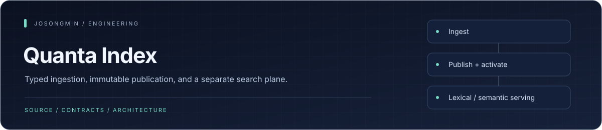
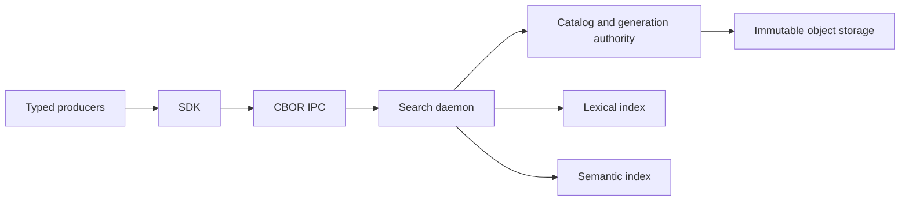

<p align="center"></p>

# Quanta Index

A Rust search infrastructure workspace for Semantica/Quanta. Producers publish typed records through `quanta-index-sdk`; the search plane owns indexing, generations, activation, and lexical/semantic/hybrid serving over Unix sockets.

[SDK](crates/quanta-index-sdk/README.md) · [Search CLI](crates/quanta-index-searchctl/README.md) · [Architecture and status](docs/ssot/engine-status-v1.md) · [Documentation](docs/README.md)


## Engineering highlights

| Mechanism | Engineering purpose |
| :--- | :--- |
| **Producer / search-plane separation** | Producers submit typed records through the SDK; indexing, generations, and serving have separate ownership. |
| **Publication and activation** | Publishing data and activating a serving pair are distinct operations, so a published generation is not implicitly query-visible. |
| **Native storage authority** | Kernel, catalog, and immutable object storage separate coordination, publication metadata, and retained objects. |
| **Multiple retrieval paths** | Lexical, semantic, and repository-map adapters sit behind shared contracts; provider qualification remains explicit. |
| **Operator-facing contracts** | Unix-socket transport, a Rust SDK, a search CLI, and state-cutover procedures expose distinct consumer and operator paths. |

## Ownership model



Publication and activation are separate operations. Typed input must be published and the relevant pair activated before serving. Legacy generations require a rebuild. A development hash embedder does not qualify an opt-in neural provider.

## Run the daemon

Use the pinned toolchain and repository build wrapper. Keep runtime state outside the checkout.

```sh
./scripts/cargow --lane daemon-lane build -p quanta-index-searchd-runtime --bin quanta-index-searchd --locked
./scripts/cargow --lane daemon-lane run -p quanta-index-searchd-runtime --bin quanta-index-searchd --locked -- serve --state-root /absolute/state-root
```

Then publish through the [typed SDK](crates/quanta-index-sdk/README.md) and query through the [operator CLI](crates/quanta-index-searchctl/README.md). Backup, restore, validation, and rebuild procedures are in the [state cutover runbook](docs/operator/state-cutover-runbook.md).

## Workspace map

| Package | Responsibility |
| --- | --- |
| `quanta-index-contract` | Bundle, query, control, and IPC data contracts |
| `quanta-index-core` | Vendor-neutral ports and validation |
| `quanta-index-kernel` | Native incremental coordination |
| `quanta-index-catalog` | Durable publication and generation authority |
| `quanta-index-storage` | Immutable object storage |
| `quanta-index-lexical`, `quanta-index-semantic`, `quanta-index-repomap` | Index adapters |
| `quanta-index-ipc` | CBOR transport framing |
| `quanta-index-searchd`, `quanta-index-searchd-runtime` | Composition and daemon executable |
| `quanta-index-searchctl` | Operator CLI |
| `quanta-index-sdk` | External producer/client facade |
| `quanta-index-search-plane` | Existing ingest/query/control composition |

The [crate ownership index](docs/ssot/crate-ownership.md) maps packages to their current source owners.

## Development and verification

Prefer named profiles over manually assembling feature/target combinations:

| Profile | Scope |
| --- | --- |
| `just rust-profile dev-fast` | Default edit loop |
| `just rust-profile dev-daemon` | Daemon/runtime development |
| `just rust-profile validate-shared-surface` | Bounded contract/core/SDK/search-plane checks |
| `just rust-profile test-fast` | Fast test feedback |
| `just rust-profile test-integration-fast` | Bounded component/integration scope |
| `just rust-profile test-integration-storage` | Lexical storage integration |
| `just rust-profile test-integration-semantic` | Semantic storage integration |
| `just rust-profile test-daemon` | Runtime scenarios and DSL truth |
| `just rust-profile verify-rust` | Standard merge scope |
| `just rust-profile verify-rust-heavy` | Explicit heavy/nightly correctness scope |

Use `./scripts/cargow` for raw Cargo operations when no profile fits. The wrapper and Just recipes route build artifacts to the shared external cache. Integration/CLI/daemon scopes resolve their identities from `tools/ci/test-authority.toml`.

### Local resource controls

| Variable | Behavior |
| --- | --- |
| `CARGO_BUILD_JOBS` | Local default 4 when unset; explicit values retain precedence |
| `QUANTA_INDEX_RESOURCE_ADMISSION` | `auto` for local admission; `1` enables in CI; `0` disables; invalid values refuse |
| `QUANTA_INDEX_RESOURCE_WAIT_SECONDS` | Admission wait limit; default 300; timeout exits 124 |
| `QUANTA_INDEX_RESOURCE_TIMEOUT_SECONDS` | Command limit; default 7200; timeout exits 124 |
| `QUANTA_INDEX_CACHE_ROOT` | Shared build/cache placement across coordinated lanes |
| `QUANTA_INDEX_TARGET_GC` | Local automatic target GC; inspect with `just target-gc --dry-run` |
| `QUANTA_INDEX_SCCACHE` | Set `0` to disable the optional repository-isolated sccache server |

Leaf work shares a cache-root slot. Queue/hold diagnostics do not establish an idle benchmark host. Timing rails reject unrelated Cargo/rustc activity unless explicitly placed in non-authoritative diagnostic mode. Profile history can be inspected with `just rust-profile-history-summary`.

## Search evaluation and current work

- [Code-search runbook](tools/benchmark/CODE_SEARCH_RUNBOOK.md#required-result-table): comparison modes, input scope, and recorded results.
- [Benchmark profiles](tools/benchmark/README.md): corpora, Criterion, DSL gates, and recording imports.
- [CI authority](docs/adr/SEP-28-001-circleci-provider-and-credit-boundary.md): hosted verification and gaps.
- [Index closeout](docs/plans/oct-22-finalizing/README.md): owners and remaining implementation/acceptance.
- [Validation](docs/plans/oct-22-finalizing/VALIDATION.md): correctness, performance, and release boundaries.
- [Embedding provider](docs/potion-code-embedder.md): model preparation.
- [Architecture decisions](docs/adr/README.md) and [historical recovery](docs/ARCHIVE-INDEX.md#historical-record-recovery).

Command availability and documentation coverage are not qualification evidence. Use current source and actual gate results for implementation, integration, benchmark, and release claims.
