# Native RFC — historical section 23 checkpoints

Historical source-scoped records through 2026-10-13, preserved on 2026-10-21.
Current work: [Oct-17 SSOT](../../plans/oct-17-index-closeout/tickets/README.md).
The [active RFC](../../rfc/oct-10-native-incremental-vnext.md) retains requirement contracts.
No task, status or execution result is maintained in this history.

## 23. Fixed full-product implementation and acceptance ledger

This is a historical requirement-scope and checkpoint ledger. Current tasks,
owners and execution order belong only to the Oct-17 SSOT; executed results
belong to VALIDATION. The ledger below records source-specific declared code
state and scoped verification, not a live whole-tree test result. Dated
subsections preserve earlier checkpoints; later text does not silently upgrade
their sources, overwrite an observed failure or prove a repaired tree passed.

Current reading boundary (2026-10-12 reconciliation):

- NativeLiteral and parts of NativeText/Kernel/Catalog are implemented; R15 full
  query-domain parity, R11/R12 physical enforcement and R32 complete background
  service remain partial. Later checkpoints implement R10 queued reclaim and
  service retirement; sustained/fault acceptance and R35/R36 default switch remain open.
- Section 23.14 records **FAILED: 96 passed, 1 failed** and a serial pump
  **FAILED: 3 passed, 1 failed**. The repaired section 23.16 checkpoint records
  **VERIFIED: 103 passed**, within its focused scope. The later changes in sections
  23.17/23.18 need their own coupled result; the earlier pass does not qualify them.
  Read each subsequent checkpoint's exact source and scope for later results.
- Full current-tree, native XL, sustained-operation, default-switch and promised
  full-product qualification are not established by those checkpoints. The
  separate legacy XL pass in section 2.1 does not qualify native XL.

This ledger preserves the full scope of sections 14 and 17.8. It does not select
an easier release profile or replace the required IDE/Auto/large-Semantic product
with the first native slice. Each row is one acceptance family; the percentages
are equal-count requirement fulfillment, **not effort, schedule, throughput or
confidence estimates**. Partial rows count zero. Splitting a row for implementation
ownership does not change the denominator. Any genuine scope change must identify
the original requirement and the explicit user decision.

Code state means the named behavior exists in its authoritative producer and
consumers: `IMPLEMENTED`, `PARTIAL`, or `MISSING`. It is separate from verification.
Verification uses the repository's `VERIFIED` / `FAILED` / `BLOCKED` / `NOT_RUN`
contract and must cover the row's concrete acceptance conditions. Compilation alone
cannot qualify a row. Prior checkpoint results remain historical scoped evidence;
current breaking session/scratch edits require a new coupled checkpoint.

| ID | Requirement / exit condition | Canonical owner / source | Declared code state | Recorded verification scope |
|---|---|---|---|---|
| R01 | One canonical paged source/projection/request IR; complete EOF/count/digest rejection | contract/index; core/index/mutations; kernel/update | IMPLEMENTED | NOT_RUN |
| R02 | Typed extensible adapters; multiple instances and profile capability refusal | kernel/registry | IMPLEMENTED | VERIFIED (local contract) |
| R03 | Bounded native filesystem capture and child-first ingress batches beyond old direct-child limit | kernel/source, update; catalog/native | IMPLEMENTED | NOT_RUN |
| R04 | Owner/path/frontier atomic transitions, cross-page rename cycles and original-base CAS | kernel/source, projection | IMPLEMENTED | NOT_RUN |
| R05 | Persistent COW maps, streamed complete validation, bounded scratch construction and root-only publication | storage/map | IMPLEMENTED | VERIFIED (local contract) |
| R06 | Reserved-before-write object custody and bounded durable batch barriers on supported OS | storage/object; catalog/native | IMPLEMENTED | NOT_RUN |
| R07 | Sole Catalog CAS publication of roots, event bindings, work and original terminal receipt | catalog/native; kernel/update | IMPLEMENTED | NOT_RUN |
| R08 | Replay, ACK-loss reconciliation, resume and immutable old-view/reopen correctness | kernel/update; sdk/native_uds | IMPLEMENTED | NOT_RUN |
| R09 | Session-fenced renewable read custody; real guard validation, process-death recovery and safe expiry | core/index/lifetime; catalog/native; kernel/ticket | IMPLEMENTED | VERIFIED (local contract) |
| R10 | Retention floors, terminal custody release, bounded DAG reclaim and physical incarnation/adoption fencing | catalog/native; storage/object; kernel maintenance | PARTIAL: retirement policy, indexed enumeration and service-owned history/custody/work composition are implemented in sections 23.56–23.57 | VERIFIED (scoped physical reclaim, automatic queued reclaim, retained ingress, prepared partial drain/reopen, pinned source custody and service retirement); complete physical fault matrix, long-pin pressure and sustained bound NOT_RUN |
| R11 | Shared live RAM/disk/WAL/provider reservations, draining charges and enforced aggregate limits | core resource ports; runtime resource owner | PARTIAL: object/profile, result/frame/provider, inspected cursor, canonical SourceRecord and RepoMap preparation have implementation/checkpoints. Other request/work/projection/Catalog metadata, vendor allocation and aggregate extent/WAL enforcement remain | Scoped results belong to their exact dated checkpoints, including the failed/repaired member coupling below. Full-family physical enforcement NOT_RUN; no old or combined test count qualifies the current shared tree |
| R12 | Service-owned scratch, crash cleanup under custody and enforcement including secondary spill | storage/scratch; all native adapters; runtime/native | PARTIAL | NOT_RUN |
| R13 | Existing waterfall P00-P09 integration, failure-surviving reopen stages and observer-cost isolation | existing trace/lifecycle owners | PARTIAL | NOT_RUN |
| R14 | Native incremental byte-literal indexing and exact current/old-view query | lexical/native/literal | IMPLEMENTED | NOT_RUN |
| R15 | Required token/BM25/regex domain parity with independent ranking/query gold | lexical/native/text, text_spool; ranking/query owners | PARTIAL | NOT_RUN |
| R16 | Bounded cold bulk-build, reopen and catch-up; initial-index algorithm/parallel preparation experiments | lexical construction; kernel source; storage map | PARTIAL | NOT_RUN |
| R17 | Sustainable lexical churn/maintenance and bounded write amplification/debt | lexical maintenance; shared scheduler | MISSING sustainable cost/maintenance closure; NativeText COW updates and logical churn tests already exist | NOT_RUN for physical writes/disk/latency and sustained maintenance; do not infer a mandatory run compactor |
| R18 | Semantic desired/covered/missing ownership, certified projection delta, stale job/delete fencing | kernel/projection, update; catalog/native | IMPLEMENTED | NOT_RUN |
| R19 | Model/recipe/input provenance and durable unchanged-owner/ABA artifact reuse | semantic/native/embedding; kernel/update | IMPLEMENTED | NOT_RUN |
| R20 | Bounded small-scope exact vector materialization/search with exact coverage and cosine gold | semantic/native/embedding | IMPLEMENTED | NOT_RUN |
| R21 | Concrete chunking/ANN feasibility and incremental searchable membership | semantic chunk/ANN owner | MISSING | NOT_RUN |
| R22 | Sustained ANN recall/query/update/filter/history retention on pinned roots | semantic ANN; catalog retention | MISSING | NOT_RUN |
| R23 | Native file inventory/path delta with one Catalog view and exact pagination | repomap/native/file_map | IMPLEMENTED | NOT_RUN |
| R24 | Provenance graph RepoMap delta and full query parity | repomap graph owner | MISSING | NOT_RUN |
| R25 | Editor overlay/mask/isolation without durable publication per keystroke | kernel/session; real editor producer | MISSING | NOT_RUN |
| R26 | Save ACK and session-frontier handoff with exact source/action identity | kernel/session; producer/SDK | MISSING | NOT_RUN |
| R27 | Required Stub index and language capability refusal | lexical/stub; producer | MISSING | NOT_RUN |
| R28 | Progressive query, exact coordinates/AST/action fencing and fixed intent budget | query planner; kernel/session; editor | PARTIAL | VERIFIED (local same-view Fast/Deep UDS streaming, original deadline/cancellation and terminal custody); coordinates/action fencing NOT_RUN |
| R29 | Replaceable bounded Auto policy, estimator/governor separation, stale/unknown signal semantics | core/index/effort | IMPLEMENTED | NOT_RUN |
| R30 | Live same-intent Fast/Deep execution, scheduler permits and dispatch/completion rechecks | query executor; runtime shared scheduler | PARTIAL | VERIFIED (opt-in in-process and configured UDS Fast/Deep/Auto selected-view/budget/resource checks); default live-signal collection/UX NOT_RUN |
| R31 | Coherent live worker queue/active/lag snapshots, TTL, cancellation and shutdown cleanup | runtime/native_worker | IMPLEMENTED | VERIFIED (local contract) |
| R32 | Owned background work pump, fair Core/Enrichment/Maintenance service and provider-bounded execution | runtime/native_worker; kernel work | PARTIAL | VERIFIED (opt-in owned pump, paced declined scopes, shared maintenance/renewal capacity and selected shutdown/recovery); full provider/fairness matrix NOT_RUN |
| R33 | Real opt-in native source/literal/path UDS, exact selection and SDK reply reconciliation | runtime/native; ipc; sdk/native_uds | IMPLEMENTED | VERIFIED (opt-in local UDS) |
| R34 | Configured semantic provider/query transport with correct coverage/freshness | runtime/native; semantic; SDK | IMPLEMENTED | VERIFIED (opt-in fixed-provider SDK/UDS; external provider qualification NOT_RUN) |
| R35 | Default daemon/CLI/launcher product routing and service shutdown/reopen | searchd; searchctl; runtime | PARTIAL: explicit native product connects lexical, configured Semantic/provider, owned pump and effort; Native-config launcher routing is implemented; default rollout and qualified cutover remain open | VERIFIED (scoped opt-in process publish/query, Semantic materialization/reopen, SDK/CLI and configured effort checkpoints); complete provider/Auto/UX, default routing and launcher acceptance NOT_RUN |
| R36 | Backup/restore, new-format cutover and retirement of competing legacy lifetime/head paths | runtime; catalog; launcher | MISSING | NOT_RUN |
| R37 | Real Semantica complete affected-domain generation, durable outbox and required side outputs | actual Semantica producer owners | PARTIAL: sections 23.65–23.68 implement SDK/endpoint/Original-funded transport, durable preparation/write-once request binding and initial V9 dispatcher stage/Submit/typed-terminal wiring. Actual Facts target/lifecycle delivery, recovery authority, Delta/deletion/Resync and complete affected-domain outputs remain | Semantica owning execution and actual producer runtime acceptance NOT_RUN for the latest wiring; scoped Quanta prerequisite passes are not durable V9/P2I product acceptance |
| R38 | P2I01-P2I08 through real producer/consumer calls and independent semantic outputs | Semantica + Index conformance owners | MISSING | NOT_RUN |
| R39 | Full fault/operational matrix plus fixed-delta N/history/fanout, initial-build and mixed-load cost gates | reusable native tests; lifecycle/benchmark owners | PARTIAL | NOT_RUN |
| R40 | Full suite/new CI selection/release and UX01-UX12/AUTO01-AUTO10 matched IntelliJ acceptance | integration + qualification owners | MISSING | NOT_RUN |

Historical tally when this ledger was created: 16 implemented, seven partial,
seventeen missing; coupled acceptance for that new session contract was NOT_RUN.
Later subsection tallies such as 17/40 describe their own checkpoints, not a live
product-completion percentage or an effort estimate. Partial does not mean an
accepted requirement, and local-contract VERIFIED tags do not close R39/R40.
The prior 123-test and 15-test checkpoints in sections 22.6/22.7 remain actual
scoped evidence; they are neither erased nor promoted to the latest breaking tree.

Historical exclusive implementation ownership for this session/scratch wave:

- Root: Core ports/IR, Semantic read-lease coupling and test fixtures, shared
  baselines/CI selectors, this requirements ledger and final integration.
- Storage: scratch namespace/lease/allocation and map/object injection, Storage
  failure tests; no Catalog/Kernel edits.
- Catalog: native session/pin schema, real guard validation, bounded recovery,
  deterministic clock and Catalog failure tests; no Core/Kernel edits.
- Kernel/integration: source/spool/adapter scratch consumers, Kernel service/read
  tickets, RepoMap/Lexical fixtures and native Runtime resources/format/tests.

That wave advanced R09/R12/R11 without enabling physical GC. Later sections
record physical and automatic queued reclaim. Section 23.55 reconciles current
ownership and remaining work; this historical assignment does not grant a new
writer ownership of another chat's active files.


### 23.1 R15 native text migration boundary from current-source audit

Native raw-byte literal indexing is not the existing text-domain implementation.
`lexical/native/literal.rs::grams` extracts raw case-sensitive byte windows;
`lexical/searcher/match_sets.rs` verifies regex candidates against
`indexed_text`, while `file_authority/paged/producer.rs` first applies explicit
`coverage.text_admitted` and constructs NFC/folded surfaces. Reusing the raw gram
root for normalized regex candidates can create false negatives. The prior SourceRecord carried only path/bytes/length. The current migration adds
an explicit policy-stamped SourceTextAdmission; no admission is inferred from UTF-8.

The next R15 implementation must therefore:

1. Freeze a policy-stamped source-local text admission/normalization recipe or
   receive producer-certified text admission through the existing projection
   contract. Valid UTF-8 alone does not prove legacy text-domain parity.
2. Reuse `quanta-index-lq-text-normalizer` token/phrase semantics and the existing
   `regex::plan_regex_prepared` / `RegexExecutor` plan-compile-verify order;
   retain independent normalized-sensitive/folded body and path surfaces where
   the advertised scope requires them. Do not revive legacy head/GC authority.
3. Store owner-local contribution references and paged term inventories;
   introduce policy-bound term/normalized-gram owner postings and live N/df/token
   totals in one Catalog-published member artifact. Update those values from
   complete old/new contributions; deletion and retained views preserve their
   own exact statistics. No corpus-sized term/position Vec or single huge object.
4. Preserve regex necessary-expression semantics. An AllDocs plan requires
   budgeted verification of the advertised owner domain or an explicit resource
   refusal; it cannot silently scan a successful prefix. Existing u64 DocId/Vec
   candidate evaluators are not a native OwnerKey map interface.
5. Use an independent full-scan UTF-8/NFC/fold/phrase/regex oracle and separate
   BM25 formula fixtures, including delete/no-op/path change/old ticket/statistic
   corruption/resource refusal. Tantivy fieldnorm quantization means an
   unqualified bit-identical score claim is invalid.
6. Keep the full query-domain/parity exit in R15. Leaf token/regex primitives or
   a new scoring formula do not qualify all DSL/path/scope behavior.

This audit is source evidence for the implementation boundary, not a performed
R15 implementation, benchmark or runtime acceptance result.


### 23.2 Session/scratch checkpoint and next text/recovery wave (2026-10-11)

The session/scratch checkpoint completed before the subsequent creation-intent
and source-admission edits. `QUANTA_INDEX_RESOURCE_WAIT_SECONDS=7200 just
rust-test-native-index` exited 0: **150 passed, 1050 skipped**, 206.611 seconds
of test execution. The 4097-owner manifest case took 175.817 seconds. This is
functional scale coverage, not an accepted indexing-throughput result.

Strict `./scripts/cargow clippy` for contract-base, contract, core, storage,
catalog, kernel, lexical, repomap, semantic, SDK, IPC and searchd-runtime,
`--lib --locked -- -D warnings`, exited 0; the vendored Tantivy dependency
emitted eight existing warnings. `./scripts/cargow --lane fmt-lane fmt --all --
--check`, test-authority, wire-inventory, fallback, allow-attribute, derive,
module-cycle and Core/Kernel module-snapshot checks passed for this checkpoint.

Checkpoint source fulfillment is **17/40 = 42.5%** (six partial, seventeen
missing). R02/R05/R09/R31/R33 have scoped local contract acceptance: **5/40 =
12.5%**. This percentage does not qualify full-product performance, supported-OS
coverage, XL reopening, remote CI or IDE parity. Physical GC remains disabled;
shared live resource quotas and secondary SQLite spill enforcement remain partial.
The ledger's creation-time tally and NOT_RUN coupled acceptance remain historical.

The next wave changes the same canonical IR, not a parallel compatibility IR:

- SourceInput, SourceRecord and StageSource require explicit Excluded or
  Utf8{policy} text admission. Raw convenience intake sends Excluded. Claimed
  UTF-8 must be rejected for the complete batch before any staged input write;
  publication must verify source bodies as well. Missing wire fields are errors.
- TokenCursor/TokenRun reuse the existing normalization semantics without a
  per-file token Vec on the cursor path. NFC may still allocate one file's text.
  This primitive does not implement native text postings, BM25 or regex parity.
- Session creation records a durable intent under a persistent OS creation lock,
  before creating a lease file. Bounded recovery must use that same lock and
  durable intent identity, not process IDs, file age or directory heuristics.
  Format v4 refuses prior native markers and requires rebuild.

These next-wave source edits are **NOT_RUN** until their own coupled checkpoint.
The previous 150-pass result does not verify a changed schema, wire or recovery
algorithm. R15 stays MISSING until the native text adapter exists; its intake and
normalization foundations alone do not satisfy the row.

### 23.3 Next implementation seams from independent source audit

R15 must reuse NativeLiteral's construction pattern, not its raw gram data:
source-change cursor -> old/new owner contributions -> capped sorted scratch
spool -> touched paged postings -> one member artifact -> Catalog publication.
A TextRecipe has **separate** admission_policy and output-recipe identity. Its
output digest commits to admission_policy, normalizer version, advertised
body/path and sensitive/folded surfaces, term/position caps and BM25 parameters;
it must equal InstanceSpec.policy. The source admission must equal the recipe's
admission_policy. These two digests must not be conflated: several output recipes
can consume the same certified admission domain.

Minimal next source ownership is lexical/native/text.rs and text_spool.rs plus
native/mod.rs exports. Existing IndexBuildPort, source delta cursors,
MapEditCursor, apply_stream and ScratchSpacePort remain canonical. The root
contains paged owners/term routes/normalized-gram routes and exact live N/token
counts. Each owner contribution owns source provenance, normalized surface refs
and a paged term inventory; a term wrapper owns df and paged OwnerKey postings.
Old/new inventory merging changes only touched routes, adjusts live counts for
insert/delete and retains old-view statistics. All output roots are one member
artifact, never independent publications. Existing DocId/Vec necessary-gram
helpers cannot serve as the native candidate interface. Bounded OwnerKey cursor
AND/OR and exact regex verification are required; AllDocs consumes its full
advertised domain or returns an explicit budget refusal. Native BM25 requires
independent formula and ranking gold. Query wire/SDK/runtime and full DSL parity
remain separate, required R15 work.

R11/R32 audit found ResourceScheduler is presently a trait, not a production
shared ledger. Existing ReservationGuard owns exact-once Drop release but can
only be constructed inside EffortGovernor. Reuse it through a public typed
acquisition method and one concrete service-owned scheduler; do not introduce
another reservation IR. The worker acquires execution resources after dequeue;
queued work must not hoard scarce permits. Provider guards survive cancellation
until the provider actually stops, and shutdown joins retain draining charges.
Nested worker/provider reservations must not acquire the same provider capacity
twice. No scheduler mutex may span provider, await, filesystem or Catalog I/O.
This estimated resource ledger alone is not a hard RSS/WAL/disk quota.

The background pump additionally needs bounded durable eligible-workspace
iteration and canonical claim/lease/operation-key ownership. A loop around the
current workspace-scoped ready_work API does not establish fairness, replay or
automatic discovery. This audit is static evidence; these next modules are not
implemented or runtime-qualified by the text/recovery checkpoint.

### 23.4 Text/recovery checkpoint observed results (2026-10-11)

`QUANTA_INDEX_RESOURCE_WAIT_SECONDS=7200 just rust-test-native-index` executed
184 tests: **183 passed, one fixture failed**, 1231 skipped, 229.947 seconds.
The 4097-owner manifest case passed in 201.599 seconds. The failing foreign
symlink fixture attempted to create a link before the session directory existed;
it was repaired by opening and retaining an actual Catalog session first. No
production code changed after this test run. A focused rerun using
`./scripts/cargow nextest run --locked --lib -p quanta-index-catalog
--test-threads 2 --no-tests fail --no-fail-fast
-E 'test(=native::authority::tests::read_session_open_intent_foreign_symlink_fails_closed)'`
passed **1/1**, with 70 skipped. The original batch remains an observed FAILED
batch; it is not rewritten as 184/184 in one execution. The combined scoped
checks cover all selected cases, but the full batch was not repeated after the
fixture-only repair.

The independent contract/normalizer rail passed 29/29. The expanded thirteen
library strict Clippy rail passed with `--lib --locked -- -D warnings`, including
the text normalizer. Formatting, wire inventory, test authority, fallback,
derive/allow-attribute policy, baselined module cycles and Core/Kernel module
snapshots passed. The fixture-only Catalog edit was rustfmt/diff checked.

New observed behavior includes process SIGKILL at intent/file/session creation
prefixes, bounded 257-intent recovery, budget rollback, creation-lock contention,
foreign symlink refusal, mandatory JSON/CBOR source-admission fields, complete
batch refusal before body writes, false direct-record admission publication
refusal, and typed UDS admission preservation through reopen. These are local
functional checks, **not** XL, Linux, throughput, full-suite, ANN or real producer
qualification. Source fulfillment stays 17/40; R12 remains partial because
secondary spill quotas are not enforced. Source-admission and TokenCursor alone
do not finish R15. The 201.599-second functional case is not a performance pass.


### 23.5 Token member and shared execution reservations: code checkpoint

The next source wave adds a token-only NativeText IndexBuildPort implementation:
explicit producer admission policy, domain-separated output recipe fingerprint,
both sensitive/folded NFC term inventories, bounded per-term position leaves,
old/new changed-owner contributions, paged postings, exact live N/df/token counts
and one Catalog member artifact. Empty admitted owners count in N; excluded
owners do not. Original indexable runs count once across two case surfaces;
long runs retain position gaps. Current fixed recipe limits are 8 MiB source,
16 MiB NFC, 8192 positions per term and 1024-byte stored term keys. Exceeding
limits is an explicit refusal; content is never truncated. At this wave,
Bootstrap supported an empty source; the subsequent cold-build path is in §23.6.
Public inspection is statistics/df only, not a
search or scoring route. R15 is now PARTIAL, not IMPLEMENTED.

A fixed corpus Kernel/Catalog integration fixture checks NFC-sensitive/folded df,
empty/excluded owners, update/delete/no-op and retained-view counts. An independent
static audit found delta.next/source/input-root binding checks were missing in
the new builder and in existing NativeLiteral planning. Both adapters were
repaired, with forged-input refusal tests. These checks are separate from normal
Kernel construction, which already creates matching bindings.

Core ReservationGuard now exposes one typed acquisition method and EffortGovernor
uses it. Runtime has one service-owned NativeResourceLedger shared by worker and
synchronous native dispatch. Plan validation precedes state marker creation.
Queueing does not reserve resources; Submit/Resume reserve after dequeue and
retain guards through awaited Kernel execution. Submission denial occurs before
Catalog admission and does not fabricate a terminal receipt. Aggregate arithmetic
is checked and an invalid ledger refuses new admission/observation. Latency is
owned by WorkBudget deadlines and is not an additive shared resource.

The configured CPU/IO/memory/provider quantities are estimated simultaneous
reservations. This is not actual RSS/WAL/disk enforcement. UDS decode and
resume_dispatch's preliminary request load remain outside these reservations.
There are no class floors; saturated interactive requests can delay/refuse Core
and control-plane requests. Provider-internal standalone tokens, external task
quiescence and fair background pumping remain unimplemented. R11/R32 therefore
stay PARTIAL. The real UDS blocked-materialization test now inspects reservation
retention during an unrelated Core update and zero reservations after completion
and service shutdown; these new assertions require their own executed checkpoint.

Source fulfillment remains **17/40 = 42.5%** (seven partial, sixteen missing).
The primitive effort rail passed 6/6, including guard move/unwind release.
The token/resource checkpoint executed 33 cases: 32 passed and one NativeText
fixture failed with DigestConflict. RCA: two independent refusal scenarios
reused one event identity with different owner-manifest payloads. Catalog correctly
retains the original payload even after refusal. The fixture now uses distinct
streams; the production event identity guard was not weakened.

### 23.6 Existing-corpus bootstrap and profile/work lifecycle

Core SourceSnapshotCursor reads an immutable SourceCut.owners with 128-entry
keyset pages. SourceInputCursor consumes the existing DeltaInput contract:
Bootstrap selects the snapshot; Patch selects the sealed mutation cursor and
requires delta.next == selected source. Both cursors latch their first failure;
calling again with a fresh budget cannot skip a failed entry and fabricate EOF.
The map scan port explicitly requires ordered, exclusive, complete pages and
truthful continuation. No synthetic mutation manifest or corpus-sized owner
buffer is introduced. Literal, token Text and file RepoMap share these paths.
The total cold-build work still depends on the whole corpus, emitted terms and
postings; a bounded input page is not a throughput or total-memory proof.

The first real cold-install fixture exposed a Kernel gate that rejected every
Reconfigure over nonempty source before an adapter could bootstrap. That gate
has been removed. Exact unchanged required specs reuse their exact old binding;
a mismatched old binding is corruption. New or explicitly changed required specs
build from the selected immutable snapshot. Old member map entries remain the CAS
preconditions and the old view ticket protects historical roots through commit.
The fixture checks 131 owners, wrong text admission preserving the source-only
head, Literal-only installation followed by Text/RepoMap addition, unchanged
Literal prepare-count preservation, explicit required-policy rebuild, exact
query/statistics gold, pinned history and durable reopen. This proves the
selected local cold path, not XL latency or a parallel bulk-build algorithm.

The initial coupled batch executed 64 cases: 63 passed and the old Kernel gate
failed the new cold fixture. Its 4097-owner direct-child-limit case passed in
154.281 seconds; this is functional evidence, not a matched performance result.
After the required-profile repair, the affected checkpoint passed **63/63** in
60.555 seconds, with 577 cases skipped. The slow 4097-owner case was deliberately
excluded from that rerun; the two executions are not a fabricated 64/64 batch.

A subsequent adversarial review found that dropping async coverage did not retire
its Pending/Claimed work. Profile removal, Async-to-Core replacement and safe
policy-only replacement now emit bounded retirement actions into the same Catalog
CAS as coverage/member/profile changes. Exact unchanged async specs reuse the
old coverage reference, including Pending projection state. New SourceLocal
async instances use snapshot bootstrap. Nonempty projection bootstrap and unsafe
async kind/group/domain/schema/format changes remain explicit RebuildRequired;
there is no silent reuse across unsupported output identities. The added fixture
covers a 129-owner retirement page boundary, Pending/Claimed/Completed states,
unchanged-async profile expansion, budget refusal preserving head/work, activation
replacement and stale-claim refusal. The first later Kernel/Projection/Semantic
batch ran 38 cases: 37 passed; the new fixture failed because it placed CoreRequired
and AsyncCoverage instances in the same publication group. The profile correctly
refused this invalid mixed-activation group. After separating fixture groups,
the two focused repair cases passed. Policy-only replacement was then added to
the lifecycle fixture: unfinished old work is Superseded, completed work retains
its receipt, and new-policy work has distinct identities.

Adversarial review also found that Pending.previous_missing was read by later
projection advancement but omitted from the coverage object's canonical child
references. The missing-map root is now retained directly by the Pending object.
An independent edge assertion checks that registration, and unchanged-profile
Reconfigure preserves the exact Pending coverage root and ready-work set before
certified advancement. This was a static custody gap, not reproduced physical
data loss: online GC remains disabled. Because canonical edges affect immutable
object identity, native format is v5; v1-v4 state is refused before creating a
new marker or catalog. The default daemon also refuses v5 native state.

The v5/profile/work checkpoint executed **68/68** tests in 105.585 seconds,
with two cases skipped. It selected Kernel and native Runtime libraries plus
native_lifecycle, native_bootstrap, native_projection, native_semantic_projection
and native_index_uds, excluding the slow 4097-owner direct-child case. This result
precedes the new BM25 query work and the additional unsafe-group-replacement
negative fixture. It does not qualify those later edits or the complete suite.

R15 remains PARTIAL: stats/DF inspection is not BM25, phrase, regex or full query
parity. The next query path must reuse TextQueryRequest/LqQuery/LexicalPlan, validate
pinned owner/posting/source provenance, use exact N/df/tf/document length, retain
deterministic ordering and fail on incomplete budget-limited scans. Legacy
generation cursors and result repository metadata cannot be guessed from a native
ViewRef/SourceRecord. R11/R32 estimated execution reservations still exclude
actual RSS/WAL/secondary spill, provider-internal execution and fair work pumping.
Source fulfillment remains **17/40 = 42.5%**; these additions complete subpaths
inside PARTIAL rows, not new full-product acceptance families.

### 23.7 Native posting reads and canonical single-content ranking

The next R15 slice adds `NativeTextIndex::visit_term`: 64-entry keyset posting
pages, exact pinned-member lookup, bounded ordered occurrence leaves, owner
contribution binding to the pinned SourceCut record, explicit text admission,
inventory-to-posting equality, and declared df versus complete EOF count.
Callbacks are provisional until the final successful TextTermScan; error or
cancellation invalidates all accumulated candidates. Query work is charged as
reads/bytes, not mutation work. Token positions count original runs, whereas
document length counts indexed runs: an overlong dropped run can leave a valid
position gap. Query readers must not reject such a gap using position < dl.

`search_content` consumes the existing LexicalPlan and only accepts one uncapped
Content leaf in Standard/Keyword mode with supported options. It introduces no
parallel query DSL. Regexp/Literal/CodeSearch/Structural modes, unsupported
filters/directives/count/timeouts/boosts and other plan trees are explicitly
refused. An independent reviewer found the initial missing pattern-type check;
the producer now rejects those alternate semantics, with canonical-planner
negative fixtures. Query transport and general domain parity remain unimplemented.

Ranking uses declared live N/df/tf/indexed document length from the exact member,
explicit validated finite k1/b, complete posting traversal and O(top_k) heap
storage with 1..1024 result admission. Low-score/large-owner hits are evicted first;
the final order is descending score then OwnerKey. All provisional hits are
discarded on exhaustion or malformed EOF. The reservation accounts for the heap
and output buffer; final sorting uses no stable-sort scratch allocation. Scaled
BM25 arithmetic avoids multiplying extreme finite k1 by tf or document length.
The native result binds ViewRef, artifact and source-record references; legacy
repository/revision/snippet metadata and generation cursors are not fabricated.
Callers retain and validate their ReadTicket: TextReadContext's TicketRecord
alone is not a live lease oracle.

Independent fixed numerical gold includes an admitted empty file in N and excludes
binary input, checks update/delete statistics and scores, historical view results,
and read-budget refusal before complete ranking. The 131-source cold fixture now
has 130 admitted documents and 259 indexed tokens: owner 129 has an additional
term occurrence. Its top three must be [129,1,2], covering a higher score on the
last posting page and deterministic ties, including durable reopen. Fake-port
tests reject oversized pages, stale source bindings, mismatched inventories and
wrong EOF df; valid nonindexed-run position gaps are retained.

The initial query-only request was cancelled while waiting for shared admission,
before compilation or tests, so it supplies no execution evidence. The combined
query/resource/reuse checkpoint subsequently passed **21/21** tests; see 23.12
for its exact scope and limitations.
R15 remains PARTIAL; these tests do not qualify Boolean/phrase/regex parity,
native product routing, latency comparisons or IntelliJ behavior.

### 23.8 Class-bound protected execution reservations

The next R11/R32 slice makes `NativeResourcePlan` explicit for Control,
Interactive, Core and Enrichment. All four class floors must fit the aggregate
CPU/IO/memory/provider capacity using checked arithmetic; invalid plans are
refused before native state initialization. Latency remains a request deadline,
not a reservable resource. A class-bound scheduler accepts only its configured
estimate, preventing a caller from marking a class active with a zero reservation
and erasing its protected floor.

One mutex-protected ledger tracks aggregate usage and active/reserved usage per
class. Admission requires the next aggregate reservation plus the floors of
other idle classes to fit capacity. Spare capacity can be borrowed while one
operation of each idle class remains admissible. Active reservations replace
their class floor. Non-cloneable tokens and ReservationGuard return the exact
class reservation on success, refusal and unwind; inconsistent release poisons
admission rather than allowing an undercount.

Status, WorkStatus and RenewWork use Control admission. Resume's preliminary
catalog read also holds a short Control reservation, released before queued
Core/Enrichment execution. Provider execution retains its Enrichment reservation
through the awaited operation and deadline handling. Per-class observation makes
these logical reservations visible without creating independent resource pools.

The added unit cases cover floor validation, spare borrowing, class isolation,
over-capacity and overflow, exact-need refusal, unwind release and invalid release.
The UDS fixture checks control requests and Core progress while an Enrichment
owner is paused, followed by zero reservations after shutdown. These latest
changes are **VERIFIED** for the focused Runtime cases in the 21-test combined
checkpoint; this is not full Runtime qualification.

This is a logical admission contract. It does not bound actual RSS, physical
disk/WAL, secondary spill or provider-internal allocation; it does not implement
a fair background pump or guarantee control latency while a shared backend lock
is held. R11 and R32 remain PARTIAL.

### 23.9 Reusing proved immutable text contributions

Static review identified two unnecessary costs in NativeText's changed-owner
path: an exact SourceRecord no-op read the body before returning; a path-only
change read the same body and scanned the complete old/new inventory despite
retaining identical postings. The producer now returns before body access for
the exact immutable record identity, after prior contribution/source binding
and metadata consistency checks. A path change reuses the inventory only when
body reference, byte length and text admission match. It changes the owner
contribution's source-record binding without tokenization or inventory traversal.
Changed content retains the body/build/diff path; inconsistent metadata is refused.

This relies on the prior member having been produced and sealed by the trusted
NativeText builder under the same recipe, and on immutable content identity.
Neither a hash alone nor Catalog CAS proves the semantic correctness of a forged
contribution. Arbitrary writers that forge native members outside that builder
are outside this contract. Incremental updates are not physical scrubs: unchanged
body/inventory objects are not reread to detect bitrot on every no-op or rename.
Normal object reads retain integrity checks; full scrub qualification remains
separate work. Reuse does not claim O(1) for the whole publication: owner-map
edits, source/frontier changes and durable Catalog commit still have their costs.

Counter-based unit cases require zero body reads/inventory scans for no-op and
rename, no contribution write for exact no-op, and a contribution write for
rename. Changed body must enter token construction; inconsistent record length
and reuse metadata are refused. The real Kernel gold also checks identical
scores/live counts after rename, the new source-record reference in current
results, and the old source reference in the pinned historical view. These
changes are **VERIFIED** by the focused unit and Kernel cases in the combined
checkpoint. Their full-suite and scale acceptance remain NOT_RUN.

### 23.10 Next owned-work pump contract boundary

R32's current Runtime executes work only after external Claim/Submit/Resume;
it does not poll and materialize durable ready work itself. The default native
registry contains Literal/FileMap; semantic execution needs an explicitly
configured owner adapter and provider. ProjectionDomain materialization remains
unsupported. Adding an unowned polling loop would not complete this requirement.

The first owned pump needs bounded explicit workspace/epoch scopes, atomic
claim-to-internal-OperationKey assignment, original-request reconciliation on
restart/ACK loss, visible bounded failure/backoff state, lease renewal through
provider execution, and owned stop/join cleanup. Queue admission must precede
claim acquisition or safely reconcile a claim if enqueue fails. Internal keys
must be fenced from external key admission. Retry limits/deadlines cannot be
reconstructed by silently resetting in-memory WorkBudget on restart.

A replaceable pure PumpPolicy may propose Poll/Defer from typed observations;
the fixed governor retains scope/page/inflight/deadline/provider authority.
Unknown or stale observations are not zero load. This contract is a next-step
design boundary, not implemented pump behavior or an execution claim.

### 23.11 Physical reclaim remains disabled pending lifetime authority

Read-only R10 audit found native object registration and child edges, but no
incoming-reference accounting, object retirement generation or physical
incarnation. The current reserve/install/confirm interface carries immutable
RegisteredObject identity, not the installed inode/device incarnation. Session
lockfile retirement tombstones and the v5 format marker are not object deletion
permits. Historical views and terminal operation/attempt/work custody are not yet
released by production bounded retention paths. These are implementation gaps,
not a reason to enable unlink using age, a digest or observed zero readers.

The required order is explicit history/replay floors and bounded custody release;
atomic root/edge accounting with Live/Retiring/Reclaiming/Deleted state; adoption
and physical-install permits under the same per-object gate; permit-only durable
unlink with identity verification, directory fsync and idempotent crash confirm;
then bounded Kernel maintenance under the service state-root lease. Genesis
installation must use that authority too. Public standalone FileObjectStore
writers cannot concurrently bypass the managed-root gate. Map keyset scanning
does not substitute for a bounded Catalog reclaim-candidate cursor.

Required independent cases include shared historical children, a live OS session
holding an expired ticket, Pending attempt/queued work protection, unlink-before-
confirm crashes, digest reinstall during Reclaiming, inode/device/fsync refusal,
and more than one candidate page with budget interruption and resume. Registered
child-first custody, durable installation/CAS and session pin recovery do not
qualify physical space reclamation. R10 remains MISSING and reclaim is disabled.

### 23.12 Combined query, immutable reuse and class-floor checkpoint

The first combined compilation failed because the new Kernel query gold imported
canonical LqQuery types without a direct test dependency. Adding the existing
quanta-index-contract workspace crate to Kernel's dev-dependencies and lockfile
repaired that setup failure. No tests executed in the failed compilation.

The repaired command selected Kernel/Lexical/Runtime libraries and
native_lifecycle, native_bootstrap and native_index_uds, using the canonical rail:

```sh
./scripts/cargow nextest run --locked --lib \
  --test native_lifecycle --test native_bootstrap --test native_index_uds \
  -p quanta-index-kernel -p quanta-index-lexical \
  -p quanta-index-searchd-runtime --test-threads 2 \
  --no-tests fail --no-fail-fast \
  -E 'test(/native::text::|native::text_query::|native_text_statistics_follow_delta_delete_noop_and_pinned_history|existing_corpus_installs_all_adapters_atomically_across_pages_and_reopens|native_reconfigure_bootstraps_async_and_retires_work_atomically|native_resources::tests::|native_worker::tests::(exhausted_execution_reservation_does_not_admit_and_is_reusable|queued_resume_interruption_preserves_the_pending_fence|unknown_resume_replies_without_entering_a_full_core_lane|full_enrichment_lane_does_not_block_real_core_submit_or_resume)|native_bind_rejects_overcommitted_class_floors_before_format_creation|native_uds_source_advance_progresses_while_owner_materialization_is_blocked/)'
```

Observed result: **VERIFIED — 21/21 passed**, 471 skipped, 25.980 seconds
of test execution after a 20.56-second test compilation. Shared admission wait
is excluded from those times. They are test timings, not qualified indexing or
query latency measurements. The selected cases cover:

- Text posting provenance, malformed pages/EOF and fixed BM25 gold, including
  live empty/binary admission, update/delete/no-op/rename and pinned history.
- Counter-based zero body reads/inventory scans on immutable text reuse;
  changed-body construction and corrupt metadata refusal.
- A 131-source multi-page cold install and durable reopen, with owner 129
  outranking earlier pages and stable owner tie ordering.
- Async bootstrap/retire/policy replacement and unsafe group-change refusal.
- Protected class-floor admission, exact-once unwind release and real UDS
  Control/Core progress while an Enrichment materialization is blocked.

Initial strict affected-target Clippy runs **FAILED** on cursor enum size and
new Kernel/Lexical lint violations. SourceInputMode now boxes both bounded cursor
states; borrow/clone/condition fixes preserve behavior, and BM25 uses fused
multiply-add with fixed-gold tolerance retained. Integration-target expansion
also exposed test-only block_on/Result-assert patterns and fixture indexing,
arithmetic and clone issues. Test-only expectations follow existing repository
integration-test conventions; indexing/arithmetic/clone issues were repaired
without weakening oracles. The final strict gate is **VERIFIED**, exit 0:

```sh
./scripts/cargow --lane clippy-lane clippy --locked --all-features --lib \
  --test native_lifecycle --test native_bootstrap --test native_index_uds \
  -p quanta-index-kernel -p quanta-index-lexical \
  -p quanta-index-searchd-runtime -- -D warnings
```

Vendored Tantivy emitted eight existing dependency warnings; this qualifies the
selected workspace lib/integration targets, not all workspace targets.
After cursor/query/fixture repairs, the expanded regression command passed
**55/55** tests across seven binaries, 593 skipped, 74.820 seconds of execution
after 25.29 seconds of compilation:

```sh
./scripts/cargow nextest run --locked --lib \
  --test native_lifecycle --test native_bootstrap --test native_index_uds \
  -p quanta-index-core -p quanta-index-kernel -p quanta-index-lexical \
  -p quanta-index-searchd-runtime --test-threads 2 \
  --no-tests fail --no-fail-fast \
  -E '(binary(=native_lifecycle) | binary(=native_bootstrap) | binary(=native_index_uds) | test(/index::mutations::tests::|native::text::|native::text_query::|native_resources::tests::|native_worker::tests::/)) & !test(/source_only_manifest_exceeds_legacy_direct_child_limit/)'
```

This adds four source-cursor boundary cases, selected native lifecycle and UDS
files, and worker queue/cancellation/shutdown cases to the focused checkpoint.
The last UDS fixture lint patch was applied after that run. Its separate command
`./scripts/cargow nextest run --locked -p quanta-index-searchd-runtime --test native_index_uds --test-threads 2 --no-tests fail --no-fail-fast`
passed **9/9**, one helper case skipped, in 3.151 seconds after 14.77 seconds of
compilation. These are two separate runs, not a fabricated 64-case batch.

Fmt, Rust syntax/allow-attribute policy, test authority, diff checks and
Contract/Core/Kernel module snapshots passed. Full suite, the slow 4097-owner
rerun, XL lifecycle/performance, general query parity, autonomous pumping,
physical reclaim, default product routing and producer/editor acceptance remain
NOT_RUN for this source checkpoint. R15/R11/R16/R32 remain PARTIAL; the overall
source ledger stays **17/40**, not a full implementation or performance verdict.


### 23.13 Owned enrichment execution contract (2026-10-12, in progress)

This implements the next R32 slice; the full forty-row scope is unchanged.
The pump is opt-in and selects only explicit workspace/epoch scopes. It does
not imply default daemon routing, Semantica producer integration, automatic
workspace discovery, Maintenance service or physical reclaim acceptance.

The canonical flow is queue slot reservation -> atomic Catalog claim and frozen
original UpdateRequest -> Enrichment resource reservation -> durable dispatch
precharge -> original-key submit/resume -> same-receipt reconciliation. The
assignment stores the original request, policy, absolute Catalog deadline,
dispatch count, due time and active state. Maximum dispatches is 1..64 and each
positive WorkLimits field must permit a checked total multiplication. Every
dispatch allocates a complete bounded allowance before work and is never
refunded after a crash. This bounds logical granted work across restarts; it is
not actual RSS, WAL, provider-internal consumption or a latency guarantee.

A work row distinguishes Open, Manual and Managed ownership. Expired Manual
claims stay in the manual domain. Managed policy/deadline/count survive service
config changes and lease expiry. Retry rotates an immutable key only on a
retained terminal Conflict or an expired claim fence, preserves total quota,
and keeps old receipts. Deterministic refusal and exhausted allowance/deadline
produce canonical WorkStatus::Blocked(Refusal), excluded from both ready queues.
A stale grant report cannot end a later dispatch.

The reserved owned producer is rejected by external Kernel input, Submit,
Resume and resume-dispatch entry points. Internal submission and recovery require
the exact active Catalog assignment. Generic Catalog admission rejects the
reserved namespace; owned admission verifies the original typed request and
sealed object identity through the canonical pure ImmutableObjectPort::identify
capability. Kernel revalidates the decoded durable request before adapter work.
The wire status codec adds Blocked; native format v6 explicitly refuses v1..v5
and the default daemon refuses v6. There is one current IR, no legacy reader.

The service owns the pump thread and joins it before releasing the state-root
lease. Queue waiting observes shutdown; provider cancellation does not release
execution resources before quiescence. Fatal Catalog/pump failure must shut down
the UDS listener and surface the error. Pump policy may propose cadence only;
fixed scope, page, resource, deadline and grant authority remains outside policy.

Observed first check: `./scripts/cargow nextest run --locked --lib
-p quanta-index-core --test-threads 2 --no-tests fail
-E 'test(/index::owned_work::tests/)'` is **VERIFIED**, 3/3 passed,
156 skipped (5.91-second compilation, 0.017-second tests). It checks frozen
policy/assignment round trips and invalid/overflowing allowance boundaries.
`./scripts/cargow --lane clippy-lane clippy --locked --lib
-p quanta-index-core -p quanta-index-contract -- -D warnings` is **VERIFIED**,
exit 0 (7.75 seconds). This library lint result does not check integration tests.
Catalog/Kernel/Runtime owned execution, restart/ACK/expiry/shutdown scenarios,
full suite and XL qualification remain **NOT_RUN** for this new slice until the
coupled checkpoint below records their actual execution.

### 23.14 Page-bounded flat boolean native BM25 (2026-10-12)

The query owner now opens reusable posting cursors against one acquired view.
Each cursor retains at most one 64-entry page and one validated hit; every hit
checks the owner inventory and pinned SourceRecord. Content, flat All(Content)
and flat Any(Content) reuse the canonical LexicalPlan. Query width is bounded
at 64 leaves and top_k at 1024. Canonical duplicate terms contribute once;
canonical key order fixes floating-point summation under clause permutations.
Memory depends on query width, bounded occurrence leaves, page size and top_k,
not corpus size. Execution still scans all selected postings: this is not a
WAND, skip-intersection or query-latency claim.

The query must exhaust every opened cursor. A missing AND operand does not
suppress validation of other operands. Any late corruption, DF mismatch,
deadline or budget exhaustion discards all provisional hits. Independent
Kernel gold covers folded/sensitive NFC terms, AND/OR, duplicate and absent
operands, exact corpus statistics and BM25 scores. The malformed-DF unit case
also checks that ranking cannot return an empty successful AND or partial OR.
Nested boolean, phrase, regex, filters, query transport and full domain parity
remain required R15 work; R15 stays PARTIAL.

The coupled Nextest command from section 23.13, extended to the native text,
Catalog authority, worker/resources, bootstrap, lifecycle and UDS targets,
executed 97 cases: **96 passed, 1 FAILED**, 635 excluded (82.887-second tests,
source-only 4097-owner case excluded). Native boolean/ranking and original-key
Catalog/Kernel cases passed in that run. The failed case was owned-pump E2E
ResourceLimited; this batch is not a successful checkpoint or benchmark.
A subsequent four-case serial pump run again reported **3 passed, 1 FAILED**.
Shutdown quiescence/restart, fatal Catalog supervision and invalid configuration
passed; autonomous completion remained failed. Additional repairs below still
require their own executed result.

### 23.15 Foreground Control isolation from the owned pump (in progress)

Static resource analysis found that pump scans/renewals used the same Control
class as foreground UDS status calls. A service sized at four class floors
could admit one pump Control operation and then refuse foreground Control.
This is a real reservation conflict; the exact failing E2E request is separately
localized through stage-specific errors and must not be guessed from the
aggregate failure.

The shared ledger now distinguishes BackgroundControl from foreground Control.
It uses the configured Control operation estimate, not a second ledger. Pump
scan, acquisition and renewal reserve BackgroundControl; normal UDS control
keeps Control. Enabling the pump validates capacity for Control +
BackgroundControl + Interactive + Core + Enrichment before creating the marker,
Catalog or scratch. A pump-disabled service retains the original four floors
and cannot use BackgroundControl. Snapshots expose both class counts.
The resource invariant and pre-creation refusal tests are added; their new
runtime results are NOT_RUN until the next coupled checkpoint. This bounds
logical admitted concurrency, not actual RSS or guaranteed wall-clock progress.

Owned request/assignment durable blobs are now bounded before copying from
SQLite. Their IR contains fixed identities and scalar quotas only; 16 KiB is
an explicit encoded envelope, checked on write and read. Corrupt persisted
policies become Storage failures. Physical reclaim, measured disk/provider
charges, scratch secondary spill, Maintenance fairness and default product
routing remain open. The forty-row completion ledger remains unchanged.


### 23.16 Owned execution checkpoint and authority hardening

The repaired coupled nextest checkpoint executed **103 tests: 103 passed,
650 skipped**, in 86.449 seconds of test execution. It includes the six real
owned-pump UDS cases, managed renewal authority, current-grant fencing,
quota/restart tests, bounded durable/occurrence codecs and flat boolean gold.
The earlier 97/102-case failures remain historical failures; they are not
silently combined into this successful run. The source-only 4097-owner test
was excluded. This is a focused functional result, not XL/performance proof.

Manual `renew_work` now rejects managed jobs. `renew_owned_work` requires the
exact current active grant and uses the frozen lease/deadline, so external
clients cannot keep abandoned managed jobs alive indefinitely. Renewal does
not reset the dispatch counter. Shutdown still retains the provider's resource
reservation and state-root lease until quiescence; cancellation is not proof
that a provider stopped.

`ready_owned_work` is now a read-only deferred transaction. It verifies the
Catalog clock floor but does not persist polling time. The regression test
checks SQLite total_changes over repeated idle polls and verifies that a clock
regression refuses without a write. Acquire/begin/renew/finish still recheck and
persist authority time in mutation transactions. Discovery supplies hints only.
This eliminates the idle clock UPDATE; it does not establish a filesystem I/O
or polling-latency bound.

Occurrence decoding checks declared sequence size before allocation and refuses
empty or greater-than-8192 position sequences in both JSON and CBOR. The wire
shape and recipe identity are unchanged. Persisted owned blobs are checked
before copying from SQLite under the 16 KiB envelope described above.

### 23.17 Adapter configuration and bounded positive boolean follow-up

Both native build ports now require `validate_instance(InstanceSpec)` without
a permissive default. Registry profile staging and retained-profile loading
invoke this hook after descriptor/activation checks. Native semantic validates
recipe fingerprint, async activation, source/projection domain, producer and
projection schema before any owner exists. Preparation repeats validation.
Native text checks its output recipe; source-local literal/file-map adapters
state their supported domain. Descriptor checks alone previously allowed an
incompatible empty profile to be published before first owner execution.
Fixtures explicitly declare or delegate their capabilities. No production
provider derivation is permitted by this validation hook.

Native ranked Content execution also compiles nested positive AND/OR into a
bounded query-local program: at most 64 leaf occurrences, 256 nodes and depth
32. It retains at most 64 term cursors, each one bounded posting page, plus
bounded top-K. A failed AND branch contributes no terms through an enclosing
OR; successful canonical terms score once in deterministic key order. Every
selected posting stream is still exhausted and authenticated before success.
The independent `(A AND B) OR C` truth table, nested score gold and complexity
boundary tests cover the added behavior. NOT, phrase, regex, filters, query
transport and WAND remain unsupported; the execution bound is still the sum
of selected posting lengths rather than a constant query-latency guarantee.

The 103-test checkpoint predates these profile/nested changes and does not
qualify them. Expansion attempts failed during compilation: first a concurrent Core
cancellation change ignored a must-handle return value (repaired), then legacy
lexical `run_registry` module/root wiring was incomplete. No test success is
inferred from those attempts. Current expanded tests and strict Clippy are
pending and must be recorded separately below. R15/R11/R12/R16/R32 remain
PARTIAL and the 17/7/16 forty-family completion ledger is unchanged.


### 23.18 Pump dependency direction and verification boundaries

The module-cycle check found `native -> native_pump -> native`. The pump now
accepts an internal `NativePumpServices` capability bundle containing the
existing Kernel, worker, shared resource ledger and BackgroundControl scheduler.
It has no dependency on the IPC dispatcher. Worker ownership is shared through
Arc, not duplicated; pump join releases its handles before the service releases
the state-root lease. The module-cycle checker passes after this repair. Real
shutdown/reopen tests must still requalify the changed handle lifetimes.

`validate_instance` is a deliberate source-level breaking interface change for
custom native adapters. Implementations must explicitly validate their profile
or delegate to an implementation with the same capabilities. Descriptor matching
and profile validation remain independent. Empty-profile staging tests assert
zero work usage and zero provider derivations for incompatible semantic profiles.

The positive boolean program changes query execution only. It preserves
read-only budget semantics: no owner-mutation credits are spent for reading a
query. Node/leaf/depth caps bound per-candidate evaluation, request checkpoints
bound cancellation granularity, and posting reads retain their existing work
charges. These are algorithmic bounds, not physical CPU time or latency proof.

The integration build also exposed an existing moved BlobRef in the concurrently
extended legacy verifier. Its two comparisons now borrow the reference instead
of moving or cloning it. Documentation paragraph splits repair strict Clippy
without adding lint suppressions. These small integration fixes do not qualify
the separate legacy run/maintenance implementation. The standalone dev-lane
library check was explicitly interrupted because the coupled test checkpoint
already compiles those libraries; interruption is not a validation success.


### 23.19 Isolated native qualification while legacy integration moves

Shared-checkout expansion attempts continued to fail before test execution as
legacy maintenance/run interfaces were being joined concurrently. Those are
executed compilation failures, not failing native runtime assertions. The
latest repair's native query indexing/arithmetic Clippy errors were repaired
without suppressions. No green shared-checkout result is promoted here.

A managed `native-profile-checkpoint` worktree was created from
`c32cd191554031b9a7d04207ffa3410e8fc201ba`. Sixty-one native implementation,
contract, adapter, package and test files were copied from primary; legacy
lexical producer/verifier/composition stayed at that HEAD. The native source
copies were checked for drift. A later primary runtime/lib change adds legacy
maintenance composition only; native module declarations match the isolated
source. The isolated checkout therefore verifies this native overlay, not the
moving full primary composition. Disposable overlay metadata and execution
logs live under /tmp, outside either repository.

The coupled nextest and strict Clippy remain serialized through the repository
resource gate, including when reusing existing compile artifacts via the
explicit target-directory option. No foreign process was interrupted. The first
cold-target isolated launch was explicitly interrupted in favor of cache reuse;
that interrupted launch supplies no test result. Final isolated execution
results must be recorded below rather than inferred from compilation progress.


### 23.20 Adversarial shutdown repair, keyset cost repair and final native checkpoint

A second independent static review found a shutdown cancellation race: a worker
could successfully buffer its started message before the pump observed shutdown;
the pump then dropped the unread receiver and never acquired the execution's
cancel handle. Worker join still retained the resources/root, but cancellation
could be delayed until the provider's own deadline. `OwnedRunHandle` now owns a
separate RAII cancellation guard created before enqueue. The worker checks its
shared relay before grant acquisition, binds that relay to the actual grant
budget after acquisition, and rechecks cancellation after callback registration.
The registration remains alive through provider quiescence. The relay's deadline
is not execution authority; the durable grant retains the execution deadline.
A cancellation racing the pre-grant flag check can conservatively consume one
dispatch; no refund or renewed allowance is synthesized.

Three new tests cover cancellation before callback registration, dropping a
handle after buffering an unread start message, and a queued command cancelling
before it reaches authority. The start-message test uses a synthetic channel
message and an actual cancellation budget; it is not a deterministic replay of
the entire durable grant/provider transition. The queued test uses a non-admitted
assignment and checks the typed Cancelled result, not a durable quota-row census.
The existing six real owned-pump E2E cases separately cover automatic execution,
renewal, fatal catalog/cadence supervision, admission and retention of resources
and the state-root lease until an uncooperative provider quiesces, followed by
reopen/resume. The independent reviewer found no further definite defect in the
repaired cancellation ownership; this is scoped static evidence, not exhaustive
concurrency proof.

The scratch audit found three nullable-OR keyset queries in `LiteralEditSpool`:
gram pages, posting cursors and top-map cursors. First-page and subsequent-page
SQL are now separate; the subsequent query states the primary-key lower bound
explicitly. The other native scratch implementations already state their lower
bounds directly. A reusable test seeds 8,192 gram, posting and top keys, compares
returned keys with fixed numeric gold, checks the actual bundled SQLite query
plan and statement counters, and compares early and late cursors. It passes:
index SEARCH, no temporary B-tree, Sort=0, late VmStep <= early VmStep + 128.
Public spool/cursor results are also checked against the independent late-key
oracle. This establishes the tested seek/sort property; it is not an indexing
latency comparison or a universal secondary-file/RSS/disk quota proof.

The same audit confirms a separate unresolved R12 cost: each scratch allocation
still reserves 4 GiB. Literal/Text/FileMap can retain their spool while a map
write acquires another 4 GiB scratch allocation. A small delta can therefore
require 8 GiB of logical scratch capacity. The fixed envelopes remain unchanged.
The next repair needs monotonic reserve-before-growth authority, main-file limit
enforcement and a verified zero-temp path or accounted secondary writer. Lowering
a constant or replacing disk spill with unbounded memory is not qualification.

The final native overlay checkpoint is VERIFIED: **168 tests run, 168 passed,
677 skipped; 103.117 seconds in test execution**. Selected library and six
integration-target Clippy with `-D warnings` is VERIFIED (exit 0, 27.70 seconds).
Vendored Tantivy emitted dependency warnings; no selected-target Clippy error
remained. Isolated canonical fmt and primary allow/derive/fallback/module-cycle,
module-discipline/test-authority/diff checks passed. Projection fixtures retain
the existing narrow test-only expectations for synchronous future driving and
Result-returning assertions; arithmetic, enum handling, large helper arguments,
index access and fixed float gold were repaired structurally. A shared launcher
maintenance test's expression was extracted from an opaque assertion macro,
without changing its zero-policy refusal oracle; its syntax gate then passed.

The earlier 161/161 checkpoint and the 5/5 positive-boolean/ranking rerun are
historical scoped results. Subsequent attempts exposed a test array method,
unhandled SQLite insertion results and projection-fixture Clippy findings; these
executed compilation/lint failures were repaired before the 168/168 checkpoint.
The separate waiting runtime-only launch was cancelled before admission because
the final coupled checkpoint covers it. It supplies no execution result. The
final package/target set matches the original coupled native set; changing that
set between small runs had caused feature-related dependency rebuilds, so future
checkpoint selection should narrow the test expression while preserving it.

The primary native files match the final isolated overlay except runtime/lib's
separate legacy-maintenance composition. Its native module declarations match.
The isolated base remains c32cd191554031b9a7d04207ffa3410e8fc201ba with the native
overlay described in 23.19; this result does not qualify the moving primary legacy
composition. No full suite, formal initial/incremental performance comparison,
XL acceptance, physical reclamation, default daemon cutover, real Semantica
producer conformance or IntelliJ/product acceptance was executed. The large
source-only 4,097-owner fixture was excluded from this checkpoint. R10 remains
MISSING; R11/R12/R15/R16/R32/R39 remain PARTIAL. The forty-family ledger remains
17 IMPLEMENTED / 7 PARTIAL / 16 MISSING, not a completion or performance percentage.

Commands, executed in the isolated native-profile-checkpoint worktree with the
shared resource gate and reusable target directory:

```sh
export QUANTA_INDEX_RESOURCE_WAIT_SECONDS=7200
export QUANTA_INDEX_PRESERVE_CARGO_TARGET_DIR=1
export CARGO_TARGET_DIR=/Users/songmin/Library/Caches/quanta-index/target/e385f4e6b4fe8e9b/shared
./scripts/cargow nextest run --locked --lib \
  --test native_lifecycle --test native_bootstrap --test native_owned_pump \
  --test native_index_uds --test native_projection --test native_semantic_projection \
  -p quanta-index-core -p quanta-index-catalog -p quanta-index-kernel \
  -p quanta-index-lexical -p quanta-index-semantic -p quanta-index-searchd-runtime \
  --test-threads 2 --no-tests fail --no-fail-fast \
  -E 'test(/index::owned_work::tests|native::authority::|native::text::|native::text_query::|native::edit_spool::tests::|native_resources::tests::|native_worker::tests::|registry::tests::|native::embedding::tests::/) | (binary(=native_lifecycle) & !test(/source_only_manifest_exceeds_legacy_direct_child_limit/)) | binary(=native_bootstrap) | binary(=native_index_uds) | binary(=native_owned_pump) | binary(=native_projection) | binary(=native_semantic_projection)'
./scripts/cargow clippy --locked --lib \
  --test native_lifecycle --test native_bootstrap --test native_owned_pump \
  --test native_index_uds --test native_projection --test native_semantic_projection \
  -p quanta-index-core -p quanta-index-catalog -p quanta-index-kernel \
  -p quanta-index-lexical -p quanta-index-semantic -p quanta-index-searchd-runtime \
  -- -D warnings
./scripts/cargow --lane fmt-lane fmt --all --check
```

Disposable overlay metadata and execution output remain under /tmp. Production
changes remain in the primary checkout; no user commit or push was performed.


### 23.21 — Native scratch growth and read-only manual discovery

This is implementation progress toward the full ledger, not RFC completion.
The 40-family ledger is unchanged: R12 and R15 remain PARTIAL.

Two regressions were executed before the corresponding repairs:

- `small_delta_uses_one_small_shared_scratch_capacity_and_preserves_old_view`
  failed with `Terminal(Refused(ResourceLimited))` under one shared 8 MiB
  reservation service. The old fixed 4 GiB/128 MiB allocations rejected small
  preparation before its actual size was known. This was a behavioral RED.
- `manual_ready_discovery_does_not_advance_durable_clock` failed with durable
  clock `2000 != 0`. Empty manual discovery used an immediate transaction and
  updated the durable clock despite its zero-write discovery budget. This was
  a behavioral RED; fixture compilation errors were repaired before that run.

`ScratchRequest` now separates positive initial admission from the unchanged
maximum envelope. `reserve_at_least` reserves only the growth delta under the
allocation-then-service lock order. Cancellation, aggregate denial and envelope
rejection leave reservations unchanged. Cleanup releases the full grown
reservation only after directory close succeeds; failed cleanup retains it.

All seven native allocation paths start at 256 KiB: storage map, literal and
text lexical spools, RepoMap inventory, kernel source/edit/work spools. They
share `quanta-index-scratch-sqlite` for main-file capacity installation and
pre-write growth. Capacity is acquired before raising `main.max_page_count`,
and page size and the returned limit are verified. Failed installation retains
additional reservation and aborts the attempt. There is no SQLITE_FULL replay.
The headroom calculation predicts ordinary B-tree growth; the installed main
page cap, not that prediction, enforces the logical main-file envelope.

This is not a physical filesystem quota, SQLite secondary-spill quota, RSS
bound, or indexing speed comparison. Secondary SQLite files and filesystem
allocation overhead remain unresolved. The helper currently samples page and
freelist counts before mutations; its per-row cost requires measured follow-up.
Do not replace the prior fixed-cap problem with an unmeasured throughput claim.

Manual ready discovery now uses a deferred read transaction and observes the
clock without advancing it. Claim/renew/publication durable mutation paths keep
their durable clock semantics.

The read contract now uses `IndexQueryPort<Q,R>` with the existing canonical
request types, a selected-ticket context, required resource declaration, and
explicit view/coverage/exhaustiveness. The unused `IndexReadPort` declaration
was removed. `FiniteScore` belongs to the wire contract and is re-exported by
core: finite JSON/CBOR decoding and canonical negative zero preserve Eq.
Pending async coverage cannot become an exhaustive response; a Complete group
can still yield a capped, nonexhaustive scan. This contract is not yet a wired
text/semantic UDS reader, nor does it prove producer/provider conformance.
The contract tests first produced a missing-symbol compile RED (E0432), which
is distinct from the two reproduced behavioral defects above.

The focused isolated checkpoint executed 12 tests: 12 passed, 1064 skipped.
It covers both behavioral regressions; real old/new view and reopen gold under
8 MiB; aggregate growth/denial/cancellation/release; real 100-row SQLite growth;
denied-growth cap stability; failed-install reservation retention; and query
coverage/finite JSON+CBOR contracts. The expanded coupled checkpoint passed
189/189 tests (889 skipped), before the final reverse-path ownership check and
lint repairs. A subsequent affected-surface checkpoint passed 15/15 tests
(1063 skipped), including the real published BM25/path gold and final path
validation. Selected coupled Clippy with `-D warnings` passed; vendored Tantivy
warnings remain dependency warnings. Prior 168/168 proof predates these changes.

`NativeTextReader` now implements the typed port using the canonical lexical
plan and fixed server ranking/reservation. It validates source owner, admitted
path and reverse path ownership against the selected ticket. The service/SDK
registry bridge is a later implementation step; these checkpoints do not
qualify that route. The unused read-port declaration was removed in the final
affected-surface checkpoint.

The checkpoint uses the restored native-profile-checkpoint worktree with this
lane's source overlay, not the concurrent primary legacy composition. Reusable
new integration tests are registered in test-authority. Disposable logs are
`/tmp/qi-r12-small-shared-scratch-red.log`, `/tmp/qi-manual-ready-red.log`,
`/tmp/qi-query-contract-red.log`, `/tmp/qi-growth-green-third.log`,
`/tmp/qi-growth-coupled.log`, `/tmp/qi-growth-final-focused.log`, and
`/tmp/qi-growth-clippy-sixth.log`.
No commit, push, XL qualification, full-suite or product acceptance is claimed.

```sh
QUANTA_INDEX_RESOURCE_WAIT_SECONDS=7200 \
QUANTA_INDEX_PRESERVE_CARGO_TARGET_DIR=1 \
CARGO_TARGET_DIR=/Users/songmin/Library/Caches/quanta-index/target/e385f4e6b4fe8e9b/shared \
./scripts/cargow nextest run --lib \
  --test native_lifecycle --test native_bootstrap --test native_owned_pump \
  --test native_index_uds --test native_projection --test native_semantic_projection \
  --test native_fault_edges \
  -p quanta-index-core -p quanta-index-contract -p quanta-index-catalog \
  -p quanta-index-kernel -p quanta-index-storage -p quanta-index-scratch-sqlite \
  -p quanta-index-lexical -p quanta-index-semantic -p quanta-index-searchd-runtime \
  --test-threads 2 --no-tests fail --no-fail-fast \
  -E 'test(=small_delta_uses_one_small_shared_scratch_capacity_and_preserves_old_view) | test(=manual_ready_discovery_does_not_advance_durable_clock) | test(index::query::) | test(native_score::) | test(scratch::tests::growth_) | test(scratch::tests::cancelled_growth_) | test(scratch::tests::main_database_grows_) | package(quanta-index-scratch-sqlite)'
```


### 23.22 — Typed native text query composition and empty lexical patches

The forty-family ledger remains 17 IMPLEMENTED / 7 PARTIAL / 16 MISSING.
This checkpoint implements the selected native text query path; it does not
qualify full lexical parity, semantic transport, the default daemon, real
producer integration, physical reclamation, or the full RFC.

`QueryAdapterRegistry<Q,R>` binds an adapter descriptor and fixed resource need
to the existing `IndexQueryPort<Q,R>`. `Kernel::query_registered` pins the exact
selection, decodes that ticket's immutable profile through the common profile
loader, resolves the selected instance, verifies the reader reservation, and
checks returned view and coverage against stored ticket state. It validates
and releases the selected ticket on completion and errors. Async coverage is
compared with the selected stored binding, including its immutable edges;
an adapter cannot substitute the current head's coverage for an older view.

The kernel API takes a resource declaration, not an admission capability. Its
caller must retain a real shared-scheduler guard during execution. The UDS
route does so: Interactive reservation spans dispatch through the query result.
Logical admission is not an RSS, WAL, or physical disk limit. Fixed per-class
admission is the first service path, not the live Fast/Deep executor in R30.

`NativeIndexService::bind_with_registry_and_queries` installs a typed text
reader registry. Existing bind methods keep an empty query registry; this
remains opt-in. The SearchText/TextRanked wire variants use the existing text
request and lexical plan. The service currently accepts only unconstrained
Native syntax, with no legacy generation selector or cursor and top_k 1..=1024.
CodeSearch/Sourcegraph and provider-backed semantic search remain unsupported
on this route. The first implementation fully scans and returns exact ranked
hits; coverage and exhaustiveness are explicit wire fields.

The SDK rejects wrong view/instance, nonfinite scores, invalid paths, duplicate
owners, wrong rank order, nonexhaustive scans, and a hit count other than
min(matched, requested top_k). The completeness check was added after an
independent audit and an executed scripted-peer behavioral RED:
`text_query_refuses_partial_scan_and_missing_ranked_hits` first failed because
partial output was accepted as success. A later focused checkpoint passed all
five SDK text tests. Those peer tests are distinct from the actual UDS test.

Literal and text preparation now inspect and validate the source cursor's first
item/EOF before allocating their scratch. A verified empty Patch reuses the
base artifact only when the owner root is unchanged; the new member retains
the new input context. Forged manifest digest and changed owner root refuse.
The empty-patch behavioral RED executed four tests, all failed before repair:
valid empty patches unexpectedly wrote maps/allocated scratch, and forged EOF
allocated scratch before rejection. This avoids lexical adapter preparation
writes; it does not assert zero writes or scratch across the whole publication.

The actual UDS gold covers two Unicode/token documents, fixed independent BM25
scores, nested Boolean syntax, selected historical view, raw over-limit and
unsupported-syntax refusals, and reopen equality. The first coupled checkpoint
executed 194 tests: 193 passed and one existing owned-pump test FAILED with the
original operation receipt Refused(FenceLost). All new text and empty-patch
tests in that run passed. A separate serial six-test checkpoint passed the five
SDK tests and that pump test. The narrow pass does not establish the cause of
the earlier coupled failure. The pump receipt oracle and 200ms lease remain
unchanged; failure-only diagnostics record claim/clock/assignment state without
adding successful-path catalog calls.

The following checkpoint added wrong-view/cancellation pin release and selected
old/current async-coverage fault tests. A six-test RED batch executed five
expected failures (four RepoMap empty-patch cases and one unnecessary Kernel
work-spool allocation) and one async-coverage success. A subsequent expanded
coupled batch executed 207 tests: 205 passed (one reported leaky), two failed.
The two failures were test setup assumptions: the initial empty core build need
not allocate scratch after the repair, and cancellation's selected profile
contains two instances, exceeding its one-examination test budget before the
adapter could cancel. The setup assumptions were corrected while preserving
the second-operation zero-allocation oracle and adding an explicit assertion
that the adapter cancelled the shared request. An affected checkpoint then
passed 22/22 tests (1277 skipped). This is not a 207/207 green claim. The earlier
pump failure passed in the 207-test batch, but its original interleaving remains
unresolved. The leaky result does not establish product child-process leakage.

Selected Clippy with -D warnings passed after the targeted lint repairs
(/tmp/qi-native-text-repomap-clippy7.log). Vendored Tantivy emits dependency
warnings. Repairs retain score-order checking through adjacent iterator pairs,
borrow the runtime request, preserve error text in failure diagnostics, and use
checked staged-record access in test gold. The synchronous test driver uses the
repository's targeted test-only disallowed-method expectation; production
warnings were not disabled. The final matched native-overlay coupled checkpoint
passed **207/207 tests**, 1092 skipped, in 100.407 seconds of test execution
(/tmp/qi-native-text-repomap-final-coupled.log). Both repaired fixture cases,
the earlier leaky registry case and the owned-pump receipt oracle passed. This
confirms this checkpoint; it does not establish the earlier FenceLost cause.
Full-suite qualification remains NOT_RUN.
Disposable output: /tmp/qi-native-empty-patch-red.log,
/tmp/qi-native-text-transport-red.log (missing-API compile RED),
/tmp/qi-native-text-sdk-completeness-red.log,
/tmp/qi-native-query-empty-green.log, /tmp/qi-native-sdk-pump-focused.log.
Verification uses the restored native-profile-checkpoint worktree with the
owned native overlay. It does not qualify concurrent primary legacy edits.
No commit, push, XL performance comparison or full-product claim is made.


### 23.23 — Empty RepoMap patches and lazy Kernel work storage

`NativeFileMap::prepare` validates the first source item or sealed EOF before
opening inventory scratch. For a verified empty patch, prior and next owner
roots must match. If the embedded input binding is unchanged it reuses the
base member; a frontier-only binding change writes one new FileMap root with
unchanged owner/path maps. The root embeds InputBinding, so blindly reusing its
artifact across a changed context would be incorrect. Nonempty preparation
consumes the retained first item and then the same cursor through sealed EOF.
Empty bootstrap still creates and seals an empty root.

`WorkSpool` now opens only at the first produced action. Its one optional slot
is shared by source Create/Retire, projection Create/Retire, and profile
retirement. An absent spool yields the existing canonical WorkActionSet::empty,
which still crosses the manifest cursor and Catalog count/digest validation.
The stored action path retains its existing sorted spill and 64-object batches.
This change does not bypass pending-work retirement, large queues, or publication
custody. A real core-only unchanged-profile reconfiguration succeeds with Kernel
scratch denied, keeps member/coverage/source roots, and creates no work rows.

The four RepoMap unit tests are cost/shape oracles using refusing scratch/map
ports and counted object installs. Their older mocked source fixture is not a
complete published-source consistency proof. The separate real Catalog/Store
`empty_source_advance_rebinds_real_filemap_and_preserves_pinned_paths` test checks
fixed source-owner and path gold, changed frontier/input, old-view pins, lexical
results and both historical file-query results after reopen. It passed in the
207-test batch and the 22-test affected checkpoint. The real test does not count
physical allocations; the unit and integration proofs have different scopes.

Actual RED output is /tmp/qi-repomap-work-spool-red.log. Coupled output is
/tmp/qi-native-text-repomap-coupled.log; the subsequent affected checkpoint is
/tmp/qi-native-query-repomap-final-focused.log. No indexing-speed comparison,
physical scratch quota, native GC enablement or default-product acceptance is
claimed. The 17/7/16 forty-family ledger remains unchanged.

Next implementation boundaries remain mandatory rather than optional tuning:

- R34: the existing single Interactive reservation equality cannot compose a
  lexical reader with provider_units=0 and a semantic reader requiring a provider
  permit. Query admission must resolve the exact selected-profile reader and
  reserve its declared need under shared class capacity. The selected request,
  ticket and declaration must stay bound through dispatch/completion; do not
  charge a provider permit to lexical work as a workaround. Reuse the existing
  SemanticQueryRequest and embedding provider/recipe authority; avoid a second
  query AST and duplicate ticket/profile acquisition.
- R10: keep reclamation disabled until the existing Catalog roots/custodies,
  explicit replay/history floors, physical incarnation and adoption/unlink gate
  form one reconciled owner. Shadow reconciliation and bounded root release
  precede physical unlink. Shared-child, stale-permit reinstall, live old-pin
  and unlink-before-confirm crash tests must establish the fixed byte/receipt
  invariants before activation. Read-session recovery already exists; do not
  introduce a competing lifetime authority.
- R12: current SQL uses ordered primary-key scans; no measured secondary-sort
  bottleneck is established. Main-file page limits do not bound all secondary
  files or RSS. A backend pilot would need reserve-before-set_len/write, denial
  without byte mutation, overflow/cancellation handling, shared-limit races and
  real file-extent tests. Backend selection remains unresolved; filesystem
  metadata and blocks are separate from logical file extent.


### 23.24 — Selected-reader query admission contract

The query admission repair replaces numeric admission with one PreparedQuery.
Preparation owns the selected ReadTicket, cloned immutable InstanceSpec, resolved
reader Arc, owned request and the original mutable WorkBudget borrow. The
registry can then be dropped; the budget cannot be replaced or reset between
preflight and execution. Execution consumes the prepared query and borrows a
ReservationGuard whose need must exactly equal required_resources(). Explicit
abort/rejection/completion release the ticket; Drop is the unwind fallback.
Preparation resolves the pinned profile once and execution validates the same
view and stored coverage. It never reacquires Latest.

Only Interactive requests may declare positive CPU/IO/memory below their
configured envelope, with zero latency; Control, BackgroundControl, Core and
Enrichment keep exact admission. Each class preserves the componentwise positive
remainder of its floor after actual reservations, including active classes. A
provider-free lexical reservation must not erase Interactive's provider floor.
The runtime drops bounded Control preflight before acquiring the actual
Interactive reservation and running the reader. This is capacity isolation, not
a strict-priority scheduler or a physical RSS quota.

An actual UDS test first FAILED at service binding with provider_units=0 for
the reader and 1 for its Interactive envelope. The accompanying noninteractive
exact-admission test passed: 2 run, 1 passed, 1 failed (1302 skipped),
/tmp/qi-selected-reader-admission-red.log. Additional scheduler and prepared-query
RED checkpoints and repaired execution results must be recorded before claiming
this contract implemented. Configured semantic transport remains unimplemented.

The scheduler behavioral RED ran 4 tests: 2 passed, 2 FAILED because the exact
class requirement refused provider-free text need. In an admission-only
intermediate source, 2 tests ran: actual-need admission passed, but the provider
floor test FAILED because a second Control operation incorrectly obtained the
unconsumed Interactive provider floor. This independently isolates floor
protection from admission equality. Final code computes the componentwise
positive floor shortfall for every enabled class, including the current active
class, before checking total capacity. Outputs: /tmp/qi-interactive-envelope-red.log
and /tmp/qi-interactive-provider-floor-red.log.

The PreparedQuery test API also produced an explicit missing-method compile RED
in the unchanged product overlay (/tmp/qi-prepared-query-api-red.log). This is
interface evidence, not behavioral correctness proof. Added fixed oracles verify
old-view source bytes after head advance, reader lifetime after registry drop,
exactly two profile-instance examinations, wrong guard preventing reader calls,
and abort/cancel/ordinary drop releasing the pin without reader calls. Existing
fixed text ranking and async coverage fault tests use the same canonical path.

An independent source-only audit found no confirmed new P0/P1 in the prepared
query, runtime connection and final scheduler calculation. This is not an
executed race/performance verdict. Foreground/manual RenewWork can compete with
Control preflight; the owned pump has a separate BackgroundControl floor. Physical
CPU/SQLite contention and third-party reservation/validation calls are not
strictly time-bounded by the trait. No strict-priority guarantee is made.
The repaired source passed a focused 23/23 Nextest checkpoint (1284 skipped),
6.676 seconds of test execution: /tmp/qi-selected-reader-admission-green2.log.
This covers the original guard/effort tests, mixed resource needs and floor,
new prepared-query oracles, earlier view/async/cancellation faults, independent
BM25 gold and actual UDS mixed-envelope service. The first compile attempt
refused an unused mut binding under strict warnings; it was removed before
this run. Selected Clippy with -D warnings passed after the type-complexity alias,
let-else admission and redundant test-clone repairs
(/tmp/qi-selected-reader-admission-clippy4.log). Vendored Tantivy dependency
warnings remain. Canonical fmt and all 46 facade checks passed. The primary
module-tree check FAILED: the intentional new PreparedQuery export needs its
Kernel baseline update, while concurrent legacy generation changes introduced
SealedGenerationByteSession types in Core. The owned Kernel baseline was updated for PreparedQuery, and the subsequent
Kernel/Contract check passed. The foreign Core drift is not accepted or hidden
by this lane. The final matched native-overlay checkpoint passed **221/221 tests**,
1086 skipped, in 99.633 seconds (/tmp/qi-selected-reader-final-coupled.log),
including all prepared query, scheduler, actual UDS, SDK, lifecycle, owner-pump
and existing semantic exact-search cases selected by the native filter plus
Core effort tests. It does not qualify concurrent primary legacy edits or the
new semantic reader tests being prepared in the next lane.


### 23.25 — Reader ceiling and request-specific sizing

The registry's registration need is a reservation ceiling. A sizing algorithm
may return a smaller actual need for its owned request without changing the
port, ticket or transport contracts. Preparation rejects zero CPU/IO/memory,
nonzero latency or any dimension beyond that ceiling, then freezes actual need
in PreparedQuery. Execution's guard and repeated port declaration must equal
that frozen actual need; a changed sizing decision refuses rather than running
under a different reservation. The Interactive envelope bounds registry ceilings
and protects its unused floor independently of actual per-request amounts.

The actual behavioral RED first accepted all eight malformed declarations as
refusals, then FAILED the valid smaller request with BackendViolation under the
old equality rule: /tmp/qi-request-reader-ceiling-red2.log. An earlier wrong
test-name filter executed zero cases and is not RED evidence. After repair,
8/8 affected real Catalog/Store query tests passed (25 skipped), including the
new eight-refusal/valid-request oracle and existing old-view, pin, ranking and
async coverage gold (/tmp/qi-request-reader-ceiling-green.log).

Configured semantic reader unit tests are prepared separately; their product
implementation and UDS/provider bridge are still pending. R34 is not closed.
Before R30 auto-policy integration, estimated stage latency must remain separate
from actual native capacity reservation: the current generic effort frame expects
positive latency estimates while the native scheduler admits latency=0 only.
Do not pass a latency estimate as admitted capacity or silently strip it inside
the native scheduler. R30 remains MISSING until that contract and live behavior
are integrated and tested.

The selected Clippy rail passed with `-D warnings`
(/tmp/qi-request-reader-ceiling-clippy.log, exit 0). A subsequent fixed oracle
changes the reader's actual sizing declaration between preparation and execute
while retaining the original guard. It verifies BackendViolation, no additional
reader call and zero retained pin. All four prepared-query tests passed
(/tmp/qi-reader-drift-green.log, 29 skipped, 2.097 seconds). This is regression
coverage of the existing execution recheck, not a new behavioral RED claim.

### 23.26 — Configured semantic reader first path (in progress)

Tests first produced a compile RED for missing NativeSemanticReadConfig,
NativeSemanticReader and shared Arc provider forwarding: 10 compiler errors,
exit 101 (/tmp/qi-native-semantic-reader-red.log). No test executed in this
compile RED. Production implementation reuses the existing exact cosine oracle
and the canonical SemanticQueryRequest. Selected instance and ticket are handed
in by PreparedQuery; reader code must not decode the profile again or acquire
a second view. The same TextEmbeddingBridge instance is shared by owner
materialization and query embedding. Coverage Complete remains independent
from scan-cap exhaustiveness. SDK/UDS configured composition and real provider
qualification remain pending; R34 is not closed by this unit interface work.

The configured reader's focused semantic checkpoint passed 9/9 tests,
86 skipped (/tmp/qi-native-semantic-reader-green.log, 0.074 seconds of test
execution). This covers the new typed-reader oracles and the existing exact
ranking, acquired ticket, provider descriptor/budget and malformed vector cases.
A new real SDK/UDS composition test first produced an API compile RED: missing
NativeServiceCapabilities/bind_with_capabilities and SDK search_semantic (8 errors,
exit 101; /tmp/qi-native-semantic-uds-api-red.log). Separately the wire/SDK tests
produced missing DTO/variant/method compile RED (contract 5 and SDK 18 errors,
exit 101; /tmp/qi-native-semantic-wire-red.log). No tests executed in either API
RED. Canonical wire request reuses SemanticQueryRequest; the result carries full
CoverageBinding, scan metadata and bounded finite cosine hits. The canonical
service composition bundle holds builders, typed text/semantic readers and an
optional owned pump. Both registries' ceilings are checked before state-root
mutation. Existing convenience binds delegate to that single composition path.
Runtime/SDK green validation remains pending at this write.

Current code ledger after configured semantic composition implementation: 17 IMPLEMENTED / 8 PARTIAL / 15 MISSING. This is a family count, not accepted product or performance progress.

Configured semantic composition passed 22/22 tests, 502 skipped in 3.371
seconds of test execution (/tmp/qi-native-semantic-composition-green.log).
The real SDK/UDS fixed-provider test crosses persisted source publication,
two durable owner claims/materializations, Pending query, exact Complete cosine
ranking, old-view requery, text/semantic co-composition, service stop/reopen,
Complete-but-capped scan and configured owned-pump completion of a new owner.
Shutdown asserts zero live resource reservations. The 11 semantic unit cases
also verify original-budget in-flight cancellation and provider revision drift.
Wire/SDK cases cover full coverage roots, identity, exact Complete binding,
empty-owner result structure, scan and vector bounds, finite cosine range,
unique vector identities and canonical rank order. Multi-vector owners and
Complete nonexhaustive scans remain valid.

The empty Complete scope test produced an actual behavioral RED: provider
calls 1 versus expected 0 (/tmp/qi-native-semantic-empty-red2.log, 1 FAILED).
An earlier reversed test-name filter selected zero cases and is not RED proof.
Repair returns a fixed empty exhaustive result only after request, selected
coverage, recipe/provider descriptor and original budget validation, with
Complete + exact covered/desired equality and both desired/owner roots empty.
Pending/Partial scopes still follow normal embedding and scanning. The declared
provider reservation remains conservative and unchanged. All four semantic
caps now come from the canonical wire contract, preventing reader/SDK drift.

R34 code state is IMPLEMENTED with scoped local configured SDK/UDS validation.
This does not qualify external provider I/O cancellation, model retrieval
quality, default daemon routing, ANN, physical quota/RSS, IntelliJ UX or actual
Semantica production. The full forty-family code tally is now 18 IMPLEMENTED /
7 PARTIAL / 15 MISSING, not a qualified product or performance percentage.
Selected Clippy and an expanded native coupled checkpoint remain pending.

### 23.27 — Native lexical churn audit boundary

Source inspection found current native lexical roots contain owner and term
maps, and deltas update touched term/owner entries through COW radix paths.
There is no source-backed active segment-chain debt that justifies adding a
native compactor. Obsolete immutable DAG files can accumulate until missing
R10 reclaim; physical directory/space effects remain unmeasured. Existing
text.rs test doubles refuse writes and do not preserve true historic COW roots,
so they cannot prove churn costs. A reusable test in the existing real
Kernel/FileObjectStore lifecycle suite will compare fixed-live-N history,
independent ranking/source gold and aggregate WorkBudget operation counts.
Aggregate reads/writes are not map-node-specific, physical byte or RSS metrics.
No churn capacity or latency result is claimed before that test executes.

Selected configured-native Clippy with `-D warnings` passed after doc paragraph,
ignored-error identifier and fixed-provider test lifetime/bit-gold lint repairs
(/tmp/qi-semantic-configured-clippy4.log, exit 0, 22.60 seconds). Earlier Clippy
attempts failed on these source/style issues and were repaired without global
lint suppression. The expanded native checkpoint, fixed-live-N churn oracle
and the next effort-contract RED remain separate pending checks.

### 23.28 — Semantic metadata-only reuse audit

R19's implemented reuse is exact OwnerInputBinding equality and the existing
exact-binding ABA path. It does not prove provider-call avoidance for rename.
SourceRecord encodes the path, so a stable-owner rename with identical payload
changes the source record and queues Create. Generic EmbeddingProvider receives
owner/source metadata; payload equality alone cannot prove equal output.
TextEmbeddingBridge can explicitly certify byte-only dependencies, but the
current owner port has no prior candidate available after the changed coverage
clears covered/searchable. Existing semantic search skips covered != desired
before loading a member, and existing coverage child custody retains searchable
when present. Retaining that stale candidate and allowing an adapter to create
a new correctly bound artifact is a candidate repair, subject to generic
coverage/recovery/retirement audit and behavioral RED. Old artifacts cannot be
reused verbatim because member and artifact input bindings must match desired.
No rename performance or new reuse implementation is claimed by this audit.
Vector payload splitting and cross-owner caching remain measurement-gated.

Expanded native checkpoint VERIFIED: canonical cargow nextest with the
configured native package/target filter ran 234/234 tests, 1,086 skipped,
115.533 seconds of test execution, exit 0
(/tmp/qi-semantic-native-final-coupled.log). The fixed-live-N real-store churn
test also passed with the positive-read assertion and unchanged current query
read counts at H=0/8/32; it does not assert an aggregate update bound or
physical space/latency capacity. The isolated legacy base differs from concurrent
primary legacy changes. This qualifies the frozen native overlay only, not the
primary full suite, XL, benchmark comparison, remote CI or product release.
The tests-only R30 time/capacity RED was not present in this checkpoint and is
executed separately next.

### 23.29 — Effort time/capacity contract repair

The tests-only old-contract checkpoint executed two behavioral RED cases:
0 passed / 2 failed, exit 100 (/tmp/qi-effort-time-capacity-red.log). A long
latency estimate caused the governor to refuse a stage already selected by
policy despite sufficient resource capacity; an unknown estimate with native
capacity was rejected as InvalidFrame.
This is not a missing-API compile failure.

The canonical replacement separates four-dimensional ResourceNeed (CPU, IO,
memory, provider) from StageOffer.estimated_latency_ms: Option<u64> and the
owner-issued EffortAuthority.remaining_time_ms. None is unknown; Some(0) is
invalid. A generic offer must declare at least one nonzero resource dimension;
native query class requirements remain positive CPU/IO/memory. DeclaredCostEstimator
uses the explicit estimate only for ranking. Estimate magnitude does not reserve
capacity or decide a deadline. The governor checks remaining_time_ms and resource
capacity independently; execution keeps the original WorkBudget cancellation
and deadline. The one canonical API is changed with all native callers, without
an old IR shim. Implementation/green checks are pending at this write.

R30 live same-intent execution remains MISSING: this contract repair alone does
not connect Fast/Deep stages, streaming results, session pins or client intent
budgets. The 18/7/15 family ledger is unchanged.

Time/capacity focused native checkpoint VERIFIED: canonical cargow nextest
ran 33/33, 1,292 skipped, 6.547 seconds of test execution, exit 0
(/tmp/qi-effort-capacity-native-green.log). It covers Core effort policies,
reservation lifetime/floors, prepared-query need/view/cancellation, and real
configured text/semantic UDS. This is not live same-intent Auto proof.
Primary Contract/Core/Kernel module snapshots passed with current baselines
(/tmp/qi-effort-module-check.log); 46 facade files passed discipline.

R19 rename behavior RED executed through a real Kernel/Catalog/FileObjectStore
fixture: 1 passed / 1 failed, no skipped, exit 100
(/tmp/qi-native-semantic-rebind-red.log). TextBridge same-owner same-payload
a.rs -> b.rs materialization called the provider twice instead of once.
The old pinned-view exact-cosine and old/new member-source binding assertions
passed before the call-count failure. The generic path-sensitive provider
contrast passed with two calls and independently different vector output.

The repair retains at most one current searchable old owner as a stale
candidate only across equal nonempty selected leaf references. Work/missing
coverage remains pending, and existing member edges retain candidate custody.
Prepared-work recovery takes precedence. Generic owner ports receive an optional
validated prior member. The semantic provider defaults to no reuse identity;
TextBridge explicitly certifies a recipe/model/output-policy/payload identity.
The original artifact must persist that identity: recomputing a key from old
bytes would not prove that an artifact made by a metadata-sensitive provider
was originally eligible for reuse. A matching certified identity creates a new
artifact/member/input binding. Malformed retained custody refuses work.
This product change and its extended tests remain pending.

The first R19 implementation checkpoint passed 4/4 real-store cases
(/tmp/qi-native-semantic-rebind-green2.log, 4.594 seconds): metadata-sensitive
provider derivation, TextBridge rename rebind, generic artifact -> TextBridge
assembly switch, and no-old-pin restart. Compilation previously failed on
three missing OwnerMemberBinding type references and one InstanceSpec reference
comparison; these were repaired. This checkpoint predates the opt-in repair.

A subsequent hostile provider contract audit found TextEmbeddingProvider did
not promise deterministic same-text output. The stateful same-model/revision
provider test executed behavioral RED: new view retained cosine 1 instead of
expected 0, 1 failed / 4 skipped, exit 100
(/tmp/qi-semantic-reuse-optin-red.log). Reuse must therefore require explicit
TextEmbeddingProvider.supports_deterministic_payload_reuse(), default false.
That declaration certifies exact successful output from immutable text/model
configuration, independent of time/randomness/mutable provider state, and does
no external I/O. TextBridge may certify a persisted payload reuse identity only
with that opt-in. Existing providers without a declaration continue normal
derivation. No external provider determinism qualification is claimed.

The expanded semantic focused attempt executed 18 cases: 16 passed / 2 failed
(/tmp/qi-semantic-rebind-optin-green.log). The two existing exact/typed-reader
fixtures manually registered unsorted artifact children; production verify_owner
already uses canonical sort/dedup artifact_children. The fixtures now use that
canonical registration. Strict artifact custody validation is unchanged.
New opt-in, changed-body, hidden-stale-result, restart-after-rename, provider
assembly-switch and direct valid-different/malformed-prior cases were exercised;
final checkpoint and lint remain pending until rerun.

Final opt-in/rebind focused checkpoint VERIFIED: canonical cargow nextest
selected semantic native units and the real-store rebind binary; 18/18 passed,
97 skipped, 7.767 seconds of test execution, exit 0
(/tmp/qi-semantic-rebind-optin-green2.log). It includes valid different prior
payload derivation, malformed prior commitment/edges refusal without provider,
changed body, current stale candidate hidden before work, rename, generic
metadata-sensitive derivation, stateful non-opt-in text provider, persisted
non-opt-in artifact across provider switch, and restart after rename publication
with no old ticket. External provider opt-in qualification, physical GC of the
retained candidate, latency/RSS and cross-owner caching remain NOT_RUN.
Selected Clippy and the expanded whole native checkpoint remain pending.

### 23.30 — Next live-execution and reclaim boundaries

Static R30 review confirms separate one-shot text/semantic requests currently
create separate budgets and release their tickets. They cannot qualify one
intent across Fast/Deep. The next minimum kernel boundary is a reborrowable
pinned query session with one original WorkBudget and one selected profile,
using existing typed registries/ports and a shared coverage validator. After
required Fast proof, the trusted frontier must remove the completed required
offer before optional Deep admission. Missing idle/memory/provider observations
stay Unknown; worker-relative timestamps need translation to the effort clock.
Optional Deep must not consume the protected Fast floor. Progressive/session
UDS remains R28, separate from an in-process executor checkpoint.

Static R10 review confirms registered object/edge rows are not unlink authority.
Retention must explicitly release view/work/request custody, protect live
sessions and pending ingress/attempt intents, and preserve or explicitly evict
terminal work artifacts used for ABA. Native FileObjectStore currently has
public writer/open paths outside a catalog-backed preinstall fence, including
genesis. Every writer must join the namespace lease and reserve/install gate
before child validation. Physical reclaim requires an incarnation-bound durable
permit, synchronized descriptor-anchored unlink and restart reconciliation,
with incremental liveness/release queues rather than a full seal scan.
R19 stale candidates remain rooted through current owner coverage. No deletion
or capacity claim is authorized by reachability alone. R10 remains MISSING.

Persisted-format admission behavioral RED executed: the fixed old-v1 policy
golden was still admitted despite the new mandatory OwnerArtifact field,
1 failed / 98 skipped, exit 100 (/tmp/qi-semantic-artifact-policy-red.log).
The canonical recipe fingerprint domain is now v2, binding the new artifact
schema to profile/reader admission before provider use. Older native semantic
profiles must be explicitly rebuilt/reconfigured under R36; no old IR or
legacy artifact reader is added. R36 upgrade/cutover is not thereby implemented.

Selected Clippy attempts failed on a mixed comparison grouping and the churn
test's unsafe indexing/doc/debug stderr. The comparison was split without
changing its condition, bounded indexing replaced by checked access/structural
patterns, and unconsumed debug stderr removed. Positive reads and H=0/8/32 equal
query-read oracles remain; update operation counts are not a capacity claim.

Selected native Clippy with -D warnings VERIFIED after the bounded lint repairs
(/tmp/qi-native-r19-r30-clippy5.log, exit 0, 4.49 seconds). Prior attempts failed
on condition grouping, unchecked lifecycle/rebind test indexing, debug stderr,
exhaustive enum matching, recipe argument ownership, and a now-redundant struct
update after removing latency. Repairs keep the independent behavioral oracles
and do not suppress workspace lints. Forty-six facade files pass discipline.
The expanded frozen native coupled checkpoint, now including recipe-v2 admission
and real rebind cases, is running; session tests are future-wave sources and
are not included in this checkpoint.

#### R19 / R30 foundation coupled checkpoint (2026-10-12)

- `cargow nextest run --locked --lib` across the eleven native packages and selected native integration binaries, including `native_semantic_rebind`: **VERIFIED, 247/247 passed**, 1,086 excluded, 139.752 seconds of test execution. Log: `/tmp/qi-native-r19-r30-final-coupled.log`.
- This binds the isolated native overlay, not concurrent primary legacy changes, the full repository suite, XL lifecycle, performance qualification, remote CI, or real Semantica integration. Those scopes remain NOT_RUN.
- Query-session contract tests were then copied alone: **FAILED, compile RED (exit 101)** because `Kernel::begin_query_session` does not exist. No tests executed; log `/tmp/qi-native-session-api-red.log`. This is an API implementation gap, not a reproduced behavioral failure.
- Next implementation reuses one ticket/profile/original cumulative budget and a single result/coverage validator shared with one-shot PreparedQuery. Optional refinement must use bounded Enrichment admission on the same atomic ledger to preserve the Interactive floor.

### 23.31 — Retained query session and optional refinement admission

The new retained-session contract keeps one decoded profile, one selected-view ticket and the original cumulative WorkBudget across typed stages. `PreparedQuery` remains a one-shot facade over the same private execution validator. Stage drop, admission refusal and malformed output leave the session pin intact; close or session drop releases it. Explicit renew extends the same ticket and fences the old lease without refreshing the request deadline. No automatic repin is permitted.

The tests-only session checkpoint produced API compile RED (not behavioral execution). The independent gold covers view A despite publication of B; accumulated mutation exhaustion; request cancellation; reservation drift; failed preparation then retry; abandoned-session release; deterministic lease expiry; wrong stored Async binding and explicit same-ticket renewal. The real adapter fixture combines native text and native semantic on one selected profile.

Optional Deep uses the existing Enrichment class on the same atomic resource ledger. Interactive and Enrichment admit positive CPU/IO/memory actual requests bounded by their configured envelope; Control/Core retain exact-envelope admission. Unused component floors remain protected. This avoids an additional pool/class and reserves the Interactive floor for foreground work. Physical memory/disk and within-class fairness are separate contracts.

Resource tests-only RED: `/tmp/qi-native-refinement-resources-red.log`, 1 passed / 1 failed, exit 100, rejection of a valid smaller Enrichment need. First repair passed the new behavioral case but failed an old test expecting exact Enrichment needs (9/10); that test is explicitly migrated to the unchanged Control/Core contract. Complete resource module and runtime execution validation are pending.

R30 live controller and R28 progressive transport are not qualified by session compilation or the above admission change. Initial integration uses an in-process service-owned handle retaining the root lease; it must remove completed required Fast offers before optional Deep admission, use actual frozen reader needs, recheck original cancellation/deadline and expose actual Async coverage/exhaustive without promotion. Policy/estimator/signals remain replaceable; signal timestamps must share the query monotonic origin. Unknown observations must not be fabricated as low pressure.

Session focused checkpoint `/tmp/qi-native-session-green2.log`: **VERIFIED, 12/12 passed**, 6.043 seconds, both marker and real text/semantic integration binaries. The first implementation attempt failed compilation on a test-only non-Copy InstanceSpec dereference; the fixture now clones the selected spec. This is not a behavioral RED receipt.

Resource module checkpoint `/tmp/qi-native-refinement-resources-green2.log`: **VERIFIED, 10/10 passed**, 22 excluded, 0.100 seconds. Existing protected-floor and unwind invariants remain included.

Live controller first attempt was FAILED setup (explicit runtime target absent under autotests=false); after registering the test target, `/tmp/qi-native-effort-api-red2.log` is **FAILED compile RED**, exit 101, missing native_effort module. No controller tests executed yet. New session/rebind/controller test targets are registered in the existing test-authority catalog; CI execution is separate.

Extended session checkpoint `/tmp/qi-native-session-postread-green.log`: **VERIFIED, 14/14 passed**, 6.632 seconds. New post-reader oracles deliberately construct a valid result and then cancel the original request or expire the injected catalog clock; the shared executor refuses that result and retains the same pin until close. This covers post-call rejection, not forced interruption of noncooperative adapters. Session lease renewal remains explicit; stages that outlive their lease cannot return success. Test-authority catalog and 46 facade checks passed. Kernel module snapshot drift contained only FrozenQuery/PinnedQuerySession/PreparedQueryStage; the owned baseline is updated.

### 23.32 — Live controller adversarial repairs and object namespace ownership

The in-process service handle retains the original state-root lease and dispatcher. Required Fast and optional Deep share one selected profile, ticket and cumulative budget. Fast's permit is released before optional preflight; Deep uses the existing Enrichment class on the same ledger. Policy, cost estimator, signal port and query-origin clock are injected. Unknown observations retain Fast; deterministic clear-dwell observations permit Deep. This two-sample execution path does not implement progressive UDS, default telemetry, provider preemption or the complete Auto/IDE acceptance matrix.

Executed behavioral REDs, followed by product repairs:

- `/tmp/qi-native-effort-adapter-red.log`: **FAILED, 4 passed / 2 failed**. A malformed Fast receipt (`matched=0` with a hit) was accepted; an absent optional semantic reader discarded a valid Fast result. Shared server/in-process text conversion now validates cardinality, unique owners and canonical rank order. Optional preparation returns absence only for an absent selected instance/registered reader; present incompatible readers, expired leases and invalid budgets remain errors.
- `/tmp/qi-native-semantic-adapter-red.log`: **FAILED, 22 passed / 1 failed**. A duplicated semantic `(owner, vector_id)` was accepted. Shared server/in-process semantic conversion now rejects duplicate identities and noncanonical rank order and validates empty-coverage counters. Multiple distinct vectors per owner remain legal. Stored Async binding, Complete coverage and exhaustive scan remain separate predicates.
- `/tmp/qi-native-object-constructor-red.log`: **FAILED, 6 passed / 1 failed**. A denied object-store opener recreated `objects/` before namespace locking. Openers now establish the private root, acquire the lease, then create/validate the object directory.
- `/tmp/qi-native-namespace-runtime-coupled-red.log`: **FAILED, 30 passed / 1 failed**, 13.971 seconds. All sixteen retained-session cases, semantic hostile-result refusal and seven namespace cases passed. The remaining executed failure shows the service still allowed a standalone object writer while bound. Managed service constructor integration is the next repair; this checkpoint does not prove that repair.

Namespace ownership uses a descriptor-checked, private, single-link lease inode. Standalone constructors hold shared OS locks; a managed constructor holds an exclusive lock until its final store reference drops. The lease is outside immutable-object inventory and is never unlinked. This is cooperative opener exclusion, not a physical reclamation permit. R10 remains MISSING: retained-view/replay floors, terminal custody release, incremental liveness, install/reclaim serialization, incarnation fencing, durable unlink confirmation and restart reconciliation are still required. Same-UID replacement of the lease/root is outside the current cooperative ownership proof.

Composition failures are not behavioral RED: an earlier whole-runtime-facade copy included unrelated legacy changes, and a later native facade copy used older worker/pump/catalog dependencies. The isolated checkout was repaired without reverting primary changes. The current coupled overlay includes native worker/pump and catalog authority/owned-work together, preserving idempotent stop/join, abandoned-work settlement, bounded scan budgets and short-lease renewal. Primary legacy composition and full-suite qualification remain NOT_RUN. A temporary unused namespace import also failed compilation and was removed without lint suppression.

After the managed service constructor repair, `/tmp/qi-native-namespace-runtime-coupled-green.log`: **VERIFIED, 33/33 passed**, one ignored subprocess helper, 13.944 seconds. Coverage is sixteen kernel session tests, eight live controller tests, seven namespace cases and two cross-process ownership cases. A listener's stop does not release the object namespace while the in-process handle survives; final handle drop permits standalone reopen. Child-process refusal requires the exact ResourceLimited error, not an arbitrary setup failure. A later concurrent primary `optional_capacity_denial` change is not covered by this frozen run; expanded validation remains pending. R30 is now PARTIAL; the forty-family code ledger is 18 IMPLEMENTED / 8 PARTIAL / 14 MISSING. R10 remains MISSING despite the ownership prerequisite.

Static one-owner SourceOnly cost review found mutation-manifest iteration, changed-owner cursors, per-file token inventories and COW paths, rather than a whole unchanged-corpus walk. The existing H=0/8/32 lifecycle oracle establishes query-read counts, not update latency or physical bytes. Frontier-only SourceAdvance still opens PathScratch; each SourceLocal async member unconditionally opens EditSpool/map staging before discovering an empty cursor. These fixed costs scale with profile size and are a new narrowly scoped optimization candidate. Independent allocation/update counters must distinguish required publication/frontier writes from avoidable per-member preparation; actual fsync/SQLite latency and N/initial-build performance qualification remain NOT_RUN.

### 23.33 — Frontier-only async preparation cost repair

`native_noop_cost` first executed behavioral RED: `/tmp/qi-native-frontier-noop-red.log`, **FAILED, 1/1**, 1.312 seconds. With no changed owners, three SourceLocal async instances allocated ten scratch areas versus six for one instance. The independent oracle permits fixed source and shared coverage-publication preparation; it requires P=3 and P=1 allocation counts to match. It does not require P=0 and P=1 equality, which would incorrectly forbid legitimate coverage-root publication cost.

The SourceLocal branch now opens EditSpool only after the verified input cursor yields a change. On zero-change EOF, it retains the exact prior owner/missing roots and skips per-instance map staging while still publishing the new desired source context and coverage binding. Schema/profile/Pending refusal checks precede this path; reaching EOF remains responsible for sealed-manifest authentication. Changed-owner behavior is retained. PathScratch and shared source/publication preparation still exist.

Focused GREEN: `/tmp/qi-native-frontier-noop-green.log`, **VERIFIED, 2/2 passed**, 1.680 seconds. Complete empty-source profiles with zero/one/three async instances rebind coverage without extra per-instance scratch. A nonempty Partial case retains the exact missing root, searchable/owner roots and ready-work set, remains Partial and makes no provider call. This establishes an allocation invariant for these paths, not an initial-build, wall-time, RSS, disk, GC, large-corpus or producer integration guarantee. R16/R17/R39 acceptance states are unchanged.

Selected coupled Clippy: **VERIFIED**, `/tmp/qi-native-session-namespace-clippy6.log`, exit 0, 32.50 seconds. The selected eleven native libraries and integration targets include retained sessions, live effort, object namespace/process ownership and two frontier-only cost cases. A third malformed-manifest case was added afterward and needs final lint validation. Earlier attempts failed on the optional registry's nested return type and test-only deadline/assertion lints; a private type alias and checked deadline additions repair those without changing product decisions or independent oracles. The first checked-deadline fixture edit also failed compilation because its TestResult alias was nongeneric; the alias is corrected. Namespace assertion expectations are restricted to integration fixtures, matching existing test conventions; product warnings remain errors.


### 23.34 — Expanded native checkpoint: failures and source composition

`/tmp/qi-native-session-namespace-full-checkpoint.log`: **FAILED**, 341 selected tests across 25 binaries, 337 passed / 4 failed, 1,049 excluded, 160.710 seconds. This is an isolated native overlay over an older legacy foundation; it does not qualify the full primary dirty tree.

One failure, `mixed_activation_profile_refused_before_staging_object`, was caused by missing primary `registry.rs` activation validation in the isolated source composition. Read-only native source comparison found that as the only remaining functional source difference in the audited native paths. Copying the coupled registry validation without modifying primary repaired the selected case: `/tmp/qi-native-profile-composition-green.log`, **VERIFIED**, 1/1 passed, 0.112 seconds. This source-copy failure is not a current-primary behavioral defect or a new product repair.

The other three failures were worker abandonment fixtures opening `state_root/catalog-v1.sqlite`, which silently created an empty SQLite database. The actual catalog lives at `state_root/catalog/catalog-v1.sqlite`. Fixture opens now use the catalog's own `path()`; worker settlement logic is unchanged. The focused three-case rerun passed: `/tmp/qi-native-worker-fixture-focused-green.log`, **VERIFIED**, 3/3, 0.424 seconds. An earlier rerun included unrelated new observer targets and failed their higher-ranked closure compilation; that is not a worker test result. The failed expanded receipt remains failed until a new coherent expanded run completes.

All three `native_noop_cost` cases passed in the expanded run. The added forged frontier-only manifest case verifies nonpublication, unchanged view/coverage/work and no provider call for count/digest tampering. The current Kernel reconciliation is `Unknown` with durable Pending status; this case does not prove terminal refusal or isolate the async branch's EOF validation. No additional product optimization was introduced by that third case.

Kernel module producer initially reported only the private `ResolvedQueryReader` alias as new drift. The selected producer updated that owned baseline; unrelated Core baseline changes were not accepted. Test-authority and the 46-facade static checks passed. Full primary composition, full suite, XL reopen/capacity, formal native incremental performance, remote CI, release qualification and Git publication remain **NOT_RUN**.


### 23.35 — Semantic scan-receipt RED and next implementation boundary

`/tmp/qi-native-semantic-scan-red.log`: **FAILED**, 1/1, 0.031 seconds. The scripted SDK receipt has a nonempty owner map and a genuine-looking hit, but `scanned_owners=0`; the SDK accepted it. The independent invariant follows native exact scan semantics: each distinct scanned owner is counted once, stale owners are skipped before vector hits are emitted. Therefore distinct returned owners must not exceed `scanned_owners - skipped_stale`. Multiple vector hits per owner remain valid.

Both SDK and shared runtime semantic conversion now enforce that invariant with checked counters and bounded distinct-owner sets. GREEN validation is pending. The new hostile receipt fixture also covers two distinct hit owners after scanning one owner and hits from a stale-only scan; its initial RED stops at the first failed oracle. Existing multiple-vectors-per-owner acceptance must continue passing.

The next R28 slice exposes borrowed, typed Fast/Deep observer callbacks inside the existing in-process session. One canonical executor must deliver validated Fast before optional Deep/provider work, release stage reservations before callbacks, preserve the original pin/view/budget, and refuse continuation after cancellation/deadline/observer error. This execution seam alone does not implement UDS streaming, terminal-frame/EOF reconciliation, or production Auto telemetry.

The next R10 slice is bounded catalog-only terminal operation custody release. It keeps operation/event replay rows, view roots, pins, object registration/edges and work roots; it must refuse Pending operations, validate row digests and roll back a whole page on budget/integrity failure. No filesystem unlink or physical-space claim follows from this slice.

R35 static review confirms the default daemon and CLI still use legacy runtime/SDK DTOs and reject the native state marker. Native process/supervisor/launcher/configuration and typed CLI wiring are separate remaining seams; pointing the legacy client at the native socket is not a valid cutover. Backup/restore and parity remain prerequisites for a default switch.


### 23.36 — Observer and bounded terminal custody implementation checkpoint

The new execution seam and maintenance port had actual behavioral RED in `/tmp/qi-native-observer-custody-red.log`: **FAILED**, 6/6, 2.817 seconds. Three observer oracles observed no callbacks from the initial delegating stub; three custody oracles received MaintenanceRequired from the initial port stub. These REDs establish missing new behaviors, distinct from the earlier semantic receipt defect.

`/tmp/qi-native-observer-semantic-green2.log`: **VERIFIED**, 18/18, 10.922 seconds. The canonical in-process executor emits borrowed, validated Fast before any optional Deep/provider work, after dropping its stage reservation, with original request checks before and after the cooperative callback. Deep uses the same selected view and emits only a validated result after its permit drops. Fast cancellation/error blocks Deep and releases the pin/resources; a Deep observer error also releases custody/resources. Publishing B during the Fast callback leaves both stages on pinned A. Existing query_effort delegates to this executor through a no-op observer. Callbacks are cooperative and not forcibly preempted. The later actual runtime malformed-fresh-scan test and test-fixture lexical-scope cleanup were added after this receipt and require final validation.

The first attempt at that GREEN failed compilation on ignored BTreeSet insert booleans in the new semantic validators; explicit bindings repair those without relaxing the hostile-receipt oracle. The SDK fresh-scan rejection fixture and legal multi-vector-per-owner acceptance passed in the eighteen-case receipt. Server conversion has the paired checked fresh-owner invariant.

`/tmp/qi-native-terminal-custody-green.log`: **VERIFIED**, 4/4, 0.330 seconds. CatalogCustodyMaintenancePort releases at most 256 operation-object, attempt-object and object-intent rows in one Immediate transaction, validates lengths/digests and a page+1 row, charges payload sizes before allocation and each delete before mutation, and checkpoints before commit. Pending/invalid pages refuse; a 259-row fixture drains in 256+3 and repeats idempotently; old/current pinned views and registered roots remain, stale attempt writes refuse, Published/Refused receipt replay and event claim identity persist. A one-write budget followed by exhaustion and a corrupt lookahead both roll back prior deletes. Object registrations/edges, work roots, view roots, pins, operation/event replay rows and filesystem objects are not deleted.

This is a catalog-only terminal-custody release API, not physical GC. Retention/replay floors, incremental liveness, automatic maintenance integration, durable fenced unlink and recovery still remain. The observer API is an in-process execution seam, not progressive IPC or default daemon routing. Selected Core module generation confirmed the two new port/page entries; unrelated concurrent publication_capacity drift remains owned by that separate lane and prevents claiming a full primary Core snapshot pass.

Current code-family ledger after these two partial implementation slices: **18 IMPLEMENTED / 10 PARTIAL / 12 MISSING**. This does not imply eighteen accepted production capabilities or a performance/completion percentage.


### 23.37 — Changed-owner corpus/history walk oracle

`/tmp/qi-native-owner-update-cost2.log`: **VERIFIED**, 1 test / four fixture cases, 110.425 seconds including construction and historical updates. This is not the measured latency of one file update. Cases are (N,H)=(64,0),(512,0),(512,8),(512,32) with a fixed single-owner old/new body in native Literal + FileMap. The spy is armed only across the measured submit; it refuses a prior source-owner root scan or an unrelated SourceRecord read and checks the five one-owner mutation cursor passes derived from this fixture's call graph. Independent old/current literal, source binding, path and pinned-view gold remain intact.

The initial attempt failed compilation on an ignored set insertion result; an explicit binding fixed it. No product optimization was required by this new oracle. Unsupported heuristic mutation/read/write ceilings were removed before execution. This rail establishes the absence of those specific whole-corpus/history walks for this two-adapter fixture; it does not qualify native token/BM25 or semantic update costs, internal physical IO, RSS, write amplification, compaction, XL or wall-time scaling.

Final selected Clippy initially failed four new terminal custody module style/guard-lifetime checks. The owned repair uses borrowed delete rows, explicit catalog guard drop after commit, map_or_else and canonical tuple-array conversion, without lint suppression or changed test oracles. Its rerun and final coherent selected regression checkpoint are pending.


### 23.38 — Final observer/custody lint and next bounded delivery slices

`/tmp/qi-native-terminal-observer-clippy4.log`: **VERIFIED**, exit 0. The selected eleven native libraries and fourteen integration targets pass `./scripts/cargow clippy --locked --lib ... -- -D warnings`. The final repair changes private test helper typing/guard scope and the observer documentation paragraph only; terminal custody uses an explicit fixed-size array conversion. No lint suppression or test-oracle weakening was introduced. Existing vendored Tantivy warnings remain outside the workspace warning denial. The preceding failed attempts remain recorded in their own receipts.

A coherent selected native regression is running on the frozen isolated overlay. The already executed 110-second changed-owner cost fixture is explicitly excluded from this repeat, since the subsequent fixture changes only name its return type and shorten a private mutex guard's scope. The selected regression is not the full primary source composition, full suite, XL, physical GC, default daemon product parity or formal performance qualification.

Next ownership-safe delivery slices are: (1) an explicit monotonic `(workspace, epoch)` Exact-admission floor with default zero and existing-pin protection, without view/object deletion; (2) live progressive frames on the existing UDS server retaining one original budget/PeerWatch/dispatch slot through staged writes, with explicit terminal/EOF reconciliation and absolute deadlines; (3) a typed, explicitly lexical-only native process/config/CLI entry with signal shutdown and no legacy fallback. Semantic provider/pump production composition, default cutover, and physical reclaim remain separate incomplete capabilities. A Published receipt remains a replay receipt even after explicit history retirement makes a new Exact request unavailable; it must not be silently rewritten or reexecuted.


Selected coherent regression `/tmp/qi-native-terminal-observer-full-green.log`: **VERIFIED**, exit 0, 351/351 passed across 25 binaries, 1,050 excluded, 160.792 seconds. This includes the actual runtime malformed fresh-scan result, all four observer cleanup/order cases, all four bounded custody cases, repaired worker abandonment fixtures and the coupled registry activation validation. The separately executed changed-owner cost fixture remains VERIFIED at its own four-case scope and is excluded from this repeat. Primary full composition, full suite/profile, XL, progressive UDS, product native process, physical GC, matched performance/UX and remote CI remain NOT_RUN at this checkpoint.


### 23.39 — Exact-history admission floor behavioral RED

`/tmp/qi-native-exact-floor-red.log`: **FAILED**, four executed tests, 0 passed / 4 failed, 0.305 seconds. The new minimal port's stub returns MaintenanceRequired for advancement and zero even for an absent workspace; the independent oracles require durable monotonic advancement, old/new pin distinction and scoped refusal. Tests also cover same-floor idempotence, backward conflict, ahead-of-head refusal, workspace/epoch isolation, restart, Published receipt replay below the floor, budget/cancellation nonmutation, corrupt digest and a valid-digest floor beyond current head. These are missing capability REDs, not a reproduced preexisting corruption regression. Product implementation is now authorized on the same tests. No view or object is deleted by the admission-floor slice.


Exact-floor focused GREEN `/tmp/qi-native-exact-floor-green.log`: **VERIFIED**, 4/4 passed, 0.424 seconds. Advancement validates current/historical metadata and charges payload lengths before decode; floor digest/head validation fails closed; pin acquisition checks the floor in its own Immediate transaction. Existing pin validation/release and Published operation replay retain their prior semantics. Bounded view retirement and physical reclamation remain unimplemented at this receipt.

Product native-route behavioral RED `/tmp/qi-native-product-route-red3.log`: **FAILED**, five tests run, 1 passed / 4 failed, 3.898 seconds. The failures require native workspace parsing/explicit-socket transport, the intended unsupported-semantic config diagnostic, and a real product daemon process that serves a typed native publish/query and reopens. The passing missing-socket case also matched prior usage text and is not new behavior proof. Earlier attempts failed compilation: selected Core artifact lacked a trait present in copied source (an explicit isolated Core rebuild repaired the import); then a fixture read_to_string result was unbound. Neither setup failure is a behavioral RED. The process tests use CARGO_BIN_EXE in the normal test profile; they are not release-profile qualification.


### 23.40 — Progressive SDK and terminal-custody behavioral RED

`/tmp/qi-native-effort-stream-red3.log`: **FAILED**, 3/3 executed tests failed, 7.082 seconds. The bounded scripted socket confirms the SDK stub does not connect/deliver Fast before Deep or classify EOF after Fast as incomplete transport; the actual in-process executor produces stages but never invokes its new terminal callback while the pin remains held. This is the test-first boundary for the client loop and retained terminal completion. Earlier stream attempts failed compilation (a generic default Option<Self> needed a method Sized bound; two old SDK exhaustive matches needed explicit new terminal refusal). Those setup failures are not behavior evidence.

The implementation must emit the terminal inside the same canonical pinned executor, forbid second/post-terminal frames, and keep the IPC PeerWatch/admission slot/original absolute deadline through writes. A finite read-ticket TTL is not a promise of indefinite valid reads during a slow callback; live-session pin rows continue protecting object custody after TTL, while new/read stages must pass their existing lease checks. No physical GC or preemptible callback claim follows. Auto is explicitly unavailable until product signal/policy composition exists.


### 23.41 — Bounded view retirement and stream/product integration repairs

`/tmp/qi-native-view-retire-red.log`: **FAILED**, 5/5 executed tests, 0.902 seconds. The initial retirement stub returns MaintenanceRequired. A Completed-work fixture then corrects its operation sequence to precede its helper's next update; this setup correction does not relax the preservation oracle.

`/tmp/qi-native-view-retire-green.log`: **VERIFIED**, 5/5 passed, 0.695 seconds. At most 256 examined historical views below the explicit Exact floor are considered per Immediate transaction. The cursor advances over protected rows as well as retired rows. Any pin, including an expired live-session pin, and any created-view work reference block retirement. Root-ledger and view rows only are deleted. Current/floor boundary, restart/idempotence, mid-page budget rollback and malformed lookahead rollback are covered. Terminal work, operation/event replay rows, object registrations/edges and filesystem bytes remain. A later static repair explicitly precharges canonical current/view validation SQL reads in addition to metadata and payload bytes; its coherent rerun is pending.

The first attempted stream GREEN mixed a newly copied product module with a Cargo graph resolved before its new dependency was copied; unresolved serde in that attempt is integration setup failure, not a behavior RED. Product source compilation also required an explicit Option<Instant> deadline and bindings for two non-unit helper results. Lock regeneration was discarded because it upgraded unrelated cached dependencies; metadata reconciliation retained existing dependency versions and updated only the intended local dependency graph.

`/tmp/qi-native-effort-stream-green4.log`: **FAILED**, 7 run / 6 passed, 3.246 seconds. The actual UDS provider-barrier test received Fast while Deep was blocked and retained the selected pin. It then incorrectly required synchronous pin release immediately after the client received the terminal; terminal emission intentionally precedes server session close. The fixture now waits within a bound for pin/resource cleanup and retains the Fast-stage custody oracle. This failure does not establish a product leak. Scripted stage order/view/terminal/EOF rejection, one-shot refusal, finish-with-pin and client-abort cleanup passed.

The static dependency gate refused direct CLI-to-Core coupling. Native CLI now uses the existing IPC RequestBudgetV1 reexport. Runtime has a narrow test-only CLI dependency for the real daemon/CLI parity oracle; the production runtime dependency remains forbidden. `python3 tools/ci/lint/lint-hexagonal-boundaries.py`: **VERIFIED** after this boundary repair. The ongoing combined focused checkpoint also includes invalid-config zero-side-effect and live-socket preservation/reopen oracles; no result is implied until execution completes.


### 23.42 — NativeText churn cost structure (static audit)

Current NativeText is a COW term/posting map, not an immutable-run backend. Its root stores owner/term maps and document/token statistics; no run-count, tombstone or compaction-debt state exists. `NativeTextIndex::prepare` iterates the sealed changed-owner cursor, retokenizes changed body bytes, diffs each changed owner's old/new term inventories and invokes `apply_postings` once. Posting application visits distinct changed terms in 64-term pages, updates each term's posting map and then its wrapper. No repeated same-publication compaction, whole-corpus/history walk or allocation depending on total repository N was found on this Patch path. This is source analysis, not a measured physical write or latency bound.

The relevant variables are changed owners C, changed bytes/token runs B/T, old+new unique terms in changed owners U, changed term-owner posting rows P and COW node/path costs D. A tiny edit to a large owner may still require O(U_owner) token/inventory work; native incremental does not imply character-level incremental parsing. The SourceInputCursor Snapshot path intentionally traverses the full source for bootstrap. Source Patch traverses the sealed mutation root and resolves changed owner keys.

Do not add synthetic run debt or a mandatory compaction port to this format. R17 may be satisfied by measured COW write bounds plus shared physical reclamation/resource scheduling, or by a backend-specific maintenance capability only after measurements identify real optimization debt. A maintenance publication, if introduced, needs original operation identity, bounded certification and Catalog CAS; a production full-recompute per quantum is not acceptable. A fixed-one-owner N comparison is planned to extend the existing corpus-walk oracle to NativeText, with actual COW amplification reported separately from query gold and physical GC. No NativeText performance or sustained-churn acceptance follows from this static audit.


### 23.43 — Terminal work retirement, exact JSON scores and descriptor-safe configuration

The focused behavioral RED `/tmp/qi-native-retire-fifo-score-red.log` executed
eight cases: six terminal-work retention cases, an exact decimal score roundtrip
and FIFO configuration refusal. All eight failed. The retention stub returned
MaintenanceRequired; serde_json decoded `0.39556284962119875` as
`0.3955628496211987`; a blocking FIFO open exceeded the three-second refusal
bound. These are executed failures, separate from compilation/setup errors.

The candidate now exposes bounded, explicit terminal manual-work retirement below
the durable Exact history floor. It refuses Pending, Claimed, managed work, any
owned assignment/request, protected views and inconsistent child custody. Page
lookahead, redundant view identity and budget checks occur inside the transaction;
a failed page rolls back. Retirement explicitly evicts manual WorkStatus and
prepared ABA reuse candidates while preserving terminal operation receipts and
immutable objects. This does not implement managed-work retirement or physical GC.

FiniteScore promises bit-exact finite JSON/CBOR roundtrips. Enable the existing
serde_json `float_roundtrip` feature at the contract producer rather than weakening
SDK/CLI equality to epsilon. Native configuration opens a descriptor with
NONBLOCK, NOFOLLOW and CLOEXEC and checks regular-file/size metadata before reading
and before state mutation. These fixes change production decoding/open behavior;
the full suite remains a separate qualification requirement.

`/tmp/qi-native-product-stream-score-green.log` executed 31 tests, 29 passed.
Floor/view retention, score roundtrips and actual daemon/SDK/CLI/reopen parity passed.
External cancellation failed with a newer SDK paired with an older IPC producer.
The FIFO case still timed out although a direct invocation of the embedded daemon
path refused a fresh FIFO promptly. That discrepancy is unresolved by this run;
retain the three-second oracle and verify a coherent test/executable composition.

The subsequent coupled attempt first failed compilation on four ignored Duration
results in IPC deadline checks, then on one ignored bool in the newly added
NativeText cost fixture. No behavioral result is inferred from either attempt.
The explicit-result fixes preserve the original deadline/cancellation checks.


### 23.44 — Coupled retention, stream and opt-in product checkpoint

`/tmp/qi-native-retention-product-stream-green3.log`: **FAILED**, 39 tests run,
38 passed, one FIFO refusal failure, 615 skipped; 22.005 seconds. This is the
isolated native-owned overlay with an older legacy foundation, not qualification
of the whole current dirty primary tree. SDK and IPC stream changes were included
together. The actual external-cancel live-peer case passed in 0.110 seconds.

Passed scope: four Exact-floor cases, five view-retirement cases, seven manual
terminal-work retirement cases, closed stream wire records, two score roundtrips,
scripted/live UDS Fast delivery and terminal/deadline/cancellation checks, CLI
identity/transport checks, and actual child-process publication/query/SDK-CLI
parity/shutdown/reopen. FIFO refusal still exceeded its three-second bound; a
passing direct binary probe cannot override the failing process regression.

The NativeText single-owner cost oracle also passed (7.568 seconds): 1-owner and
64-owner corpora, fixed changed file, no prior source-owner traversal or unrelated
source-record reads, equal counted update scan entries, independently checked
old/current pinned term statistics and search output. This proves the observed
counted access invariant for these inputs; it does not bound wall-clock latency,
physical I/O, long-history growth, large-file tokenization or sustained operation.
R17 maintenance remains unimplemented.

R35 becomes PARTIAL because the explicit native process route exists. The code
ledger is **18 IMPLEMENTED / 11 PARTIAL / 11 MISSING**; this is neither a completion
percentage nor release acceptance. Default cutover, managed work retention,
physical reclaim, actual Semantica producer integration, native XL and full CI
remain separate open seams.


### 23.45 — Managed retention RED and pre-main FIFO diagnosis

`/tmp/qi-native-managed-retention-red2.log`: **FAILED**, five cases run, two
active/rotated-history blockers passed and three target cases failed, 0.944 seconds.
The original first attempt omitted a terminal operation receipt and failed before
the retirement target; that setup failure is excluded from behavioral RED. After
repairing the fixture, the preserved-replay case reaches retirement and reports
blocked rather than retired; corruption and transactional-budget cases also fail.

The next narrow implementation can retire an inactive terminal managed assignment
and its work row only when exactly one retained owned request matches that
assignment and has an independently verified terminal receipt. Keep request and
operation rows for original-request replay. Rotated multi-request histories remain
explicit blockers until a bounded durable-summary contract exists. This does not
claim sustained managed-history reclamation or physical object deletion.

A sampled nextest FIFO child spent all 795 samples at macOS `_dyld_start +0`,
with 112 KiB footprint before Rust execution (`/tmp/qi-fifo-child-sample.txt`).
The failing three-second process test therefore does not establish a blocked
configuration open in this run. The same compiled test directly passed in
0.02–0.05 seconds, including full backtrace settings; stderr-pipe blockage was
disproved. Cold-loader versus deterministic nextest environment remains under
investigation. Preserve configuration correctness and distinguish handler latency
from complete process startup; no cold-start performance acceptance is inferred.

Pinned public-API producers rendered Contract and SDK successfully; their source
files matched the isolated execution overlay before promoting the generated
baselines. The changes include explicit text admission, native text/semantic and
progressive requests/results, and removal of Eq on envelopes carrying non-Eq query
inputs. The module producer rendered Contract/Core/Kernel. Only native Core port
additions were promoted; unrelated publication-capacity module drift remains
owned by the separate lane and is not certified by this checkpoint.


### 23.46 — Managed terminal retention focused GREEN

`/tmp/qi-native-managed-retention-green.log`: **VERIFIED**, five cases passed,
98 skipped, 1.008 seconds. This closes the three executed RED targets and retains
the active/rotated-request blockers. One inactive, dispatched managed assignment
with one validated retained request and a matching terminal receipt can now be
retired below the Exact floor without deleting the original request/receipt.
Lookahead validates redundant identities and owned evidence before committing
page deletion. Request/assignment corruption and budget failure roll back the page.

Independent review found no proved safety defect in this branch. A proposed
zero-dispatch issue was withdrawn: acquire then retire before dispatch produces no
terminal receipt through the normal producer path, so it is outside the preserved
terminal-receipt contract. That abandoned-assignment liveness gap and rotated
history remain open; do not simply remove the dispatch-count or receipt guards.
Kernel-level submit/restart replay after retirement remains a separate execution
proof requirement. Physical immutable objects are untouched.

Warm repeated FIFO nextest still failed, disproving cold first-launch verification
as the cause. Redirecting child stderr to a file still failed with zero stderr
bytes, disproving pipe backpressure. Loader/env/descriptor investigation remains
open; neither scoped retention GREEN nor a direct FIFO probe certifies this case.
Expanded Clippy reached the new retention modules and rejected explicit lint
violations in conversion/error handling and lock lifetime; fixes and rerun are
pending. No full native or primary suite acceptance is inferred.


### 23.47 — Expanded native regression and actual owned replay after restart

`/tmp/qi-native-retention-current-full.log`: **FAILED**, 591 tests executed,
590 passed, one failed, 1,003 skipped across 28 binaries; 225.944 seconds. The sole
failure remains `fifo_native_config_is_refused_without_blocking_or_creating_state`.
The production handler FIFO unit passes while the complete nextest child process
exceeds the original three-second bound. Preserve both results: handler refusal
does not certify complete process startup. This run is the isolated native-owned
overlay on an older legacy foundation; it is not the full current primary tree.
The separately verified 110-second changed-owner fixture and the large direct-child
manifest fixture were excluded from this repeat.

`/tmp/qi-native-managed-kernel-replay.log`: **VERIFIED**, one actual Kernel
lifecycle case passed in 1.611 seconds; the expanded regression also passed it.
It creates a Published owned result, retires the below-floor work and old view
rows, drops and reopens the Catalog/Kernel, then replays the original request.
An independent storage guard rejects every get/install/map operation during replay;
the returned result stays Published and the adapter executes once. A later fresh
Create uses a distinct operation while the original request remains replayable.
This closes the scoped Kernel replay proof left open in section 23.46.

Deeper source review follows SourceChangeCursor changed-key lookups, NativeText
changed-owner term inventories, persistent-map changed radix paths and
`install_reachable_map_nodes` traversal of newly prepared nodes only. No native
Patch traversal of all retained objects, owners or historical roots was found.
This is a static finding, not a physical cost bound: changed body/token count,
unique changed terms, direct-node fanout, new immutable nodes, synchronous durable
writes, filesystem lookup and SQLite B-tree costs remain relevant. Physical GC,
sustained churn, native XL and formal wall-time/RSS acceptance remain NOT_RUN.

Expanded Clippy exposed explicit result handling, checked arithmetic, borrowing
and stage-check grouping issues in the newly composed targets. Repairs are
ongoing; no successful final Clippy result is implied by this regression.


### 23.48 — Fixed-path storage cost oracle and undispatched work retirement

`/tmp/qi-native-storage-cost-checkpoint2.log`: **VERIFIED**, one real
FileObjectStore persistent-map test passed in 2.532 seconds. The first attempt
failed compilation on an ignored map-insertion result and is not a behavioral
RED. The test constructs N=1/64/512 fixed four-byte keys and retains H=0/8/32
immutable versions. It measures the entire one-key map apply using a fresh
WorkBudget, including internal map reads/writes/bytes, with value creation and
fixture construction outside the measured scope. Old/current/bootstrap-root
lookup gold is independent of the new value's construction.

For this unchanged key topology, equal-width distinct values retain the same
charged work across history; the test bounds installed changed-path nodes by ten
and charged writes by 32. A four-byte key has at most eight radix nibbles and each
node at most 17 direct references. The larger corpus may add a path-derived read
allowance, not an N-sized traversal. These are a tested logical-work bound for
the fixture, not a universal constant, actual syscall count, physical disk bound
or wall-time plateau. Large keys/files, physical history reclamation and sustained
NativeText/ANN operation remain separate acceptance conditions.

`/tmp/qi-native-never-admitted-retirement-red.log`: **FAILED**, two cases run,
one passed and one failed, 0.278 seconds. After the live pin is released, the
never-dispatched Superseded work remains blocked instead of being retired. The
begun dispatch without a receipt correctly remains protected. The implementation
adds an explicit unused-request disposition: inactive, Superseded, dispatches=0,
exactly one validated request, absent operation and ingress rows, below the Exact
floor, and no pin. Request, assignment, child custody and work are deleted in one
transaction. It does not fabricate a terminal receipt: stale validation remains
WorkFenceLost and operation inspection remains Unknown. Receipt-bearing work
continues preserving its original request and receipt.

The subsequent coupled checkpoint
`/tmp/qi-native-auto-red-retention-green.log` executed 11 tests, eight passed
and three failed in 4.753 seconds. All selected managed retention tests, including
corrupt-lookahead rollback, passed. Three configured Auto UDS cases fail because
the transport unconditionally refuses Auto despite the configured policy,
estimator and signal port. Missing configuration correctly refuses before any
stage/provider dispatch. The earlier fixture compilation error named a nonexistent
SDK error variant and is excluded from behavioral RED. The next transport repair
passes Auto to the existing canonical pinned executor; it must preserve Unknown/
pressure Fast-only behavior and same-view Deep after policy dwell. This is
configured composition, not default product signal collection or IntelliJ/Auto
qualification.

The canonical `rust-test-native-index` recipe now explicitly selects the native
query sessions, stream, semantic rebind, object namespace, no-op, fault, scratch
and product process targets that its previous selection omitted. `just --show
rust-test-native-index`, test-authority and hexagonal-boundary checks pass. The
expanded recipe itself and current-primary execution remain NOT_RUN at this
checkpoint; its selection change does not erase the FIFO process failure.


### 23.49 — Configured Auto GREEN and source-backed FIFO launch RCA

`/tmp/qi-native-auto-retention-focused-green.log`: **VERIFIED**, 11/11
passed, 1,591 skipped, 5.077 seconds. Configured Auto now uses the original pinned
executor through UDS. Unknown telemetry and pressure each deliver Fast and a
matching final reason without provider dispatch; clear policy dwell delivers
Fast then Deep from one ViewRef with one provider call. Missing configuration
refuses before frames/provider calls. The signal source, policy and estimator
remain replaceable injected ports; default product telemetry collection and
matched Auto/UX qualification remain NOT_RUN. This focused isolated overlay
result is not a whole current-primary result.

The selected managed cases also pass: receipt-bearing original replay/rearm,
rotated-history refusal, budget and corrupt-lookahead page rollback, unused
Superseded assignment deletion, begun/no-receipt protection and corruption
rollback for the unused-request branch. Physical immutable objects remain intact.

The representative FIFO child failure has a concrete host launch explanation.
OS unified-log rows (`/tmp/qi-native-fifo-gatekeeper-rca.log`) bind the exact child
PID 95928 and path hash 805e36a134aea75f to `syspolicyd`:
GK performScan at 2026-10-12 07:41:16.084, evaluateScanResult identifying
`quanta_index_searchd-6ba1ade7d9b3939f` at 07:41:20.555, and PID provenance at
07:41:20.556. The assessment spans 4.471 seconds, exceeding the three-second
launch-inclusive fixture bound. The sampled child was still at `_dyld_start+0`
with no FIFO descriptor or Rust output. Together these establish pre-main OS
assessment for this failure, rather than a blocked configuration read.
The [official Nextest macOS documentation](https://nexte.st/docs/installation/macos/)
describes Gatekeeper/XProtect startup delays; it does not guarantee their bound.

The fixture's three seconds was introduced to detect a blocking FIFO open, not
an independently specified product cold-start SLA. The exact production-reader
unit verifies that requirement separately. Retain the actual full-process failure:
no claimed native cold-start acceptance, handler latency inference from host
launch time, timeout increase, test skip or OS security change follows from this
RCA. The now-unnecessary double-spawn discriminator was canceled while queued;
it has no executed test result. Current-primary focused verification and expanded
Clippy are queued as separate proof scopes.

### 23.50 — Current-primary owned recovery RED/GREEN and provisional-install RED

The current primary is `c32cd191554031b9a7d04207ffa3410e8fc201ba` with a dirty
overlay; this checkpoint does not qualify a clean commit, isolated worktree,
full suite or benchmark. The decisive command was `./scripts/cargow nextest run
--locked -p quanta-index-kernel --test native_lifecycle --test-threads 2
--no-tests fail -E
'test(owned_terminal_replay_survives_work_retirement_restart_and_fresh_create)'`.
The resource-admitted command used the shared native target cache.

Actual behavioral RED (`/tmp/qi-primary-owned-resume-actual-red.log`): 1 run,
0 passed, 1 failed, 0.829 seconds. A cancelled terminal owned recovery called
object `get`, returning `BackendViolation("terminal replay read an object")`
instead of `Cancelled`. The same fixture rejects altered caller metadata and
requires positive replay after work retirement and catalog restart through a
storage implementation that refuses reads, writes and map work.

`Kernel::resume_owned_work` now checkpoints its original budget before catalog
validation and compares the canonical caller identity with the immutable
operation request. A private `validate_request_identity` helper shares the
existing submit-replay metadata charge, encoded-size check, canonical encoding,
child binding and object `identify`; it never loads the physical request.
Pending recovery still claims the operation and reloads the durable input in
the original drive path. No replacement request or digest-error reconciliation
fallback was added.

GREEN (`/tmp/qi-primary-owned-resume-green.log`): **VERIFIED**, 1/1 passed,
37 skipped, 1.078 seconds. This includes changed-request refusal, original
cancellation, no-read terminal resume/submit, restart and fresh-create identity.
It proves that recovery no longer needs the terminal request object; physical
GC itself remains NOT_RUN and unimplemented.

The next catalog prerequisite has executed RED
(`/tmp/qi-primary-object-install-red.log`): 2/2 failed after successful
compilation, 0.141 seconds. Public attempt reservation followed by terminal
custody release, and ingress reservation followed by discard/reopen, lack an
operation-independent provisional parent/child installation record. These are
new lifetime-contract tests, not a reproduced deletion defect: physical unlink
is disabled. Confirmation must atomically transfer provisional custody to
permanent edges, remove the provisional record, and already-confirmed adoption
must not recreate it. Same-digest changed metadata must be rejected even after
the original operation disappears. This local prerequisite does not authorize
reclamation: managed genesis/install authority, physical incarnation, fenced
unlink/reinstall, crash reconciliation and bounded edge-drain still remain.

Broader current-primary attempts have encountered compile/lint errors in
concurrently changed lexical, retention and publication-admission fixtures.
Compile failures are **FAILED** compilation, not behavioral RED or native test
execution. The focused native checkpoint and expanded Clippy require a fresh
successful execution after these repairs; prior isolated results are not
promoted to those scopes.

### 23.51 — Provisional child custody and explicit v7 state boundary

Catalog reservation now records canonical object-global provisional metadata
in `native_object_install_v1` and deduplicated parent/child protection in
`native_object_install_edge_v1`, with a child-leading index. Both ingress and
attempt reservation write this protection in their existing Immediate
transaction before the physical writer can proceed. Operation abort/discard
does not delete the provisional record: unconfirmed physical parent existence
has not yet been reconciled, so its children remain conservatively protected.

Confirmation uses an explicit reserved-or-already-registered path, inserts
permanent registration/edges and removes provisional edges/metadata in the
same transaction. Confirmed re-adoption validates the same metadata and does
not recreate provisional debt. The existing genesis direct-registration path
remains an explicit prerequisite for the future managed install gate; no generic
missing-provisional confirmation fallback or physical unlink was introduced.

Metadata reads validate byte lengths before allocation; parent closure is
limited to 4,096 direct children, and permanent/provisional edge reads use
`LIMIT 4097` as corruption lookahead. Row checksums and the exact deduplicated
expected edge set are checked before acceptance. These are local object bounds,
not whole-corpus scans. New tests cover terminal release/discard plus reopen,
confirmed re-adoption, same-digest metadata conflict, later reserve/confirm
failure rollback and malformed/over-limit permanent edges.

Adding these durable tables requires an explicit state boundary. The catalog
retains its full canonical-schema check and refuses partial older schemas;
there is no additive legacy-prefix reader or unproved intent backfill. Native
composition now writes `.native-index-v7` / `quanta-index-native-state-v7`,
refuses v1-v6 before catalog/object initialization, and the legacy daemon
refuses v7 as a distinct native root. Existing data is preserved; a new native
state or explicit rebuild is required. The v6 guard executed actual RED
(`/tmp/qi-primary-native-v7-marker-red.log`): 1/1 failed, 0.105 seconds,
because v6 without installation custody was accepted before the marker repair.

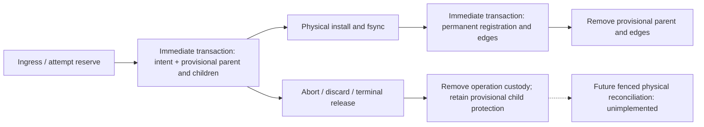

Current-primary expanded native execution and Clippy are being run against
the coupled candidate. Their eventual results must be recorded separately from
the earlier focused owned-replay GREEN. This candidate still does not implement
physical GC, managed genesis admission, physical-incarnation/reinstall fencing,
post-unlink crash recovery or a sustained disk-space bound; R10 remains PARTIAL
and R17 remains MISSING.

### 23.52 — Managed genesis custody and native regression checkpoint

The current genesis path is `CatalogGenesisPort::begin_bootstrap` → managed
`ImmutableObjectPort::install` through `GenesisSink` →
`CatalogGenesisPort::publish_bootstrap` using the original `WorkBudget`.
The Catalog derives the canonical empty profile through the identity port,
persists its exact registration and durable fence before physical installation,
and atomically transfers confirmed bootstrap custody into the first view/head.
The previous direct Catalog genesis publication API is removed. Managed stores
refuse unsunk `put`; standalone stores retain their explicit standalone behavior.
Reservation precedes external-child filesystem inspection, and cancellation
after scalar/batch reservation is checked before physical installation.

Bootstrap tables introduce an explicit v8 state boundary. Native composition
refuses v1-v7 before Catalog/object initialization; the legacy daemon refuses
the v8 native root. This is a rebuild boundary, not a migration implementation.

Behavioral RED was observed for the five Catalog bootstrap tests, the three
initial Kernel genesis tests, managed unsunk installation, reservation-time
cancellation, and v7-state acceptance. The reservation-order test first passed
because the ordering repair was already present; it is not reported as RED.
An additional real-store crash-cut test covers physical sync followed by
confirmation failure, retaining provisional custody across reopen and then
publishing the same frozen profile successfully.

`/tmp/qi-primary-bootstrap-coupled-green.log` records the primary canonical
`./scripts/cargow nextest run --locked` native selection: **VERIFIED, 632/632
passed**, 1,200 skipped, 28 binaries, 219.808 seconds. It includes all five
native product-process cases, fifteen native UDS cases, Catalog bootstrap
cases, four real-store genesis cases and storage cancellation/namespace cases.
The selection excludes the two previously declared large corpus-walk/source
manifest cases; it is neither the complete workspace suite nor a qualified
XL/performance comparison. The execution predates the subsequent bootstrap
lock-wait cancellation tests and repair below.

The process FIFO fixture now distinguishes executable startup from entered
configuration preflight: startup watchdog 30 seconds, then refusal watchdog
3 seconds, with bounded stderr observation and no state/socket side effects.
The process case passed in 5.050 seconds. This is functional refusal coverage,
not a 3-second end-to-end launch SLA. Prior five-second startup failures remain
historical failures; same-PID macOS executable assessment was measured at
8.443 seconds in a separate failing run.

Adversarial review found an additional P1: `begin_bootstrap` lacked a checkpoint
after waiting for an Immediate SQLite transaction, allowing a cancelled request
to return/commit a stage. Independent new-stage and existing-stage tests use
the actual SQLite busy callback to observe blocking, cancel the original
request, release the competing writer, and require `Cancelled` with unchanged
stage rows and durable fence counter. Actual RED is recorded in
`/tmp/qi-primary-bootstrap-lock-cancel-red.log`: **FAILED, 0/2 passed**, 0.073
seconds; both returned `Ok(BootstrapRef)` instead of `Cancelled`. Checkpoints
after transaction acquisition, before existing-stage return and immediately
before new-stage commit are now implemented. The preceding 632-test result
does not prove this seam. Two additional Catalog
tests cover corruption of a confirmed bootstrap-object row and cancellation of
the original bootstrap budget followed by reopen and successful fresh-budget
retry. Post-repair canonical native execution in
`/tmp/qi-primary-bootstrap-lock-cancel-green.log` is **VERIFIED, 197/197 passed**,
42 skipped, eight binaries, 37.834 seconds. It covers the complete Catalog
unit slice, both actual lock-wait cancellation cases, the two additional
bootstrap-object/budget cases, all four real-store genesis cases, native fault
edges, native UDS and all five product-process cases, plus the storage unit,
namespace and cross-process namespace slices. The new-stage case proves no
stage or fence allocation survives the cancelled wait; the existing-stage case
proves no successful cancelled-stage response and unchanged prior custody.

The expanded native Clippy command (fourteen packages, library and declared
native integration targets, plus product binary, `-- -D warnings`) is
**VERIFIED** in `/tmp/qi-primary-bootstrap-current-clippy2.log`. The first
execution failed on two needless value arguments in the new crash-cut test
helper; these now borrow their comparison inputs. Compilation/lint success is
separate from behavioral success. `just rust-cargo-modules` is **VERIFIED**
(`/tmp/qi-primary-bootstrap-cargo-modules.log`): guarded Contract/Core/Kernel
module trees are unchanged. `just rust-hexagonal` is **VERIFIED**
(`/tmp/qi-primary-bootstrap-hexagonal.log`). The public API check was explicitly
cancelled while waiting for resource admission, before its producer started,
to batch it with the next coupled GC checkpoint; API behavior is **NOT_RUN**,
not a failed API comparison. The required daemon scope is still **NOT_RUN**.
No complete workspace or release qualification follows.

Physical reclamation remains unimplemented. Its first coupled slice must cover
confirmed and provisional objects, indexed incoming custody, frozen reclaim
permits, physical incarnation/reinstall fencing, descriptor-verified unlink and
directory sync, durable post-unlink confirmation, and bounded direct-child
draining. A resumable bootstrap is a live root until an explicit fenced abort;
timeout alone cannot authorize deletion. `require_object` must remain a read
validator; adoption must cancel a queued reclaim atomically with insertion of
the new root/edge and refuse an already reclaiming incarnation. No whole-DAG
seal scan or namespace-lease-only deletion is authorized by this checkpoint.
R10 remains PARTIAL; R17 remains MISSING; default product Auto/Deep and full
release/remote-CI qualification remain outside the verified selection.


### 23.53 — Paired physical reclaim and original-budget audit checkpoint

The first physical-GC implementation pairs one `ManagedObjectAuthority` with
its managed `FileObjectStore`. A typed Bootstrap/Ingress/Attempt scope is a
hint; the store's fixed Catalog authority validates it under the caller's original
`WorkBudget`. Managed installation reserves before filesystem writes, then
confirms after sync. The old budgetless reserve/confirm routes refuse a bound
managed namespace. Standalone storage retains its separate explicit contract.

```mermaid
flowchart LR
    A[Reserve managed object and child custody] --> B[Install and sync under digest gate]
    B --> C[Confirm registration in Catalog transaction]
    C --> D[Release custody and enqueue candidate]
    D --> E[Indexed incoming check and Retiring]
    E --> F[Freeze namespace, shard, file incarnation and registration]
    F --> G[Persist Reclaiming]
    G --> H[Held-FD unlink and directory sync]
    H --> I[Persist Draining]
    I --> J[Release at most 32 child edges in one transaction]
    J -->|more children| I
    J -->|finished| K[Deleted; later install obtains fresh generation]
    E -->|new adoption| C
```

No Catalog transaction spans filesystem IO. Reclaiming/Draining refuse new
adoption; Retiring adoption changes its generation atomically with the new root
or edge. The namespace binding includes held root/objects/lease device and inode;
present targets additionally freeze shard/file identity, ctime, wire length and
full registration. GC hashes through a 64 KiB buffer and at most 4,096 child refs.
Relative openat/statat/unlinkat with held shard FDs prevents path substitution
from redirecting the deletion. A replaced empty shard cannot impersonate an
already completed unlink. Bootstrap remains live until an explicit fenced abort.
The canonical native state is now v9; v1-v8 are refused before initialization,
and the legacy route refuses v9. Existing state requires an explicit rebuild;
backup/import into another inode namespace is not implemented by this boundary.

Actual RED: `/tmp/qi-primary-gc-v9-marker-red.log`, one v8 refusal case failed
because the preceding build accepted the incompatible state. Actual coupled
RED: `/tmp/qi-primary-gc-behavior-red4.log`, **FAILED, 15 run / 4 passed / 11
failed**, 172 skipped, 3.259 seconds. Ten failures reached the intentionally
unconnected public GC work-page port; that experiment proves missing GC behavior,
not that every implemented internal GC method independently failed before repair.
The independent original-zero-write-budget oracle failed with `Ok(None)` instead
of `ResourceLimited`: referenced LIVE candidate dequeue had no write precharge.
It now charges before mutation; Retiring reset also counts fence-counter update.
The earlier compilation failures are not behavioral RED evidence.

Focused coupled GREEN: `/tmp/qi-primary-gc-coupled-green3.log`, **VERIFIED,
49/49 passed**, 280 skipped, six binaries, 10.466 seconds, canonical
`./scripts/cargow nextest run --locked` for Catalog/Kernel/Storage/Runtime.
Selected expressions cover GC, genesis/bootstrap, Store reclaim units, runtime
maintenance and v8 refusal. Gold includes actual SDK source-record/body deletion,
live Exact pin protection before release, shared children under two parents,
Retiring readoption, same-digest reinstall, forged scope refusal, full wire/child
identity and namespace/shard/file replacement refusal. The Catalog 4,096-child
fixture drains 32 edges per page and reopens halfway; it uses synthetic trusted
registrations rather than 4,096 actual files. The real-store 70-child fixture
reopens after unlink and the first drain page. A real SDK 1 MiB body exhausts its
original byte budget after persisting Retiring, releases its Control reservation,
reopens the same root and completes deletion with a new caller-owned invocation.
This is phase-resumable behavior, not all-or-nothing GC-step mutation.

Independent audit also found uncancellable Catalog mutex acquisition. Its actual
RED `/tmp/qi-primary-gc-mutex-red.log` is **FAILED, 0/2 passed**, 126 skipped,
2.115 seconds. Both failed on the first GC route while another thread held the
actual mutex; later managed-install/bootstrap subroutes were not reached in RED.
A native budget-aware try_lock helper now checks the original deadline/cancellation
before and after acquisition and during a one-millisecond backoff. GC, paired
installation and bootstrap begin/publish/abort use it; legacy budgetless locking
is unchanged. Post-repair coupled execution in `/tmp/qi-primary-gc-mutex-coupled-green.log`
is **VERIFIED, 51/51 passed**, 280 skipped, six binaries, 10.851 seconds.
The GREEN exercises GC, managed-install and bootstrap subroutes while the mutex
stays held. SQLite internal busy-timeout and filesystem syscall preemption remain distinct
limitations; this mutex change does not prove a hard end-to-end deadline.

`just rust-public-api`: **VERIFIED**, guarded Contract and SDK public API
unchanged (`/tmp/qi-primary-gc-public-api.log`). Initial `just rust-cargo-modules`
reported the intended new Core GC ports/types/module as drift; Contract and Kernel
were unchanged. Only the affected Core baseline was regenerated through the canonical producer.
`just rust-cargo-modules` after promotion is **VERIFIED**, all three guarded
module trees unchanged (`/tmp/qi-primary-gc-cargo-modules-current.log`).
`just rust-hexagonal` and `just rust-module-discipline` also pass. Expanded
current-native execution in `/tmp/qi-primary-gc-current-full2.log` is **FAILED**:
672 executed, 642 passed, 30 failed, 1,205 skipped, 28 binaries, 196.325 seconds.
The common failure is `budgetless object callback on managed catalog`.
`Kernel::seal_mutations` still calls the old reserve/confirm callbacks when
adopting an already registered mutation-map root. Store installation had been
migrated, but this direct adoption producer had not. Focused GC tests did not
exercise that SDK sealing path; the expanded source/Auto/pump/product tests did.
The repair now introduces `InputStagingPort::adopt_registered_inputs`, accepts
only exact confirmed registrations, preserves the open ingress fence (including
empty batches) and GC generation checks, and migrates the Kernel sealing
producer together. Catalog adoption uses the original-budget mutex and a single
transaction. It precharges four writes for worst-case Retiring cancellation
(durable fence counter, lifecycle row, queue removal) plus ingress insertion,
refuses provisional and Reclaiming/Draining objects, and checkpoints before
commit. Managed callback refusal remains intact and no unchanged payload is
reinstalled. The narrow adoption/query checkpoint in `/tmp/qi-primary-adopt-query-red13.log`
is **FAILED: 14 executed, 11 passed, three failed, 808 skipped, 8.735 seconds**.
Both adoption fixtures, held-mutex cancellation/deadline, actual SDK source
lifecycle with old-view/reopen, Auto same-view execution, owned pump and product
publish/query/reopen passed. The three expected RED failures are the unimplemented
Literal/Path reader contract fixtures and absence-of-registered-reader UDS refusal.
These failures are independent of the repaired sealing producer. Literal/Path
reader and runtime registry wiring is now implemented; its post-repair execution,
expanded native regression, Clippy and required daemon rail remain pending.
Compilation failures are not behavioral RED or GREEN; narrow passing product
cases do not qualify all thirty failures from the preceding expanded run.
The required `just rust-profile test-daemon` checkpoint also **FAILED** on the
preceding source: 30/317 executed, 29 passed, one failed, ten skipped, 211.684
seconds after compilation. The runner stopped on
`e2e_integrity_scrub::a_generation_of_an_earlier_format_is_quarantined_at_boot_with_the_format_reason`:
its semantic manifest version 9 is refused by an adapter serving format 13.
The causal boundary is history restore, before boot inventory publication:
the new semantic retained-generation measurement decodes inactive manifests;
the existing restore contract deliberately propagates unsupported-format
refusal rather than inventing content fallback. The E2E oracle is being aligned
to typed boot refusal and preservation of both generations. Inventory-level
FormatUnsupported quarantine classification remains a separate unit oracle;
serving an active generation alongside an unsupported retained format is no
longer claimed. The remaining daemon cases were not executed, and this earlier compiled rail does not verify the
subsequent budgeted adoption or query-reader changes.

The explicit maintenance step holds the configured Control ledger reservation,
processes one candidate and one drain page, and rejects an insufficient declared
GC envelope before mutation. Its memory/IO floor is a logical conservative
admission estimate, not measured RSS or retained-disk enforcement. A partial drain
retains the input cursor; an error preserves durable phase and requires caller
retry. A caller must periodically restart at `None`, including under continuous
new insertion; keyset pagination alone does not establish maintenance fairness.
No automatic GC driver, physical disk bound, power-loss qualification, actual
unlink syscall fault injection, native XL or comparative performance acceptance
is established. The tombstone review found permanent per-object metadata growth. Actual RED in
`/tmp/qi-primary-gc-tombstone-red.log` is **FAILED, 0/1 passed**, 188 skipped,
1.874 seconds: physical drain completed but lifecycle count stayed one. Final
drain now removes queue and lifecycle in the same generation/phase-fenced
transaction. Fresh reserve takes the globally monotonic durable fence, so the
old permit cannot authorize a later installation. The extended real-store
fixture reopens after completion and requires no lifecycle row plus rejection
of the old mark/drain permit. That fixture and the same-digest reinstall fixture
passed in the expanded execution above; the thirty other failures remain open.
No background scan or automatic cleanup of older persisted DELETED rows was
added, and no claim is made about SQLite file shrinkage.
The current persisted-target reader has bounded registration validation, but
compares raw child-array length against the frozen distinct-edge count. A valid
registration preserving duplicate occurrences `[X, X]` can therefore refuse GC
resume after its single distinct edge was frozen. An independent digest-valid
RECLAIMING-row fixture now requires successful resume with direct_children=1;
the current reader now sorts/deduplicates registration children before comparing
the frozen count. The duplicate fixture passed in the combined checkpoint below.
The source changed while execution waited; this lane did not execute the preceding
broken reader, so no behavioral RED is claimed for that correction.

Literal and Path now implement the existing generic IndexQueryPort contract.
Runtime selects the stored profile through Kernel::prepare_query, obtains the
Interactive reservation and executes under the same pinned ticket. Member
identity, schema, policy, format, source root and exact stored children are
checked before artifact access. Explicit builder-only composition has no implicit
query capability and refuses missing readers. Actual two-instance policy-bound
SDK output, old-view behavior, reader-failure cleanup and pre-state reader ceiling
refusal are independent test oracles. The combined checkpoint in
`/tmp/qi-primary-delivery-a-green-text-red2.log` is **FAILED: 21 executed,
20 passed, one failed, 875 skipped, 16.904 seconds**. Reader contract refusal,
ceiling validation, error cleanup, stored-profile spy, actual two-instance
nonempty SDK results and old-view binding all passed. The sole failure is the
Text installation-cost fixture, separate from the query integration.

A separate Text experiment retains prior file-local inventory roots and submits
only changed occurrence identities. Its RED fixture changes one same-position
four-byte token among 32/256 distinct terms, checks old/current fixed BM25 output
and unchanged boundary terms, then bounds logical occurrence install submissions.
This does not measure physical filesystem writes or wall time. Full-file
tokenization, occurrence identification and complete prior/next validation remain
O(file terms); arbitrary edits moving positions can change all occurrences.
The fixture actually failed after its semantic goldens: the 32-term case
submitted 64 occurrence inputs although the fixed edit permits at most two.
The repair is now implemented with a sorted prior/next merge, identity comparison
and COW edits with exact expected guards, reusing unchanged occurrence references.
Post-repair combined execution in
`/tmp/qi-primary-native-postfix-focused-green.log` is **VERIFIED: 21/21 passed,
875 skipped, ten binaries, 14.745 seconds**. Both 32/256-term fixtures satisfy
at most two occurrence install submissions while retaining changed and unchanged
term goldens on old/current pinned views. This verifies a structural submission
bound for that edit, not a wall-time/RSS/disk benchmark. The same checkpoint
passes all adopted-input, target, reader, Auto, pump and process representatives
listed above. Expanded current-native regression in
`/tmp/qi-primary-native-postfix-expanded2.log` is **VERIFIED: 714/714 passed,
1,216 skipped, 28 binaries, 215.139 seconds**. The original thirty managed
adoption failures no longer reproduce. The run covers typed reader contracts,
query sessions, source/semantic lifecycle, GC, namespace ownership, real UDS,
Auto/pump and opt-in process routing. The two separately selected heavy fixtures
(4,097-owner source manifest and 64/512-owner H=0/8/32 update cost) and
native_source_batch were excluded; this is not full workspace, native XL,
external producer/provider, remote CI or release qualification. Clippy and
the required daemon checkpoint remain pending. The first two Clippy attempts
failed on Core and scratch API documentation lint; the current source has the
code-item markup/paragraph corrections, and the retry is waiting on the shared
resource gate. No Clippy pass is claimed. The peer thread "증분 (2)" already owns
the current workspace/all-features and daemon checkpoints; this lane does not
start a duplicate daemon run and will compare its source/coverage before reusing
any result. This does not close R17 sustained maintenance or the global
memory/disk qualification gaps.
 R10 remains PARTIAL and R17 remains MISSING; the broader forty-family ledger and
Semantica producer/ANN/editor/default-cutover/release gaps are not closed here.


### 23.54 — Explicit service-owned queued reclaim and resource isolation

The automatic service route was absent after the physical reclaim primitives
were implemented. A current execution of
`./scripts/cargow nextest run --locked -p quanta-index-searchd-runtime --test native_index_uds --test-threads 1 --no-tests fail -E 'test(native_owned_pump_automatically_reclaims_discarded_inputs_without_manual_steps)'`
failed one executed test: after a real UDS ingress discard, the record file
remained after the five-second watchdog. This is behavior RED for the missing
service route; it is not a compilation failure or a GC throughput measurement.
The old constructor configured owned work only. The new explicit maintenance
capability, rather than an implicit change to all old pump users, supplies the
queue-drain requirement. The test retains its independent physical-deletion and
held-ingress protection oracles while selecting that capability.

`NativeReclaimConfig` freezes interval, maximum steps, child-page size, original
round work allowance, checkpoint timeout and periodic head probe. The driver
keeps the forward cursor across rounds and independently revisits the head;
it resets the forward cursor only at exhaustion. A failed step does not advance
its cursor, and a long round schedules spacing from completion rather than
running accumulated catch-up ticks. Configured interval times head period is
limited to five minutes; this is a configured cadence, not a wall-clock latency
promise under resource denial, SQL contention or blocked syscalls.

`bind_with_capabilities_and_maintenance` composes queued reclaim with the
existing single service manager. The product JSON accepts optional
`maintenance`; omission leaves queue draining disabled. A distinct
`MaintenanceControl` class belongs to the same `NativeResourceLedger`, because
owned lease renewals run in separate threads and must not lose their protected
`BackgroundControl` reservation while GC hashes/unlinks/syncs. GC-only requires
four foreground floors plus maintenance; owned work plus GC additionally
requires the renewal floor and all configured parallel enrichment grants.
Validation occurs before marker/catalog/socket creation. Separate validation
of the two background features is insufficient for the combined capacity.

Each round owns one reservation and one `WorkBudget` shared across every step.
Due reclaim runs before the owned scope scan. The wait deadline is capped by
the next reclaim deadline. Shutdown publishes/cancels the active original
request, invokes cancellation callbacks outside the slot mutex, and joins the
manager before releasing the state-root lease. Scheduler capacity denial is
paced. Concurrent custody `Conflict` leaves the cursor for a later round.
Corruption, storage failure and charged-work/deadline exhaustion are surfaced
as manager/service errors; there is no silent perpetual retry of an inadequate
work allowance. A configured short timeout can therefore stop the service;
operators must provide an appropriate allowance. Checkpoints do not preempt
SQLite busy waits or filesystem sync, so there is no hard shutdown time claim.

Unit, real UDS and independent daemon-process tests cover configuration refusal,
forward/head traversal, shared round budget, cancellation registration/join,
protected renewal capacity, discarded record/body deletion, retained ingress
protection and process reopen. GREEN execution and strict Clippy are pending at
this checkpoint. `just rust-hexagonal` and `just rust-module-discipline` pass.
Catalog lint repairs preserve final-query/transaction-commit-before-mutex-drop;
they are not additional runtime proof. Earlier temporary verification outputs
and live sessions were unavailable when work resumed, so no pending old run is
promoted to a completed result; the behavioral RED above was freshly executed.

Scope remains queued reclaim only. Published-history retention still requires
explicit terminal custody release, Exact floor advancement and history
retirement before those objects enter the queue. R10 remains PARTIAL and R17
remains MISSING. Real global RAM accounting is also open: `ResourceNeed` is
logical admission and `WorkUsage.bytes` is cumulative work, while returned
`StoredObject` buffers may escape `get` and deeply clone. A lease released at
function return would undercount these live allocations. Closing R11 requires
allocation-before-admission leases retained by immutable shared results and
all producer/reader buffers. SQLite secondary spill and retained Catalog WAL
need distinct enforced space custody; they are not bounded by `io_bytes`.
No RSS, disk ceiling, XL speedup, external producer or release claim is made.

The final test audit adds a real owned-renewal/queued-GC composition case:
while a provider stays blocked, UDS discard must lead to physical record/body
deletion, held ingress files must survive, the original claim fence must remain
unchanged, and its expiry must advance without a new operation or dispatch.
Releasing the provider must then publish the original receipt. This is a small
composition oracle, not a contention or throughput benchmark. A separate
70-child fixture prepares exactly one 32-edge Draining page through the public
manual maintenance port with automatic reclaim disabled. It verifies the durable
(phase=3, children=70, drained=32) state and parent unlink, then reopens with
automatic reclaim and verifies completion while independently held children
remain byte-identical. Only later UDS discard may delete those children. This
deterministic preparation proves automatic recovery from a persisted partial
state; it does not prove interrupting an automatically started round or an
abrupt process crash in that round. Invalid product-policy tests now require the specific rejection cause
as well as failure before state creation, so unrelated startup errors cannot
satisfy their oracle. Execution is pending; test additions and formatting alone
do not promote these claims to VERIFIED.

The first combined GREEN attempt failed during test compilation because
`native_product_process` imported `ImmutableObjectPort` from `index` instead of
`index::ports`; no selected behavioral test executed in that attempt. The import
is corrected and the same selection is queued again. The new refusal test also
uses the existing daemon RAII guard and a 30-second process-exit watchdog,
with a bounded stderr read. An accidentally accepted invalid configuration
therefore fails and cleans up its child instead of blocking forever in
`Command::output`. These test repairs do not alter production configuration or
GC semantics.


The second combined attempt also failed compilation, before behavioral execution:
`RequestBudgetV1` in `search-plane/readiness/auxiliary_store.rs` was an
unconditional unused import despite being used only by test fixtures. It now
shares the existing `cfg(test)` import boundary. The third combined checkpoint
executed **25 tests: 24 passed, 1 failed, 117 skipped** across four binaries
(`/tmp/qi-primary-auto-reclaim-green3.log`, 21.133 seconds of test execution).
The original automatic-discard behavioral RED now passes. GC-only, partial
70-child drain/reopen, owned-renewal plus queued-GC, exact invalid configuration,
independent process discard/reopen and ordinary process publish/reopen all pass.
The existing `native_owned_pump_renews_and_completes_without_external_claim_or_submit`
fails with an unlabeled channel Timeout. Its narrow serial rerun retains the
five-second watchdog and adds stage labels; it is pending, so the combined rail
remains **FAILED**. These durations describe this execution, not indexing or GC
throughput qualification. Current broader strict Clippy remains **FAILED** in
Catalog/RepoMap test fixtures; production diagnostics disappearing does not make
the whole rail green.

R11 follow-up boundary: object `get` currently retains a wire buffer while
allocating decoded payload and child buffers, and public `Vec` fields allow
unaccounted clones/moves after return. A reservation-backed memory scope must
lease before each allocation and remain owned by immutable shared results until
their last clone drops. Its capacity must be a sublease of the existing class
reservation, not a second independent pool or extra ledger charge. Query setup
uses Control while execution uses Interactive; the allocation context therefore
must bind to each stage's actual reservation instead of freezing one scope when
`WorkBudget` is first created. Worker budgets can bind after their guard is
acquired. Required independent oracles are refusal before allocation, concurrent
live-object admission, last-clone release, error/cancellation release and zero
double accounting. Shared-clone pointer identity alone cannot prove peak memory
admission or a process RSS ceiling. This is a pending coupled core/storage/runtime
contract change, not completed by the queued-GC checkpoint.


The unchanged short-lease scenario's serial diagnostic run is **VERIFIED,
1/1 passed, 15 skipped** (`/tmp/qi-primary-owned-renew-diagnostic.log`, 5.176
seconds of test execution). It retains the 200 ms lease, 450 ms provider hold
and five-second channel watchdog. Only receive-stage error labels were added.
A serial pass does not reproduce or establish the cause of the prior parallel
Timeout; that earlier combined failure remains recorded. The next checkpoint
includes Catalog/RepoMap unit tests, renewal scheduling units and the same real
GC/pump/process selection at two test threads. Its result and the current-tree
strict three-package Clippy result remain pending. Catalog's 56 and RepoMap's
13 observed test-only diagnostics have source repairs without new lint
suppressions; formatting and diff checks pass, which is not a Clippy verdict.

The primary three-package strict Clippy retry then exposed three additional
RepoMap scratch test diagnostics: unchecked deadline arithmetic and two
`panic_in_result_fn` findings. The repair is confined to the test module:
checked deadlines, fallible invariant checks with unchanged expected values,
and checked disk-limit arithmetic. The production scratch algorithm is unchanged
by this repair. That executed attempt is **FAILED**
(`/tmp/qi-primary-maintenance-clippy.log`); the next strict retry and the combined
Catalog/RepoMap/maintenance regression are queued. No pass follows from source
repair alone.

R11 retained-memory contract correction: retaining an entire
`ReservationGuard` in every escaping result is rejected. Its destructor releases
CPU, IO, provider and memory together (`core/index/effort.rs`), and the native
ledger keeps the class's active count until that release. Such ownership would
hold execution capacity across Control preparation, Interactive Fast, observer
callbacks and optional Deep, although those stages deliberately release their
execution guards. Immutable sharing solves duplicate payload allocation, but
does not solve this execution-slot lifetime error.

The same ledger must distinguish active execution reservations from detached
retained-memory leases. Memory leases inside an active reservation are subleases
of its existing memory allowance, not extra resident-byte charges. Stage
completion must atomically release the execution dimensions and unused memory,
move only live retained bytes into service-wide retained accounting, and retain
no class execution slot. Detached bytes must never satisfy another operation's
protected execution floor. Last-owner release must return those bytes exactly
once, including error and cancellation paths. Snapshots must separately expose
execution reservations and retained bytes.

Checking capacity only at detachment is also insufficient: if configured
capacity equals the sum of execution floors, an active allocation can fit its
class allowance while its escaped bytes cannot coexist with the restored class
floor. Escape admission therefore needs a protected future-floor/headroom
commitment before the escaping allocation is made or handed out. This commitment
must participate in the same ledger's admission invariant without counting the
same live resident bytes twice. The exact coupled API and proof remain pending;
neither whole-guard retention nor an independent memory pool is an accepted
shortcut. Required oracles include zero old-class active count with a retained
result, independent Control/Deep admission when headroom exists, refusal before
escaping allocation when headroom is absent, concurrent detach/drop, unchanged
floor protection and zero accounting after the last clone. Object-buffer
coverage alone still cannot establish decoded-profile/result coverage or RSS.

Minimal candidate admission invariant for this pending R11 change is
`active_execution_envelopes.memory + detached_live_bytes + pending_escape_ceiling
+ sum(execution_floor_shortfall) <= capacity.memory`. `pending_escape_ceiling`
is a prospective capacity commitment, reported separately from actual resident
reservations. `commit_escape(max_bytes)` must be admitted under the existing
ledger mutex before the corresponding escaping allocation. Allocation remains
inside the active envelope. Consuming stage completion removes the execution
reservation and its pending ceiling atomically, adds actual retained bytes no
larger than that ceiling, and restores execution-floor protection. The restored
floor shortfall increases by at most the released execution memory; the retained
addition is no larger than the removed ceiling, so the promise cannot increase.
Concurrent admissions include outstanding commitments and cannot consume this
headroom. Earlier drop releases the commitment without producing a retained
lease. Floor-only capacity must reject even a one-byte escape with unchanged
state; one-byte additional headroom must admit that escape and still admit every
protected execution class after detachment. This is a conservative accounting
contract with explicit retained headroom, not a physical-memory measurement or
an implemented scheduler API.

The next combined checkpoint executed **194 tests: 193 passed, one failed,
109 skipped** across the selected Catalog/RepoMap libraries and runtime
libraries/integration binaries (`/tmp/qi-primary-maintenance-final-checkpoint.log`,
51.195 seconds). All selected Catalog/RepoMap cases pass, including the bounded
4,096-child drain/restart. Automatic reclaim, partial drain recovery, combined
renewal/reclaim and independent daemon recovery pass. The existing 200 ms lease
test also passes at two test threads; this does not establish the prior Timeout's
cause. The sole failure is the newly added, deterministic
`false_owned_completion_wakes_manager` behavioral RED. A consumed `Ok(false)`
completion frees its scope but leaves the manager asleep until the existing
cadence deadline. The repair must both wake other ready scopes and pace retries
of the declined scope; waking alone would introduce a hot denial loop. Bounded
per-scope retry timing uses the existing pluggable cadence and no new resource
pool. Its production repair and GREEN execution are pending.

The third strict Clippy attempt is **FAILED**
(`/tmp/qi-primary-maintenance-clippy3.log`): it reaches runtime and reports thirteen
production diagnostics in pump cleanup/cadence, reclaim-driver documentation and
worker helper/guard lifetimes. The driver and worker lint repairs preserve their
authority, cleanup and queue ordering; pump repair is coupled with the completion
wakeup fix. These diagnostics must be rerun after repair without lint suppression.

A separate static deadline defect is confirmed in the owned worker: Catalog
computes `grant.remaining_ms` before commit, but the worker constructs
`RequestBudgetV1::for_duration` after grant delivery and its start barrier.
Consequently that delay is added back to the local execution allowance. Late
Catalog publication still checks its durable deadline, so this is not evidence
of successful late publication. The new
`owned_grant_delay_does_not_restart_original_deadline` test holds the existing
after-grant barrier beyond the original one-second deadline and distinguishes
the initial worker checkpoint's `ResourceLimited` from the later Catalog fence
rejection. Its actual RED execution is pending. The minimum candidate repair
anchors the local deadline to a monotonic instant captured before requesting
the grant, then uses checked deadline arithmetic instead of restarting a duration.

The first deadline-specific attempt failed compilation on a receiver borrow
left midway through the pump lint repair; it executed no behavioral test
(`/tmp/qi-primary-owned-deadline-red.log`). After the borrow correction, the
deadline-specific behavioral RED actually executes and fails its independent
initial-checkpoint oracle: **0 passed, one failed, 92 skipped**, 1.311 seconds
(`/tmp/qi-primary-owned-deadline-red2.log`). The worker now captures the monotonic
anchor before `begin_owned_work`, computes a checked absolute deadline, and
constructs the original request with `RequestBudgetV1::until`. Unrepresentable
deadlines settle the already acquired grant and propagate failure. No owned
policy timeout, lease duration or retry allowance is increased. The test keeps
the one-second total allowance and 1.1-second after-grant barrier; its assertion
now reports the actual unexpected result without changing the expected outcome.
Final selected worker/pump/reclaim/UDS/process GREEN and strict three-package
Clippy are queued (`/tmp/qi-primary-maintenance-final-green.log`,
`/tmp/qi-primary-maintenance-clippy4.log`). They are not yet VERIFIED.

The completion-wakeup production repair keeps `contains` as active ownership,
records retry deadlines only for accepted declined scopes, and excludes those
scopes until the previous bounded policy cadence has elapsed. Successful work
retains immediate catch-up. The earliest retry deadline participates in the
manager's wait together with the policy and GC deadlines. The retry map is
structurally bounded by the 1,024 validated configured scopes; it adds no
independent scheduler, background thread or resource pool. Deterministic tests
cover wake notification, a different scope remaining eligible, exact retry
deadline boundaries, expiration pruning, consecutive refusal without zero-delay
retry and successful completion without cooldown. This is distinct from the
earlier unlabelled short-lease Timeout, whose cause remains unestablished.

The selected runtime checkpoint actually completes: **73 passed, zero failed,
73 skipped across four binaries**, 34.982 seconds
(`/tmp/qi-primary-maintenance-final-green.log`). This covers selected worker,
pump, maintenance and reclaim cases, all sixteen native owned-pump integration
cases, selected UDS cases and independent product-process recovery. The
post-grant-delay regression passes without changing its original one-second
allowance. This does not qualify Catalog/RepoMap tests on a later contract
revision, full workspace, Large/XL performance, actual RSS or WAL bounds.

The fourth strict Clippy attempt is **FAILED** on two pump cleanup guard-lifetime
diagnostics (`/tmp/qi-primary-maintenance-clippy4.log`). Cleanup now consumes
poisoned mutex results with explicit recovery, drops the cloned-handle guard
before cancellation callbacks, and drops the cleared slot guard immediately.
No warning suppression is added; final Clippy rerun is required.

A further adversarial review rejects the conservative pre-call worker deadline
anchor as the final design. Catalog subtracts wait time when it samples the
remaining allowance after acquiring its connection; adding that allowance to an
instant captured before the wait subtracts the same wait twice. The producing
Catalog authority must supply an ephemeral process-local monotonic execution
deadline in the canonical `OwnedWorkGrant`, anchored at its original durable-clock
sample. Worker must consume that deadline without restarting or reconstructing
it. Durable assignment fields remain the restart authority; a monotonic instant
is neither persisted nor a cross-process/wire artifact. The pre-grant-delay test
expects the fixture's public Conflict receipt while its original allowance is
still live; the separate post-grant test continues to require expiry at the
first checkpoint. The pre-grant behavioral run is queued, not yet verified.

The pre-grant-delay regression actually fails on the conservative worker-anchor
implementation: **zero passed, one failed, 93 skipped**, 1.432 seconds
(`/tmp/qi-primary-pre-grant-red.log`). Observed result is `Err(ResourceLimited)`;
independent expected behavior is the empty-profile fixture's public
`Terminal(Refused(Conflict))` receipt. This is an executed double-charge RED,
not a successful deadline or performance claim.

The canonical grant now carries `execution_deadline: Instant`. Catalog captures
its anchor after connection and transaction admission, derives the remaining
allowance from the original durable deadline, checks monotonic arithmetic before
precharging the grant, and commits the same assignment/ordinal transaction.
Worker calls `RequestBudgetV1::until(grant.execution_deadline)` directly. There is
no duration reconstruction, consumer repair or parallel grant IR. Durable/wire
assignment fields and configured allowances are unchanged. This process-local
field is deliberately absent from persistence/serde. The matching pre-grant and
post-grant tests must both pass on the new producer/consumer contract.

The final traversal audit also identifies a static starvation path: a due head
probe resets its cadence only after a successful step. Repeated transient
custody `Conflict` therefore keeps the head permanently due and prevents the
independent forward cursor from running. Cadence now counts the attempted head
probe before fallible work; the failed step still cannot advance the forward
cursor, and the next normal round retains its last successful cursor. The
conflict is still reported and paced by the existing manager. No new retry loop
or allowance is added. The deterministic regression uses one step per round
and a head that always conflicts, requiring forward progress after each failed
probe. This is source-confirmed with execution pending; no pre-fix behavioral
RED is claimed for this distinct traversal repair.

#### Current coupled checkpoint verdict (2026-10-12)

The producer/consumer deadline contract and traversal repair actually pass the
selected coupled execution: **468 passed, zero failed, 73 skipped across seven
binaries**, 67.782 seconds of test execution
(`/tmp/qi-primary-maintenance-authority-green.log`). Scope includes the complete
selected Core/Catalog/RepoMap libraries, selected native worker/pump/reclaim
library cases, all sixteen owned-pump integration cases, selected UDS cases and
independent product-process recovery. Both pre-grant wait and post-grant expiry
oracles pass. Repeated head Conflict with independent forward progress passes.
The existing short-lease renewal case also passes; its earlier unlabelled
Timeout's cause is still not established by repeated GREEN executions.

The fifth strict Clippy run is **FAILED** on the new grant's first-doc-paragraph
length (`/tmp/qi-primary-maintenance-clippy5.log`). The documentation is split
into a concise summary and detailed contract paragraph, with no production
behavior change and no warning suppression. Final four-package Clippy retry is
pending. Formatting/diff, hexagonal boundaries, all 46 facade boundaries and
test-authority registration pass.

Reproduction commands (default features; disposable outputs remain outside the
checkout):

```sh
./scripts/cargow nextest run --locked \
  -p quanta-index-core -p quanta-index-catalog -p quanta-index-repomap \
  -p quanta-index-searchd-runtime --lib \
  --test native_index_uds --test native_owned_pump --test native_product_process \
  --test-threads 2 --no-tests fail --no-fail-fast \
  -E 'package(quanta-index-core) | package(quanta-index-catalog) | package(quanta-index-repomap) | test(native_pump::renewal_tests) | test(native_worker::tests) | test(native_reclaim_driver) | test(maintenance) | test(reclaim) | binary(native_owned_pump) | test(product_daemon_serves_native_publish_query_and_reopen)'
./scripts/cargow clippy --locked \
  -p quanta-index-core -p quanta-index-catalog -p quanta-index-repomap \
  -p quanta-index-searchd-runtime --all-targets --no-deps -- -D warnings
just rust-hexagonal
just rust-module-discipline
just rust-test-authority
```

This is a local correctness checkpoint, not the full workspace, all-feature,
Large/XL performance, sustained churn, live-memory/RSS, SQLite spill/WAL,
external producer/provider, default cutover or release qualification. R10/R11
and R32 remain PARTIAL; R17 sustainable lexical maintenance remains MISSING.
No requirement is closed solely by this test count.

The sixth strict Clippy retry is **FAILED** on one `needless_pass_by_value`
diagnostic for the integrated `ReclaimAttempt` metadata outcome
(`/tmp/qi-primary-maintenance-clippy6.log`). Both variants contain Copy metadata,
not grants, permits or resource ownership; the outcome is now explicitly Copy.
The producer's validated-key `Contended` outcome remains distinct from physical
reclaim success and from an unclassified error. The automatic sweep may defer
that examined key, while the manual API still returns `Conflict`. The 468-test
checkpoint already includes the independent permanent-first-key contention,
restart/exhaustion and manual-conflict/cursor-order rejection cases. These do
not turn deferred work into successful physical deletion. The final Clippy
rerun and a focused current runtime/UDS/pump/process integration pass remain
pending; the 468-test checkpoint is retained as its recorded scope.

A final adversarial arrival pattern exposes a remaining static head-probe gap:
with a permanently contended first key and an always-busy upper-key forward
sweep, resetting every head probe to None never reaches a newly queued lower
key behind that first key. Head traversal now retains its own cursor and a
forward-frontier snapshot for each prefix cycle. Classified contention advances
only scheduling traversal; a partial physical drain preserves its cursor.
Reaching the frozen frontier or exhausting the prefix resets that head cycle,
so continuous upper-key arrivals cannot keep it chasing a moving frontier.
Unclassified errors still cannot advance either failed cursor; attempted probes
remain paced, and per-round step/work limits are unchanged. The deterministic
one-step regression introduces a lower key after forward has reached 50,
keeps first key 1 permanently contended and leaves upper work continuously
available, then requires lower-key removal without forward exhaustion. This
is a source-confirmed gap with final focused execution pending; no pre-fix
runtime RED is claimed for this additional policy repair.

Head-cycle state is one private `Idle | Prefix { after, until }` enum. This
preserves an explicitly frozen None frontier through partial drains and errors,
instead of using absence of an optional value to infer that a cycle has not
started. A second independent queue/child-count oracle checks partial drain
resumption, an unchanged frontier while forward progresses, and prefix restart
to discover another lower arrival while upper work remains. No additional
scheduler, resource pool, persisted IR or work allowance is introduced.

The focused latest runtime checkpoint completes: **80 passed, zero failed,
73 skipped across four binaries**, 36.978 seconds
(`/tmp/qi-primary-maintenance-current-runtime-green.log`). Both new bounded-prefix
head tests pass, along with both deadline oracles, declined-scope pacing,
permanent-first-key contention/restart, the sixteen owned-pump integrations,
automatic physical reclaim and independent daemon recovery. This confirms the
latest GC state-machine change without rerunning unchanged Core/Catalog/RepoMap
libraries; their preceding 468-test coupled checkpoint remains recorded.

The seventh strict Clippy attempt is **FAILED** on one Boolean-expression lint
in the separate readiness-owner error-source-preservation test
(`/tmp/qi-primary-maintenance-clippy7.log`, shared by two integration facades).
The assertion is rewritten with the equivalent `is_none_or` predicate. This is
a test-only style correction, not a production behavior change or new runtime
proof. The eighth strict four-package/all-targets Clippy run is pending.

#### Final local checkpoint status (2026-10-12)

The eighth strict Clippy execution is **VERIFIED**, exit 0
(`/tmp/qi-primary-maintenance-clippy8.log`): Core, Catalog, RepoMap and runtime,
all targets, default features, no dependency lint promotion, `-D warnings`.
The two preceding failures were the integrated metadata outcome's pass-by-value
lint and a separate readiness test's equivalent Boolean predicate; neither is
left pending. No warning suppression or production allowance increase was used.

| Scope | Final local status | Limit |
|---|---|---|
| Coupled Core/Catalog/RepoMap libraries + selected native runtime integrations | VERIFIED: 468/468 | Default features; preceding GC prefix-cycle refinement remains separately covered below |
| Latest runtime/UDS/owned-pump/independent product-process regression | VERIFIED: 80/80 | Includes the final frozen-prefix head FSM, partial drain and continuously busy-forward/lower-arrival cases; overlaps the preceding checkpoint |
| Four-package strict all-targets Clippy | VERIFIED: exit 0 | Default features, selected packages, not workspace/all-feature CI |
| Hexagonal/module/test-authority/owned formatting/diff checks | VERIFIED | 46 facade files; structural/source checks do not add runtime coverage |
| Native Large/XL, sustained churn and comparative indexing performance | NOT_RUN | No speedup, throughput or capacity qualification follows from these correctness tests |
| Real live-allocation/RSS, SQLite spill/WAL and full physical fault matrix | NOT_RUN | Logical reservations and queued reclaim are narrower than these limits |
| Real producer/provider, default routing/cutover and release qualification | NOT_RUN | R37/R38 and broader R40 acceptance remain open |

These are overlapping scoped results, not 548 distinct tests or completion of
the forty-family requirements ledger. The engine's native deadline, declined
completion pacing and GC traversal defects are repaired and locally verified.
R11 retained-memory enforcement and R17 sustainable lexical maintenance still
require their coupled implementations and operational evidence. Commit/push
and remote CI are not asserted by this checkpoint.


#### File bulk staging and source-buffer integration follow-up (2026-10-12)

A source audit after the Large checkpoint identified a local staging omission:
`run_merge_stage_bytes` counted cursor structs but not the decoded map frames
owned by their `Vec`s. MapCursor retains one decoded frame per level, at most
`height + 1`; the map codec bounds height, fanout and key size. Selection now
includes the 96 KiB leaf-frame charge per input. Before opening any cursor,
execution adds the branch-frame charge from each actual input descriptor and
refuses an excess over the unchanged staging cap. The selector's estimate is a
minimum; it cannot authorize the subsequent height-sensitive allocation. An
invalid height is a corruption refusal. Shared store caches and caller-owned
roots remain outside this local stream charge and require the separate global
R11 accounting. This repair does not claim RSS enforcement.

Posting-stream staging is explicitly dropped before gram-count generation;
its final encoded page-byte ledger is copied as scalar metadata first. The
fresh-run pre-admission bound already includes the larger 64-cursor worst case.
No format, public interface, resource-cap increase or alternate execution path
was added.

The concurrently introduced shared StoredObject interface exposed an E0507
integration failure in native text: a consumer attempted to move the payload
out of shared custodianship. Text source loading now returns the StoredObject;
its caller validates UTF-8 once and borrows the payload through normalization.
This retains the existing memory lease without a payload clone, unsafe lifetime
extension or early lease release. It does not qualify all decoded native
results under R11.

Added or strengthened independent regressions cover:

- Full 64-bit source masks (including bit 63), interleaved logical IDs, a full
  256-member ID bucket, sparse content membership and identical final roots
  under shuffled leaf order.
- Duplicate logical IDs in a later chunk, after an intermediate map is written:
  typed refusal, no successful final run, actual collection after attempt
  retirement, and a separate retained prior object remaining readable.
- Equal fan-in with shallow/deep map descriptors: deep-frame refusal precedes
  an absent-object read and leaves the write meter unchanged; shallow input
  remains admitted under the same cap. Invalid map height is explicitly refused.
- A UTF-8 admission stamp with invalid bytes: CorruptObject before token writes,
  preserving the original error classification after buffer integration.

The first selected test invocation is **FAILED at compilation**, E0507 at
the shared-object consumer; none of its selected tests executed. After the
borrowed-buffer integration repair, the focused all-feature library regression
is **VERIFIED: 21/21 passed**, 519 skipped, 256.591 seconds. It executed all
thirteen native text tests, seven new-run bootstrap tests and the decoded-frame
admission test. Full masks/shuffled roots, failed-attempt GC/protected prior,
UTF-8 refusal and the 1,025-leaf multi-pass merge passed. The two slow alerts
are completion warnings, not timeout results. The corrected producer/merge
checkpoint is also **VERIFIED: 7/7 passed**, 533 skipped, 21.076 seconds. The
five producer prepared-compaction cases and two independent merge/seal cases
were all listed in the actual execution, including delta/delete/clear-all,
immutable old-root queries, expired/touched preparation, two/three-leaf merge
and omitted-cohort refusal. Their existing 1,000,000-byte staging settings
were not raised. After lint-only test arithmetic changes, the full-mask,
height-admission and invalid-UTF8 cases were rerun: **VERIFIED: 3/3 passed**,
537 skipped, 3.472 seconds. These three overlap the 21-test checkpoint.
Fresh strict Clippy is **VERIFIED**, exit 0 in 39.08 seconds:
`./scripts/cargow --lane shared-validation-lane clippy --no-deps --all-targets
--all-features --locked --offline -p quanta-index-lexical -- -D warnings`
(with the normal resource gate). The preceding invocation failed one
documentation-paragraph rule and two test arithmetic rules; all were corrected
without lint allowances. Vendor warnings were visible and were not promoted
into an owned-target success claim. Formatting, diff, test-authority, hexagonal
and all 46 facade checks also passed.

The regression commands used `./scripts/cargow --lane test-daemon-lane nextest
run --lib -p quanta-index-lexical --all-features --locked --offline --test-threads 2
--no-tests fail --failure-output immediate` with these explicitly checked
selections (the 21/7 batches also used `--no-fail-fast`):

```text
21: test(file_authority::paged::run_postings::tests::new_run_bootstrap)
    | test(=file_authority::paged::run_postings::tests::run_merge_refuses_decoded_frames_before_loading_or_writing)
    | test(file_authority::paged::producer::tests::)
    | test(native::text::tests::)
 7: test(file_authority::paged::producer::prepared_compaction_tests::)
    | test(=file_authority::paged::verify::tests::clean_append_only_runs_merge_serving_dictionary_and_require_declared_policy)
    | test(=file_authority::paged::verify::tests::seal_rejects_metadata_only_run_merge_that_omits_one_cohort)
 3: test(=file_authority::paged::run_postings::tests::new_run_bootstrap_preserves_full_masks_and_shuffled_interleaved_leaves)
    | test(=file_authority::paged::run_postings::tests::run_merge_refuses_decoded_frames_before_loading_or_writing)
    | test(=native::text::tests::utf8_stamp_with_invalid_bytes_refuses_before_token_writes)
```

The `producer::tests::` branch in the 21-test invocation matched no cases;
the verified producer coverage comes exclusively from the corrected seven-test
selection, not from that unmatched branch.

The final production and regression-test changes are locally accepted within
these scopes. No post-change Large/XL execution, process RSS guarantee,
sustained-maintenance qualification, whole-workspace pass or release claim is
added by this checkpoint. The preceding 106-test and
Large results remain historical scoped checks and do not qualify this later
production change. Filter review also found that the earlier producer predicate
used `producer::tests::` although the real module is
`producer::prepared_compaction_tests::`. The 106-test invocation therefore did
not run the planned producer delta/delete/clear-all/pinned-view unit case; any
earlier claim that it did is withdrawn. A fresh explicit seven-test invocation
selects the real producer module and two independent merge/seal oracles. An
unmatched branch in a union filter is not successful coverage merely because
other selected tests pass. Whole-workspace, Native Large/XL, churn and RSS acceptance
remain separate.

### 23.55 — Current-source final action register (2026-10-12)


과거 본문은 [보존 이력](RFC-DELIVERY-CHECKPOINTS.md#2355--current-source-final-action-register-2026-10-12)으로 이전했다. 현재 작업은 [SSOT](../../plans/oct-17-index-closeout/tickets/README.md)만 따른다.

#### Current facts and important corrections


과거 본문은 [보존 이력](RFC-DELIVERY-CHECKPOINTS.md#current-facts-and-important-corrections)으로 이전했다. 현재 작업은 [SSOT](../../plans/oct-17-index-closeout/tickets/README.md)만 따른다.

#### Remaining implementation and acceptance slices


과거 본문은 [보존 이력](RFC-DELIVERY-CHECKPOINTS.md#remaining-implementation-and-acceptance-slices)으로 이전했다. 현재 작업은 [SSOT](../../plans/oct-17-index-closeout/tickets/README.md)만 따른다.

#### Observed ownership and permitted parallelism


과거 본문은 [보존 이력](RFC-DELIVERY-CHECKPOINTS.md#observed-ownership-and-permitted-parallelism)으로 이전했다. 현재 작업은 [SSOT](../../plans/oct-17-index-closeout/tickets/README.md)만 따른다.

#### Evidence reconciliation and the next checkpoints


과거 본문은 [보존 이력](RFC-DELIVERY-CHECKPOINTS.md#evidence-reconciliation-and-the-next-checkpoints)으로 이전했다. 현재 작업은 [SSOT](../../plans/oct-17-index-closeout/tickets/README.md)만 따른다.

#### NativeText inventory cost and cursor-contract follow-up (2026-10-12)

The `증분 (2)` lane owns this local change in
`crates/quanta-index-lexical/src/native/text.rs`; the active memory-ledger,
retention-policy, product-composition and closeout paths remain with their
existing owners. This is a narrow continuation of F04 indexing-cost work,
not completion of R11/R17 or a new backend/scheduler/IR.

Source inspection found two omissions in the inventory merge:

- When old/new entries share both term key and immutable occurrence reference,
  `diff_inventory` read and decoded that object twice. It now validates the
  occurrence once and reuses its count. Different references still require
  independent validation, and both contribution token totals are checked at EOF.
  This removes one object-port read/decode per shared entry; it does not prove a
  wall-time speedup, cache hit rate or a corpus-independent total update cost.
- `MapEntries` checked ordering and forward progress but did not reject a
  backend page exceeding the requested 64 entries. It now rejects an oversized
  page before buffering or yielding its entries. This enforces the consuming
  cursor contract; it does not bound allocations already made by the backend,
  which remain part of F01/R11.

Three reusable regressions independently require one actual object-port read
for a shared occurrence across different inventory roots, no posting edits for
unchanged membership, rejection of either forged contribution total, corruption
refusal for a different new occurrence identity, rejection of a 65-entry page
before its first yield, acceptance of a full 64-entry page, and refusal of a
repeated continuation. The initial three-test selection passed before the
different-identity control was added; the following 22-test result includes it.

Verification is **VERIFIED: 22/22 passed**, 521 skipped, 0.091 seconds of test
execution, using:

```sh
QUANTA_INDEX_RESOURCE_WAIT_SECONDS=7200 ./scripts/cargow --lane test-daemon-lane nextest run --lib -p quanta-index-lexical --all-features --locked --offline --test-threads 2 --no-tests fail --failure-output immediate -E 'test(native::text::tests::) | test(native::text_spool::tests::) | test(native::text_query::tests::)'
```

All sixteen NativeText tests, both spool tests and four query-policy/Boolean
tests were selected. The earlier three-test run overlaps this result. Strict
all-target/all-feature lexical Clippy is **VERIFIED**, exit 0, 7.87 seconds:

```sh
QUANTA_INDEX_RESOURCE_WAIT_SECONDS=7200 ./scripts/cargow --lane shared-validation-lane clippy --no-deps --all-targets --all-features --locked --offline -p quanta-index-lexical -- -D warnings
```

`just rust-hexagonal`, `just rust-module-discipline` (46 facades),
`just rust-test-authority`, owned-file formatting and `git diff --check` pass.
Vendor warnings were visible; dependency lint promotion was not requested.
No pre-fix runtime RED was executed: these were source-confirmed omissions with
post-repair regressions. No wire/persisted format, resource cap or public API
changed. Native Large/XL, current-candidate cold/delta/churn performance,
physical RSS/spill/WAL and full integrated acceptance remain **NOT_RUN**.

#### Borrowed lexical scratch fields and cursor advancement follow-up (2026-10-12)

The `증분 (2)` lane owns this continuation in shared
`quanta-index-scratch-sqlite/src/lib.rs`, lexical `native/text_spool.rs`,
`native/edit_spool.rs`, and the private visibility of the existing term-key cap
in `native/text.rs`. It does not take ownership of the active memory-ledger,
decoded result IR, retained-history, product configuration or deployment lanes.

Both lexical spools previously copied nullable object-reference BLOBs into
temporary Rust Vecs before checking their 32-byte width. Inserts also created
temporary Vec copies of each present reference. Literal gram pages copied a
BLOB before checking its three-byte width. Scratch key reads had no field-length
check before their owned Rust copy. These are source-confirmed allocation and
validation omissions; no pre-fix runtime RED or measured speedup is claimed.

Shared `bounded_blob`, `fixed_blob` and `read_map_edit` now own SQL field decoding.
They borrow `ValueRef`, validate field lengths/types and decode fixed references
onto the stack. Nullable references preserve NULL versus exact 32-byte BLOBs.
Both adapters return the existing canonical MapEdit directly, removing their
local row tuples and reference-copy helpers. All reference binds borrow the existing fixed bytes.
Consumer key bounds remain domain-owned: Text terms use the existing 1,024-byte
cap, owner keys at most 32 bytes, and Literal gram keys at most three bytes.
The full row is decoded before a cursor changes its last key, so malformed
references cannot advance that key and escape refusal on retry.

Seven reusable tests cover binary-byte/pointer preservation; exact 3/32-byte
values; NULL/add/delete/replace gold; empty/31/33-byte and 1 MiB invalid refs;
non-BLOB SQL types; oversized term/owner/gram fields; and repeated typed refusal
of each Text/Literal cursor without skipping the malformed row. An SQL query
may still allocate its value internally before exposing ValueRef. These guards
bound Rust field copies, not SQLite cache/spill, escaping key/result charges,
aggregate memory, WAL or physical RSS. R11/R12 remain open for those scopes.

Focused coupled libraries are **VERIFIED: 47/47 passed**, 517 skipped across two
binaries, 0.225 seconds of test execution. The resource gate waited 343.4 seconds;
compilation took 39.72 seconds. These are verification timings, not indexing
throughput measurements. The command is:

```sh
QUANTA_INDEX_RESOURCE_WAIT_SECONDS=7200 ./scripts/cargow --lane test-daemon-lane nextest run --lib -p quanta-index-scratch-sqlite -p quanta-index-lexical --all-features --locked --offline --test-threads 2 --no-tests fail --failure-output immediate -E 'package(=quanta-index-scratch-sqlite) | test(native::text::tests::) | test(native::text_spool::tests::) | test(native::edit_spool::tests::) | test(native::text_query::tests::)'
```

Strict two-package/all-target/all-feature Clippy is **VERIFIED**, exit 0,
11.42 seconds, using:

```sh
QUANTA_INDEX_RESOURCE_WAIT_SECONDS=7200 ./scripts/cargow --lane shared-validation-lane clippy --no-deps --all-targets --all-features --locked --offline -p quanta-index-scratch-sqlite -p quanta-index-lexical -- -D warnings
```

The first strict invocation **FAILED** only on the new decoder's long first
documentation paragraph; it was split without a lint allowance or production
change. The selected real Kernel delta/churn/old-view tests are **VERIFIED:
4/4 passed**, 47 skipped, 24.741 seconds of test execution:

```sh
QUANTA_INDEX_RESOURCE_WAIT_SECONDS=7200 ./scripts/cargow --lane test-daemon-lane nextest run -p quanta-index-kernel --test native_lifecycle --all-features --locked --offline --test-threads 2 --no-tests fail --failure-output immediate -E 'test(=native_text_statistics_follow_delta_delete_noop_and_pinned_history) | test(=native_text_fixed_live_set_churn_preserves_current_and_pinned_gold) | test(=native_text_one_owner_patch_cost_is_independent_of_unrelated_owner_count) | test(=native_text_same_position_term_replace_installs_only_changed_occurrences)'
```

The run waited 638.7 seconds for resource admission and compiled in 4m 42s,
including the selected semantic/Lance dependency graph. Those preparation
times are not corpus indexing times. The four tests prove source/query/stats
gold through delta/delete/no-op, retained old views, 32 fixed-live revisions,
one-owner N=1/64 scan invariants, and same-position term replacement at 32/256
terms with at most two changed occurrence inputs. The scan/write counters do
not include total physical bytes/fsync/upkeep or provide a wall-time SLO.
Hexagonal, module discipline, test authority, workspace lint inheritance, owned
formatting and diff checks pass. No wire/persisted format, resource cap, schema
or adapter activation changed. Native Large/XL, measured cold/delta/churn cost,
global live memory/spill/WAL and whole-product qualification remain **NOT_RUN**.

#### Native body NFC live-allocation follow-up (2026-10-12)

The `증분 (2)` lane owns normalizer `case.rs` / `tokens.rs` and its native
lexical builder consumer in `native/text.rs`. The normalizer remains independent
of Core/runtime and vendor admission types stay behind its implementation.
Existing Core `WorkBudget::reserve_memory` / MemoryLease and the shared ledger
remain the sole native allocation authority. No resource cap or persisted
normalization recipe/version changed.

The prior bounded body NFC route enforced its local 64 MiB scratch policy and
counted output before birth, but did not fund those births from the global
memory scope. The existing bounded API now takes a replaceable reservation
callback returning an owning grant. Census/build scratch calls it before each
native allocation; old and replacement grants coexist through reallocation,
then the old grant retires. Producer release occurs after actual backing drop.
Exact output backing is funded before String allocation and the output grant
travels with the generic TokenCursor. Funded cursors cannot deep-clone or use
the uncharged `into_text` extraction. Text drops before its grant; native token
preparation explicitly drops the cursor immediately after token rows are stored,
before inventory/COW merging. ASCII stays source-borrowed and requests no grant.

The callback has no Core/vendor dependency. Native supplies temporary grants
from the original WorkBudget memory scope; explicit standalone tests supply unit
grants. Original memory/work refusal is preserved by the bounded error API.
All known callers of the changed bounded API in this checkout were updated;
a Rust source search of the Semantica packages and memory-platform checkout found
no additional callers. That search is not consumer compilation qualification.

Eight new tests cover output lifetime, ASCII with an always-refusing grant port,
original output refusal, second-pass refusal/cleanup, overlapping scratch grants,
cancellation/panic after scratch birth, and native WorkBudget scope refusal before
token writes. The native test separately requires ASCII to reach occurrence
construction without consulting that refusing memory scope.

The baseline coupled execution is VERIFIED: 47/47, before the new tests. The
next execution is VERIFIED: 53/53, 531 skipped, 0.187 seconds, including the five
initial funding tests and native scope binding. The later cancellation/panic
cases were not in that binary; their pending selection cannot be counted as
passed. Strict Clippy found array indexing plus three test error-discard patterns
and a Result-returning panic oracle. Owner fields, explicit result matching and
a unit-returning panic oracle replace those forms without lint allowances.
Final strict Clippy is **VERIFIED**, exit 0, 14.18 seconds, for both changed
packages, all targets/features, without dependency lint promotion:

```sh
QUANTA_INDEX_RESOURCE_WAIT_SECONDS=7200 ./scripts/cargow --lane shared-validation-lane clippy --no-deps --all-targets --all-features --locked --offline -p quanta-index-lq-text-normalizer -p quanta-index-lexical -- -D warnings
```

The completed final coupled execution is **VERIFIED: 59/59 passed**, 596 skipped
across four compiled binaries, 23.807 seconds of test execution. Both new
cancellation/panic-after-birth oracles appeared in the actual run and passed.
This covers all 38 normalizer tests, 17 native text unit tests and four real
Kernel lifecycle/cost/churn tests, using:

```sh
QUANTA_INDEX_RESOURCE_WAIT_SECONDS=7200 ./scripts/cargow --lane test-daemon-lane nextest run --lib --test native_lifecycle -p quanta-index-lq-text-normalizer -p quanta-index-lexical -p quanta-index-kernel --all-features --locked --offline --test-threads 2 --no-tests fail --failure-output immediate -E 'package(=quanta-index-lq-text-normalizer) | test(native::text::tests::) | test(=native_text_statistics_follow_delta_delete_noop_and_pinned_history) | test(=native_text_fixed_live_set_churn_preserves_current_and_pinned_gold) | test(=native_text_one_owner_patch_cost_is_independent_of_unrelated_owner_count) | test(=native_text_same_position_term_replace_installs_only_changed_occurrences)'
```

The resource gate waited 92.7 seconds and compilation took 2m 40s; neither is
an indexing-time observation. Kernel gold proves delta/delete/no-op, old/current
views, fixed-live 32-revision churn and selected owner/term-count cost invariants
after this funding integration. It does not prove full physical upkeep/RSS or
product-process capacity. Earlier 47/53-test runs overlap this checkpoint.
Hexagonal, 46-facade module discipline, test authority, owned formatting and
diff checks pass. No production change followed this final coupled execution.

This slice funds native body NFC buffers only. Term/fold buffers, SQL/cache/spill,
decoded maps/results, transport and global physical RSS/WAL remain separate F01
work. Previous Kernel, Large/XL and runtime results do not qualify this new
normalization signature/funding integration or provide a performance SLO.

#### Native token key and batch allocation follow-up (2026-10-12)

This `증분 (2)` continuation owns normalizer `case.rs` / `lib.rs` and native
lexical `text.rs` / `text_spool.rs` token preparation. Core/Storage MapPage,
resource-ledger and runtime retention/product work retain their existing owners.
The earlier 59-test NFC checkpoint precedes this production continuation and
does not verify the new token preparation contract.

The common normalizer exposes an allocation-free case scalar iterator with the
existing per-character lowercase semantics. The native builder counts final
UTF-8 key bytes, applies the existing 1,024-byte limit, reserves from the original
WorkBudget, then allocates and encodes the final key once. There is no intermediate
folded String. TokenRow holds backing before its temporary MemoryLease; sibling
spool consumers receive borrowed key/position access, not an extraction API.
The 64-row TokenBatch admits array backing before allocation, refuses overflow
without growing and reuses backing across flushes. Clearing rows releases key
charges; dropping the batch releases its array charge after rows drop. A private
spool BatchDemands carrier holds bounded stack storage for token, inventory,
posting and top write demands, replacing their temporary Vecs. Width is checked
before the demand callback runs; only the initialized prefix reaches SQLite
reservation. Existing per-row demand formulas and work/disk charges are unchanged.
No new scheduler, memory ledger, resource ceiling or normalization recipe is added.

The old ASCII refusal test expected no memory reservation because it inspected
NFC funding only. ASCII still borrows its NFC source, but token batch backing
now requires funding. The updated builder test expects a typed refusal before
token writes at the actual first allocation: two bytes for the Unicode NFC
output or `64 * size_of::<TokenRow>()` for the ASCII batch. The normalizer's
separate funded-ASCII oracle continues to prove that NFC itself requests no grant.

Five new tests use independent literal Unicode outputs and allocation-lifetime
observations: streamed case surfaces; funded keys/positions including dotted-I
expansion; key limit refusal before reservation and exact-boundary acceptance;
batch overflow/reuse and key/backing release; and folded-key denial after a
sensitive key with complete partial-batch cleanup. No expected token bytes are
derived from the implementation under test.
The existing 1/32/33-run scratch-cost test now binds the same memory scope,
checks that token charges are zero at the first occurrence-install callback,
and inspects both stored case surfaces against fixed sequential positions.
This exercises complete and partial SQL flushes without publishing a map root.
One additional stack-demand test verifies exact order/length at partial/full
width and preserves the original callback refusal. The earlier width test now
observes zero demand callbacks for empty and oversized input, rather than only
calling the width predicate. These are six new tests in this continuation.

- VERIFIED: owned-file formatting, `git diff --check`, `just rust-hexagonal`,
  `just rust-module-discipline` (46 facades), `just rust-test-authority`.
- VERIFIED: coupled Nextest, exit 0, **69/69 passed**, 592 skipped across four
  compiled binaries, 24.890 seconds of test execution. All six new test names
  and the three updated oracles appeared in the actual run. Coverage includes
  normalizer NFC/case/provenance, native text/spool and four real Kernel
  delta/delete/no-op/pin, fixed-live churn and selected owner/occurrence-cost golds.
  The admission gate waited 1,503.7 seconds; compilation took 3m 48s. Neither
  duration is an indexing-time observation. Earlier 59-test NFC results overlap.
- FAILED: initial affected strict Clippy, exit 101, on one needless-borrow
  expression in the coupled MapPageEntry posting visitor. The borrowed owner key
  is now passed directly, without a lint allowance or contract change. This
  single expression cleanup follows the 69-test execution; token funding,
  normalization and SQL batch behavior were not changed by that repair.
- VERIFIED: strict Clippy retry, exit 0, for the two changed packages,
  all targets/features, `--no-deps -- -D warnings`, 14.86 seconds of compiler
  execution. Admission waited 175.3 seconds. Neither is an indexing benchmark.
  No funding, case, demand formula or resource ceiling was changed to pass lint.
- NOT_RUN: physical allocation/performance acceptance, latest full integration
  suite, Native Large/XL, remote CI and release.

The selected coupled command is:

```sh
QUANTA_INDEX_RESOURCE_WAIT_SECONDS=7200 ./scripts/cargow --lane test-daemon-lane nextest run --lib --test native_lifecycle -p quanta-index-lq-text-normalizer -p quanta-index-lexical -p quanta-index-kernel --all-features --locked --offline --test-threads 2 --no-tests fail --failure-output immediate -E 'package(=quanta-index-lq-text-normalizer) | test(native::text::tests::) | test(native::text_spool::tests::) | test(=native_text_statistics_follow_delta_delete_noop_and_pinned_history) | test(=native_text_fixed_live_set_churn_preserves_current_and_pinned_gold) | test(=native_text_one_owner_patch_cost_is_independent_of_unrelated_owner_count) | test(=native_text_same_position_term_replace_installs_only_changed_occurrences)'
```

The affected lint command is:

```sh
QUANTA_INDEX_RESOURCE_WAIT_SECONDS=7200 ./scripts/cargow --lane shared-validation-lane clippy --no-deps --all-targets --all-features --locked --offline -p quanta-index-lq-text-normalizer -p quanta-index-lexical -- -D warnings
```

This slice funds token preparation keys and array backing only. Subsequent SQL
term/position/edit/occurrence buffers, query/cursor/result/transport allocation,
SQLite cache/spill and physical RSS/WAL remain F01/R11/R12 work. It does not
establish an indexing throughput improvement or a physical memory cap.
Static cost caveat: each prepared case-surface key requests a lease, and the
canonical MemoryLease constructor creates shared ownership backing. The native
scope also creates a NativeMemoryLease owner and locks the shared ledger on
reserve/release. Thus this
continuation adds token-proportional admission/lease costs; removing the folded
String alone does not prove fewer total allocations or faster indexing. A
batch-local encoded arena with one backing grant is an evaluation candidate,
not an accepted implementation or measured improvement. Compare admitted peak
memory, reservation/allocation counts, Unicode outputs and actual cold/delta
throughput before selecting it; do not remove funding or overreserve a worst-case
batch merely to obtain lower allocator counts.

#### Native token packet arena follow-up (2026-10-12)

This `증분 (2)` continuation replaces the preceding private per-key token
allocation layout. It changes only native lexical `text.rs` / `text_spool.rs`;
normalizer, Core memory ports/ledger, Storage MapPage and runtime composition
retain their current contracts and owners. The 69-test and strict-Clippy results
above precede this continuation and do not verify its new layout.

The native builder collects at most 32 indexable source ranges on the stack,
preserving the normalizer's original positions, including gaps. A packet emits
the same two case surfaces into at most 64 SQL rows. An allocation-free census
records each encoded key length, enforces the existing 1,024-byte key limit and
counts the exact total. The packet reserves one arena backing allocation for
that total, rather than a separate Vec and MemoryLease per key. Its independently
funded row array carries only offsets/positions. Sibling SQL consumers borrow
key slices from that packet; no key extraction or per-row grant is exposed.

An equal/smaller subsequent packet reuses both backing allocations and their
grants. Clearing logical rows/data does not refund still-allocated capacity.
Growth reserves the new exact arena while the old arena/grant remain live,
then drops old backing before its charge. No prior key bytes need copying after
the previous SQL flush. Refusal or cancellation during admission preserves the
previous packet; census failure causes no key birth. Both data fields drop before
their grants on cancellation, error and unwind. Funding, deadlines, key/row caps,
SQL demand formulas, persisted normalization policy and output format remain
unchanged. The grants cover data backing; administrative/thread/allocator
overheads and aggregate physical RSS remain outside this scoped proof.

The fixed 1/32/33-run native scratch oracle now requires exactly two token
memory reservations: one metadata array and one arena, including the full and
partial SQL flushes for 33 runs. Prior per-key code requested one metadata grant
plus one grant per surface. Reservation-count reduction is not a measured
throughput improvement, and neither historical Large nor the 69-test checkpoint
qualifies current-arena performance.

Updated independent Unicode/position gold, exact-key-limit, reusable full packet
and pre-birth-refusal tests cover the new layout. Added tests discriminate old
plus new arena admission at adjacent ceilings, preserve old bytes/positions on
refusal or original-request cancellation, and verify cleanup after a deliberate
panic following both backing births. Existing Kernel delta/delete/no-op/pin,
fixed-live churn and selected owner/occurrence-cost golds remain in the same
coupled selection. No second implementation or algorithm-choice framework is
added for this local storage layout.

- VERIFIED: owned formatting and `git diff --check`; `just rust-hexagonal`,
  `just rust-module-discipline` (46 facades), `just rust-test-authority`.
- VERIFIED: coupled Nextest, exit 0, **72/72 passed**, 592 skipped across four
  compiled binaries, 26.597 seconds of test execution. All three new growth/
  cancellation/panic names and the rewritten packet/Unicode/limit/native SQL
  reservation-count oracles appeared in the actual run. The original four real
  Kernel lifecycle/cost/churn names also passed. Admission waited 343.2 seconds;
  compilation took 2m 51s, neither an indexing-time observation. The previous
  69 tests overlap and are not added to this total.
- FAILED: initial arena strict Clippy, exit 101, found the updated underscore
  lease field and unchecked multiplication in the new test helper. After the
  72-test execution, the updated key lease field was renamed `key_memory` and
  the helper uses checked multiplication. No lint allowance, funding or arena
  logic change was used. The test pass precedes those two lint repairs.
- VERIFIED: strict Clippy retry, exit 0, for the two packages, all targets/
  features, `--no-deps -- -D warnings`, 11.35 seconds of compiler execution;
  admission waited 60.8 seconds. No arena/funding/SQL/cap change followed the
  72-test run or was used to pass lint. These durations are not performance gold.
- NOT_RUN: physical allocation/cold/delta throughput,
  Native Large/XL, spill/WAL, full product integration and release qualification.

```sh
QUANTA_INDEX_RESOURCE_WAIT_SECONDS=7200 ./scripts/cargow --lane test-daemon-lane nextest run --lib --test native_lifecycle -p quanta-index-lq-text-normalizer -p quanta-index-lexical -p quanta-index-kernel --all-features --locked --offline --test-threads 2 --no-tests fail --failure-output immediate -E 'package(=quanta-index-lq-text-normalizer) | test(native::text::tests::) | test(native::text_spool::tests::) | test(=native_text_statistics_follow_delta_delete_noop_and_pinned_history) | test(=native_text_fixed_live_set_churn_preserves_current_and_pinned_gold) | test(=native_text_one_owner_patch_cost_is_independent_of_unrelated_owner_count) | test(=native_text_same_position_term_replace_installs_only_changed_occurrences)'
```

```sh
QUANTA_INDEX_RESOURCE_WAIT_SECONDS=7200 ./scripts/cargow --lane shared-validation-lane clippy --no-deps --all-targets --all-features --locked --offline -p quanta-index-lq-text-normalizer -p quanta-index-lexical -- -D warnings
```

SQL term/position/edit/occurrence buffers, query/result/transport allocation and
SQLite cache/spill remain F01/R11/R12 work. This private packet improvement does
not close those scopes or the product Semantic/Auto and performance gates.

#### Native occurrence preparation allocation follow-up (2026-10-13)

This `증분 (2)` slice owns SQL position collection and JSON occurrence write
preparation in native `text.rs` / `text_spool.rs`, the private `text_memory.rs`
serializer sink and its one module declaration. The active resource lane owns
immutable occurrence decode in `text_occurrence.rs`, Core/Storage and the shared
ledger; it independently appeared in this shared source during verification.
Do not duplicate that read-side decoder or confuse its proof with this slice.
The preceding 72-test arena pass and lint precede these changes.

SQL position results now travel inside PreparedPositions with the canonical
Occurrence and its allocation grant. Each growth reserves complete new backing
while old backing/grant remain live, moves positions, drops old backing before
its charge, and refuses before copying when the original scope cannot admit it.
Borrowing/serialization never extracts an uncharged Vec. The existing 8,192
position cap and the wire Positions/Occurrence shape are preserved.

The private JSON sink first runs the canonical serializer into an allocation-free
counting writer with original request checkpoints, then admits exact output
backing before allocation. The second pass has a fixed output limit and cannot
silently grow. It preserves original typed request refusal; changed count/output
is refused. This two-pass cost is not a measured indexing speedup.

OccurrenceWrites owns the existing ObjectBatchInput/pending records plus their
payload grants. Its three fixed-width arrays are funded before birth; payload
data drops before payload grants, then array backing before metadata charge.
Serialized positions are explicitly dropped before queued payload adoption.
Successful flush drops installed payload backing before releasing its grants;
failure preserves custody until the batch itself drops. The temporary MapEdit
array is funded through its SQL insertion. Pending term bytes and returned
object-reference arrays remain separate F01 work; this does not fund all data
merely because batch metadata and payloads are funded.

Four new tests cover growing position-vector refusal/old-plus-new peak, fixed
JSON bytes and batch payload lifetime, serialization length drift without
unfunded growth, and original cancellation during census before allocation.
The existing 1/32/33-token fixture observes token-charge release and exactly two
token reservations at the transition into occurrence metadata funding; total
later reservations legitimately include positions/payloads and are not mislabeled
as token work. The paired install observer checks the same transition rather
than expecting all new, still-live payload charges to be zero.

- VERIFIED: structural hexagonal, 46-facade module and test-authority checks;
  initial owned formatting and diff checks.
- FAILED: initial Nextest compiler and strict Clippy on an E0716 temporary
  wrapper borrow in a test. A named owned result fixes that local test; the
  coupled Nextest retry is VERIFIED: **76/76 passed**, exit 0, 598 skipped
  across four compiled binaries, 24.204 seconds of test execution. All four
  new names and the affected token-to-occurrence observer appeared and passed,
  together with the four real Kernel lifecycle/cost/churn golds. Compilation
  took 16.46 seconds, not indexing time. The newly added six decoder-specific
  tests were excluded by this selection; its read-side acceptance stays separate.
- FAILED: the same Clippy invocation additionally found equatable-if-let in
  the active read-side decoder. That producer retains ownership; no lint
  allowance or alternate old decoder is introduced here.
- FAILED: strict Clippy retry removes local E0716, but finds five syntax/style
  findings in the same active decoder: three needless raw-string hashes,
  equatable-if-let and op-ref. Repeating its already-known loop lint before
  checking producer source readiness was unnecessary; do not queue another
  unchanged lint retry. No owned position/JSON/payload findings were emitted.
  This failed batch is not a package-level lint pass. Owned formatting is
  repaired; no position/JSON/payload logic changed after the 76-test pass.
- VERIFIED: after the decoder owner repaired those five source expressions,
  the same two-package/all-target/all-feature strict Clippy invocation returned
  exit 0, 12.64 seconds of compiler execution. Admission waited 26.5 seconds.
  This closes the preceding composed lint failure for that source; it precedes
  the write-array sizing continuation below.
- VERIFIED: six decoder-specific tests selected separately, **6/6 passed**,
  exit 0, 560 skipped, 0.041 seconds. This checks exact retained capacity,
  malformed/closed record preflight, 8,192/excess bounds, original cancellation,
  simultaneous term heads and fixed map/sequence/escaped-field wire gold. It
  establishes that selected read/write composition alongside the earlier
  76-case result, not a full-suite or aggregate resource verdict. No union
  selection of all 82 names was executed here.
- NOT_RUN: physical RSS/spill/WAL, Native Large/XL,
  full product integration, comparative throughput and release qualification.

The coupled command remains:

```sh
QUANTA_INDEX_RESOURCE_WAIT_SECONDS=7200 ./scripts/cargow --lane test-daemon-lane nextest run --lib --test native_lifecycle -p quanta-index-lq-text-normalizer -p quanta-index-lexical -p quanta-index-kernel --all-features --locked --offline --test-threads 2 --no-tests fail --failure-output immediate -E 'package(=quanta-index-lq-text-normalizer) | test(native::text::tests::) | test(native::text_spool::tests::) | test(=native_text_statistics_follow_delta_delete_noop_and_pinned_history) | test(=native_text_fixed_live_set_churn_preserves_current_and_pinned_gold) | test(=native_text_one_owner_patch_cost_is_independent_of_unrelated_owner_count) | test(=native_text_same_position_term_replace_installs_only_changed_occurrences)'
```

```sh
QUANTA_INDEX_RESOURCE_WAIT_SECONDS=7200 ./scripts/cargow --lane shared-validation-lane clippy --no-deps --all-targets --all-features --locked --offline -p quanta-index-lq-text-normalizer -p quanta-index-lexical -- -D warnings
```

The separately executed decoder selection was:

```sh
QUANTA_INDEX_RESOURCE_WAIT_SECONDS=7200 ./scripts/cargow --lane test-daemon-lane nextest run --lib -p quanta-index-lexical --all-features --locked --offline --test-threads 2 --no-tests fail --failure-output immediate -E 'test(native::text_occurrence::tests::)'
```

Remaining F01 coverage includes SQL term/edit copies, query/result/transport
buffers, SQLite cache/spill, administrative allocation and physical RSS/WAL.
Native product/producer/large-performance gates retain their own scope.

#### Native occurrence write-array sizing follow-up (2026-10-13)

The `증분 (2)` lane inspected two remaining boundaries before continuing.
Core MapEdit/OrdinalMapEdit still return owned Vec keys, including through
MapEditCursor and PersistentMapPort. A producer-only memory grant released
at return or the next cursor advance would undercount caller-retained edit keys.
Closing SQL term/edit copy funding therefore needs coupled canonical key/cursor
ownership at producer and consumer, not a second local ledger, uncharged copy,
or a corpus-sized bank of cursor grants. That shared Core/Storage boundary is
not rewritten in this independent native preparation slice.

The inspected preparation cost was concrete: OccurrenceWrites allocated three
64-row arrays and their full metadata grant for each changed-body preparation,
even if every normalized occurrence was unchanged or the body had no terms.
Its private container now starts with no allocation/grant. Only a changed
occurrence triggers array admission. Initial capacity is eight and grows by
doubling to the existing 64-row limit. Three arrays move together under one
metadata grant: old backing/grant and payload grants remain live until all new
backing is admitted, allocated and moved, then old backing retires before its
metadata charge. A failed push releases only its incoming payload and preserves
the prior queued inputs and grants. Clearing a successful flush retains funded
array capacity for reuse. No output, batch width, scheduler, memory cap or wire
IR changes. Eight is a small-container default, not a measured optimal threshold.

Two new tests discriminate no allocation at empty construction/first refusal
and 8-to-16 growth at adjacent old-plus-new ceilings, preserving all queued
payload bytes and grant ownership. The existing install observer now compares
actual live memory to independent JSON-position gold plus declared eight-row
metadata; it no longer infers a stage boundary from a matching allocation size.
The separate token arena test remains the exact two-reservation oracle.

- The later SQL term-key checkpoint below **VERIFIED** one 87-test coupled
  invocation including these two sizing oracles, preparation, arena and all six
  read-decoder tests, plus the three new key-custody cases. Its final strict
  Normalizer/Lexical Clippy also includes this sizing continuation.
- NOT_RUN: physical RSS/cache/spill/WAL,
  cold/delta/mixed-load throughput, Native Large/XL and full product qualification.

```sh
QUANTA_INDEX_RESOURCE_WAIT_SECONDS=7200 ./scripts/cargow --lane test-daemon-lane nextest run --lib --test native_lifecycle -p quanta-index-lq-text-normalizer -p quanta-index-lexical -p quanta-index-kernel --all-features --locked --offline --test-threads 2 --no-tests fail --failure-output immediate -E 'package(=quanta-index-lq-text-normalizer) | test(native::text::tests::) | test(native::text_occurrence::tests::) | test(native::text_spool::tests::) | test(=native_text_statistics_follow_delta_delete_noop_and_pinned_history) | test(=native_text_fixed_live_set_churn_preserves_current_and_pinned_gold) | test(=native_text_one_owner_patch_cost_is_independent_of_unrelated_owner_count) | test(=native_text_same_position_term_replace_installs_only_changed_occurrences)'
```

Source establishes fewer eager arrays and lower small-batch metadata reservation;
the same growth may transiently need old-plus-new metadata and performs extra
array moves. No indexing speedup or physical capacity guarantee follows from
the two new correctness tests or the older preparation results.

#### Native SQL term-key preparation custody follow-up (2026-10-13)

The `증분 (2)` write set is private native `text.rs`, `text_spool.rs` and
`text_memory.rs` preparation. Shared Core MapEdit/MapEditCursor, Runtime
provider/Auto, immutable read decoding and physical vendor allocation retain
their existing owners. This adds no parallel Core edit IR or scheduler.

SQL term pages return a bounded private TermPage of PreparedKey owners. Each
copied key reserves its exact byte demand before birth and drops backing before
its original Temporary lease. Empty pages allocate no page array. The first row
admits the existing 64-slot array, including its wider key handles. A consuming
iterator retains that array grant; each moved key keeps its independent grant
after the iterator is dropped. No Clone or data-only extraction API is supplied;
the explicit key-plus-grant handoff is used by bounded SQL write packets only.

Token/posting continuation copies acquire separate grants while the old key is
still live. Occurrence preparation moves each key into its pending batch and
retains the grant through canonical MapEdit SQL insertion. Posting preparation
funds metadata key copies, all five bounded arrays, at most one child reference
per wrapper, and canonical wrapper JSON before allocation. Fixed 64-slot grant
arrays retain only their packet's key/payload custody. They are not a corpus-sized
bank or a substitute for canonical MapEditCursor ownership. Data arrays retire
before grants on success, refusal and unwind; custody slots are checked before
the key/payload owner is split.

Three new adjacent-capacity/lifetime tests cover page iteration with a moved
key, a denied next key preserving prior data, empty/first-array refusal,
independent copy demand and original cancellation. Existing 129-key SQL ordering
gold, malformed cursor refusal, token scratch batching and real Kernel delta,
delete and churn oracles stay selected. Install memory gold additionally counts
two two-byte pending keys and a separate two-byte continuation.

- Initial strict Clippy: **FAILED**, one test Option arithmetic error and four
  unchecked packet indexing sites. Checked repairs are in place, without lint
  suppression. First coupled Nextest compilation **FAILED** at the same test
  arithmetic error; no runtime result follows from that attempt.
- Module discipline (46 facades), test authority, scoped rustfmt and diff
  whitespace: **VERIFIED**. Initial hexagonal gate **FAILED** because separately
  owned Runtime added an Embed dependency absent from its allowed boundary.
  After the shared boundary change, the final gate is **VERIFIED**, exit 0.
  This preparation patch changes no dependency or allowlist.
- Corrected strict Clippy: **VERIFIED**, exit 0, 47.43 seconds, all targets and
  features of Normalizer/Lexical. Selected coupled Nextest: **VERIFIED**,
  **87/87 passed, 592 skipped**, four binaries, 23.948 seconds of test execution
  (12.92 seconds compilation). This is one actual run including the new key and
  lazy-array cases, six decoder cases, Normalizer and four real Kernel lifecycle
  cases; it is not a sum of earlier overlapping counts.
- Physical RSS/cache/spill/WAL, cold/delta throughput, Native Large/XL, actual
  producer and full product/release qualification remain **NOT_RUN** for this
  continuation. Cooperative queue/compile/test duration is not indexing latency.

```sh
QUANTA_INDEX_RESOURCE_WAIT_SECONDS=7200 ./scripts/cargow --lane shared clippy --no-deps --all-targets --all-features --locked --offline -p quanta-index-lq-text-normalizer -p quanta-index-lexical -- -D warnings
QUANTA_INDEX_RESOURCE_WAIT_SECONDS=7200 ./scripts/cargow --lane shared nextest run --lib --test native_lifecycle -p quanta-index-lq-text-normalizer -p quanta-index-lexical -p quanta-index-kernel --all-features --locked --offline --test-threads 2 --no-tests fail --failure-output immediate -E 'package(=quanta-index-lq-text-normalizer) | test(native::text::tests::) | test(native::text_occurrence::tests::) | test(native::text_spool::tests::) | test(=native_text_statistics_follow_delta_delete_noop_and_pinned_history) | test(=native_text_fixed_live_set_churn_preserves_current_and_pinned_gold) | test(=native_text_one_owner_patch_cost_is_independent_of_unrelated_owner_count) | test(=native_text_same_position_term_replace_installs_only_changed_occurrences)'
```

Wider key handles and reservation calls add overhead; 64 is the existing page
cap, not an optimal tuning claim. Canonical cursor edit/continuation copies,
old-inventory copies, returned object/root arrays, other record JSON,
query/result/transport and SQLite vendor allocation remain F01 seams. This key
custody change alone establishes neither complete resource closure nor speedup.

#### Native inventory-head sharing and delta-row custody (2026-10-13)

The `증분 (2)` continuation owns private `native/text.rs` and `text_memory.rs`.
MapEntries previously cloned every returned inventory key from its retained
MapPageEntry. It now returns the canonical immutable MapPageEntry itself; head
and continuation share the original page/charge. Callers compare borrowed key
bytes, including equal keys across different pages, and preserve whole-page
ordering/progress rejection. Only an actual deletion or changed posting makes a
separately admitted SQL key copy. This changes no Core map cursor contract.

Private PreparedRows centralizes bounded array allocation: no empty allocation,
initial capacity at most eight, doubling to the existing 64-row packet cap,
reserve full new backing while old data/grant still live, move rows and retire
old backing before its grant. Clearing rows retains funded capacity. Separate
InventoryDeletes and PostingEdits packets own canonical MapEdits and their
bounded key grants through synchronous SQL insertion. Posting rows fund both
term and the 32-byte owner key; keys never silently inherit the scan-page grant.
Array admission failure drops the rejected row before its local key grants,
preserving prior rows and custody. Successful flush drops keys before their
grants and retains row backing; failed/cancelled flush preserves the packet.
There is no parallel persisted/wire IR, enlarged cap or scheduler workaround.

Three new checks cover immutable key-pointer sharing through cursor drop,
zero preparation-key reservation during scan, adjacent old-plus-new row
ceilings with fixed deletion-key gold, independent term/owner admission,
successful flush/refund/reuse and cancellation preserving queued rows.
The scan-sharing fixture explicitly supplies a standalone test page; it proves
sharing without promoting its fixture to aggregate resource admission.
Real Kernel delta/delete/no-op/pinned-history/churn/changed-occurrence gold
executes in the same selection and guards functional SQL/map publication.

- **VERIFIED**: strict Clippy, exit 0, 33.64 seconds, all targets/features of
  Normalizer and Lexical. Source also includes the previous term-page/key,
  position/JSON and lazy occurrence-array repairs.
- **VERIFIED**: one coupled Nextest invocation, **90/90 passed, 592 skipped**,
  four binaries, 24.663 seconds execution (20.10 seconds compilation). This
  includes the three new cases and all previously selected preparation,
  Normalizer, immutable decoder and four real Kernel lifecycle cases; counts
  are not summed across runs.
- **VERIFIED**: hexagonal boundaries, all 46 facade files, test authority,
  scoped rustfmt and diff whitespace. Native product/producer, full suite,
  physical capacity, Large/XL and throughput qualification remain **NOT_RUN**
  for this continuation. Actual allocation and speedup are not measured by
  logical work spies or the memory-ledger oracle.

```sh
QUANTA_INDEX_RESOURCE_WAIT_SECONDS=7200 ./scripts/cargow --lane shared clippy --no-deps --all-targets --all-features --locked --offline -p quanta-index-lq-text-normalizer -p quanta-index-lexical -- -D warnings
QUANTA_INDEX_RESOURCE_WAIT_SECONDS=7200 ./scripts/cargow --lane shared nextest run --lib --test native_lifecycle -p quanta-index-lq-text-normalizer -p quanta-index-lexical -p quanta-index-kernel --all-features --locked --offline --test-threads 2 --no-tests fail --failure-output immediate -E 'package(=quanta-index-lq-text-normalizer) | test(native::text::tests::) | test(native::text_occurrence::tests::) | test(native::text_spool::tests::) | test(=native_text_statistics_follow_delta_delete_noop_and_pinned_history) | test(=native_text_fixed_live_set_churn_preserves_current_and_pinned_gold) | test(=native_text_one_owner_patch_cost_is_independent_of_unrelated_owner_count) | test(=native_text_same_position_term_replace_installs_only_changed_occurrences)'
```

F01 still needs canonical returned MapEdit/cursor keys, other decoded records,
object/root output arrays, query/result/transport, allocator/admin and physical
SQLite/RSS/WAL custody. This continuation supersedes old-inventory key-copy
and deletion/posting-row preparation gaps only; the complete F01–F09 register
remains active. F04 inspection also confirms FileObjectStore::install_batch
deduplicates inputs and calls the batch install path, which still syncs each
new object file before namespace/barrier completion. The legacy scale runner's
`Native` query syntax does not instantiate this native Kernel product. Extend
the existing native measurement owners with actual write/sync/cold/delta and
required-upkeep accounting; do not equate input counts with physical IO, remove
durability barriers speculatively, or treat the old scale output as native proof.

#### Native small-object JSON and fixed-edge preparation (2026-10-13)

The `증분 (2)` continuation owns private `native/text.rs`. Root/contribution
publication previously called ordinary serde_json::to_vec, and root/contribution/
posting edge validation built tiny heap vectors for every comparison. Root and
contribution publication now use the existing funded canonical serializer;
PreparedPayload owns the original Temporary grant through put and, for the root,
logical SHA256 computation. Ordinary encode remains test-fixture-only. Wrapper
and occurrence payloads retain their prior funded preparation path.

Text's exact zero/one/two child list is represented by fixed stack arrays, in
the existing order and with duplicate multiplicity unchanged. Read-side edge
checks borrow that list without constructing a temporary child Vec. The private
32-byte producer/stable-owner key also uses fixed stack storage. Only a real
top-map delta copies it into a canonical MapEdit, admitting its byte backing
first and retaining its grant through synchronous SQL insertion. On refusal,
the edit data drops before its grant. No Root/Contribution/Posting schema,
child order, recipe fingerprint, logical commitment or public port changes.

Three new cases cover exact edge order/multiplicity/empty surfaces, fixed owner
byte gold and a literal empty-root JSON/commitment oracle. The actual put observer
requires the payload's exact live charge while the original installation call
runs; an adjacent insufficient ceiling refuses before installation, and a
backend refusal releases caller backing/grants without returning a candidate.
Backend wire/registration copies are not claimed as funded by that observer.

- First Clippy and Nextest compilations: **FAILED**, five E0716 temporary-borrow
  errors in the test comparison macro. The macro now compares in one guarded
  match so temporary owners live through comparison/error formatting. This fixes
  the repeated test-helper cause without adding product copies or lint allows.
- Corrected strict Clippy: **VERIFIED**, exit 0, 1 minute 18 seconds, all targets
  and features of Normalizer/Lexical. Corrected coupled Nextest: **VERIFIED**,
  **93/93 passed, 592 skipped**, four binaries, 26.442 seconds execution
  (2 minutes 38 seconds compilation). One actual invocation includes the three
  new fixed-edge/owner/root-payload cases, prior preparation/decoder/Normalizer
  cases and four real Kernel lifecycle cases; counts are not summed across runs.
  Scoped rustfmt, diff whitespace, hexagonal boundaries, 46-facade module
  discipline, document paths and test authority: **VERIFIED**.
- Native product/producer, whole suite, physical RSS/SQLite/WAL, Large/XL,
  cold/delta throughput and release qualification remain **NOT_RUN** for this
  continuation. Two-pass serialization adds CPU work; allocation custody and
  fewer tiny vectors do not by themselves establish a wall-time speedup.

Other decoded source/path records, Literal/Semantic producer buffers, canonical
cursor-return keys, backend wire/registration/root arrays, query/result/transport
and allocator/vendor physical memory remain F01 boundaries under their existing
owners. The complete F01–F09 register remains active.

```sh
QUANTA_INDEX_RESOURCE_WAIT_SECONDS=7200 ./scripts/cargow --lane shared clippy --no-deps --all-targets --all-features --locked --offline -p quanta-index-lq-text-normalizer -p quanta-index-lexical -- -D warnings
QUANTA_INDEX_RESOURCE_WAIT_SECONDS=7200 ./scripts/cargow --lane shared nextest run --lib --test native_lifecycle -p quanta-index-lq-text-normalizer -p quanta-index-lexical -p quanta-index-kernel --all-features --locked --offline --test-threads 2 --no-tests fail --failure-output immediate -E 'package(=quanta-index-lq-text-normalizer) | test(native::text::tests::) | test(native::text_occurrence::tests::) | test(native::text_spool::tests::) | test(=native_text_statistics_follow_delta_delete_noop_and_pinned_history) | test(=native_text_fixed_live_set_churn_preserves_current_and_pinned_gold) | test(=native_text_one_owner_patch_cost_is_independent_of_unrelated_owner_count) | test(=native_text_same_position_term_replace_installs_only_changed_occurrences)'
```

#### Native object-install cost observation (2026-10-13)

The `증분 (2)` continuation owns optional install IO observation in Storage's
object module and the existing Kernel single-owner Text cost fixture. This
closes part of F04's measurement gap, not the indexing-performance requirement.
No separate benchmark runner, publication scheduler or resource ledger is added.

FileObjectStore defaults to no observer. A caller may attach one before work;
new-object wire writes and the existing file/directory/barrier sync operations
then report actual Write return bytes and operation attempts/failures. Partial
writes count the accepted prefix; the original IO error still reaches the
caller. Constructor/namespace setup, Catalog/SQLite/WAL, object reads and GC are
outside the counters. Sync operations are not exact syscall or device-IO counts.
Existing durability ordering, reservation and confirmation remain authoritative.

Snapshots retain observer identity, refuse mixed-owner deltas, checked-counter
regression/overflow, poison and an in-flight IO call. Callers must serialize the
entire measured phase against unrelated work; a gap between individual IO calls
is not proof that the store or a publication is idle. The synchronous fixture
samples before/after submit with no concurrent publisher. Observer locking has
cost, so observed-mode elapsed values do not qualify default-mode latency.

The existing Text oracle now captures separate initial index-publication and
one-owner delta-publication phases for corpus sizes 1 and 64. Workspace/config
creation, source upload and request construction occur outside those phases.
Submit elapsed time includes its synchronous Catalog path, while counters cover
object install only. Old/new pinned query, term-statistics and source identity
gold remain independent of the counters. No equal IO cost across different COW
tree heights, speedup threshold or latency SLO is invented.

Focused store tests use a literal 21-byte immutable wire golden, preserve
duplicate ordinal registrations and require zero wire writes on replay. The
existing macOS barrier-failure test now observes the real child/parent install:
75 returned write bytes, two file-sync operations, one failed barrier, unchanged
original error, two installed object files and zero custody confirmations.
This tests a reached failure prefix rather than claiming successful durability.

- Initial selected compile: **FAILED**, E0382 in the cost fixture; moving the
  observer into the spy lost the caller's Arc. The caller now explicitly shares
  the same observer with Arc::clone; no second observer or copied counter set.
- First scoped strict check: **FAILED**, five observer lints (unneeded snapshot
  ownership, Option control flow and discarded conversion/result errors). The
  baseline is now borrowed; invalid conversion still refuses a sample, and the
  original Write result is preserved. The next strict check: **FAILED** on the
  test's println macro; fallible terminal Write::write_fmt now propagates output
  errors. Neither failure is behavioral test success; no lint allows are added.
- Corrected Storage/Kernel all-target/all-feature strict Clippy: **VERIFIED**,
  exit 0, 36.25 seconds dev-profile execution. Corrected focused Nextest:
  **VERIFIED**, **6/6 passed, 121 skipped**, three binaries, 9.262 seconds
  execution and 21.56 seconds compilation. This includes the three observer
  units, fixed-wire/replay store test, actual barrier-failure prefix and existing
  Kernel cold/delta plus old/new query/statistics/source gold. Counts are not
  combined with preceding lexical or sibling checkpoints.
- **VERIFIED**: scoped rustfmt/diff whitespace, hexagonal boundaries, all 46
  facade files, test-authority selection and targeted Storage/Kernel module
  snapshots at this checkpoint. The initial module comparison reported only
  the new observer module; the reviewed Storage baseline was updated in place.
- Native Large/XL, N/history/fanout/delete/upkeep cost slopes, whole-pipeline
  cold throughput, freshness, mixed query/update tails, physical retained space
  and comparative performance remain **NOT_RUN**. F01–F09 remain active.

| Corpus owners | Phase | Write calls | Returned wire bytes | File sync operations | Directory sync operations | Barrier operations | Observed elapsed microseconds |
|---|---|---:|---:|---:|---:|---:|---:|
| 1 | Initial index publish | 25 | 5275 | 25 | 38 | 9 | 282768 |
| 1 | One-owner delta publish | 17 | 4752 | 20 | 32 | 8 | 268089 |
| 64 | Initial index publish | 509 | 75544 | 883 | 1044 | 140 | 3427547 |
| 64 | One-owner delta publish | 22 | 6214 | 25 | 37 | 8 | 274781 |

These are one diagnostic run's object-install counters, not default-mode or
quiet-host benchmark acceptance. The fixture uses tiny two-token bodies with
shared unrelated-owner content; it does not model realistic corpus diversity,
large files or fanout. Two sizes do not prove an asymptotic complexity bound.
All reached failure counters in the successful Kernel phases were zero.

The current-source next audit target is initial-install grouping: Text prepare
calls process_change for each owner; build_inventory flushes that owner's
occurrences and applies its inventory root before the next owner. Map's
flush_reachable_chunk already uses bounded child-first batch installation.
Aggregate observations do not assign all 140 barriers to Lexical or prove sync
dominates elapsed time. Attribute operation time and Catalog/other phase cost
before choosing a change; evaluate existing multi-root apply_stream and install
batch contracts rather than bypassing durability or adding a parallel writer.
Necessary invariants include exact child closure/ordinal results, durable reserve
then confirm, cancellation/failed-prefix custody and bounded live preparation.

```sh
QUANTA_INDEX_RESOURCE_WAIT_SECONDS=7200 ./scripts/cargow --lane shared clippy --no-deps --all-targets --all-features --locked --offline -p quanta-index-storage -p quanta-index-kernel -- -D warnings
QUANTA_INDEX_RESOURCE_WAIT_SECONDS=7200 ./scripts/cargow --lane shared nextest run --lib --test native_lifecycle -p quanta-index-storage -p quanta-index-kernel --all-features --locked --offline --test-threads 2 --no-tests fail --failure-output immediate --success-output immediate -E 'test(object::io_observation::tests::) | test(=object::tests::observed_install_batch_counts_real_wire_syncs_and_deduplicated_replay) | test(=object::tests::batch_barrier_failure_leaves_reserved_objects_unconfirmed) | test(=native_text_one_owner_patch_cost_is_independent_of_unrelated_owner_count)'
```

**Elapsed-call attribution continuation (2026-10-13).** The existing observer
now also holds checked Duration sums for returned Write calls and reached file,
directory and barrier sync helpers. Clocks start after observer entry accounting
and stop before observer completion accounting. Failed calls contribute their
elapsed time and preserve the original product result. Clock regression or
duration overflow invalidates the sample instead of publishing a zero or changing
the operation's return. Concurrent calls may overlap: a sum is not elapsed wall
time or independent kernel/device time. Directory helper validation is included.

The synchronous single-publisher Kernel fixture requires reached call sums to
fit inside its enclosing submit duration. Two new units wrap actual delayed
Write/sync closures to verify reached timing classes and the failed-directory
prefix, and reject duration regression/overflow or missing-clock observations.
This continuation owns only the existing observer and cost fixture. No new
profile collector, benchmark runner, publication scheduler or durability path.

The preceding six-test result belongs to the counter-only source. The first
elapsed-call checkpoint is **VERIFIED**: Storage/Kernel all-target/all-feature
strict Clippy exit 0, 26.91 seconds; Nextest **8/8 passed, 121 skipped**, three
binaries, 9.027 seconds execution, 1 minute 39 seconds compilation. This run
includes the two elapsed units and the existing store failure/replay and Kernel
old/new query/statistics gold. These counts supersede, rather than add to, the
counter-only test count for this source.

| Shared corpus owners | Phase | Submit microseconds | Write microseconds | File-sync microseconds | Directory-sync microseconds | Barrier microseconds |
|---|---|---:|---:|---:|---:|---:|
| 1 | Initial index publish | 287747 | 457 | 17453 | 37449 | 42787 |
| 1 | One-owner delta publish | 265633 | 787 | 19064 | 36062 | 28308 |
| 64 | Initial index publish | 3172596 | 9472 | 291524 | 545531 | 575347 |
| 64 | One-owner delta publish | 283939 | 1032 | 17935 | 34159 | 37004 |

In this observed run, reached object-call time covers approximately 45 percent
of the 64-owner initial phase and 32 percent of its delta phase. The residual is
unattributed; it is not a measured CPU or Catalog-only cost. Catalog/WAL,
disposable SQLite scratch, metadata validation/hash, preparation and other work
need their own causal decomposition. Object sync counts alone cannot justify
selecting sync batching as the complete performance repair.

The next extension keeps the same fixture and adds an explicit shared/distinct
corpus choice, retaining two ASCII tokens per owner. Distinct content varies
one unrelated term per owner, while all owners still share the other term.
Fixed plain/stable/stableac df gold proves the intended diversity and term
support; both old/new views must retain the hot-owner query/source gold and
single-owner scan bound. Input generation/upload stay outside submit timing.
This is a controlled corpus-shape test, not a representative Large/XL benchmark.
Standalone distinct-corpus runtime checkpoint: **VERIFIED**, **8/8 passed,
121 skipped**, three binaries, 23.485 seconds execution, 14.31 seconds
compilation. The two 64-owner shapes have identical delta write/sync/barrier
call counts (22/25/37/8), while the distinct initial shape records 822 Write
calls / 108897 returned bytes versus shared 509 / 75544. These are call
counts, not unique object counts. One distinct delta elapsed sample increased
substantially outside measured object-call time; its cause is not established
by this uncontrolled diagnostic run. The logical scan bound still passed.

The authority audit then found that all preceding cost-fixture runs used
open_with_scratch (standalone object authority), whereas NativeIndexService
uses open_managed_with_scratch with the paired Catalog. The old request helper
also recursively adopted already-staged records through legacy fixture custody.
Those runs are not paired managed-product cost evidence. The current cost
fixture now binds the Catalog-managed object namespace and stages source/mutation
inputs only through Kernel ingress. It no longer calls adopt_fixture_tree for
this path. The canonical SourceTransition/UpdateRequest IR is unchanged.

Managed-authority shared/distinct runtime checkpoint: **VERIFIED**, **8/8 passed,
121 skipped**, three binaries, 22.370 seconds execution, 7.97 seconds compilation.
The queued strict check was observed with no producer child before this fixture
correction and compiled the corrected source after admission. It **FAILED** on
one redundant Catalog Arc clone: the cost fixture's new request builder no
longer needs a separate local Catalog owner. KernelServices now receives that
Arc by move while the object authority retains its own shared Catalog owner.
Corrected Storage/Kernel all-target/all-feature strict verdict: **VERIFIED**,
exit 0, 2 minutes 00 seconds dev-profile execution. The runtime result
above precedes this lint-only ownership cleanup; its corpus, IO and query gold
are unchanged. No extra identical strict process was launched while the old
live handle remained pending, and no runtime loop was repeated for this cleanup.

| Managed corpus | Owners | Phase | Write calls | Returned bytes | File/directory/barrier sync calls | Submit microseconds | Observed object-call microseconds |
|---|---:|---|---:|---:|---|---:|---:|
| Shared | 1 | Initial publish | 25 | 5275 | 25 / 38 / 9 | 285867 | 87382 |
| Shared | 1 | One-owner delta | 17 | 4752 | 20 / 32 / 8 | 276663 | 83423 |
| Shared | 64 | Initial publish | 509 | 75544 | 883 / 1044 / 140 | 4556259 | 1480981 |
| Shared | 64 | One-owner delta | 22 | 6214 | 25 / 37 / 8 | 289042 | 78201 |
| Distinct | 64 | Initial publish | 822 | 108897 | 1209 / 1334 / 147 | 5371486 | 1658312 |
| Distinct | 64 | One-owner delta | 22 | 6212 | 25 / 37 / 8 | 312424 | 91667 |

These current managed samples cover about 31–33 percent of 64-owner initial
submit time and 27–29 percent of delta submit time in the object-call sum. The
remaining time is unattributed, not proof of a Catalog bottleneck. Static audit
confirms the separate reserve/confirm install authority calls reach Catalog
transactions; subsequent attribution should time the existing custody port
boundaries and scratch work without changing their durability/authority contract.
The earlier standalone distinct delta spike was not reproduced by this managed
sample. Neither event establishes a comparative latency bound or a speedup.

Scratch remains an isolated standalone fixture namespace; service execution
ledger, daemon/SDK, online maintenance and real Semantica producer are not
qualified by this Kernel fixture. Current source does not retain a second
standalone cost path or advertise these samples as full product throughput.
Catalog/WAL/GC, whole-pipeline cold throughput, representative Large/XL,
quiet-host Off/Record performance and F01–F09 acceptance remain separate.

**Install custody attribution continuation (2026-10-13).** The same optional
observer now counts/times reached reserve and confirm port calls, including
their original failure results. Managed stores call their paired authority with
the original scope/object slice/WorkBudget; standalone stores call their original
scalar/batch sink. Scope and scalar-input validation precede observation, so an
unreached authority is not reported as a port call. The observer is not authority
and does not create, refund, replace or renew a reservation/budget.

IO-only elapsed_call_time keeps its existing meaning. A checked combined
elapsed_install_call_time adds reserve/confirm sums. Port time includes Catalog
locking, validation, metadata and commit work; it is not SQL/device-exclusive
time or a count of SQL commits. Sums may overlap for concurrent or reentrant
ports. Only the concrete synchronous/non-reentrant native fixture requires the
combined sum to fit within submit wall time. Off remains the default.

The actual scalar/batch refusal fixture requires original ResourceLimited before
wire IO, and original FenceLost after a completed 21-byte installation with one
remaining object file. The existing cancellation fixture now requires one
successful reserve, zero confirms/writes and unchanged Cancelled. The real macOS
barrier-failure prefix requires one reserve and zero confirms. Fixed wire/replay
gold and delayed elapsed tests now include reached custody count/time classes.
Kernel successful phases require paired reserve/confirm counts, no custody
failures and unchanged query/source/df/scan gold for shared/distinct inputs.

The first compile reported **FAILED compilation**, E0046: the new test sink
omitted ObjectWriteSink's required batch methods. Both are now explicit and
forward the fixed refusal without copies or a default success. The corrected
checkpoint, before the group-size continuation below, is **VERIFIED**:
`cargow --lane shared nextest run --lib --test native_lifecycle` selected the
Storage object observer/object tests and the existing Kernel native Text cost
fixture: 18/18 passed, 112 skipped, 25.161s. Storage/Kernel strict all-targets,
all-features Clippy exited 0 (26.80s). Module snapshot, boundary/facade,
test-authority, format/diff and document-path checks exited 0. Initial compilation
failure remains distinct from the corrected runtime result. Object tests were
selected together because the shared reserve/confirm helpers changed;
other-domain or product/full-suite proof is not inferred from this selection.

The six managed samples from that same terminal run are diagnostic, not a
quiet-host performance qualification. Cold publication for shared/distinct
64-owner inputs took 5.189/5.842s; one-owner deltas took 0.366/0.315s.
Reserve/confirm port-call time accounts for 47.9--57.7% across all six samples;
IO-call time accounts for 27.2--30.5%. Remaining wall time is unclassified.
The original managed authority opens and commits one transaction per reached
reserve or confirm call, but these elapsed sums do not isolate lock wait,
validation, metadata or durable commit. No group-commit speedup is inferred.

**Custody group-size continuation (2026-10-13).** The same observer now sums
the original slice lengths and counts single-object reserve/confirm calls.
Counters cover reached port input entries, including failed calls and replay;
they are not unique objects, new files, durable successes or SQL operation
counts. Scalar sinks contribute their one actual object; batches contribute
their post-dedup input slice. No payload/registration copy, new collector,
admission rule or increased batch cap is added. Checked overflow invalidates
the observation while preserving the original authority result.

Fixed-wire duplicate/replay, scalar/batch reserve/confirm refusal, cancellation,
and the actual two-object failed barrier retain independent prefix golds.
The native fixture reports group totals and singleton counts alongside its
existing query/source/df/scan gold. Its pre-contribution-batching checkpoint is
**VERIFIED**: the same selected ObjectStore/observer and Kernel cost command
ran 18/18 tests, 112 skipped, 22.928s (compile 43.55s). Both 64-owner corpora
made 69 singleton reserve calls; shared/distinct cold phases had respectively
207/214 reserve calls and 883/1209 input entries, with paired confirms.
One-owner cold had 13 calls/25 entries/7 singletons; all three one-owner delta
phases had 12 calls and 9 singletons (20/25/25 entries). These are reached
input/call counts, not unique files or a qualified timing comparison. The
combined strict checkpoint is recorded with the implementation below.

Static inspection confirms reachable map nodes already install child-first in
bounded batches. Cross-owner batching and commit grouping must preserve exact
scope, frozen intent, child registration, GC custody and durable acknowledgment.
An alternative that replaces eager child decoding with an existence-only
scratch probe is not applied: it can delay corruption detection until after
earlier sibling groups have installed. Its failure-prefix contract would need
separate justification and proof; reduced decoder work alone is insufficient.

The source-established batching candidate at that checkpoint was NativeText
contribution installation, not top-map batching: process_change already spools
owner edits, and apply_postings applies owner/term roots together. Before the
following repair, write_contribution used one original AttemptContext::put per
changed admitted owner. A bounded
contribution packet can reuse AttemptContext::put_batch with the same attempt
scope; defer owner edits until actual returned references have been validated,
flush before the final top-root apply, and keep payload/children/key/metadata
leases through installation and SQL insertion. Earlier confirmed inventory
children remain prerequisites. Do not synthesize a receipt from identify,
publish queued references, group different scopes, or change GC/ACK fences.
Required regression: multiple changed owners crossing the fixed packet cap,
ordinal/dedup and independent old/new query/statistics gold, refusal before
allocation, cancellation, late failure without publishing a partial member,
and fewer reached singleton custody calls on the same managed corpus. This is
the contract for the following implementation, not a claim of measured latency
savings.

**NativeText contribution batching implementation (2026-10-13).** The original
NativeText prepare loop now owns one private ContributionWrites packet backed
by existing funded PreparedRows. It flushes at the existing 64-row cap and
before final owner/term map application. Inputs retain exact canonical JSON,
child order and original attempt scope. Queued payloads are not object refs or
publication authority. Confirmed return ordinals create the existing top-map
edits; deletion and unchanged-owner paths preserve their original behavior.
The one-row tail uses the original scalar put; larger packets use existing
put_batch, with no new storage/core port, scheduler, format or enlarged cap.

Payload, child, packet backing, temporary input/reference arrays and copied
owner keys are admitted before allocation and retain custody through the used
call/SQL insertion. Failed/cancelled installation produces no contribution
top-map edits; original failure propagates. Input allocations drop before
packet payload/child grants. A consumed packet cannot silently be retried.
Original immutable children and attempt/catalog GC protections remain required.

The existing managed corpus fixture now includes 65 owners crossing the packet
cap, fixed singleton-call bounds and independent retrieval of every unchanged
owner on both old/new views; document-frequency totals alone cannot prove the
tail contribution was published. A new focused fixture checks child/payload
denial, original cancellation, backend refusal before top-map references and
exact lease refunds.

Implementation checkpoints, kept separate by source/selection:

- **VERIFIED**: `cargow --lane shared nextest run --lib --test native_lifecycle`
  selected NativeText/preparation-spool and ObjectStore/observer tests plus the
  existing managed Text cost fixture: 66/66 passed, 645 skipped, four binaries,
  26.944s (compile 35.01s). This precedes the following fault-only extension
  and the checked-size/fallible-scalar-array correction.
- **VERIFIED**: Kernel native_lifecycle cost fixture alone, 1/1 passed,
  50 skipped, 26.133s (compile 27.81s), after adding the used contribution
  batch refusal. Actual source/inventory objects are installed first; a
  multi-owner contribution-port refusal produces original durable
  ResourceLimited, leaves Latest on the prior view, preserves all unchanged
  and old/new pinned retrieval gold, exposes neither rejected term, and
  replays the same refusal with zero object writes/reserve/confirm calls.
  The hook must be consumed on the actual canonical contribution batch;
  an unrelated refusal cannot satisfy this oracle. This is in-process
  Catalog/Kernel/FileObjectStore proof, not daemon/SDK failure qualification.
- **FAILED**: affected Storage/Lexical/Kernel strict Clippy exited 101 on this
  repair's unchecked addition of two type sizes. Explicit checked_add repairs
  the expression without changing its size. The scalar reference array now
  uses fallible reservation before installation, preserving its original
  scalar port. These corrections require their own terminal checks.
- **VERIFIED**: affected module inventory unchanged against the two private
  packet types' updated baseline, hexagonal/facade/test-authority, format/diff
  and document-path checks.
- **VERIFIED**: corrected packet denial/cancel/refund test plus the used managed
  Kernel cost/fault fixture, 2/2 passed, 648 skipped, three binaries, 27.566s
  (compile 1m55s). This includes checked type-size arithmetic, fallible scalar
  return-array reservation, 65-owner retrieval, actual multi-owner batch
  refusal, preserved Latest/pins and exact refused replay without object IO.
  The 64-owner 144/151 paired call counts and five-singleton gold are unchanged.
- **FAILED**: the first corrected strict invocation exited 101 before affected
  crates on concurrent Contract native_protocol.rs's unused serde::Serialize
  import. Current source has removed that import. The same affected strict
  command was retried on current source and is **VERIFIED**: strict
  Storage/Lexical/Kernel all-targets, all-features Clippy exited 0, 56.32s.
  Command: `cargow --lane shared clippy --no-deps --all-targets --all-features
  --locked --offline -p quanta-index-storage -p quanta-index-lexical
  -p quanta-index-kernel -- -D warnings`. No lint allowance or owner-file edit
  is added by this packet repair.

Structural results use the same managed fixture and observer definitions;
timings are diagnostic and not a quiet-host comparison:

| 64-owner cold corpus | Reserve calls before -> after | Confirm calls before -> after | Singleton reserves before -> after | Reached reserve entries before/after | Returned Write bytes before/after |
|---|---|---|---|---|---|
| Shared | 207 -> 144 | 207 -> 144 | 69 -> 5 | 883 / 883 | 75,544 / 75,544 |
| Distinct | 214 -> 151 | 214 -> 151 | 69 -> 5 | 1,209 / 1,209 | 108,897 / 108,897 |

The 65-owner boundary has 148 paired calls, 900 input entries and seven
singletons. One-owner delta phases still have 12 paired calls and nine
singletons; this repair does not establish a one-file-delta speedup. It removes
63 reserve and 63 confirm calls per 64-owner cold case, while preserving
installed bytes and query/statistics output. IO helper categories are not raw
syscall/device counters; the existing scalar and batch durability helpers
classify their calls differently. No removal of barriers or physical protocol
change is inferred from a reduced helper count.

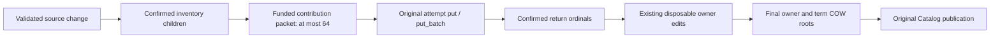

**Bounded verified-inventory reuse and tail-failure continuation (2026-10-13).**
Source inspection found that different admitted owners with the same immutable
body still normalize/build/install the same inventory independently. NativeText
prepare now owns a funded local window of at most 64 verified identities. A key
requires exact body ObjectRef and byte length under that prepare's one recipe;
every lookup still validates producer admission, size and original cancellation.
Only a freshly verified UTF-8 body and a successfully installed immutable
inventory enter the window. The original attempt's confirmed object custody
protects those roots through prepare. No raw body, foreign recipe/attempt or
persistent cache escapes. Existing prior/new inventory diff and per-owner
statistics validation remain, including on cross-owner hits.

The private container uses existing PreparedRows, reserves before growth and
stops retaining new identities at its fixed limit. Allocation refusal propagates;
no budget reset or hidden cache admission is invented. Physical experiment
interface: NativeTextIndex::with_inventory_reuse_limit(0..=64), where zero uses
the original uncached computation. Invalid limits refuse; changing the physical
limit does not change recipe/persisted output identity. Resource-envelope and
default throughput acceptance still need real service qualification.

The existing managed fixture compares cached and uncached 64-owner shared
corpora, requiring identical cold/delta artifact refs, complete query/statistics
gold and fewer reached custody inputs/calls with unchanged actual written bytes.
Distinct bodies remain a separate workload; this is not a claim of arbitrary
content reuse or total pipeline speedup. A focused identity/window fixture
checks rename, different body/length, excluded/wrong admission, bounded full
window, denial, original cancellation and exact grant refund.

The 65-owner physical regression additionally confirms a real 64-contribution
group, then refuses its final scalar tail. A one-shot hook must be consumed and
its confirmed-input count must be exactly 64. Latest, every original source
path, old/new retrieval and exact refused replay must remain unchanged. The
second failure uses a distinct original event stream; it does not rebind the
earlier refused event identity. Existing stage_sources windows upload the test
inputs, without another runner or producer.

Verification reconciliation (2026-10-13):

- **FAILED, fixture then corrected:** the initial managed tail run returned
  InvalidInput before the injected refusal. Its event stream differed from its
  original operation/staging key. The native cost helper now binds all three
  to the same original key; this was not a reproduced product batch defect.
- **VERIFIED:** `./scripts/cargow --lane shared nextest run --lib --test
  native_lifecycle -p quanta-index-storage -p quanta-index-lexical -p
  quanta-index-kernel --all-features --locked --offline --test-threads 2
  --no-tests fail --failure-output immediate --success-output immediate -E
  'test(native::text::tests::) | test(native::text_spool::tests::) |
  test(native::text_memory::tests::) | test(object::io_observation::tests::) |
  test(object::tests::) |
  test(=native_text_one_owner_patch_cost_is_independent_of_unrelated_owner_count)'`:
  67/67 passed, 645 skipped, four binaries, 35.878 seconds. The managed fixture
  executed the cached/uncached artifact and query gold, bounded funding and
  actual 64-confirmed/last-tail-refusal/replay oracles. These are scoped results
  on the compiled shared-tree source, not qualification of concurrent edits.
- The same-run shared 64-owner cold comparison reached 144/144 reserve/confirm
  calls with reuse disabled versus 20/20 enabled; inputs were 883 versus 511.
  Actual writes stayed 509 and written bytes stayed 75,548; cold/delta artifact
  refs matched. The distinct-body cold case still reached 151/151 calls, and
  each 64-owner one-file delta reached 12/12 calls and 25 inputs. This proves
  conditional repeated-inventory work reduction, not a qualified latency gain.
- **FAILED:** scoped all-target/all-feature strict Clippy exited 101 on
  `InventoryReuse::lookup`: `suspicious_operation_groupings` rejects the local
  `entry.body == record.bytes`/length comparison naming. Align the private field
  name with the canonical source field, then rerun affected strict verification.
  Do not suppress the lint or report this continuation fully accepted.
- **VERIFIED, prior scoped check:** the Lexical/Kernel module snapshots include
  the two private reuse types. Physical service resource-envelope, latest
  integrated suite and qualified throughput remain **NOT_RUN**.

**Occurrence output/edit admission and one-owner deletion continuation
(2026-10-13).** Static review found that OccurrenceWrites::flush installed its
packet before admitting SQL MapEdit backing and did not reserve its confirmed
ObjectRef output array. It now admits both overlapping bounded arrays under the
original WorkBudget before installation, allocates edit backing before object
IO, and retains the grant through reference consumption and SQL insertion.
Key custody is declared before edit data so error unwinding also drops data
before releasing its grant. The private VerifiedInventory field is now named
bytes, matching SourceRecord; the previous strict failure is preserved above.
No lint suppression, parallel IR, new port or scheduler was introduced.

The focused occurrence fixture uses fixed JSON payload gold and an independently
calculated two-row allocation envelope. Insufficient headroom and original
cancellation must cause zero installation calls, leave queued data unchanged
and produce no inventory edits. The actual refusing writer checks the live
reference/edit/payload/key envelope at the installation boundary; its error is
preserved, the temporary array charge returns, and packet drop refunds exactly.
The existing token-build live-memory oracle includes these overlapping arrays.

The existing managed NativeText cost oracle now also deletes the hot owner
after the replacement/failure cases, keeping old and replacement views pinned.
For 1/64/65-owner shared and 64-owner distinct corpora, plus the explicit uncached
64-owner comparison, it independently checks docs/tokens/DF, every unchanged
owner and its original source ref, no deleted-owner hits/source entry, old pinned
retrieval, Latest and exact successful replay with zero object-install IO.
The measured deletion rejects full prior-source scans/unrelated-record reads,
requires zero new occurrence inputs, and compares visited entry counts across
corpus sizes. It uses the original operation/staging/event key on a distinct
stream; no skipped frontier or identity rebinding is used.

**VERIFIED, preceding deletion-only snapshot:**
`./scripts/cargow --lane shared nextest run -p quanta-index-kernel --test
native_lifecycle --all-features --locked --offline --test-threads 1
--no-tests fail --failure-output immediate --success-output immediate -E
'test(=native_text_one_owner_patch_cost_is_independent_of_unrelated_owner_count)'`:
1/1 passed, 50 skipped, 38.446 seconds. All five deletion gold/cost/replay cases
executed. The 64/65-owner deletion samples each reached seven paired
reserve/confirm calls and 16 inputs, versus six calls/eight inputs for deleting
the only owner. These are reached object-helper counts, not raw device IO,
necessary GC/drain cost or a latency SLO. This snapshot predates the subsequent
occurrence output/edit admission repair; it is not its verification.

**Current verification:** the same NativeText/spool/memory/object plus managed
cost selector printed above completed **VERIFIED: 68/68 passed**, 645 skipped,
four binaries, 36.448 seconds (compile 31.15 seconds). It includes the new
occurrence envelope denial/cancellation/refusal/refund fixture and all five
managed cold/replacement/deletion/artifact/pinned/replay/failure cases on the
repaired code. The latest deletion samples preserve seven paired calls/16
inputs at 64/65 owners and zero new occurrence inputs, with no full source
scan or unrelated source reads. Scoped formatting/diff, Hexagonal boundaries,
test-authority and document-path checks are **VERIFIED**.

The subsequent all-target strict run **FAILED (exit 101)** on two test-only
`Result::ok()` conversion expressions; the private bytes naming repair itself
produced no further naming error. Both expressions now preserve typed conversion
failure with `map_err`. Product code did not change after the 68-test checkpoint.
The exact affected two-test retry is **VERIFIED: 2/2 passed**, 581 skipped,
0.024 seconds (compile 40.74 seconds):
`./scripts/cargow --lane shared nextest run -p quanta-index-lexical --lib
--all-features --locked --offline --test-threads 2 --no-tests fail
--failure-output immediate --success-output immediate -E
'test(=native::text::tests::occurrence_flush_admits_refs_and_edits_before_install_and_refunds_after_refusal)
| test(=native::text::tests::changed_body_scratch_reservation_work_scales_with_token_batches)'`.
Those two tests overlap the 68-test scope; no 70-test total is claimed.
The next strict attempt also **FAILED (exit 101)** on the deletion fixture's
`explicit_iter_loop`; iteration now borrows `&ranked.hits`, preserving the same
Vec traversal and gold. This is a test-only style correction, not a product
behavior repair. The third affected strict attempt **FAILED (exit 101)** on
six new errors in the concurrent Literal result-custody implementation
(`native/literal.rs`: four must_use_candidate, one type_complexity and one
redundant_closure_for_method_calls). This output reports no further error in
the owned NativeText/deletion hunks; a failed dependency traversal is not a
strict pass for them. Literal is the active result-custody owner's write set;
this lane does not add duplicate repairs or immediately rerun an unchanged
partial source. The next strict integration waits for that owner's source
checkpoint. Runtime and static results above retain their exact scopes and do
not qualify concurrent changes or the complete workspace.

**Kernel ingress capture and source-stage baseline continuation
(2026-10-13).** The existing NativeText cost fixture previously constructed
every source through scalar stage_source_text before starting its publication
clock. Kernel/SDK already provide a bounded child-first stage_sources path,
so that fixture could neither measure its cost nor prove that the product
batching path reduces preparation work. No new staging port or runner is needed.

The same managed helper now builds fixed corpus inputs before measurement,
then selects either existing scalar staging or existing stage_sources windows
of 32 under the same original OperationKey/IngressRef. Source-stage wall/object
snapshots surround the actual staging calls. Ingress-capture snapshots include
begin_input, source staging, owner-mutation construction/sealing and exact
transition assembly; they end before the independent read oracle and index
publication. Corpus generation, filesystem discovery, producer analysis, IPC,
queries, reopening, GC and mandatory drain remain outside these measured scopes.
Catalog work contributes to wall time, but its physical WAL/device IO is not
part of ObjectIoSnapshot.

Source staging is a **subset** of ingress capture. Do not sum the two elapsed
or IO totals as disjoint work. The fixture explicitly prints `stage=scalar` or
`stage=batch32` and five phase labels: source_stage, ingress_capture,
cold_index_publish, one_owner_delta_publish and one_owner_delete_publish.
The clocks are observed-mode diagnostics, not qualified timing comparisons.

Every returned source ordinal is checked outside both clocks by decoding its
actual immutable record and comparing path, admission, byte length, exact
single body edge, leaf children and original body bytes. The existing full
query/statistics/old-pin/failure/replay golds still execute. The 64-owner shared
scalar versus batch comparison requires identical cold/replacement/deletion
artifacts and identical actual source write calls/bytes. Reached source custody
calls must match the independent API shape: two scalar installs per source or
one batch per 32-file window; confirms remain paired. A 65-owner case checks
32/32/1 staging and the existing late contribution refusal, while distinct
bodies and disabled inventory reuse remain separate workloads.

The 32-file windows here are valid only for the fixed small-byte corpus.
Current Kernel and SDK also preflight path/body/metadata allowance against
8 MiB; Kernel additionally checks actual encoded object wire bytes before
installation. File count alone is not a general production packing algorithm.
Actual producer integration must pack against both bounds and preserve typed
refusal for an oversized or incompatible input. It must not raise the batch
limit, silently retry a rejected upload as scalar, or treat this tiny-corpus
comparison as acceptance of maximum-width/Unicode-path/large-file staging.

Source-established F01 seam: Kernel stage_sources still uses unfunded Vec
backing for bodies/records/predictions/returned refs and clones input.bytes
before immutable installation. Its WorkUsage charge and 8 MiB batch bound
are not live-memory leases. The scalar source-record JSON encoder likewise
has no WorkBudget argument. These are allocation-custody gaps, not reproduced
OOM incidents. The active Core/Kernel custody integration must admit the used
arrays, body and JSON copies before birth and keep returned-reference custody
through Runtime conversion/emission; moves or borrowed input may remove
copies only within the single canonical contract. This cost fixture's direct
Kernel budgets do not qualify the real service's memory envelope.

**Current checkpoint:** formatting/diff, Hexagonal and test-authority checks
are **VERIFIED**. The existing managed-cost test plus all native_source_batch
tests first **FAILED at compilation (exit 101, E0277)**: owner-count literals
in the diagnostic phase matrix inferred i32, which cannot use u64::from.
The matrix now explicitly binds the count to u8; no product behavior changed
and zero runtime tests executed in that attempt. The corrected exact selector
is pending its original live resource-gated handle; runtime/comparative
acceptance is **NOT_RUN** until terminal results are inspected. Affected
Storage/Lexical/Kernel all-target strict Clippy **FAILED
(exit 101)** on the concurrent Literal result-custody code's type_complexity
and redundant_closure_for_method_calls. This is the current executed failure;
the prior six-error output is historical, not a claim that all six errors
remain. No duplicate Literal repair is made by this lane.

The first corrected runtime attempt also **FAILED at compilation (exit 101)**
on the concurrent LiteralPageParts unreachable-public alias. Again zero runtime
tests executed, and this lane does not bypass the compile guard or edit that
owner's facade. Recheck the actual alias export/source checkpoint before the
next exact retry; the fixed fixture owner-count type remains in place.

The actual LiteralPageParts export was subsequently observed in native/mod.rs
before starting the next exact runtime/strict retry. Its affected all-target
strict attempt **FAILED (exit 101)** on the concurrent native_source_rebase
fixture's wildcard_enum_match_arm at published() (native_source_rebase.rs:402).
The owned staging diagnostic hunks emitted no error in that output, but this
is not a strict pass. The new capture-rebase test remains with its original
owner; no duplicate edit, lint suppression or whole-workspace green promotion
is made. The exact managed-cost/native_source_batch runtime handle is still
live, so runtime/comparison stays **NOT_RUN** until its terminal output.

**Corrected terminal runtime checkpoint (2026-10-13): VERIFIED.**
`./scripts/cargow --lane shared nextest run -p quanta-index-kernel --test
native_lifecycle --test native_source_batch --all-features --locked --offline
--test-threads 2 --no-tests fail --failure-output immediate
--success-output immediate -E 'binary(=native_source_batch) |
test(=native_text_one_owner_patch_cost_is_independent_of_unrelated_owner_count)'`
executed 2/2 tests across two binaries, 50 skipped, 33.759 seconds (compile
9.08 seconds). The managed test executed all six corpora and 30 diagnostic
phase samples, including ordinal/child/body/query/artifact/old-pin/delete/fault
and exact replay golds; the existing batch test independently exercised its
source admission/order/dedup/refusal cases. No qualified speedup is inferred.

Same-run shared 64-owner staging reached 128 paired reserve/confirm calls
through scalar versus two through existing batch32. Actual source writes
remained 66 and bytes 21,099; batch reached 67 registration inputs versus
scalar 128, reflecting bounded within-batch duplicate-body reuse. Downstream
cold/replacement/deletion artifacts matched. Source singletons fell from 128
to zero; these are concrete helper calls and attempted registration inputs,
not raw syscalls, unique durable bytes or a general workload latency ratio.

The remaining capture cost is now visible: batch32 source staging reached two
calls, but complete ingress capture reached 68 calls and 64 singletons
(200 registration inputs and 48,630 written bytes). At 65 owners, source
staging reached three calls while ingress capture reached 70 and 65 singletons.
Static follow-up found per-mutation scalar immutable installation in the
streaming StageMutationCursor and network stage_mutation_page. This is a used
F04 batching candidate, not a missing index backend or a reason to reduce
durability. Inspect ordering, full-stream digest/count, ingress custody,
bounded packet memory and late-error semantics before replacing those scalar
writes with the existing install_batch. Network pages allow 128 mutations,
so physical batches must stay within the store's existing 64-input bound.
Keep the complete EOF seal and original owner/expected/next identities; never
derive a sealed receipt from queued/predicted references. Coupled source
ownership is required because the capture-rebase owner shares update.rs.

This comparison qualifies only its recorded fixed corpus and assertions.
Initial filesystem/producer/IPC capture, maximum-byte packing, F01 staging
leases, sustained maintenance and full product/performance gates remain open.

Native Large/XL, long-history/mandatory upkeep, actual producer/IDE, physical
operating caps and F01--F09 acceptance remain separate requirements.

Sources: [object observer](../../../crates/quanta-index-storage/src/object/io_observation.rs),
[install hooks and fixed-wire/failure fixtures](../../../crates/quanta-index-storage/src/object.rs),
[existing native Text cost oracle](../../../crates/quanta-index-kernel/tests/native_lifecycle.rs).

#### Kernel mutation-staging batch continuation (2026-10-13)

This supersedes the scalar-install candidate above with implementation, not
performance acceptance. Shared `main` HEAD remains
`c32cd191554031b9a7d04207ffa3410e8fc201ba`; the implementation is dirty.
The `증분 (2)` lane owns the new private Kernel `mutation_staging.rs`, its
module declaration, former cursor relocation and `stage_mutations` /
`stage_mutation_page` call hunks, plus the existing cost-oracle tail fault.
Source rebase/resync, canonical escaped-key custody, IPC response custody and
physical capacity retain their existing owners.

- Streaming and network pages use one private cursor and the original
  `ImmutableObjectPort::install_batch`, ingress sink, WorkBudget, cancellation
  and deadline. Network pages still allow 128 items; physical packets allow
  at most 64 and 8 MiB. No new public IR, wire format, publication path or
  scheduler is introduced.
- Before allocation, the cursor reserves bounded packet metadata and performs
  a checked JSON byte census followed by encoding into admitted capacity.
  Actual installed registrations must exactly match the predicted length,
  order and identities before any edit is emitted. Prediction is validation,
  never publication authority. Only `next` is a physical child; `expected`
  remains historical CAS metadata.
- The logical digest uses the same canonical JSON bytes and original domain.
  The entire iterator must reach EOF and drain its confirmed pending outputs
  before a descriptor is returned. An iterator/install/order/budget failure
  latches the cursor; neither a confirmed prefix nor a swallowed error can
  become a sealed mutation manifest. Network complete-map sealing remains an
  independent count/digest/EOF check.
- Five private tests cover 129-item packet/order/digest gold, historical-child
  exclusion, exact-64 EOF, cancellation after confirmation with pending
  backing, empty/floor denial, late invalid/error tails, wrong installation
  receipts and final reservation release. The managed 65-owner cost oracle
  additionally confirms 64 actual mutations, refuses the final packet,
  checks unchanged Latest/member state and retries the original ingress to
  independently traverse all returned mutations through complete EOF.

**VERIFIED — production-library strict only:**
`./scripts/cargow --lane shared clippy -p quanta-index-kernel --lib
--all-features --locked --offline --no-deps -- -D warnings` returned exit 0,
25.68 seconds compiler report. It excludes dev-dependency IPC and the new
tests. Earlier production-library check and narrow Kernel module-baseline
update also returned exit 0. Scoped formatting/diff and Hexagonal pass.

**FAILED — earlier selected runtime compilation:** the new Kernel lib,
native_lifecycle/native_source_batch/native_source_rebase selection returned
101 before executing tests: concurrent IPC initially had an unused response
encoder import and an unmatched `ResponseMemoryLimited` variant. The import
is now test-only; the variant match remained missing at this static recheck.
**FAILED — initial test-authority check:** the concurrently created
`native_source_resync.rs` target lacked its catalog entry. These coupled
owner changes are not patched or suppressed by this lane. New mutation tests
and managed tail/cost comparison remain **NOT_RUN** until selected execution.

**VERIFIED — later static recheck:** after the resync owner registered its
target, `just rust-test-authority` returned exit 0. `just rust-module-discipline`
passed all 46 facade files; `just rust-no-allow` returned exit 0. Scoped
`rustfmt --check` and diff checks passed. The subsequent narrow Kernel module
snapshot check **FAILED** only for the concurrent source-resync owner's new
`source::ProducerOwnerCursor`; the mutation module entries match. Its owner
must accept that new structure and update the baseline after its source
settles. `SourceResync` is now present in Contract and Kernel source, so the
earlier audit's absent-code observation is superseded by in-progress
implementation, not runtime acceptance. No baseline is blindly refreshed to
hide another owner's active change.

Remaining F01 seams include escaped `MapEdit.key`, source body/JSON/array and
returned-reference lifetimes, decoder/allocator/SQLite/vendor buffers and
physical operating caps. This declared packet envelope is not a hard RSS
bound. The old 68/70 capture-call baseline is not a result for this new
implementation. Full capture/producer/IPC, Native Large/XL, long history,
mandatory upkeep, actual IDE, integrated suite and F01–F09 acceptance remain
open; no qualified speedup or delivery completion is claimed.

#### Kernel source-preparation allocation continuation (2026-10-13)

The `증분 (2)` lane additionally owns `staging_payload.rs`, its module entry,
the private source-record encoder and scalar/batch source-preparation hunks
in `update.rs`, and memory/empty-source cases in `native_source_batch.rs`.
The earlier unfunded-source-preparation observation is partially superseded:

- Source and mutation JSON share one private checked census/reservation/encode
  helper. JSON and path-copy capacity are admitted before allocation, under
  the original budget. Data precedes its lease in owned backing. This internal
  helper changes neither SourceRecord/OwnerMutation JSON nor the public IR.
- Batches reserve declared metadata and body-copy bytes before allocating
  body/record/predicted/returned arrays and cloning bodies. Arrays use fallible
  explicit capacity; record leases survive actual ordered installation and
  packet data destruction. Body input is still borrowed from the caller;
  caller-side intake and decoder custody are not established by this repair.
- Empty bodies skip a zero-byte reservation, which MemoryScope rejects by
  contract. Scalar source preparation identifies content, admits its record
  backing before either installation, then checks the actual content identity
  before installing the record. Prediction is never emitted as authority.
- The real-store source test adds floor-only scalar and batch denial with
  independently absent body objects, plus empty UTF-8 source scalar/batch
  identity and observable reservation/refund checks. Existing order, child,
  text-admission and dedup golds remain intact. The managed corpus matrix
  remains the actual capture/cold/update/delete oracle.

The first production strict check **FAILED** on three new unchecked metadata
multiplications and the active resync owner's `source.rs` comparison-chain
lint. The new multiplications were changed to checked arithmetic without
suppression. The selected runtime then **FAILED during compilation**, zero
tests executed, on the active IPC codec's unused `oversized_for` function.
Its owner removed that obsolete function and repaired/renamed the frame-memory
error classifier. The next selected compilation **FAILED**, zero tests ran,
on this lane's new test sink lacking mandatory batch methods, an ignored
atomic peak result and an existing SourceAdvance-only fixture's missing
SourceResync refusal arm. All three test consumers were repaired explicitly,
without relaxing the sink contract, suppressing warnings or broadening that
fixture to accept resync. A fresh identical selected run is pending.

**VERIFIED — newer production-library compilation:**
`./scripts/cargow --lane shared check -p quanta-index-kernel --lib
--all-features --locked --offline` returned exit 0, 29.02 seconds compiler
report, after the source-preparation and checked-arithmetic repairs. This
excludes test compilation/execution. Strict and runtime results remain separate;
the old production strict pass does not qualify these newer source changes.

Format/diff, test-authority, Hexagonal, no-allow and module discipline pass.
The exact inspected module drift contains the moved JSON writer, new private
StagedPayload and the resync owner's expected bounded producer-owner cursor;
the canonical narrow Kernel baseline update returned exit 0 and its independent
comparison is pending. Accepting a module shape does not accept source-resync
behavior.

This funds Kernel temporary preparation, not the complete F01 chain. The
returned source-reference Vec still escapes without its own retained lease;
canonical MapEdit keys, original intake/decoded bytes, transport and physical
allocator/RSS/cache/spill/WAL acceptance remain open. Census encoding adds a
pass to source-record preparation; no qualified latency speedup is claimed.
F01–F09 remain active.

**VERIFIED — selected actual runtime after compiler repairs:**
`./scripts/cargow --lane shared nextest run -p quanta-index-kernel --lib
--test native_lifecycle --test native_source_batch --test native_source_rebase
--all-features --locked --offline --test-threads 2 --no-tests fail
--failure-output immediate --success-output immediate -E
'test(mutation_staging::tests::) | binary(=native_source_batch) |
binary(=native_source_rebase) |
test(=native_text_one_owner_patch_cost_is_independent_of_unrelated_owner_count) |
test(=staged_mutation_pages_reject_duplicate_count_and_stale_ingress) |
test(=source_path_cycle_crosses_mutation_cursor_pages)'`
returned exit 0: 12/12 tests across four binaries, 66 skipped, 38.506 seconds
execution and 9.10 seconds compiler report. The final compiler repair also
consumed the mutation fake scope's atomic peak return value. Five private
mutation laws, real source memory/empty/order gold, three rebase cases and
three lifecycle scenarios actually executed; fault cases and the corpus
matrix are subcases, not extra test counts. This is no source-resync or
full-product qualification.

| Fixed managed capture corpus | Prior scalar-mutation checkpoint calls / singletons | New batch-mutation calls / singletons | New actual writes / written bytes |
|---|---|---|---|
| Shared 64, source batch32 | 68 / 64 | 5 / 0 | 199 / 48,630 |
| Shared 65, source batch32 | 70 / 65 | 7 / 1 | 203 / 49,444 |
| Shared 64, source scalar | 194 / 192 | 131 / 128 | 199 / 48,630 |

Calls are paired original object-install reserve/confirm callbacks, not raw
syscalls. The source/manifest written bytes and ordinal/child/body/cold/update/
delete/old-pin/replay gold remain intact. Historical call counts above refer
to the recorded old scalar-mutation implementation on the same fixed input
shape; they are not matched-host timing evidence.

The fixed <=65-owner cost fixture now rejects capture above source-stage
calls plus ceil(owners/64) mutation groups plus two manifest-map groups, and
requires equal confirmation calls. This workload-specific callback budget
prevents per-mutation scalar custody regression without promising a corpus-
independent global map or latency bound. The affected cost-only Nextest
recheck returned exit 0: 1/1, 50 skipped, 25.518 seconds execution, 27.26
seconds compiler report. It is a subset rerun, not a thirteenth distinct test.
The newer comparison again observed capture 5/7 calls, 48,630/49,444 bytes
and the actual 64-confirmed/last-packet-refused/retry-complete gold.

Independent narrow Kernel module comparison returned exit 0 (`module tree
unchanged`). The affected lib/three-test strict check **FAILED** solely on
the concurrent source-resync comparison-chain lint. Its owner has now changed
that branch to an exhaustive cmp match. The identical strict retry returned
exit 0, 34.58 seconds compiler report, for Kernel lib/native_lifecycle/
native_source_batch/native_source_rebase. This qualifies that source checkpoint,
not the later retained-reference return change below.
Native Large/XL, physical RSS/disk/WAL/GC/drain, actual producer/IDE and full
suite/CI/release remain separate acceptance scopes.

#### Source-stage returned-reference custody continuation (2026-10-13)

This supersedes the returned-Vec implementation gap above with a coupled
resource-owned return contract. Shared dirty `main` HEAD remains
`c32cd191554031b9a7d04207ffa3410e8fc201ba`. The `증분 (2)` lane owns only
Core's StagedSourceReferences/iterator and exports, Kernel source result
reservation/return hunks, the Contract borrowed StagedSources serializer,
runtime execute/dispatch/reply source-return hunks and their selected tests.
Producer enumeration, embedding provider/cache and other resource paths
retain their existing owners.

| Boundary | Coupled behavior | Preserved constraint |
|---|---|---|
| Core | One non-Clone StagedSourceReferences owns Vec backing before its lease; its consuming iterator retains that same backing charge through drop | Reject an explicitly insufficient lease; no implicit deep copy or lease-detaching Vec conversion |
| Kernel | stage_sources returns that carrier; reserve retained result bytes before any object installation and separate them from temporary packet metadata | Original budget, ordered actual confirmations, source count/body/child identity and bounded batch remain exact |
| Runtime | The existing execute method returns NativeReply; StageSources moves the carrier into its scoped variant while other inline replies use Plain | No second dispatch/API implementation; execution reservation ends at dispatch return while memory remains |
| Wire | Borrow the references directly through the canonical StagedSources variant ordinal 16 | JSON/CBOR unchanged; SDK response decoding remains the original DTO, no state-format bump for allocation custody |

The real source test now distinguishes temporary denial from future retained
denial: either refuses before the independently absent body can be installed.
Empty-source output stays charged while returned references/the consuming
iterator own backing and releases once on iterator drop. Runtime ledger gold
requires no CPU/IO/provider reservation after the reply escapes, live==retained
memory through canonical emission, and zero live charge after final drop.
Standalone unlimited WorkBudget callers still carry an optional lease; the
actual Native dispatcher supplies its existing ledger scope. This carrier is
allocation custody, not a second logical source IR.

**VERIFIED — Core/Contract selected laws:**
`./scripts/cargow --lane shared nextest run -p quanta-index-core
-p quanta-index-contract --lib --all-features --locked --offline
--test-threads 2 --no-tests fail --failure-output immediate
--success-output immediate -E 'test(index::records::staged_source_tests::) |
test(=native_protocol::tests::borrowed_staged_source_references_preserve_json_and_cbor_wire)'`
returned exit 0: 3/3, two binaries, 459 skipped, 0.015 seconds execution,
13.13 seconds compiler report. This proves owning-iterator final release,
underfunded-carrier rejection/release and canonical JSON/CBOR roundtrips.
Kernel production-library check also returned exit 0, 23.27 seconds compiler
report; it is not runtime acceptance.

**FAILED — initial coupled compilation, zero tests executed:** the runtime
library attempt encountered active producer-enumeration types/helpers/variants
not yet connected. The following selected runtime attempt encountered active
TextEmbeddingBatch provider/cache and Semantic consumer migration errors.
Those owners have since connected the inspected types/consumers. The identical
Contract/Kernel/Runtime selected runtime and affected strict checks are pending;
do not promote the three independent laws to actual service acceptance.
The concurrently new producer-recovery test initially lacked its test-authority
entry; the owner registered it and the subsequent test-authority check passed.
Scoped formatting/diff and Hexagonal pass. Core/runtime module drift includes
the inspected resource-carrier and producer-enumeration changes; baselines
must be reconciled through the canonical tool after their source settles.

Remaining F01 seams include original decoded intake, other escaped cursor keys,
scratch/vendor allocation and physical allocator/RSS/cache/spill/WAL/disk
acceptance. Actual SDK/UDS and source-stage cost acceptance for this changed
return contract are recorded below; Native Large/XL and F01–F09 are not closed.

**VERIFIED — actual source-return integration:**
`./scripts/cargow --lane shared nextest run -p quanta-index-kernel
-p quanta-index-searchd-runtime --test native_lifecycle
--test native_source_batch --test native_index_uds --all-features --locked
--offline --test-threads 2 --no-tests fail --failure-output immediate
--success-output immediate -E 'binary(=native_source_batch) |
test(=native_text_one_owner_patch_cost_is_independent_of_unrelated_owner_count) |
test(=native_uds_source_lifecycle_status_old_view_and_reopen)'`
returned exit 0: 3/3, 86 skipped, 24.862 seconds execution. These are the
real-store source admission/empty/iterator cases, the fixed managed corpus
cost/fault/query gold and the actual SDK/UDS source lifecycle/status/old-view/
reopen case. The source-reference carrier crosses the real Native dispatcher
and canonical wire without changing the client DTO. The capture callback
budget and written-byte/artifact gold remain intact; timing is diagnostic,
not qualified performance.

**FAILED — intermediate checks, not hidden:** the first coupled test
compilation also exposed this lane's old Result equality assertion requiring
PartialEq on the resource owner. It now matches the required ResourceLimited
variant without adding resource-owner value equality. The strict check found
this lane's Result::ok conversion; it now uses checked multiplication and a
mapped conversion error. Its other two errors belonged to the active
TextEmbeddingBatch capacity helper. The subsequent lib-selected runtime
compilation failed on 34 errors in the concurrently added provider-custody
tests (macro declaration order, constructor and OwnerKey fixture shape among
them); no selected runtime ledger test executed. The actual integration
selection above uses normal integration targets and does not qualify that
lib test or its data-only slot assertion. Both remain pending rather than
being counted as successful omissions.

**VERIFIED — structure/public API reconciliation:** canonical Core/Kernel/
Runtime module updates returned exit 0, followed by independent module-tree
comparison exit 0 for all three. Canonical Core/Contract public API updates
returned exit 0; independent comparison also returned exit 0, unchanged.
Source shapes were inspected before update; baseline acceptance is neither
provider nor producer-recovery runtime acceptance. Format/diff, test-authority,
Hexagonal, no-allow and 46-facade module discipline pass. New whole-scope
strict, runtime ledger, original intake/cursor/vendor/physical operating and
F01–F09 acceptance remain separate work.

#### Storage writer preparation continuation (2026-10-13)

Current-source F01/F04 audit found that `FileObjectStore::identify` encoded an
entire temporary object wire only to discard it after hashing, and the same
encoding in `prepare_object` carried work-byte accounting without live memory
custody. The scratch map loader also returned an unowned wire buffer. This
continuation owns only private writer preparation, the scalar borrowing path,
and the coupled scratch-wire consumer; publication/adoption/GC protocols retain
their existing authorities.

- One checked canonical header binds payload length and ordered child count.
  Identity hashes the existing domain, header, ordered child bytes (including
  duplicates) and payload directly. It allocates no wire buffer and preserves
  the original work-byte charge, limits, identity and wire format.
- Encoding acquires a Temporary lease before fallible exact wire reservation.
  PreparedObject keeps the wire before its grant in field/drop order. Scalar
  installation borrows from this owner through reservation, write, sync and
  confirmation instead of destructuring data away from the lease. Batch and
  reachable-map installation use the same PreparedObject owner.
- Scratch reading reserves declared wire length before copying the borrowed
  SQLite blob. It rejects length drift before buffer extension and transfers
  the same wire owner into the prepared map object after canonical decoding.
  The decoded StoredObject retains its independent existing custodian.
- Fixed SHA-256 gold covers empty payload, ordinary payload and ordered repeated
  children. Real-store laws cover scalar denial, second-wire batch denial before
  durable reservation/IO, confirmation-time funding and scalar/batch panic
  refund. Scratch laws cover wire-only and decode-overlap denial and successful
  prepared-wire lifetime.

**VERIFIED — Storage selected regression:**
`./scripts/cargow --lane shared nextest run -p quanta-index-storage --lib
--all-features --locked --offline --test-threads 2 --no-tests fail
--failure-output immediate --success-output immediate -E
'test(object::write_preparation::tests::) |
test(prepared_wire_admits_before_decode_and_retains_charge_after_decode) |
test(object::tests::) | test(map::tests::)'`
returned exit 0: 37/37, 28 skipped, 4.196s execution and 29.28s compile.

**VERIFIED — changed-source Native return/writer integration:**
`./scripts/cargow --lane shared nextest run -p quanta-index-storage
-p quanta-index-kernel -p quanta-index-searchd-runtime --lib
--test native_lifecycle --test native_source_batch --test native_index_uds
--all-features --locked --offline --test-threads 2 --no-tests fail
--failure-output immediate --success-output immediate -E
'test(object::write_preparation::tests::) |
test(=map::scratch::tests::prepared_wire_admits_before_decode_and_retains_charge_after_decode) |
binary(=native_source_batch) |
test(=native_text_one_owner_patch_cost_is_independent_of_unrelated_owner_count) |
test(=native_uds_source_lifecycle_status_old_view_and_reopen) |
test(=native::native_closeout_tests::staged_source_reply_retains_only_memory_until_canonical_emission_ends)'`
returned exit 0: 8/8, 315 skipped, six binaries, 27.237s execution and 39.55s
compile. Four private laws overlap the previous 37-test packet; do not add the
counts as 45 distinct cases. The previously unexecuted source-return Runtime
ledger law now executes against the real Native ledger and passes. This
supersedes that law's pending verdict in the preceding continuation, without
promoting other provider tests or the entire workspace.

The same-run shared 64-owner capture retained 199 actual writes / 48,630 bytes
and five paired custody calls; cold publish retained 509 writes / 75,548 bytes
and 20 calls (144 without inventory reuse). Distinct 64-owner cold still had
822 writes / 108,894 bytes and 151 calls. The streaming identity change removes
the preparation-only wire copy, not durable writes or that remaining cold
cost. Timing is diagnostic and is not a qualified throughput comparison.

Scoped formatting/diff, Hexagonal, test-authority and independent Storage
module comparison are **VERIFIED**. The first affected all-target/all-feature
Storage strict check **FAILED** on three new test-only lints (similar names,
panic in Result and manual assert). The fixture now isolates its intentional
panic injection and uses a distinct snapshot name, without any lint allowance;
its repaired four laws execute in the accepted eight-test packet above.
**VERIFIED — affected Storage strict retry:**
`./scripts/cargow --lane shared clippy -p quanta-index-storage --no-deps
--all-targets --all-features --locked --offline -- -D warnings` returned exit 0,
46.21s compiler report. This qualifies the affected Storage targets; it does
not qualify the distinct Core/Kernel/Runtime strict scopes or full workspace.
No allocation-free overall identity claim is made: RegisteredObject child/output
vectors, batch metadata/sets, path/FD and other decoded owners remain F01 seams.
Logical wire custody does not qualify allocator RSS/SQLite/cache/spill/WAL or
physical disk capacity. Cold/delta throughput, Native Large/XL and F01–F09
acceptance remain separate requirements; no counter or time limit was relaxed.

#### Storage commit metadata continuation (2026-10-13)

Current-source follow-up found that prepared batch installation deep-cloned
RegisteredObject and its child vectors without live allocation custody, and
allocated reference sets, gate indexes and gate guards despite the existing
64-object bound. This continuation owns the private inner commit workspace;
the single Core port and Catalog reserve/sync/confirm protocol are unchanged.

- RegistrationBatch admits the declared registration-array and copied-child
  backing before any fallible allocation. Data fields drop before its one
  Temporary grant on success, refusal, cancellation and unwind. The consumer
  receives only a borrowed slice through durable reservation and confirmation.
- A sorted fixed 64-reference table replaces the two heap reference sets.
  Binary search plus a fixed seen table preserves duplicate rejection, ordered
  child-first validation, repeated child edges and external-child detection.
  Each membership lookup remains O(log 64).
- Gate indexes and guards use fixed 64-entry arrays. Sorting and skipping
  repeated indexes retain the original ascending lock order. Every acquired
  guard stays alive through the final confirmation callback.
- Independent laws cover metadata-floor denial before custody or external
  child lookup, exact copied-edge order/duplicates and final charge release,
  child-first/duplicate/64+1 boundaries, and real callback-time gate custody.
  The gate fixture uses two distinct canonical objects sharing shard 45
  (payload bytes 6 and 7) plus a different shard; latest coupled execution must
  cover that fixture after its final edit.

**VERIFIED — selected Storage packet:**
`./scripts/cargow --lane shared nextest run -p quanta-index-storage --lib
--all-features --locked --offline --test-threads 2 --no-tests fail
--failure-output immediate -E 'test(object::write_preparation::tests::) |
test(object::tests::) | test(map::tests::) |
test(=map::scratch::tests::prepared_wire_admits_before_decode_and_retains_charge_after_decode)'`
returned exit 0: 41/41, 28 skipped, 4.086s execution and 28.71s compile.
Four new metadata/reference/gate laws extend the previous Storage packet;
do not count the overlapping 37 again. The intermediate latest Native packet
also passed 12/12, 315 skipped, six binaries, 26.950s execution and 45.02s
compile; this includes the final same-shard gate fixture. Its first strict
check **FAILED** on ten dynamic indexing/slicing lints. All affected accesses
now use checked bounds with typed BackendViolation; no allowance or fallback
success was introduced. The private membership helper propagates bounds errors.

**VERIFIED — final changed-source union:**
`./scripts/cargow --lane shared nextest run -p quanta-index-storage
-p quanta-index-kernel -p quanta-index-searchd-runtime --lib
--test native_lifecycle --test native_source_batch --test native_index_uds
--all-features --locked --offline --test-threads 2 --no-tests fail
--failure-output immediate -E 'test(object::write_preparation::tests::) |
test(object::tests::) | test(map::tests::) |
test(=map::scratch::tests::prepared_wire_admits_before_decode_and_retains_charge_after_decode) |
binary(=native_source_batch) |
test(=native_text_one_owner_patch_cost_is_independent_of_unrelated_owner_count) |
test(=native_uds_source_lifecycle_status_old_view_and_reopen) |
test(=native::native_closeout_tests::staged_source_reply_retains_only_memory_until_canonical_emission_ends)'`
returned exit 0: **45/45**, 282 skipped, six binaries, 28.460s execution and
29.96s compile. This single union includes the 41 Storage laws plus four actual
source/cost/UDS/Native-ledger cases; previous packets overlap this result.

**VERIFIED — affected strict retry:**
`./scripts/cargow --lane shared clippy -p quanta-index-storage --no-deps
--all-targets --all-features --locked --offline -- -D warnings` returned exit 0,
34.50s compiler report. Formatting/diff, Hexagonal, test-authority and canonical
Storage module update followed by independent unchanged comparison are
**VERIFIED**. These results qualify the selected boundaries, not other active
owners or the complete workspace.

Remaining source-established seams are the outer batch builder's unique/output
arrays and child clones, public returned RegisteredObject/MapEdit-key lifetime,
referenced-shard path sets and other path/FD/vendor allocations. A Temporary
lease ending before returned data dies cannot close those escaping contracts.
No hard RSS/cache/spill/WAL/disk or qualified throughput claim is made. Whole
cold/capture/delta/history/upkeep, actual producer/IDE/deployment and F01–F09
remain the original complete delivery/acceptance scope.

#### Canonical cursor-edit ownership continuation (2026-10-13)

The prior F01 register identified escaped MapEdit keys. Current-source audit
located the concrete emission boundary: MapEditCursor returned OrdinalMapEdit
with an unowned Vec key, while SQL cursors copied that key again for continuation.
This continuation changes the single canonical OrdinalMapEdit at that boundary;
it does not introduce a parallel cursor IR or change persisted map/wire bytes.

- Core OrdinalMapEdit now shares one immutable data value containing ordinal,
  ordinary edit payload and Retained allocation custody. copy_key/copy_key_parts
  admit the declared key/shared-value/Arc-header footprint before fallible key
  allocation and shared-value birth. Clones share the same key and charge;
  only the final clone releases. A standalone unscoped constructor is used by
  direct Storage test inputs, not the inspected Native producer paths.
- Kernel mutation staging admits every returned position before packet
  installation, and exposes those positions only after the original ordered
  confirmation matches the predicted registration. Pending positions retain
  their own future floor; digest/EOF/failure-latch rules remain unchanged.
- Projection and source-owner/path/frontier emission, Storage slice cursors,
  Lexical text/literal scratch cursors, RepoMap scratch rows and Kernel map/work
  scratch consumers use this same canonical position. SQL decoders borrow
  bounded BLOBs and exact nullable references before an admitted key copy.
  Continuation retains a shared position instead of cloning its key Vec.
- Kernel edit/work map pages retain their 128-entry array backing reservation
  separately from per-position data. An empty page allocates/reserves nothing.
  Work-map projection reads key/ref only; original work payload staging remains
  the existing separate producer authority.
- Core laws cover fixed prefixed-byte gold, shared backing, final-only refund,
  future-floor denial and original cancellation. Mutation laws preserve
  64/64/1 groups, exact digest/edges, refusal/order/length/EOF and add key-floor
  denial before any packet installation. A real Native ledger law verifies
  that an escaped/shared position keeps memory after execution ends while
  CPU/IO/provider reservations are released.

Initial implementation checkpoint, superseded by the 57-test acceptance below:
scoped formatting/diff, test-authority and
Hexagonal **VERIFIED**. Coupled Rust tests are live, **NOT_RUN** until their
terminal result is inspected. Intermediate affected-all-target compilation
**FAILED** on unused/dead items after the boundary change, a live RepoMap
import cleanup and a missing Core test Digest import; these were repaired.
Compilation failures are not executed assertion failures. Core public API and
affected module baseline reconciliation is recorded in the continuation below.

This funds emitted cursor positions and their inspected continuation lifetime,
not every raw input allocation. Source path/frontier intake, work-action
payload staging, RegisteredObject child/output arrays, other scratch/vendor
buffers and physical RSS/cache/spill/WAL/disk remain F01 seams. Initial and
incremental throughput, Native Large/XL, actual producer/IDE/deployment and the
complete F01–F09 register remain separate delivery/acceptance scopes.


#### Storage internal cursor custody continuation (2026-10-13)

The prior emitted-position change left two used Storage consumers unclosed:
MapScratch::next_edit still copied SQLite key/reference BLOBs into plain MapEdit,
and initial radix construction cloned its continuation key. Current-source audit
confirmed both calls, in build_empty_root and apply_sorted_existing_root.

- MapScratch now returns the same canonical OrdinalMapEdit via the shared
  bounded borrowed-row decoder. Exact nullable references are decoded before
  admitted key birth; no private second cursor/key IR is introduced.
- Both bootstrap and existing-root algorithms retain that position for keyset
  continuation. Bootstrap clones shared custody, not key backing; existing-root
  transfers the position after processing. CAS, sorted prefix work, root bytes
  and node installation authority remain unchanged.
- insert_node compares an existing collision row through its borrowed bounded
  BLOB; it no longer allocates a duplicate full wire for equality checking.
- The new SQL law uses fixed prefixed-key/reference gold. It checks zero-floor
  refusal, exact-cap admission, shared backing/final release, EOF without another
  reservation and malformed reference rejection before key admission. The
  existing prepared-wire law also checks identical-row comparison at zero floor.

The prior coupled session 32782 terminated with exit 101: Lexical lib test had
three compile errors, two old Vec continuation assignments and one move of
MapEdit out of the new shared position. The fixtures now use admitted positions
and an explicit oracle-value clone; SQL seek/step and sorted-delta golds remain
unchanged. Zero tests executed in that failed compile. **VERIFIED — expanded coupled retry:** session 14506 returned exit 0,
57/57 tests, 1,136 skipped, ten binaries, 28.695s execution and 24.99s compiler
report. This packet includes Core's two cursor laws, Kernel mutation staging,
Lexical text/literal scratch, RepoMap owner/path and FileMap regressions, shared
SQL decoder, all selected Storage map/scratch laws, real Native retained-only
ledger, source batch, one-owner update cost and actual UDS lifecycle/reopen.
The measured execution time is a regression packet duration, not throughput.

```sh
QUANTA_INDEX_RESOURCE_WAIT_SECONDS=7200 ./scripts/cargow --lane shared nextest run \
-p quanta-index-core -p quanta-index-kernel -p quanta-index-storage \
-p quanta-index-lexical -p quanta-index-repomap -p quanta-index-scratch-sqlite \
-p quanta-index-searchd-runtime --lib --test native_source_batch \
--test native_lifecycle --test native_index_uds --all-features --locked --offline \
--test-threads 2 --no-tests fail --no-fail-fast --failure-output immediate \
-E 'test(index::records::ordinal_edit_tests::) | test(mutation_staging::tests::) | test(map_edit_sql_decoder) | test(native::text_spool::tests::) | test(native::edit_spool::tests::) | test(native::scratch::tests::) | test(map::tests::) | test(map::scratch::tests::) | test(ordinal_map_position_keeps_only_memory) | binary(native_source_batch) | test(=native_text_one_owner_patch_cost_is_independent_of_unrelated_owner_count) | test(=native_uds_source_lifecycle_status_old_view_and_reopen)'
```

**VERIFIED — structural/static checks:** scoped rustfmt, diff, test-authority,
Hexagonal and doc/prompt integrity pass. Storage module baseline was updated for
the shared test ledger; independent comparison of all six affected module trees
returned unchanged (session 54724, exit 0). Independent Core public-API comparison
returned unchanged after its earlier canonical update (session 93658, exit 0).
**FAILED — first affected strict:** seven-package all-target/all-feature
Clippy (session 84219) returned exit 101 on the new Core constructor's
`doc_markdown` comment. The method reference was marked as code; no lint was
suppressed and no production behavior changed. **VERIFIED — strict retry:** the same seven-package all-target/all-feature
command (session 25345) returned exit 0; compiler report 3m40s. This qualifies
Core/Kernel/Storage/Lexical/RepoMap/ScratchSQLite/Runtime owned targets, not the
entire workspace, vendor warnings, product performance or release.

```sh
QUANTA_INDEX_RESOURCE_WAIT_SECONDS=7200 ./scripts/cargow --lane shared clippy \
-p quanta-index-core -p quanta-index-kernel -p quanta-index-storage \
-p quanta-index-lexical -p quanta-index-repomap -p quanta-index-scratch-sqlite \
-p quanta-index-searchd-runtime --no-deps --all-targets --all-features \
--locked --offline -- -D warnings
```

Remaining F01 includes source-path/frontier intake and work-action payloads,
RegisteredObject children/outer batch arrays, other decoded/container owners and
actual SQLite/vendor physical admission. These repairs do not establish hard
RSS/disk capacity, quiet-host cold/delta speed, Native Large/XL, actual
Semantica/IDE/deployment or F02–F09 acceptance. The original full scope remains.


#### Canonical registration and batch-output custody continuation (2026-10-13)

Source audit confirmed that streaming identity avoided a full wire buffer but
returned unowned child vectors; install_batch duplicated those vectors and
returned an unowned slot array. An extracted StoredObject.registration clone
could outlive the parent allocation owner. This changes the one current metadata
contract and its used producers/consumers, without a persisted-format change.

- Core index/registration.rs owns immutable shared RegisteredObject data.
  copy_children/copy_from_iter admit the declared child/shared-value/Arc-header
  footprint before allocation; clones retain one charge and ordered repeated
  children. Explicit unscoped construction belongs to caller inputs/fixtures or
  the existing wire decoder, not the inspected Storage Native producers.
- RegisteredObjectBatch replaces the raw Vec return of ImmutableObjectPort's
  bounded install_batch. Slots are admitted before allocation, pushes cannot
  grow past the requested bound, and consuming iteration keeps slot custody
  until iterator drop. Individual emitted objects keep their own shared charge.
- Storage identify/prepare use the admitted registration factory. Object decode
  separates payload and registration leases; extracting registration does not
  lose child/shared-value custody when StoredObject drops. The streaming
  physical reclaim reader admits registration and its 64 KiB private block
  before allocation, then transfers returned metadata custody.
- Batch preparation admits unique/reference-array backing. A fixed 64-entry
  sorted digest-to-original-ordinal index replaces allocator-owned BTreeMap
  nodes, preserves physical child-first input order and exact wire collision
  checks, and uses binary lookup plus bounded stack shifts. Commit callback
  arrays clone shared registrations rather than duplicating child backing.
- Coupled Core/Storage/Kernel/Catalog/Runtime and adapter fixture constructors
  use the same metadata type. Corruption fixtures now explicitly construct
  altered metadata instead of mutating shared backing. The closed three-field
  serialization contract remains reference/bytes/children; the private wire
  decode bridge is not a second runtime index IR or an admission implementation.

**VERIFIED — initial affected compilation:** eight packages, all targets/features,
locked/offline check returned exit 0 (session 67868), compiler report 4m10s.
Subsequent focused execution compiles the final tests/changes independently.

**FAILED — first coupled runtime:** session 66638 returned exit 100: 317 run,
316 passed, one failed, 1,168 skipped, eleven binaries, 46.013s execution. The
fixed-reference-table law called streaming identify under its zero-allocation
*table* scope; returned metadata now correctly needs retained capacity. Its
caller input preparation was moved to the separate existing preparation budget.
The table itself still operates under zero capacity, and all independent
child-first/duplicate/64/65 assertions remain. The new retained-denial law
separately checks that metadata or returned-slot refusal precedes custody/IO.

**VERIFIED — expanded runtime retry:** session 98081 returned exit 0:
318/318, 1,168 skipped, eleven binaries, 48.410s execution and 18.96s compiler
report. It includes the fixed digest-index zero/full/duplicate/original-ordinal
law, Core custody/closed JSON, complete selected Storage and Catalog libraries,
mutation staging, used adapter regressions, real Native retained-object lifetime,
source batch, single-owner cost and actual source/Semantic UDS reopen. Counts
from the earlier failed packet are not added to this result.

**VERIFIED — API:** Core canonical baseline update (82540) followed by independent
unchanged comparison (69728), both exit 0. Affected module baseline updates
(83128, Storage final 84606) completed; subsequent comparison (4487) found seven
unchanged trees and one concurrent Semantic LoadedSourceRecord addition. The
8-package module comparison is FAILED pending that owner's reconciliation.

**FAILED — first affected strict:** session 91319 returned exit 101. Own
BatchIndex lookup used prohibited Result::ok; it now explicitly distinguishes
found slot from ordinary insertion position, without a lint allowance. The same
execution found a concurrent Semantic return-type mismatch: SourceUtf8 clones
plain SourceRecord while ProjectionUtf8 returns LoadedSourceRecord. That new
source-decode owner is active in the separate indexing-layer audit; it is not
repaired by discarding its decode lease. Full affected strict acceptance remains
NOT_RUN after these changes. **VERIFIED — scoped production strict:** Core/Storage libraries, all features,
locked/offline no-deps `-D warnings` returned exit 0 (45337), 36.94s compiler
report. This does not qualify the failed eight-package all-target command.
**VERIFIED — final focused runtime after the lookup repair:** session 21221
returned exit 0: 16/16, 305 skipped, two binaries, 0.251s execution and 8.44s
compiler report. It executes the Core three custody/closed-wire laws, actual
Storage wire/registration/slot admission, confirmation/unwind, digest/reference
bounds and shared-key/scratch-wire ownership. It overlaps the 318-case packet;
counts are not aggregated.

**FAILED — first scoped all-target strict:** session 71811 returned exit 101 on
four new test-only lints: observer/snapshot similar names, an effect-free lifetime
binding and two implicit raw-pointer borrows. Names/argument binding and explicit
raw-const pointer syntax were repaired; assertions, ceilings and golds were not
removed and no lint allowance was added.

**VERIFIED — scoped all-target strict retry:** Core/Storage, all targets/features,
locked/offline no-deps `-D warnings` returned exit 0 (97405), 29.24s compiler
report. Test-authority, Hexagonal, scoped formatting and diff checks pass. This
still does not qualify the concurrent Semantic source-decode change or the
failed broad eight-package command.

```sh
QUANTA_INDEX_RESOURCE_WAIT_SECONDS=7200 ./scripts/cargow --lane shared clippy \
-p quanta-index-core -p quanta-index-storage --no-deps --all-targets \
--all-features --locked --offline -- -D warnings
QUANTA_INDEX_RESOURCE_WAIT_SECONDS=7200 ./scripts/cargow --lane shared nextest run \
-p quanta-index-core -p quanta-index-storage --lib --all-features --locked \
--offline --test-threads 2 --no-tests fail --no-fail-fast --failure-output immediate \
-E 'test(index::registration::tests::) | test(object::write_preparation::tests::) | test(map::scratch::tests::)'
```

This changes metadata allocation/Arc work and bounded lookup constants. No
cold-build or incremental latency speedup is inferred from unchanged wire/IO
counts. Quiet-host whole-pipeline measurement, Native Large/XL and operations
remain F04/F09 requirements. Remaining F01 includes Catalog wire/JSON decoded
metadata and sorted child-copy backing, source path/frontier/work payloads,
other decoded/container owners, vendor/cache/spill/WAL/FD and physical limits.
Actual Semantica/IDE/deployment and the complete F01–F09 register remain open.

#### Work payload and coverage preparation custody continuation (2026-10-13)

The `증분 (2)` continuation preserves the complete F01–F09 scope. Current
source still uses one immutable-store input IR and one WorkBudget authority;
this change adds data custody rather than a scheduler or publication path.
Source event/recovery and Catalog/Semantic decoded-record owners remain with
their existing active lanes.

The preceding work-payload checkpoint completed **44/44 selected tests**,
1,454 skipped, 38.532 seconds, with `scripts/cargow --lane shared nextest run`
over Contract/Core/Kernel/Catalog/Lexical/RepoMap/Runtime. Its selected filter
covered Core work and the runtime returned-reference lifetime law, spool/mutation preparation,
native adapter scratch, target registration, native source batching,
work-manifest leaf boundaries, retirement/reconfigure/replay, the one-owner
cost oracle and real UDS source/Semantic lifecycle. That result precedes the
coverage changes below and is not promoted to their acceptance.

Implemented boundaries:

- WorkIntent hashes stream the same canonical JSON into SHA-256. Work action
  keys are fixed 33-byte values; canonical decode reserves parser allowance
  before decode and compares reserialization against original bytes without
  another encoded Vec. Scratch action pages admit row backing and each bounded
  payload before copying. Fixed JSON bounds are 16 KiB; the fixed-field wire and
  child-set oracles preserve prior identity and edge semantics.
- Core `StagedObjectReferences` generalizes the existing source-only returned
  carrier. AttemptContext reserves its retained reference array before backend
  installation; an empty batch performs no install. Consuming iteration retains
  the array charge. Source changes here were limited to this coupled type and
  empty-batch handling; no alternate staging return IR remains.
- Core `ObjectChildren` replaces the work-specific helper as the one inline,
  sorted, deduplicated set for fixed records with at most three references.
  Work and coverage share its constructor. Coverage `covered` values remain
  historical comparison stamps; only desired source/projection and searchable
  objects become live physical edges.
- Kernel `staging_payload::StagedObjectBatch` owns canonical ObjectBatchInput
  arrays, per-row payload/child leases and their metadata reservation. Work and
  coverage use it through synchronous install/binding. It has no installation
  authority, no wire type and no independent policy. The deployed 64-object
  store-group envelope and existing 8 MiB packet limit remain.
- Pending coverage arrays allocate lazily at their first leaf, after reservation.
  Their 64-slot charge survives drain/reuse and ends with backing. Empty work
  does not create this array. OwnerCoverage JSON is counted and admitted before
  encoding, under a 16 KiB fixed-record bound; maximal-value wire comparison
  checks its fit against the previous serde_json encoder.
- Coverage checks every returned identity/order before writing any scratch
  binding, and sends borrowed fixed keys through EditSpool::push_key. Existing
  MapEdit callers delegate to that same SQL authority; no new edit IR exists.

New unit laws cover array-floor denial, child-copy refusal and payload refund,
opaque payload/edge preservation, original cancellation, refusal past batch
capacity, lazy pending coverage, exact 64-slot drain/reuse lifetime and
fixed-record wire/physical-edge golds.

Final coupled command (**VERIFIED — 34/34**, 498 skipped, 52.211 seconds):

```sh
QUANTA_INDEX_RESOURCE_WAIT_SECONDS=7200 ./scripts/cargow --lane shared nextest run \
  -p quanta-index-core -p quanta-index-kernel -p quanta-index-searchd-runtime --lib \
  --test native_lifecycle --test native_projection \
  --test native_semantic_projection --test native_noop_cost --test native_index_uds \
  --all-features --locked --offline --test-threads 2 --no-tests fail \
  --no-fail-fast --failure-output immediate \
  -E 'test(index::work::tests::) | test(staged_source_tests::) | test(spool::tests::) | test(staging_payload::tests::) | test(update::coverage_staging_tests::) | binary(native_projection) | binary(native_semantic_projection) | binary(native_noop_cost) | test(staged_source_reply_retains_only_memory) | test(=async_coverage_and_work_manifest_cross_leaf_batch_boundary) | test(=owned_terminal_replay_survives_work_retirement_restart_and_fresh_create) | test(=native_reconfigure_bootstraps_async_and_retires_work_atomically) | test(=native_text_one_owner_patch_cost_is_independent_of_unrelated_owner_count) | test(=native_uds_source_lifecycle_status_old_view_and_reopen) | test(=native_uds_semantic_query_fixed_cosine_coverage_reopen_and_composed_pump)'
```

**Executed first current run — FAILED:** 29 selected tests ran, 27 passed and
2 failed, 319 skipped, 45.079 seconds. Empty batches and empty child lists
incorrectly reserved zero bytes, which the canonical MemoryScope rejects.
Allocation-free preparation now checks the original budget and owns no memory
lease. Both original refusal golds remain unchanged for the retry. Projection,
Semantic projection, frontier-only/no-op, work lifecycle and the one-owner
cost cases passed in this executed run; this is not final repaired acceptance.

**Executed first affected strict — FAILED:** fixed action keys exposed
`needless_borrows_for_generic_args` at WorkActionDigest's SHA update. Removed
the unnecessary borrow without a lint allowance. The queued affected strict
retry retains all-target/all-feature coverage for Contract/Core/Kernel/Storage/
Catalog/Lexical/RepoMap/Semantic/Runtime.

**Executed repaired second run — FAILED:** 29 ran, 28 passed and 1 failed,
319 skipped, 45.973 seconds. All seven new preparation laws passed. The remaining
old scratch fixture classified an injected raw SQLITE_FULL as ResourceLimited
after the concurrent SQLite taxonomy repair removed that unsupported inference.
The coupled fixture now separately proves explicit pre-write reservation denial
with unchanged reservation/zero rows, the raw SQLite hard-page-cap refusal, and
its unwitnessed Storage outcome. It does not simulate real ENOSPC. An intermediate
focused command failed compilation because the new count fixture used u64 with
rusqlite FromSql; corrected to SQLite's signed i64. The final coupled command
above includes this fixture and both actual UDS lifecycle cases.

The second affected strict stopped on the concurrent scratch namespace's
`too_long_first_doc_paragraph`; splitting that paragraph preserves its explicit
non-physical-cap contract without a lint allowance. Final affected strict is
pending terminal inspection.

The subsequent nine-package all-target strict command also **FAILED** on two
redundant RegisteredObject clones in Catalog's provisional-custody fixtures
and a new Lexical scratch count decoded as u64. The fixtures now borrow the
original immutable registration before their intentional child Vec copy;
the SQLite count is i64. Their rollback/refusal assertions remain intact.
These are coupled fixture/strict repairs, not new engine algorithms. The same
affected command is live for final inspection; its failure history is not
replaced by the earlier narrow Core/Storage pass.

The following affected strict attempt also **FAILED** on Core's
`items_after_test_module`: CanonicalWorkWriter was below the work unit module.
Moved that existing writer above tests without changing its implementation,
wire or public API. Core/Kernel module snapshots independently compared
unchanged after the declaration move. The final nine-package strict attempt
subsequently completed as recorded below; earlier partial results are not
promoted to its verdict.

**VERIFIED — final selected execution:** 34/34 passed, 498 skipped, 52.211
seconds. All seven new batch/coverage laws, both actual
`index::records::staged_source_tests` laws, the repaired scratch refusal/fault
fixture, existing work key/digest/canonical JSON laws, projection/Semantic
projection/no-op/work lifecycle and real UDS source/Semantic cases executed.
The one-owner oracle passed with fixed query/rebuild gold; its elapsed time
under concurrent host work is not a performance comparison. This binary
preceded the declaration-only writer move; no production body changed after
its compile. Earlier 44/44 and failing 29-test attempts overlap this scope and
their counts are not added.

**VERIFIED:** scoped formatting, `git diff --check`, hexagonal boundary check,
Core public API baseline update then independent unchanged comparison, and
Core/Kernel module baseline updates then independent unchanged comparisons.
**VERIFIED — prior checkpoint final strict:** Contract/Core/Kernel/Storage/
Catalog/Lexical/RepoMap/Semantic/Runtime, all targets/all features,
`scripts/cargow --lane shared clippy --locked --offline -- -D warnings`, exit 0,
5 minutes 50 seconds. This preceded the frontier and concurrent SourceRecordOwner
changes below; it does not qualify those new source inputs. The earlier
`index::staged_source_tests::` substring does not match Core's actual private
`index::records::staged_source_tests` path. A final named filter must use
`test(staged_source_tests::)` and inspect its two actual executed laws; no
missing selection is promoted to a pass.

Still open: source/frontier/projection and other decoded/preparation owners,
Catalog/VFS/physical disk/WAL/FD and allocator/RSS operating acceptance, complete
cold/capture/delta/history/upkeep performance, actual V9/IDE/deployment/full
domain parity and coherent integration/release. No scoped custody result proves
those performance or product requirements; F01–F09 remain active.

#### Frozen frontier preparation and edit-cursor custody continuation (2026-10-13)

This F01 continuation moves SourceEvent shape/frontier rules into the private
Kernel `frontier.rs` owner. Source producer-epoch/Advance/Resync authority,
path ownership and final publication remain their existing owners. The complete
F01–F09 register remains active.

Previously `validate_events` allocated expected refs, `stage_events` separately
allocated MapEdits/keys, and SourceEditCursor consumed those unowned arrays.
`PreparedFrontiers` now reserves one array before growth or frontier lookups,
copies the complete original SourceEvents into its rows and retains their
preconditions. `stage` consumes that preparation without accepting a second
event slice, so a caller cannot replace a validated envelope with a new event
sharing its producer/stream key. This is private data custody of the canonical
SourceEvent; no alternative persisted/wire IR or compatibility alias exists.

- Fixed 41-byte frontier keys preserve the old `frontier\0 + ProducerId +
  StreamId` byte order without a heap Vec.
- The same original WorkBudget funds the array and bounded event JSON. SourceEvent
  contains only fixed identities/u64 values; encode/decode bounds are 16 KiB.
  Typed decoding acquires an 8x+512 temporary parser allowance before parsing;
  the copied result has no heap-owned string/vector fields. This allowance is
  logical accounting, not an allocator/RSS guarantee.
- Frontier installation uses the existing common StagedObjectBatch and
  64-object immutable-store envelope. All returned ordinal identities are
  checked before modifying that group's prepared rows. Partial physical work
  still belongs to the original attempt; a later failure cannot publish a
  successful prefix or refund those durable writes.
- FrontierEdits owns the original array's consuming iterator and lease through
  final EOF/drop, without another VecDeque/key array. Its output is the existing
  admitted OrdinalMapEdit. Publication remains SourceEditCursor → existing COW
  maps → Catalog CAS; no new publisher, scheduler or state store exists.
- Empty backing checks original cancellation/deadline and acquires no zero-byte
  lease. Epoch/predecessor/identity checks and the operation-key/event-ordinal
  separation retain their prior behavior.

New unit laws cover allocation-floor denial, empty backing, frozen input,
iterator EOF custody, prior-epoch/predecessor/identity rules, journal-ordinal
independence, the independently written old key bytes and maximal event wire
comparison. The existing real lifecycle fixture additionally exercises 65
streams across the group boundary, all persisted event values, the old view
and a conflict in the final stream that must leave the published view unchanged.

**VERIFIED:** scoped formatting, `git diff --check`, hexagonal boundaries;
Kernel module snapshot updated then independently compared unchanged.
**FAILED initial narrow compilation:** first strict stopped on a concurrent
Core SourceRecordOwner transition's unused SourceRecord import; Core's owner
removed it. The first unit command then stopped on the same now-unused import
in Kernel source; removed that import while retaining the new owner. No
SourceRecordOwner implementation is attributed to this continuation.
An initial narrow Kernel strict then **FAILED** on a used underscore-prefixed
lease field during preparation-to-cursor transfer. Renamed that actually used
preparation field to memory without changing release order or adding an allowance.

**VERIFIED — selected unit execution:** 14/14 passed, 23 skipped, 0.098 seconds,
using `scripts/cargow --lane shared nextest run -p quanta-index-kernel --lib
--all-features --locked --offline --test-threads 2 --no-tests fail
--no-fail-fast --failure-output immediate`, filter `test(frontier::tests::) |
test(staging_payload::tests::) | test(update::coverage_staging_tests::) |
test(spool::tests::)`. All four new frontier laws and prior packet/coverage/scratch
laws executed.

**VERIFIED — actual coupled source execution:** 21/21 passed, 265 skipped,
41.405 seconds, seven binaries. The existing Kernel/Runtime front door selected
frontier laws, the new 65-stream persisted-marker/late-conflict test, independent
producer/old-view behavior, create/edit/delete/replay/cold reopen, all selected
native_noop_cost/source_rebase/source_resync binaries and actual UDS source and
Semantic queries. SourceResync crossing owner/path pages and producer isolation
also executed. No test result is inferred from a compiled-only target. These
counts overlap the 14-test unit scope and are not added together.

**VERIFIED — frontier-checkpoint Kernel library strict:** terminal exit 0,
14.53 seconds. The companion all-target strict **FAILED** on three IPC first-doc
paragraph lints, exit 101 in 41.40 seconds; the paragraphs were split without
allowances. These results precede the path changes below. Prior 34/34 and prior
nine-package strict also remain previous-scope evidence, not acceptance of later
source inputs.

Still open: path/other preparation owners, remaining decoded metadata,
physical Catalog/VFS/disk/WAL/FD/RSS admission, initial/delta/history/upkeep and
Native Large/XL performance, actual V9/IDE/deployment/capability and release.

#### Source path page, continuation and marker preparation custody (2026-10-13)

The previous source audit found an incomplete path-custody edit: the new page
producer called missing borrowed-row helpers while its callers still expected
VecDeque, unowned strings/BLOB vectors and the removed allocating path-key helper.
This continuation completes the coupled producer/consumer change within the
private Kernel boundary. It does not introduce a new persisted/wire IR, storage
engine, scheduler, publication authority or resource policy.

- SQL rows are read through borrowed ValueRef fields. Path type/byte bound,
  UTF-8/canonical-relative-path and nullable exact 32-byte owner/reference fields
  are validated before copying. Each owned row acquires its original retained
  charge before String/Arc backing; the 128-slot page is separately admitted.
  WorkUsage charges SQL row reads/bytes and remains distinct from live memory.
- PathRow shares one immutable String and charge. Its page cursor keeps slot
  backing charged through EOF; the continuation holds the same row rather than
  deep-copying a String. Exhausted cursor backing drops before the next page
  reservation. Path lookup keys are admitted before copying and expose only a
  borrowed slice, preventing a caller from detaching the Vec from its guard.
- Path owner markers use the existing bounded StagedObjectBatch and counted
  staging JSON encoder. At most 64 predictions stay on the stack. All returned
  identities are checked before writing any marker binding in that batch.
  Marker JSON, child edges, path namespace and final Catalog CAS are unchanged.
  The follow-up decode review also removes the unbounded generic path-marker
  decoder: both directions use a 16 KiB bound and the reader admits temporary
  parser allowance before JSON decode. The fixed OwnerKey result contains no
  escaping heap backing. This is logical parser admission, not a vendor/RSS cap.
- The producer-membership BTreeSet is removed. The existing canonical event
  shape validator proves sorted producer/stream order before allocation-free
  producer binary search; source epoch and Resync authority remain unchanged.

Three path-custody unit laws and three actual-SQL laws are implemented. The SQL
oracles exercise malformed type/UTF-8/canonical/oversize paths and malformed
nullable owner/reference fields under a zero-memory scope; empty output requires
no lease. A 129-row independent order oracle covers the 128-row boundary, retained
continuation after page destruction, empty tail, and refund of array/prefix
backing when the first or a later row cannot be admitted. A separate literal
owner/reference gold verifies both 16-byte owner axes and both 32-byte digests.
One follow-up marker-decode law preserves the previous maximal-value JSON wire,
tests refusal before parser admission, checks malformed/oversize input and
verifies refund. It was added after the 12-test checkpoint below.

**VERIFIED — static scope:** scoped rustfmt, git diff --check and the existing
hexagonal boundary check, Kernel module baseline update and independent unchanged
comparison. **FAILED — first library strict:** two new-source lints,
needless_pass_by_value and arithmetic_side_effects; the borrowed fixed-field row
is now Copy and ordinal growth uses checked_add. No allowances were added.
The first selected-test attempt **FAILED before execution** on eight unhandled
SQL fixture row-count results. Their explicit bindings are now present in the
shared source. The first all-target retry **FAILED** on four SDK lints introduced
by the coupled borrowed-input wrappers. Documentation now quotes StageSources;
owned wrappers explicitly drop their consumed inputs/request after the common
borrowed transport returns, preserving the public owned API and wire behavior.

**VERIFIED — pre-marker-decode Kernel all-target/all-feature strict:** terminal exit 0,
41.76 seconds. Dependency vendor warnings remain visible; this is not a
whole-workspace or vendor-clean claim. **VERIFIED — selected unit execution:**
12/12 passed, 31 skipped, 0.046 seconds (10.12-second compilation). All three
new path-custody laws, three actual-SQL laws, two prior path laws and four frontier
laws executed. **VERIFIED — coupled SDK/source/resync/rebase/UDS execution:**
64/64 passed, 446 skipped, 63.065 seconds across eight binaries, after 5m58s
compilation. All 13 selected path/source/frontier unit laws, SDK owned/borrowed
wire/ACK/cancel behavior, no-op/65-frontier/independent-producer checks, one-owner
cost gold, path handoff/collision/refusal/rebase, producer-wide Resync crossing
owner/path pages and actual UDS source/Semantic/reopen executed. This includes
the added marker-decoder law. Counts overlap earlier checkpoints and are not
added. It is not a throughput comparison or actual Semantica producer acceptance.

The post-marker strict attempt **FAILED before code checking** because the
offline dependency cache lacked adler2 2.0.1. Canonical locked fetch completed
without a lockfile update. The later metadata continuation below includes the
same sources in its pending affected strict. The prior 12-test/strict results
remain scoped to their earlier source; the 64-test result precedes the later
binding-metadata changes.

Canonical commands:

```sh
QUANTA_INDEX_RESOURCE_WAIT_SECONDS=7200 ./scripts/cargow --lane shared clippy \
  -p quanta-index-kernel --all-targets --all-features --locked --offline -- -D warnings
QUANTA_INDEX_RESOURCE_WAIT_SECONDS=7200 ./scripts/cargow --lane shared nextest run \
  -p quanta-index-kernel --lib --all-features --locked --offline --test-threads 2 \
  --no-tests fail --no-fail-fast --failure-output immediate \
  -E 'test(path_staging::tests::) | test(source::tests::) | test(frontier::tests::)'
```

Logical row/array custody does not fund SQLite vendor allocations/cache/spill,
allocator excess capacity, aggregate RSS/WAL/FD or physical disk growth. F01
retains those owners; F02–F09 and cold/delta/history/upkeep/Large/XL performance,
actual Semantica/IDE/deployment and final integration remain active.

#### Fixed publication-binding JSON and canonical four-child preparation (2026-10-13)

After the 64-test path checkpoint, source review confirmed unadmitted JSON
decoding/encoding and child Vec preparation in Kernel coverage/member metadata.
The used WorkPacket prediction array already owns its reservation and was not
repaired again. The active layering lane owns RepoMap preparation; this slice
owns Core ObjectChildren and the coupled Kernel binding producers/consumers.

The private binding_metadata module exposes typed read/write entrypoints only
for CoverageBinding, OwnerCoverage, MemberBinding and OwnerMemberBinding. Their
current fields contain fixed identities/scalars, not escaping heap data. Reads
bound JSON at 16 KiB and acquire original temporary parser allowance before
serde. Writes reuse the counted StagedPayload encoder; the original lease stays
alive through synchronous put/install. Validation of instance, input, policy,
edges and publication remains with the existing update/registry/Catalog owners.
The durable UpdateRequest decoder is deliberately excluded: its event vectors
need a real escaping owner, not the fixed-field helper's temporary allowance.

Coverage has at most four physical edges. Core's existing ObjectChildren is
therefore extended to Four and its one constructor now accepts four optional
references. All in-repository work/coverage/member callers move together; no
three-slot compatibility constructor or second child-set IR remains. This is
an intentional Core API break, not a persisted/wire-format change. The fixed
input/destination arrays have four slots; sorting, distinct filtering and zip
cannot drop a fifth input because the public constructor cannot accept one.
Historical covered stamps stay outside physical child sets. Existing immutable
store canonicalization and final Catalog authority are unchanged.

Kernel query coverage validation, coverage retirement/load/save, owner coverage
and fixed member load/save use this boundary. Coverage/owner-member edges are
sorted sets. Ordinary MemberBinding edges are an ordered sequence, artifact
then optional input root, preserving aliases. Its private MemberChildren holds
one or two stack entries rather than reusing the set constructor. This prepares
the existing slice wire; it is not another semantic member IR. Child preparation
is stack-only and compared through borrowed slices. Private forwarding helpers are removed;
update imports the canonical helper functions directly. This does not fund
profile assembly maps, request event vectors, MapEdit preparation, Catalog/vendor
allocations, errors/transport, physical RSS/WAL/disk or the full F01 scope.

New oracles: all 625 combinations of four nullable/duplicate references against
an independent BTreeSet; old three-slot/null/duplicate and WorkAction wire laws
remain. Three binding tests cover maximal-value previous serde wire comparison
for all four types, decode/encode floor refusal and refund, literal physical
edge sets across Pending/Partial/Complete without historical dependencies, and
oversize/original-cancellation refusal. They are implemented, not yet accepted.

**VERIFIED — static scope:** scoped formatting/diff/hexagonal checks; Core public
API baseline update followed by independent unchanged comparison; Core/Kernel
module baseline updates followed by independent unchanged comparison. The API
snapshot explicitly records Four and the four-slot constructor.
**FAILED — first affected strict:** two newly concurrent Core request-budget test
Atomic results and an IPC first-doc paragraph. Core's explicit result handling
was already present when inspected; the IPC paragraph is split without an
allowance. These are coupled test/doc repairs, not new indexing algorithms.
The first selected compile **FAILED** on two test-only MapRoot::empty calls;
the canonical empty value is MapRoot(None), now used. No test executed in that
failed attempt. The full dependency-including strict retry subsequently
**FAILED** on 14 newly concurrent SDK transport lints. That active producer lane
retains its SDK ownership. The owned Core/Kernel all-target/all-feature strict
uses the normal --no-deps scope; it cannot qualify the separately failing SDK.
**VERIFIED — repaired selected execution:** 20/20 passed, 285 skipped,
0.076 seconds, two binaries (29.62-second compilation). All four WorkAction/child
laws including 625 independent-set combinations, three new binding laws, six
source laws, four staging laws and three existing coverage laws executed.
**VERIFIED — pre-ordered-member repair owned strict:** Core/Kernel, --no-deps,
all targets/all features, exit 0 in 1m48s. The dependency-including SDK failure
remains separate. **FAILED — actual coupled execution:** 21 ran, 19 passed,
2 UDS source/Semantic tests failed, 530 skipped, 26.220 seconds. Static RCA then
confirmed ordinary member wire children were incorrectly sorted by this change.
FileObjectStore hashes and stores supplied child order; Literal/Text readers
require artifact-before-input. The prior new unit golden incorrectly assumed
set semantics for that sequence, so it did not detect the regression. Writer
preparation now preserves original order and aliases; the reader is unchanged.
Literal reverse-order, alias and absent-root golds are added. No format stamp or
reader normalization workaround is introduced.
**VERIFIED — repaired actual coupled execution:** 21/21 passed, 530 skipped,
28.998 seconds, seven binaries (3m24s compilation). Work/child and binding laws,
async work/coverage cross-leaf boundary, retirement/replay/fresh create,
reconfigure, every selected projection/Semantic projection case and both actual
UDS source/Semantic/reopen tests executed. This proves the ordered-member repair
through the real query consumers; no earlier failing result is erased. The
20-test scope overlaps and counts are not added.

The repaired owned strict **FAILED** only on the ordered-member helper's
option_if_let_else rule. Its match is now the equivalent map_or, preserving the
sequence and aliases without an allowance. The next strict attempt **FAILED**
on a redundant test clone; the already last-used MemberBinding is now moved
into its alias/absence oracle. The broader Core/adapter continuation below
includes these sources in its pending strict. The 21-test binary precedes
this expression-only lint change; it is not a new algorithm or wire format.
The Kernel module baseline was updated after the private ordered sequence type
and independently compared unchanged. Full-workspace/SDK/physical/benchmark,
actual producer/IDE/deployment and final release remain separate.
The prior path 64/64 and pre-metadata strict results do not qualify these changes.

Selected tests use the normal locked/offline `scripts/cargow --lane shared
nextest run -p quanta-index-core -p quanta-index-kernel --lib --all-features
--test-threads 2 --no-tests fail --no-fail-fast --failure-output immediate`
with `test(index::work::tests::) | test(binding_metadata::tests::) |
test(update::coverage_staging_tests::) | test(staging_payload::tests::) |
test(source::tests::)`. A later actual projection/work/UDS checkpoint is still
required. F01–F09, initial/delta/history/upkeep performance, actual producer/IDE,
deployment, operating acceptance and final release remain active.

#### Core fixed-metadata decoder and actual adapter read coupling (2026-10-13)

Post-repair review found a structural seam: the Kernel-private decoder could not
be reused by actual adapters without a dependency cycle. Literal/Text/FileMap
readers still decoded MemberBinding directly, and Semantic still directly
decoded CoverageBinding, OwnerCoverage and OwnerMemberBinding. Those six used
read sites bypassed the new parser admission despite the Kernel-local tests.

The decoder and 16 KiB bound now live in Core index/metadata.rs. Four typed
entrypoints return the existing contract records under the original WorkBudget;
the generic implementation stays private, admitting temporary parser backing
and checking cancellation/deadline before and after decode. There is no backend,
runtime or Kernel dependency, alternative record IR or policy decision there.
Kernel retains counted write preparation and the ordered-member/sorted-set
edge helpers. It calls Core directly for reads; no private decoder twin or
forwarding read API remains.

The six adapter sites use Core's functions while retaining their exact original
reference/ticket/instance/input/policy/edge checks. Literal/Text/FileMap preserve
ordered member edges. Other ProjectionBinding/contribution, path-owner,
artifact/vector, durable request, profile assembly, errors/transport and
physical-resource seams remain under their existing owners. This is a selected
read-custody repair, not closure of all metadata or F01.

The prior binding unit oracles now exercise Core through the same entrypoints
used by adapters. **VERIFIED — static:** scoped formatting/diff and hexagonal
boundary checks; Core public API update then independent unchanged comparison,
and Core/Kernel module updates then independent unchanged comparisons.
**VERIFIED — five-package owned strict:** Core/Kernel/Lexical/Semantic/RepoMap,
--no-deps, all targets/all features, terminal exit 0 in 4m34s. SDK/vendor and
whole-workspace strict remain separate scopes.
**VERIFIED — actual coupled execution:** session 7926 completed with exit 0:
21/21 tests passed, 569 skipped, 28.287s test time and 6m26s compilation after
newly integrated vendor changes. The selected scope contains Core child/work
laws, binding admission laws, the 65-owner coverage/work boundary, terminal
retirement/replay, async reconfiguration, all selected real projection and
Semantic projection cases, and both actual Source/Semantic UDS old-view/reopen
cases. The pre-coupling 21/21 and earlier strict counts remain separate; they
are not added to this result. This result precedes request-preparation changes.
F01–F09,
initial/delta/history/upkeep/Large/XL, actual producer/IDE/deployment and final
release remain active.

#### Request JSON and publication event-copy preparation (2026-10-13)

The next F01 review distinguishes cumulative WorkUsage from live allocation
custody. charge_request_metadata already charged envelope/event work, but
submit and terminal replay still used serde_json::to_vec with an after-the-fact
length check. Request edges also created a temporary Vec; Source and Projection
publication separately cloned their event Vec without reserving its backing.

The private request_preparation module now reuses counted StagedPayload JSON:
count under the original cancellation/deadline and existing work upper bound,
reserve exact temporary output backing, then encode under that bound. Submit
holds the lease through immutable installation and releases it before driving;
terminal replay holds it through canonical identity calculation. Input work
charging, bytes, object hashing, admission and final Catalog decisions stay
with their original owners. No new request IR or persisted version is added.

Physical request dependencies use the existing stack ObjectChildren set:
source/resync owner-manifest root; projection owner-manifest root and complete
affected-domain certificate; reconfigure profile; materialize owner source and
projection. Historical expected/target source roots, Partial.missing and
ProjectionDomain historical stamps retain their prior exclusion. Sorting and
alias dedup preserve the previous request identity; ordered MemberBinding
edges remain a different existing wire contract and are not changed here.

PreparedEvents reserves len * size_of(SourceEvent) before copying. Its data
precedes its lease on abandonment. The coordinator keeps that owner alive
while the canonical Vec is consumed by the synchronous Catalog commit, then
releases it after commit returns on either success or refusal. Empty arrays
allocate nothing. This repairs custody of the existing separate copy; it is
not a claim that copying is necessary or faster. The durable request decoder
still needs its own actual retained Vec/Projection Box owner before allocation;
that future owner can support a measured ownership-transfer optimization.

Three independent laws cover every request-kind wire against the preexisting
serde serializer, exact output floor denial/refund and census overflow,
literal child-set null/alias/reverse-order/history golds, and the 65-event copy
floor, live charge through consumed commit data, empty and original-cancel
paths. The selected actual projection, work, empty-source FileMap and Source/
Semantic UDS old-view/reopen regressions are included in one coupled batch.

Static formatting/diff and hexagonal checks passed; the Kernel private-module
baseline was updated and its independent comparison reports unchanged. The
first selected build (80183) FAILED on one obsolete ProducerCompleteness import
left after child-helper extraction; no tests ran. The import was removed,
without lint exceptions. Retry 68166 completed VERIFIED: exit 0, 25/25 passed,
573 skipped, 36.046s tests and 1m03s compilation. The new preparation laws,
empty-source pinned FileMap query, actual Source/Semantic UDS and all selected
projection/work regressions executed. This result precedes registration and
coupling of the retained durable-request decoder. Strict 86757 subsequently
FAILED on decoder-only similar_names lint findings; its repaired, broader
source checkpoint is recorded in the next continuation. No earlier
21/21 result is added to these request-preparation tests. Logical leases
do not promise allocator/RSS, Catalog/WAL/vendor or physical disk ceilings.
F01-F09, initial/delta/history/upkeep/Large/XL and actual producer/IDE/release
remain active.

#### Durable request decoding and retained data custody (2026-10-13)

Static follow-up confirms load_request returned a bare UpdateRequest created by
ordinary serde decoding. StoredObject's byte lease did not cover the separately
allocated event Vec or ProjectionTransition Box. A temporary parser allowance
alone would refund while those allocations were still used by resume or commit.

The private request_decode owner now returns LoadedRequest: the existing
UpdateRequest and its retained backing lease, with data destroyed first.
Operation/body/source-mode/epoch and physical-edge checks remain in load_request.
Resume classification, owned replay comparison and prepare/commit keep this
owner while borrowing the canonical request. Materialize borrows the original
claim rather than trying to move data through the immutable owner. No live
lease is added to a persisted/SDK DTO and there is no alternate request IR.

Under the original WorkBudget, decoding first admits declared temporary parser
scratch. Borrowed serde_json RawValue slices locate the existing closed request
variant and its event array without allocating an event container. Closed
parser parts reject unknown/duplicate/missing fields; nullable projection
expected is explicitly required. These parts are transient parser structure,
not another public semantic contract. An allocation-free census counts events;
checked exact retained Vec and optional Projection Box bytes are reserved before
birth. A bounded DeserializeSeed fills only the preallocated vector and rejects
census mismatch/trailing input. Fixed Reconfigure/Materialize parser parts are
Copy-constrained and invoke the original scalar/WorkClaim codecs under parser
custody; a future heap-bearing payload cannot silently retain this uncharged
fixed-field assumption. Original cancellation/
deadline is checked before and after parsing and during event iteration, so an
interruption is not relabeled as JSON corruption. Kernel enables serde_json's
raw_value feature explicitly; only durable JSON reads change, not CBOR/wire tags.

Four laws compare all five original request kinds against the old contract
codec, retained bytes and data lifetime after WorkBudget drop; 65 events with
parser-only versus exact combined headroom; unknown/duplicate/missing nullable/
invalid event/trailing input corruption and refunds; original cancellation at
entry and during retained reservation. The coupled selection also executes
actual source rebase/resync, projection, retirement/work and Source/Semantic UDS
old-view/reopen paths. Test fixtures reuse the existing maximal request examples;
they do not define expected publication behavior from the new decoder.

This decoder still preserves the existing separately funded publication copy;
an ownership-transfer optimization requires a later coupled change. Parsing
uses multiple passes over control metadata. No initial/delta speed improvement,
allocator/RSS cap, error-string or Catalog/vendor memory closure is claimed.
Profile assembly/edit preparation, remaining adapter codecs and physical
capacity are separate F01 seams. All F01-F09 requirements stay open.

Scoped formatting/diff and hexagonal checks passed; Kernel module baseline
update and independent unchanged comparison completed, including the two
Copy-constrained fixed-variant parts. The test ledger explicitly consumes its
atomic update result under the repository's unused_results denial. Strict 86757 FAILED two similar_names findings in the event
seed helper; result/event_rows names replace the ambiguous names without a lint
exception. Retry strict 76625 completed VERIFIED: terminal exit 0, Kernel
--no-deps/all-targets/all-features/locked/offline, 11m12s Cargo time including
dev-dependency checks after the serde_json feature change. Vendor warnings are
separate from the owned Kernel strict scope. Selected test 73957 remains live
under the shared resource front door at this checkpoint. It subsequently FAILED
at compilation after concurrent ScratchConnection API integration: 24 Source/
Spool scope/type and test-call errors, no tests executed. Kernel strict's earlier
source is not promoted across that changed dependency. The coupled repair and
retry are recorded below; the earlier 25/25 preparation result does not qualify
this decoder. This build/check time is not an indexing performance measurement.

#### Profile lookup and member-edit preparation candidate (2026-10-13)

The next static F01 review locates three unadmitted profile trees in
build_members: prior/target BTreeMaps and a union BTreeSet. These are bounded
configuration (at most 4096 instances per profile), not a corpus-wide scan or
an established cause of the old XL timing. Member/coverage MapEdit vectors
and their member-key copies also lack preparation custody. Projection coverage
has the same edit-vector/key seam. The profile decoder already admits its own
stored profile/validation backing; that implementation is not duplicated here.

A private member_staging candidate is written but NOT registered or used by
the product at this checkpoint. ProfileIndex reserves a bounded sorted borrowed
reference array before allocation and merges the two ordered iterators without
a union container or deep InstanceSpec copy. MemberEdits allocates nothing for
an empty/no-edit plan, reserves arrays before their first birth/growth and keys
before copying, and keeps both old and new array charges through replacement.
Failed allocation/growth preserves prior rows; backing dies before its grants.
The existing canonical MapEdit and 23-byte member key remain unchanged.

Three laws are implemented: lookup/union parity with the prior independent tree
reference, duplicate and floor refusal; literal edit/key/predicate preservation
and key-floor denial, successful 65-row growth/refund/cancel; failed 65th growth
preserves all 64 prior rows and their exact live charge. These are NOT_RUN.
Scoped rustfmt/diff checks passed. Product coupling, module baseline and strict/
actual regression acceptance remain NOT_RUN; do not count this candidate as a
closed production seam. Durable-request execution 73957 remains live and is
allowed to reach its terminal result before these callers are changed. All
F01-F09 scopes, initial/delta/history/upkeep performance and release remain open.

#### Profile/member coupling and scoped scratch caller repair (2026-10-13)

The member_staging candidate is now registered and used by build_members and
projection_advance. Prior/target tree maps and the union set are removed. The
coordinator uses funded sorted borrowed profile indices and an allocation-free
ordered union. Both member/coverage edit buffers and Projection coverage use
lazy MemberEdits. Their exact original key bytes, expected/next predicates and
sorted unique map-port input stay unchanged. Reservation ownership remains in
the coordinator through synchronous map consumption; no additional persisted
IR, publication authority or all-corpus validation pass is introduced.

Durable-request test session 73957 FAILED at compilation, exit 101, after the
active scratch owner introduced ScratchConnection/ScratchConnectionScope.
Existing Source/Spool production temporary-scope arguments and direct fixture
SQL methods did not type-check: 24 errors, no tests executed. Minimum Kernel
caller repair adds explicit borrowed Connection dereference for helper calls
and scoped SQL access for fixtures, retaining the new operation/close authority.
It does not add a raw-connection fallback or restore the removed owner Deref.

Strict session 70879 then FAILED on the same coercion seam in dependencies:
Storage map scratch (3 production sites) and Lexical edit/text spools (9).
A narrow follow-up fixes the borrowed scope expression in those actual sites,
Lexical's affected fixture helper calls, and the equivalent RepoMap scratch
site. Existing driver, allocation, connection and cleanup lifetime logic remain
with their original owners. Source edits preserve that concurrent integration;
no unrelated physical-capacity redesign is assigned to this slice.

Scoped formatting/diff and hexagonal checks passed. Kernel module baseline
update then independent unchanged comparison completed. Four-package owned
strict 12652 remains live. Coupled test 50948 FAILED at compilation, exit 101:
Storage called ScratchNamespaceLease.namespace_identity before its concurrent
Core trait update was present in the compiled input; no tests ran. Immediate
source recheck finds the method now present in Core, Storage's test lease and
the Runtime lease implementation. The active scratch/physical owner is still
coupling this namespace lifetime and reader admission. Reconcile those current
interfaces before a new runtime retry; do not erase the failed attempt or
promote earlier strict source. Runtime acceptance remains NOT_RUN. The test selection keeps all request/metadata/member laws,
actual source/path/spool laws, rebase/resync, projection/work, pinned empty-source
FileMap and Source/Semantic UDS old-view/reopen regressions in one batch. No
previous source's pass count is promoted or added. Remaining BaseMember/erased
future allocations, other adapter/error codecs, physical budget, whole suite,
initial/delta/history/upkeep performance and F02-F09 remain open.

#### Coordinator base and erased-future custody candidate (2026-10-13)

The next static F01 source trace confirms BaseMember::Present(Box::new(binding))
is created in the coordinator without a grant, and both registered build and
owner-build adapters create Box::pin(async ...) without admitting their concrete
frame. Descriptor-refusal routes also box an async error unnecessarily.

The private build_staging candidate is written but NOT registered/coupled at
this checkpoint. PreparedBaseMember admits the exact MemberBinding Box payload
before creation, preserves the canonical BaseMember and holds the lease through
consumption. BuildFuture is a live owner returned by value containing the
existing IndexFuture and its grant; there is no second outer Box. Its safe poll
uses the existing Pin<Box<dyn Future>>. A factory receives AttemptContext only
after size_of::<F>() for the concrete monomorphized frame is reserved against
the original budget. This avoids borrowing a mutable captured context to fund
an already-created future, heuristic frame bounds, new synthetic budgets,
unsafe pin projection or a new persisted/public future IR.

Coupling must change the private erased-adapter/registry returns to
Result<BuildFuture, IndexError>, report unsupported descriptors synchronously,
and use ? before await in the two coordinator build call sites. Base custody
must survive the full asynchronous build, including Reuse, refusal and dropped
future. One base Box floor/transfer/refund law is implemented but NOT_RUN; future
factory-before-birth and drop-before-lease laws plus actual adapter acceptance
remain required. This does not admit arbitrary A::Delta/candidate/backend frame
allocations or returned errors. Those need their own producer boundaries.

Scoped formatting/diff passed. Product registration, module baseline, strict
and runtime acceptance are NOT_RUN. Existing strict 12652 and coupled test 50948
remain live; this candidate does not alter the product currently under that
verification. F01-F09 and the complete initial/incremental performance, producer,
IDE/operations/release requirements remain open.

#### Base/future production coupling and factory/drop laws (2026-10-13)

The build_staging candidate is now registered. Kernel required-member builds
admit PreparedBaseMember before constructing a prior binding Box and retain its
owner through registry build completion. Erased build/owner-build adapters call
the monomorphized future factory only after original frame reservation. Their
private registry return is Result<BuildFuture, IndexError>; both coordinator
callers and existing registry tests use ? before await. Unsupported descriptors
return the same typed error synchronously, without a boxed async error. Public
Core adapter ports, persisted records, descriptor/resource-demand validation,
plan/reuse/build and final publication authority remain unchanged.

Two laws are implemented: base Box floor/transfer/refund and original binding
parity; frame floor denial before the factory runs, exact frame headroom, drop
before first poll sees a live credit and releases data before refund, and original
cancellation prevents factory execution. The existing NoIo context fixture is
reused; a failed memory admission cannot be mistaken for adapter IO success.
Captured A::Delta/candidate/backend allocations and escaped errors remain
separate F01 owners. This is not a process RSS or indexing-speed claim.

Strict 12652 completed FAILED, exit 101, after this coupling: the newly added
base fixture omitted the current MemberBinding.logical_commitment field.
The source contract had changed in the shared tree; the fixture now sets a
literal independent Digest. No lint waiver or wire repair was introduced.
Scoped formatting/diff, hexagonal and Kernel module update passed; independent
module comparison, four-package strict 19067 and coupled test 39239 remain
pending terminal evidence. The selected scope adds both new laws and all actual
registry tests to the previous source/path/spool, request/metadata/member,
rebase/resync, projection/work and Source/Semantic UDS old-view/reopen batch.
All F01-F09, physical/operating, initial/incremental performance, actual producer/
IDE and final release scopes remain open. Earlier passes are not promoted.

#### NativeText pinned-member read custody (2026-10-13)

The source audit found that the direct FileMap member query already uses the
Core fixed-field decoder. It is not reassigned or rewritten. NativeText's
`pinned_root` still used generic JSON for its published MemberBinding; that call
now uses the same Core `decode_member_binding` and original WorkBudget. Ordered
member edges, exact member equality, source-policy checks and the root logical
commitment remain unchanged. No new wire format, decoder implementation or
publication authority is introduced.

The added real pinned-root test uses the existing raw-object/map fixture and
original ledger: one byte below the parser floor refuses; exact headroom returns
the fixture's independent one-document/two-token root and refunds all parser
credit; an over-16KiB member refuses before parser reservation. The raw object
fixture intentionally does not fund its stored input, separating input custody
from this parser admission. These assertions do not qualify other fixed metadata,
adapter frames, allocator RSS or corpus-scale indexing speed.

Scoped rustfmt, diff and hexagonal checks passed. The independent Lexical module
comparison 90857 completed exit 0: module tree unchanged. The five selected Lexical lib tests are running
as 99082 under the shared resource frontdoor; runtime acceptance is NOT_RUN
pending terminal execution. Existing four-package strict 19067 and coupled
Core/Kernel/Runtime test 39239 remain live admission waits and are not restarted.
F01-F09 and initial/delta/history/upkeep/product/release gates remain intact.

The existing strict 19067 subsequently terminated FAILED, exit 101: the new
IPC `CborPayloadMatchProgressError` derived `thiserror::Error` without declaring
the dependency. The minimum coupling repair declares the existing workspace
thiserror version in IPC. Canonical offline `cargow metadata --format-version 1`
completed exit 0 and updated IPC's lock dependency to thiserror 1.0.69; no vendor
version or other codec behavior is replaced. Five-package strict 86520 adds
IPC to the prior four-package scope and is pending terminal evidence. Test
39239 and Lexical test 99082 keep their original live handles.

Current Semantica source also supersedes an older missing-target inventory:
`quanta-sdk-runtime-executor/client/mutation_api.rs` now carries the explicit
Native target through Facts `capture_original_committed_full_v3` and attaches
it using `try_with_native_source_target_v1`. Real initial/full eligibility,
Delta/delete/watch/recovery and owning Rust/product acceptance still need their
own evidence; this static caller correction does not promote those scopes.

#### Runtime scratch test dependency coupling (2026-10-13)

Coupled execution 39239 terminated FAILED, exit 101 before test execution:
Runtime's new `native_scratch_io` tests imported ScratchConnection/configure/
storage_error without a direct scratch-sqlite dependency. The row inference
error occurred with that unresolved import and is not separately classified
as a database correctness failure. No tests executed on this attempt.

The minimum repair declares scratch-sqlite as a Runtime dev dependency and
updates the lock through canonical offline `cargow metadata` (exit 0). The
initial hexagonal recheck FAILED because its dev-edge inventory lacked this
actual adapter composition test. The existing DEV_INTEGRATION_DEPS entry now
admits this one Runtime test edge alongside the existing CLI test edge; the
production allowlist is unchanged. The boundary regression independently
checks both edges are accepted in dev dependencies and rejected in production.
`python3 -m pytest tools/ci/tests/test_lint_hexagonal_boundaries.py -q` returned
exit 0, 10/10; `just rust-hexagonal` and scoped `git diff --check` passed.

Retry 65641 keeps exactly the prior Core/Kernel/Runtime unit/integration/UDS
selector, original all-features/locked/offline options, two test threads and
no-tests-fail. Lexical test 99082 and strict 86520 keep their live handles.
Rust acceptance is NOT_RUN pending actual execution; neither dependency
resolution nor the Python boundary tests qualify runtime behavior, physical
scratch caps, Native performance or F01-F09 completion.

#### Counted projection/profile staging and scoped Lexical acceptance (2026-10-13)

Lexical execution 99082 completed VERIFIED, exit 0: five selected lib tests
passed, 579 skipped, 0.038s test execution after 58.96s compilation. This includes
the actual pinned-member parser floor/refund/overbound law and existing term
normalization, owned-source refusal, ranking/result custody and repeated-term
query regressions. It does not cover the whole Lexical suite, Kernel or scale
performance. Kernel module comparison 55538 completed exit 0: unchanged tree.

The next source-established preparation repair reuses `staging_payload::encode`
through private typed `binding_metadata` writers for projection contributions,
certificates and profiles. Kernel's two projection staging calls, profile staging
and genesis now hold StagedPayload across their existing synchronous install
calls. The previous generic `update::encode` was removed. Fixed projection
records use the fixed-field envelope; profiles check the existing 4096-instance
cap and count the actual wire without imposing another profile byte policy.
Their original live ledger admits the output before allocation. Canonical serde,
registry validation, child lists, bootstrap identity and publication order remain
unchanged. Historical child semantics are not redesigned. The still-allocating
projection child lists, profile-validation working sets and projection read
codecs remain independent F01 seams; this repair does not claim to close them.

Two laws are added: projection owner/certificate golden wire, exact output floor,
drop/refund and original cancellation; empty and maximum-count unique profiles
with the same wire/floor/lifetime laws and over-count refusal before output.
Scoped rustfmt/diff and hexagonal checks passed; runtime is NOT_RUN pending the
actual named selection. Extra census CPU is not represented as a speedup.

The follow-up static trace confirms seven coordinator `owner_key.to_vec()`/
`coverage_key.to_vec()` preparations in coverage editing/materialization, plus
projection's generic read codecs and allocated physical child lists. These
remain unclosed. A synchronous single-edit key owner should reserve only the
actual temporary key, without introducing the shared Arc needed by streaming
OrdinalMapEdit. Preserve original key bytes, expected/next predicates and port
call order; couple the change after this checkpoint's terminal evidence.

Strict 86520 terminated FAILED, exit 101, on IPC's new test lint violations.
The selected repair removes direct slice/index access and Result-returning
assertion tests, and replaces the panic-on-serialization fixture with an
AtomicBool invocation spy plus a serialization error. Original refusal identity
and the no-serialization assertion are both retained; no lint allowance or
weakened expected result is added. Five-package strict retry 76125 and the
combined IPC frozen-payload/Kernel binding-metadata lib selection 24691 are
pending terminal evidence. The broader coupled selection 65641 keeps its live
handle. All F01-F09 and the initial/incremental/operating/product/release scope
remain active.

#### IPC/Kernel preparation runtime checkpoint (2026-10-13)

Execution 24691 completed VERIFIED, exit 0. The command was
`QUANTA_INDEX_RESOURCE_WAIT_SECONDS=7200 ./scripts/cargow --lane shared nextest run
-p quanta-index-ipc -p quanta-index-kernel --lib --all-features --locked --offline
--test-threads 2 --no-tests fail --no-fail-fast --failure-output immediate
-E 'test(binding_metadata::tests::) | test(frozen_payload_)'`.
Nextest ran 10/10 across two binaries, 178 skipped, 0.245s execution after
10m00s compilation. This is compile/test timing, not indexing throughput.

The actual selection includes five IPC canonical-byte/mismatch/error/control
laws, three existing Kernel binding decode/physical-edge laws, and both new
projection/profile output floor/lifetime/cancellation laws. The maximum-count
unique profile fixture executes. It verifies prepared JSON custody and wire
parity, not all staging side effects or the full Kernel suite. Broader coupled
Runtime selection 65641 and five-package strict 76125 retain their live handles;
their outcomes, scale performance, physical RSS/disk and F01-F09 remain open.

Strict 76125 subsequently completed VERIFIED, exit 0 after 5m20s. Exact scope:
`QUANTA_INDEX_RESOURCE_WAIT_SECONDS=7200 ./scripts/cargow --lane shared clippy
--no-deps -p quanta-index-kernel -p quanta-index-storage -p quanta-index-lexical
-p quanta-index-repomap -p quanta-index-ipc --all-targets --all-features --locked
--offline -- -D warnings`. The selected owned packages pass without lint
allowances. Existing vendor dependency warnings are emitted outside the
`--no-deps` owned-package verdict; this is not a claim of zero dependency
warnings or a whole-workspace strict pass. Earlier strict failures remain
historical failures, superseded only for this repaired selected scope.
Runtime coupled execution 65641 remains pending terminal evidence. Initial/
incremental performance, physical operations and F01-F09 remain open.

#### Synchronous coordinator edit-key custody (2026-10-13)

After the five-package strict and IPC/Kernel preparation checkpoints passed,
the still-queued Runtime selection left the next owned preparation seam
available. `member_staging::PreparedEdit` now admits the exact temporary key
before Vec birth. Its MapEdit data dies before the lease; it introduces no Arc,
heap-owned edit array, cursor, public IR or port change. Four coverage-spool
inputs and three owner/missing/coverage map applies now use it. Each direct
apply has a local scope so its key credit is released before the next apply.
The original raw key, expected/next predicates, synchronous call order and
publication/fence decisions are preserved. No `owner_key.to_vec()` or
`coverage_key.to_vec()` preparation remains in `update.rs`.

One added law checks literal 32-byte key and predicates, one-byte-below denial,
exact headroom, one-row slice, surviving the budget variable then refund on
owner drop, empty zero-allocation and original cancellation. It is NOT_RUN
until the selected execution completes. Scoped rustfmt/diff and hexagonal
passed. Module comparison 49056 reported the intentional PreparedEdit addition.
Canonical baseline update 88763 and independent comparison 52818 completed
exit 0; the latter reports unchanged. Kernel all-target/all-feature strict
40815 is pending. Broader selection 65641 finally acquired admission and is
compiling; its existing member_staging selector includes this law and its
actual projection/materialization/Source/Semantic regressions remain selected.
Prior strict success does not qualify the subsequent key change. Streaming
cursor retained backing, projection codecs/children, physical caps, full
initial/incremental performance and F01-F09 remain separate open scopes.

#### Coupled preparation, recovery and UDS runtime acceptance (2026-10-13)

Execution 65641 completed VERIFIED, exit 0: 67/67 across nine binaries, 555
skipped, 61.450s test execution after 4m12s compilation. The exact frontdoor was
`QUANTA_INDEX_RESOURCE_WAIT_SECONDS=7200 ./scripts/cargow --lane shared nextest run
-p quanta-index-core -p quanta-index-kernel -p quanta-index-searchd-runtime --lib
--test native_lifecycle --test native_projection --test native_semantic_projection
--test native_source_rebase --test native_source_resync --test native_index_uds
--all-features --locked --offline --test-threads 2 --no-tests fail --no-fail-fast
--failure-output immediate` with this unchanged selector:

```text
test(index::work::tests::) | test(binding_metadata::tests::) |
test(request_preparation::tests::) | test(request_decode::tests::) |
test(member_staging::tests::) | test(build_staging::tests::) |
test(registry::tests::) | test(source::tests::) |
test(path_staging::tests::) | test(spool::tests::) |
binary(native_projection) | binary(native_semantic_projection) |
binary(native_source_rebase) | binary(native_source_resync) |
test(=async_coverage_and_work_manifest_cross_leaf_batch_boundary) |
test(=owned_terminal_replay_survives_work_retirement_restart_and_fresh_create) |
test(=native_reconfigure_bootstraps_async_and_retires_work_atomically) |
test(empty_source_advance) |
test(=native_uds_source_lifecycle_status_old_view_and_reopen) |
test(=native_uds_semantic_query_fixed_cosine_coverage_reopen_and_composed_pump)
```

The selection actually executes all previously pending request-decode, member/
profile preparation, base-Box and erased-future laws, the new single-edit key
law, registry contracts and existing source/path/spool laws. Actual projection
replacement/retraction/reuse, pending coverage, asynchronous reconfigure/work
retirement, source rebase/collision refusal, complete resync across owner/path
page boundaries, neighbor-producer protection, restart replay and both real UDS
Source/Semantic old-view/reopen paths pass in this coupled candidate. This
supersedes the pending runtime verdicts above for those named scopes only.
Earlier 21/25/10/5 counts are not added as distinct coverage. Kernel strict
40815 remains pending for the subsequent key source. Full applicable suite,
actual Semantica producer/IDE, native Large/XL, physical faults/operating and
initial/incremental performance, remote CI/default cutover/release/Git and all
remaining F01-F09 requirements retain their separate open verdicts.

#### Typed projection metadata read/write coupling (2026-10-13)

Core's existing fixed-field parser now has typed entrypoints for
ProjectionBinding, ProjectionCertificate and ProjectionOwnerContribution;
Kernel projection reads use those entrypoints and the original WorkBudget.
They share the existing 16KiB envelope, pre-parser temporary allowance and
post-parser control checkpoint. No generic escaping-data decoder or new
publication authority is exported. Kernel binding serialization reuses the
existing counted writer. The two generic projection JSON helpers are removed.

Projection lookup keys now use a stack [u8;27] with the identical literal
`projection\0` namespace and 16-byte ID. Only the synchronous map apply copies
the key, under PreparedEdit's temporary reservation. All reference/edge,
producer, expected binding, certificate/affected-set and fence comparisons
remain unchanged. Physical child-list allocation is still separate F01 work;
this slice does not claim to close it or physical RSS/disk/performance.

The existing projection stage law now checks all three typed readers against
old canonical serde, parser floor refusal, exact headroom/refund, corruption,
overbound-before-admission and original cancellation. One new projection-key
law uses literal 27-byte gold, below/exact temporary floors and refund. Runtime
is NOT_RUN pending actual execution. Static rustfmt/diff and hexagonal passed.
Selected Core/Kernel module comparison 65603 is pending. Public Core API
comparison 45680 runs the canonical selected API producer through the shared
resource frontdoor; unexpected drift must be inspected before baseline update.
Core strict 77653 and the previous Kernel strict 40815 retain live handles.
Coupled execution 13114 repeats the accepted 67-test selector plus
`test(projection::tests::)`; prior 67 acceptance is not promoted to these later
reads/writes. Required broader export/consumer/full-suite qualification and
all F01-F09 operating, product and initial/incremental performance remain open.

Module comparison 65603 FAILED for two already-coupled shared Core port
declarations absent from the inventory: ObjectUnlinkPort and
RequestExecutionObserverV1. Kernel reported unchanged. Their current typed
definitions and Storage/Runtime reclaim and IPC/Original observer consumers
were inspected before canonical Core-only baseline update 37800 completed
exit 0. This registers their actual module surfaces; it does not qualify their
independent behavior or take over their implementations. Independent selected
Core/Kernel module comparison 34416 completed exit 0: both unchanged. The projection
parser entrypoints add no unregistered module or vendor dependency.

Canonical Core public API comparison 45680 completed FAILED, exit 1: the
rendered additions are the three projection parser entrypoints plus the actual
shared ObjectUnlinkPort and scratch binding/scope/namespace surfaces, including
absence-and-sync recovery. Current Core definitions and Storage/Runtime
consumers were inspected. These are typed, vendor-independent additions and
do not grant publication or Catalog reclaim authority. A selected canonical
baseline update and independent comparison follow; neither inventory action
qualifies the separate scratch/reclaim operating behavior. Core strict and
the new projection runtime selection retain their original live handles.

Core strict 77653 completed VERIFIED, exit 0 after 27.80s:
`QUANTA_INDEX_RESOURCE_WAIT_SECONDS=7200 ./scripts/cargow --lane shared clippy
--no-deps -p quanta-index-core --all-targets --all-features --locked --offline
-- -D warnings`. This qualifies the selected Core source for lint/compilation,
not projection runtime or downstream/full-workspace behavior. Kernel strict
40815 remains live; runtime 13114 remains pending. Canonical selected Core
public-API update 9360 is queued after inspection of 45680's rendered diff;
an independent comparison is still required after that update. F01-F09 and
full source/consumer, operating and performance acceptance remain open.

Kernel strict 40815 subsequently completed VERIFIED, exit 0 after 4m30s:
`QUANTA_INDEX_RESOURCE_WAIT_SECONDS=7200 ./scripts/cargow --lane shared clippy
--no-deps -p quanta-index-kernel --all-targets --all-features --locked --offline
-- -D warnings`. Its admission occurred after projection coupling, covering
the current projection readers/writer/key and member edit owner source.
Core public API baseline update 9360 completed exit 0 using the canonical
selected producer on the shared resource frontdoor. An independent selected
comparison follows; update alone is not equality or runtime acceptance.
Runtime 13114 acquired admission and is compiling its unchanged prior selector
plus the new projection-key law. No previously accepted 67-test count is
promoted to this later candidate or added as distinct coverage. Initial/delta/
history/upkeep, physical/operating, actual producer/IDE and F01-F09 remain open.

#### Projection metadata coupled runtime checkpoint (2026-10-13)

Execution 13114 completed VERIFIED, exit 0: 68/68 across nine binaries, 559
skipped, 68.366s execution after 1m14s compilation. Exact command/package/
target/options are the accepted 65641 frontdoor above, with only
`test(projection::tests::)` added to that selector. The extended existing
projection stage law now actually exercises all three Core parsers' old-wire
parity, parser floor/refund/corruption/overbound/original-cancel properties;
the new literal projection-key law executes and passes. Source/projection/
Semantic rebase, resync, replay, old-view/reopen and actual UDS regressions
also execute on this coupled candidate. This supersedes the pending named
projection runtime verdict above, not all Kernel or product behavior.

Core and Kernel selected strict are VERIFIED under their recorded commands.
Public API independent comparison 45804 retains its live handle after canonical
update 9360; update alone is not a completed equality check. Projection
physical child-list construction, other adapter/controller allocation owners,
physical caps/operating, full consumer/suite and actual producer/IDE acceptance,
Native Large/XL and initial/incremental performance remain open F01-F09 scopes.
The 68 count replaces this selection's prior 67; it is not added to prior
21/25/10/5 results as distinct coverage or a performance comparison.

#### Inline projection physical edges (2026-10-13)

The three private projection child helpers no longer construct Vecs. Owner
contributions and certificates reuse Core ObjectChildren (two/four possible
edges). Binding uses a private ProjectionChildren wrapper: existing Core
variants for up to four edges and a five-reference array for its full domain.
No public Core child IR or wire format changes. Reference extraction remains
exactly source/output; current target source plus affected root; and current
certificate/owners/source roots, respectively. Historical prior stamps remain
excluded and projection sort/dedup semantics remain unchanged. Ordered member
edges are not converted to sets.

Both staging callers, metadata read checks and binding installation now pass
the inline slices. Constructor capacity is proven by five input slots and
five output slots zipped together. One independent BTreeSet oracle covers
all 7776 nullable/duplicate/zero-reference shapes; another uses literal five/
four/two-edge golds, existing contract helpers, alias/empty cases and a distinct
historical root. Both laws are implemented but NOT_RUN pending execution.
This removes source-established preparation allocations; it does not measure
indexing speed, allocator RSS or all backend/transport allocations.

Scoped rustfmt/diff and hexagonal passed. Canonical Kernel module baseline
update 59034 completed exit 0; independent comparison 88000 completed exit 0:
module tree unchanged. Kernel
strict 55216 and coupled execution 76426 run through the shared frontdoor;
the selector is the accepted projection 13114 selection and includes both new
laws. Earlier 68 acceptance is not promoted to these later child helpers.
Independent Core API comparison 45804 keeps its live handle; this private
Kernel change adds no new Core public surface. All F01-F09, actual producer/
IDE, physical/operating and initial/incremental performance remain open.

#### Inline-edge runtime and API acceptance (2026-10-13)

Execution 76426 completed VERIFIED, exit 0: 70/70 across nine binaries, 560
skipped, 64.077s test execution after 1m03s compilation. Command/package/target/
options and selector match recorded 13114; both added projection child laws
execute under its existing `test(projection::tests::)` selector. The independent
7776-shape set oracle and literal/old-contract/historical-root law pass. Actual
projection, source rebase/resync, async work, replay and Source/Semantic UDS
old-view/reopen regressions also pass on this current inline-child candidate.
This supersedes the pending named runtime verdict, not the whole workspace or
physical/operating/performance acceptance. Earlier overlapping counts are not
added as distinct coverage.

Independent Core public API comparison 45804 completed VERIFIED, exit 0:
`python3 tools/ci/resource_admission.py --lock
/Users/songmin/Library/Caches/quanta-index/resource-admission/build-test.lock
--wait-seconds 7200 --timeout-seconds 7200 -- python3
tools/ci/lint/check-public-api.py --packages quanta-index-core` reported public
API unchanged after canonical update 9360. This checks the actual selected
surface; it does not prove downstream Semantica use or scratch/reclaim behavior.
Kernel strict 55216 retains its live handle for the subsequent child change.
Full consumer/suite, actual producer/IDE, Native Large/XL, initial/delta/history/
upkeep and physical operating/performance, remote CI/default cutover/release/
Git and remaining F01-F09 requirements remain open.

#### Inline-edge strict repair and current cost-rail audit (2026-10-13)

Strict 55216 completed FAILED, exit 101, on many_single_char_names in the five
reference destructuring and suspicious_operation_groupings in certificate
edge comparison. The repair uses explicit ordinal names and binds the same
certificate edge value before the unchanged comparison. No lint allowance,
reference/predicate change or runtime-result weakening is introduced. Scoped
rustfmt/diff and hexagonal passed. Kernel strict retry 78280 retains all-target/
all-feature/locked/offline/-D warnings. The earlier 70 runtime result belongs
to the pre-lint-repair candidate; the narrow subsequent execution is explicit.

The F04 source recheck finds an existing small-corpus cost owner in
`native_lifecycle::native_text_one_owner_patch_cost_is_independent_of_unrelated_owner_count`.
Its helper uses u8 owner counts and tests 1/64/65, shared/distinct terms,
cached/uncached and scalar/32-input staging. It separately observes capture,
cold publication, replacement and deletion, plus independent query/statistics/
old-pin/artifact/replay checks. ObjectIoObservation counts returned Write bytes,
reached syncs and custody calls; it explicitly excludes device IO, SQL/WAL,
namespace opening and GC. This is not a Native Large/XL or growing-history/
fanout/mixed-load/required-upkeep qualification.

Narrow execution 80629 selects that existing single structural-cost law on
current source using the shared frontdoor, one test thread, all-features/locked/
offline and no-tests-fail. It is NOT_RUN pending execution. Host-contended elapsed
values remain diagnostic; no throughput comparison or renewed release claim
is inferred. Preserve the existing measurement/harness owner and extend it
for unmet scale requirements; do not add a second benchmark scheduler.
All F01-F09 and initial/incremental/operating/product/release remain open.

#### Remaining-work audit: code seams versus acceptance gaps (2026-10-13)

Read-only source audit on shared dirty main at
`c32cd191554031b9a7d04207ffa3410e8fc201ba`; this identifies remaining work,
not a current-main completion or performance receipt. No other lane's source
or historical test result is promoted. Complete F01-F09 scope is retained.

| Priority / scope | Current authoritative seam | Required completion |
| --- | --- | --- |
| P1 / F01 logical admission | `lexical/src/native/text.rs` production `read_root`, `read_contribution`, `read_posting` call generic JSON decode without parser-memory admission or a fixed metadata bound; `text_reader::source_path` reverse-owner marker also parses directly | Couple fixed-field reader admission to the original WorkBudget; preserve exact wire, children and commitment checks. Test refusal before parsing, malformed/oversized metadata, cancellation and refund. Do not apply the fixed-field envelope to variable occurrence/source-path data. |
| P1 / F01 profile and adapter preparation | `kernel::registry::validate_profile` builds BTreeMap/BTreeSet without a WorkBudget; native adapter futures and captured data remain separate from the funded erased Kernel future | Audit births and lifetimes at each actual caller; replace profile working sets with one admitted bounded preparation where needed, and retain each adapter allocation grant through its real lifetime. Logical accounting does not establish an allocator/RSS cap. |
| P1 / F06 real launcher / restore | Python launcher emits `verify-native-state` and boot identity arguments absent from the actual Rust CLI; managed Native namespace binds root/object/lease inode identity | Couple a real verifier and boot identity authority to the binary and real-process tests. Restore needs explicit exclusive validated namespace rebinding, object/receipt closure and incarnation semantics. Preserve existing deployment owner; stub launcher tests and ordinary byte-copy are insufficient. |
| P1 / F07 real producer activation | Latest producer audit §23.71 retains missing first Native FULL authority, safely refused durable V9 recovery, PTA Original fixture/issuer gaps and opaque CPU-work callbacks | Resolve these in the existing Semantica producer owner; execute first FULL, successor Delta/delete, restart/recovery, lost ACK and exact terminal reconciliation through the real product. Existing target/client wiring is not product acceptance. |
| P1 / F04 initial and incremental performance | Existing native lifecycle cost law uses 1/64/65 owners; capture/staging is outside its cold-publication timer. Object IO observations exclude SQL/WAL, namespace open and GC | Extend the existing harness/measurement owner to total cold capture/build, reopen/catch-up, fixed delta against growing corpus/history/fanout, deletion and required upkeep, concurrent queries and freshness. Quiet matched Native Large/XL and full resource observations remain NOT_RUN. |
| P1 / F05 physical composition | Legacy runtime composition still passes `publication_admission: None`; Native physical scratch/VFS/FD admission has a separate active owner | Verify the actual supported composition and all reached inventory/writer/boot/GC paths together. This line alone does not prove every physical guard is absent; subset port tests do not prove total disk/WAL/FD/inode/cache limits. |
| P2 / F02-F03 operating acceptance | Retention/pump/provider/activity/effort have focused implementation and acceptance checkpoints | Long pins, repeated updates, storage pressure, restart/drain and actual IDE Auto/Fast/Deep behavior need operating/product proof. Do not repeat a new scheduler or policy framework to fill a proof gap. |
| P2 / F08 promised index capabilities | Product embedding bridge declares whole-file one-vector policy; native semantic query uses bounded exact search | Chunk/ANN and promised graph/overlay/save behavior need their own adapter contracts and tests. Existing exact-search correctness is not ANN or IntelliJ-level product acceptance. |
| P1 closeout / F09 | Shared tree is dirty; no coherent full-suite/product/quiet-performance/release verdict is established here | Integrate coupled changes, run affected consumer and full acceptance rails, then remote CI/default cutover/release and authorized Git publication. Keep scoped checks distinct. |

Ordering: finish the current Kernel strict and existing structural-cost check;
repair owned fixed-field/preparation seams; integrate deployment/producer and
physical owner results at their actual contracts; then run scale/operating and
product acceptance on the coupled candidate. Independent ownership-safe code
work can proceed in parallel, but shared heavy verification and final
integration remain serialized. No new benchmark scheduler, generic authority
fallback or duplicated compatibility IR is required by this audit.

At this audit checkpoint, cost session 80629 is confirmed live and compiling;
strict session 78280 is confirmed live with no terminal verdict. Both checks
remain NOT_RUN for acceptance until their authoritative terminal results arrive.
The previous 70/70 coupled result predates the ordinal-name/local-comparison
lint repair; it is not a current full-suite result.

#### Profile-shape validation admission repair (2026-10-13)

The previous remaining-work table's Registry shape-allocation seam is now
repaired in source, pending coupled runtime acceptance. Registry's private
`validate_profile` takes the caller's original WorkBudget and delegates duplicate
instance and mixed group-activation validation to the existing profile validator.
The previous per-call BTreeMap/BTreeSet working sets are removed; boot registry
maps remain a distinct open allocation scope. Both actual callers, profile
staging and loaded-profile adapter validation, propagate their real budget.

The existing shape validator now checks cancellation and the canonical 4096
instance envelope before reserving or allocating. Its one reference array is
admitted before `try_reserve_exact`, sorted without a second heap array, and
dropped before the grant. Adapter validation checks the original control before
each instance and after completion. Empty profiles allocate no working array
but still honor original cancellation. Decoder shape validation remains in
place, preserving that boundary's independent invalid-profile rejection.

Invalid profiles with both duplicate IDs and mixed groups now follow the
existing decoder's canonical duplicate-first rejection, rather than Registry's
previous group-first pass. No valid profile or persisted/wire representation
changes. The 11 existing private Registry test call sites now supply a real
budget; their policy/domain/group/duplicate expectations remain intact.

A new Registry law checks exact reference-array floor versus floor-minus-one,
unsorted valid inputs, refund, unfunded admission before invalid policy checking,
over-count refusal, empty zero-budget acceptance and original cancellation for
empty/nonempty inputs. No allocator/RSS cap or adapter-internal allocation
coverage is inferred from this logical grant.

Scoped rustfmt, diff whitespace and `just rust-hexagonal` are VERIFIED. Kernel
module comparison 61444 completed VERIFIED, exit 0, module tree unchanged,
using `python3 tools/ci/lint/check-cargo-modules-snapshot.py --packages
quanta-index-kernel`. Coupled Nextest session 52781 remains live/pending.
The latter selects Registry/profile laws and actual native reconfiguration using
`./scripts/cargow --lane shared nextest run -p quanta-index-kernel --lib
--test native_lifecycle --all-features --locked --offline --test-threads 2
--no-tests fail --no-fail-fast --failure-output immediate` with filter
`test(registry::tests::) | test(profile::tests::) |
test(=native_reconfigure_bootstraps_async_and_retires_work_atomically)`.
Acceptance is NOT_RUN pending terminal results. Existing cost 80629 was already
compiling before this repair and must not be promoted to profile acceptance;
Kernel strict 78280 remains queued on its original handle.

#### Native text fixed-metadata reader admission repair (2026-10-13)

The remaining-work table's four fixed-field lexical reader omissions are now
repaired in source, pending runtime acceptance. A private `text_memory::decode_fixed`
accepts only Copy metadata, enforces the existing 16 KiB fixed-field envelope,
reserves original-budget Temporary parser allowance before JSON parsing and
checks original control before and after parsing. Production root, contribution,
posting and reverse-path OwnerKey marker readers use it. It introduces no public
Core/adapter IR, new compatibility decoder or persisted representation.

Root logical commitment and child edges, contribution child edges, posting
nonempty/df/child predicates, and selected source/path/owner checks are unchanged.
Oversized noncanonical fixed metadata now refuses before parser admission.
Variable SourceRecord paths and occurrence positions retain their existing
separate decoded-data/parser custody; they are not routed through this Copy
helper or the fixed metadata envelope. The allowance is logical parser custody,
not an allocator/RSS guarantee or a throughput improvement claim.

Two new laws cover actual root/contribution/posting readers at exact parser
floor and floor-minus-one, expected fixed statistics, peak/refund, malformed
JSON under admitted/unfunded budgets, over-bound refusal before reservation,
and original cancellation precedence. Existing pinned-member, commitment,
posting/query and preparation tests remain selected as regression oracles.
No prior fixture assertion or wire predicate was weakened.

Scoped rustfmt, whitespace and `just rust-hexagonal` are VERIFIED. Module
comparison 11243 completed VERIFIED, exit 0, lexical module tree unchanged,
using `python3 tools/ci/lint/check-cargo-modules-snapshot.py --packages
quanta-index-lexical`. Runtime 84651 selects existing native text, text_reader
and text_query test modules via `./scripts/cargow --lane shared nextest run
-p quanta-index-lexical --lib --all-features --locked --offline --test-threads 2
--no-tests fail --no-fail-fast --failure-output immediate` and the matching
module filter. Strict 66878 uses `clippy --no-deps -p quanta-index-lexical
--all-targets --all-features --locked --offline -- -D warnings` through the
same frontdoor. Both are confirmed live awaiting admission, acceptance NOT_RUN.

Cost 80629 compiled its Kernel/lexical slice before these changes; it cannot
qualify this repair. Kernel strict 78280 and profile acceptance 52781 retain
their original live handles. Full F01-F09, physical admission, actual producer/
launcher/restore, initial and incremental large-scale performance, operating/
product and release qualification remain open.

#### Existing structural-cost regression terminal result (2026-10-13)

Session 80629 completed VERIFIED, exit 0: one selected native lifecycle test
passed, 52 skipped, 24.570s test execution after 10m43s debug/test compilation.
Nextest run ID is `734a20f7-31c4-4dae-bace-3592009ae0ff`. The command is the
previously recorded shared-frontdoor, Kernel native_lifecycle, all-features,
locked/offline, one-thread exact filter selecting
`native_text_one_owner_patch_cost_is_independent_of_unrelated_owner_count`.

This executes the existing 1/64/65-owner structural-cost, cold-publication,
replacement/deletion and freshness/statistics/old-pin/replay assertions. The
24.570s value is the duration of the whole selected multi-case test, not an
indexing or single-update latency and not a matched throughput comparison.
Compilation of this slice preceded the profile-shape and lexical fixed-reader
repairs; those retain their own pending acceptance sessions. No additional
release build was requested. Native Large/XL, growing history/fanout, required
GC/upkeep, full physical-resource observations and operating/product acceptance
remain NOT_RUN. Full F01-F09 remains open.

#### Lexical strict and deferred delta-decoder checkpoint (2026-10-13)

Lexical strict 66878 completed VERIFIED, exit 0, in 2m28s using the recorded
all-target/all-feature/no-deps/locked/offline/-D warnings frontdoor. It checks
the fixed-metadata lexical repair for lint/compilation, not runtime or whole
workspace acceptance. Vendor warnings are outside its no-deps lint scope;
no lint allowances were introduced. Lexical runtime 84651 remains pending.

Additional Registry audit found `decode_delta` ran before future reservation.
The callback now runs inside the admitted async future, after original control
and frozen demand checks, with original control checked again before planning.
Unfunded future creation, dropping an unpolled future and cancellation before
polling no longer invoke the decoder. Private SourceDelta borrows are tied to
the future lifetime; no source clone or new public IR is introduced. The returned
typed decoder error is preserved when original control remains valid.

A new six-case Registry law uses an actual decoder invocation counter and
original memory ledger: grant refusal, unpolled drop, pre-poll cancellation,
successful binding, cancellation inside the decoder and decoder refusal. It
checks zero/one callback calls and future grant refund. This closes callback
ordering, not the heap backing of arbitrary A::Delta, candidate or nested
adapter futures. Existing Registry/profile/actual native reconfiguration session
52781 already selects the new law and remains pending. Kernel strict 78280 has
acquired admission; module comparison 71542 completed VERIFIED, exit 0,
Kernel module tree unchanged, using the canonical selected-package comparison.
Scoped rustfmt,
whitespace and hexagonal pass; runtime acceptance is NOT_RUN pending results.

The remaining fixed/variable-codec inventory is not limited to NativeText:
NativeLiteral is registered by `native_product.rs`, not merely an unused test
adapter. Its root/posting/member parser sites still need admission; build-time
prior Contribution parsing, reused gram cloning and BTreeSet gram generation
also need real backing custody. Contribution contains a Vec and must not be
routed through the Copy fixed-field helper. Its query Contribution/SourceRecord
decoding already holds `decoded_memory`; do not falsely classify those reads as
unfunded. RepoMap load_root/load_contribution/read_path_entry also already hold
decoded-memory grants; fixed envelopes/control boundaries remain a separate
audit, not proof that all their parsing is unbudgeted. Preserve existing writer/
scratch/physical owners before coupling these additional repairs.

Full F01-F09, actual producer/launcher/restore, Native initial/incremental scale,
operating/product and release qualification remain open.

#### Shared fixed lexical metadata and NativeLiteral readers (2026-10-13)

The Copy fixed-field parser is now owned by private `native::metadata`, shared
by NativeText and NativeLiteral. It replaces the prior text_memory location;
there is one decoder implementation and no forwarding compatibility wrapper.
Its size, allowance, original control, typed error and grant lifetime contract
remain the same. Text staging memory retains its independent writer/row/key
ownership. Public Core and adapter IR/wire surfaces remain unchanged.

NativeLiteral's base-root preparation, root verification, query root and both
build/query posting readers now use that parser. Query member metadata uses the
existing typed Core member-binding parser. Existing commitment, ordered root
edges, cardinality, selected member and input comparisons remain intact. Vec
Contribution and variable SourceRecord do not enter the Copy decoder; their
remaining build allocations are still explicit F01 work.

The existing literal empty-patch law now includes a literal canonical root
golden and a rejecting original parser-memory scope. It expects refusal after
one correct Temporary allowance request and before scratch allocation/object
installation/map publication. Its existing empty-patch/frontier-only reuse and
forged owner-root assertions remain; only the test's original unscoped functional
fixture is resumed afterward, without renewing cancellation or a granted lease.
Text metadata floor/refund/malformed/cancellation laws now address the shared
parser location. Their acceptance and Literal acceptance remain separate.

Scoped rustfmt/diff and `just rust-hexagonal` are VERIFIED. Module comparison
6517 FAILED, exit 1, on exactly the intentional private metadata module addition;
canonical selected baseline update 15453 completed exit 0 after inspection,
with independent comparison required afterward. Literal runtime 93559 selects `test(native::literal::tests::)`
under the same lexical lib/all-feature/locked/offline/2-thread/no-tests-fail
Nextest frontdoor. Lexical strict 65718 rechecks all targets/features under
-D warnings after this shared-module/reader repair; earlier 66878 acceptance
does not qualify the later source. Text runtime 84651, Kernel profile/decoder
runtime 52781 and Kernel strict 78280 retain their original handles. All new
runtime acceptance is NOT_RUN pending terminal results.

Still open in Literal preparation: gram tree/output and reuse clone custody,
prior variable-contribution parsing, pending batches and fixed-key/edge copies.
Source/static admission repair is not Native initial/incremental scale or
physical/operating/product qualification. Complete F01-F09 remains active.

#### Literal gram custody and coupled batch-reference RCA (2026-10-13)

NativeLiteral now owns generated/reused gram vectors through private
PreparedGrams and LoadedContribution backing owners. The existing byte-window
BTreeSet algorithm, sorted unique output and 262144-gram envelope remain.
Before each tree-capacity increase, incremental Temporary credits fund the
existing declared 128-byte-per-gram logical allowance. Sixteen inline credit
slots cover capacities 8 through 262144; no heap lease list or lease per gram
is introduced. Output/copy arrays reserve their declared three-byte-per-gram
backing before birth; tree and output overlap under separate grants. Prior
Contribution JSON now receives decoded-memory admission and keeps it with the
value through comparison/use. Its count envelope is checked after decode;
exact bounded/cancellable sequence decoding remains a separate improvement.
No allocator/RSS or speed guarantee follows from the tree allowance.

Three new Gram laws use literal ASCII/raw-UTF8 byte golds, duplicate/growth
cases, tree/array peak and live credit, copy/transfer/refund, initial/growth/
output refusal, unique mutation counts, over-count copy refusal and original
empty-input cancellation. Existing literal acceptance 93559 completed VERIFIED:
3/3, 586 skipped, 0.018s execution, including the new parser-refusal assertion
and preserved empty/frontier/forged-root golds. This does not execute the Gram
laws or a nonempty production lifecycle.

Kernel strict 78280 FAILED on the new test's forbidden block_on. It now uses
the existing LocalPool driver without a lint waiver. Text runtime 84651 FAILED:
51 passed / 3 failed / 532 skipped. Narrow 95357 reproduced those same three
sentinel assertion failures (0 passed / 3 failed / 586 skipped); it compiled
before the subsequent repair. Source tracing identifies Core put_batch's
Retained reference output against Temporary-only TokenMemoryScope, plus the
occurrence caller's duplicated reference-array charge. Core Retained custody
is preserved. The caller now reserves only its separate Temporary MapEdit
array; Core reserves references before physical install. Three affected batch
fixtures explicitly accept/record both classes while ordinary token fixtures
remain Temporary-only. Existing byte/peak/refusal/no-write/refund golds stay
unchanged, and exact Retained reservation-count assertions are added.

Coupled attempts 91118 strict and 5338 runtime FAILED during compilation of
the active physical Storage owner's then-unwired ObjectWriter; 52781 FAILED
on that owner's intermediate missing create_writer/type inference. No tests
executed in those compilation failures. Current source now has create_writer
and real Writer uses; the root did not edit, remove or allow that owner's code.
Lexical strict 65718 previously completed VERIFIED for its earlier shared
metadata candidate; it does not qualify subsequent Gram/batch repairs.

Module comparison 43558 completed VERIFIED for the private metadata module.
Later comparison 55391 FAILED only on the intentional LoadedContribution and
literal_grams/GramTree/PreparedGrams inventory additions. Canonical selected
update 65927 completed exit 0 after inspection; current independent comparison
42447 remains pending. Scoped rustfmt/diff and hexagonal pass.

Coupled runtime 51256 selects Registry/profile, Text/read/query, Literal/Gram
laws and actual native create/edit/delete/old-pin/replay/reopen, batch-boundary
fixed-delta and reconfiguration fixtures through the shared Kernel+Lexical
lib/native_lifecycle all-feature/locked/offline/2-thread/no-tests-fail frontdoor.
It is compiling on the repaired current source. Strict 55970 rechecks both
packages with no-deps/all-target/all-feature/locked/offline/-D warnings. Both
remain NOT_RUN for acceptance pending terminal results. Pending Literal batch/
key/edge/output staging, exact variable decoding, physical operations, real
producer/launcher/restore, Native initial/incremental scale and all F01-F09
requirements remain open; earlier pass counts are not aggregated or promoted.

#### Gram/profile/decoder/batch runtime acceptance checkpoint (2026-10-13)

Session 51256 completed VERIFIED, exit 0: 114/114 tests across three binaries,
595 skipped, 19.036s execution after 24.52s debug/test compilation. The command
and selector are the coupled Kernel+Lexical checkpoint recorded immediately
above. Substring profile selection also includes existing causal-profile laws;
114 is the actual execution count, not 114 newly introduced incremental laws.

The authoritative PASS lines include both fixed metadata laws, all three Gram
laws, profile exact-floor/refund/control, six-case deferred delta decoding,
all three previously failing Text batch laws and actual Native lifecycle
create/edit/delete/old-reader/replay/cold-reopen, 65-owner batch-boundary fixed
delta and async reconfiguration. Existing literal parser-refusal/empty/frontier/
forged-root golds and Text read/ranking/positions/cancellation regressions also
execute. Byte/peak/no-write/refund expectations and Core Retained reference
custody were preserved, with classification checks added. This supersedes the
failed named runtime scopes above; their failed runs remain historical evidence.

Independent module comparison 42447 completed VERIFIED, exit 0, Kernel and
Lexical trees unchanged after the inspected private baseline update. Strict
55970 has acquired admission and remains pending, so lint acceptance is still
NOT_RUN for this later combined candidate. Runtime scope is real Kernel/Catalog/
storage/adapter integration plus lib laws, not daemon transport, Semantica SDK
activation, physical operating acceptance or Native Large/XL timing. The 19.036s
value measures the selected suite, not indexing throughput or one delta latency.

Remaining Literal pending-batch/key/edge/output staging and exact variable
sequence decoding are not closed by these laws. Full F01-F09, initial and
incremental performance, physical budgets/operating, actual producer/IDE,
launcher/restore, remote CI/default cutover/release and Git publication remain
open. Earlier overlapping 70/54/3/1 counts are not added to this 114 selection.

#### Gram test-only strict repair after runtime acceptance (2026-10-13)

Strict 55970 subsequently completed FAILED, exit 101, only on type_complexity
for the Gram test's explicit byte/gold/peak tuple table. The identical type now
has a local GramGold alias; data, iteration, expectations and product code are
unchanged. No lint allowance or assertion relaxation is introduced. Scoped
rustfmt/diff pass. A fresh combined Kernel+Lexical strict and narrow three-Gram
law execution are submitted through the same recorded frontdoors. Their
acceptance remains NOT_RUN until terminal results. The 114 runtime receipt
belongs to the pre-test-alias candidate; no entire-suite rerun is inferred.

#### NativeLiteral funded batches and borrowed SQL keys (2026-10-13)

The test-alias retry 58932 completed VERIFIED, exit 0, combined Kernel+Lexical
all-target/all-feature/no-deps/locked/offline strict in 2m07s. Narrow Gram retry
73315 completed VERIFIED, exit 0, 3/3 with 586 skipped, 0.027s execution. These
qualify the recorded pre-batch candidate, not the subsequent source below.

Literal pending object packets now reuse the existing counted JSON writer and
admitted PreparedRows. One private LiteralBatch<K> serves two concrete keys:
owner [u8;32] contributions and gram [u8;3] posting wrappers. Each row holds
payload/child backing custody after its canonical input, and bounded metadata
array custody remains attached through reuse. Install admits a separate exact
input-header array before taking inputs, delegates returned-reference admission
to Core, and keeps row grants alive until that local input data is destroyed.
Consumed packets refuse reuse; failure does not manufacture an installed root.
Posting metadata/base working arrays also use the same admitted row owner.

Owner keys and ordered root child lists are now inline. Nullable, duplicate and
original edge order remain intact. The private LiteralEditSpool methods take
borrowed key/expected/next parts; producer key clones/to_vec and transient MapEdit
allocation disappear. Existing SQL, uniqueness, work charges, incoming-space
reservation and scratch/physical authority stay unchanged. All three spool test
callers are coupled. Root/contribution/posting JSON uses the existing counted
writer, retaining its payload grant through synchronous installation. Wire,
commitment and ordinal-output validation are preserved; the 64-object and
32-MiB contribution batch bounds are unchanged.

Two new laws cover literal owner bytes and ordered/alias/null edge golds, plus
child/input-array refusal before allocation/consumption or IO and original
cancellation. Runtime 64698 selects Literal/Gram/spool laws and actual native
create/edit/delete/old-pin/replay/reopen and 65-owner fixed-delta fixtures through
the recorded shared Kernel+Lexical lib/native_lifecycle frontdoor. Lexical strict
73625 rechecks all targets/features with no-deps/locked/offline/-D warnings.
Module comparison 55136 FAILED, exit 1, only on the intentional private
LiteralBatch addition and PendingContribution-to-PendingObject inventory
replacement. Canonical selected update follows source inspection; independent
comparison is required afterward. Scoped rustfmt/diff and hexagonal pass;
new runtime/strict acceptance remains NOT_RUN pending terminal results.

Still open: exact variable Contribution sequence decoding, gram-page/cursor
and persistent-map returned-root backing audit, other adapter/candidate/future
allocations and physical operating proof. No allocator/RSS, throughput or
complete F01 claim follows from these logical grants. Full F01-F09 and Native
initial/incremental scale, real producer/IDE, launcher/restore, release and Git
qualification remain open.

#### Literal batch acceptance and funded gram-page custody (2026-10-13)

Batch runtime 64698 completed VERIFIED, exit 0: 16/16 across three binaries,
695 skipped, 7.295s execution after 19.09s compilation. The accepted filter is
the Literal/Gram/spool modules plus actual native create/edit/delete/old-pin/
replay/cold-reopen and 65-owner fixed-delta fixtures recorded above. Both new
batch-refusal and inline-key/ordered-edge laws execute. Lexical all-target/
all-feature strict 73625 completed VERIFIED, exit 0, in 1m11s. Canonical private
module update 64972 and independent comparison 84977 both completed exit 0;
Lexical module tree unchanged. These qualify the pre-gram-page candidate.

Further read-path audit distinguishes correct shared custody from a real gap:
OrdinalMapEdit's Clone shares Arc<OrdinalMapEditData>, whose key and grant remain
paired. Posting/Top cursor checkpoints do not deep-copy keys and are preserved.
Gram-page Vec backing, however, previously had no live owner. It now returns
the existing bounded PreparedRows<[u8;3]> with original Temporary admission
before growth. Empty pages allocate no array. The private posting cursor borrows
that owner's slice instead of consuming/cloning an unguarded Vec; producer and
all spool test callers are coupled. Query SQL, 64-row keyset bound and independent
64/64/2 row/cursor golds remain intact.

A new actual-spool law checks empty-page zero allocation, first array credit
refusal at the existing eight-row/24-byte floor, and original cancellation
without a renewed request. Scoped rustfmt/diff and hexagonal pass. Runtime
52809 repeats the same accepted Literal/Gram/spool/native-lifecycle selection
including the new page law. Lexical strict 98694 has acquired admission;
independent module comparison 17438 remains pending. New acceptance is NOT_RUN
until terminal results, not inherited from 64698/73625.

Exact variable Contribution decoding, persistent-map returned-root backing,
other adapter/future/transport allocation and full physical operating budgets
remain F01 work. No hard allocator/RSS or indexing-latency claim is made. Full
F01-F09, Native initial/incremental large-scale performance, actual producer/
IDE, launcher/restore and release/publication qualification remain open.

#### Gram-page test compilation repair (2026-10-13)

Module comparison 17438 completed VERIFIED, exit 0, Lexical tree unchanged.
Gram-page strict 98694 and runtime compile 52809 completed FAILED, exit 101,
before tests: the new test referenced function-local assertion macros outside
their scope, and the existing late-page test borrowed a slice from a temporary
PreparedRows owner (E0716). The new test now returns explicit typed failures;
the late-page oracle binds its owner before borrowing. Golds and product logic
are unchanged, with no lint waiver. Scoped rustfmt/diff pass. Strict retry 39521
has acquired admission, and the same accepted runtime selector is resubmitted
after authoritative terminal failure. Acceptance remains NOT_RUN until their
results; earlier batch 16/16 does not qualify the later gram-page source.

#### Gram-page terminal acceptance and map-output ownership audit (2026-10-13)

Strict retry 39521 completed VERIFIED, exit 0, Lexical all-target/all-feature/
no-deps/locked/offline/-D warnings in 54.06s. Runtime retry 47889 completed
VERIFIED, exit 0: 17/17 across three binaries, 695 skipped, 7.635s execution
after 10.09s compilation. The same recorded Literal/Gram/spool/native lifecycle
selector executes the added actual-spool page-credit/cancellation law and the
unchanged sorted/keyset/refusal, create/edit/delete/replay/old-pin/reopen and
65-owner fixed-delta golds. These supersede the failed gram-page compilation
attempts; they are not a whole-suite or timing comparison.

Current source audit confirms three additional map backing seams without
executing an allocation failure:

- Storage apply_batch collects base-root and borrowed-edit arrays into raw Vecs.
  Its WorkUsage byte charge does not reserve their live backing.
- Storage apply_stream's previous-position key is a deep Vec clone after a
  WorkUsage charge. In contrast, cursor OrdinalMapEdit clone shares the already
  admitted Arc-backed key; do not misclassify that shared clone or repair it.
- Storage apply_stream builds a raw returned Vec<MapRoot>; Core
  PersistentMapPort, MapBatchWrite and AttemptContext propagate it without a
  paired live owner. WorkUsage is cumulative work, not retained output custody.

The structural repair must admit arrays before their actual birth and keep
root-output data with its grant through use/iteration. One canonical returned
root owner should couple producing ports, Storage and actual consumers; a new
wrapper only after allocation or a second versioned root IR would leave the
producer boundary unfunded. Preserve ordinal cardinality, precondition checking
before durable install, scratch ownership, COW root identity and error/drop
semantics. All direct port callers, including standalone/tests, need inventory
before changing this shared Core/Storage interface. No broad interface mutation
or active physical-owner file edit was performed in this read-only audit.

Owned Literal exact variable Contribution decoding is independently actionable
while that coupled map ownership boundary is reconciled. Initial/incremental
scale, physical budgets/operating, actual producer/IDE, launcher/restore,
release/publication and the complete F01-F09 objective remain open.

#### Literal Contribution exact preflight and source-reference lookup (2026-10-13)

Current-source continuation of F01; no Storage/Core map interface or other
physical/deployment/producer owner file is edited by this packet. Previous
gram-page 17/17 is its own accepted scope, not proof of this later candidate.

The canonical private Contribution record and its loaded owner now live in
`lexical/src/native/literal_contribution.rs`. Both production consumers use one
bounded visitor: preparation preflights the complete immutable payload before
exact gram-array admission/materialization; query only validates and extracts
the source reference, without allocating a gram array. Existing closed map and
sequence wire, field ordering on serialization, fixed ObjectRef and three-byte
grams remain. Missing/duplicate/unknown/null/excess fields and malformed widths
refuse. Strict sorted/unique grams are checked before materialization, with
the existing 262144 count envelope; empty grams remain legal.

Preflight retains only fixed fields/count/prior gram. The same Original
WorkBudget is checked per gram and before/after parsing. Original cancellation
and expired deadline, typed count exhaustion and bounded-array violations are
not converted to generic corrupt-object success/fallback. The sequential
parsers hold one conservative 3*wire Temporary allowance; preparation reserves
exact 3*count backing before Vec birth. PreparedGrams refuses implicit growth
even if allocator capacity exceeds the requested count. One private loaded
owner keeps data before its grant and accepts the already-funded PreparedGrams
at generation/reuse/materialization; the second sorted-array scan in the
Literal producer is removed. The logical allowance is not an allocator/RSS cap
or a wall-clock interruption guarantee.

Eight new laws cover fixed canonical/reordered/escaped/sequence wire and live
array/refund; parser/array floors and refusal; original cancellation during
grant and inside sequence; malformed closed records/widths/sort/duplicates;
empty/MAX/MAX+1 envelopes; materialization error cleanup; source-reference
lookup with no gram-array reservation; original expired-deadline precedence.
The selected runtime packet also includes existing Literal/gram/spool and actual
create/edit/delete/old-reader/replay/reopen and 65-owner fixed-delta fixtures.
Runtime session 66467 completed VERIFIED, exit 0: 25/25 across three binaries,
695 skipped, 7.560s test execution after 1m01s compilation and 198.003s shared
resource wait. All eight new laws and both actual lifecycle fixtures passed.
The total execution duration is not delta latency or a throughput comparison.

Scoped format/whitespace and `just rust-hexagonal` pass. Module comparisons
18897/29384 report the expected new private codec and canonical type move;
canonical update 68929 and independent comparison 27501 both exit 0.
No module/public-API drift is waived. Strict Clippy and runtime acceptance of
the later source are separate gates. Full F01-F09, initial/incremental Native
Large/XL, physical/operating, actual Semantica/IDE, launcher/restore, integrated
suite/CI/release and Git publication remain open.

Strict 46149 completed FAILED, exit 101: one useless_format lint in the new
null-record test fixture. The exact same JSON bytes now use direct String
construction; no product algorithm, expected behavior or lint allowance was
changed. Strict retry is pending. This failure does not erase the completed
25-test runtime receipt or qualify the retry before its terminal result.

Strict retry 38101 completed VERIFIED, exit 0: Lexical all-target/all-feature/
no-deps/locked/offline/-D warnings in 1m26s. The eight decoder laws are being
rerun after the test-only identical-string lint repair; their current retry is
not yet accepted. The 25-test product implementation and independent module/
hexagonal scopes are unchanged by that fixture spelling repair.

Decoder retry 32771 completed VERIFIED, exit 0: 8/8, one binary, 592 skipped,
0.353s execution after 16.74s compilation. Together with strict 38101, this
accepts the test-only lint repair; do not add its overlapping eight cases to
the earlier 25. This is scoped correctness/admission acceptance, not a native
Large/XL or initial/delta speed qualification.

Executed commands (each under `QUANTA_INDEX_RESOURCE_WAIT_SECONDS=7200`):

```sh
./scripts/cargow --lane shared nextest run -p quanta-index-lexical -p quanta-index-kernel --lib --test native_lifecycle --all-features --locked --offline --test-threads 2 --no-tests fail --no-fail-fast --failure-output immediate -E 'test(native::literal::tests::) | test(native::literal_contribution::tests::) | test(native::literal_grams::tests::) | test(native::edit_spool::tests::) | test(=create_edit_delete_old_reader_replay_and_cold_reopen) | test(=batch_boundary_preserves_all_owners_and_fixed_delta_work)'
./scripts/cargow --lane shared clippy --no-deps -p quanta-index-lexical --all-targets --all-features --locked --offline -- -D warnings
./scripts/cargow --lane shared nextest run -p quanta-index-lexical --lib --all-features --locked --offline --test-threads 2 --no-tests fail --no-fail-fast --failure-output immediate -E 'test(native::literal_contribution::tests::)'
```

Read-only follow-up establishes the shared map change footprint before another
owner's mutation: Core ports/records/AttemptContext, producing Storage map and
its standalone tests, Kernel source/projection/update/spool, Literal/Text and
RepoMap consumers, plus Core/Kernel/Lexical/RepoMap/Semantic test-port
implementations (including native_lifecycle). Text inventory currently pops
one returned root; other callers borrow, check ordinal counts or iterate.
The canonical returned owner must preserve these scalar/borrow/iteration uses
while retaining backing custody. Storage previous-position can retain the
existing admitted OrdinalMapEdit rather than deep-copying its key. The actual
input/output allocation sites still need before-birth admission; merely
wrapping an already-created Vec at AttemptContext is insufficient. No shared
map producer/port mutation was made in this packet.

One separate Literal read contract remains visible in this static follow-up:
preparation and query decode Contribution payload but do not explicitly check
its StoredObject reference/one-source-child registration as they do root/source
edges elsewhere. Normal producer writes still supply the expected child; no
normal-operation corruption/GC failure was reproduced. This requires an
independent corruption/refusal oracle before claiming complete Literal object
read validation. The new visitor's wire/array laws do not close that seam.

#### Literal object/source-edge read contract (2026-10-13)

This advances the preceding Contribution read-validation seam while retaining
the complete F01-F09 scope. Current shared dirty main remains
`c32cd191554031b9a7d04207ffa3410e8fc201ba`; no independent normal-operation
corruption or GC failure was reproduced. Existing producers install one source
child correctly. The missing check was at the adapter read boundary.

Preparation now calls `literal_contribution::load` and query calls
`load_record`, each under the original WorkBudget and actual ImmutableObjectPort.
One read helper checks original control before/after get, exact requested
StoredObject registration reference and child cardinality one. The same bounded
wire preflight validates the whole payload; its source reference must equal
that registered child before preparation reserves/materializes a gram array.
Query still returns only the fixed reference and never allocates gram backing.
The raw decoder is private cfg(test), not a production bypass. Existing data/
grant ownership, canonical wire, sorted count envelope and source/body lookup
behavior remain. No rehash of every object or full-corpus validation is added.

Four new boundary laws cover accepted object/reference/source and build-vs-query
reservation; wrong returned identity, missing/duplicate/extra/wrong source
edges before array admission; original cancellation before/after get with
malformed envelope; corrupt payload and array quota refusal with no mutation or
leaked grant. Their read-only test port deliberately supplies independently
chosen invalid envelopes; it is not a hash-verified filesystem or production
corruption reproduction. The selected packet also runs actual Catalog/COW/
Literal create/edit/delete/old-reader/replay/reopen and 65-owner lifecycle golds.

Runtime 53349 and module comparison 83030 are confirmed live; runtime/strict
acceptance remains NOT_RUN until terminal outputs. Scoped format/whitespace and
`just rust-hexagonal` pass. No other owner's shared Core/Storage physical or
Semantica/deployment path was edited. The active physical lane is repairing
Scratch synchronous=OFF FD retirement cleanup; it has its own pending verdict,
not proof of this Literal packet. Map output/input/previous-key coupling,
physical operations, actual producer/IDE/deployment, initial/incremental Native
Large/XL, full suite/CI/release and Git publication remain separate requirements.

The read-only shared Map follow-up finds two additional live metadata backing
seams in `install_reachable_map_nodes`: raw DFS `pending` and bounded prepared
object `chunk` Vec growth. Their WorkUsage charges and the individual
PreparedObject wire/registration grants do not fund those arrays. Include them
with input base/edit arrays, previous-position key and returned-root ownership
in the producing-side repair; fixing only the public return type would leave
these used allocations unadmitted. Existing MapBuffer can own bounded internal
stack/batch backing; derive stack bounds from the radix branch/depth contract,
preserve byte/count group limits, exact marks/cycle refusal, child-first groups
and error/drop behavior. Preserve the public root owner separately through
escaping iteration, not a new duplicate scheduler or second wire IR.

The same source disproves an unconditional whole-old-tree traversal claim for
this install helper: it continues at a staged.scratch.prepared miss and pushes
only children found in staging. Untouched persistent subtrees are cut off at
their references. This is a source-established algorithm boundary, not a
measurement of Catalog/WAL/scratch physical IO or total delta latency. One
pending/enter/exit traversal can reread staged objects; no speculative speedup
or full-corpus workaround is accepted from that observation alone.

Module 83030 completed VERIFIED, exit 0, unchanged. Coupled runtime 53349
completed FAILED, exit 101 before any test: the concurrent physical owner's
`vendor/lance-io-7.0.0/src/local.rs:112` TempPath.as_ref parent call has E0282
type ambiguity. No owner file was repaired or dependency gate weakened by this
packet. A Lexical-only selected library packet is dispatched to discriminate
the owned codec/read-boundary changes from that external compilation seam;
its acceptance remains pending and cannot qualify Kernel lifecycle. The earlier
25/25 and eight-case receipt are pre-object-boundary source and are not promoted
to this new candidate. After the shared owner source compiles, execute the same
actual coupled lifecycle selection; do not infer success from compilation or
rename this full objective to the independent library slice.

Lexical-only 17736 completed VERIFIED, exit 0: 27/27, one binary, 577 skipped,
0.430s execution after 27.68s compilation and 2.507s resource wait. This
executes all four new object-boundary laws and the unchanged eight Contribution,
Literal/Gram/spool checks; it does not execute either Kernel lifecycle fixture.
All refusals retain the exact original control and show no writes/escaped
temporary charge in the boundary fixture. Module comparison 83030 remains
unchanged. Lexical all-target/all-feature strict is dispatched separately;
its acceptance is pending. The coupled lifecycle compilation failure remains
recorded until the external owner source is repaired and actual tests execute.

Strict 39261 completed FAILED, exit 101: needless_pass_by_value on the new
private materialize preflight parameter. Both callers now borrow the fixed
preflight layout; wire, envelope checks, admission and control/error behavior
are unchanged. No lint allowance or test expectation changed. The strict retry
and affected reader tests require terminal results before accepting this later
candidate; current scoped runtime receipt 17736 is preserved with that source
boundary explicit.

Strict retry 4808 completed VERIFIED, exit 0: Lexical all-target/all-feature/
no-deps/locked/offline/-D warnings in 1m40s after 70.648s shared admission wait.
The private preflight-borrow repair has no lint allowance. Read-only observation
confirms the shared Lance owner changed the failing TempPath parent call; the
same actual Kernel/COW lifecycle packet is therefore redispatched to verify the
final reader source. Its terminal result is pending. A different shared owner
or a source repair is not by itself evidence that those tests execute/pass.

Coupled retry 40125 completed VERIFIED, exit 0: 29/29 across three binaries,
695 skipped, 8.524s test execution after 2m14s compilation and 169.599s shared
admission wait. All four new object/source-edge laws, eight Contribution laws
and existing Literal/Gram/spool laws pass; both actual Catalog/COW lifecycle
fixtures pass (create/edit/delete/old-reader/replay/cold-reopen and 65-owner
batch boundary). This executes the final private preflight-borrow source after
the shared dependency repair and supersedes the earlier zero-test coupled
compilation failure for this selected scope. Strict 4808 and module 83030 are
their distinct accepted scopes; neither their durations nor the overall suite
duration is incremental indexing latency. Do not sum the overlapping 27/29
counts or qualify the current packet from older 25/eight-case runs.

Executed coupled command under `QUANTA_INDEX_RESOURCE_WAIT_SECONDS=7200`:

```sh
./scripts/cargow --lane shared nextest run -p quanta-index-lexical -p quanta-index-kernel --lib --test native_lifecycle --all-features --locked --offline --test-threads 2 --no-tests fail --no-fail-fast --failure-output immediate -E 'test(native::literal::tests::) | test(native::literal_contribution::tests::) | test(native::literal_grams::tests::) | test(native::edit_spool::tests::) | test(=create_edit_delete_old_reader_replay_and_cold_reopen) | test(=batch_boundary_preserves_all_owners_and_fixed_delta_work)'
./scripts/cargow --lane shared clippy --no-deps -p quanta-index-lexical --all-targets --all-features --locked --offline -- -D warnings
```

This closes the identified Contribution read/reference/source-edge and original
control boundary in this packet, not all Literal metadata or F01. Raw SourceRecord
parser/result paths and Posting wrapper read identity/children retain their
own audit/ownership obligations. No physical-resource envelope, whole suite,
daemon/SDK/Semantica/IDE product acceptance, initial/delta Native Large/XL
comparison, sustained pin/space/restart, deployment/restore, CI/release/default
cutover or Git publication is promoted. Complete F01-F09 remains active.

#### Canonical Map output and internal array custody coupling (2026-10-13)

This advances the source-established Map backing seams under complete F01-F09,
not a new scope or a performance verdict. Before editing, the current physical
owner's exact active-turn file changes were inspected: Runtime admission/VFS/
Lance files and their existing documentation, with no Map producing algorithm
or map-return port edit. This packet owns Map root return signatures, producing
arrays and their minimal direct consumers/test ports; those physical files,
object registration authority and Semantica/deployment remain their owners'.

Core `index/map_roots.rs` defines one canonical StagedMapRoots, its fixed-count
builder and data-only consuming iterator. The producing Storage port reserves
Retained capacity before Vec/Arc birth, including a shared-value/header logical
allowance, before opening scratch or consuming edits. Missing/excess ordinals
refuse. Empty output has no heap allocation. Clone shares one backing/charge;
borrowed and forward/backward consuming iteration preserve order, nulls and
aliases, with the last owner releasing the charge. The builder has no raw Vec
extraction/growth path. This remains logical admission, not allocator/RSS proof.

PersistentMapPort.apply_stream, MapBatchWrite.roots and AttemptContext now
propagate the same owner. Storage scalar output consumes its iterator; Kernel,
Literal/Text, RepoMap and Semantic test-port signatures and the actual lifecycle
observer are coupled. Text's single inventory root is copied from first instead
of popping a raw array. Storage history now clones the shared canonical owner;
no parallel versioned IR or after-allocation wrapper remains on this boundary.

Storage reuses MapBuffer for batch base/edit arrays, DFS pending stack,
PreparedObject chunk and the borrowed PreparedObject-reference array at flush.
Growth reserves old/new overlap before backing birth. The DFS cap follows the
existing at-most-17 child/depth envelope including deepest children before
depth refusal; byte/count group thresholds, exact marks/cycle checks,
child-first grouping and scratch authority remain. Borrowed flush slots die
before clearing pointees; admitted chunk backing is reused. Previous-position
now retains the existing OrdinalMapEdit instead of cloning its Vec key. Output
checks original control after reachable installation. No full-old-tree scan,
Raised timeout, eager compaction or new scheduler is introduced.

Three Core laws cover order/null/alias, shared clone and consuming-iterator
lifetime after budget drop; quota/overflow/original cancellation before birth;
missing/excess/empty/discarded builder cleanup. Two Storage boundary laws cover
input/output array refusal before cursor/read/write/install, and refused flush
reference backing preserving its chunk before custody plus a successful retry
under the original budget. Existing independent multi-root/history/keyset/CAS/
child-first/physical-dedup map golds remain, alongside actual Kernel lifecycle
and current Contribution laws. These fixtures do not qualify physical capacity.

First coupled attempt 57983 completed FAILED, exit 101 before tests: one unused
atomic fetch_update result in the new Core test tracker. It now binds that
result; no algorithm, oracle or warning allowance changes. Retry 4414 and Core/
Storage module comparison 74286 are confirmed live; runtime/strict/API
acceptance remains NOT_RUN until terminal evidence. Scoped format/whitespace
and `just rust-hexagonal` pass. The intentional public return-contract change
requires inspected API inventory update and independent comparison, not a
waiver. Native Large/XL, initial/delta whole-pipeline speed, physical/operating,
actual producer/IDE/deployment, full suite/CI/release and Git publication remain
open under the original complete F01-F09 register.

Retry 4414 completed FAILED, exit 101 before tests: seven Kernel fixed-array
consumers still attempted Vec-style owned try_into. The current owner provides
one borrowed as_slice accessor; source/projection/spool/update now copy the
already-fixed one/two/three scalar roots from that slice. This retains original
cardinality refusal and ordering without allocating or extracting an unfunded
Vec. All seven direct occurrences were coupled; no generic compatibility
conversion or old return type was reintroduced. The same selected runtime
packet is redispatched after the confirmed terminal failure. Module 74286's
inspected drift is exactly the new Core private module and three public owner/
builder/iterator types; Storage is unchanged. Canonical Core update 37523 is
pending, followed by independent comparison and public API/strict acceptance.

Core module update 37523 exits 0. Independent six-package compare 3069 shows
Core/Storage/Kernel/Lexical unchanged and separate pre-existing/current-owner
RepoMap and Semantic declaration drift (funded Contribution/path types and
Semantic file-admission factories/context/qualified_fs). The one-line test-port
return edits do not introduce those declarations. Their baselines are not
overwritten by this packet; the total six-package command is FAILED, not a
whole-tree pass. Owned four-package independent compare 57890 is dispatched.

Runtime 42210 reports E0716 before tests in the new Storage flush readback law:
the returned StoredObject was temporary while its payload slice was borrowed
by the assertion macro. It is now bound through assertion lifetime. This is a
test fixture repair preserving the fixed payload, chunk/retry and custody
golds. Core PartialEq now compares as_slice directly, preserving value equality
without denied indexing syntax. No warning allowance or expected output
changed. The same confirmed-live handle is retained until terminal completion;
do not dispatch another heavy runtime before it releases the gate.

Runtime 42210 subsequently completed FAILED, exit 101, zero tests; the bound
readback fixture repair is complete. Owned module 57890 completed VERIFIED,
exit 0, Core/Storage/Kernel/Lexical unchanged. Runtime retry 94787 then completed
FAILED, exit 101 before tests on a separate concurrent physical-owner seam:
FileObjectStore's NamespaceLease now stores ObjectIoFile containing Send-only
ObjectReadFile/ObjectWriteTicket, so the store fails its existing Sync bound.
PersistentMapPort/ObjectStore thread-safety is not weakened and no unsafe Sync
is added. The three independently runnable Core root laws are dispatched;
their scope cannot qualify the Storage arrays or real Kernel lifecycle. Preserve
the separate physical owner and require the store's actual shared namespace
lifetime/synchronization repair before retrying the full coupled packet.

Core-only 73555 completed VERIFIED, exit 0: 3/3, one binary, 264 skipped,
0.013s execution after 25.78s compilation. Null/alias order, one backing under
clone and forward/backward consuming iteration after original budget drop,
quota/overflow/original cancellation and discarded/incomplete/excess/empty
builders all pass. This is not Storage/native lifecycle acceptance.

Current source now has the physical owner's immutable NamespaceFile and
shared ObjectReadFile contract instead of a mixed mutable ObjectIoFile in
NamespaceLease. No such owner file was edited by this packet. The same full
selected coupling rail is redispatched after the confirmed compilation failure
and observed repair. Public API inventory must cover both this canonical Map
return contract and that independently owned read-handle change; they are
distinct implementation/proof boundaries.

Coupled retry 65849 completed VERIFIED, exit 0: 54/54, seven binaries, 1188
skipped, 11.345s execution after 31.67s compilation. This executes the final
fixed-array consumer/readback lifetime source after the namespace repair.
Included scopes are the three new Core laws; two new Storage allocation/refusal
laws; existing map buffer growth, independent multi-root/history/reopen,
keyset/pruning/binary differential/CAS/no-install-on-late-failure, child-first
bounded groups and unchanged fixed-edit cost laws; current Contribution laws;
actual Kernel create/edit/delete/old-reader/replay/reopen and 65-owner delta.
The contains-style map selector also executes thirteen current RepoMap
file_map laws; these do not erase that owner's module baseline drift or close
all RepoMap resource work. Semantic library compiles in this packet, but no
Semantic runtime case is selected. Do not advertise 54 newly added tests or
add overlapping Core-only counts. Whole-suite/product/physical/performance and
complete F01-F09 remain separate. Strict all-target/all-feature/no-deps for the
six affected packages is dispatched; its terminal acceptance and the inspected
Core public API inventory update/independent comparison remain pending.

Strict 57567 completed FAILED, exit 101, on the newly shared ManagedObjectIo
rustdoc's overlong first paragraph at storage/object.rs:75. One blank rustdoc
line separates its summary from explanation; that minimal formatting coupling
does not modify the physical owner's code or public shape. The same six-package
strict rail is retried after terminal failure. No allowance is added and the
54-case runtime receipt remains on unchanged product behavior. Public API
render/diff/update/independent compare is serialized after Rust verification.

Strict retry 8138 completed VERIFIED, exit 0: all-target/all-feature/no-deps/
locked/offline/-D warnings for Core/Storage/Kernel/Lexical/RepoMap/Semantic in
3m04s after 131.439s shared admission wait. No product code or oracle changed
after the 54-test accepted source; the one blank physical rustdoc line has no
behavior/API shape effect. Core API render/compare is now dispatched under
the same resource gate using the canonical tool-owned nightly rail. Its
required baseline diff/update and independent compare remain pending. The
unrelated RepoMap/Semantic module declaration drift remains its owners', not a
whole repository module pass or a reason to weaken this selected strict rail.

Core API compare 86720 completed FAILED, exit 1 on inspected intentional drift:
the map return/field owner and three new public owner/builder/iterator types,
their slice/clone/iteration accessors and MemoryLease-derived negative unwind
auto-traits; separate current-owner ObjectReadFile/ReadIo/WriteIo/WriteTicket
physical lifetime ports and OutputTicket.authenticate_reserved_for_parent.
Read handles require shared Sync; mutable write tickets stay Send-only. The
new MapBatchWrite no longer advertises UnwindSafe/RefUnwindSafe because it
retains an opaque lease owner, as other counted owners do. No unsafe auto-trait
implementation or old Vec conversion is added to mask that breaking surface.
The physical capacity method's exact parent/reservation validation was inspected
as its owner's integration surface; baseline acceptance is not that method's
runtime/operating proof. Canonical single-package Core API update is dispatched
after inspecting these coupled declarations, followed by independent compare.

Core API canonical update 8392 and independent comparison 67832 completed
VERIFIED, exit 0; the latter reports public API unchanged. Combined with
54/54 coupled runtime 65849, six-package strict 8138, owned four-package module
57890, hexagonal/test-authority and scoped format/whitespace, this accepts the
canonical Map return/input/internal-array custody packet at its stated boundary.
No current root-return port exposes raw Vec<MapRoot>; clone/iteration preserve
one grant, and producing input/stack/chunk/borrowed slots use original-budget
admission. This inventory update also records independently owned physical
ports/capacity declarations, without promoting their whole operating proof.

Executed decisive runtime and strict commands under
`QUANTA_INDEX_RESOURCE_WAIT_SECONDS=7200`:

```sh
./scripts/cargow --lane shared nextest run -p quanta-index-core -p quanta-index-storage -p quanta-index-kernel -p quanta-index-lexical -p quanta-index-repomap -p quanta-index-semantic --lib --test native_lifecycle --all-features --locked --offline --test-threads 2 --no-tests fail --no-fail-fast --failure-output immediate -E 'test(index::map_roots::tests::) | test(map::tests::) | test(map::buffer::tests::) | test(native::literal_contribution::tests::) | test(=create_edit_delete_old_reader_replay_and_cold_reopen) | test(=batch_boundary_preserves_all_owners_and_fixed_delta_work)'
./scripts/cargow --lane shared clippy --no-deps -p quanta-index-core -p quanta-index-storage -p quanta-index-kernel -p quanta-index-lexical -p quanta-index-repomap -p quanta-index-semantic --all-targets --all-features --locked --offline -- -D warnings
```

The Core public API check/update/independent check each used the canonical
`check-public-api.py --packages quanta-index-core` with only the middle call's
`--update-baseline`, serialized by resource_admission under the shared
build-test.lock; the tool-owned fixed nightly is preserved. No new per-run
evidence files, compiler-policy waiver, unsafe auto-trait, release rebuild,
commit or push is produced. Standalone scoped acceptance is not a physical RSS/
disk cap. Full F01-F09, remaining decoded/query/transport/allocator/vendor and
physical owners, long-pin/space/churn/drain, initial/delta Native Large/XL,
actual Semantica/IDE/deployment/restore, whole applicable suite/CI/release and
default cutover remain open with their independent acceptance contracts.

#### Literal posting read contract coupling (2026-10-13)

Current source audit found both incremental preparation and query decoding the
posting payload without binding its registered identity and child edge to the
requested object/root. The producer already emits nonempty wrappers with one
root child and deletes the wrapper when cardinality reaches zero. This is a
read-boundary contract gap, not a reproduced normal-store corruption or a
measured indexing-speed defect.

One private `load_posting` now serves both production callers under the original
WorkBudget. It checkpoints before and after object retrieval, rejects mismatched
registered references and child counts before parsing, uses the existing bounded
fixed-field metadata admission, and rejects zero count, null root or a child
other than the payload root. No wire schema, alternate IR, full posting scan,
content rehash, counter repair or new storage owner is introduced. Exact count
versus map membership is still the producer's invariant; this reader does not
claim to recompute or prove cardinality by walking the posting tree.

Three reusable laws cover independently fixed wire/root/count gold; wrong
identity, missing/extra/duplicate/wrong children; empty/malformed wrappers;
original cancellation before/after retrieval and expired deadline; and parser
quota refusal without installation. These are controlled port fixtures, not
filesystem corruption/GC/crash acceptance. The selected runtime also includes
current Literal/contribution laws and the actual create/edit/delete, historical
reader, replay/reopen and 65-owner delta fixtures.

Initial attempt 80241 FAILED(exit101), tests0: the new deadline test named a
nonexistent IndexError variant. The canonical error is ResourceLimited, verified
against the current enum and prior deadline law; the test was corrected after
the attempt's terminal result. Retry 50723 completed VERIFIED(exit0): 22/22,
three binaries,705 skipped,9.655s test execution after17.53s compilation and
228.324s shared admission wait. It includes three new posting laws and the
existing Literal/contribution and two actual Kernel lifecycle cases listed
above; it is not22 new tests or a whole-suite receipt. Module comparison67423,
hexagonal/test-authority, scoped format and whitespace checks VERIFIED(exit0),
module tree unchanged; no baseline replacement or lint allowance is needed.
Two-package all-target/all-feature/no-deps strict26845 completed VERIFIED,
exit0 in5m11s after25.778s shared admission wait. The checked packages are
Lexical and Kernel; dependency warnings are outside --no-deps strict scope.
No source/test oracle changed after the22-case accepted retry. No public API
shape changed in this private-reader packet.

```sh
QUANTA_INDEX_RESOURCE_WAIT_SECONDS=7200 ./scripts/cargow --lane shared clippy --no-deps -p quanta-index-lexical -p quanta-index-kernel --all-targets --all-features --locked --offline -- -D warnings
```

Executed runtime command under QUANTA_INDEX_RESOURCE_WAIT_SECONDS=7200:

```sh
./scripts/cargow --lane shared nextest run -p quanta-index-lexical -p quanta-index-kernel --lib --test native_lifecycle --all-features --locked --offline --test-threads 2 --no-tests fail --no-fail-fast --failure-output immediate -E 'test(native::literal::tests::) | test(native::literal_contribution::tests::) | test(=create_edit_delete_old_reader_replay_and_cold_reopen) | test(=batch_boundary_preserves_all_owners_and_fixed_delta_work)'
```

F04 inventory was rechecked: the existing cost helper's owner parameter is u8,
with 1/64/65-owner cases; source capture/staging is outside its publication
clock. Batch32/scalar and cached/uncached observations are scoped logical/object
cost evidence, not total initial-build/delta/reopen/upkeep Native Large/XL
performance. The canonical causal-cost build currently targets the existing
scale_matrix harness; it must be connected to the required Native pipeline
before its output can qualify Native performance. Do not start a second runner
or transfer legacy XL acceptance to Native. This read repair and scoped checks
do not close F01-F09, whole-suite, actual producer/IDE/physical operations,
performance, deployment, CI/release or Git publication.

#### Canonical SourceRecord decode and Literal output transfer (2026-10-13)

The prior Literal source-record path already held an8x Temporary JSON loan and
reserved retained path capacity before escaping a hit. The audit does not label
it wholly unfunded. Its private raw decoder and duplicate accounting bypassed
the canonical SourceRecordOwner and lacked exact record/body registered identity
and leaf-body edge checks.

Literal now uses the existing SourceRecordOwner decoder. A canonical
into_retained_parts transfer reserves the path's actual capacity while the
original decode grant remains live, then moves the same record/buffer and its
replacement retained lease together. No path clone, second wire IR, increased
steady retained8x loan, or Runtime DTO shape change is introduced. Exhaustive
SourceRecord field matching makes future field additions revisit this transfer.
Malformed decode preserves the original post-parse control before returning a
schema error. The conservative8x parse envelope remains logical accounting,
not exact allocator/RSS proof or bytewise interruptible JSON parsing.

The two used Literal read helpers checkpoint before/after get; record identity
and one-child count are checked before parsing, the payload's bytes child is
checked after canonical decode, and body identity/leaf edges/exact byte length
are checked before the literal predicate. These do not rehash content, traverse
unrelated owners or substitute typed-source admission for general UTF8/semantic
capabilities. The existing LiteralHit -> Kernel -> Runtime result conversion
keeps its paired record/lease interface.

Five new reusable laws use independent fixed wire/path/body gold: retained
transfer preserves the same pointer and overlapping accounting; denial/cancel
refunds the decode owner; malformed/cancelled decode refuses; wrong record/body
references, missing/extra/wrong children and body-length mismatches refuse; and
cancel before/after either read retains first cause with no installation.
Fixture allocations are explicitly unscoped test data, not physical file/GC
corruption acceptance. Runtime3723 VERIFIED(exit0):27/27, four binaries,
973 skipped,8.877s test execution after54.72s compilation and130.263s admission
wait. This includes the five new laws, prior Literal/contribution laws and
actual create/edit/delete/historical-reader/replay/reopen and65-owner delta.
Do not add overlapping earlier22/54 counts or report27 new tests.

Existing Core source-cursor51637 VERIFIED(exit0):6/6, one binary,265 skipped,
0.024s test execution after23.93s compilation. Strict73399 FAILED(exit101):
used underscore binding in the transfer, unchecked test-ledger addition, and
three independently owned publication rustdoc diagnostics. Rename the moved
lease binding and use checked test-ledger arithmetic; add only rustdoc backticks
and a summary paragraph break in publication_admission.rs. No physical logic,
API shape or oracle changes accompany those repairs. Post-repair Core49093
VERIFIED(exit0):9/9, one binary,262 skipped,0.037s execution after21.22s compile;
this includes the three owner laws and six existing cursor laws, overlapping
prior counts. Three-package strict retry21488 FAILED(exit101) on concurrent
lexical_store/store.rs changes: items-after-statements, collapsible-if, dead
with_custody_context, panic-in-Result fixture methods and a long-lived test lock.
Those production cleanup and fixture changes are outside this packet; no
allowances, physical-protocol edits or test weakening were added to hide them.
Core-only all-target/all-feature/no-deps strict71264 VERIFIED(exit0),39.00s.
This does not promote the failed three-package strict. Core API compare67719
FAILED(exit1) on reviewed intentional drift: into_retained_parts plus the
independently owned held-control/owned-work admission methods, work-admission
owner, thread-bound Catalog funding/Control file ports and pending-writer
retirement trait method. Their source declarations were inspected; inventory
acceptance is not their operational proof. Canonical Core update81104 VERIFIED
(exit0); independent API26720 VERIFIED(exit0), public API unchanged.
No unsafe auto-trait implementation, legacy duplicate IR or fallback was added.
The acceptance remains scoped: selected runtime27/27, post-lint Core9/9,
Core strict71264, API update/independent compare and static boundary/format
checks; full three-package strict21488 and Core module comparison67617 retain
FAILED until their separately owned changes pass. No complete F01 acceptance
or Native performance guarantee follows.

Additional executed rails, all Rust work under the shared front door:

```sh
QUANTA_INDEX_RESOURCE_WAIT_SECONDS=7200 ./scripts/cargow --lane shared nextest run -p quanta-index-core --lib --all-features --locked --offline --test-threads 2 --no-tests fail --no-fail-fast --failure-output immediate -E 'test(source_record_owner_tests::) | test(index::mutations::tests::)'
QUANTA_INDEX_RESOURCE_WAIT_SECONDS=7200 ./scripts/cargow --lane shared clippy --no-deps -p quanta-index-core -p quanta-index-lexical -p quanta-index-kernel --all-targets --all-features --locked --offline -- -D warnings
QUANTA_INDEX_RESOURCE_WAIT_SECONDS=7200 ./scripts/cargow --lane shared clippy --no-deps -p quanta-index-core --all-targets --all-features --locked --offline -- -D warnings
```

Core API compare/update/independent compare used check-public-api.py with
--packages quanta-index-core, only the middle call's --update-baseline, through
the shared resource_admission.py gate and tool-owned nightly-2026-08-01 rail.
Scoped format,
hexagonal and test-authority checks VERIFIED. Module comparison67617 FAILED:
Lexical unchanged; Core drift names independently owned publication admission
traits/structure, not this private test module or new owner method. No foreign
module baseline is overwritten or whole-module pass inferred.

Executed coupled runtime under QUANTA_INDEX_RESOURCE_WAIT_SECONDS=7200:

```sh
./scripts/cargow --lane shared nextest run -p quanta-index-core -p quanta-index-lexical -p quanta-index-kernel --lib --test native_lifecycle --all-features --locked --offline --test-threads 2 --no-tests fail --no-fail-fast --failure-output immediate -E 'test(source_record_owner_tests::) | test(native::literal::tests::) | test(native::literal_contribution::tests::) | test(=create_edit_delete_old_reader_replay_and_cold_reopen) | test(=batch_boundary_preserves_all_owners_and_fixed_delta_work)'
```

Complete F01-F09, physical resource/allocator/vendor enforcement, Native total
initial/delta Large/XL performance, actual Semantica/IDE/Auto, whole applicable
suite, deployment/cutover, CI/release and Git publication remain open. No new
per-run evidence file, release rebuild, commit or push accompanies this packet.

#### Native initial and incremental work measurement expansion (2026-10-13)

This continues F04/R13/R15-R17/R39 through the existing native_lifecycle cost
fixture and ObjectIoObservation; no second runner, ledger or production engine
is introduced. Read-only current owner reconciliation found no Native lifecycle
or scale-file edits in the physical/layering owners' current turn lists. This
packet owns only the NativeText cost helper/observation hunks in
kernel/tests/native_lifecycle.rs; scale/scale_matrix and physical modules remain
with their existing owners.

The helper's u8 owner ceiling is removed using u32 and the existing large_owner
identity generator. The initial inputs, query/deletion gold and65-owner refusal
windows use that same generator. This changes the fixture's earlier repeated-byte
owner-key layout; do not numerically join historical receipts with this new key
layout. The ASCII distinct-term generator keeps two tokens, remains unique past
255 and26^2, and has fixed0/25/26/255/675/676/32768 gold plus the u32 maximum bound.
Zero-owner cost input refuses. Shared/distinct512 cases now accompany1/64/65,
cached/uncached and scalar/batch32 comparisons. All old-view/statistic/owner-set,
delete/replay and65-owner batch/tail refusal golds remain; no result oracle or
old <=65 manifest-call bound is widened. That small-key-layout call bound is
not asserted as a general512-owner tree bound.

Timing distinguishes setup/configuration, initial ingress including source
staging and mutation sealing, cold publication, delta ingress/publication, and
delete ingress/publication. Each selected-work sum includes only disjoint stages;
source staging is nested in capture and is not added twice. Corpus generation
and independent source/query gold are excluded, and necessary reclamation,
reopen/catch-up, external producer, daemon/network/IDE freshness and mixed-load
tails are not yet measured. This is not whole product wall latency. Object-call
counters include returned write bytes, explicit sync/barrier and custody calls;
Catalog/WAL/device extents/global FD/RSS are not qualified by them. Timed Kernel
publication includes some Catalog work, but it is not separately decomposed.

Runtime43605 VERIFIED(exit0): one compound law covering eight configurations,
52 skipped,68.935s overall test;5.25s compile and134.935s resource wait. The overall
test duration includes fixture generation and independent verification, not a
one-file update. Initial88369 FAILED(exit101), tests0, on the remaining Vec<u8>
in the65-owner tail fixture; it was changed to Vec<u32> before retry.

Single observed batch32, reuse64 selected-work results in seconds:

| Corpus / owners | Setup + capture + initial publication | Delta capture + publication | Delete capture + publication | Cold reserve/confirm calls |
| --- | ---: | ---: | ---: | ---: |
| shared1 |0.648 |0.385 |0.187 |13 |
| shared64 |1.534 |0.401 |0.282 |18 |
| distinct64 |3.956 |0.410 |0.273 |149 |
| shared65 |1.638 |0.388 |0.268 |20 |
| shared512 |9.210 |0.398 |0.319 |55 |
| distinct512 |30.784 |0.430 |0.308 |1118 |

These are debug/test-profile diagnostic observations on a shared host, one sample
per configuration, not SLOs, quantiles, release performance or Native Large/XL.
Current-law acceptance proves no old-source-corpus scan/unrelated-record read in
the measured delta/delete, equal scanned-entry work across these sizes, fixed
query/statistics/old-view/deletion gold, and unchanged cached/uncached/scalar
artifact identity for the same current fixture inputs. It does not prove every
input's O(delta) work, growing-history/fanout bounds or total physical costs.

**Source and measured initial-build candidate:** distinct512 cold publication
is27.588s,5894 returned writes/742071 bytes and1118 reserve/confirm calls; their
measured reserve/confirm durations are9.502s/8.638s and barrier duration4.690s.
Shared512 cold publication is6.458s,2777 writes/404621 bytes and55 reserve/confirm
calls. This shows a shape-dependent cold path; do not attribute it to Salsa or
assume all elapsed time is write throughput. NativeText process_change calls
build_inventory on each body-cache miss. build_inventory flushes occurrences
through put_batch and installs that owner's inventory via apply_stream before
returning; InventoryReuse shares only exact body/length under one recipe and
attempt. Distinct bodies cannot hit that whole-body window. Those repeated
per-inventory durable boundaries are a source-established candidate explaining
some call amplification, not a complete causal attribution for all1118 calls.

Next discriminating work keeps existing owners: count cold occurrence groups
and identify map/custody groups; examine bounded same-attempt confirmed occurrence
reuse or cross-owner batching without an unconfirmed-reference cache, second
storage owner, early ACK or weak GC fence. Require exact artifact parity, original
control/quota/refund and refusal-after-confirmed-prefix laws, then rerun matched
current-input group counts. Do not predict a speedup from the above call-time
sum or add a corpus-wide verifier/raised timeout to pass.

Strict31419 FAILED(exit101) on the generator's integer division; checked_div
replaced it without changing its quotient. Fixed generator40917 VERIFIED(exit0),
1/1,53 skipped,0.008s test after4.69s compile. Selected Kernel native_lifecycle
strict66525 VERIFIED(exit0),4m10s. The quotient-preserving checked_div change
and added generator gold do not change the measured Native production code;
the scoped cost receipt remains distinct from the post-fix generator/strict.
Scoped rustfmt/whitespace and test-authority checks VERIFIED(exit0). No new
baseline or public API change is required. No production indexing optimization
was implemented in this measurement packet; full suite, real Native scale/
producer/IDE/physical operating, quiet Off/Record comparison, release and Git
publication remain NOT_RUN/open under the complete F01-F09 scope.

Executed under QUANTA_INDEX_RESOURCE_WAIT_SECONDS=7200:

```sh
./scripts/cargow --lane shared nextest run -p quanta-index-kernel --test native_lifecycle --all-features --locked --offline --test-threads 1 --no-tests fail --no-fail-fast --failure-output immediate --success-output immediate -E 'test(=native_text_one_owner_patch_cost_is_independent_of_unrelated_owner_count)'
./scripts/cargow --lane shared nextest run -p quanta-index-kernel --test native_lifecycle --all-features --locked --offline --test-threads 1 --no-tests fail --no-fail-fast --failure-output immediate -E 'test(=native_text_cost_corpus_preserves_ascii_terms_beyond_u8)'
./scripts/cargow --lane shared clippy --no-deps -p quanta-index-kernel --test native_lifecycle --all-features --locked --offline -- -D warnings
```

#### Bounded same-attempt confirmed occurrence reuse (2026-10-13)

Continuation of the measured F04 cold-build amplification candidate; the original
F01-F09 objective and R01-R40 remain unchanged. Production changes are confined
to native/text.rs; cost observations remain in the existing Kernel lifecycle
fixture. No physical writer, journal, admission owner, public wire IR, third-party
backend or separate benchmark runner is introduced.

InventoryReuse now owns a separate confirmed-occurrence window bounded by the
same per-kind reuse limit(max64;0 disables). Its reference backing is admitted
under the original Temporary budget before durable installation. Lookup/prepare/
remember checkpoint the original control and refuse a foreign attempt/fence.
Only a complete put_batch output with every ordinal identity matching the
producer's identify result can enter the window. Refusal, bad output length or
a malformed later identity cannot publish a reusable successful prefix. Existing
AttemptSink installation custody protects those immutable leaves until settlement;
this is not a cross-attempt or persistent cache. Slot fill/dedup/overflow cannot
grow or acquire a late allocation grant.

build_inventory still encodes/identifies each exact canonical occurrence. An
already confirmed identity can enter the funded SQL inventory edits without a
second occurrence installation, while its source term key retains its original
lease through insertion. Inventory roots, contributions, final map installation,
verification and durable acknowledgment stay on the existing paths. Full body
reuse, disabled-cache output, policy/format and content identities are preserved;
no old-root scan, unconfirmed-reference reuse, early ACK, cache-derived oracle
or GC-fence weakening substitutes for current correctness.

Three reusable negative/boundary laws cover the bounded ordered identity set,
duplicate/full window, quota-before-install, original cancel, foreign fence,
zero-allocation disabled mode and rejected/malformed-batch prefix with no SQL
edit. Direct window fixtures prove bookkeeping only; actual custody and artifact
parity need the coupled production runs. Existing token/occurrence/inventory
refusal oracles explicitly disable this separate optional cache when isolating
their original envelope, preserving those expected outcomes.

The existing cost spy now records occurrence installation calls and cold
occurrence inputs separately. The fixed two-token corpus has independent positions
0/1 gold for raw/folded surfaces: the enabled confirmed window should submit four
ordinal inputs once, while the fully uncached route submits four per owner. The
existing shared/distinct1/64/65/512, scalar/batch, exact artifact/old-view/statistic/
delete and refused-prefix laws remain the acceptance target. Initial cost89469
VERIFIED(exit0), one compound law/eight configurations,53 skipped,67.057s test
execution after40.05s compile and569.700s admission wait. Enabled cold occurrence
inputs/calls match fixed4/1 gold; the disabled shared64 route matches256/64.
Cold distinct512 reserve/confirm falls from the prior-source1118 to607 while
returned writes/bytes stay5894/742071. This cross-run count observation is not
a source/environment-qualified latency comparison.

A stronger same-code distinct512 cache-off control was added to the existing law,
not a second runner. Control51847 VERIFIED(exit0): one compound law/nine
configurations,53 skipped,94.814s test execution after4.35s compile and26.563s
admission wait. It independently asserts identical cached/uncached cold, delta
and delete artifacts; exact owner/query/statistics/history gold; same returned
write count/bytes; lower custody/barrier calls; and exact occurrence input/group
gold. Prior refusal-after-confirmed-prefix/no-mutation/replay and fixed delta/
delete scanned-entry laws still execute. Do not add overlapping53/1/1 counts
as a workspace qualification or describe the whole94.814s as a delta time.

Same-code distinct512 observed cold publication counters:

| Metric | Reuse0 | Reuse64 |
| --- | ---: | ---: |
| Occurrence ordinal inputs |2048 |4 |
| Occurrence installation calls |512 |1 |
| reserve/confirm calls |1118 |607 |
| explicit barrier calls |1115 |604 |
| returned writes / bytes |5894 /742071 |5894 /742071 |
| selected cold publication seconds |25.558 |23.055 |
| selected setup+capture+publication seconds |28.765 |26.350 |
| one-owner capture+publication seconds |0.452 |0.454 |

The511 fewer occurrence groups exactly account for511 fewer reserve/confirm and
barrier calls in this fixture. The input shape's repeated positions0/1 make this
mechanism's useful case explicit; arbitrary position distributions need their own
acceptance. Artifact and returned-byte parity are product invariants; the elapsed
values are sequential single debug/test observations on a shared host, not
quantiles, Off/Record neutrality, full pipeline, sustained maintenance/GC or
Native Large/XL/release qualification. Other shared source changes are not
merged into a before/after performance proof. Strict28597 FAILED(exit101) on one `doc_markdown` error in the new private
method. Current source has the backticks repair; retry51451 is live. Its
retry51451 VERIFIED(exit0), 4m36s compiler/check time after135.025s shared
resource wait; it covers Lexical/Kernel libraries and Kernel native_lifecycle
under all features with `--no-deps -- -D warnings`. Unit tests execute separately. Remaining unique-inventory map installation boundaries
are still candidates for bounded cross-owner batching after source/ordinal/
refusal invariants are frozen; no second map lifecycle owner is proposed.

Verification98050 completed VERIFIED(exit0):53/53, three binaries,682 skipped,
7.662s test execution after49.85s compile and1447.375s shared resource wait.
This includes all current NativeText laws, the three new reuse laws and the two
actual Kernel lifecycle cases; no53-new-tests, full-suite, physical operating
or performance-effect claim follows. The original live handle was retained
through resource silence without restart. Its two separate cost acceptances are
recorded above; strict28597 failed and retry51451 VERIFIED(exit0). Lexical module55284 FAILED on inspected new
ConfirmedOccurrences plus independently owned AtomicWriteAdmission declarations;
canonical update85101 and independent compare57899 VERIFIED(exit0). The latter
is an inventory check, not physical-writer operating acceptance. Hexagonal and
scoped format/whitespace checks VERIFIED. Formal matched performance, full suite,
Native Large/XL/producer/IDE/physical/Off-Record/release qualification remain
NOT_RUN. Keep the exact live handle; do not restart on observation silence.

Dispatched under QUANTA_INDEX_RESOURCE_WAIT_SECONDS=7200:

```sh
./scripts/cargow --lane shared nextest run -p quanta-index-lexical -p quanta-index-kernel --lib --test native_lifecycle --all-features --locked --offline --test-threads 2 --no-tests fail --no-fail-fast --failure-output immediate -E 'test(native::text::tests::) | test(=create_edit_delete_old_reader_replay_and_cold_reopen) | test(=batch_boundary_preserves_all_owners_and_fixed_delta_work)'
```

#### Confirmed inventory SQL batching checkpoint (2026-10-13)

Source-established residual cost: the confirmed-occurrence hit path called
`TextSpool::inventory_batch` once per term. Every call invokes the existing
scratch write admission, page/free-page accounting, hard-cap verification and
cached statement preparation. Immutable-object reuse therefore did not batch
its disposable SQL edits. This is an observed call-path cost, not a measured
end-to-end latency defect.

The existing private `InventoryDeletes` packet becomes `InventoryEdits`.
Confirmed additions and replacements move their funded `PreparedKey` into the
same 64-row packet as deletions. It retains each original key grant through SQL
insertion, drops keys before grants, and preserves the existing admitted row
backing across flushes. No key copy, persistent cache, alternate map IR,
publication authority, transaction, journal or second runner is introduced.
Unconfirmed occurrence inputs still use `OccurrenceWrites`; full ordinal
confirmation precedes reuse. The final inventory cursor remains sorted by SQL
and is consumed only after both pending writes and mixed edits are flushed.
Cancellation or SQL refusal aborts this prepare under the existing contract;
disposable partial rows cannot be published as a successful root.

Two new laws cover independent mixed add/delete gold through the 64/65 boundary,
scalar versus batched scratch reservation observations, exact key pointer
transfer, zero-charge refund, row-growth refusal before SQL, unchanged-edit
rejection, and cancellation retaining the queued prefix without SQL admission.
Focused44239 FAILED(exit100):54/55,682 skipped,7.470s test execution after
49.48s compile and281.489s shared resource wait. Both actual Kernel lifecycle
cases passed. The new mixed batch law used a Temporary-only TokenMemoryScope
for a cursor whose canonical output requires Retained custody. The fixture now
uses existing funded_batch_budget and explicitly requires retained output
reservations plus final zero refund; production output custody is unchanged.
Post-fix43069 VERIFIED(exit0):53/53 Lexical NativeText laws,563 skipped,
0.217s test execution after65s compile. Its corrected fixture also checks
Retained cursor grants and final zero live memory; no production repair or
weakened lifetime check was needed. Preserve failed55-test batch and focused
53-test rerun separately; the two Kernel passes remain the earlier source
checkpoint. Cost58470 VERIFIED(exit0): one compound law/nine configurations,53 skipped,
101.276s test execution after228s compile and10.469s resource wait. No second
benchmark harness was added. This executes current Kernel initial/delta/delete
query/artifact parity and the original independent unrelated-owner cost bounds.

Same-code distinct512, reuse0 versus reuse64:

| Observed measure | reuse0 | reuse64 |
| --- | ---: | ---: |
| Cold occurrence inputs/install calls | 2048/512 | 4/1 |
| Cold reservation/confirmation calls | 1118/1118 | 607/607 |
| Cold barrier calls | 1115 | 604 |
| Returned object writes/bytes | 5894/742071 | 5894/742071 |
| Cold publication seconds | 28.998220 | 22.511362 |
| Selected setup/capture/publication seconds | 32.477685 | 25.780447 |
| One-owner capture/publication seconds | 0.466978 | 0.452770 |
| Delete capture/publication seconds | 0.304411 | 0.670252 |

These are single sequential observations on shared dirty main, not latency
quantiles, SLOs, formal performance comparisons or evidence of a SQL-batching
speedup versus the prior source. The reuse0/64 comparison tests combined reuse
policy; it does not isolate the new SQL packet. Its independent scalar/batched
SQL test above verifies reduced scratch reservation observation work with equal
65-row output. Delete timing variance remains visible rather than discarded.
Source reads/scans, artifact equality and mandatory checked per-update work
retain the actual cost-law acceptance; producer, reopen, upkeep/GC, history,
fanout, Native Large/XL, Off/Record and physical aggregate caps remain open.

Exact cost command (same existing law):

```sh
QUANTA_INDEX_RESOURCE_WAIT_SECONDS=7200 ./scripts/cargow --lane shared nextest run -p quanta-index-kernel --test native_lifecycle --all-features --locked --offline --test-threads 1 --no-tests fail --no-fail-fast --failure-output immediate --success-output immediate -E 'test(=native_text_one_owner_patch_cost_is_independent_of_unrelated_owner_count)'
```

Next source-established candidate: `process_change` calls `build_inventory` for
each fresh unique body, and that function calls `apply_stream` for its own
inventory before owner contribution/posting aggregation. Do not attribute all
remaining607 reservation calls to that boundary without phase-specific counts.
Cross-owner map batching requires a bounded multi-owner scratch cursor, exact
ordinal/source custody, confirmed outputs before contribution/diff assembly,
original cancellation and all-or-refused publication. Freeze and test these
contracts before changing map submission; do not create another lifecycle owner. No latency SLO
or general corpus improvement is claimed from source batching alone.

Exact accepted production strict and post-fixture NativeText commands:

```sh
QUANTA_INDEX_RESOURCE_WAIT_SECONDS=7200 ./scripts/cargow --lane shared clippy --no-deps -p quanta-index-lexical -p quanta-index-kernel --lib --test native_lifecycle --all-features --locked --offline -- -D warnings
QUANTA_INDEX_RESOURCE_WAIT_SECONDS=7200 ./scripts/cargow --lane shared nextest run -p quanta-index-lexical --lib --all-features --locked --offline --test-threads 2 --no-tests fail --no-fail-fast --failure-output immediate -E 'test(native::text::tests::)'
```

Module58776 FAILED solely on the inspected private rename. Canonical update66073
and independent compare47972 VERIFIED(exit0). Scoped rustfmt/whitespace checks
VERIFIED. Strict51451 VERIFIED(exit0). Focused44239 and retry43069 retain the separate results above. Hexagonal and
test-authority checks VERIFIED(exit0). Full original
R01-R40/F01-F09 scope and the 18/40 requirement tally remain unchanged.

#### Multi-owner inventory boundary audit and implementation seam (2026-10-13)

Current source confirms `FileObjectStore::apply_stream` accepts1..64 canonical
base roots and orders the complete edit stream by root ordinal/key before any
reachable map node installation. Its installation chunk spans those roots;
the existing AttemptSink owns every registered group. NativeText instead calls
`build_inventory`/`apply_stream` for each freshly built body before aggregating
postings. Posting roots already use the multi-root route. A total607 cold
reservation count cannot by itself identify the inventory share.

The existing Kernel UpdateCostSpy now records successful streamed map calls,
root widths and consumed edits, partitioned into single-root/multi-root buckets.
Each bucket also records the existing object observer reservation/barrier deltas
inside that map call. Initial, fixed-owner delta and delete are printed by the
same existing nine-configuration law; unrelated-owner growth must not add
logical delta/delete map calls, roots or edit rows. This is bounded fixture
instrumentation, not production telemetry or a new runner. The new observer
sampling itself is outside any claimed Off/Record-neutral performance proof.
Cost78695 VERIFIED(exit0): one compound/nine-configuration law,53 skipped,
95.979s test execution after38.37s compile and540.381s shared resource wait.
Fixed-owner delta/delete logical single/multi map call/root/edit shape remained
identical across1/64/65/512 owners and shared/distinct/cache/staging controls.
Detailed terminal output was truncated during retrieval; retain the executed
pass and available shared1 row, not invented large-case phase totals. Shared1
cold and delta each had single1call/1root/4edits/1reserve/1barrier; cold
multi3calls/9roots/12edits/3reserves/3barriers, delta multi3/9/11/3/3. Delete
had single0 and multi3calls/9roots/12edits/1reserve/1barrier. No large-case
reservation attribution or observer-neutral latency claim follows.

Production now separates `finish_change` from body/old-contribution validation.
The private `ConfirmedTextChange` contains fixed-size owner, prior reference,
prior/next contribution and exact prior-reuse flag. No SourceRecord/path/body,
raw clone, pending map reference or new persisted/wire IR enters it. The source
cursor still processes one owner at a time; batch size and behavior are unchanged.
Contribution installation, diff/statistic checks, root counters and deletion
spooling keep their original order. This exposes the completion seam needed for
bounded map batches; it is not the batching optimization itself. New production
regression/strict verification is pending; earlier packets remain source-scoped.

Source-body control audit additionally found no caller checkpoint before its
size rejection or after a successful ImmutableObjectPort::get. The caller now
checks Original control at both boundaries, before validating returned identity,
leaf edges and byte length. Failed get results still retain their original
backend error ordering. A new four-case law covers pre-cancelled oversized input
with zero reads, cancellation after valid/length-inconsistent successful reads,
and active malformed-length rejection, with zero installations. These are
controlled-port boundary laws, not a reproduced physical FileObjectStore defect
or physical-allocation proof. Focused75672 VERIFIED(exit0):56/56 across three binaries,682 skipped,
7.287s test execution after217s compile and1221.394s shared resource wait.
This includes54 NativeText laws plus two actual Kernel lifecycle cases.
The same handle was retained through the resource wait without restart.
Cost78695 preceded this source-body guard change and does not qualify its new
control cases. Scoped format/whitespace, hexagonal and test-authority checks
VERIFIED(exit0).
Strict62122 VERIFIED(exit0),84s check time; it belongs to the pre-batching
confirmed-stage/source-control checkpoint, not the later batch implementation.

The multi-root bucket includes Kernel source-map updates as well as NativeText
postings/top maps. Scalar apply/apply_batch routes are not part of these stream
buckets. Do not treat the buckets as complete publication cost or domain-labeled
inventory/posting totals. The scoped observation uses the serial NativeText
fixture; concurrent adapter intervals would need separate attribution.

Next multi-owner contract, before enabling batching:

- Keep at most64 pending transitions/root bases under Original pre-allocation
  admission; copy only fixed metadata after validating the canonical decoded
  source. Never clone SourceChange or detach its SourceRecordOwner lease.
- Keep one owner's tokens at a time. Preserve draft inventory rows in the same
  bounded scratch table keyed by batch-local root ordinal/key until the existing
  multi-root map port consumes them. Reset tokens per owner and draft rows per
  completed batch. Preserve hard page/physical limits and original refusal;
  choose batch work/byte bounds under the existing resource contract.
- Only confirmed map outputs become ConfirmedTextChange or verified-body cache
  entries. If a repeated body matches an unconfirmed pending draft, flush/confirm
  that bounded prefix before ordinary cache reuse; never cache an invented root
  or relabel pending identity as confirmed authority.
- Resolve outputs by exact ordinal/count, then finish owner transitions in the
  original source order. Core, AttemptSink, Catalog publication, ACK and GC remain
  the sole existing owners. Any map/SQL/contribution refusal aborts publication;
  confirmed prefixes retain the original attempt's custody until settlement.
- Compare batch1/64 with the same source/recipe/artifact and independent query
  gold, including shared/distinct bodies, mixed add/modify/delete/exclusion,
  rename/noop,64/65 boundaries, repeated bodies across boundaries and old views.
  Cover memory/scratch denial, cancellation, malformed ordinal/output, durable
  prefix refusal/replay and exact budget refunds. Measure map phase groups plus
  total initial/delta/delete/upkeep cost; do not freeze current inefficiency as
  a required golden or promote tiny fixtures to Native Large/XL qualification.

Module57138 FAILED solely on the new private ConfirmedTextChange declaration.
Canonical update19792 and independent compare53105 VERIFIED(exit0). Original full
R01-R40/F01-F09 scope and18/40 implementation tally remain unchanged.

Current focused command (resource wait is outside product timing):

```sh
QUANTA_INDEX_RESOURCE_WAIT_SECONDS=7200 ./scripts/cargow --lane shared nextest run -p quanta-index-lexical -p quanta-index-kernel --lib --test native_lifecycle --all-features --locked --offline --test-threads 2 --no-tests fail --no-fail-fast --failure-output immediate -E 'test(native::text::tests::) | test(=create_edit_delete_old_reader_replay_and_cold_reopen) | test(=batch_boundary_preserves_all_owners_and_fixed_delta_work)'
```

#### Bounded multi-owner inventory implementation checkpoint (2026-10-13)

Production now uses private InventoryBatch and PendingTextNext to prepare and
confirm inventory maps in bounded windows. The public physical scheduling knob
with_inventory_batch_limit accepts1..64; default64 and scalar1 share the same
canonical recipe/artifact. Fresh source bytes retained as scratch drafts are
bounded by MAX_SOURCE_BYTES in aggregate, so the window cannot grow to64 maximum
bodies. Tokens remain one-owner-at-a-time. SourceChange/SourceRecordOwner are
borrowed only during preparation; queued data has fixed-size metadata and no
path/body clone. Row/base backing is admitted before token/leaf work. The
window remains tied to the original attempt/fence and cancellation budget.

Scratch inventory uses batch-local root/key primary keys. Token reset preserves
drafts; successful batch completion resets draft rows. Its first-row query
includes malformed negative ordinals; continuation uses the composite row-value
seek instead of a nullable OR predicate that could cause repeated full scans.
Out-of-range/negative ordinals refuse before cursor advance. The original map
port preflights the complete sorted stream and confirms original-attempt custody
before any contribution/posting transition is completed, in source order.
Published-prior or confirmed roots alone enter body reuse. A repeated pending
body flushes its bounded prefix before cache reuse, including empty inventories;
there is no pending-reference cache or second lifecycle/publication owner.

Batch66383 FAILED(exit101), tests0, unused single-inventory test helper.
The helper was removed; its two refusal/control tests call the same production
prepare_inventory function directly. Retry60282 FAILED(exit101), tests0, ignored
SQLite fixture insertion result; the fixture now checks exactly one inserted
row. Neither failure was hidden by a lint allowance.
Batch94068 VERIFIED(exit0):62/62,three binaries,677 skipped,8.274s tests after
26.97s compile and50.072s shared wait. It covers54 NativeText laws and six spool
laws, including the new multi-ordinal/reset/malformed-row law. Its two Kernel
lifecycle cases use NativeLiteralIndex; they are cross-component regression,
not NativeText lifecycle proof. Prior packets' generic Kernel lifecycle pass
counts retain their literal scope and must not be promoted to Text coverage.

Focused43539 VERIFIED(exit0):5/5,three binaries,735 skipped,16.734s tests
after65s compile and471.755s resource wait. This includes metadata-before-leaf,
foreign-fence, unfinished/cancel/refund law and actual SQLite composite-primary-
key SEARCH assertion, plus three actual NativeText Kernel statistics/history,
fixed-live churn and changed-occurrence tests. Scalar/batch64 cost and strict
acceptance are recorded below. Native Large/XL and operating qualification
remain open.
Original R01-R40/F01-F09 scope and18/40 requirement tally remain unchanged.

Module2167 FAILED solely on the four new private batch declarations;
canonical update38181 and independent compare52143 VERIFIED(exit0).
Existing Kernel cost law now has ten configurations, adding distinct512 with
reuse64 and map batch1 versus default64. It compares independent query/artifact
and initial/delta/delete gold, exact returned writes/bytes, and lower grouped
reservation/barrier counts. Every printed cost phase carries map_batch_limit;
source staging and reuse policies retain their separate labels. Cost37108 VERIFIED(exit0):one compound/ten-configuration law,53 skipped,
103.550s tests after20.35s compile and198.299s shared resource wait.
The same-code scalar/batch64 control passed artifact/query/write parity and
strictly lower reservation/barrier assertions; no source snapshot was joined
to an earlier run for this comparison.
This extends the existing law, not a new runner or performance ledger.

Same-code distinct512, reuse64 and batch32 source staging held fixed:

| Observed metric | map batch1 | map batch64 |
| --- | ---: | ---: |
| Cold map stream calls, single+multi | 512+19 | 0+27 |
| Cold map stream roots, single+multi | 512+1033 | 0+1545 |
| Cold map stream edit rows | 2048+4613 | 0+6661 |
| Reservation/barrier calls inside map streams | 568/568 | 88/88 |
| All cold publication reservation/confirmation calls | 607/607 | 127/127 |
| All cold publication barriers | 604 | 124 |
| Returned object writes/bytes | 5894/742071 | 5894/742071 |
| Cold publication seconds | 23.263619 | 13.828962 |
| Selected setup/capture/publication seconds | 26.670620 | 16.975284 |
| One-owner capture/publication seconds | 0.428183 | 0.391988 |
| Delete capture/publication seconds | 0.298522 | 0.292556 |

The same logical1545 roots/6661 edits are regrouped;480 fewer map-stream
reservation/barrier calls account exactly for480 fewer full cold publication
reservation/barrier calls in this fixture. The extra grouped streams include
inventory; existing Source/posting/top owners remain. Neither531->27 stream
calls nor scalar-body fixtures prove a general asymptotic throughput bound.
Timing is one shared-host debug observation, not quantiles, Off/Record neutrality,
large-body/fanout/history/upkeep/GC/reopen/Native Large/XL or release acceptance.
The producer's independent affected-set proof cost remains outside these clocks.
Strict1114 VERIFIED(exit0),47.33s, Lexical/Kernel libraries and Kernel
native_lifecycle under all features/locked/offline with --no-deps -D warnings.
Scoped rustfmt/whitespace, hexagonal and test-authority checks VERIFIED.
Unit-test compilation and selected execution remain separate from this strict
production/library/test-target scope; no full-suite acceptance is inferred.

Exact cost command:

```sh
QUANTA_INDEX_RESOURCE_WAIT_SECONDS=7200 ./scripts/cargow --lane shared nextest run -p quanta-index-kernel --test native_lifecycle --all-features --locked --offline --test-threads 1 --no-tests fail --no-fail-fast --failure-output immediate --success-output immediate -E 'test(=native_text_one_owner_patch_cost_is_independent_of_unrelated_owner_count)'
```

#### Batch byte/failure/mixed/reopen coverage audit (2026-10-13)

Static coverage audit found the existing Text cost law's failure scenarios
exercise contribution64/tail and mutation staging65, not refusal after an
inventory64 group has already confirmed. Literal lifecycle receipts are not
Text cold-reopen evidence. The new reusable Kernel native_lifecycle test targets
these remaining seams; no second runner or per-run evidence file is introduced.

The existing native-text services constructor is extracted into one test helper
shared by the cost law and new scenario. It preserves registry/recipe/physical
stores and original source-stage keys. A disabled-by-default spy fault returns
ResourceLimited only after the real map port confirms the first64-root group;
this is a controlled completion-boundary refusal, not power-loss/crash proof.

The scenario includes two distinct4MiB-plus bodies, each under8MiB but together
over the8MiB draft window, with independent left/right/shared df gold and two
single-root calls. It then adds65 unique bodies, refuses after64 confirmed roots,
checks unchanged latest source/member/query and terminal same-request zero-write
replay. A new operation uses its own ingress to stage a70-owner mixed update:
modify, same-body rename,65 additions, excluded source, whitespace-only source,
and a repeated body. Independent df/source-path gold covers current and pinned
old views. All pins release before dropping Kernel/Store/Catalog/spy; fresh
instances must recover Published/Refused status, exact artifact, old/current
query gold and the refused request's zero-write replay.

Test52654 FAILED(exit100):one executed test,0 passed,1 failed,54 skipped,
0.257s tests after8.15s compile and1332.802s shared resource wait. The fixture
submitted both large bodies in one source batch, exceeding the independent
8MiB ingress packet limit before Text preparation. Its later65/70-input calls
also exceeded the32-input ingress limit. This is a fixture contract violation;
the limits and production code are unchanged. Large bodies now stage one per
call, and additions/mixed sources use32-input windows under each operation's
own ingress. The Text draft,64-root refusal and query gold remain unchanged.
Retry66516 VERIFIED(exit0):1/1,54 skipped,5.150s tests after7.72s compile
and24.780s shared resource wait. This accepts the specified byte/prefix/mixed/
history/service-instance reopen and zero-write replay laws on the corrected
fixture. Strict72951 FAILED(exit101):two items_after_statements errors caused
by placing the new spy fault before the existing local CountingCursor type/impl.
The fault is moved after those declarations, without changing its executable
order or adding a lint allowance. Strict retry52706 VERIFIED(exit0),1m23s,
for Kernel native_lifecycle under all features/locked/offline/no-deps and
-D warnings. Dependency vendor warnings remain visible; they are outside the
selected no-deps lint scope. Scoped rustfmt and whitespace checks VERIFIED.
Previous component receipts retain their original scope.
Existing narrower accepts retain their source/scope; formal performance,
physical pressure, genuine process crash, source SDK join, Native Large/XL and
release remain open. Original18/40 tally and R01-R40/F01-F09 scope are unchanged.

Commands for this coverage checkpoint:

```sh
QUANTA_INDEX_RESOURCE_WAIT_SECONDS=7200 ./scripts/cargow --lane shared nextest run -p quanta-index-kernel --test native_lifecycle --all-features --locked --offline --test-threads 1 --no-tests fail --no-fail-fast --failure-output immediate -E 'test(=native_text_byte_bounded_batch_confirmed_prefix_mixed_update_and_reopen)'
QUANTA_INDEX_RESOURCE_WAIT_SECONDS=7200 ./scripts/cargow --lane shared clippy --no-deps -p quanta-index-kernel --test native_lifecycle --all-features --locked --offline -- -D warnings
```

#### Text scratch hot read statement preparation (2026-10-13)

Static source audit found repeated SQL compilation on the used Text scratch
inventory, posting and top edit cursors: each emitted row called Connection::
query_row, whose locked rusqlite0.40.2 implementation calls prepare before
Statement::query_row. Per-term positions and posting-cardinality reads also
used uncached preparation. The existing token/posting term-page and insert
paths already use prepare_cached on the same connection.

These five hot read sites now use that existing bounded statement cache.
Inventory retains distinct first/continuation SQL and its composite-primary-key
seek. Original WorkBudget charges and scoped physical SQLite authority precede
preparation; row decoding and cursor advance stay unchanged. The cached
statement dies before its ScratchConnectionScope, and the connection owns cache
lifetime through spool disposal. Locked rusqlite defaults to16 cached statements
and clears bindings on cache return. No per-row SQL, second cursor/IR, schema,
wire/recipe, publisher, scheduler, cache authority or capacity increase is added.

This removes repeated preparation on cache hits; it does not prove SQL is the
dominant cost or assign a speedup. Cached vendor allocations still belong to
the existing physical SQLite/resource acceptance, not a claimed hard RSS bound.
Selected58185 VERIFIED(exit0):65/65,three binaries,676 skipped,25.255s tests
after4m09s compile and53.467s shared wait. It covers55 NativeText laws,six
TextSpool laws and four actual Text Kernel statistics,churn,changed-occurrence
and byte/prefix/mixed/reopen scenarios. In particular the malformed-row law
retries the same failed inventory/posting/top position and the inventory law
checks first/continuation ordering,token reset and composite-primary-key SEARCH.
Strict92978 FAILED(exit101),tests0:E0432 in the shared Contract dependency's
DecodeBackingRefusalV1 import. Live source inspection after failure found both
the type and ContractBase root re-export present in concurrently modified
contract files. No Contract owner change is made by this packet; rerun on the
current source is required rather than promoting the earlier tests to strict.
Strict retry96201 VERIFIED(exit0),4m35s after51.693s shared wait,for
Lexical/Kernel libraries and Kernel native_lifecycle under all features/locked/
offline/no-deps/-D warnings. Vendor dependency warnings retain their no-deps
scope. Scoped rustfmt and whitespace checks VERIFIED; performance remains
NOT_RUN by this packet. The earlier65/65 and later strict are separate checks
on their respective shared-source states, not whole-source release evidence;
full R01-R40/F01-F09 and18/40 implementation accounting remain unchanged.

```sh
QUANTA_INDEX_RESOURCE_WAIT_SECONDS=7200 ./scripts/cargow --lane shared nextest run -p quanta-index-lexical -p quanta-index-kernel --lib --test native_lifecycle --all-features --locked --offline --test-threads 1 --no-tests fail --no-fail-fast --failure-output immediate -E 'test(/^native::text::tests::/) | test(/^native::text_spool::tests::/) | test(=native_text_byte_bounded_batch_confirmed_prefix_mixed_update_and_reopen) | test(=native_text_statistics_follow_delta_delete_noop_and_pinned_history) | test(=native_text_fixed_live_set_churn_preserves_current_and_pinned_gold) | test(=native_text_same_position_term_replace_installs_only_changed_occurrences)'
QUANTA_INDEX_RESOURCE_WAIT_SECONDS=7200 ./scripts/cargow --lane shared clippy --no-deps -p quanta-index-lexical -p quanta-index-kernel --lib --test native_lifecycle --all-features --locked --offline -- -D warnings
```

#### Native Text engine-scale cost-law extension (2026-10-13)

The existing native_lifecycle cost fixture now separates ranked response gold
from exhaustive owner gold. Ranking retains the public1,024 top-k cap and
checks its deterministic owner prefix. Existing visit_term traverses every
unchanged owner against the independent2..=N owner set, rejects duplicates,
and checks tf1,length2,position0 and exact df. This avoids widening product
query limits merely to fit a large fixture. Source/body ordinal gold and
old/current/delete statistics remain outside the measured work intervals.

The existing cost print/assert body is extracted as one reusable helper, with
the same clock boundaries and observer fields. New explicitly ignored test
native_text_large_initial_delta_delete_preserve_gold_and_changed_work runs
64 and4,096 owners for both shared-body and distinct-body/two-token corpora.
Initial build,one-owner replace and delete must retain all existing output gold.
The same fixed mutation must retain zero prior-source scans,zero unrelated
record reads and identical consumed logical map call/root/edit and scanned-row
shape across the two sizes. Physical trie node counts and timing may differ.
The ignored test requires explicit selection; ordinary unit rails do not
silently acquire two large corpus builds.
Its exact ignore reason,Kernel owner,release cadence and2026-12-31 review
expiry are registered in tools/ci/ignored-test-policy.toml. The existing
ignored-test-policy and test-authority checks both VERIFIED; no new test target
or per-run evidence artifact is added.

This is NativeTextIndex through the real Kernel,managed FileObjectStore and
SqliteCatalog,using the existing fixture's standalone scratch and WorkBudget.
It is engine-scale functional/cost acceptance,not daemon/SDK producer/physical
resource-cap qualification or realistic-code throughput. The two-token fixtures
do not cover high token/term cardinality,fanout/history growth,maintenance,GC,
reopen,provider/mixed load,observer neutrality or Native Large/XL product rails.
Selected39483 FAILED(exit100):0 passed,1 failed,55 skipped,102.857s tests
after29.90s compile. Initial/replace gold had been adapted,but the old deleted-
term ranking loop still requested top_k=N and refused at4,096. That remaining
fixture route now uses the unchanged1,024 product cap and independent full
posting owner/source/tf/position/df gold. No product limit or deadline changes.
Retry8697 VERIFIED(exit0):one compound/four-configuration case,55 skipped,
327.322s tests after9.46s compile and189.118s shared wait. Fixed query/owner/
source/position/statistics and changed-work assertions pass for both corpus
shapes. No product limit or timeout increase was required. Strict for the
changed Kernel native_lifecycle target61232 FAILED(exit101):bool_to_int_with_if
in independent position gold and too_long_first_doc_paragraph in the new test
comment. Replace the exact0/1 expression with u32::from and separate the doc
summary paragraph; no lint allowances or behavior changes. Strict retry94177
VERIFIED(exit0),51.19s,Kernel native_lifecycle,all features/locked/offline/
no-deps/-D warnings. These equivalent assertion/doc edits do not repeat or
replace the accepted scale execution. Scoped rustfmt/whitespace,ignored-test
policy and test-authority checks VERIFIED. Whole-suite/release remains NOT_RUN.

Same-code observed timings in seconds,with reuse64,source batch32,map batch64:

| Corpus / owners | Setup+capture+initial publish | Initial capture | Initial publish | One-owner capture+publish | Delete capture+publish |
| --- | ---: | ---: | ---: | ---: | ---: |
| Shared /64 | 1.490488 | 0.318441 | 0.917303 | 0.359865 | 0.239960 |
| Shared /4,096 | 89.518521 | 25.528802 | 63.746884 | 0.488582 | 0.452681 |
| Distinct /64 | 2.326015 | 0.355925 | 1.693494 | 0.390969 | 0.245384 |
| Distinct /4,096 | 163.158747 | 31.245575 | 131.669304 | 0.459336 | 0.356427 |

Replace consumes one single-map call/root with4 edits and three multi-map
calls/nine roots/11 edits; delete consumes zero single-map calls and three
multi-map calls/nine roots/12 edits,identical across both sizes/corpora.
Prior-source scans and unrelated source-record reads are0 in every measured
replace/delete. Physical node writes are22->26 for replace and16->20 for
delete,consistent with changed trie shape; logical invariance is not physical
cost equality or a universal latency bound.

Initial publish remains a concrete performance target. Shared4,096 writes
21,893 objects/3,167,041 bytes with352 reservation/confirmation calls and349
barriers. Distinct4,096 writes46,794 objects/5,888,083 bytes,confirms55,060
registrations with934 reservation/confirmation calls and931 barriers. In that
distinct publish,reserve/confirm elapsed call totals are36.561542/56.308236s
(92.869778s combined) within131.669304s publication. The observer enforces
non-overlapping synchronous custody calls in this fixture,so these are useful
cost-localization totals,but not guaranteed savings. Shared publish's same
totals are20.377869/21.980417s. The next source audit must separate managed
Catalog/custody SQL,physical admission and durable synchronization beneath
reserve/confirm without inventing a second publication authority.

Static call binding:ObjectIoObservation.custody times FileObjectStore's call to
the existing authority.reserve_managed/confirm_managed. Those calls reach
Catalog managed_install::install -> lock_native_budget -> one transaction ->
reserve_attempt/confirm_attempt -> register_confirmed/register,object-install
and reclaim state helpers -> commit. Per-object and per-child checks include
intent identity,registered metadata/child existence,durable custody and reclaim
adoption/queue state. Several repeated helpers still use uncached query_row/
execute and re-encode metadata. These are source-established candidates,not a
measured SQL/fsync split or permission to skip checks. Any batch-local reuse
must carry exact checked-object/child evidence only within the same locked
transaction and original budget,with bounded admission; preserve per-child GC
adoption and validate confirmation against the frozen intent. Use the existing
Catalog/physical owners and narrow recovery/fault laws before another scale run.

These are single shared-host debug observations on two-token fixtures,not
quiet-host quantiles,matched previous-version gains,SLOs or real-code Native
Large/XL product qualification.327.322s includes independent gold and cleanup
outside the printed work intervals; it is not one-owner update latency.
Original R01-R40/F01-F09 and18/40 tally remain unchanged.

```sh
QUANTA_INDEX_RESOURCE_WAIT_SECONDS=7200 ./scripts/cargow --lane shared nextest run -p quanta-index-kernel --test native_lifecycle --all-features --locked --offline --test-threads 1 --run-ignored only --no-tests fail --no-fail-fast --failure-output immediate --success-output immediate -E 'test(=native_text_large_initial_delta_delete_preserve_gold_and_changed_work)'
QUANTA_INDEX_RESOURCE_WAIT_SECONDS=7200 ./scripts/cargow --lane shared clippy --no-deps -p quanta-index-kernel --test native_lifecycle --all-features --locked --offline -- -D warnings
python3 tools/ci/lint/check-ignored-test-policy.py
just rust-test-authority
```

#### Catalog installation metadata SQL preparation (2026-10-13)

This follows the engine-scale custody localization above. Current-source and
workstream inspection found the active layering work scoped to Runtime
retention/GC diagnosis; common file/VFS work retains its separate owner.
This packet changes only Catalog's used registration/install metadata-read
hunks and its required dependency feature,not reclaim/lifetime semantics.

require_object,object_install::registered_matches and managed_install::
require_child_charged now use one exact registered shape/payload SQL pair and
the connection's existing bounded prepare_cached facility. Provisional shape/
payload and registered/provisional edge readers also cache their fixed SQL.
The private cached_query_row wrapper returns the statement before a nested
validator needs the same SQL; it retains original rusqlite error/optional-row
semantics. Every metadata bound,digest,edge count/order,identity,child/intent
check and transaction ordering is preserved. This is prepared-SQL reuse,not
cached validation evidence or permission to skip a correctness check.

Catalog declares rusqlite cache explicitly. Its earlier standalone dependency
disabled default features; selected strict90548 FAILED(exit101) with missing
prepare_cached and consequential type inference errors. Relying on Lexical's
feature unification would hide that defect in the combined build. With the
explicit Catalog feature,standalone strict39046 VERIFIED(exit0),17.94s,lib/
all-features/locked/offline/no-deps/-D warnings. Cargo.lock already includes the
required cache dependency; no extra registry/persisted schema/public API is
introduced. The cache remains locked rusqlite's16-entry connection owner;
retained vendor memory and physical admission keep their existing F01 scope.

Module32102 FAILED on the separate current lifetime::LockFile declaration.
Its inspected Plain/File vs admitted ObjectReadFile lease owner is an
intentional private lifetime change. Canonical baseline update60335 and
independent compare18254 VERIFIED. This does not claim operating acceptance.
Selected42432 VERIFIED(exit0):105/105,three binaries,182 skipped,48.415s tests
after40.61s compile and165.115s shared wait. This is101 Catalog Native authority
laws plus four actual Text Kernel statistics,churn,changed-occurrence and
byte/prefix/mixed/reopen consumers. It includes failure-prefix rollback,
unconfirmed custody after reopen,corrupt child/edge and bootstrap refusal,
managed frozen intent,GC/reclaim and caller fence/budget behavior. It does not
qualify Runtime sustained automatic GC,resource caps or producer integration.
Existing scale law80634 VERIFIED(exit0):one compound/four-configuration case,
55 skipped,350.234s tests after0.37s compile and66.246s shared wait. Independent
gold,zero prior-source/unrelated-record reads and fixed replace/delete logical
map shape remain accepted for64/4,096 shared and distinct fixtures. Initial
object writes/bytes,registration/custody/barrier counts match the previously
observed fixture shape. This is functional/cost-law acceptance,not a speedup.

| Current4,096 corpus | Setup+capture+initial publish seconds | Initial capture | Initial publish | Replace capture+publish | Delete capture+publish | Publish reserve+confirm call seconds |
| --- | ---: | ---: | ---: | ---: | ---: | ---: |
| Shared | 86.064217 | 25.071555 | 60.741147 | 0.791454 | 0.412383 | 38.082080 |
| Distinct | 171.438373 | 32.292948 | 138.898100 | 0.465161 | 0.384211 | 91.702888 |

No total indexing-latency improvement is established. The prior observations
were89.518521/163.158747s initial work and92.869778s distinct publish custody.
These single shared-host debug runs have neither matched source-wide custody
nor quiet-host/statistical qualification; opposing timing changes must not be
converted into a speedup/regression percentage. In particular the distinct
custody interval is still about92s,so prepared-SQL reuse is not an accepted
solution to the dominant measured cost. Preserve its correctness acceptance;
the next checkpoint must decompose repeated metadata/child/intent validation,
transaction work and commit before another scale experiment. Any validation
reuse needs an exact original-transaction witness and unchanged refusal/GC
contracts; do not replace checks with an unbounded or cross-attempt cache.
Full scope/tally unchanged; product Native Large/XL/producer,physical-resource,
sustained Runtime GC,quiet performance and release acceptance remain separate.

```sh
QUANTA_INDEX_RESOURCE_WAIT_SECONDS=7200 ./scripts/cargow --lane shared clippy --no-deps -p quanta-index-catalog --lib --all-features --locked --offline -- -D warnings
QUANTA_INDEX_RESOURCE_WAIT_SECONDS=7200 ./scripts/cargow --lane shared nextest run -p quanta-index-catalog -p quanta-index-kernel --lib --test native_lifecycle --all-features --locked --offline --test-threads 1 --no-tests fail --no-fail-fast --failure-output immediate -E 'test(/^native::authority::tests::/) | test(=native_text_byte_bounded_batch_confirmed_prefix_mixed_update_and_reopen) | test(=native_text_statistics_follow_delta_delete_noop_and_pinned_history) | test(=native_text_fixed_live_set_churn_preserves_current_and_pinned_gold) | test(=native_text_same_position_term_replace_installs_only_changed_occurrences)'
QUANTA_INDEX_RESOURCE_WAIT_SECONDS=7200 ./scripts/cargow --lane shared nextest run -p quanta-index-kernel --test native_lifecycle --all-features --locked --offline --test-threads 1 --run-ignored only --no-tests fail --no-fail-fast --failure-output immediate --success-output immediate -E 'test(=native_text_large_initial_delta_delete_preserve_gold_and_changed_work)'
```

#### Catalog statement-profile diagnostic seam (2026-10-13)

Initial custody still costs about92s in the prior distinct4,096 fixture;
repeated broad timing is insufficient to choose between SQL validation,
Rust metadata work and durable commit. The adapter now has explicit
SqliteCatalog::set_statement_profile,using locked rusqlite trace_v2 PROFILE
events on the existing connection. It replaces that connection's diagnostic
callback and preserves admission,durability,scope/transaction behavior. Trace
is explicitly declared in Catalog's dependency; ordinary constructors do not
enable a callback. This is an adapter diagnostic API,not a Core/wire IR or a
second authority. Callbacks must neither panic nor reenter the Catalog.

Existing Kernel cost fixtures optionally attach a fixture-thread-local
collector when an explicit !Send Guard is active. Fixed read/write/COMMIT/other
buckets retain only counts and elapsed durations; no raw/expanded SQL or bound
values are retained. Cold publish,replace publish and delete publish take
separate checked counter differences at their existing measured boundaries.
Overflow,invalid events,missing SQL and mid-phase mode changes refuse a
measurement. Every guard receives a checked monotonic fixture-thread epoch;
restarting collection cannot accept a previous session's baseline even if
the new counters exceed it. Guard drop clears the fixture aggregate; normal new fixtures do
not install tracing. The constructor/managed stores/publisher and original
independent cost gold remain shared with the earlier law.

The reusable128-distinct-owner profile case checks read/write presence and
at least one COMMIT per successful custody reservation/confirmation,then
prints SQL totals beside outer publication/custody clocks. A separate fault
law drives a real SELECT profile callback into a maximum counter and checks
that overflow/mode-change evidence cannot become an accepted measurement.
SQLite's bundled profile contract reports approximate statement wall time at
millisecond resolution despite nanosecond units; it is not CPU time,pure fsync,
or Rust/lock time. Commit SQL totals include publication's other control
transactions and must not be asserted as an exact custody subset. Statement
profiles and outer elapsed clocks are nested/different scopes,not additive.

Strict8276 FAILED(exit101):two doc_markdown errors and a significant-drop
guard tightening in the new API. Documentation and the temporary guard use
are corrected without lint exceptions. Strict retry32934 FAILED(exit101) at
the concurrent IPC finite-CBOR dependency seam: the selected registry
ciborium0.2.2 lacked the required finite parser API. Current Cargo now selects
vendor/ciborium-0.2.2 with that API. Retry57923 FAILED(exit101) after the
finite-CBOR/IPC compile seam cleared: two helper methods had unreachable pub
visibility. Both are narrowed without lint exceptions. Static adversarial
review also found that stop/start collection with increasing counters could
accept an earlier baseline; epoch identity and a real SELECT callback regression
now reject it. Focused retry45094 VERIFIED(exit0):3/3,one binary,56 skipped,
5.892s tests after37.95s compile and80.703s resource wait. This covers the
128-owner profile and both real callback collector failure laws. Catalog module
compare39206 and existing test-authority VERIFIED. Whole R01-R40/F01-F09 and
18/40 tally remain unchanged; no broad scale retry precedes this narrow probe.

| Phase,128 distinct tiny owners | Publish wall | Reserve / confirm wall | COMMIT calls / profile elapsed | SELECT calls / profile elapsed |
| --- | ---: | ---: | ---: | ---: |
| Cold | 3.324207s | 0.899496s / 1.144782s | 86 / 0.614s | 131,444 / 0.221s |
| Delta | 0.318996s | 0.086234s / 0.092867s | 30 / 0.145s | 3,473 / 0.017s |
| Delete | 0.227756s | 0.051652s / 0.059668s | 20 / 0.101s | 3,320 / 0.012s |

These are diagnostic shared-host debug observations,not quiet-host quantiles
or a performance guarantee. Cold publication also emitted23,182 write
statements(profile0.087s),versus480/profile0.002s on delta and383/profile0.002s
on delete. Millisecond quantization loses short statement time; subtracting
SQL totals from the outer clock does not prove Rust CPU,lock or fsync cost.
The observation rules out using COMMIT elapsed alone as a complete explanation
of this cold fixture. Repeated metadata/child/intent validation remains a
source-established candidate to partition before changing validation reuse;
delta/delete separately retain material durable commit work.

```sh
QUANTA_INDEX_RESOURCE_WAIT_SECONDS=7200 ./scripts/cargow --lane shared nextest run -p quanta-index-kernel --test native_lifecycle --all-features --locked --offline --test-threads 1 --no-tests fail --no-fail-fast --failure-output immediate --success-output immediate -E 'test(=native_text_catalog_profile_separates_statement_commit_from_custody) | test(native_catalog_profile::)'
```

Selected strict26654 FAILED(exit101) on concurrent capture_format.rs:
two Result::ok calls discarded decode context and nonce_budget_error used
a wildcard enum match. This does not establish a new profiling defect or a
strict pass. The existing handle completed after its remaining vendor build;
it was not restarted on an observation timeout. Selected fmt-check FAILED
on the helper's one chain wrap and concurrent capture_format.rs formatting;
the helper wrap is fixed without editing the other owner's source. Direct
rustfmt --check --edition2024 --config skip_children=true over the three
changed diagnostic Rust files VERIFIED(exit0); just rust-test-authority also
VERIFIED(exit0). Kernel-only strict46356 remains live in the shared resource
queue at the earlier observation; it subsequently VERIFIED(exit0),5m25s compile
after781.015s shared wait. This is Kernel native_lifecycle all-feature strict,
not Catalog-lib strict or product acceptance. Read-only current
inspection of the producer thread confirms its separate CBOR/IPC/topology and
Semantica compile/test work; this packet changes only Catalog diagnostics and
the reusable Kernel collector. Current integrated suite,
Native daemon/producer,Large/XL,physical caps and release remain NOT_RUN here.

#### Managed attempt child preflight reuse (2026-10-13)

The used reserve_attempt first validates every external child's bounded
metadata/digest/physical-edge ledger,checks child-first order and duplicates,
and performs GC adoption/reservation. It then called the general reserve,
which validated the same external children again under the same locked SQLite
transaction. GC adoption changes its own lifecycle rows,not registered
metadata or registered edges. The ordinary unbound reservation path has no
such earlier managed preflight and must retain its original child validation.

The private reserve_object_intent now owns only provisional installation and
the exact frozen attempt intent. The ordinary reserve performs its original
per-object child checks before this primitive. Managed reserve_attempt completes
its original full preflight,then invokes the same mutation primitive for the
unchanged objects under that transaction. There is no retained validation
cache,new publisher,second authority,persisted/wire format or batch-cap change.
Repeated canonical/bounds/intent checks and the original conservative budget
charges,checkpoints,GC adoption and reserve/confirm commit boundaries remain.
Removing the redundant reads does not qualify those conservative charges as
physical memory/IO enforcement; F01 remains open.

A new reusable Catalog law corrupts a previously confirmed external child's
edge checksum,requires refusal plus rollback of an earlier batch leaf's
provisional/intent/GC rows,restores the child and verifies success,refuses a
changed frozen intent,confirms and reopens,then corrupts that child again and
requires revalidation in a new transaction. This is Catalog ledger acceptance,
not a daemon crash or power-loss test. Existing ordinary-reservation corruption,
failure-prefix,frozen-intent,GC and actual Text query gold remain required.

Focused batch7317 FAILED(exit101),tests0: concurrent source_file.rs imported
SourceIdentityDecodeAdmissionV1 before its admitted_decode re-export landed.
Current source contains identity module and re-export. This is a coupled
producer compile seam,not a Catalog test failure or acceptance. Three Text
filters in that command also used obsolete names and never counted as selected
coverage. The corrected retry selects all four actual Text gold names plus
Catalog authority and the profile failure laws. No test/performance acceptance
is claimed while the corrected handle runs; the original18/40 tally is unchanged.
Corrected retry36338 FAILED(exit101),tests0: the new law attempted to mutate
immutable RegisteredObject bytes,and capture_format's golden macro borrowed
a temporary digest. Current source reconstructs the changed unscoped fixture
object and binds the unchanged golden's actual digest to a local variable.
The failed patch attempt observed those corrections already present; no second
copy of the change or weaker oracle is introduced. The next retry also selects
capture_format tests to cover that coupled fixture correction.
Retry95582 FAILED(exit101),tests0 on three unused execute results in the new
law. Current source asserts each corruption/restoration UPDATE affected
exactly one edge; this also prevents an absent injected fault from producing
misleading coverage. Current capture_format has fixed-width guards and typed
FromSqlConversionFailure context instead of Result::ok,and an exhaustive
nonce-budget error match instead of a wildcard. Existing wrong-width/type,
nonce-format refusal codes and independent golden remain the acceptance
oracle. Corrected retry65499 is live; its predecessor is terminal and was not
restarted because of a wait timeout.
Retry65499 subsequently VERIFIED(exit0):121/121,three binaries,173 skipped,
57.140s tests after22.33s compile and29.837s shared wait. Selected scope is
102 Catalog authority laws,12 capture-format laws and seven actual Text Kernel
gold/profile laws. It includes the new managed-preflight atomicity/reopen
law,ordinary-reservation corrupt-child refusal,the unchanged stamp golden/
refusal classes,byte-bound mixed-prefix/reopen,fixed-live-set churn,pinned
statistics/replace/delete/no-op,changed occurrences,and both collector fault
laws. No producer/daemon/physical-GC operating/release acceptance is inferred.

| Phase,128 distinct tiny owners after reservation reuse | Publish wall | Reserve / confirm wall | COMMIT calls / profile elapsed | SELECT calls / profile elapsed |
| --- | ---: | ---: | ---: | ---: |
| Cold | 3.133020s | 0.838125s / 1.120793s | 86 / 0.580s | 125,000 / 0.184s |
| Delta | 0.325187s | 0.079577s / 0.097254s | 30 / 0.139s | 3,229 / 0.017s |
| Delete | 0.208055s | 0.047516s / 0.054881s | 20 / 0.086s | 3,036 / 0.012s |

Compared with the earlier same-size fixture observations,SELECT counts are
lower by6,444/244/284 while COMMIT and write counts remain86/30/20 and
23,182/480/383. The source change removes four repeated registered-object/
edge reads per external child occurrence in managed reservation. These are
diagnostic observations on changing shared-main source and host load,not a
matched performance comparison,latency SLO or attribution of wall-time gain.
The same query/statistics/source gold remains accepted by the selected laws.
Catalog all-target/all-feature strict24385 FAILED(exit101) after17.37s admitted
execution on subsequent concurrent Chunk decoder coupling: Contract imported
AdmittedOptionalSeedV1 before its Base-root export existed,and the ordinary
ChunkRecord decoder still passed its newly parameterized Visitor constructor
as a bare Visitor. No Catalog lint/test failure was reported by this attempt;
it also does not prove Catalog strict. Reinspect that owning source closure
before retrying rather than repeatedly compiling a known partial producer.
The earlier121/121 belongs to its executed source; subsequent changing shared
source is not silently promoted to current integrated qualification. Original
18/40 and the complete R01-R40/F01-F09 goal remain unchanged.

```sh
QUANTA_INDEX_RESOURCE_WAIT_SECONDS=7200 ./scripts/cargow --lane shared nextest run -p quanta-index-catalog -p quanta-index-kernel --lib --test native_lifecycle --all-features --locked --offline --test-threads 1 --no-tests fail --no-fail-fast --failure-output immediate --success-output immediate -E 'test(native::authority::tests::) | test(native::authority::capture_format::tests::) | test(=native_text_catalog_profile_separates_statement_commit_from_custody) | test(native_catalog_profile::) | test(=native_text_byte_bounded_batch_confirmed_prefix_mixed_update_and_reopen) | test(=native_text_statistics_follow_delta_delete_noop_and_pinned_history) | test(=native_text_fixed_live_set_churn_preserves_current_and_pinned_gold) | test(=native_text_same_position_term_replace_installs_only_changed_occurrences)'
QUANTA_INDEX_RESOURCE_WAIT_SECONDS=7200 ./scripts/cargow --lane shared clippy --no-deps -p quanta-index-catalog --all-targets --all-features --locked --offline -- -D warnings
```
Changed-file rustfmt and git diff --check VERIFIED(exit0); existing test
authority VERIFIED(exit0). This is static formatting/registration evidence,
not compilation or test acceptance. The owned mutation primitive has exactly
two callers: ordinary reserve after its original child check and managed
reserve_attempt after its original full preflight. reclaim::adopt and
reserve_object write lifecycle/queue/fence rows,not registered metadata/edges.
Confirmation reuse is deliberately not inferred from this proof: register
writes registered metadata and edges between checks,so a separate bounded
read-after-write witness/refinement is required before removing those checks.
Their current verification,including exact own-object installation metadata,
remains executed. Cross-transaction/reopen validation is never cached.
The new changed-intent test includes the still-unconfirmed earlier leaf in
the batch so it reaches exact metadata refusal instead of an unrelated missing
child refusal.

The follow-up actual Text selectors are:
native_text_statistics_follow_delta_delete_noop_and_pinned_history,
native_text_fixed_live_set_churn_preserves_current_and_pinned_gold,and
native_text_same_position_term_replace_installs_only_changed_occurrences.

#### Registered metadata read/decode reuse (2026-10-13)

Static review found registered_matches and require_child_charged read bounded
metadata,check its row checksum and decode it,then invoke require_object to
repeat those same steps before validating edges. The private
require_registered_edges now owns the original identity/canonical-bounds and
full physical-edge ledger checks. require_object still reads and validates
metadata before invoking it; registered_matches and require_child_charged
invoke it with the metadata they just validated in the same locked operation.
All three callers perform shape/checksum/decode before this helper. No earlier
transaction's metadata or edge evidence is reused,no global cache is added,
and both bounded edge-shape and edge-value queries remain executed.

The original metadata-error classes,equality checks,registered byte/child
bounds,edge count/order/dedup/checksum checks,conservative Original budget
charges and transaction/GC/publication behavior remain. This removes two
metadata SELECTs plus one redundant hash/decode per matched registration or
charged child validation. It does not remove confirmation read-after-write
validation; the helper still reads the current physical edges.

A new reusable Catalog law first accepts a registered parent with duplicate
logical child references and one physical edge,then independently injects a
bad edge checksum,a missing edge,and a checksum-valid matching zero-byte
metadata row. Every mutation must affect exactly one row and every case must
refuse with CorruptObject. The expected result comes from canonical object/
edge invariants rather than from the new helper's implementation.

Current Base exports AdmittedOptionalSeedV1 and the ordinary Chunk decoder
constructs its explicit policy Visitor,closing the previously inspected static
coupling gaps. Focused retry12687 compiles the current used decoder and selects
the new metadata law plus the prior Catalog/Text/capture-format/profile scope.
Functional acceptance and new timing observations remain NOT_RUN until that
handle completes; the original18/40 tally remains unchanged.
Retry12687 subsequently VERIFIED(exit0):122/122,three binaries,173 skipped,
57.206s tests after4m18s compile and20.955s shared wait. Selected scope is
103 Catalog authority laws,12 capture-format laws and seven actual Text Kernel
gold/profile laws. It includes all three new equal-metadata fault scenarios,
the prior preflight atomicity/reopen law and existing child/custody/frozen-intent/
GC failure laws,plus byte-prefix/mixed/reopen,churn,pinned statistics and changed
occurrence query gold. This is owner/Kernel acceptance,not real producer/daemon,
physical operating bounds or release qualification.

| Phase,128 distinct tiny owners after metadata reuse | Publish wall | Reserve / confirm wall | COMMIT calls / profile elapsed | SELECT calls / profile elapsed |
| --- | ---: | ---: | ---: | ---: |
| Cold | 2.821053s | 0.730193s / 1.016372s | 86 / 0.533s | 116,962 / 0.159s |
| Delta | 0.398000s | 0.081347s / 0.099017s | 30 / 0.140s | 2,963 / 0.012s |
| Delete | 0.194543s | 0.045224s / 0.053386s | 20 / 0.095s | 2,748 / 0.007s |

Relative to the prior same-size reservation-reuse observation,SELECT counts
decrease by8,038/266/288. Write and COMMIT counts remain23,182/480/383 and
86/30/20. These agree with removing two duplicate metadata reads per used
validation,but changing shared-main source/host load remains a comparison
limit. Delta wall time increased in this observation; no wall-time gain,SLO
or matched benchmark conclusion is claimed. The next required broad step is
the existing Native scale/operating acceptance under its original contracts,
after the selected Catalog strict check completes; this probe does not close
R15-R17 or any independent F01-F09 work.

Selected Catalog strict4507 FAILED(exit101) on11 lints: two long first doc
paragraphs in these private helpers,and new boot_manifest/terminal_custody
integration hygiene. The helper paragraphs are split. Boot operation/view/
registration/serialized-payload accounting now uses checked addition and
multiplication,propagates uint conversion errors before arithmetic,and returns
ResourceLimited on arithmetic overflow. Its valid bounded-row charges are
unchanged. The previous boot manifest is borrowed as Option<&NativeBootManifest>
with both callers coupled; no ownership or selection rule changes. The stored
row reader returns its original nested result directly,and the fixed-array
slice closure is replaced by its method. No lint allowance is added.
Strict13131 FAILED on the intermediate &Option idiom and two concurrently
added boot-test path calls. Current source uses Option<&...> and retains the
actual Catalog database path before drop. The corrected strict is running.
New boot selection/retention/refusal/corruption laws also entered this shared
module after the122-case receipt; they need a new owning run and are not
covered by that earlier count. Large scale has not been retried during these
known compile/lint failures.
Corrected strict46664 FAILED(exit101),tests0,before Catalog checking: the
concurrent corpus admitted decoder had two unused imports and an unused/
unreachable CorpusDecodeLimitsV1 export. Reinspect its owning export/consumer
closure before another strict attempt. This is not Catalog strict acceptance
and does not invalidate the earlier scoped executed122-case result by itself;
current integrated qualification remains unproved. The promised boot-owner
regressions and Native scale step remain pending rather than bypassing the
shared contract compile seam.
Current source removed the unused corpus imports and completed the limits
re-export through ingest/ipc/root. Corrected Catalog strict12272
VERIFIED(exit0),all-targets/all-features/locked/offline/no-deps/-D warnings,
43.76s compile after22.430s shared wait. It covers the current Catalog library
and tests,including the private reuse helpers and the coupled boot accounting/
borrow fixes. No warning allowance or producer decode fallback was introduced.
The next combined owning checkpoint selects all current Catalog authority/
capture-format laws,the seven actual Text gold/profile laws and the existing
ignored64/4,096 shared/distinct scale law with run-ignored all. Newly added
boot laws and post-boot-change Text/scale acceptance remain NOT_RUN while
that handle runs; scope and original18/40 tally remain unchanged.

### 23.56 — Service-owned retention code checkpoint (2026-10-12)

This is an implementation checkpoint on shared dirty `main`, not runtime or
performance acceptance. It closes the audit-time missing invocation in F02.
R10/R32 remain PARTIAL until the new coupled tests and operational gates execute.
Other active memory, normalization, legacy maintenance and deployment changes
retain their existing ownership and evidence; their earlier pass counts do not
qualify this new source.

#### Implemented contracts and producer ownership

- Core adds `CatalogExactHistoryPort::retain_exact_history_tail` and
  `CatalogCustodyMaintenancePort::next_terminal_custody`. Catalog derives the
  sequence-window floor from its validated current view and advances it in
  the same transaction. The floor is monotone; widening a configured window
  cannot recover already retired history. Existing pins remain independent
  protections, and new Exact acquisitions below the floor remain refused.
- The native Catalog owns `native_terminal_custody_v1` and its
  `(workspace, epoch, ready_sequence)` index. Publishing or refusing an operation
  inserts its terminal-ready row in the original receipt transaction.
  The existing durable non-reusing counter supplies insertion sequence;
  operation keys remain receipt identity. Even late lower-key producers
  receive sequences above an already frozen head frontier, so new arrivals
  cannot enlarge that finite prefix. Core exposes one canonical
  `TerminalCustodyCandidate { sequence, operation }`, with no cursor shim.
  Custody release removes that entry only after its bounded page has no
  remaining custody. Original operation/event replay rows remain intact.
  This queue avoids re-reading all settled historical receipts every sweep.
- Ready lookup uses separate indexed forward and frozen-prefix SQL range
  queries. It verifies borrowed field shapes before Rust copies, the ready
  digest, canonical key encoding, scope and parent existence. A missing
  parent is Storage corruption, not a deferred absent workspace. A fixed
  512-byte key guess was removed during static review: the serializer of
  maximum-width typed IDs/counters supplies the canonical upper bound.
- Native format is v10. The service refuses v1–v9 marker roots before Catalog
  or object-store creation. A v9 root cannot be opened as v10 without its
  newly required ready-set schema. There is no startup history scan, relabel,
  migration reader or claim that a rebuild preserves v9 replay receipts.

#### Composition and bounded scheduling

`NativeRetentionConfig` declares explicit workspace/epoch scopes, a positive
sequence window, page size, cadence, round timeout, WorkLimits and head-probe
period. Invalid scopes/envelopes or missing automatic reclaim are refused
before service state creation. The minimum WorkLimits are an initial bounded
round allowance, not a proof of every possible historical receipt's size.
Aggregate decoded-row memory and physical disk/WAL remain F01/R11/R12 work.

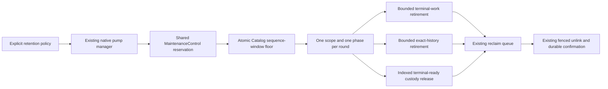

The driver rotates scopes and work/view/custody phases, preserves failed page
cursors, and uses separate forward and frozen head-prefix cursors. Continuing
high-key ingress cannot extend a head sweep indefinitely. Protected or partial
rows can be revisited without holding the forward traversal at their head.
No second scheduler, Catalog lifetime authority or GC implementation is added.
Each round binds the original cancellation/deadline and the reservation's
memory scope. Resource refusal is paced; it cannot renew the same round's
deadline or reset a failed cursor. Integrity/backend failures remain fatal.

The explicit lexical product accepts `retention` and uses the same pure
capability/resource validation as in-process composition before creating its
state root. A proposed standalone `owned_work` config was removed: all three
registered Literal/Text/FileMap builders are CoreRequired, so that option would
advertise an idle enrichment pump. Real Semantic provider, provider draining,
live Auto signals and configured effort remain the coupled F03 implementation.
No Semantic/Auto product capability is claimed by this retention slice.

#### Static checks and pooled execution plan

- VERIFIED: owned-file formatting; `git diff --check`; `just rust-hexagonal`,
  `rust-module-discipline` (46 facades), `rust-test-authority`,
  `rust-module-cycles`, `rust-no-allow`, `rust-wire-inventory`; guarded
  Core/Kernel/Contract cargo-module trees are unchanged.
- FAILED: four strict workspace Clippy attempts. The first found the new
  ready-query Option lint and was repaired. Later attempts encountered a
  moving shared normalizer signature, the pump scheduler field typo, then
  normalizer array indexing/error-discard/panic-test lint failures. The
  field typo and ready-query lint were repaired; the normalizer owner is
  repairing its own source. No lint allowance or memory callback removal
  was used to obtain a pass.
- VERIFIED: Catalog/runtime/searchd strict all-target/all-feature Clippy,
  exit 0 (35.14 seconds of compiler execution). The first owned attempt
  FAILED on the now-complete WorkUsage initializer's redundant default update;
  removing that redundant syntax repaired it without changing the four charges.
  A later positive product-process oracle reuses the existing independent
  publish/search/CLI/reopen gold and additionally requires an automatic floor,
  custody drain and typed below-floor refusal.
  Compiler execution time is not an indexing performance result.
- VERIFIED: subsequent workspace all-target/all-feature `check`, exit 0,
  4m 11s of compiler execution, including the added positive product test.
  This precedes the active decoded MapPage/cursor IR continuation and does not
  qualify that later source.
- FAILED: post-product-test runtime strict Clippy on the later shared source.
  Core's in-progress MapPage continuation has an unused ObjectRef import in
  `index/work_cursor.rs` and an unread lifetime-only `memory` lease field in
  `index/records.rs`. The active F01 owner is coupling these producers and
  consumers. No memory lease is removed or lint suppressed here. Recheck the
  affected candidate after that continuation settles; no repeated check of
  the same known failure is queued. Compilation/lint is separate from tests.
- NOT_RUN: new Catalog, driver, UDS and product-process tests; full suite,
  sustained retention/pressure, Large/XL, performance, remote CI and release.

Canonical static commands (resource admission and the shared target apply):

```sh
./scripts/cargow --lane shared clippy --no-deps --all-targets --all-features --locked --offline -p quanta-index-catalog -p quanta-index-searchd-runtime -p quanta-index-searchd -- -D warnings
./scripts/cargow --lane shared check --workspace --all-targets --all-features --locked --offline
./scripts/cargow --lane shared clippy --no-deps --all-targets --all-features --locked --offline -p quanta-index-searchd-runtime -- -D warnings
```

The first two completed before the MapPage continuation. The third is the
executed failure above. The planned pooled runtime selection includes these
new tests and the existing Catalog floor/work/view/custody, original pin/replay,
unconfirmed-child protections and service automatic reclaim regressions. Run
that selection once the coupled static checkpoint is coherent; do not construct
a hybrid old-Core candidate to bypass its current interface work.

Pool the runtime checkpoint after the coupled static interfaces settle:

| Boundary | Added test/oracle | Required observation |
|---|---|---|
| Catalog tail | `exact_tail_policy_is_atomic_monotone_and_preserves_existing_pin` | Sequence-window floor and wider-window monotonicity; existing pin survives; new below-floor Exact refuses |
| Terminal queue | `terminal_custody_ready_set_is_bounded_partial_restart_safe_and_preserves_replay` | Pending excluded; partial page survives restart; scoped prefix drains; original receipt/operation remains |
| Frozen membership | `terminal_custody_ready_sequence_survives_restart_and_fences_late_lower_operation` | Restart preserves increasing insertion sequence; late lower producer key enters forward queue above the frozen prefix |
| Key/budget | `terminal_custody_ready_accepts_widest_canonical_key_without_a_guessed_byte_cap` | Valid maximum-width key is accepted; mutation denial rolls back queue/custody release; retry drains |
| Integrity | `terminal_custody_ready_corruption_refuses_before_release`, `terminal_custody_ready_orphan_refuses_as_corruption_instead_of_deferred_scope` | Exact Storage refusal, without custody release or quiet defer |
| Query cost | `terminal_custody_ready_queries_use_scope_and_key_ranges_without_history_scan` | Actual producer SQL uses scope and key range index; no historical/table scan or temporary sort |
| Cursor liveness | Four `native_retention::tests` | Independent ordered-set oracle for protected head/late lower key/busy ingress; failed cursor retained; hostile counts/progress refused; actual driver rounds preserve scope and phase fairness across absent epochs and limited work |
| Real service | `native_automatic_retention_advances_floor_releases_custody_and_preserves_pin_and_replay` | Actual UDS edits reach the automatic floor and ready-set drain, old pin/replay survive, new below-floor Exact refuses, stop and reopen complete |
| Real product | `product_daemon_applies_retention_config_preserves_current_query_and_reopens` | Actual `serve-native` JSON installs retention; automatic floor and custody drain occur; current query/CLI and independent-process reopen gold remain exact; below-floor Exact has the typed refusal |
| Product/format | `native_retention_and_owned_work_config_refuse_before_creating_state`, `native_format_refuses_v9_without_creating_retention_state` | Missing reclaim, zero/duplicate/underfunded policy and unsupported pump option refuse within a bounded process wait; no state/socket creation; old marker bytes remain |

These finite regressions do not establish sustained disk capacity or a latency
SLO. Long pins, ingress versus drain rate, aggregate memory, replay-row growth,
physical spill/WAL, unlink failure and provider drainage remain explicit
operational acceptance. F01/F03–F09 are not closed by this checkpoint.

### 23.57 Resume checkpoint: retirement refusal fairness and provider custody

Current-source inspection confirms that the two Core lint defects recorded in
section 23.56 were repaired by their owner: the unused import is removed and
the lifetime-only MapPage lease field is named `_memory`. This is source
inspection, not a new compiler verdict. Coupled Catalog/runtime/searchd
strict Clippy is queued through the existing cooperative resource gate;
the concurrent closeout process suite still owns that gate.

The retirement driver now has a direct `run_round` fault-injection oracle,
`absent_epoch_and_limited_work_do_not_starve_other_scopes_or_phases`.
An absent epoch must remain configured for retry without blocking the next
scope. ResourceLimited work must allow that scope's Views and Custody phases
to run before retrying Work. The expected call sequence is fixed independently
of the implementation. Together with section 23.56, fifteen new test functions
are implemented; their execution remains **NOT_RUN** at this checkpoint.

Static provider-pool inspection also found two concrete custody defects:

| Defect | Repair | Proof boundary |
|---|---|---|
| `spawn_tracked` checked shutdown before taking the registry lock. A waiter could pass that check, then register after drain had shut down and observed an empty registry. | Check shutdown under the same registry mutex used by drain. An admitted spawn registers before drain can inspect it; a waiter acquiring the mutex after shutdown refuses. | Lock-order reasoning and existing shutdown/drain regressions; current execution pending. |
| `live_attempts` returned zero on registry poison although drain correctly retained and reconciled live handles. | Observation recovers the mutex's preserved handle vector, like drain. Admission continues to fail closed on poison. | Existing poison regression now requires a live gauge of one, Storage refusal of a new spawn, unfinished custody, successful later join, and final zero. Current execution pending. |

Pool implementation changes are confined to `quanta-index-embed/src/pool.rs`; no second provider
scheduler or request-budget authority is introduced. This repairs pool-local
lifetime truthfulness. It does **not** close F03: a Native execution grant still
needs explicit physical-attempt custody across caller cancellation, plus
service/provider drain integration, actual Semantic product composition and
Auto signals. Merely enabling a product flag cannot establish those guarantees.

The existing OpenAI cancellation regression is also strengthened in
`quanta-index-embed/src/openai.rs`: after typed cancellation the parked physical
attempt must still occupy one tracked slot; a zero-duration drain names it as
unfinished; only releasing the transport and joining it permits a zero gauge.
This is a pool/provider regression, not proof of Native ledger custody.
The Catalog monotone-tail oracle now widens the window with zero writes and
zero mutations allowed. An unchanged floor must not charge a repeated rewrite;
this logical assertion does not measure SQLite fsync or physical WAL bytes.

The next pooled checkpoint includes Catalog floor/work/view/custody tests,
the four driver tests, real UDS/product retention and reclaim regressions, and
the embedding provider-pool/OpenAI interruption tests. Runtime, sustained
capacity, Large/XL, performance, remote CI and release remain **NOT_RUN** until
their own executed results exist.

The first resumed coupled strict-Clippy execution is **FAILED**: the added
driver regression held its observation mutex guard until the function ended
(`significant_drop_tightening`). The comparison now uses the guard only in the
condition, with no cloned observation or lint suppression. The retry includes
Catalog, runtime, searchd and embed together. Earlier Core errors are absent
from that executed compilation, but the overall lint verdict remains failed
until the repaired retry completes. Formatting, test-authority, no-allow,
document-path and diff-whitespace checks are **VERIFIED** for their scoped
commands; none substitutes for the queued runtime batch.

The repaired combined strict-Clippy retry is **VERIFIED**, exit 0, 36.05 seconds
of compiler execution, covering all targets/features of Catalog, runtime,
searchd and embed. The command is:

```sh
./scripts/cargow --lane shared clippy --no-deps --all-targets --all-features --locked --offline -p quanta-index-catalog -p quanta-index-searchd-runtime -p quanta-index-searchd -p quanta-index-embed -- -D warnings
```

This current compile includes the MapPage/cursor continuation and the pool
and retirement-regression repairs above. Vendored Tantivy warnings are outside
the selected workspace package warning denial. Compilation time and cooperative
resource-queue waiting time are not indexing or query measurements. The runtime
selection has been started; its terminal result is still pending here.

The first pooled execution is **FAILED: 56 run, 55 passed, one failed,
333 skipped, 23.628 seconds**. All selected Catalog and driver regressions,
provider pool/interruption tests, format/config refusals, existing automatic
reclaim regressions and actual product-process retention/reopen passed.
The two-source UDS retention fixture did not settle custody within 10 seconds.
A narrow diagnostic rerun reproduced that failure: floor was already the
expected 2, earlier terminal entries had drained, operation 3 remained,
worker was Running, the resource ledger was healthy and shutdown succeeded.
This does not establish a stuck floor or a resource leak.

The fixture's one-row custody page runs only once per three maintenance phases:
with one scope and a 20ms interval its ideal ceiling is 16.7 custody rows/second,
before Catalog/reclaim/IO cost. A bounded page is not an unconditional 10s drain
guarantee for arbitrary object fanout. The larger UDS fixture now uses page 8,
with unchanged WorkLimits, cadence, resource capacity and 10s watchdogs.
Single-row partial/restart coverage remains in Catalog and the real product
fixture. This config correction is not a production algorithm optimization or
an indexing-performance result; its runtime acceptance remains pending.

The UDS oracle is also strengthened: pin an actual source-bearing view, retract
its owner, retain only the current sequence, and require every other below-floor
view and all terminal custody to drain. Both the old source record and body must
retain their original bytes under that pin. After explicit last-pin release,
automatic retirement/physical GC must remove both, while the current UDS path
query returns exactly the surviving second owner/source/path. Original Published
replay and below-floor refusal remain mandatory. This closes a fixture gap where
the earlier pin protected only a data-free configured view; it adds no success
claim before the stronger case executes.

The first stronger-fixture compile is **FAILED** before test execution:
rusqlite does not implement ToSql for the unsigned sequence type. The isolated
history observation now checks conversion to SQLite i64 once before its loop;
no cast/truncation, deadline extension or weakened oracle is used. That failed
compile is not a second runtime failure of the updated pin scenario.

Terminal checkpoint after the fixture repair:

- **VERIFIED**: stronger physical-pin UDS and actual product-process cases,
  2/2 passed, 40 skipped, 11.992 seconds of test execution. The independent
  path gold additionally binds owner/source identity and excludes the retracted
  first path. Both old record and body files are preserved under the old pin
  and removed after release.
- **VERIFIED**: final Catalog/runtime/searchd/embed strict Clippy, all targets
  and features, exit 0. This includes the stronger UDS oracle and checked
  SQLite sequence bindings.
- **VERIFIED**: final pooled checkpoint, **56/56 passed**, 333 skipped,
  five binaries, 23.451 seconds of test execution. This one execution covers
  all fifteen newly added functions, all four driver tests, both strengthened
  provider regressions and the selected existing retirement/reclaim/replay
  protections; it is not a sum of the earlier 55-pass and 2-pass runs.
- **NOT_RUN**: full workspace suite, sustained retention/ingress and long-pin
  pressure, physical RSS/spill/WAL capacity, native Large/XL and performance
  comparisons, actual Semantica producer, remote CI, default cutover and release.
  F01/F03–F09 remain separate delivery/acceptance scopes. The pool repair does
  not establish Native provider execution-grant custody or configure Semantic
  and Auto in the product.

The exact pooled command uses the same shared target/resource front door as
Clippy; disposable output stayed outside the checkout:

```sh
./scripts/cargow --lane shared nextest run --lib --test native_index_uds --test native_product_process --all-features --locked --offline -p quanta-index-catalog -p quanta-index-searchd-runtime -p quanta-index-embed --no-tests fail --no-fail-fast --test-threads 2 --failure-output immediate --status-level pass --final-status-level fail -E 'test(terminal_custody_) | test(exact_history_) | test(exact_tail_policy_) | test(work_retirement_) | test(view_retirement_) | test(never_admitted_) | test(unconfirmed_attempt_parent_keeps_child_custody_after_terminal_release_and_reopen) | test(native_retention::tests::) | test(=native_automatic_retention_advances_floor_releases_custody_and_preserves_pin_and_replay) | test(=native_format_refuses_v9_without_creating_retention_state) | test(native_automatic_reclaim_) | test(=native_owned_pump_automatically_reclaims_discarded_inputs_without_manual_steps) | test(=product_daemon_applies_retention_config_preserves_current_query_and_reopens) | test(=product_daemon_serves_native_publish_query_and_reopen) | test(=native_retention_and_owned_work_config_refuse_before_creating_state) | test(=native_reclaim_config_refuses_invalid_policy_and_capacity_before_state_creation) | test(pool::tests::) | test(a_cancelled_budget_abandons_the_attempt_in_flight) | test(an_attempts_timeout_is_capped_by_the_budget_remainder) | test(a_deadline_during_backoff_stops_the_retry_loop_typed)'
```

These finite watchdog observations are functional acceptance under the stated
fixture policies. They do not certify a corpus-independent latency SLO, a clean
performance environment, or unbounded retention throughput.


### 23.58 Native product and physical provider execution checkpoint (2026-10-13)

This continuation keeps the complete F01–F09 register. It advances F03 and
corrects current-source F04/F06/F07/F08 inventories; no scoped checkpoint is
whole-plan completion. The inspected shared tree is based on HEAD
`c32cd191554031b9a7d04207ffa3410e8fc201ba`; unrelated owners' dirty work is
preserved. Runtime/performance qualification is not inherited from section
23.57's 56-test run after these edits.

#### Implemented seams pending coupled verification

- Core `RequestBudgetV1` carries a stage-local weak provider-attempt port.
  Physical HTTP work takes a finite lease before spawn. The cap is the
  **original grant's** `provider_units`, not a separately enlarged pool cap.
  Cloned/escaped request data does not own CPU/IO/provider reservations and
  cannot borrow the next stage's authority. Scoped WorkBudget binding preserves
  original usage/deadline/cancellation and restores the original request on
  success, refusal and unwind.
- `NativeProviderExecutionCustody` owns the original `ReservationGuard` and
  actual state-root lease. Submit, Resume, owned materialization, one-shot
  Semantic and streamed Deep share this custody. A cancellation may complete
  the logical worker while a physical attempt remains charged and root-locked.
  Worker `quiesced` means logical work/settlement completion; physical provider
  drainage has its own result. Native OpenAI explicitly requires custody and
  rejects missing bindings before HTTP, including an incorrectly zero-funded
  reader. Provider-free adapters retain their existing local execution path.
- Explicit native JSON config composes a pinned OpenAI provider, one shared
  Semantic bridge/recipe, owner and typed reader, shared attempt pool, and the
  existing owned pump. Exact workspace/epoch scopes gate build and query
  provider IO; owned scopes must be a subset. Descriptor/model/endpoint,
  egress consent, recipe/read demands and policy are checked before state
  creation. This does not switch the default legacy `serve` route.
- Configured effort uses the existing replaceable policy, estimator and signal
  ports. Actual worker queues and ledger occupancy feed Auto; signal conversion
  preserves original expiry across worker/query clock origins. Empty **observed**
  Running lanes can report current pending wait zero. Logical admission memory
  headroom includes protected floors; it is not a measured RSS bound. Missing
  user/IDE activity, provider health and calibrated quality stay `Unknown`.
  Explicit Deep is usable; full automatic promotion still needs the actual
  interaction ingress and AUTO/UX operating acceptance. Idle time is never
  invented from query duration or a quiet worker.
- Local model configuration remains explicitly unsupported before state/model
  loading until startup residency and decoded-model allocator accounting exist.
  Configured asset file sizes alone do not prove a model memory bound.

The provider pool now hands unfinished post-grace attempts to a named reaper
that retains their JoinHandles through final join. Spawn failure joins
synchronously before returning its failure. Joined panic names remain explicit
and close further admission rather than growing an unbounded diagnostic list.
Native and legacy shutdown consumers reject observed physical panics; native
listener/pump/worker/provider failure messages remain jointly visible. This is
implemented source, not shutdown acceptance before its regression executes.

#### Current-source residual corrections

- F04 already has logical single-owner update spies and native bootstrap tests.
  The missing evidence is physical cold/delta cost with independent corpus N,
  history H, fanout, deletes and required upkeep, plus query gold. Legacy scale
  reports explicitly do not measure physical write IO on that path. Extend
  existing measurement owners; do not invent a second benchmark scheduler.
- F06 legacy backup/restore does not support native v10. Native rebuild/cutover
  or backup/restore, receipt/root continuity and failure/rollback drills remain.
  Current launcher accepts `serve`/`verify-state` and selects legacy `serve`;
  native launch selection follows the active staging-safety owner's handoff.
- F07 **a real Semantica legacy producer exists**. Its emission plan and
  SearchCorpus batch include Semantic scopes and reuse existing outbox/receipt
  custody. The producer does not yet call NativeUdsClient/NativeIndexRequest;
  separate `publish_semantic` returns NotImplemented. Reuse and convert that
  owner; do not duplicate the outbox or claim actual native integration from
  an HTTP stub. P2I01–P2I08 remain the coupled source-pair acceptance.
- F08 native Semantic is whole-file one-vector bounded exact; legacy LanceDB
  IVF-HNSW is a separate store. NativeFileMap is path inventory. Native chunk/
  ANN, provenance graph RepoMap, overlay/save handoff, required Stub and
  revision-bound coordinates/actions remain explicit implementation scopes.

Audit source pointers: [native product](../../../crates/quanta-index-searchd-runtime/src/native_product.rs),
[provider custody](../../../crates/quanta-index-searchd-runtime/src/native_provider_custody.rs),
[Auto signals](../../../crates/quanta-index-searchd-runtime/src/native_auto_signals.rs),
[Kernel read stages](../../../crates/quanta-index-kernel/src/update.rs),
[existing cost oracle](../../../crates/quanta-index-kernel/tests/native_lifecycle.rs),
[native exact Semantic](../../../crates/quanta-index-semantic/src/native/embedding.rs),
[path inventory](../../../crates/quanta-index-repomap/src/native/file_map.rs),
[launcher](../../../tools/deployment/launcher.py).

#### Verification ledger

- Initial strict Clippy is **FAILED** in Core production/test lint checks
  (items/doc paragraphs/test assertions); follow-up checks reached Embed and
  Runtime and exposed one collapsed-if, nineteen runtime lint violations and
  one test-only unnecessary Option wrapper. These were repaired without lint
  suppression. No test result follows from these compile/lint attempts.
- Product admission additionally binds a typed native TenantId to every
  authorized workspace, uses its deterministic hex only at the existing
  admission-engine string seam, and checks concrete SourceContent/QueryText
  admission before HTTP. Source and query bridges share one provider and must
  have exactly equal recipes. The process oracle rejects tokenless query
  input without additional provider calls.
- Product loopback HTTP tests execute real daemon/SDK/build/query/stream/reopen
  paths with deterministic vector responses. They are integration oracles,
  not real remote-provider quality, network latency or performance acceptance.
- Coupled compile/test, provider shutdown/fault, Auto/UX, local model residency,
  actual Semantica native producer, native Large/XL, full applicable suite,
  remote CI/default cutover/release: **NOT_RUN** at this in-progress entry.

### 23.59 F03 activity ingress, provider prediction and bounded HTTP buffers (2026-10-13)

This supersedes section 23.58's missing activity-port inventory. F01–F09
remain the delivery scope; the shared dirty main base is `c32cd191554031b9a7d04207ffa3410e8fc201ba`.

| Boundary | Implemented contract | Limit |
|---|---|---|
| Foreground source | Explicit `effort.interaction_source = registered_foreground_publisher` selects one foreground producer. Control UDS and typed SDK Begin/Activity/Renew/End bind server-random identity, kernel UID, strict sequence and 1..60000ms lease | No actual IDE integration or observation of other apps; absent config/publisher stays Unknown |
| Freshness | Only Activity resets idle; Begin remains Unknown, Renew extends freshness, End invalidates. Auto sample TTL is clipped to publisher expiry; old token/UID/sequence/expired session/restart refuses | One-shot SDK transport detects abrupt exit through finite expiry. Previously issued samples expire at their original clipped TTL |
| Provider prediction | Replaceable `NativeProviderSignalPort` reads the same actual pool admission mutex: free slots Ready, full slots Busy, shutdown/panic/poison/inconsistent registry Offline | Remote means transport mode. Ready does not prove endpoint health, permission, reserved capacity or completion; the governor and physical custody remain authoritative |
| Policy dwell | Canonical `PolicyState.clear_valid_until_ms` records the earliest expiry of four pressure inputs. Dwell continues only when the next fresh window reaches that expiry; a gap restarts it, non-clear/unknown clears it | Adjacent windows at the exact exclusive-expiry boundary are contiguous. Sparse snapshots cannot prove an unobserved interval clear; this stays separate from grant authority |
| HTTP buffers | Count JSON before allocation; admit original/physical copies separately to the original memory scope. Explicit `max_response_bytes`, bounded decoded read and one-byte overflow probe | Required Native execution refuses absent custody/memory authority/cap. Standalone unbound transport remains outside the Native contract |
| Decoder | Bounded visitors reject item/coordinate overflow before pushing past count/dimension; raw response and parser charge survive channel/parse lifetime | Reqwest internals, allocator excess capacity and returned Vec lifetime after this provider stage remain F01 boundaries; no hard RSS guarantee |
| Preflight | Provider-owned single-input envelope covers worst escaping, URL clones, raw response, parser/vector metadata. Reader/Enrichment reservations and headroom outside enabled execution floors are checked before state creation | Current native source/query bridges send exactly one text. Empty-ledger affordability is not a throughput guarantee; concurrent retained data can still cause typed admission refusal |

The emission wrapper deliberately keeps bounded canonical response metadata
inline. One targeted `large_enum_variant` expectation documents why boxing
overload refusals would introduce an unadmitted allocation. Other strict lints
and memory admission are unchanged.

Verification history:

- **FAILED**: prior selected runtime, 111 run / 109 passed / 2 failed,
  487 skipped, 69.183s. Real product Semantic/explicit Deep/reopen passed.
  The missing-provider negative fixture was repaired to remove only provider.
- The second failure was physical record/body GC within the original 10s
  observation window after last pin release. Exact cause remains unknown.
  Failure-only diagnostics now include all 11 reference tables, view/pin/work,
  phase/queue and parent state. No GC algorithm, budget or deadline was changed.
- **VERIFIED**: narrow repaired selection 2/2, 43 skipped, 17.169s with test
  threads 1. This neither erases the parallel failure nor proves GC capacity.
- **FAILED**: a queued compiler read intermediate DTO/SDK edits and found three
  exhaustive response matches. Consumers were updated together. A subsequent
  strict run found three new Embed lints, later retries found new test-only
  lint defects and one Core Result-test panic assertion. Those were repaired;
  the current final retry is pending, not a passed compilation claim.
- **FAILED**: expanded coupled runtime, 139 run / 138 passed / 1 failed,
  855 skipped, 105.042s. The sole failure was the new actual HTTP/grant/root
  fixture creating its state directory as `0755`; StateRootLease correctly
  required `0700`. The fixture now sets that required mode explicitly.
  Actual Semantic daemon/reopen, activity SDK/fencing/expiry, pool prediction,
  bounded transport/parser and the unchanged 10s retention window passed.
- **VERIFIED**: repaired actual HTTP/grant/root selection, 1/1 passed,
  129 skipped, 0.067s. Cancellation returns while the original Native grant
  and state-root lock remain held; physical join releases both. This narrow
  result does not turn the preceding 139-test run into a passed batch.
- **VERIFIED**: repaired coupled selection in one fresh invocation,
  139/139 passed, 855 skipped, 100.622s. Command: canonical `scripts/cargow
  --lane shared nextest run --lib` with the existing native_effort,
  native_owned_pump, native_index_uds and native_product_process binaries,
  six selected packages, all features, locked/offline, threads 1 and the
  explicit F03 filter. Log: `/tmp/qi-native-f03-final-runtime.log`.
- **VERIFIED**: focused strict `scripts/cargow --lane shared clippy --no-deps
  --all-targets --all-features --locked --offline` for Core, contract, SDK,
  Embed, runtime and searchd, `-- -D warnings`; 3m58s, exit 0. Log:
  `/tmp/qi-native-f03-accepted-static.log`. The stated Kernel integration
  exclusion remains; dependency compilation is not integration execution.
- These passes precede the additional adverse-review corrections below.
  Acceptance of those subsequent source changes is **NOT_RUN** until a new
  terminal result is recorded. Different source runs are not summed.

The broader Kernel-all-target retry also **FAILED** while the concurrent F04
cost fixture referenced five not-yet-present object-IO elapsed members. Current
source later contains those members; that observation is not a rerun verdict.
The focused strict retry selects all targets/features of Core, contract, SDK,
Embed, runtime and searchd, compiling Kernel/storage dependencies normally.
It excludes Kernel's actively edited integration targets. The pooled runtime
selects Kernel **lib** prepared-query regressions, not the F04 cost fixture.
This is explicit scoped verification, not a workaround candidate or a full
workspace/all-target acceptance claim.

The final pool includes product/process, effort/owned pump, physical HTTP/root
custody, pool panic/poison/shutdown, bounded decoder/envelope, Core request-stage
restoration, prepared queries, activity codec/SDK/recorder/signal TTL and actual
pool prediction, plus strengthened retention. Process fixtures run serially;
internal pump concurrency stays exercised. Full workspace, actual remote
quality/health, Auto/UX operations, actual IDE publisher, sustained retention,
native Large/XL/performance, Semantica producer, release/default cutover and
Git publication remain separate **NOT_RUN** scopes.

F04 source reconciliation additionally found an existing concurrent owner:
`ObjectIoObservation` in storage and `one_owner_native_text_cost_case` in
`native_lifecycle.rs` already observe 1/64-owner cold/delta submit object writes
and reached sync calls. Extend that authority after source handoff; do not
duplicate it. Staging/request assembly, H/fanout/deletes/upkeep, Catalog/WAL/GC
and device IO remain distinct. `scale_matrix`/`causal_cost_capture` still run
legacy E2eRuntime; Native DSL syntax does not establish Native Kernel execution.
Formal Native measurement must reuse existing benchmark registry/benchctl/raw
evidence/custody owners. File size changes are not physical write-byte counters.

#### Additional source defects found after the passing checkpoint

- Physical HTTP request-copy lease/URL originally remained alive through the
  result send, overlapping parser admission and invalidating the startup peak
  calculation. Drop physical URL and copy charge before publishing the result;
  the original physical attempt/root grant still lasts until actual join.
- Reqwest's default redirect policy allowed a 307/308 to resend admitted
  request bytes to an unapproved endpoint. Disable redirects; existing 3xx
  classification refuses them. A two-endpoint loopback oracle must prove no
  payload or Authorization reaches the target.
- Auto policy was reinitialized at each query. With only pre/post-Fast
  observations, Fast durations below dwell never promoted; TTL shorter than
  dwell made promotion impossible in that path. Introduce bounded service
  observation history with a common monotonic clock. Share clear-window and
  Fast-residence observations, not per-request phase, transition cap, proof,
  pinned view or resource grant. Continue dwell only across actual contiguous
  fresh pressure samples. Do not fabricate activity or delay Fast to fill dwell.
- Optional stage preparation reused a frame sampled before preparation. Sample
  clock/signals again after preparation and before Deep policy/governor so an
  ended publisher, expiry, pressure or unavailable provider can deny that stage.
- A signal source can block while sampling. Timestamping the decision before
  sampling counted that wait as clear dwell and evaluated freshness at a stale
  time. Stamp the sample at its start conservatively, read the monotonic clock
  again at sampling completion, and use completion time for policy/governor.
  Sampling that outlives TTL cannot establish a fresh clear interval.

The service installs one `NativeEffortObservationHistory` and common monotonic
clock. An O(1) Mutex serializes only local sampling and pure policy proposals;
no stage/provider/observer IO or governor reservation runs under it. Pressure
history stores last completed sample and clear-window bounds. A separate
monotonic atomic Fast-residence marker is updated infallibly only after an
actual Auto Deep stage's successful terminal delivery, session close and
original-budget checks. Unexecuted Deep proposals and explicit preferences do
not reset it. Delivery marker reads precede associated clock reads so concurrent
legitimate deliveries cannot be mistaken for a regressed clock. The marker is
policy prediction, not proof or resource admission. Missing, poisoned, regressed
or overflowed observations fail closed; `history + query-local clock` refuses.
There is no background sampler: expired gaps restart clear dwell.

The existing real daemon/SDK Semantic process oracle is extended to actual Auto
promotion across short queries with sample TTL shorter than dwell, one optional
HTTP query on the pinned view, and Fast/no HTTP after foreground End. New
regressions cover continuous 20ms samples across 100ms dwell, a TTL gap, high
pressure reset, explicit Fast, clock regression/dual-clock refusal, actual
optional reader preparation changing interaction/provider readiness, and
concurrent delayed sampling that expires its own prediction.

- **VERIFIED**: narrow Embed redirect/physical attempt/envelope selection,
  4/4 passed, 97 skipped, 0.100s. The two-endpoint loopback test observed the
  admitted POST at the first endpoint and no connection to its redirect target.
  Log: `/tmp/qi-native-f03-redirect-repair.log`.
- **FAILED**: first history narrow compile rejected `drop(Copy Result)` in its
  test cleanup. First strict retry rejected a concurrent Core test's redundant
  authority clone. Neither invocation executed the selected runtime tests.
  Named cleanup result and clone-survives-original-drop assertions repair the
  test sources without dropping their authority/custody oracle.
- **FAILED**: second narrow compile rejected an unused atomic `fetch_max`
  result. The corresponding strict run reported that defect plus private
  field/binding/doc formatting, explicit guard release and a disallowed clock
  fallback spelling. These are compile/lint failures, not executed runtime
  failures. Explicit invalid-clock sentinel, named atomic result and scoped
  naming/guard fixes preserve refusal and residence contracts.
- **FAILED**: third history narrow execution, 8 run / 7 passed / 1 failed,
  503 skipped, 23.004s. New shared-window/concurrent/prepare-change tests and
  actual daemon/SDK Auto promotion + End passed. The old UDS clear fixture
  stamped observations at zero with a 1000ms TTL, so common-service time after
  setup correctly made it Unknown. Clear/pressure fixtures now timestamp actual
  sampling; explicit 20ms TTL-gap tests remain unchanged. No production TTL,
  dwell or deadline was raised. Its strict retry also found a final test lock
  drop and an unused cloned text request, repaired without reducing assertions.
- **VERIFIED**: repaired UDS Auto clear/pressure selection, 2/2 passed,
  167 skipped, 3.147s. Log: `/tmp/qi-native-f03-fresh-fixture.log`.
- **VERIFIED**: final affected strict `scripts/cargow --lane shared clippy
  --no-deps --all-targets --all-features --locked --offline` for Core, Embed,
  contract, SDK, searchd and runtime, `-- -D warnings`, exit 0, 3m38s.
  Log: `/tmp/qi-native-f03-history-static-final.log`. Kernel dependency
  compilation and Kernel integration targets remain distinct scopes.
- **VERIFIED**: one fresh final pooled invocation, **144/144 passed**,
  **856 skipped**, 10 binaries, **115.699s** test execution, exit 0. Command:
  `scripts/cargow --lane shared nextest run --lib --test native_effort --test
  native_owned_pump --test native_index_uds --test native_product_process
  --all-features --locked --offline`, packages Core/Kernel/runtime/Embed/
  contract/SDK, `--no-tests fail --no-fail-fast --test-threads 1`, and the explicit
  existing F03 filter plus `native_effort_ports::tests` and borrowed authority
  identity. Log: `/tmp/qi-native-f03-final-accepted-runtime.log`.
  This fresh result includes actual daemon/SDK Auto promotion with 1200ms
  dwell and 1000ms sample TTL, Fast-only after End, real Semantic source/query/
  reopen, physical HTTP/grant/root cancellation, redirect refusal, bounded
  reader/parser/preflight, request-stage restoration, pool panic/poison,
  owned-pump and the unchanged 10s physical retention observation.
- **VERIFIED**: `git diff --check`, test-authority and Rust allow-attribute
  gates at the code checkpoint. They do not execute product code.
- Full applicable workspace, actual IDE publisher integration, remote provider
  quality/health, continuous churn/pressure and hard RSS/FD/spill/WAL bounds,
  Native Large/XL/performance, real Semantica producer, backup/cutover, remote
  CI/release and Git publication remain **NOT_RUN**. F01–F09 remain active;
  this checkpoint closes the selected F03 repairs, not the full delivery.

#### F07 actual producer mapping recheck

The initial inspection at Semantica HEAD
`373b529f021f11af7f32c136572ee1b48df45fd5` found legacy SearchCorpus
producer code, frozen UTF-8 source bytes and tombstones. The deeper product
caller/feature audit supersedes its suggested V1-outbox implementation target:
`dispatch_registration::prepare_lexical_dispatch_v1` calls a proof-support
fixture, and the standalone V5 persistence function is reached only by tests.
Existing V1 outbox code must not be confused with current product custody.

The actual product path is `ordinary_aggregate_prepare_v2.rs` →
`aggregate_prepare.rs` → `prepared_aggregate_owner_pipeline_v1.rs`, which
persists writer-owned prepared members, transfers custody to V9 aggregate
closeout, publishes through the existing SearchCorpus adapter, and records a
terminal receipt. Native integration must extend these existing production
owners and their recovery flow; adding a second outbox or patching the V1 test
helper does not deliver the product. The deeper audit's current source pair and
exact minimum coupled write set are recorded in section 23.60.

The existing retrieval-kernel `index_sdk_ingress` remains the single SDK import
owner. Its `native_connect_v3` currently wraps `QuantaIndexClientPayloadV1`
external custody; it is not the NativeUdsClient source-advance route. Runtime
handoff must not become a second SDK owner.

Legacy string stream/event IDs, publish generation and batch SHA cannot be
cast into Native identity, numeric frontier or owner digest. Persist the
original Native OperationKey, predecessor, exact base ViewRef/SourceCut,
source-input custody and terminal receipt in the actual production member
artifact/recovery state. ACK loss reconciles the same key through status/resume;
Delivered requires Published(view) and read-back. Previous OwnerMutation CAS
values come from durable member state or section 23.60's bounded exact-view
lookup, never inferred from source bytes/generation. Real Native producer
implementation and P2I01–P2I08 remain NOT_RUN.

### 23.60 F07 bounded exact-view source-owner recovery (2026-10-13)

This checkpoint advances the producer recovery boundary without declaring the
real Semantica producer delivered. Shared Index HEAD remains
`c32cd191554031b9a7d04207ffa3410e8fc201ba` with concurrent uncommitted changes.

| Boundary | Implementation | Invariant / exclusion |
|---|---|---|
| Contract | `LookupSourceOwners { selection, owners }` / `SourceOwners { view, source, rows }`; private bounded key/row collections | 1–128 strictly ascending unique owners, enforced by constructors and JSON/CBOR decoding; no arbitrary object CRUD |
| Runtime | Existing authenticated Control route, Interactive reservation with zero provider demand, one pinned view and bounded persistent-map lookups | Every row and SourceCut comes from that view; missing owner is None; unavailable Exact refuses instead of selecting Latest |
| Reply custody | Retained allocation acquired before output allocation; scoped borrowed DTO serialization | Data dies before its lease; CPU/IO/provider execution ends after lookup while response memory remains charged through synchronous serialization; IPC frame and allocator RSS remain separate F01 work |
| SDK | `lookup_source_owners(selection, Vec<OwnerKey>, budget)` | Validate requested Exact identity or Latest workspace/epoch, exact row count and key order; caller preserves returned ViewRef/SourceCut for CAS and frozen replay |
| Semantica | Product caller audit distinguishes V9 aggregate/writer member custody from V1 proof fixtures | No production NativeUdsClient invocation; actual member artifact/receipt/recovery coupling and P2I01–P2I08 remain NOT_RUN |

The source producer admits UTF-8 bytes read from the opened file descriptor,
without normalization, and freezes them in SearchCorpus ReplaceScope/member input.
Invalid UTF-8 is explicitly refused; this does not establish binary-file input
coverage. Static evidence: `snapshot_text_read_v3.rs:128–169,201–215`,
`read_birth_v3.rs:116–140`, `file_content.rs:40–103`, and
`search_plane_handoff_dispatch/lexical_batch.rs:253–299` in Semantica.
Delete emits a TombstoneScope; rename contributes an old-path delete and
new-path upsert (`core_invalidator_source_refresh_v1.rs:188–225,308–340`).
Native stable owners must bind repo/path rather than revision. Use explicit
`SourceInput.text = Utf8 { policy }` matching the selected NativeText recipe;
the SDK's single `stage_source` convenience method admits Excluded text.

Product feature/caller audit was rechecked at Semantica HEAD
`645b781a6a7bac9d4aef415c410955ebced2f929`; relevant producer paths were clean
and unchanged from the earlier snapshot. Root independently inspected the
product composition gate, terminal dispatch and V2 replay-table schema.

The V1 outbox and bounded V5 CBOR artifact exist, but their standalone
registration/persistence paths are proof fixtures rather than the current
aggregate product owner. The product persists writer-owned lexical prepared
members and transfers them to V9 closeout before delivery. Native operation,
stream ordinal, exact base, intent digest, source-input custody and Published
receipt must be coupled to that member artifact and its existing recovery
state machine. Relabeling legacy batch CBOR as Native intent is invalid.
SDK ingress's `native_connect_v3` wraps the old SearchCorpus client, not
NativeUdsClient. The existing leaf `index_sdk_ingress` remains the sole SDK
import owner for the actual Native adapter. Runtime handoff must not import a
second SDK owner or construct a second outbox.

Current production evidence in Semantica (line numbers at that snapshot):

- `source_bound_projection_assembly/authority_assembly.rs:401–436` selects
  `execute_ordinary_source_bound_aggregate_v2` under the product feature closure.
- `authority_assembly/ordinary_aggregate_prepare_v2.rs:371` prepares aggregate
  members; `:668–790` recovers the same V9 row/member artifact after restart.
- `authority_assembly/prepared_aggregate_owner_pipeline_v1.rs:128` begins the
  V9 custody transfer; `:1121` persists a validated writer member;
  `:414–474` dispatches actual legacy SearchCorpus publication/activation;
  `:751–780` revalidates the stored canonical batch on recovery.
- `indexing_machine_v2/store/schema.sql:756` owns
  `indexing_source_bound_closeout_replays_v2`, the actual durable aggregate
  replay table. This is not `indexing_search_plane_outbox_v1`.
- SDK ingress `terminal_receipt_v1.rs:326` accepts legacy BatchPublishReceipt
  plus activation CAS evidence. Native Published(ViewRef) cannot be forged or
  converted into that legacy terminal capability.

The minimum **coupled** producer implementation therefore includes the
retrieval contract's member/terminal receipt schema, leaf ingress Native
connection/dispatch/terminal validation, writer-owned Native member artifact
freeze/revalidation, aggregate prepare/dispatch/recovery and V9 evidence CAS.
Preserve the existing required side-output members and aggregate visibility
barrier. A Native source receipt needs its own typed member/prerequisite
capability bound into that barrier; standalone SDK submission is insufficient.
The exact operation, staged source/mutation refs and any Unknown result must
survive in that production custody before a retry. A proof-only adapter or
standalone V1 outbox patch is not a smaller valid implementation.

**Retry liveness constraint (static, runtime NOT_RUN):** admission writes a
Pending operation and claims events before the expected-view/source CAS
(`catalog/native/authority.rs:2609–2684`, `kernel/update.rs:1485–1515`).
Conflict terminalization preserves a Refused claim. Rebinding its ordinal
requires the original predecessor and payload; `owner_digest()` currently
hashes both expected_source and the mutation set. Another producer's source
publish changes SourceCut, so rebuilding under Latest changes that digest and
the same ordinal refuses DigestConflict; retaining the old cut refuses CAS.
Skipping to the next ordinal also violates the unchanged published frontier.
An admission-only CAS check does not remove the race after admission.

Do not hide this with unrecorded retries, skipped ordinals or arbitrary new
stream identities. Existing contracts require an explicit fenced resync for
incompatible capture; the product has no implemented Native resync owner yet.
The structural alternative under audit separates logical capture identity
(canonical owner mutation digest/count, retaining owner expected/next CAS)
from execution base ViewRef/SourceCut and physical mutation-root layout.
The static port audit permits this only for an immutable logical mutation
stream and a durably Refused old operation. A fresh OperationKey may reuse the
same SourceEvent ordinal/payload; operation sequence and event sequence are
independent. The canonical mutation digest includes each owner's expected/next
ObjectRefs and is revalidated by the complete cursor at EOF. Execution still
checks the current SourceCut, touched owners, old/new paths and event frontier.
Pending/Unknown must reconcile the original operation; Published wins after ACK
loss. Changed logical mutations remain DigestConflict; changed touched owner or
occupied destination remains a typed refusal. Precomputed Semantica side
outputs require dependency/context revalidation against the new source cut.
Perpetual concurrent source churn does not provide a bounded completion time.

It must preserve terminal operation identity, event uniqueness, current-owner
and path CAS, restart/ACK ambiguity and persisted-format refusal. This is an
unimplemented contract candidate, not an accepted optimization or proof of
multi-producer liveness. Existing path-collision and Refused-claim fixtures
prove payload immutability, not successful rebasing after unrelated SourceAdvance.

The minimum next coupled checkpoint is a versioned capture hash domain over
`(owners.count, owners.digest)` plus real SQLite/Kernel interleave/restart and
negative CAS fixtures. Old v10 Pending/Refused payloads must not be reinterpreted
in place: require an explicit new format/incarnation and old-state refusal or
a separately proven migration. A runtime marker bump alone must not allow an
in-process Catalog/Kernel consumer to reinterpret legacy durable claims.
`SqliteCatalog::open` unconditionally initializes the Native schema and is
also used directly without runtime marker checks. The format preflight must
therefore run inside its BEGIN IMMEDIATE transaction before any DDL, seeding
or recovery, with a dedicated semantic-format singleton/domain/digest in the
Native schema. No Native namespace permits first birth; any existing Native
schema without the exact current format row refuses rather than guessing
compatibility from an empty row count. Existing generic roots may already have
Native schema from ordinary Catalog initialization, so this conservative
breaking rule also requires explicit rebuild/cutover for those roots. Runtime
v11, prior-marker v10 refusal, the legacy daemon's v11 refusal list and direct
Catalog old-format/row-corruption/reopen tests must be coupled to the same
transition. Do not repurpose an allocator counter as a format stamp.
Required independent golds: SourceCut/physical-root changes preserve logical
capture digest; mutation count/digest changes alter it; unrelated producer
advance allows a fresh operation to publish the original event after durable
refusal; old Refused replay remains identical; touched-owner/path conflicts,
Pending/Unknown takeover, changed mutations and duplicate Published claims
never move the head/frontier. This checkpoint precedes actual V9 Native delivery.

Cold input remains paged at the existing 32-file/8MiB source staging and
128-mutation boundaries. The new lookup's 128-owner cap does not authorize
materializing an entire cold corpus, copying a legacy 256MiB payload or treating
a current delta as initial full coverage. Whole SourceCut CAS and contiguous
event frontier checks still govern submit; resolving a previous owner value
does not relax stale-base or delivery/replay invariants.

**VERIFIED — focused runtime:** the pooled command below ran **5/5 PASS**, 552
skipped, four binaries, 2.569 seconds execution (2m05s compilation). Four tests
exercise this new lookup boundary; one existing source-ownership unit matches
the same filter. Actual service/UDS/SDK A→B→delete, historical Exact/Latest,
missing owners, unavailable Exact, retained charge through serialization,
bounded wire decoding and SDK mismatch refusal executed. Log:
`/tmp/qi-native-f07-runtime-accepted.log`.

```sh
QUANTA_INDEX_RESOURCE_WAIT_SECONDS=7200 QUANTA_INDEX_PRESERVE_CARGO_TARGET_DIR=1 CARGO_TARGET_DIR=/Users/songmin/Library/Caches/quanta-index/target/e385f4e6b4fe8e9b/shared ./scripts/cargow --lane shared nextest run -p quanta-index-contract -p quanta-index-sdk -p quanta-index-searchd-runtime --lib --test native_source_owner_lookup --all-features --locked --offline --test-threads 1 -E 'test(source_owner)'
```

The compile failures before that pass are retained separately: unused Contract
serde import; concurrent incomplete scoped Semantic integration; unused Runtime
CoverageStatus after that integration; missing CatalogReadPort import in the
new UDS test. Each was repaired before the executed five-test result. They
were compiler failures, not executed test failures. No golden was weakened.

**FAILED — affected three-package strict:** the first Clippy command found a
redundant clone in the new wire test, which was removed. Retry at
`/tmp/qi-native-f07-strict-retry.log` found four lints: one duplicated terminal
match in NativeReply (now merged) and three indexing lints in the concurrent
`native_semantic_result.rs:129,130,138` owner. The latter source was not patched
by this lookup lane. Full Runtime strict is not VERIFIED; the independent
Contract/SDK strict is VERIFIED: the same command with only those two packages
returned exit 0 (1m02s compiler report), log
`/tmp/qi-native-f07-api-strict.log`. It does not waive the Runtime findings.

```sh
QUANTA_INDEX_RESOURCE_WAIT_SECONDS=7200 QUANTA_INDEX_PRESERVE_CARGO_TARGET_DIR=1 CARGO_TARGET_DIR=/Users/songmin/Library/Caches/quanta-index/target/e385f4e6b4fe8e9b/shared ./scripts/cargow --lane shared clippy -p quanta-index-contract -p quanta-index-sdk -p quanta-index-searchd-runtime --all-targets --all-features --locked --offline --no-deps -- -D warnings
```

**VERIFIED — source inventories:** Contract/SDK public API and selected
Contract/Runtime module snapshots were generated with their repository tools
and rechecked unchanged. Initial drift comprised the intended activity/owner
lookup API and source-owner collection module items; regeneration is an
inventory update, not runtime qualification. `just rust-wire-inventory` passes
after repairing the existing deployment-selection row to schema v2. The new
`autotests=false` integration target is registered in Cargo, test-authority and
the Native Justfile target/filter. `just rust-test-authority`,
`just rust-hexagonal`, `just rust-module-discipline`, `just lint-doc-paths` and
scoped rustfmt/diff checks pass. The full Native recipe was inspected with
`just --dry-run rust-test-native-index`; it was not executed in this checkpoint.

The last reply-match/clone edits are behavior-preserving lint repairs after
the five-test result; no new test count is fabricated from compiler checks.
Source-capture semantic separation/format transition, actual V9 producer,
physical resource, Large/XL, IDE, full-suite/CI/release and Git publication
remain NOT_RUN here. F01–F09 and the original full-work goal remain open.

### 23.61 F07 logical capture rebase and Native v11 format gate (2026-10-13)

This supersedes section 23.60's unimplemented capture/format candidate, without
declaring actual Semantica V9 Native delivery complete. The shared main HEAD
remains `c32cd191554031b9a7d04207ffa3410e8fc201ba`; changes are uncommitted and
verification belongs to the selected source scopes below.

| Owner | Coupled change | Preserved boundary |
|---|---|---|
| Contract | One SourceTransition IR; `owner_digest()` hashes v2 domain plus canonical `(owners.count, owners.digest)` | Owner mutation digest still includes owner/expected/next; execution ViewRef/SourceCut and physical mutation root remain in the immutable operation, not the event capture |
| Catalog | Exact state-v11/capture-v2/domain/digest singleton, checked under BEGIN IMMEDIATE before DDL/seeding/recovery | Existing Native namespace cannot silently initialize or reinterpret old claims; current roots reopen; incompatible roots refuse typed StateRootFormatUnsupported |
| Runtime | v11 marker; v1–v10 prior markers and legacy daemon v11 root opening refuse | No relabel, in-place old-payload migration, allocator reset or new stream workaround |
| Kernel proof | Real managed ingress Pending claim → unrelated source publish → original durable Refused → fresh operation/current exact cut, original event ordinal and capture | Original receipt/replay, owner/path CAS, independent frontier rows, published duplicate refusal and restart |

The Catalog preflight first classifies its exact Native schema object set and
checks the bounded singleton shape/types/domain/digest. Namespace detection
uses SQLite's ASCII case-insensitive identifier boundary; a case alias still
refuses because the installed name must exactly match the canonical name.
Before the shared schema verifier copies DDL, each Native definition must be
TEXT and fit within the byte size of this build's entire canonical Native
schema. This conservative format envelope rejects excessively padded or
recast DDL; it does not bound SQLite's internal schema/cache allocations.
It reads no corpus or
claim history and makes no prior-state repair. Absent Native namespace permits
first birth; a preexisting Native namespace without the correct stamp refuses,
including generic Catalog roots initialized by older code. A stamp is not
inferred from empty tables or a marker alone. Format creation/seeding shares
the existing initialization transaction, and malformed or old-format opens
roll back before recovery. Earlier connection WAL/SHM bookkeeping is outside
this no-Native-DDL/claim-mutation contract; byte-identical filesystem refusal
is not claimed. This same gate protects direct SqliteCatalog/Kernel
consumers that never consult the runtime marker.

Only a durably Refused original claim can transfer to a fresh operation with
the same predecessor/payload. Pending/Unknown must reconcile the original;
Published remains the authority after ACK loss. Retrying cannot alter logical
mutations, skip event positions, repair expected owner stamps or override path
conflicts. Restage exact frozen logical items under the new ingress custody;
do not assume a retired old mutation root survives. Perpetual concurrent churn
still provides no bounded optimistic-CAS completion guarantee. Semantica must
add original/new operation linkage and dependency/side-output revalidation to
its existing V9 artifact/terminal/recovery ownership before product delivery.

The subsequent read-only actual-producer audit used Semantica HEAD
`0701dc5a57f5b31aca478ea8afa4f1447159525f`. V9 still has no Native index-IR or
NativeUdsClient call. Its `source_event_identity_v1` hashes closeout plus
attempt into a legacy event string; changing the attempt therefore cannot
represent the same Native stream ordinal/capture. Its pending carrier requires
HistoryMain/Lexical/Structural/Dirty/RepoMap custody and a fixed ten-field replay
wire. The next coupled change belongs inside that existing writer authority:

- Replace the relevant legacy search-plane member contract with a required
  Native capture/member and typed Native terminal receipt; change strict replay
  serde, owner-fence digest, artifact/readback validation and exhaustive dispatch
  together. Preserve other required side-output members and their barrier.
- Freeze stream epoch, sequence/predecessor, canonical mutation count/digest,
  original owner expected/next refs, bounded source/mutation page refs and
  dependency/context identity. Existing `literal_files` and text-only replace
  scopes do not represent excluded raw/binary source input.
- Persist original operation and append-only retry lineage in the same writer
  database, protected by its existing revision/immutable-identity CAS. Replacing
  only the current operation in replay JSON loses ACK-unknown authority. Keep
  startup keyset visitor paging and read attempt children per row rather than
  preloading all frozen payloads.
- Resolve Unknown/Pending through the original operation; only a durable Refused
  result permits a fresh exact-view revalidated execution of the frozen capture.
  Missing Native receipt prevents aggregate Terminal/Acked. Do not translate a
  Native Published(ViewRef) into legacy activation authority.

This is the actual product seam, not a second outbox or a standalone helper
declared integrated. The required acceptance includes original ACK loss,
restart lineage, unrelated rebase, touched owner/path/frontier refusal, bounded
cold input and the missing-Native-receipt barrier. It remains NOT_RUN.

**Additional F07 liveness gap, statically confirmed:** Native currently exposes
no fenced retirement/resynchronization of an irreconcilable source capture.
Changing the same ordinal's expected/next/path changes its capture and must
refuse DigestConflict. A permanently conflicting capture does not advance its
frontier, so the next ordinal cannot publish either. Current frontier validation
also refuses changing the epoch of the existing producer/stream pair. Creating
an arbitrary new StreamId is not a supported replacement: it neither fences
old Pending work nor records reconciliation/retirement authority.

The retry fixtures below therefore prove only an equivalent frozen capture
remaining valid at a new exact execution base. The actual producer must
serialize capture issuance per source authority and preserve this limitation.
Before claiming general resynchronization/liveness, implement section 8.2's
explicit fenced resync through the same Catalog/Kernel/producer ownership:
fence old admitted work, bind the authorized replacement to its
old stream epoch/frontier and current exact SourceCut, preserve old immutable
terminal receipts, and publish the new baseline and epoch decision atomically.
The source baseline must be bounded/page-driven with complete producer coverage;
an unverified delta cannot masquerade as a complete reset. Older projection
coverage must become unavailable/stale until recertified. Required negative
golds include late old-work publish, ACK-unknown during the fence, incomplete
baseline, stale resync base, epoch replay and crash before/after the atomic
decision. This contract and its implementation remain open; the v11 retry
checkpoint must not be reported as full event-stream recovery.

The minimal implementation slice identified by the static port audit is one
explicit `UpdateKind::SourceResync`, reusing `SourceTransition` rather than a
second IR. Seal that admission mode into the durable operation so a publication
caller cannot forge a reset. Bind the existing producer/stream frontier tuple
and digest to the exact base and require a larger stream epoch with
predecessor zero/sequence one. Kernel can merge a paged scan of that producer's
existing owner prefix with the sealed mutation cursor, rejecting omission of
an existing owner or its deletion; completeness of external new files still
requires producer authority. Reuse owner/path CAS, member construction and the
Catalog's atomic claim/frontier/view/head/receipt commit. Reconfigure and a
second bootstrap of an existing workspace do not supply this fence.

No eager O(history) rewrite of Pending operations is needed: old publish first
makes the reset base stale; reset first fences old publish through the exact
view/source/frontier checks. Preserve original keys in the producer's durable
attempt lineage and use existing Status/Resume for bounded reconciliation.
Catalog per-stream Pending enumeration is absent, but a new enumeration port
is not required merely to compensate for an outbox that lost original keys.
Persisted admission-mode changes must be reflected in the selected state
format contract; a deployed v11 root cannot silently reinterpret new rows.

**VERIFIED — pooled runtime checkpoint:** `/tmp/qi-native-f07-v11-runtime-final.log`
returned exit 0: **172/172 PASS**, 392 skipped, seven binaries, 39.569 seconds
execution (49.24 seconds compiler report). The command is recorded in
[VALIDATION](../../plans/oct-10-index-closeout/VALIDATION.md#f07-logical-capture-and-v11-format-checkpoint-2026-10-13).
It executed the complete selected Catalog library, independent capture golden,
three managed-ingress rebase/negative tests, seven Runtime format tests and the
actual source-owner UDS lifecycle. Earlier compile attempts failed on a discarded
SQL insert result and an unused Kernel query trait import; both were fixed before
this pass, without weakening expected results. These were compiler failures,
not executed test failures. Independent static review also added case-alias and
oversized-DDL refusal and preserved serialization errors in the capture golden.

**VERIFIED — inventories/static:** Contract/SDK public API was generated with
its repository tool after the intended three shared state/capture constants
were reviewed; final recheck reports both unchanged. Guarded Contract/Kernel
module trees are unchanged. Catalog is not a guarded module-snapshot package;
its optional initial selection reported no baseline, and no new guard/baseline
was invented. Logs: `/tmp/qi-native-f07-v11-api-final.log`,
`/tmp/qi-native-f07-v11-modules-final.log`. Test-authority, wire inventory,
hexagonal boundary, module discipline, doc paths and scoped formatting/diff pass.

**FAILED — affected five-package strict:** `/tmp/qi-native-f07-v11-strict.log`
first found the new Catalog doc paragraph and wildcard passthrough lints; both
were repaired without suppression. Retry at
`/tmp/qi-native-f07-v11-strict-retry.log` returned 101 for the concurrent
Lexical result owner's unexported public `LiteralPageParts` alias at
`native/literal.rs:600`. That active owner remains responsible for the coupled
result interface; this source lane did not patch it behind the owner. The
independent Contract/Catalog/SDK all-target/all-feature attempt later found the
fixture lints recorded below at `/tmp/qi-native-f07-v11-boundary-strict.log`.
These intermediate failures do not supersede the subsequent scoped final pass.

**VERIFIED — final Catalog format regression:** after the doc/error-match lint
repair, the focused `test(capture_format)` Nextest command returned **8/8 PASS**,
152 skipped, one binary, 0.681 seconds. Log
`/tmp/qi-native-f07-v11-format-final.log`. This is a later narrow scope, not an
additional 180-test combined current-source claim.

**VERIFIED — current coupled runtime after typed classification repair:**
`/tmp/qi-native-f07-v11-runtime-current.log` returned exit 0: **173/173 PASS**,
395 skipped, seven binaries, 39.353 seconds execution (36.04 seconds compiler
report). The new independent SQL missing-row failure with a refusal-like path
name remains Storage; a real DDL mismatch still returns typed format refusal.
The common schema comparator now constructs refusal at the observed mismatch,
with the legacy default unchanged; Native no longer parses error-message text.
This current run includes the entire Catalog library and original Kernel/
Runtime/UDS selection again. Earlier 172 and 8 counts remain separate history.

The independent boundary strict subsequently exposed four fixture lints:
unchecked predecessor subtraction, a truncating cast counted by two rules,
and a golden const declared after statements. Fixtures now supply explicit
predecessor/payload golds and declare the constant first. The active Lexical
owner also exported LiteralPageParts; Root did not make that foreign edit.
The next strict attempt at `/tmp/qi-native-f07-v11-strict-final.log` found an
exhaustiveness lint in the new Kernel test helper. The following attempt at
`/tmp/qi-native-f07-v11-strict-accepted.log` found the same lint in the prior
lookup test and two single-item Vec initializer lints in Runtime test setup.
Root repaired these exact test-only integration hunks: explicit current outcome
variants, and vec! initializers after the unchanged allocation reservations.
No production result interface or reservation lifetime was altered.

**VERIFIED — final affected strict:**
`/tmp/qi-native-f07-v11-strict-closed.log` returned exit 0, 58.26 seconds compiler
report. The command uses Contract/Catalog/Kernel/SDK/Runtime,
`--all-targets --all-features --locked --offline --no-deps -- -D warnings`.
The final test-helper lint edits were compiled here; they do not invent another
runtime count. Vendor warnings are outside this no-deps strict scope. Failed
attempts remain recorded. This five-package pass is not whole-workspace or
product/release acceptance.

Actual V9 delivery/fenced resync, physical
resource/scale/performance, full suite/remote CI/release and Git publication
remain separate unaccepted scopes. Code owners are Contract `index.rs`, Catalog
`capture_format.rs` plus narrow initialization hooks, new Kernel
`native_source_rebase.rs`, and Root marker/test/inventory/docs.
No source-event-claim update or persistent writer port was duplicated.


### 23.62 F07 producer-wide source resync and Native v12 (2026-10-13)

The v11 checkpoint proves logical capture retry, but cannot repair a
permanently refused initial capture or fence every old stream after a new
producer baseline. Owners are producer-scoped; stream-only reset would leave
another old stream able to rebase against the new view. The canonical protocol
therefore adds explicit `UpdateKind::SourceResync { prior_epoch, transition }`
and seals `SourceOperationMode` in `ImmutableOperation`. The publication
must carry exactly that stored mode; recovery checks decoded request equality.
There is no inferred reset, alternate outbox or eagerly rewritten history.

| Boundary | Behavior / invariant |
| --- | --- |
| Source admission | First Advance creates the producer authority row with the event epoch, even if that first operation later refuses. Existing Advance must use the same epoch. Resync validates the exact prior epoch and leaves it unchanged while Pending. |
| Baseline contract | One source event binds producer/stream/stream_epoch, with greater epoch and predecessor 0 / event sequence 1. Operation attempt sequence remains independent. Every known owner of that producer must have an explicit unchanged, replacement or deletion mutation with normal source/path CAS. |
| Bounded completeness | Seek into the producer owner-key prefix and merge 64-entry immutable map pages with the sealed ordered mutation cursor. O(known producer owners + submitted mutations), bounded retained pages; no whole-corpus Vec or second history walk. |
| Publication | Exact view CAS, persisted source mode, producer prior-to-next epoch, event claim/frontier, baseline roots, view/head and original terminal receipt commit in the existing SQLite transaction. Failure rolls all of them back. |
| Other streams | No new epoch Advance can publish before the baseline. After resync, every old epoch is fenced, including freshly rebased operations. A stream with an older frontier can join the current epoch only at event predecessor 0 / sequence 1. |
| Replay / history | Old Published/Refused receipts retain their original result; old Pending operations reconcile using Status/Resume and refuse if fenced. Existing Exact view pins remain valid. |
| Producer scope | Reset stream selection is explicit under producer-wide authority. A new StreamId on ordinary Advance cannot bypass the epoch fence. Core completeness covers known Native owner membership; external filesystem discovery/new-file completeness remains producer-owned. |
| Projection availability | Source advance/resync makes external Projection coverage Pending. Structurally valid stale provenance returns SnapshotUnavailable; malformed coverage/profile/binding remains CorruptObject. Old Exact views keep their original provenance. |
| Format | State v12 adds persisted source mode and the digested producer epoch table. Capture hash remains v2. Runtime refuses v1-v11 before opening state; direct Catalog requires the current semantic stamp. Old roots require explicit rebuild, never relabel/migration/upcasting. |

Code owners: Contract `index.rs`; Core `ports.rs` /
`PreparedPublication`; Catalog `authority/source_authority.rs` plus schema,
admission and publication; Kernel `source.rs` / `update.rs`; Semantic
`native/embedding.rs`; Runtime dispatch classification, current/prior markers
and fixtures. The new `native_source_resync` target is registered in Cargo,
the canonical Native rail and test authority.

The shared checkpoint groups Catalog authority tests, actual Kernel managed
ingress/reset/rebase/projection tests, Contract closed wire/capture gold,
Runtime format refusal and actual SDK/UDS source-owner lookup. Current command:
`./scripts/cargow --lane shared nextest run`, six packages, all features,
locked/offline, serial tests; log
`/tmp/qi-native-f07-resync-v12-runtime.log`. Execution is **NOT_RUN** until
completion; compilation/admission waiting must not be promoted to test success.

Still separate: actual Semantica V9 producer native delivery and durable
attempt lineage, SDK/UDS producer-epoch read for external recovery, unchanged
SourceLocal baseline adapter no-op cost, sustained Native Large/XL/resource
acceptance, full suite/remote CI/release and shared Git publication. Reset
correctness does not prove latency or external producer integration.

The first pooled attempt failed during compilation before test execution:
`/tmp/qi-native-f07-resync-v12-runtime.log`, exit 101, unused shared IPC
`codec.rs::oversized_for`. Its active owner removed the helper; Root did not
patch that foreign codec. Retry log:
`/tmp/qi-native-f07-resync-v12-runtime-retry.log`. Test result remains
**NOT_RUN** until the retry executes and completes.

Follow-up source review added one shared pure event-shape gate before public
Native admission: nonempty, strictly sorted unique producer/stream pairs,
operation-bound event and checked predecessor+1 ordinal. Execution reuses the
same gate; malformed public initial events cannot seed producer authority.
The existing multi-producer Advance contract remains a trusted aggregate/
authenticated UDS operator boundary. ProducerId is a logical namespace, not
independent caller authentication; direct Catalog ports are trusted internal
capabilities.

The remaining recovery API must provide a bounded producer-prefix page plus
current producer source_epoch and exact view/source identity. Known-key lookup
alone cannot reconstruct old keys/tombstones after local producer ledger loss.
Subsequent pages must bind the first Exact view; changed head refuses/restarts.
This is a separate product boundary, not evidence that today's resync core has
external recovery delivery.

The second compile attempt failed on the new resync test's missing
InputStagingPort import; its owner repaired all five resulting E0599 errors.
The next attempt (`/tmp/qi-native-f07-resync-v12-runtime-final.log`) failed
before tests on a missing state-version import in Catalog format tests and a
concurrent Kernel staging test's unchecked fetch_max result. Root repaired the
exact Catalog test import; the staging owner independently repaired its fixture.
No executed test result is inferred from these compiler failures.

**VERIFIED — final coupled runtime:** the final frozen owned source includes
pre-admission shape/budget ordering and the 129-owner boundary. The selected
six-package, all-feature, locked/offline serial Nextest command at
`/tmp/qi-native-f07-resync-v12-runtime-accepted.log` returned exit 0:
**192/192 PASS**, 799 skipped, 13 binaries, 78.400 seconds test execution
(24.42 seconds compiler report). All five real managed-ingress resync tests,
old-capture rebase, projection and semantic stale-Pending regression, full
Catalog library, closed Contract mode/capture gold, Runtime format refusal
including v11 and actual UDS source-owner history passed. Earlier failed
compile attempts remain separate. This is not full-suite, scale/performance,
actual V9 native-delivery, remote CI, release or Git publication qualification.

**VERIFIED — inventories and post-strict focused runtime:** final public API
check reports Contract/SDK unchanged after the generated, reviewed source-mode/
SourceResync/immutable-mode baseline update:
`/tmp/qi-native-f07-resync-v12-api-final.log`. Guarded Contract/Core/Kernel
module trees match: `/tmp/qi-native-f07-resync-v12-modules-final.log`.
The module update also reflects the independent staging owner's JsonWriter
move into staging_payload; that move is not this lane's implementation claim.

Strict attempts exposed and repaired source-mode test error-context discard,
explicit Catalog lock drop, equivalent frontier comparison-chain syntax,
new fixture enum exhaustiveness/redundant clones, and existing staging cursor
Result-test assertions. The last were changed only inside the test module to
return descriptive failures; expectations and production staging logic were
preserved, with no lint suppression. Failed attempts remain in
`/tmp/qi-native-f07-resync-v12-strict{,-retry,-final,-closed}.log`.
Final all-target/all-feature seven-package strict log:
`/tmp/qi-native-f07-resync-v12-strict-accepted.log`; status follows its
observed completion, not compilation progress.

The focused post-repair serial Nextest run used Contract/Catalog/Kernel,
`--lib --test native_source_resync --all-features --locked --offline` and
`-E 'test(source_mode) | test(resync) | test(source_epoch) | test(mutation_staging::tests::)'`.
It returned exit0 **12/12 PASS**, 397 skipped, 4 binaries, 27.905 seconds:
`/tmp/qi-native-f07-resync-v12-post-strict-runtime.log`. This separately
covers the final Catalog/frontier code and test-helper edits; it is not added
to the earlier 192 count.

**VERIFIED — final affected strict:** the seven-package
Contract/Catalog/Kernel/Semantic/SDK/Runtime/Searchd command
`./scripts/cargow --lane shared clippy ... --all-targets --all-features --locked --offline --no-deps -- -D warnings`
returned exit0 in 4m08s:
`/tmp/qi-native-f07-resync-v12-strict-accepted.log`.
Vendor warnings are outside the no-deps strict scope. The final narrow
runtime and API/module checks above pass; no whole-workspace, native-resync
SDK/UDS delivery, XL latency, sustained operations or external V9 producer
qualification is inferred. No commit/push was performed by this lane.

Next code boundary: current exact-view producer owner-prefix pages plus
source_epoch for recovery when the producer ledger is lost. Then bind the
real V9 writer-owned attempt/closeout lineage to Native terminal receipts;
keep external filesystem completeness and cross-incarnation reconciliation
explicit. SourceLocal unchanged baseline work and scale/operational
qualification remain separate from resync correctness.


### 23.63 F07 paged producer inventory and epoch recovery (2026-10-13)

The missing boundary after §23.62 was external recovery of the **complete known
producer baseline** when its local owner ledger is lost. Known-key lookup cannot
discover deleted/unknown prior keys. This change adds one canonical bounded read
route; it does not introduce another producer journal or source authority.

| Boundary | Implementation and invariant |
| --- | --- |
| Wire | `ListProducerSourceOwners` request ordinal 29, `ProducerSourceOwners` response ordinal 23. `NativeProducerSourcePage` binds current `view`, immutable `source`, `producer`, optional current `source_epoch`, strictly ordered non-null owner/source rows, and `has_more`. Existing ordinals and Native state v12 stay unchanged. |
| Admission | Limit 1..128 before execution/allocation. `Latest` is valid only for the first page; continuation requires `Exact(page.view)` and `page.next_after()`. Interactive execution uses zero provider units. |
| Read algorithm | One immutable map prefix seek with `limit + 1` (at most 129) entries. The extra matching-producer row proves continuation; another producer does not. Strict key/order/bounds checks reject backend violations. No whole-producer collection or history traversal. |
| Current authority | `source_epoch(view, producer)` before and after scan, against the same exact current head; changed head or epoch refuses with Conflict. A nonempty inventory without epoch authority is corruption. Historical enumeration is refused; existing known-key lookup still supports retained historical views. |
| Memory custody | Reserve retained row memory before allocating the output; backend scan retains its own leases. Release execution and view ticket before returning the scoped result. Borrowed response serialization keeps the retained reply lease alive. |
| Producer recovery | Enumerate all pages, merge current external files with old Native owner membership, explicitly replace/delete/keep each prior owner, then submit SourceResync with the recovered prior epoch and exact source/view CAS. A concurrent publication invalidates the recovery attempt; rediscover against the new current view. |
| Ordinary delta | Keep the durable producer epoch/frontier and prior refs; use known-key lookup only for affected owners when needed. Whole producer enumeration and SourceResync are recovery operations, never the default per-file update path. |
| Recovery liveness limit | Continuation intentionally requires the same current head; sustained publication can force repeated Conflict, including unrelated producers. This API proves bounded reads and refusal correctness, not starvation-free recovery. Actual V9 acceptance must include interleaved-publication recovery and define snapshot/pin and producer-fencing custody before claiming completion under continuous writes. Do not turn whole enumeration into the ordinary delta path. |
| Scope | Native inventory proves only existing Native membership. Discovering all new/current filesystem files, preserving durable event/attempt lineage, and actual Semantica V9 delivery remain producer responsibilities. |

Code is connected across Contract/Core, Runtime dispatch/scoped reply, SDK, and
the registered `native_producer_source_recovery` real UDS integration target.
Static review found and repaired a missing Runtime nonempty/epoch check and a
historical enumeration expectation that contradicted current-authority semantics.

Current-source pooled selection: **VERIFIED**, 17/17 passed, 833 skipped,
eight binaries, 43.911 seconds test execution (52.38 seconds compiler report).
This includes closed JSON/CBOR bounds, canonical map keys, prefix/lookahead
parsing, retained reply serialization, SDK response/preflight binding, 129-owner
multi-page recovery, neighbor producers, stale inter-page CAS, actual reset/delete/
old-stream fencing, original receipt replay and reopen. The all-delete fixture
also proves current empty path queries and retained historical Exact 128-path
queries. Earlier 7-test, 6-test and 17-test runs are separate historical scopes,
not additional coverage counts.

Impact-scoped strict Clippy is **VERIFIED**: five production library packages
and three selected integration targets, all features, `--no-deps -D warnings`,
2m44s. This is not all-target/workspace Clippy. Reviewed Contract/SDK public API
and Contract/Core/Kernel module baselines, wire inventory, test authority,
hexagonal boundaries, module discipline, owned formatting and diff checks pass.
The four new Contract module entries and generated Contract/SDK API baselines
were reviewed before updates; final checks report unchanged baselines.
Full suite, actual V9 producer delivery, native Large/XL performance, sustained
resource/operations acceptance, remote CI, release and Git publication remain
**NOT_RUN** here. F01–F09 and the full-work goal remain open.


#### Actual V9 producer continuation audit

Read-only recheck of Semantica HEAD
`74ad2b91e051b8c74ecd27ebbee5e3e480c81aff` found the inspected producer paths
clean; unrelated dirty docs/analysis were not edited. There is still no Native
ProducerId/StableOwnerId derivation or NativeUdsClient dispatch in the actual
product subtree. `index_sdk_ingress/native_connect_v3.rs` remains the legacy
payload seam and its name is not proof of Native integration.

- Recovery requires a stable canonical workspace/repository → ProducerId and
  path → StableOwnerId contract. Losing the producer identity prevents prefix
  discovery even with this API. Define rename and incarnation behavior before
  issuing any persisted Native identity.
- Existing page ObjectRefs suffice for deletion CAS: Kernel reads the prior
  SourceRecord and removes its stored path. No new source-record read API is
  required merely to delete unknown old owners.
- The source-closure witness is complete path/content-digest authority, not
  a byte archive. The existing **V9 Lexical Required member already stores full
  source bytes** in `SearchCorpusReplaceScope.source_bytes`, copied from the
  snapshot-pinned literal map by `search_plane_handoff_dispatch/lexical_batch.rs`
  (253–285) and decoded during `prepared_aggregate_owner_pipeline_v1.rs`
  (751–805) recovery. The earlier inference that V9 has no recoverable raw
  source bytes is withdrawn. Reuse this artifact after V9 ownership transfer;
  do not create another raw-byte outbox by default.
- Before using the recovered Lexical member for initial/full Native upload,
  independently require replace-path equality with the complete closure,
  canonical sorted unique paths, no foreign scope/tombstones, and source bytes
  matching both lexical SHA-256 coverage and the closure's canonical content
  digest. A full File-doc emission path suggests coverage but is not an oracle.
  For delta, compare current and prior completed closure and require exact
  replace/tombstone/clear representation of the resulting source changes.
  Never reread current filesystem bytes for an original pending V9 identity.
- Freeze the Native workspace/producer/stream/owner identities, original
  OperationKey, source event epoch/ordinal/predecessor, exact expected view and
  SourceCut, mutation intent, closure and lexical artifact digests in the same
  writer-owned V9 member **before the first Native write**. Then stage in bounded
  batches from the recovered bytes; a crash reopens the same key/fence and
  restages or discards that original operation. Reconcile and persist the exact
  Native terminal receipt before ACK. Semantica string SourcePublicationEvent
  identity and manifest generation cannot be cast to Native sequence numbers.
- Native pre-V9 staging is unsafe: durable ingress rows and objects are GC roots
  with no timestamp/expiry, and only explicit discard or successful admission
  removes them (`catalog/native/authority.rs:100–121,2622–2632,2710–2712`;
  `authority/reclaim.rs:509–530`). A crash before any V9 row strands an ingress.
  A seal-only API or finite TTL does not solve cross-database lifetime custody;
  finite TTL would break indefinitely pending V9 recovery. No custom shadow
  hold table or pre-stage compact-reference workaround is approved.
- The current V9 witness owns a whole `BTreeMap<path, String>`; a bounded Index
  page does not bound those producer allocations. The Native full-baseline path
  must consume one exact authoritative snapshot in fixed source-upload windows,
  seal membership/digest and frozen byte custody in the existing writer-owned
  handoff, and retain a bounded cursor/manifest rather than an eager full corpus
  text map. Preserve complete-membership and snapshot semantics while changing
  the issuer and its consumers together. This is a structural allocation risk,
  not an executed memory measurement or proof that normal deltas rescan all files.
  V9 currently copies full member payload/CBOR and caps each member at 256 MiB;
  this remains a corpus ceiling. Native batch limits (32 inputs / 8 MiB) and
  object size (~16 MiB including overhead) are separate limits. Whole V9 payload
  paging must extend the existing artifact owner and verified manifest/readback
  contract before claiming open-ceiling producer memory or throughput.
- **Confirmed empty-baseline gap:** that source-closure issuer explicitly
  rejects `collected_paths.is_empty()` and `expected.is_empty()` (35–40,
  94–112). The all-files-deleted case therefore cannot issue a current complete
  empty baseline through the existing product contract. Add an explicit
  authoritative empty-workspace closure case in the same issuer/validator;
  do not globally reinterpret missing witnesses as empty authority.
  The collector also refuses empty project inputs; CallGraph requires a root,
  converted ImportGraph explicitly refuses empty query closure, and V9 ImportGraph
  publication requires executed content digest and exact empty edge shard. Opening
  only the witness guard would introduce a downstream panic/refusal. A small
  robustness fix changes the collector's `root_files[0]` to a typed error; it does
  **not** implement authoritative-empty aggregate publication. That requires one
  explicit empty-source graph authority/disposition and coupled writer receipt
  consumers, preserving the distinction from NotRequested/Failed/Executed.
- Minimum coupled product write boundary: existing full-closure issuer →
  ordinary aggregate prepare/aggregate prepare → prepared aggregate issuer
  immutable writer-owned members → prepared aggregate owner pipeline dispatch
  and reconcile → the single retrieval-kernel SDK facade. Native member
  kinds/receipts must change with V9 phase/barrier/recovery validators.
  Persist event epoch/ordinal and attempt identity independently, exact frozen
  bytes/CAS/base and original terminal receipt. Adding a parallel V1 outbox or
  merely swapping the HTTP/UDS call does not close this boundary.

These are current-source implementation gaps, not failed runtime checks.
Actual V9 product pair and P2I01–P2I08 remain **NOT_RUN**; the independent empty
closure/all-delete fixture must join their required producer acceptance.


#### F06 integration blockers rechecked during the recovery checkpoint

Read-only current-source audit; deployment/backup files retain their existing
active owner. These are unaccepted integration boundaries, not executed runtime
failures of the new producer inventory API.

1. Legacy backup/restore/verify explicitly refuse `.native-index-v12` through
   `searchd/app/state_format.rs:185-211` and
   `searchd-runtime/state_migration.rs:250-287`. Native layout and service lease
   are separate from legacy deep-open and activation rotation.
2. Native managed namespace binding persists root, object directory and lease
   inode identity (`catalog/src/native/authority.rs:3657-3725`). A byte-copy to a
   new directory cannot be opened by the ordinary managed-store constructor:
   the namespace binding rejects its changed inode identity. Reusing SQLite
   snapshot/object copy alone is insufficient. A supported restore must have
   one explicit exclusive, validated namespace-rebind transaction and preserve
   the GC graph, object closure and original receipt roots; an explicit new-root
   rebuild has different incarnation/outbox semantics. Relabeling is forbidden.
3. Current dirty launcher invokes `verify-native-state` and Native boot-identity
   flags, but the inspected Rust command parser/binary has only `serve-native`
   with `--config` on this path. Launcher tests use a shell stub accepting the
   new arguments (`tools/ci/tests/test_deployment_launcher.py:111-145`), so their
   pass cannot establish real Rust CLI compatibility. Couple verifier/boot
   identity and real-binary refusal/reopen tests before default selection.
4. A legacy migration test whose name contains native uses legacy SearchCorpus
   and native lexical storage. It does not exercise the v12 Native service root.
   Native root/receipt/pin/replay restoration remains a separate actual gate.

Keep the existing Catalog SQLite snapshot/verification and exclusive
manifest-last staging authorities. Specify quiescent nonterminal custody,
object closure and restore incarnation before extending them; do not create a
second backup engine or allow copied roots to bypass namespace checks.


#### Authority omission corruption boundary

The final read-only audit found no normal v12 transaction that removes an
existing producer authority: first Advance inserts authority with operation and
event claims in one transaction, Resync updates it, and normal lifecycle has no
authority DELETE. Under those invariants, a missing row means no source Advance
has been admitted in this workspace epoch.

A separately deleted authority row in a logically corrupted/tampered database
is outside that normal-path guarantee. A fresh StreamId can then permit an
initial Advance to reseed another epoch; per-row digests do not detect row
absence. A frontier-only check misses refused-only captures and shared projection
claims, so it is not a valid quick fix. This was a static conditional witness,
not an executed fault. Do not advertise complete SQL logical-corruption detection
from the source-resync or page tests. A Native offline verifier/restore closure
must include authority occupancy against source claims/current membership;
settle the canonical integrity contract before adding redundant occupancy state
or an O(history) check to ordinary delta admission.


#### F07 continuation: explicit source admission and path handoff

The single-source SDK route previously forced `SourceTextAdmission::Excluded`,
although the canonical StageSource protocol and Kernel already accept a typed
admission. `NativeUdsClient::stage_source` now requires the explicit admission
between bytes and request budget, and forwards it unchanged. This deliberately
breaks the old SDK signature instead of introducing a defaulting shim. All
existing SDK Runtime callers explicitly retain Excluded. A scripted socket
oracle independently checks decoded StageSource for Excluded and Utf8 policy.
This fixes policy expressibility; it does not remove the Native object/frame
size limits or prove large-file throughput.

A new existing-target Kernel integration oracle transfers `handoff.rs`
owner2→owner1→owner3 in two transitions, covering insert-before-delete and
delete-before-insert order. It requires one path, exact current/historical owner
and source refs, correct literal content, stale competing Pending refusal,
unchanged frontier/head on refusal, cold reopen and original terminal replay.
The oracle is independent of the current source/FileMap scratch implementation;
no production path-ownership algorithm was changed speculatively.

The actual Semantica collector also replaces `root_files[0]` with a checked
first root and typed SEARCH/retrieval_port_snapshot_build failure. Its existing
nonempty closure test is retained and an empty-root no-panic rejection is added.
Authoritative-empty aggregate publication remains unsupported as detailed above.
Current Quanta follow-up runtime selection is **VERIFIED**, 45/45 passed,
350 skipped, seven binaries, 48.098s (54.23s compiler report). It executes the complete SDK
native_uds module, Runtime producer-page/known-lookup memory units, Kernel
native_source_rebase and native_source_resync targets and real UDS recovery/lookup targets. Impact strict is **VERIFIED** for four production libraries and six named
integration targets (31.31s); not all targets. Its coupled FileMap repair
retains the existing charged OrdinalMapEdit through contribution flush instead
of moving/cloning a naked key. The final runtime run follows the shared cursor consumer repair and includes
SourceResync. Refreshed SDK API is **VERIFIED** after generated/reviewed baseline
update and unchanged final check. Semantica exact QBC initially compiled the
captured source but failed in an unrelated parser export (E0432), before any
graph test. The second captured-source retry also failed before tests on three
E0599 calls in Java native_read_v3 lacking NativeAllocationAdmissionV3 in scope.
The current active parser owner has already staged that trait import, so this
task made no conflicting parser edit. Semantica graph runtime is **NOT_RUN**,
not a pass; both compile attempts remain **FAILED**. Prior
17-test results refer to the page checkpoint before the SDK signature change;
counts are not aggregated and no full-suite/producer/scale claim follows.

### 23.64 F07 frozen source input and bounded mutation upload (2026-10-13)

This checkpoint implements producer prerequisites, not the actual Semantica V9
Native publisher. The F01–F09 goal remains open. Existing closeout and scale
results do not qualify these changes or the unconnected producer.

| Surface | Implemented contract | Proof / limit |
| --- | --- | --- |
| SDK mutation input | `stage_mutations_fallible` owns the existing single upload loop; the infallible method delegates. Sort at most 128 owner mutations per request; refuse page-local duplicates. A producer error never seals the partial manifest. | Quanta selected 38/38 VERIFIED. Initial compiler and scripted socket failures remain in VALIDATION. |
| Kernel mutation order | Each page has its own sorted cursor. The previous immutable root and absent-CAS reject cross-page duplicates; final seal scans the complete stored map for canonical count/digest. Upload pages need not be globally owner-sorted. | Real 129-owner cross-page reverse-order, duplicate and wrong-count tests VERIFIED. This does not remove the recovery baseline join. |
| Frozen CBOR comparison | IPC `cbor_payload_matches` invokes the existing encoder into a comparing writer, without allocating another encoded corpus. Consume the full serialization even after mismatch so serializer failure remains an error. | Altered, short, trailing bytes and serializer error VERIFIED. O(encoded bytes) time; constant extra writer state, not a claim about arbitrary user serializers. |
| Semantic source lifetime | Move the loaded source record together with its decode-memory guard into the source-input branch; do not clone the bare dereferenced record. | Source decode retention, denial, cancellation and error-refund tests included in the 38-test run. This is not hard RSS qualification. |
| Semantica source preparation | Reuse the source-authority wire content-digest owner through contract-retrieval. Borrow frozen Lexical bytes; check CBOR identity, V5 aggregate axes, complete path set, UTF-8 and closure digest. Refuse Delta and noninitial input. | Owning QBC pending. The capability proves supplied-data consistency, not durable readback authenticity. Existing canonical batch validation still allocates O(N) metadata; no overall constant-memory claim. |

The V9 cutover reuses the existing logical `SearchPlaneLexical Required`
member and immutable byte carrier. A publisher strategy must be frozen before
staging in durable issuance/replay authority, not selected from mutable runtime
configuration during recovery. The implementation choice in §23.65 freezes it
in the initial V9 replay row rather than duplicating it in the artifact.
Native mode must not dispatch the legacy SearchCorpus publisher. The existing
Required-member order/readback seal/cursor can be reused; preparation authority,
terminal receipt validation and restart reconstruction remain coupled changes.
Do not add a second raw-byte archive, Native member plus payload-only legacy
member, or an independent producer journal merely to evade this coupling.

The required write order is:

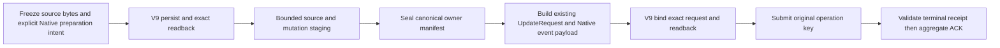

The pre-stage intent freezes original OperationKey, exact ViewRef/SourceCut and
profile, independent numeric event position, explicit text and owner-identity
policies, original Lexical source event, immutable member ref and closure
binding. The Native event payload is computed from the sealed owner mutation
manifest; it is not the Lexical source-event SHA or source-closure content
digest. Reuse the existing canonical UpdateRequest after seal. The V9 owner
must retain preparation custody before any SDK write and exact submitted-request
custody before submit. Unknown outcomes reconcile the original operation key;
Refused remains refusal. A raw validated DTO is not that durable capability.

Initial upload does not require a corpus-wide OwnerId sort. Ordinary Delta still
requires an authoritative complete changed/deleted owner set and retained CAS
refs. SourceResync requires a complete join of the old producer prefix and new
baseline, including every old owner; bounded per-page upload alone does not
supply that authority or bound producer-side memory. Durable owner metadata or
an admitted external spill is still required for recovery when that join cannot
stream. Do not quietly scan/rebuild the full corpus on ordinary file edits.

`NativeSourcePreparationIntentV1` and `NativeSourceBoundUpdateRequestV1` are now
implemented in contract-retrieval with closed handwritten wire fields and
shape/digest tests. Preparation builds the existing UpdateRequest and computes
Native capture through its existing contract owner. Bound-request validation
compares against an independently supplied sealed OwnerMutationSet, not the
request's own owner set: self-derived comparison would accept physical root
replacement because logical capture intentionally excludes physical root.
The new contracts reuse the existing
Native contract types and Lexical artifact/source-event types, preserving
operation retry sequence independence from event ordinal. Preparation is not yet stored
in the aggregate artifact or connected to the publisher. Source preparation
also has stamped frozen-DTO and independent closure gold tests; public aggregate
and durable-authenticity integration proofs remain unexecuted.

Current V9 `Dispatching` stores only aggregate receipt, lease and terminal member
receipts. It has no pre-submit request-binding API. The next coupled change adds
one write-once binding to the same V9 authority, reusing typed UpdateRequest and
binding it to preparation/member/aggregate identities. Same-request ACK-loss
retry must re-load the stored row; different requests must refuse. Lease renewal
and receipt append must preserve binding. Current CAS returns a reconstructed
in-memory row, so CAS success alone cannot prove exact readback before Submit.
Terminal/Acked transitions drop Dispatching fields; the Native terminal receipt
must retain the exact bound request or an exact-loadable reference in the same
V9 authority for cold revalidation. Complete these consumers together.

Owner-mutation seal precedes Submit; Native request-root seal runs inside Submit.
Before a V9 request binding exists, recovery may reconstruct from fixed source
intent. After binding exists, even Unknown status cannot authorize changing the
physical mutation root or original request. Query/reconcile the original key.
Ingress-fence renewal is attempt metadata and must not change semantic request
identity. Exact profile/source and staged text admission still need runtime
checks: these facts cannot all be proven from UpdateRequest shape alone.

### 23.65 F07 durable Native preparation and write-once request custody (2026-10-13)

This source checkpoint extends the existing V9 workflow. It does not enable the
Native product publisher. The ordinary host currently passes explicit `None`
for Native preparation; no authenticated Native endpoint has been injected.
Native rows refuse the old Lexical publisher and terminal path until the typed
Native completion path is implemented.

#### Durable authority and format ownership

`SourceBoundCloseoutReplayV2` uses JSON envelope format **3**, with two
required-present optional fields:

```text
native_source_preparation_v1: Option<NativeSourcePreparationIntentV1>
native_update_binding_v1: Option<NativeSourceBoundUpdateRequestV1>
```

The preparation is captured in the first Preparing insertion. Its value,
including `None` selecting the existing publisher, is immutable in every CAS.
The request slot changes only None→Some in Dispatching under the same lease
and unchanged member progress. The original request survives Terminal, Acked,
cleanup and lossless RecoveryRequired quarantine. A binding without preparation,
a binding before Dispatching, and a Native terminal without binding refuse.
Quarantine preserves evidence and never grants successful publication.

The publisher choice is frozen in the canonical initial V9 row, bound to the
writer-owned artifact/member identity. It is not duplicated in a new artifact
format, a second journal, or another corpus archive. Existing prepared artifact
formats 3/4/5 remain their existing contracts. Prior replay JSON format 2 and
missing new fields refuse; there is no missing-field default or new migration shim.

**SQL row layout remains format 2.** Its existing columns and schema CHECK are
unchanged, while the nested JSON envelope is format 3 and independently
validated. Static review caught an attempted SQL stamp 3 that would violate
`schema.sql`'s `CHECK (replay_format_version = 2)` and fail every insertion.
The owner now explicitly names `SOURCE_BOUND_SQL_ROW_FORMAT_VERSION_V2` and
tests SQL2/JSON3 success plus independent SQL3 and JSON2 refusal. These Rust
tests are implemented; execution is still pending.

#### Concrete producer, persistence and replay changes

| Owner | Implemented change | Remaining proof / limit |
| --- | --- | --- |
| Contract replay envelope and closed serde | Required-present fields, current-format refusal, phase/internal identity checks, exact Required Lexical ref and source-closure artifact binding. | Semantica owning Rust execution pending; pure artifact checks cannot prove Lexical event equals member bytes. |
| Canonical admitted decoder | Quanta fixed IDs/records and source-only Advance/Resync decode into existing replay DATA; owned strings and one-event vector use existing admission. Extra event/record fields refuse before decoding their payload. | Native seed leaf/denial tests implemented. Fully funded Native envelope success and cold product replay remain integration proof gaps. |
| Existing replay store | Preparation immutable, request write-once, same-phase binding with unchanged lease/member receipts; all later transitions retain both fields. | CAS transition tests and SQL/JSON tests implemented, not executed. |
| Existing aggregate coordinator | Explicit Native preparing entrypoints use the common persistence owner; post-seal bind compares an independent SDK seal result, CASes and exact-loads the request. Identical lost-ACK readback succeeds; replacement refuses. | No SDK Submit and no typed Native terminal issuance. |
| Existing prepared owner pipeline | Before Native preparation transfer, compare the writer-persisted Lexical handle, borrowed full-source validator, original source event, closure and initial Advance mode. Recovery exact-loads artifact/member custody and repeats the comparison. | Source validator retains its initial-full-only scope and existing O(N) metadata validation. Ordinary host still selects the existing publisher explicitly. |
| Consumed issued custody | Exact ordinary/change-event readback after issuance was consumed; compare original aggregate/artifact/preparation, and retain change-event plan/owner/runtime epoch checks. No row insertion or reissued authority on this path. | Owning Rust and actual ACK-loss restart validation pending. |
| Legacy completion boundary | Native preparation refuses Legacy Lexical dispatch before connect, generic published evidence capture, generic Lexical receipt append and generic terminal promotion. | This is a fail-closed implementation boundary, not successful Native delivery. |

The initial producer check consumes the existing writer-persisted member
capability and borrows its body. It does not load another whole-corpus copy just
to compare a source event. Recovery uses the existing exact member readback.
The bound request retains its real physical root. Cold replay treats the exact
persisted request as authority; it does not independently re-prove the first
SDK seal by comparing a request to an owner set extracted from itself.

Quanta prerequisites were extended at their canonical owners: the sealed
retained-scalar decoder now admits 16-byte IDs using the same original scalar
visitor and rejected-input custody as 32-byte digests; `SourceTransition`
capture streams the same JSON tuple/domain into SHA-256 instead of allocating
an intermediate Vec. Selected Quanta tests are **7/7 VERIFIED** (309 skipped,
0.047s), including owned-input retention, first-error/no-second-poll, exact
array/u8 predicates and the independent unchanged Native capture golden.
The two affected Quanta production libraries also passed strict Clippy with
all features, `--no-deps -- -D warnings` (1m13s compiler report). Test-target
strict, Semantica execution and whole-workspace qualification are not implied.
This result is separate from §23.64's latest **38/38 VERIFIED** (522 skipped,
3.560s) and does not qualify Semantica or an incremental performance budget.

#### Required next coupled slice

1. Inject an authenticated Native endpoint/client and resource custody through
   the existing SDK ingress facade. The Native socket is independently configured;
   never infer it from the existing SearchPlane root or construct an unfunded path.
2. From exact durable preparation, validate Native source/profile/view and stage
   bounded source/mutation windows under their memory leases. Seal, then bind and
   read back the exact request before any Submit.
3. Submit/status/resume the original key and full request. After binding, Unknown
   never authorizes a new physical mutation root or request. Refusal stays refusal.
4. Implement typed Native terminal validation and exact cold readback, then couple
   it to the existing Required Lexical identity and aggregate ACK. Reuse canonical
   required-member ordering; do not reinterpret a Legacy receipt as Native proof.
5. Complete authoritative ordinary Delta/deletion and old/new producer Resync join.
   Initial-full page staging does not provide these authorities or performance proof.

QBC, source validator public aggregate integration, funded Native decode success,
SDK/V9 restart, full suite, Native Large/XL, operating and release qualification
remain separate gates. Static formatting/boundary passes are not Rust execution.

For this checkpoint, Semantica owner resolve and affected boundary preflight
passed. Owning execution is **BLOCKED** by repeated shared-source changes during
QBC capture. A reached Cargo attempt also refused an out-of-date lockfile;
the canonical offline lock update completed, and a subsequent attempt failed
capture in an unrelated interprocedural source file. Semantica tests remain
**NOT_RUN**. No raw Cargo fallback, guard bypass, unrelated cache purge, or
successful owner receipt was used to claim the new Native path works.


### 23.66 F07 explicit endpoint and exact Native terminal custody (2026-10-13)

This slice connects host and receipt authority. It does not enable the Native
producer, qualify incremental performance, or close F01-F09.

| Boundary | Current implementation | Remaining proof / caller |
| --- | --- | --- |
| Host endpoint | Product composition accepts an explicit optional Native socket. The original OS-path copy owner admits host-owned backing under the existing payload grant. Publications retain the host and borrow the path; same-key host revalidation includes exact endpoint equality. | The shipped executor still passes `None`. Native selection requires host input plus durable preparation; endpoint/preparation mismatch refuses before V9 transfer. |
| SDK source input | `NativeUdsClient<P = PathBuf>` supports borrowed `&Path`; borrowed source windows use the same StageSources preflight/wire/ACK owner as owned inputs. Limits are 32 items and 8MiB weighted input. | These are input limits, not a total-memory or RSS bound. Canonical encode still owns frame/compression buffers. |
| Exact request replay | `submit_borrowed(&UpdateRequest)` shares canonical Submit response classification without cloning the event vector. | `status(key)` cannot prove which request was admitted. Kernel Submit replay compares the original immutable request ObjectRef before returning Terminal. The producer must replay the exact V9 request. |
| Native owner receipt | A distinct Native receipt retains exact Submit Terminal(Published), digest-checked CatalogView, and original bound-request digest. It checks operation/view axes, expected sequence+1, profile and source frontier; cold validation requires independent V9 preparation/request. | Initial full only. A locally supplied status/key or digest is not remote request-binding proof. The actual publisher must mint from exact Submit replay. |
| V9 member recording | Generic identity append refuses Native Lexical. The dedicated Native recorder exact-loads the live grant and revalidates full canonical Native receipt bytes against the original preparation/binding before CAS. | Prevents a Legacy receipt from consuming the write-once member slot. A refused receipt can leave an unreferenced immutable object; no claim of zero storage side effects. Real Native Dispatching-row regression still NOT_RUN. |
| Terminal and readers | One existing writer revalidation interface carries optional borrowed Native preparation/request. Terminal, checkpoint/ACK retry, Acked reader and completed predecessor readback pass exact V9 context. Cold writer readback repeats frozen source/closure checks. | Rust owner and product execution remain separate gates. Generic receipt rejection alone is insufficient evidence of end-to-end Native publication. |

#### Resource gap and required repair

Client IPC has no complete memory-admission path. `RequestBudgetV1` supplies
cancellation/deadline, not memory. Request encode owns CBOR/frame and optional
compression buffers; generic response decode owns body plus nested DTO backing.
A fixed host reservation derived only from 8MiB source input does not prove
these concurrent allocations or retained response lifetime.

The first primitives are now implemented: `encode_request_single_frame_admitted`
reuses counted frame encoding with a real MemoryScope lease, and
`read_response_body_admitted` retains raw CBOR body backing with its MemoryLease.
They refuse before body allocation on admission denial, retain no bare Vec
extraction, and distinguish ResourceLimited from cancellation/invalid scope.
They are not yet connected to Native client send or Semantica original funding.
The remaining transport/decoder connection must retain these original leases
through every write, response decode and returned owned value.
A generic `DeserializeOwned` result cannot be called fully funded by multiplying
wire bytes by an arbitrary factor. Native typed decode must provide its own
bounded storage admission before the real producer enables this path. A
single-frame primitive is an explicit bounded transport contract; it must refuse
oversize input instead of silently claiming compression scratch is funded.

Actual bounded stage/seal -> V9 request bind/readback -> original Submit -> typed
receipt/ACK caller, canonical owner-ID policy, ordinary Delta/deletion and Resync
old/new join remain open. Existing initial-full source admission does not provide
changed/deleted-owner authority. Native Large/XL and operational/performance
qualification remain NOT_RUN.

#### Checkpoint evidence

Quanta SDK `native_uds::tests` completed **34/34 VERIFIED** (183 skipped,
1.017s), including borrowed source wire/ACK parity, denial before connect and
borrowed Submit parity/original-key unknown handling. The public API snapshot
was regenerated through the existing owner tool. These results do not qualify
Semantica producer integration, transport memory, or performance.

Semantica owner resolve succeeded. The first new owner execution failed source
capture before Cargo because an unrelated intraprocedural source changed while
hashing. Affected boundary preflight executed and **FAILED** the existing SDK
result-taxonomy contract in `sdk/ide/document_symbols.rs` (missing
`.try_project_admitted_v1(`); the other 21 impacted policies passed. This is not
Rust compilation or an executed Native behavioral failure. The narrowed owning
Rust tests remain NOT_RUN until a successful exact source capture/execution.


The repeated Semantica owner attempt also ended before execution with
`owner QBC source closure changed before execution`
(`/tmp/qi-native-f07-terminal-owner-retry.log`). No Native Rust tests executed
and no owner proof was promoted. SDK public API check after regeneration is
VERIFIED (`/tmp/qi-native-f07-borrowed-sdk-api-check.log`).


The IPC admitted-buffer primitive tests are **5/5 VERIFIED** (117 skipped,
0.022s), covering canonical single-frame parity, denial before second encode,
retained body lifetime, truncated-body refund, cancellation and malformed
lease-size separation. The corrected first attempt timed out waiting for the
shared build lock without running tests; retry admitted after 190s and completed.
Output: `/tmp/qi-native-f07-client-buffer-tests-retry.log`. This proves the
selected buffer owners, not funded typed decode, common send, hard RSS or Native
producer integration.

An additional initial-full predicate was repaired statically: first V9 binding
compares the SDK seal's independent owner count with exact source-closure count;
terminal validation compares it with frozen Lexical scope count. Initial producer
and terminal paths explicitly reject SourceResync until the old/new owner join
exists. A necessary count match is not a proof of owner/path/content equality.
The negative Native tests were added but Semantica execution remains NOT_RUN.


The affected Quanta IPC and SDK production libraries passed strict Clippy:
`./scripts/cargow --lane shared clippy -p quanta-index-ipc -p quanta-index-sdk --lib --all-features --locked --offline --no-deps -- -D warnings`.
**VERIFIED**, compiler report 27.00s, lock wait 37s;
`/tmp/qi-native-f07-client-buffer-sdk-strict.log`. Test-target strict, Semantica
Rust execution, whole suite, E2E and Native performance remain unqualified.


### 23.67 F07 Original-funded client transport and bounded source staging (2026-10-13)

Selected Core/IPC/SDK owner tests are **52/52 VERIFIED** (554 skipped,
1.051s); Core/SDK public API check passed. Production-library strict was
**BLOCKED** by a 300s build admission timeout before Cargo. Semantica owning
Rust is **NOT_RUN**, source capture blocked; affected boundary preflight
**FAILED** two current shared Cargo policies (51 passed). These claims are
separate from full Native producer, E2E and performance qualification.

This checkpoint extends the actual transport and source-stage owners. It does
not enable the shipped Native publisher or close the complete F01-F09 scope.

| Owner | Code change | Boundary and remaining work |
| --- | --- | --- |
| IPC one-shot loop | The existing connection/write/read/deadline loop accepts an admitted request frame and returns an admitted raw response body. Canonical Core memory types are reexported at IPC. | Existing standalone/progressive callers retain their routes. A funded negotiated route would need both simultaneous frame reservations; the current funded route uses one frame. |
| SDK publication reply | A retained reply owner holds canonical typed response, raw body and decoded backing. Publication-only bounded decode rejects oversized identifiers, text, containers, unsupported variants and trailing CBOR before unsupported payload traversal. Borrowed sources, mutation pages and Submit use admitted transport. | Parser allocation bounds and malformed-input rejection are owner-test claims, not a process RSS ceiling. Arbitrary query/stream decoding is outside this route. |
| Core budget | Original external cancellation bit and absolute deadline are observed directly. The admitted constructor reserves the two initial shared allocations before creation; clones retain that charge. Core exposes the private MemoryLease payload layout for external canonical Arc accounting. | External stores do not fire local waiters. IPC rechecks in bounded waits. Child construction, waiter registration and optional query ledgers require their own admission and are outside initial-budget funding. |
| Semantica Original bridge | The same OriginalExecutionKeeper is carried through source collection and final ingress. The memory adapter reserves each buffer and its logical lease/owner backing through the original control and retains actual per-buffer grants. Missing Original authority, deadline or cancellation source refuses Native execution. | Original scope/budget must be used by the actual dispatcher. Existing non-Original backing does not gain synthetic permits. |
| Sole SDK ingress | Initial-full staging borrows checked source bodies, reads the exact expected Native view/source/profile, then uploads fixed stack windows of at most 32 files and mutation records and independently seals their map. Constant-time file access prevents repeated prefix scans. | No Submit occurs in staging. The caller must persist/read back preparation before staging and bind/read back the sealed request in V9 before Submit. Actual ordinary V9 caller and explicit target authority remain open. |

The frozen path-owner policy is domain-framed BLAKE3-128 over validated
repo-relative path bytes, namespaced by the original producer. Its policy digest
must match preparation. Duplicate IDs, including collisions, are refused by the
persistent mutation map's absent-CAS; no second full-corpus owner table is built.
A required lexical file cannot be staged with Excluded text admission. A single
source above the existing 8MiB weighted upload window refuses before writes;
partial source-record splitting is not a substitute for a specified chunk protocol.

Recovery continues to use the original operation, source capture and immutable
V9 request. Staging can leave ingress objects on refusal; it does not authorize
publication or a new operation after an uncertain ACK. Once request binding exists,
the dispatcher must skip restaging and replay that exact request.

Remaining coupled delivery: explicit host target authority → original V9
preparation → funded stage/seal → write-once bind/readback → exact Submit replay
→ published-view/typed receipt → dedicated recorder → ACK/restart. The shipped
executor still selects None. Ordinary Delta/deletion, authoritative old/new Resync
join, real Native Dispatching-row negative regression, full suite and Native
Large/XL operational/performance/release qualification remain open.

Verification results for this source slice are recorded in VALIDATION.md; older
34/5/38/7-test checkpoints do not qualify these new changes.

An additional Original error audit is open: reserve_owned_memory_v3 can
replay a sticky WorkLimit refusal. The adapter's canonical consume_work_v1(0)
checkpoint recovers exact Original causes without a second journal, and
Deadline no longer projects as memory exhaustion. WorkLimit still maps to
ResourceLimited and IPC's frame classifier can mislabel it as memory. Repair
that canonical distinction and call the Original checkpoint after SDK failures
before enabling the producer. No BackendViolation workaround or new wire
taxonomy was introduced to hide this gap.


### 23.68 F07 exact V9 dispatch, bounded reconciliation and live lease limits (2026-10-13)

The current dispatcher can consume a per-attempt NativeSourceTargetV1 and
freeze preparation into existing V9 before staging. A configured socket alone
is not a request authority. Existing legacy attempts remain legacy unless an
explicit valid target is attached. This is implementation wiring, not product
cutover or acceptance.

| Owner | Implemented behavior | Proof boundary |
| --- | --- | --- |
| Canonical Core error | WorkLimitExceeded is distinct from ResourceLimited; IPC does not label work exhaustion as frame-memory denial. Original error recovery reads the existing sticky cause. | The 52 selected Core/IPC/SDK tests passed for this work-error slice; later cap changes require their own check. |
| V9 dispatcher | Writer-read artifact and frozen lexical source are validated before bounded staging; independent seal is bound once and exact-read back before Submit. Existing binding skips all restaging. | Semantica owning Rust and real V9 dispatch are not yet verified. |
| Sole terminal ingress | Submit Accepted/Unknown drives one Resume of the original operation, then exact Submit again. Only Published plus exact published view mints a receipt. Confirmed Refused is preserved and never resumed. | Real UDS regressions added; execution pending. Neither Status(key) nor Accepted is terminal evidence. |
| Existing lease owner | Same live owner renews a due lease through canonical CAS and exact readback. Preparation, binding and recorded progress stay immutable. Expired, foreign or stale grants refuse. | Renewal decision checks and store replacement predicates are separate from a real granted renewal test. |
| Request budget | capped_at clones the same request scope and ledgers and only shortens its deadline. Staging uses a fresh parent clone after renewal for each RPC; the bounded terminal sequence uses one current lease cap. | Cancellation, parent-deadline and callback rejection tests are scoped verification, not a process-wide resource ceiling. |
| Final V9 receipt mutation | Wall time is sampled after writer persistence/readback, preventing stale pre-RPC time from validating an expired grant. | Existing epoch-based lease clock behavior still needs clock-discontinuity qualification. |

Source preflight invokes progress before scanning and every 32 files, while
keeping all durable writes after input validation. Each file observes the
latest capped request budget. The earlier checked-full capability construction
still performs full closure validation before this callback; it needs its own
bounded control/lease checkpoints before large-corpus acceptance.

Current-product corrections from static caller review:

- SDK Facts mutation already calls capture_original_committed_full_v3 through
  issue_facts_original_snapshot_bound_source_v11 and the existing rail. The
  earlier claim of zero production callers was limited to a runtime-only
  search and is withdrawn. The actual Facts path still lacks explicit target
  delivery and first-full eligibility; ordinary successors select Delta.
- Watcher recompute remains an Ordinary source path. No synthetic Original
  execution authority may be attached to it.
- SDK owned-phase lifecycle compatibility was repaired after finding the
  bit/deadline mismatch. RequestExecutionObserverV1 observes the existing
  Original source-control checkpoint; owned-phase budgets delegate termination
  to that phase instead of copying an obsolete fixed deadline. Non-phase
  lifecycles retain their actual absolute deadline. The existing scope Arc
  implements the observer and retains the same Original grants; no synthetic
  cancellation bit, timeout, phase getter or secondary refusal journal was
  added. All Native RPCs still receive the independent finite live V9 cap.
  This implementation is owning-Rust NOT_RUN until the pooled check succeeds.
- Query-readiness startup has no Original keeper. Native replay consequently
  refuses before dispatch. A product recovery owner must issue fresh recovery
  work authority and retain exact V9 operation/binding; persisted keeper
  resurrection and query timeout as execution authority are invalid.

Remaining coupled scope: actual initial full V9 producer; explicit target
custody through Facts requests and recovery; lifecycle-to-IPC owning proof;
watcher admission; native Delta/deletion and authoritative Resync owner join;
fresh-process Native recovery; actual Dispatching/renewal regression; full
suite and Native Large/XL operational/performance qualification. F01-F09 is
not complete. Validation outcomes remain in VALIDATION.md §23.68.


The fixed-deadline getter experiment was withdrawn: OperationContextV1 and
PublicationOriginalPhaseV3 permit admitted closeout past the preparation
request timeout. Unconditionally copying the stored deadline would revoke
that valid work. The observer-only phase budget preserves this existing
contract; the V9 call cap limits transport and leaves durable replay intact.
The constructor requires an actual phase owner or actual non-phase deadline.


### 23.69 F07 explicit SDK target and replay downgrade boundaries (2026-10-13)

Native selection now travels through the existing ApplyChanges payload and
request fingerprint. NativeSourceTargetV1 uses the canonical closed manual
codec; selection axes contribute a domain-separated digest. Absence preserves
legacy JSON and fingerprint bytes. Presence requires an explicit idempotency
key and the Facts Original publication route. Endpoint configuration still
cannot select a Native operation implicitly.

| Boundary | Current behavior | Remaining authority |
| --- | --- | --- |
| Target codec | Reject unknown/invalid axes; digest binds selection. | One exact owner test GREEN on a separate CAS source. |
| Idempotency | Reject changed selection before cold recovery. | New SDK owner execution not yet run. |
| Pre-source/cached replay | Native SDKPreSource, RecoveryRequired and Completed refuse targetless legacy recovery/response reuse. | Completed must read/authenticate the exact V9 receipt before it can succeed. |
| Facts producer | Post-CAS capture helper can attach a supplied target. The normal route rejects earlier. | Authenticated pre-CAS pending source, committed promotion and first Native FULL are required. |
| Runtime owner | V9 stage/bind/exact replay implementation exists. | Whole Runtime check failed in the PTA fixture before dispatcher compilation. |

The early Facts guard must not be deleted merely because a later callsite
exists. Existing move-only target seed parts already authenticate the prospective
closure pin and genuine Original execution before Source CAS. The next coupled
change must retain that pending authority through the same CAS and compare the
committed closure/keeper before Native attachment. It cannot invent a committed
source before CAS or issue Original authority in the coordinator.

Latest pooled proof is 56 selected Quanta tests and 126 same-CAS Semantica ingress
tests, recorded separately in VALIDATION §23.68. Neither qualifies the newest SDK
path, product cutover, runtime renewal or throughput. Progress-aware validation
is being added at canonical codec/digest owners: bounded upload windows alone
cannot interrupt a preceding full-corpus validation scan. Immutable witness
validation and sorting must have their own explicit work bounds; a checkpoint
before/after an opaque operation is not a preemption guarantee.


### 23.70 F07 prospective source custody and interruptible validation (2026-10-13)

This checkpoint adds source custody and cooperative validation; it does not
activate the Native product producer. The Facts guard remains unconditional:
current mutations produce Delta, whereas this Native adapter admits initial
FULL only. Guard removal before a pre-CAS eligibility proof would permit a
Source commit with an unsupported indexing successor.

```mermaid
flowchart LR
  A[Explicit target + SDK idempotency] --> B[Authenticated target pin / Parser closure / Original keeper]
  B --> C[Move-only pending Native source]
  C --> D[Existing pre-source journal stores exact target]
  D --> E[Source CAS]
  E --> F[Exact committed seal + same Original owner promotion]
  F --> G[Existing V9 preparation and bound request]
  G --> H[Bounded stage / seal / exact Submit replay]
  H --> I[Authenticated Native receipt / V9 terminal / ACK]
```

The diagram states the required ownership order. Its Source CAS→V9 restart
bridge and initial FULL product selection remain incomplete; the guard prevents
normal Facts requests from entering this unfinished route.

| Owner | Implemented change | Limit |
| --- | --- | --- |
| SDK Facts source owner | FactsPendingNativeSourceV11 retains fixed prospective seal, explicit target and genuinely retained Original keeper. Issuance checks pin/Parser closure; consuming promotion checks committed snapshot/closure and same execution owner. | Move-through is implemented, production guard retained, owning Rust not yet verified. |
| Existing publication journal | Persist exact optional target in the same pre-source intent and checksum-covered material. Same-operation equality includes target; ordinary callers explicitly supply None. | Native cold and in-process recovery refuse before legacy Product replay until fresh Original recovery exists. |
| IPC comparator | Preserve exact byte equality with checkpoints before/after and within 64KiB or 256 serializer writes; preserve original callback error. | Custom Serialize code computing without writes must cooperate independently. |
| Canonical source validation | Same ordinary validators now delegate to progress-aware event SHA, unit-set SHA, source SHA and bounded item scans. Native closure content uses the existing chunked canonical digest. | Vec sorting and V5 artifact validation still contain opaque work. |
| Runtime validation owner | Same Original observer and retained lease cap govern preflight. A local renewal-due query schedules authenticated renewal; each actual RPC still validates the durable row. | Scheduling is not write authority. No row reload per hash chunk; no expiry resurrection. Root Runtime compilation remains unverified. |

No second journal, targetless fallback, synthetic Original grant, duplicate hash
algorithm or alternate validator was introduced. Material checksum detects
selection removal/modification before intent restoration. No Native↔ordinary
mode switch is inferred from an absent resource or an uncertain ACK.

Remaining canonical artifact work is explicitly coupled: one V5 progress entry,
nested receipt/handoff/witness propagation, ordinary CBOR checkpoints under the
same allocation semantics, interruptible chunk collection/sort and preservation
of caller error. Adding a fake memory scope to the bounded Original encoder is
not an implementation option. The ordinary mode presently has no work callback;
changing it affects decoder/schema matches and requires owning tests.

Verification is pooled at this checkpoint. See VALIDATION §23.70 for exact
source/runner outcomes; older GREENs do not qualify these additions.


The §23.70 pooled checkpoint now has 65 selected Quanta tests GREEN and 127
Semantica ingress tests GREEN on the recorded CAS source. Contract/IPC API
inventory and generated prompt lint passed. These are component proofs. SDK
DTO owner compilation failed earlier in the PTA Python→DFG birth feature
boundary, and the whole Runtime proof remains open. The producer audit found zero production Ordinary-member issuers. The proposed
Ordinary bridge was removed. Existing PythonSource literal-return selection
retains its genuine Original loan; Java-only expression/descriptor readers are
Java-feature gated, and unsupported Python general-expression reads fail with
typed UnsupportedOperation. Enabling Java or accepting an arbitrary Current
as authority would violate provenance. Owning Rust proof is pending.


### 23.71 F07 Python feature boundary and remaining authority gaps (2026-10-13)

The producer audit supersedes the proposed Ordinary selected-row bridge in
§23.70: no production Ordinary member constructor exists. That bridge was
removed rather than extending authority from a raw evidence reference and an
arbitrary Current. Existing PythonSource literal selection already verifies the
same Original backing, row ordinal and two occurrence-free constraints.

Java ledger/descriptor access is now confined to native-java-relation-output
in expression birth, selected axes, Original envelope finishing and literal
prepare/verify. Python-only general-expression/Ordinary descriptor reads return
typed UnsupportedOperation. This fixes feature closure without claiming that a
general Python Original expression producer has been implemented. Java and
PythonSource literal paths retain their existing producer contracts.

Two SDK regressions exercise the actual target preflight and fingerprint owner:
selection differences change the fingerprint, and a missing idempotency key
refuses before mutation-owner entry. The existing ordinary fingerprint golden,
partial-target DTO refusal and cold-replay refusal are retained.

The remaining compile/activation seams are distinct:

| Seam | Required repair | Current evidence |
| --- | --- | --- |
| Python feature closure | Restrict Java-only readers; preserve PythonSource literal route | Source repaired; focused format/diff pass; owning run pending |
| PTA Original fixtures | Produce genuine retained source/output authority for general callable inputs and migrate coupled fixture consumers | Deleted Vec-to-Original helper still referenced across nine PTA files; no genuine general Python issuer exists |
| First Native FULL | Select owner/view/epoch/event from the admitted host and initial ReplaceGeneration producer | Endpoint-only bootstrap does not issue Native target; ordinary SDK mutation is a successor Delta |
| Source CAS to durable V9 | Recover committed source under fresh Original admission; exact preparation/binding/terminal reconciliation | Target is checksum-covered in existing journal; recovery currently refuses safely |
| End-to-end CPU admission | Propagate callbacks through V5 receipt/handoff/witness, ordinary canonical CBOR and fallible sorting | Existing byte/item callbacks do not preempt opaque V5 work |

The audited product Python Original literal issuer accepts only a single
non-async, undecorated, zero-formal function returning an integer literal.
Concurrent DFG source adds an exact initializer field-copy issuer with focused
tests, but its production routing is not connected: the composition provider
still calls the literal issuer. Neither exact shape replaces Parameter2.py
class/method/general-call fixtures. Restoring a generic Vec-to-Original
helper, removing those tests or silently reclassifying their expected positive
semantics would not repair authority. Facts remains guarded; no Native product
activation, performance or full-suite conclusion is made.


### 23.72 F07 canonical V5 progress and exact Native completion (2026-10-13)

The canonical Ordinary replay mode now accepts an optional borrowed work observer;
NativeVectors retains its allocation authority. The same receipt/manifest/chunk,
handoff/witness validators and manual serializer propagate the observer. V5
validation and content-digest APIs preserve the caller's original typed failure.
Foundation's existing CBOR encoder checkpoints large byte writes in 64KiB chunks.
No synthetic MemoryScope or parallel validator is introduced. Allocator/RSS,
opaque semantic-snapshot validation, and comparator string work remain distinct
limits; cooperative callbacks do not prove a wall-clock interruption ceiling.

Runtime Native source preflight invokes this V5 entrypoint. Native completed SDK
recovery now requires the same fresh Original source, exact retained target,
published generation and immutable V9 Native preparation/binding. The canonical
coordinator reuses its typed terminal-receipt oracle and exact durable ACK
checkpoint validation; ordinary SDK checkpoint success is insufficient. Cleanup
phases refuse completion readmission. Mutation Delta still lacks a complete
Native changed-set contract, so the existing three admission guards remain.

Initial FULL is a separate index-only search-plane transaction after an existing
committed source baseline, not an implicit property of endpoint-only ensure.
Its implementation must issue fresh Original execution, inspect the existing
exact operation before recollection, preserve the immutable request on retry,
and authenticate Native terminal/ACK before returning success. The initial API
is being coupled to these owners; it is not yet product-ready.

The selected four Quanta packages passed all-target/all-feature strict Clippy
(52.33s compiler; resource admission time is recorded separately). The captured Semantica Contract, Foundation and Kernel ingress scopes passed
746/746, 208/208 and 127/127 respectively; these are distinct scopes with overlapping
focused subsets, not an additive product count. Subsequent Runtime/SDK visibility
and Dispatching resume changes remain NOT_RUN for owning Rust. Product restart,
Delta/Resync and performance acceptance remain NOT_RUN.


Initial-FULL producer recheck found a separate correctness seam: an ordinary
ensure can already publish a Legacy Lexical head. The existing aggregate emitter
then selects Delta, freezes that head and carries its delivered source-event
predecessor. These values cannot be relabeled as Native first FULL. The Native
selection must choose a complete Original FULL producer and its real backend
head/event authority before plan/emission. Do not loosen the Native validator,
clear the Legacy head, or claim the new initial API is accepted before coupling
this policy and owning validation.


The subsequent call-path check narrows the initial-head finding: endpoint-only
ensure is not proven to always publish Legacy Lexical. The existing deferred G1
contract provides a genuine NotComputed baseline with no lexical head/outbox,
no completed predecessor and first source-event ancestry. The initial Native
producer requires this exact deferred proof; an already-active Legacy head
refuses before publication rather than being relabeled. Canonical Native target
eligibility additionally requires Advance, event (0,1), and empty owners/paths/
frontiers roots. SourceCut must still match the actual selected Native view.
Fresh entry issuance and pre/post-collection exact V9 attempt inspection are
connected in source. Acked replay authenticates typed Native receipt and persisted
ACK; nonterminal replay fences recollection and remains pending/refused, not a
new request. Bound Dispatching resume now reuses the immutable V9 request, fresh Original
execution scope and existing lease/terminal/ACK owners. Earlier phases remain
pending. ACK activation now uses the existing Product reader visibility owner,
checks exact authority/source/receipt and final repository admission before
advancing, and reports uncertain publication after a failed visibility readback.
These later Runtime/SDK additions are source-only; Delta and Resync remain open.


### 23.74 F07 Native recovery read and refusal audit (2026-10-13)

Bound Native dispatch recovery is not yet memory-qualified. Writer
`load_revalidated_source_bound_artifact_v3` reads Required members, then
`recover_prepared_aggregate_dispatch_custody_v2` loads them again, decodes the
Lexical batch and retains History/Lexical/RepoMap together. Generic Ciborium
decode/re-encode and Kernel batch/byte clones lack Original allocation
admission. The V9 admitted JSON decoder is not a CBOR artifact/member decoder.
An Original scope at the outer dispatcher alone does not cover these allocations.

The immutable file reader formerly reserved declared length but read up to the
global 512MiB cap plus one, allowing corrupt growing files to expand the buffer
before rejection. Source repair reads exactly declared bytes into a fallible
fixed allocation and uses a stack one-byte overflow probe. Truncation, overlong
files and digest drift refuse; the in-memory test store checks length before
copy. Added tests require owning execution; this is not a full memory-admission
claim.

Recovered dispatch formerly converted `PreparedAggregateDispatchErrorV2::Original`
to string Contract errors. The canonical coordinator now carries the original
RuntimeError through `OriginalExecution`; cancellation, deadline and work-limit
roundtrip tests cover the mapping without synthetic grants. Owning execution
is still pending. Native terminal Refused still remains a durable failed exact
request; retries cannot invent a replacement request or claim success.

Remaining coupled repair: writer raw-byte admission before allocation; canonical
CBOR artifact/member and typed Quanta batch decode admission before each dynamic
allocation; leases retained with byte/decoded custody; reuse exact member custody
through recovery/terminal instead of unscoped re-read/clone. Preparing/Prepared
resume must follow this admission contract, not bypass it. Delta/replacement and
Refused retirement need their own real producer/event authority.


### 23.75 Current source progress and remaining delivery (2026-10-13)


과거 본문은 [보존 이력](RFC-DELIVERY-CHECKPOINTS.md#2375-current-source-progress-and-remaining-delivery-2026-10-13)으로 이전했다. 현재 작업은 [SSOT](../../plans/oct-17-index-closeout/tickets/README.md)만 따른다.

### 23.76 Original scope progress accounting and remaining work (2026-10-13)


과거 본문은 [보존 이력](RFC-DELIVERY-CHECKPOINTS.md#2376-original-scope-progress-accounting-and-remaining-work-2026-10-13)으로 이전했다. 현재 작업은 [SSOT](../../plans/oct-17-index-closeout/tickets/README.md)만 따른다.

#### Remaining promised work, kept with original owners


과거 본문은 [보존 이력](RFC-DELIVERY-CHECKPOINTS.md#remaining-promised-work-kept-with-original-owners)으로 이전했다. 현재 작업은 [SSOT](../../plans/oct-17-index-closeout/tickets/README.md)만 따른다.

### 23.77 Parallel delivery plan and exclusive write sets (2026-10-13)


과거 본문은 [보존 이력](RFC-DELIVERY-CHECKPOINTS.md#2377-parallel-delivery-plan-and-exclusive-write-sets-2026-10-13)으로 이전했다. 현재 작업은 [SSOT](../../plans/oct-17-index-closeout/tickets/README.md)만 따른다.

#### Current-source code-first dispatch revision


과거 본문은 [보존 이력](RFC-DELIVERY-CHECKPOINTS.md#current-source-code-first-dispatch-revision)으로 이전했다. 현재 작업은 [SSOT](../../plans/oct-17-index-closeout/tickets/README.md)만 따른다.

#### Live ownership correction before dispatch (2026-10-13)


과거 본문은 [보존 이력](RFC-DELIVERY-CHECKPOINTS.md#live-ownership-correction-before-dispatch-2026-10-13)으로 이전했다. 현재 작업은 [SSOT](../../plans/oct-17-index-closeout/tickets/README.md)만 따른다.

#### Stage0: freeze interfaces and real write ownership


과거 본문은 [보존 이력](RFC-DELIVERY-CHECKPOINTS.md#stage0-freeze-interfaces-and-real-write-ownership)으로 이전했다. 현재 작업은 [SSOT](../../plans/oct-17-index-closeout/tickets/README.md)만 따른다.

#### First dispatch: A / B / C in parallel


과거 본문은 [보존 이력](RFC-DELIVERY-CHECKPOINTS.md#first-dispatch-a--b--c-in-parallel)으로 이전했다. 현재 작업은 [SSOT](../../plans/oct-17-index-closeout/tickets/README.md)만 따른다.

#### Next available slots: D / E / F / G / H


과거 본문은 [보존 이력](RFC-DELIVERY-CHECKPOINTS.md#next-available-slots-d--e--f--g--h)으로 이전했다. 현재 작업은 [SSOT](../../plans/oct-17-index-closeout/tickets/README.md)만 따른다.

#### Checkpoints and delivery discipline


과거 본문은 [보존 이력](RFC-DELIVERY-CHECKPOINTS.md#checkpoints-and-delivery-discipline)으로 이전했다. 현재 작업은 [SSOT](../../plans/oct-17-index-closeout/tickets/README.md)만 따른다.

### 23.78 Non-overlapping implementation checkpoint (2026-10-13)

This checkpoint extends A/B/D in section23.77. It does not redispatch the
existing physical-store, Literal or publication-capacity writers, and it does
not change the original18/40 implementation completion tally.

- **A — controlled canonical decode:** the existing vendored Ciborium decoder
  now accepts a typed seed and caller-owned reserve hooks before parser String
  or byte-buffer growth. The existing Canonical decode-cbor leaf performs the
  Foundation allocation-free frame scan first and retains the allocation owner
  with the returned value. Short-text and exact-bytes seeds refuse visitor
  growth before admission and verify ownership before adopting a parser buffer.
  No unconditional Foundation dependency or parallel DTO/wire format was added.
  Runtime's genuine Original adapter, typed four-field member visitor and
  admitted V5/member recovery remain incomplete. These leaf APIs alone do not
  establish whole-decode memory custody.
- **B — Native Delta:** pure validation joins before/after V5 closure members
  and the SourceCommitManifest changed set; staging uses Exact old-owner lookup
  and bounded Add/Modify/Remove mutation windows. The manifest base/target
  source-root authority remains an issuer obligation; its digest domain must
  not be compared directly with the V5 closure digest. Runtime preparation,
  SDK mutation admission and cold replay remain guarded. Recursively requiring
  every prior checked Delta would introduce O(history) recovery and is not an
  accepted product integration: fixed-size authenticated current-baseline
  custody must be persisted and retained through the next accepted update.
- **B SDK seam repaired:** request_publication_admitted now permits the existing
  LookupSourceOwners request. The existing bounded decoder accepts SourceOwners,
  charges up to128 fixed-size rows before decode, and both SDK read routes share
  exact view/owner-order/cardinality validation. The stage caller additionally
  compares the returned SourceCut with its durable preparation.
- **Producer verification cost:** the existing composition-owner membership
  validator now merges the two ordered closures and compares declared transitions
  directly. It no longer constructs an O(N) path union plus a second owned
  transition set. Additional memory is O(1), excluding existing input closures;
  validation time remains O(N), and existing source capture/closure cloning is
  not removed. A mixed-path regression covers leading/trailing adds, removal,
  modification, unchanged members, omission, extra and duplicate-path claims.
- **D cost proof:** the existing native_noop_cost owner now measures frontier-only
  object writes and custody at N1/64 and H0/8/32, with independently read source
  roots/bodies preserved. Existing FULL/modify/delete cost and query gold in
  native_lifecycle are reused. The object observer excludes Catalog/WAL/device
  IO, GC and physical read bytes; these tests cannot qualify total update cost.
- **H remains BLOCKED:** Rust lacks a canonical persistent Native boot identity
  issuer/read-only verifier corresponding to launcher root_nonce and receipt
  axes. Fixed marker bytes and an inode lock are insufficient. No verifier
  success stub or fallback was introduced.

**Verification:** `./scripts/cargow test -p quanta-index-sdk --lib` passed226/226
on the inspected shared-main source. The same-count foreign-owner regression
was then strengthened and `./scripts/cargow test -p quanta-index-sdk --lib
admitted_source_owner_lookup -- --nocapture` passed2/2 after that change. The
whole226 target was not rerun after the test-only strengthening. These are SDK
unit/UDS scripted-peer laws, not a real Semantica producer or Native daemon E2E.

Semantica changed-path boundary preflight passed18 policies for the feature/
Runtime selectors and6 for the composition membership validator. Rustfmt and
scoped diff checks passed. Canonical owning test capture first failed because
shared source changed; the third capture completed and the owning command
**FAILED**, exit101, tests0: captured Cargo.lock required an update under
--locked. Source digest9ae2dec3d91f828884a7e7305b8c1b724e67a91d22b857256eeab5ff9c34302d,
result `/tmp/qi-native-cbor-exact-owner-oct13-retry2.json`. The current root
Cargo.lock has another live owner's claim and was not overwritten here. This
is a dependency-lock input failure, not a failed decoder assertion. Decoder,
Delta and composition behavioral acceptance remain NOT_RUN on the new source.
The corrected Native no-op owning target later passed5/5 (21.60s) after a
historical4/5 failure of the raw-byte equality oracle. The request uses JSON
u8-array Digest encoding, whose width varies with digest values. The corrected
law subtracts the independently encoded once-installed request payload and
compares remaining physical bytes exactly across N1/64 at identical event axes;
count laws also cover H0/8/32. Catalog/WAL/GC and total update time stay excluded.
The subsequent Canonical QBC retry at sourcee3f0686a… failed before tests on the
shared CFG/IR/source-authority dependency cycle, tests0; VALIDATION retains both
input failures separately. No Native performance, operating, full-product or
release qualification follows.


### 23.79 Original-funded Native member readback integration (2026-10-13)

This checkpoint extends A/B in §23.77 without changing the original R01–R40
scope or the 18/40 implementation tally. Product Native FULL/Delta/recovery and
large-corpus operating/performance acceptance remain separate obligations.
The common publication/VFS/writer-capacity files owned by the other active
chats were not edited in this checkpoint.

- Extend the existing Canonical/Ciborium decode owner with a schema frame
  callback. It returns `Result<(), F>`; successful early termination cannot
  bypass the remainder of canonical framing. The existing no-callback API
  delegates to the same decoder. The Native member uses one frame scan to
  reject tags before Ciborium can skip them.
- Decode the existing four-field immutable member DTO with admitted scalar
  seeds, borrowed field identifiers, exact canonical key order and receipt/
  kind/payload-length checks. V1 byte-array and V2 byte-string persisted forms
  retain their existing reader contract; cross-format payloads refuse.
- Reuse `OriginalNativeMemoryScopeV1` for wire, parser and visitor backing.
  Fixed allocation slots charge requested capacity before growth; old and new
  grants overlap during realloc, and parser-owned payload adoption checks
  backing pointer plus capacity. Unexpected allocator capacity refuses. This
  is declared backing-capacity custody, not allocator RSS/device-memory proof.
- Native Committed/Dispatching recovery now consumes this admitted Lexical
  member readback and retains its nominal wrapper until dispatch custody is
  dropped. The payload cannot be extracted as a detached owned Vec. Read/hash/
  frame/parser work consumes the same Original source control; its sticky
  refusal takes precedence over codec diagnostics. Wire uses the exact ref
  length, bounded read chunks and a one-byte overflow probe.
- Generic Native recovery without Original is refused before its previsibility
  helper or member/aggregate readback starts. Ordinary non-Native recovery
  keeps its existing owner path.

Remaining allocation scope is explicit: earlier full V5 readback and member
revalidation, History maps, nested Lexical DTO decode/copies, Structural/Dirty/
RepoMap and the small filesystem PathBuf still need their own exact admission.
The current change does not certify all recovery allocations or eliminate all
repeated artifact/member reads. Original scope identity is supplied by the
existing targeted-source/host ingress, not inferred from byte length.

Repeated Delta baseline is also not closed: existing typed in-process checked
predecessor remains valid, but the current cold V9 terminal record does not
persist a fixed-size authenticated source-transition proof. Recursively
reconstructing all predecessor Deltas would cost O(history) and is prohibited.
A regression refuses raw matching request/reply without the checked predecessor;
Runtime FULL/Delta guards were not relaxed. Complete cold Delta needs the
existing V9/terminal owner to bind current source-root/closure and validated
transition custody, without another publication head or changed-file trust.

Verification at this checkpoint:

- Static format/diff and relevant boundary preflight: VERIFIED for owned paths.
- Canonical exact owner test on source `94b39d11f8d8b43b46ce254d0e01a2bef293226730f9cf99622a8134ecb6d15b`:
  FAILED, exit101, 0 passed/1 failed/14 filtered. This executed behavior, not
  a compile failure. Fixed text is5 bytes and scratch4; parser admission is
  called before each of two appends. The old one-call oracle was repaired;
  retained-live and final-zero refund checks remain. Post-repair exact owner
  VERIFIED(exit0),1/1 with14filtered on source
  `e4cb0e9cda98df12e06040787a04e5a0b65f191a407d84e6069b67db24f070da`.
  Setup93.765s(including front-door disk admission/cleanup), execution19.796s.
  This compiles the Canonical lib(test) and proves that selected lifetime law;
  the other14 cases and new Runtime memory/member behavior remain NOT_RUN.
- Earlier exact source capture refused concurrent untracked-source drift;
  another live module attempt failed during closure finalization. Neither is
  a completed test pass and neither starts a second result ledger.
- Runtime exact gold compile FAILED(exit101), tests0, QBC source
  `5b63ca52748c83f501b7323f6411b150741dff247e9e58bef7191ca915702f93`:
  `original_java_callable_intake_v3.rs:41,54` calls unavailable
  `OriginalSemanticOutputAdmissionV3::record_first_refusal_v1` (E0599).
  The affected DFG file is live-claimed by
  `PTA-CALLABLE-DFG-STACK-CUSTODY-20261013`, owned by 증분 테스트보완;
  this checkpoint did not duplicate its repair. Setup19.407s, execution90.414s.
  The Runtime member/memory-owner behavioral tests remain NOT_RUN.
- Delta terminal regression and actual producer/daemon/IDE/Native Large–XL:
  NOT_RUN. No full-suite or performance acceptance is inferred.

Owning commands (same existing lane; exact requests capture immutable sources):

```sh
./scripts/quanta-build-cli owner run --lane 01a10d0b-bc57-7662-a2d3-315c1a07fdb5 --package quanta-contract-canonical --execution-kind test --target-kind lib --selector-mode exact --selector algorithms::canonical::admitted_decode_v3::tests::decoded_value_retains_parser_owner_until_last_drop --compile-policy package-all-features
./scripts/quanta-build-cli owner run --lane 01a10d0b-bc57-7662-a2d3-315c1a07fdb5 --package quanta-runtime --execution-kind test --target-kind lib --selector-mode exact --selector retrieval::port_impls::index_projection_writer::prepared_commit_artifact_v2::admitted_member_decode_v3::tests::admitted_member_gold_accepts_v1_array_and_v2_byte_string --compile-policy feature-isolation:quanta-runtime.no-default.32c001bdd540
```


### 23.80 Attempt-local readback reuse and adversarial custody repair (2026-10-13)

This is the existing writer's in-process recovery proof, not another persisted
IR, publication head, shared cache or activation authority. Original R01–R40
accounting remains18/40; complete Native producer/Delta/product acceptance is
not established by this checkpoint.

Before: recovery exact-loaded and owner-revalidated the aggregate and all
Required members initially, then repeated that complete readback while obtaining
individual persisted member custody. After: one
`RevalidatedSourceBoundArtifactReadbackV3` retains the frozen existing V3
artifact, readback seal and its issuing writer for that attempt. History,
Lexical, Structural, Dirty and RepoMap custody selections use that same proof;
each selected body still undergoes its own exact immutable read. Existing
previsibility and activation validators are preserved. Completed-predecessor
readback outside this recovery path still uses its existing fresh-read owner.

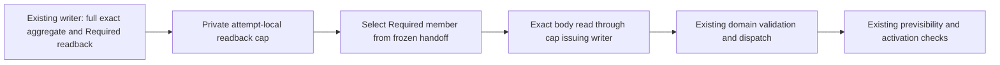

Static adversarial review found two boundary weaknesses in the first draft.
The recovery constructor accepted raw kind/ref/binding, and the body helper
accepted a writer independently of the cap. Both were repaired: persisted
custody reissue now requires the actual private readback cap and selects its
frozen Required ref internally; the helper has no separate writer argument and
body reading uses the cap's writer. No exploitation/runtime failure is claimed
from these static findings.

The regression exercises aggregate deletion after cap issuance: repeated
metadata selection must not perform another aggregate read, but a new attempt
must fail. It then reads the still-present member successfully and requires
same-length corruption and removal of that body to fail. Writer identity and
NotApplicable/absent Required selection are checked. This proves the intended
attempt-local contract when executed, not continued aggregate availability,
terminal ACK durability, total recovery memory, or measured speedup. Rust
execution for these new Runtime cases is NOT_RUN at this source checkpoint.

A separate native source-validation repair advances cancellation by scanned
closure members, not only changed rows. A long unchanged suffix following one
changed row previously suppressed cadence checks. Independent tests cover the
96-row unchanged suffix, Full-to-Delta add/modify/delete and successor rename
as delete+add, and an invalid no-op manifest. The owning Kernel exact
cancellation request is VERIFIED:1 passed/130 filtered; the source-validation
module is VERIFIED:7 passed/0 failed/124 filtered, source
`e7202e727e7ed0a7aeefa8ab2687a1fa48df51ec0b055cc168d3cf0097f82691`.
This includes existing Full/Delta identity/omission/source-body golds and the new
suffix-cancellation and successor laws. It is not V9/UDS/real producer evidence.
Genuine Original-backed Runtime readback
cases now cover retained/refunded grants, truncated/oversized/corrupt wire and
memory refusal before file read; they are source additions, not product proof.

Canonical module verification on immutable source
`e4cb0e9cda98df12e06040787a04e5a0b65f191a407d84e6069b67db24f070da`
executed9 passed/3 failed/3 filtered, exit101 (FAILED). Two scalar fixtures used
scratch2 below the UTF-8-scalar minimum4; the frame refusal fixture matched
Enter-major3 although the Foundation text event is Scalar-major3. Fixtures now
use the existing contracts and retain allocation/adoption/negative assertions;
the original FAILED result is preserved. Post-fix exact lifetime QBC is
VERIFIED:1 passed/14 filtered, source
`e7202e727e7ed0a7aeefa8ab2687a1fa48df51ec0b055cc168d3cf0097f82691`.
Post-fix Canonical module QBC on that same immutable source is VERIFIED:
12 passed/0 failed/3 filtered, exit0. The3 filtered cases belong outside the
selected Canonical module; this is not a whole-package or Runtime pass.

Next allocation owner cut must join Native Lexical preparation, V9 nested
batch recovery and terminal revalidation with the same Original scope. Current
scope creation is already before `prepare_ordinary_source_bound_aggregate_v2`
in the execution call chain; definition line order did not imply late creation.
The actual gap is that the existing scope is not passed into preparation, and
nested DTO decode/reencode/clone and terminal reads remain unadmitted.
Upstream `prepare_source_bound_publish_batch_v1` is earlier and has a separate
allocation boundary. The legacy SearchPlane V5 persisted-row loader is not the
Native V9 aggregate recovery path.

Latest Runtime exact readback owning request captured source
`326f420bacfb1e4cba715fae9f9ce793f9f73535f2719b5ccec371d431ad5051`
and FAILED(exit101),tests0 before the selected behavior could run. Four
Runtime-analysis compiler errors remain: Rust imports call the removed source
getter; precise solve clones a now-nonclone Java nominal world; the dispatch
adapter derives Clone over that world and calls its removed direct dispatch
method. The previous DFG error and this later analysis failure are different
source-specific outcomes, not a repeated failed test.

The Rust import consumer had no overlapping live path/directory claim. It now
uses the same `try_query_source_execution_authority_ordinary_v3()` API as the
TypeScript consumer, preserving typed refusal of Original-to-ordinary access.
No old getter shim or authority clone was restored. Static diff/format and
boundary preflight passed; Rust execution after this repair is NOT_RUN.
`solve_worker.rs` and nominal-world producer are actively claimed by
PTA-CALLABLE-CONSUMER-B/A-20261013 under 증분 테스트보완. Their coupled
retained-world/dispatch migration was not duplicated or weakened to unblock
these tests. Runtime readback/cap tests and Native product acceptance therefore
remain NOT_RUN; a coherent updated dependency handoff is needed before retry.
 Batch decode must extend the existing
Quanta corpus wire schema; the current ActiveHead-only replay decode policy
cannot be reused as if it admitted batch/chunk/symbol/source allocations.


### 23.81 SearchPlane preparation ownership and corpus key decode (2026-10-13)

This checkpoint reduces actual copies in existing prepare/validation owners;
it does not add a second DTO, decoder authority, publication head or typed
validation shortcut. R01–R40 accounting stays18/40 because the remaining Native
allocation, recovery and product exit conditions are not complete.

- The existing bound Lexical prepare API borrows `SearchCorpusIngestBatch`.
  Runtime passes its retained batch by reference instead of cloning the whole
  file/chunk/symbol/semantic tree; all known callers were updated together.
- The immutable-byte validator still decodes and applies every axis, seal,
  shape, surface-mutation, source-event, mode/base, digest and exact SDK
  conversion check. It now compares full serialized DTO-wire through the
  existing IPC comparing writer instead of constructing a second complete
  encoded Vec. This is deterministic DTO-wire equality, not a new RFC8949
  sorted-map claim, and serialization traversal remains O(payload).
- Validated decoded Lexical/Structural/Dirty batches are consumed by their
  existing exact SDK converters instead of being cloned for that check.
- One private validation core takes standard `Cow<[u8]>`: typed preparations
  pass the encoder's owned Vec and the public immutable-byte validator passes
  borrowed bytes. Successful prepare moves that Vec into the existing
  `PreparedSearchPlaneMemberPayloadV1`; the external borrowed validator still
  creates its required independent owned copy. All rejection logic is shared.
- Four map visitors in the existing Quanta `corpus_wire` schema classify known
  keys to the same static field-table literals rather than constructing owned
  String keys. Value, duplicate and missing-field contracts remain unchanged;
  unknown and nontext keys still refuse. The bounded identifier parser also
  refuses indefinite text keys even when their fragments spell a known valid
  field. This intentionally tightens the pre-release read contract: existing
  deterministic writers emit definite keys, and Kernel's exact DTO-wire
  validator already refused noncanonical encodings. It does not preserve every
  formerly accepted CBOR key form. Fixed known-indefinite and byte-string-key
  refusal cases were added and passed in the current contract rerun.
  This is not admission for arbitrary nested DTO values or every parser buffer.

Meaningful regression source includes a populated64-tombstone member with
input survival, exact public wire revalidation and source/digest refusal;
owned encoder pointer/capacity preservation versus borrowed-copy independence;
fixed JSON/CBOR schema wire, static key identity, and four-DTO normal/unknown/
duplicate/missing/nontext-map-key cases. Static formatting/diff and relevant
boundary preflight passed. Initial Kernel exact populated-member request
VERIFIED:1 passed/131 filtered, source
`dca75e17a21cf12283580db080fc5bcbd140561c9f498ad01086c8a160424abe`.
It precedes the later Cow transfer and Quanta key changes and does not verify
those changes. Post-Cow Kernel exact ownership request is VERIFIED:
1 passed/132 filtered, source
`b52ebf87c0b1ceb99a3072453af7a02a96cc01efbcc2eaa7d1361bda98944cb6`.
It checks owned encoder pointer/capacity preservation and borrowed-copy
independence. The complete prepare module on that same immutable source is
VERIFIED:10 passed/0 failed/123 filtered. Existing route, axes, mode/base,
canonical DTO-wire, source/digest and expected-active negative rails remain
included; this is Kernel prepare behavior, not Runtime producer acceptance. Quanta corpus-focused contract tests are VERIFIED:15 passed/0 failed/
190 filtered, using `./scripts/cargow --lane shared test --locked --offline
-p quanta-index-contract --lib corpus_`. This includes the3 new schema-key
cases and existing corpus shape/clear-surface/activation/control regressions;
it is not15 new tests or full-suite acceptance. The preceding compile failed
on the new test's unchecked Map::insert result (tests0); that fixture now
asserts the key was absent and the same target passed. No measured speedup,
RSS, Native Large/XL or actual producer acceptance is inferred.

Further Original allocation work must preserve the actual nested backing
census: top strings and vectors; file coverage/IDs and source bytes; chunk and
symbol strings/metadata; semantic records and cluster member vectors;
tombstone owner/path identity. ActiveHead-only admission and one exact member
byte seed cannot substitute for this batch schema. The existing Runtime CBOR
memory owner previously retained only one parser/visitor text/bytes slot each;
a second live same-kind backing refused. That existing owner now has a prepaid
retained-bank Vec (including its metadata capacity), exact kind/pointer/capacity
adoption and retained backing revisit; new source tests exercise lifetime,
metadata pre-birth denial and a real two-byte-string decoder. Rust execution
for this owner remains NOT_RUN because the Runtime compile closure is blocked.
Adversarial review also found linear retained lookup per buffer could become
quadratic over a complete batch and was not charged to Original work. Empty
fresh-buffer and work-accounting repairs plus a scalable prepaid lookup remain
required before treating this bank as the full-batch performance owner. Keep exact kind/pointer/capacity provenance and sticky
refusal, prepay both old and new backing during growth, and retain grants until
the corresponding aggregate owner dies. This prerequisite alone is not a
completed admitted batch decoder or allocator/RSS guarantee.

Runtime Original/cap tests remain unexecuted: the previous analysis failure's
Rust getter is repaired, but the three Java nominal Clone/direct-dispatch
errors remain in current source and the active PTA-CALLABLE-CONSUMER-B
ownership boundary. The retained/read-current migration is not duplicated.


#### Corpus key refusal checkpoint — 2026-10-13

The subsequent same corpus-focused command exited 0: **16 passed / 0 failed /
190 filtered**, 0.01 seconds test execution. The additional test function checks
both fixed known-indefinite text and known-spelling byte-string key refusal;
they are two assertions in one test, not two additional test cases. Resource
admission waited 259.700 seconds and compilation took 25.76 seconds. Neither is
an indexing throughput result. This completes the selected key-classification
regression; full DTO allocation admission, Runtime Original behavior and whole
suite qualification remain separate.


### 23.82 Original preparation scope passage and cooperative refusal (2026-10-13)

The source audit confirmed an actual authority passage gap, not a late scope
birth: ordinary aggregate execution already creates the Native Original scope
before preparation, but did not pass it to the preparation input. The existing
scope now travels through `prepare_ordinary_source_bound_aggregate_v2` into
`SearchPlaneAggregatePrepareInputV1`. A Native target without it refuses before
writer preparation. This does not create a new budget, source authority, or head.

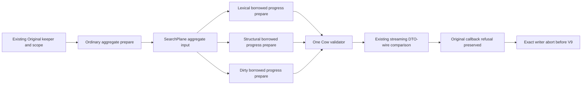

- The three preparation APIs take borrowed batches. Structural and Dirty no
  longer clone their complete batches at the Runtime aggregate seam.
- The same single Cow validator and all prior axes, digest, seal, surface,
  mode/base, exact conversion and expected-active checks remain authoritative.
  Public byte revalidation also has the same progress path for future recovery
  wiring; no duplicate validator is introduced.
- Stage checkpoints occur before encoding/decoding, around verification and
  conversion, before the prepared return and before aggregate issuance. The
  existing IPC comparison polls at 64KiB or 256 writes. The callback retains
  its exact error through `SearchPlanePrepareProgressErrorV1::Progress`.
- Once exact writer abort succeeds, ordinary execution returns the typed
  preparation cause rather than stringifying cancellation/deadline/work refusal.
  Uncertain abort still refuses with both preparation and abort context; it
  cannot be treated as a completed cleanup or safe publication.
- The existing CBOR allocation bank now retains the same Original owner Arc.
  Fresh zero-capacity destinations skip impossible retained identity lookup;
  allocation alias validation still scans retained identities.
  Remaining bank probes, metadata growth/moves, backing-byte copy and alias
  probes are charged to the same Original work control before the operation.
  Synthetic MemoryScope unit fixtures are explicitly not genuine Original proof.

**Limits remain substantive:** eager CBOR encode/decode/digest/conversion and
cluster/snapshot builder interiors still lack complete admitted nested DTO
allocation and bounded work callbacks. Stage checks do not prove bounded
cancellation latency inside those operations. Recovery still performs ordinary
batch decoding after an admitted wire read; the new progress byte API alone
does not repair that allocation. Bank lookup is prepaid but linear, and can
accumulate O(N²) probes over a full batch. Reusing the existing admitted native
ordered-map owner requires same-root funding validation, stable bank slot IDs
and atomic old/new identity transitions; a second unaccounted hash table is not
an accepted substitute. R01–R40 stays18/40; no throughput, RSS, Large/XL, Runtime
producer acceptance or full-memory ceiling is inferred.

Static format/diff and Runtime boundary preflight passed. New Kernel tests
exercise pre-encode callback refusal, interruption during a populated70KiB
wire comparison, and borrowed Structural/Dirty wire parity. The first whole
module QBC attempt terminated during source-identity hashing when a concurrent
Java owner changed its file; no accepted test result was obtained. The owning
exact request is being captured on the existing immutable snapshot lane before
running the full module against the same captured source. Runtime bank and
producer behavior remain NOT_RUN at this checkpoint; its previously reproduced
Java nominal analysis compile errors remain a separate active owner boundary.


The fixed-source exact observer request passed1/1 (135 filtered), source
`c4a0508ae9a2a4ba4f47de03fc206bc47266bf307e6c031964e75d9c3bdc184e`.
It proves the Kernel comparison callback refusal is preserved, not Runtime
Original lifecycle acceptance. The complete prepare module passed13/13 (0 failed,123 filtered) on that
same immutable source; the five changed preparation/bank files match it.


**VERIFIED — current Kernel preparation module:**13 passed/0 failed/123 filtered,
exit0 on source`c4a0508ae9a2a4ba4f47de03fc206bc47266bf307e6c031964e75d9c3bdc184e`.
This includes the exact observer case; do not add1+13 as disjoint coverage.
The prior route/axis/digest/mode/base/CAS/canonical-wire tests and new observer
and borrowed-payload cases all executed. Runtime Original, aggregate abort and
recovery behavior, scalable bank lookup and whole admitted batch remain open.


### 23.83 Funded output, mutable bank and borrowed writer custody (2026-10-13)

This checkpoint implements the preparation allocation seams in §23.82; it does
not replace the original R01–R40, UX/AUTO or P2I acceptance requirements.
The implementation tally remains **18/40**, with12 PARTIAL and10 MISSING.
The prior13-test Kernel source remains a historical checkpoint.

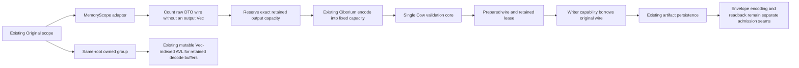

**Raw output and recovery connection.** The new IPC `payload_admission` owner
uses the existing Ciborium DTO serializer in a count pass and a fixed-capacity
write pass. It reserves exact declared output capacity before allocation,
checks actual Vec capacity and refuses length/content drift between passes.
Both passes poll at64KiB sink windows and preserve the original callback error.
This unframed artifact path intentionally does not apply the16MiB transport
frame cap or prepend a frame header. The caller supplies the member artifact
cap. This is a separate raw-output policy; it does not fork the serializer or
change DTO wire order.

Kernel's three borrowed progress preparations and its immutable-byte validator
now accept an optional MemoryScope. The same private Cow+lease carrier keeps
backing before lease through every early return, including interruption after
encoding. The prepared member retains the lease; its implicit Clone was
removed. Value equality ignores resource custody. A borrowed public validator
pre-reserves its required independent output copy. Native ordinary preparation
and recovery pass their existing Original scope; missing Native scope still
refuses. Allocation refusal checks the Original sticky cause before returning
context, and cancellation/deadline refusal is not converted to validation
success. Compatibility wrappers use the same core with no MemoryScope and are
not presented as Native admitted execution.

**Scalable retained bank.** The previous linear retained-buffer lookup is now
replaced in source by the existing `native_online_ordered_map_v3` mutable AVL
and `NativeTemporaryVecV3` backing. Numeric pointer keys select rows; they do
not mint authority. Exact kind/pointer/capacity matching, four active slots,
same-root Original admission and sticky refusal remain. Lookup, insertion and
removal use the existing admitted engine, rather than a second map algorithm.
Pending insertion/removal slots retain detached grants on failure. A static
review found that the defensive removed-key mismatch branch dropped its row
and lease immediately; it now parks that row in paid owner storage, poisons the
owner and refuses repeated removal without overwriting unresolved custody.
The genuine Original grant regression covers that state transition; it is not
a reproduced product corruption or an executed fault-injection result.

The mutable bank was chosen over a persistent path-copy map because retaining
all group-funded historical path nodes could accumulate O(N log N) metadata
charges. The reused mutable engine has O(log N) indexed operations and O(N)
retained geometric backing, with old/new growth backing funded by the existing
owner. Those are inspected algorithm bounds, not measured throughput or RSS.
The400-live-buffer source regression limits each adoption's actual Original
work increase to208 units to distinguish the former linear scan. The real
Ciborium two-byte-string source test uses a named no-op frame-work fixture;
it does not prove Original work admission for a complete decoded batch.
Runtime bank tests remain NOT_RUN under the separate analysis compile blocker.

**Writer custody without a second capability copy.**
`ValidatedSourceBoundHandoffMemberV1` now borrows bytes and digest from its actual
typed History/SearchPlane/RepoMap owner. The writer immediately persists that
borrowed capability, then returns only owned immutable identities. It no longer
clones the full member wire merely to mint writer custody, and the borrow keeps
the prepared member's output lease alive through that call. The regression
constructs a real Dirty handoff and checks byte/digest pointer identity at the
production SearchPlane constructor. Runtime execution remains NOT_RUN.
The existing artifact envelope still clones its payload and canonical encoding
still creates a distinct output. Eliminating the capability copy does not
fund those allocations or readback.

**Executed proof and source boundary.**

- IPC output tests: VERIFIED,8 passed/0 failed/132 filtered, using
  `./scripts/cargow --lane shared test --locked --offline -p quanta-index-ipc
  --lib payload_admission::tests`. They cover fixed scalar wire, a17MiB raw
  artifact without a frame prefix, denial before output allocation/write pass,
  count/write callback refusal, refund and length/same-size content drift.
  These use an explicit unit ledger, not an Original producer fixture.
- New Kernel exact output request: VERIFIED,1 passed/139 filtered. Complete
  prepare module on the same captured source: VERIFIED,17 passed/0 failed/
  123 filtered. The exact case is included in17 and is not additional coverage.
  Source digest:
  `83c8f0d9c116769586242d78ef1285604f012997b5816271e045b428ddb65671`.
  Current Kernel source/tests and captured Quanta IPC lib/output source/tests
  match that capture at this checkpoint.
- The preceding exact attempt stopped during external sibling source capture;
  tests0 and no accepted receipt. The subsequent captured execution passed.
  Neither capture time nor compiler time is indexing throughput.
- Static scoped format/diff and affected Runtime boundary preflight: VERIFIED.
  Runtime bank, borrowed writer capability, recovery, aggregate abort, actual
  Original producer and full-suite behavior: NOT_RUN. Existing Java nominal
  analysis consumer errors remain in the shared compile closure and under a
  separate active owner; this packet does not restore a Clone/dispatch shim.

**Still-required coupled allocation cut.** Prepared output admission is not
whole-preparation memory admission. Kernel and recovery still decode nested
String/Vec/source_bytes with ordinary `decode_cbor_payload`; SDK conversion and
cluster/snapshot building also allocate. Quanta's independent workspace uses
stock Ciborium0.2.2, whereas Semantica uses an existing parser-reserve patch.
A root DeserializeSeed alone cannot intercept the parser's own backing or
nested ordinary `next_value()` allocations. Next implementation must reuse the
parser hook at a neutral owner, preserve the same DTO graph, reserve every
nested visitor backing before growth, and retain parser/visitor grants until
the decoded value and its consumer release them. Direct Quanta dependency on
Semantica's artifact-policy canonical decoder is not the accepted dependency
direction. Exact parser placement and shared Cargo cutover need their own
current-owner review before edits; the inspected reuse candidate is not a
completed migration. No `wire_length * multiplier`, late postcharge, TLS
budget, second DTO or post-decode refusal is a complete substitute.

Full Native producer transitions, IDE/AUTO/P2I, operations, coherent suite,
Large/XL performance and CI/release gates remain under §23.76–§23.77. This
checkpoint does not promote a leaf proof to any of those completed families.


### 23.84 Native member persistence under the existing Original (2026-10-13)

The §23.83 follow-up source audit found that ordinary preparation retained the
Native Original scope, but `PreparedAggregateOwnerPipelineInputV1` did not carry
it into writer/store member persistence. That boundary is now connected in
source. This is implementation progress in the existing A/B lanes, not closure
of the original18/40 tally or of whole-preparation memory admission.

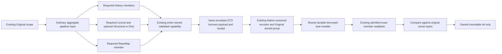

- Native target with no Original scope refuses before member persistence. All
  required and optional member paths pass the same existing scope; there is no
  newly issued root, global budget, hidden TLS authority, or Native fallback to
  ordinary persistence. The optional no-scope branch remains the ordinary File
  path. An admitted call rejects the test-only in-memory artifact store, whose
  bare Vec values cannot retain Original grants.
- The same private `PreparedSourceBoundHandoffMemberArtifactV1` now uses standard
  Cow backing for payload bytes and receipt text. Serialization borrows both;
  ordinary/custom admitted deserialization constructs owned values with an
  explicit static owned lifetime. Existing V1 array and V2 byte-string wire
  behavior and immutable ref checks remain. No new envelope schema or duplicate
  serializable-view DTO was added.
- `AdmittedCanonicalOutputV3` reuses Foundation's
  `canonical_cbor_bytes_native_into_with_work_v3` and SourceWire's
  `OriginalCanonicalAdmissionV3`, with the same keeper and Original owned group.
  Completed output, partial/retired encoder state and grants stay outside the
  Source loan on failure and success. Output/state drop before the group, and
  only a borrowed byte getter is exposed. The scope's authentic sticky refusal
  is checked before mapping a codec failure.
- Both ordinary and admitted member persistence share one checked envelope
  builder, immutable ref/hash path, durable installer and exact byte-comparison
  operation. The installer now borrows bytes; the Native encoded owner remains
  live throughout write and admitted readback. This removes the envelope's
  complete payload clone and avoids extracting a bare uncharged Vec from the
  admitted output. Ordinary test-memory storage remains explicitly unadmitted.
- Hash and durable writes charge the same Original before each64KiB window;
  filesystem stages poll around existing temp/fsync/hard-link/directory-sync
  transitions. Unconditional temp cleanup still runs after a work refusal.
  `finish_temp_install_v2` retains uncertain install/cleanup failure semantics.
  Blocking filesystem calls are not preemptible, so these checkpoints do not
  promise a fixed cancellation latency inside fsync or hard-link.
- Ordinary preparation now preserves a typed persistence RuntimeFloorRefused
  cause rather than formatting it into a generic projection error. The exact
  writer abort path still determines whether cleanup completed; this scope
  propagation does not authorize a V9 transfer after failure.

Adversarial source review fixed a missed ordinary History test argument after
changing the typed writer methods. It also found Native decode/readback modules
were reachable from an ingress-disabled writer feature even though their
Original module was ingress-gated. Their declarations/reexport/getter now use
that same index-sdk-ingress feature boundary. The latter is a static reachability
repair; no executed feature-off Rust GREEN is claimed.

**Test source and honest proof limits.** Four new canonical-output owner tests
cover fixed canonical wire, genuine Original memory refusal/refund, actual work
accounting with retained output and partial producer refusal. The first work
refusal draft wrongly treated `Some(60_000)` in the installed Budget as a work
limit. That field is wall-clock milliseconds; the repository rail's cumulative
work is unbounded by policy. The test now checks actual Original consumed work,
not a nonexistent60k ceiling. Bounded-work and genuine cancellation behavior are
not proved by that fixture. No cancelled fake scope or production limit change
was used to manufacture the rejection.

Three coupled storage-owner tests use a real durable root: a fixed155-byte
RepoMap envelope and BLAKE3 ref/readback with grant refund; memory denial before
any final CBOR file; and refusal before the second64KiB write followed by temp
cleanup and an idempotent retry. The last uses an explicitly injected work
callback, not a genuine Original cancellation fixture. The writer's test-only
validated capability constructs storage input; these are not actual producer or
RepoMap semantic acceptance tests. The fixed155-byte golden and digest were
independently checked with Python's BLAKE3 implementation; that oracle check does
not execute the Rust writer.

Scoped rustfmt/diff and affected boundary preflight passed. The owning Runtime
QBC exact request uses `quanta-runtime` lib(test), registered compile policy
`feature-isolation:quanta-runtime.no-default.32c001bdd540` with
index-sdk-ingress/retrieval-authority-multilang/retrieval-workspace-bundle/
sqlite-store. The owning run terminated with exit101: analysis compilation
failed at three Java authority calls before the Runtime test harness could
compile. Executed test count is0. Captured source digest is
`e2ffdf317ec1a93f6e1ace86526790a8feff0a21b6afcb4766cc506b3081db35`.
`solve_worker.rs:563` requires Clone through `.cloned()`, and
`java_nominal_dispatch_adapter_v1.rs:8,30` requires Clone and a removed direct
dispatch method. Those separately owned producers/consumers remain open;
no Clone shim, weakened feature closure or repeated unchanged run was added.
Earlier IPC8/8 and Kernel17/17 receipts remain their earlier captured scope and
are not proof of the new Runtime packet. Runtime module/product, feature-off,
full suite, Native producer, Large/XL and release acceptance remain unproved.

**Remaining end-state requirements.** Member body/envelope output/readback
connection does not fund immutable-ref/path/error metadata strings, aggregate
artifact/transfer marker/terminal receipt serialization, nested batch decoding,
SDK builders or whole History/RepoMap input construction. The neutral nested
DTO admission cut also needs generic Vec backing and exact Box-string transfer:
String admission alone does not cover a possible `into_boxed_str` reallocation.
Keep parser provenance, old/new realloc overlap, metadata prebirth and escaped
value custody together. The parser/DTO port and current Original adapter still
require a coupled implementation; no wire-length multiplier or postcharge is
accepted as closure. R01–R40, UX/AUTO, P2I and §23.77 lane obligations stay intact.

**Post-run adversarial correction.** The admitted store's final sticky Original
checkpoint formerly replaced any persistence error. A simultaneous install/work
refusal and failed temp cleanup therefore lost the cleanup uncertainty retained
by `finish_temp_install_v2`. The same store now resolves the two outcomes
together: a clean persistence refusal retains its typed Original cause; a
successful result under sticky refusal cannot escape; a separate persistence
failure under sticky refusal retains both causes in BackendUnavailable.
Three source-level error-precedence cases use a genuine Original refusal plus
an injected cleanup error. They do not reproduce an actual filesystem fault.
These corrections postdate the failed capture and remain Rust NOT_RUN. The
canonical-output owner's unused type reexport was also removed while retaining
crate-visible module/type reachability. No completion tally changed.

### 23.85 Neutral nested decode backing and Original adapter (2026-10-13)

The §23.84 allocation gap now has an implemented neutral port and existing
Original bank adapter. This is a coupled extension of the existing owners:
no new budget, snapshot owner, wire version or duplicate DTO was introduced.
R01–R40 remains18/40 because parser/complete DTO/SDK/product cutover is open.

| Owner | Implemented responsibility | Remaining boundary |
|---|---|---|
| Quanta contract-base `admitted_decode` | DecodeBackingAdmissionV1, named finite DecodeBackingRefusalV1, bounded AdmittedSequenceSeedV1 | Caller must provide admitted child seeds and retain the owner with returned values |
| Quanta contract facade | Reexports the same neutral port/seed | Full SearchCorpus/nested DTO seed graph is not connected |
| Existing Runtime AdmittedCborMemoryV3 | Same Original/AVL bank extended to Vec<T> and exact boxed text | Runtime owner behavior proof pending; Quanta standalone production adapter remains open |
| Existing native allocation-core Box owner | Fallible exact UTF-8 Box<str> birth before any copy | Caller owns Original reservation and lifetime; allocator-private RSS is not accounted |

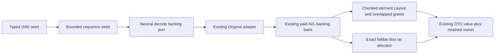

- The sequence seed reads a typed child, admits outer Vec backing, then pushes.
  It never allocates from size_hint or reserves merely to discover EOF. At the
  item limit a rejection seed fails before entering an additional child
  deserializer. The child seed remains responsible for all nested allocations.
- One bank growth implementation now computes checked Layout::array<T> size
  and alignment. The fifth active slot handles element vectors; active and AVL
  retained entries verify pointer/capacity/layout before reentry. Old and new
  grants coexist during growth. ZST vectors enforce a count limit and work
  without registering the shared dangling sentinel as a backing address.
- Box copy uses the existing allocator boundary extended to str. It checks
  exact byte Layout, runs caller admission even for empty text, performs one
  fallible allocation and UTF-8 copy, and transfers that allocation directly to
  Box<str>. It does not call String::into_boxed_str or shrink a Vec. Empty boxes
  have no pointer-bank entry. Input and output funding coexist in the same
  owner; the decoded values must outlive any subsequent pointer-provenance use.
- The named public refusal is a finite signal. Authentic Original and local
  bank causes remain in their existing owner slots; the adapter does not mint
  replacement causes, budgets or TLS authority. Parser/canonical internal
  callback signatures remain unchanged.
- Alignment follow-up rejects a deliberately corrupted retained Vec layout
  before growth, retaining the old value and grant. Layout does not authenticate
  a freed pointer reused at the same address; the value/owner lifetime contract
  and future parser temporary retirement/transfer must preserve that boundary.

Proof remains separated. Native allocation-core Box module QBC passed9/9,
including the three new UTF-8/empty/refusal cases, on source digest
`8e3bad0791d6314c75a2ab7dd7657ed5108ece3650473e04351c8b3554f535f9`.
This is an allocator-owner proof, not Runtime Original custody acceptance.
The initial neutral sequence version passed4/4; the named-refusal revision's
current base all-feature lib suite passed101/101 and base all-target/feature
strict passed. These remain separate allocator-owner and base-library scopes.
The live-root Runtime module attempt became ineligible after source drift,
including this thread's document edits. It issued no accepted result. The
canonical exact snapshot retry terminated101 on captured source
`eb3385be6d4daaec633f594ebdfded3457c80165338fa6c79651134697b9c34a`:
the same three Java analysis compile errors occurred before Runtime harness
compilation; tests executed0. Genuine Original bank behavior remains NOT_RUN.

Two early Box requests stopped during source hashing because files changed.
The subsequent owner attempt stopped at --locked before compiling any tests.
The separate canonical lock sync e5d924e2849 added the existing quanta-sdk
dependency edge to quanta-runtime-query-surface-foundation; it was not caused
by this packet, which added no manifest dependency. The new run after that
sync passed. No alternative standalone harness or lock bypass was used.

For further Runtime module proof, first capture one exact owner witness, then
run the module against that same validated execution root/digest. Do not run a
live module while writers mutate its full source inputs or treat a drifted
completion as green. No source snapshot or receipt was added to this repository.

Remaining coupled work: one neutral parser implementation/patch across both
repositories; complete SearchCorpus, semantic source, channel and symbol DTO
seeds with their existing validators; retained decoded carrier in Kernel and
recovery; Quanta-native production admission independent of quanta-runtime;
SDK builders and transient string/Box ownership; complete producer, delta,
Large/XL, operations and release acceptance. Output/member receipts from
earlier packets do not qualify these unimplemented or unexecuted scopes.


### 23.86 Typed text and cluster decode with terminal owner custody (2026-10-13)

This packet extends the existing decoded-backing boundary; it does not close
full batch ingestion, Native product acceptance, or indexing performance.
The original R01–R40 tally remains18/40,12 PARTIAL and10 MISSING; UX/AUTO,
P2I, Large/XL and operating acceptance remain in the original scope.

| Owner | Implemented change | Evidence / remaining seam |
|---|---|---|
| contract-base admitted_decode | AdmittedTextSeedV1 and AdmittedBoxedTextSeedV1, byte bounds, existing predicate callback before destination birth, parser-owned String adoption/conversion, terminal abort hook | Base lib109/109; successful decoded fields still require a retained caller owner |
| contract-base string_newtype macro | Same String identity with an admitted typed seed | Contract macro delegates to this one producer; validated RepoId/RevisionId NFC policy is not bypassed or replaced |
| Existing LanguageCode / ExactRepoRelativePathV1 / SymbolKindCode | Typed seeds reuse their existing private predicates and keep the exact admitted Box | Ordinary serialization/deserialization stays unchanged; no admitted into_boxed_str shrink |
| Existing ClusterMembershipReplaceV1 visitor | One map state machine parameterized by ordinary/admitted field policies; same validate_v1 | Admitted identifier keys avoid owned String birth under the controlled CBOR parser; same4096 limit and admitted SymbolId children |
| Existing Runtime Original bank | Exact live ParserText active/parked custody, String adoption, consuming Box conversion and retired parser grant refund | Genuine Original tests implemented; new Runtime execution NOT_RUN |
| Existing Ciborium parser | Required abort_decode_v3 on initial/read/seed/final-checkpoint error | Parser owner QBC9/9; no release of grants or substitution of original error on abort |
| Existing canonical decode wrapper | Framing refusal also ends the shared owner attempt before buffer reservation | Exact owning canonical frame-abort test1/1; full wrapper module not qualified |
| Existing public API guard | Direct contract-base baseline in addition to facade/SDK | Reexport-only facade output hid base trait/method changes; base/facade selected gate and CI authority test pass |

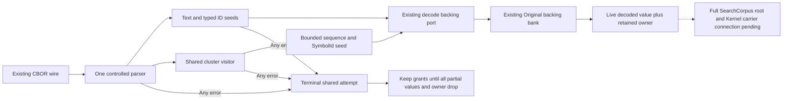

**Lifetime and failure contract.** Owned text is accepted only after its live
pointer, capacity and Layout match the parser bank. Box conversion keeps input
and output charges overlapping, removes the exact active/parked ParserText row
while the String still exists, drops String, then refunds its old grant. This
prevents a successfully consumed temporary from leaving a stale address row.
Zero length with nonzero capacity still has allocation custody; zero-capacity
text still polls the existing Original. It does not prove allocator-private RSS
or cryptographic allocation identity from a pointer.

On any seed/parser/frame error, the attempt becomes terminal across owner
clones without releasing live grants or overwriting the authentic cause.
This covers semantic validation rejecting an owned parser String before its
conversion, as well as parser errors after temporary birth. All partial values
must die before the final owner. Ignoring a decode error and resuming the same
bank is forbidden; this is a failed attempt, not an incremental retry token.

The controlled parser requires at least4 scratch bytes; known cluster keys need
17 bytes for deserialize_identifier (tests use32). Earlier Runtime source tests
used2 and could never enter the intended visitor; those fixtures are repaired.
Generic Serde/JSON test doubles prove predicates/dispatch/wire semantics only;
they do not prove that arbitrary deserializers admit parser allocations.

**Source-bound verification.** Quanta all-feature lib suites passed base109/109
and contract235/235. The prior101 and229 results are historical subsets, not
additional passed tests. Parser integration QBC9/9 uses source digest
`f3daf27ca4fa696da9dab9b389862c44ff5df9762f31cface47c340bc749ae21`;
its exact witness1 is included in the nine. The initial complete parser run was
8/9: a test mistook the second zero-work callback for the final callback although
reads also poll before/after. The repaired test keys refusal to typed seed
completion, retains the same5-byte charge oracle and passes in the new capture.
Canonical frame-abort exact1/1 is a separate captured scope, digest
`1dfae9d2cdba804979a211c48fd624d7f6cccbddc79dfb0419280af7d73f541f`;
subsequent edits only clarify its public abort documentation. Its CAS source
was later removed by external cache lifecycle, so no same-root full-module
GREEN was manufactured. Final combined base/contract all-target/all-feature strict passed; command,
resource admission waits and repaired test-lint failures remain in VALIDATION.

**Remaining coupled work at this checkpoint.** Quanta resolved stock Ciborium
independently. The subsequent §23.87 moves the controlled parser to one Quanta
source; its cross-workspace resolution and acceptance remain separately gated.
Full SearchCorpus, source coverage/file identities, Chunk/Symbol and Semantic
source record/replace DTOs, optional/binary fields, SDK construction, Kernel
and recovery carriers, and Quanta standalone production admission remain open.
RepoId/RevisionId must reuse the funded existing NFC owner, not call ordinary
normalization inside a supposedly admitted seed. source_bytes byte-string and
bundle_payload integer-array wire forms must remain distinct. Post-decode
coverage/digest BTreeSet and sorting scratch need their own admission. New
Runtime tests cover real controlled text, multi-box sequence, active/parked
retirement, corrupted custody, genuine memory refusal, terminal clone refusal,
and actual cluster success/duplicate semantics, but are NOT_RUN; the prior
foreign Java compile failure is not a current-bank behavior verdict. No new
throughput, cancellation latency, whole-memory, producer, XL or release claim.

### 23.87 Quanta-owned parser and admitted structural decode (2026-10-13)

One physical controlled codec now lives at `vendor/ciborium-0.2.2`. The former
Semantica `third_party/ciborium` directory is removed. Quanta's workspace member,
direct dependency and crates-io patch select it; both Semantica workspace roots
use direct paths and patches to the same directory. The parser depends on Serde
and Ciborium's I/O/low-level crates, not Semantica or quanta-runtime. Existing
Semantica serialization authority is retained; physical source relocation does
not move the semantic policy or grant issuer into the codec.

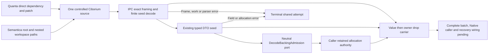

`decode_cbor_seed_admitted_v1` reuses the allocation-free framing scanner to
reject trailing bytes and excessive nesting before parser backing birth.
Its explicit caller input bound replaces no protocol limit implicitly. The
scanner's legacy retained-text estimate is not a memory grant. Actual scanned
read bytes and parser work go through the existing caller callback; the authentic
work error is retained separately from the I/O marker. `Interrupted` is not used
for terminal refusal because `read_exact` retries it. Scratch below four bytes
is refused before parsing; admitted structural field identifiers need scratch
large enough for their existing field names.

The returned `AdmittedDecodedCborV1<T,O>` exposes borrowed access, without a DTO
extractor, and declares the value before its retained owner for drop order.
Matching the typed seed's authority to the parser owner remains an explicit
caller contract: generic Serde cannot prove it. Input bytes, scratch, owner
metadata and unsupported ordinary nested visitors are not funded by this API.
It therefore does not qualify complete Native ingress or whole-process memory.

`ChunkStructuralMetadata` now has an admitted seed using the same six-field
visitor as ordinary Deserialize. Each Box uses the existing admitted boxed-text
seed, with a caller-selected byte bound and no `into_boxed_str` shrink in the
admitted path. Borrowed known map keys avoid String backing. Missing, duplicate,
unknown, limit and backing refusals abort the same owner. Ordinary wire output
and schema remain unchanged. Real controlled-CBOR IPC tests cover successful
six-field decoding and rejection after partial construction; semantic-only
fixtures are not physical Original grant evidence.

Quanta's existing test ownership scanner now explicitly includes this canonical
vendor's integration targets. Ten targets have owners; the five no-std tests have
a distinct no-default Justfile/CI rail, since all-features compiles zero tests
in that target. The inherited fuzz test initially failed on macOS after fork.
Its harness now retains 128×1024 inputs and the same 0..32 byte lengths using a
fixed StdRng seed in the normal test process. It no longer allocates/I/Os after
fork or prints every input; a panic reports seed, iteration and bytes and is
resumed. Malformed decode errors are expected, not promoted to valid inputs.
The original SIGTRAP is recorded; this is a harness repair, not proof of an
independent parser correctness defect or exhaustive malformed-input coverage.

Verification commands, outcomes and pending rails are recorded in VALIDATION.
Semantica's old parser9/9 is historical evidence from its former source owner.
An earlier no-deps metadata pass does not prove locked dependency resolution:
the latest full locked metadata requests at both Semantica roots refuse lock
drift. The root lock has a live independent owner and was not overwritten.
Topology regeneration also refuses unresolved source-module edges before
installing generated contracts. Two otherwise unclaimed test mounts received
explicit existing-file paths; further PTA/source-owner edges remain outside this
packet. Do not hand-prune the old topology inventory to manufacture acceptance.

Remaining: complete SearchCorpus/source identities, funded existing RepoId and
RevisionId NFC DATA custody, Chunk/Symbol/Semantic record seeds, binary and optional
fields, post-decode validation scratch, Kernel/recovery retained carriers,
Quanta-native production admission, SDK builders, and producer/delta/Large/XL,
operations and release qualification. Existing Catalog, Lexical performance,
launcher/root identity and publication capacity work stay with their respective
channels. R01–R40 remains18/40; no performance percentage or latency guarantee is
derived from these owner tests.


### 23.88 Typed source identities and native batch connection (2026-10-13)

The neutral SourceIdentityDecodeAdmissionV1 port delegates RepoId and RevisionId
to their existing native unit seeds. SourceFileKey/Revision and ChunkRecord
reuse the same ordinary/admitted visitor and wire predicates. Source paths keep
the existing exact repo-relative validator; Chunk paths keep their existing
permissive representation until batch validation. No predicate is strengthened
merely to make a leaf seed look canonical. Binary seeds preserve both SourceBytes
byte strings and existing bundle integer arrays; optional seeds select admitted
children without allocating for None. A failed attempt must not be resumed.

Runtime's Original adapter retains a distinct native identity DATA/funding row
per occurrence, uses the existing funded NFC producer, checks owned parser
backing before moving it, and keeps completed/pending DATA before the funding
group in drop order. The external error marker is finite; complete original
causes stay in DATA. Static review identified terminal-success serialization
and validation-cause projection as additional owner requirements; they are not
claimed tested until the corresponding regression runs.

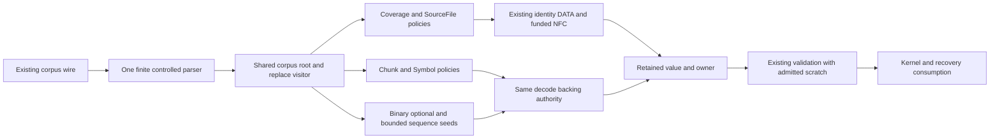

The diagram is the required connection, not a completion claim. Current recovery
still ordinary-decodes SearchCorpusIngestBatch after reading admitted member
bytes. Leaf DTO work must close the whole root, replacement and validation path
before any product-memory guarantee. The port is an adapter for the existing
issuer; it is not a new runtime, IR, snapshot owner or normalization authority.

Source-bound Base121/121 and Contract242/242 pass precedes the next Symbol and
coverage implementation packet. Vendor595/595, no-default5/5 and vendor/IPC
strict passed separately. Runtime QBC reached independent compiler errors and
then rejected concurrent source mutation; no Runtime behavior was accepted.
See VALIDATION for exact commands and failure boundaries. R01–R40 remains18/40.


### 23.89 Complete corpus seed and coupled Native recovery boundary (2026-10-13)

The existing SearchCorpusIngestBatch, replacement/tombstone/scope, Symbol/span,
coverage/event and Semantic source DTOs now expose admitted seeds. Ordinary and
admitted policies share each existing visitor and wire predicate; no second
DTO IR or inferred canonical-ID producer was introduced. CorpusDecodeLimitsV1
contains explicit text_bytes, source_bytes, bundle_bytes and collection_items
ceilings. Semantic text and record collections use those same caller limits.

Accepted-value limits do not bound a deserializer's earlier temporary birth.
The controlled CBOR parser can allocate a String/byte buffer before its field
visitor checks the length. Its aggregate Original admission is mandatory and
separate; a per-field before-birth limit requires a parser/seed boundary, not an
assertion that the existing field check runs earlier. Complete corpus identifiers
need at least25 scratch bytes for the longest existing known map key. Controlled
CBOR integration tests cover25 success/24 refusal and real nested byte/text
paths; their final executed result belongs in VALIDATION, not this design prose.

Writer shape and reader acceptance are distinct contracts. Source bytes encode
as a CBOR byte string; bundle_payload encodes an integer array. Existing Ciborium
Vec decoding also accepts a CBOR byte string through BytesAccess. The admitted
bundle keeps that actual ordinary-reader behavior using a bounded u8 sequence;
it does not add an unsupported wire rejection merely because writer shape differs.

Native recovery is still incomplete at the following coupled owner boundary:

| Current path | Required change | Acceptance condition |
| --- | --- | --- |
| Prepared validator ordinary-decodes a complete Lexical DTO, reencodes and constructs an SDK batch before pipeline decode | Let the existing Native validator borrow the same admitted DTO and exact retained wire; preserve axes/digest/receipt checks | Native verification never ordinary-decodes/clones another corpus DTO or constructs a legacy SDK batch |
| Pipeline ordinary-decodes member payload again | Retain admitted DTO and member-readback owners through validation, staging and terminal dispatch | No extracted bare DTO; output dies before all grants |
| Completed predecessor returns an entire bare batch although caller uses generation only | Use Native admitted member/DTO custody locally, validate snapshot and return the required generation | Existing Native scope required; no ordinary Native fallback or escaped batch |
| Digest verifier mutates batch_digest and allocates/clones digest Strings | Factor borrowed hashing through the existing canonical serializer and its blank-digest contract | Independent fixed digest oracle; no clone or mutable-extractor bypass |
| Unit-set/coverage/snapshot validation allocates BTreeSet and sorting Vec scratch | Admit actual existing validator scratch before its birth using the same Original authority | Refusal/cancellation preserve terminal custody and exact cause |
| Admitted member-envelope bank caps text at64 bytes | Admit a product DTO bank from the same Original, with explicit product limits and retained custody | Member-envelope grant is not misrepresented as full corpus-text grant |

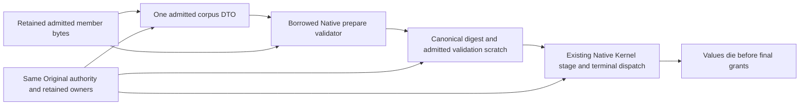

The table/diagram are remaining implementation obligations. Replacing the two
pipeline canonical_decode calls alone cannot close Native funding: it leaves
the earlier prepared validator's decode, digest mutation, SDK materialization
and semantic snapshot scratch intact. Owner tests for complete seeds qualify
only typed decoding dispatch; they do not imply indexing/XL/whole-memory or
Runtime acceptance. R01–R40 stays18/40.


### 23.90 Borrowed hashing and retained Native corpus integration (2026-10-13)

The canonical batch digest no longer requires a mutable DTO or a clone. IPC
owns a root-field serializer decorator: only root `batch_digest` becomes empty;
all other existing field serializers, including nested digest fields, are used
unchanged. The public token matcher compares carried lowercase hex with32 raw
bytes without allocating an expected token. Unit-set digesting similarly shares
one formula while allowing caller-funded index slices; ordinary duplicate-error
order is preserved. These are mechanisms, not physical admission issuers.

Native Lexical preparation accepts a borrowed DTO under an explicit Native
source target, exact frozen wire comparison and the same validator. The shared
SDK-wire predicate preserves bundle/seal/mode and normalization requirements.
Runtime recovery retains admitted DTO plus its existing Original bank in member
custody. No bare DTO extractor is introduced. Host Native selection and all
fixed target fields must agree with durable V9 preparation before recovery.
Native predecessor corpus readback uses the same admitted decode path and returns
only validated generation to its caller.

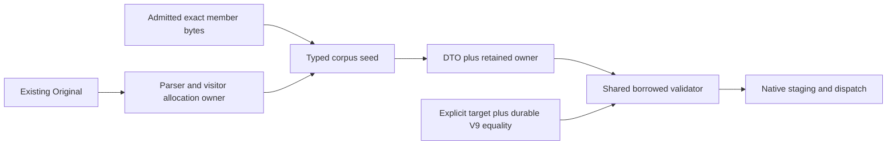

The diagram describes the new corpus segment, not complete recovery: sealed
aggregate readback still performs an earlier ordinary Lexical revalidation.
Repair that upstream owner next; otherwise a second downstream admission cannot
fund the earlier decode retroactively. Artifact/snapshot decoders and complete
validation scratch remain in scope. Selected Quanta digest8/8, coverage10/10 and
three-crate strict passed; Semantica compiled behavior is not proven by them.
See VALIDATION for commands and exact exclusions. The18/40 tally is unchanged.
