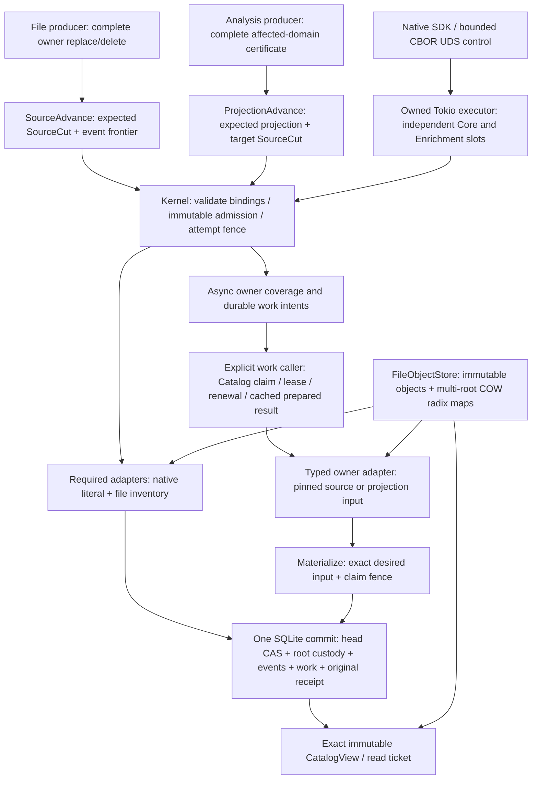

# Native RFC — historical implementation rechecks

Source-scoped observations from 2026-10-11 through 2026-10-13, preserved on
2026-10-21. This document is immutable history, not a task list or a statement
about current source. [Current work](../../plans/oct-17-index-closeout/tickets/README.md),
[results](../../plans/oct-10-index-closeout/VALIDATION.md), and the
[active RFC](../../rfc/oct-10-native-incremental-vnext.md) have separate authority.
Technical contracts, failure records and exact commands below remain available
for reference; this relocation closes no acceptance gate.

### 17.2.3 Bounded remediation plan from the implemented paths

2026-10-12 follow-up inspection of primary
`c32cd191554031b9a7d04207ffa3410e8fc201ba` with concurrent dirty native work.
This is the execution refinement of 17.2.1/17.2.2 and the existing R01–R40
obligations, not another product stage or a change to the forty-row denominator.
The write set for this planning pass is this subsection only. Implementation and
runtime acceptance below are **NOT_RUN by this planning pass**; preceding test
results retain their original source and scope.

**Rechecked implementation state before assigning work.** A subsequent same-day
source pass confirms that both previously incomplete connections are now used:
Literal/Path execute through their typed registries and Kernel::prepare_query;
SqliteCatalog::reclaim_work_page delegates to reclaim::work_page. Managed storage
uses the paired Catalog, digest mutation gates and descriptor-relative physical
reclaim. NativeReclaimDriver runs from the existing service manager under its
shared MaintenanceControl floor, with paced rounds and independent bounded
head-prefix traversal. Final drain removes the queue and lifecycle row; a durable
global fence protects later installation, so a permanent per-object DELETED row
is not required. NamespaceLease revalidates the held root/objects/lease identities.

Sections 17.2.1/17.2.2 record the earlier inspection; their direct-reader and
unimplemented-GC observations are historical, superseded by this recheck and
sections 23.53/23.54. The former work-page stub must not remain an open task.
Section 23.53 records typed-reader/physical-GC regressions; section 23.54 records
the later automatic-GC and runtime checkpoints. The latter's existing log ends
in 80 passed / 73 skipped and its Clippy log in successful completion. Those
logs were read by this pass, not re-executed or promoted to new current-tree/full
qualification. At that recheck, the remaining boundaries were retained-memory enforcement,
spill/WAL/disk custody, published-history retention orchestration and operational
acceptance. Sections 23.56/23.57 subsequently implement and verify focused service
retirement; section 17.2.4 separates its operating acceptance from remaining code.
No second GC implementation or repeated Delivery A refactor is needed.

| Disposition | Source-backed reason | Existing requirement / owner |
|---|---|---|
| Keep the cancellation repairs closed within their recorded scopes | Kernel query-session/Runtime effort checkpoints and later GC mutex/original-budget/owned-deadline regressions are recorded. Future memory or retention changes retain these oracles | R09/R28/R30/R32; Kernel/Runtime |
| Keep Literal/Path routing implemented; preserve its regression laws | NativeLiteralReader/NativePathReader, both registries and bounded reply validation are wired through stored-profile prepare_query and exact Interactive reservations | R02/R09/R14/R23/R33; Lexical/RepoMap with Kernel/Runtime integration |
| Keep physical and automatic queued GC implemented within its scoped evidence | Catalog queue dispatch, namespace/incarnation-fenced unlink, bounded drain and the service-owned driver are connected. Full physical faults, history retirement orchestration and sustained resource/space bounds remain open | R06/R10/R17/R32/R39; Catalog + Storage + Runtime integration |
| Complete resource enforcement for enabled paths | NativeResourcePlan reserves logical ResourceNeed; its IO bytes have no retained-disk unit. TextReader accepts any positive memory declaration; MapScratch caps its main DB but sets temp_store=FILE with a separate 2 MiB cache | R11/R12/R32/R39; resource owner + each allocation owner |
| Measure native query/update costs before changing algorithms | Text search traverses all selected postings; NativeText Patch consumes changed owners, whereas Snapshot intentionally consumes the source. Legacy traces cannot choose a native optimization | R15/R16/R17/R39; Lexical and measurement owners |
| Defer backend extraction/mmap/migration until a real capability uses it | Production deliberately pairs FileObjectStore and its private radix implementation. Existing ports are useful but do not establish transparent physical substitution | R02/R05/R08/R36; composition/storage owner when selected |

**Delivery A — implemented query boundary; retained acceptance laws.**

The following integration is present in the rechecked source and has recorded
focused execution in section 23.53. Keep these laws for subsequent resource
changes; do not create a new implementation lane for the completed routing.

- Reuse IndexQueryPort, QueryAdapterRegistry and Kernel::prepare_query for Literal
  and Path. Use the existing request fields or a minimal owned typed adapter
  carrier; do not add another AST, Any payload or dynamic plugin registry.
  Each adapter owns member/root decoding and validates stored instance policy;
  Kernel resolves the instance from the selected ticket's stored profile.
- Freeze the two used `(request, result)` signatures, their descriptor checks and
  request-size/reservation rules before editing consumers. Add the corresponding
  readers in Lexical/RepoMap and inject them through NativeServiceCapabilities.
  Runtime performs bounded request/reply mapping and reserves Control preparation
  plus the selected exact Interactive need, as the Text/Semantic paths already do.
- Remove query_member and concrete store access from these query branches once
  both consumers move. Concrete FileObjectStore ownership remains valid at the
  composition and physical-maintenance boundary. Do not generalize the entire
  SqliteCatalog-typed Runtime merely to eliminate its concrete type spelling.
- Decisive checks: an unregistered kind, incompatible schema/format/policy and
  absent profile instance refuse before the adapter reads/decodes an artifact;
  two supported same-kind instances resolve their own stored members; unsupported
  recipe combinations refuse explicitly. Preserve independent byte/prefix gold,
  exact pagination, old-view reads after an update/reopen, original cancellation,
  and pin/reservation cleanup on preparation/admission/reader failure.
- Exit: both UDS routes use the same retained-session laws as Text/Semantic and
  have actual query execution tests. Merely declaring the reader traits or making
  missing-reader cases return errors does not finish this delivery.

**Delivery B — complete and qualify the current object lifetime protocol.**

The physical protocol and explicit automatic queue driver are implemented with
scoped recorded evidence. Remaining work is full fault/resource acceptance and
the declared retention-to-queue service boundary below, not port scaffolding.

- Continue the current typed CatalogReclaimPort/ManagedObjectAuthority and
  ManagedObjectReclaimPort implementation. Finish queue dispatch and audit every
  reserve/adopt/release path against the same lifecycle transaction. Cover
  registered and provisional incoming edges and all existing view/operation/work/
  ingress/attempt/bootstrap custody. Retained view roots protect live pins;
  bootstrap timeout alone is never an abort or deletion permit.
- Preserve the coupled sequence: indexed candidate -> revalidated Retiring ->
  frozen namespace/object generation/physical target under the store gate ->
  Reclaiming -> verified unlink + directory sync -> durable Draining -> bounded
  direct-edge release -> completed lifecycle removal. Adoption can cancel
  Retiring in its root/edge insertion transaction; it refuses Reclaiming/Draining.
  Reinstall after completion gets a fresh global generation. No SQL transaction
  spans filesystem IO; physical failure
  retains child protection and restart resumes the same persisted phase.
- The current bounds are eight work candidates, thirty-two drained edges and at
  most 4,096 direct children per object. Verify the actual work behind these
  bounds: drain currently decodes the frozen registration as well as an edge
  page. A thirty-two-edge mutation limit is not a thirty-two-read/constant-memory
  promise. Charge bounded metadata decoding/hash buffers rather than assuming
  the mutation count describes the whole cost. Keep indexed incoming lookup;
  do not add a second liveness/refcount authority or a whole-DAG seal scan.
- Retain the manual step and existing automatic NativeReclaimDriver under the
  same ledger. The manager now integrates both materialization and queue draining;
  MaintenanceControl preserves foreground Control and owned renewal capacity.
  Its frozen head-prefix cycle prevents a permanently contended first key and
  continuous upper-key arrivals from hiding intermediate arrivals. One original
  WorkBudget covers a round; a later independent scheduled round may create its
  own request budget. No nested retry resets the current round's allowance.
- **Retirement precedes collection.** At this planning checkpoint, product
  maintenance drained the existing queue; it did not call release_terminal_custody,
  retire_terminal_work_page, advance_exact_history_floor or
  retire_exact_history_page. A published-view pin/GC test invokes the relevant
  Catalog calls explicitly before physical collection. Therefore discarded-input
  deletion cannot establish bounded space under repeated published updates.
  Define the selected profile's history/replay retention and its authorized owner
  before adding a bounded, resource-admitted orchestration of those existing
  calls. Keep Pending operations, retained work/replay and live pins protected;
  do not introduce TTL-based deletion or a second retention authority. For a
  contract retaining unlimited history/receipts, pressure refusal is valid and
  a constant total-disk requirement is invalid. Distinguish live logical rows,
  reclaimable data, SQLite free pages and WAL growth in the operational batch.
  The service-call gap is superseded by sections 23.56/23.57. Preserve their
  implemented retention owner and focused acceptance; sustained disk/WAL bounds
  remain open. Do not dispatch a second orchestration of these calls.
- **Progress must be inspectable.** finish_reclaim_round currently treats a
  ResourceLimited round as a paced nonfatal return; that is an explicit policy,
  not successful reclamation. NativeReclaimRound is private and its success
  summary is discarded by the manager; repeated budget/timeout refusals have no
  maintenance-specific outcome/progress snapshot. Add only bounded observation
  through the existing runtime diagnostics: completed work/edges, deferred or
  limited rounds, last progress and original-budget usage/outcome. Keep storage/
  corruption errors distinct. Test a persistently limited round against an empty
  queue and successful drain so a responsive daemon cannot stand in for healthy
  maintenance. No metrics permission system or persisted diagnostic IR is needed.
- Decisive checks use real Catalog + real FileObjectStore: shared child under two
  parents; live old-view pin; resumable bootstrap and explicit fenced abort;
  Retiring adoption; Reclaiming reinstall refusal; stale generation; namespace/
  shard/file replacement; provisional parent absent/present; cuts after unlink,
  before/after directory sync, before durable confirmation and during edge drain;
  cancellation during object-gate/SQL waits; reopen and idempotent resumption.
  Assert actual target absence, retained-live-object readability, exact remaining
  edges and reservation release. Fake authority tests alone do not close R10.
- Exit: manual bounded physical reclaim and crash recovery can be accepted
  separately. Sustainable automatic reclaim additionally needs Delivery C and
  the operational batch below. R17 does not close from a manual unlink test.
  Preserve explicit v9 refusal of incompatible prior roots; backup/import into a
  new inode namespace needs the separate R36 rebind/cutover contract, not silent
  adoption of persisted physical stamps.

**Delivery C — enforce resources in three reviewable parts.**

This is now the first substantial coupled code change. Its memory portion uses
the pending retained-memory contract in section 23.54; it must not introduce a
competing scheduler or keep complete execution guards inside returned objects.

The current implementation pass has introduced stage-bound MemoryScope/MemoryLease
contracts and active/detached/pending accounting in the existing native ledger.
Memory subleases refuse before exceeding the active envelope; retained allocation
commitments preserve future execution floors, and guard release moves live bytes
without retaining a CPU/IO/provider slot. Temporary escape poisons admission while
keeping cleanup charges. StoredObject now shares immutable payload/registration
and allocation custody across clones. Object get reserves wire and decoded data
before allocation; its fixed-length read checks EOF without a growable read buffer.
Runtime query/worker, manual maintenance and owned-ready scan stages bind the
actual scope to the original WorkBudget. The shared ledger still owns admission.
Profile loading now counts the JSON instance array without materializing records,
refuses more than 4096 instances before allocating the instance vector, and decodes
into its preallocated capacity. The canonical IndexProfile is shared with its
retained charge through session/build clones; duplicate-instance and mixed-group
validation uses a bounded, separately charged reference array.
The object/profile/ledger slice is locally verified below. Result/path copies,
provider/producer buffers and SQLite allocations still need coverage. Per-lease/
ledger metadata and allocator overhead are also outside these declared data
charges; they cannot be relabelled a fixed process baseline. Neither these source
changes nor object/profile sharing closes R11/R12 or proves process RSS or
spill/WAL/disk limits. The selected contracts and real-store lifetime oracles
are compiled/verified together before extending those consumers.

Capacity must cover execution floors plus escaping-data headroom. A capacity
equal to the enabled floor sum legitimately refuses every retained allocation;
it must never silently disable tracking. Successful integration fixtures now
declare one additional stage-sized memory allowance (CPU/IO/provider floors stay
unchanged), while the floor-only refusal/cleanup oracle stays independent. This
does not guarantee every possible concurrent retained result fits: actual
allocation admission remains decisive, and complete reader/result sizing is
still pending. The small owned-pump fixture's stage memory is 64 KiB for its
sub-8 KiB objects with simultaneous wire/decoded data; it is not a production
maximum-object or process-RSS declaration.

Current focused execution is **VERIFIED: 75/75 passed, 335 skipped**, across
Core, Storage, Kernel and runtime libraries (4.428 seconds). It includes all five
bounded-profile oracles, the original-cancellation allocation oracle, detach/
floor/race laws, both real-file object lifetime/refusal oracles and selected
real-worker regressions. The preceding 73/75 batch failed only because the two
new real-object fixtures did not set tempfile's directory mode to 0700; setup is
corrected without changing storage policy. Additional native integration is
**VERIFIED: 104/104 passed, one skipped**, across seven binaries (86.402 seconds):
Kernel query session/real adapters/projection, native UDS, Fast/Deep, owned pump
and the independent product daemon. The floor-only native UDS fixture refuses
decode with ResourceLimited, releases its pin and all tracked charges, and then
admits a metadata read. The Fast-cancellation observer independently requires
detached live profile memory with zero execution slots and pending commitments,
then zero charges after cancellation. The preceding integration attempts failed
at compilation on one old moving-payload fixture (corrected to borrow) and an
in-progress shared Catalog trait implementation (present in this passing run);
neither attempt executed its selected tests. These results overlap existing
regressions and are not full-workspace or process-RSS qualification. Strict
four-package/all-targets Clippy of the memory slice is **VERIFIED**, default
features, no dependency lint promotion, `-D warnings`, exit 0 (47.51 seconds).
The final
13-test memory/profile/cancellation recheck after explicit mutex release and
borrowed-token cleanup is **VERIFIED: 13/13, 347 skipped**, three library binaries
(0.156 seconds). These thirteen overlap the earlier 75, rather than adding new
test coverage. The temporary-escape poison is still set while holding the ledger
mutex; shortening the normal lock lifetime must never move that gate outside
the critical section.

The verification commands use the repository front door; these are selected
scopes, not a whole-workspace qualification:

```sh
./scripts/cargow --lane shared nextest run --locked \
  -p quanta-index-core -p quanta-index-storage -p quanta-index-kernel \
  -p quanta-index-searchd-runtime --lib \
  -E 'test(native_resources::) | test(native_worker::) | test(index::budget::) | test(index::effort::) | test(object::tests::) | test(profile::)' \
  --no-tests fail --no-fail-fast --test-threads 2

./scripts/cargow --lane shared nextest run --locked \
  -p quanta-index-kernel -p quanta-index-searchd-runtime \
  --test native_query_session --test native_query_session_real \
  --test native_index_uds --test native_effort --test native_owned_pump \
  --test native_product_process --test native_projection \
  --no-tests fail --no-fail-fast --test-threads 2

./scripts/cargow --lane shared nextest run --locked \
  -p quanta-index-core -p quanta-index-kernel -p quanta-index-searchd-runtime --lib \
  -E 'test(retained_memory_) | test(profile::) | test(memory_reservation_rechecks_original)' \
  --no-tests fail --no-fail-fast --test-threads 2

./scripts/cargow --lane shared clippy --locked --no-deps --all-targets \
  -p quanta-index-core -p quanta-index-storage -p quanta-index-kernel \
  -p quanta-index-searchd-runtime -- -D warnings
```

The following map-read slice is now implemented. Selected library checks are
**VERIFIED: 62/62 passed, 891 skipped**, across Core, Storage, Lexical and runtime
(5.190 seconds). Seven-package/all-targets strict Clippy is **VERIFIED**, default
features, no dependency lint promotion, `-D warnings`, exit 0 (75 seconds).
The selected 10-binary native integration batch ran 160 tests in 458.594 seconds:
**FAILED: 159 passed, one retention-settlement watchdog failure, one skipped**.
Its failure snapshot had zero live/detached/pending memory and zero execution
slots. While that batch ran, the shared retention fixture acquired a larger
bounded row budget and an independent history-cleanup oracle; an intermediate
compile caught its unconverted u64 SQL parameters. Current native UDS rerun is
**VERIFIED: 32/32 passed, one skipped** (22.003 seconds), including the prior
retention failure, with checked SQL conversions. The remaining nine binaries
passed in the broader batch. These are separate receipts: the full 160-test
batch was not re-executed after the test-only correction, and neither receipt
is whole-workspace, steady-state or process-RSS qualification. Runtime all-targets
Clippy for the later shared fixture edit is **VERIFIED**, all targets, default
features, no dependency lint promotion, `-D warnings`, exit 0 (25.71 seconds).
Node-prefix decode and input
nibble buffers acquire temporary capacity before allocation. Mutable/bootstrap
path frames and scan DFS frames use the same admitted buffer owner; growth reserves
simultaneous old/new capacities, and truncation does not release live capacity.
Scan walks one mutable path with a frame per depth instead of cloning a path per
sibling. MapPage shares immutable entry/key data and retained leases through clones,
page cursors and continuation positions. Work/mutation/source and text-posting
cursors retain that page instead of moving an uncharged VecDeque out of it.
The page builder drops data before leases on refusal as well as success. Key
leases are separate from the page-capacity lease, so the lease-handle vector is
also dropped before its capacity reservation. Returned
keys, entry-vector capacity, lease-handle capacity and the shared page value are
admitted before their allocations. Explicit standalone fixtures may construct
uncharged pages; the native file-backed route always uses its actual stage scope.
The producer inventory port still copies an outgoing owned edit key; source/action
and occurrence decoding, query-term keys and result/provider buffers remain
separate owners. Lease/ledger bookkeeping and physical allocator costs remain
outside the declared data charge. The earlier 75/104/13 and four-package Clippy receipts above
precede this map-read change and do not qualify this composition. The 62-test
batch includes three real FileObjectStore/NativeResourceLedger page oracles:
last-clone/cursor custody after execution, two retained pages under a successor
scope, and partial-scan refusal with complete charge cleanup and renewed admission.
It also includes independent ordered-map/history/scan and native text regressions,
and the old/new-capacity growth refusal oracle. A preceding 61/62 run failed a
legacy map-summary test's unchanged-width assumption: a new distinct reference
adds dictionary/dependency metadata. Both persisted summaries already matched
independent page enumeration. Its corrected oracle compares the same reference
cardinality with a tiny-value edit, proving that value closure size is excluded
without pretending reference metadata is free. Earlier compile-only attempts
caught fixture move order, required batch callbacks and temporary golden bindings;
those were corrected before this passing run. The later borrow-style edits are
compiled by the passing all-targets Clippy and do not change those data paths.

```sh
./scripts/cargow --lane shared nextest run --locked \
  -p quanta-index-core -p quanta-index-storage -p quanta-index-lexical \
  -p quanta-index-searchd-runtime --lib \
  -E 'test(map::) | test(index::mutations::) | test(retained_memory_real_map) | test(native::text::)' \
  --no-tests fail --no-fail-fast --test-threads 2

./scripts/cargow --lane shared clippy --locked --no-deps --all-targets \
  -p quanta-index-core -p quanta-index-storage -p quanta-index-kernel \
  -p quanta-index-lexical -p quanta-index-repomap -p quanta-index-semantic \
  -p quanta-index-searchd-runtime -- -D warnings
```

```sh
./scripts/cargow --lane shared nextest run --locked \
  -p quanta-index-kernel -p quanta-index-searchd-runtime \
  --test native_query_session --test native_query_session_real \
  --test native_projection --test native_lifecycle --test native_source_batch \
  --test native_semantic_projection --test native_index_uds --test native_effort \
  --test native_owned_pump --test native_product_process \
  --no-tests fail --no-fail-fast --test-threads 2

./scripts/cargow --lane shared nextest run --locked \
  -p quanta-index-searchd-runtime --test native_index_uds \
  --no-tests fail --no-fail-fast --test-threads 2
```

The occurrence-position reader slice is now implemented. Both BM25 term heads and
visit_term borrow/move the canonical Occurrence through ScopedOccurrence, which
holds its exact position-vector charge until the last use within execution. It
uses Temporary custody: those positions do not enter Fast/Deep result emission,
and they must not retain execution slots or promise an escaping result lifetime.
A count-only numeric/sorted/closed-record preflight checks 1..=8192 positions;
materialization reserves count * sizeof(u32) before try_reserve_exact and never
grows that vector. The original WorkBudget controls both passes and preserves
cancellation/deadline error identity. Sequential JSON parser escape scratch has
its separate temporary declaration. The canonical JSON/CBOR producer wire shape
and text recipe digest remain unchanged; the actual object-backed reader uses the
new scoped decoder, with reference/children validation before parsing.

Selected Lexical library checks are **VERIFIED: 40/40 passed, 526 skipped**
(0.182 seconds), including six position-custody oracles and existing BM25/term/
reader/producer regressions. They cover exact capacity, last-use release, concurrent
heads plus denied growth without changing prior data, original cancellation and
work authority, the 8192/8193 boundary, malformed/duplicate/unknown/extra fields,
and canonical map/sequence/escaped-field parity. Raw object buffers retain their
own independent custody. These declared vector charges do not cover source/path
JSON copies, ranking/result containers, callback-owned copies, lease metadata,
allocator costs, process RSS or disk/WAL. Lexical all-targets strict Clippy is
**VERIFIED**, default features, no dependency lint promotion, `-D warnings`, exit 0
(1m51s). The subsequent Lexical/Kernel selection is **VERIFIED: 48/48 passed,
544 skipped**, two binaries (6.503 seconds), including native_query_session_real
and selected text/occurrence/reader tests. Those selections overlap; they are not
independent counts to add or process-RSS proof. Shared product Semantic/pump/effort
composition is now implemented in source (section 23.58), with separate acceptance
in section 17.2.4. The earlier runtime all-targets Clippy attempt **FAILED** on
seventeen shared-source lint errors; these selected passes do not turn it into a
current runtime strict green result.

```sh
./scripts/cargow --lane shared nextest run --locked \
  -p quanta-index-lexical --lib \
  -E 'test(native::text_occurrence::) | test(native::text::) | test(native::text_query::) | test(native::text_reader::)' \
  --no-tests fail --no-fail-fast --test-threads 2
```

The later selected Lexical/Kernel and owner-Clippy commands were:

```sh
./scripts/cargow --lane shared clippy --locked --no-deps --all-targets \
  -p quanta-index-lexical -- -D warnings

./scripts/cargow --lane shared nextest run --locked \
  -p quanta-index-lexical -p quanta-index-kernel --lib \
  --test native_query_session_real \
  -E 'test(native::text_occurrence::) | test(native::text::) | test(native::text_query::) | test(native::text_reader::) | binary(native_query_session_real)' \
  --no-tests fail --no-fail-fast --test-threads 2
```

The next allocation owners are explicit; a successful raw-object, map-page or
occurrence-position read cannot stand in for their copied or decoded buffers:

| Owner/path | Required custody boundary | Decisive oracle |
|---|---|---|
| Other reader-decoded source/path records and query containers | Map and occurrence-position custody are implemented above; separately reserve source/path JSON data and term-head/ranking containers at their actual used lifetime; account simultaneous cursors | Under-declared combined footprint refuses before allocation, with unchanged prior data and released temporary charges |
| Literal/path/text/semantic result owners and runtime wire conversion | Reserve hit/path/vector capacity before copying; transfer a retained lease through Fast observation, Deep, emission and any actual result sharing | Execution slots are free between stages while live result charges remain; cancellation/last-owner drop releases all charges; conversion cannot drop a lease before the bytes |
| Object preparation, source normalization and producer spools | Charge simultaneous source/normalized/token/encoded buffers and growth before allocation, preserving the original request and quiescence boundary | Worst-case supported expansion and simultaneous buffers refuse within the declared envelope; cancelled provider/build work stays charged until quiescent |
| SQLite scratch/Catalog and per-lease/ledger metadata | Include connection/cache/journal/temp-spill and per-operation custody overhead once at their actual lifetime; retain disk through confirmed deletion | Concurrent small operations cannot hide metadata growth, and secondary spill/WAL refusal/cleanup is separately verified |

Use the existing MemoryScope authority for these RAM owners. A lease on the raw
object, an estimated ResourceNeed, or a post-allocation measurement is not proof
for newly copied data. Concrete interface changes are selected at each used
owner; this does not authorize a second scheduler, an unused replacement backend,
an arbitrary larger production allowance or a blanket R11 completion claim.

1. **Live memory.** For each enabled reader/build/GC capability, derive a
   conservative simultaneous-allocation bound from actual constants and buffer
   lifetimes: object wire plus decoded payload, query-width cursor pages and
   positions, top-k and result path copies, source/token buffers, scratch/Catalog
   caches and memory journals, provider in-flight work and cancelled draining
   work. Reject an under-declared config/request before that work, or acquire an
   enforced growth reservation before allocation. Existing GC step minimums need
   this same derivation; they do not establish a minimum for Text or other paths.
   Service baseline and shared caches are charged once; concurrent work is summed.
   WorkUsage.bytes stays cumulative work rather than being renamed into live RAM.
   Before this implementation slice, a maximum 16 MiB payload coexisted with its
   wire buffer while to_vec created the owned payload, and StoredObject::clone
   duplicated its Vec. The current shared object and profile custody address
   those specific data lifetimes. Fast results still survive drop(permit) while
   observer/Deep execution follows. The remaining copies and allocations are
   concrete escaping lifetimes, not an observed RSS-overrun measurement.
   Bind the allocation scope to each actual stage reservation. Before an
   escaping allocation, commit future retained-memory/floor headroom in the same
   ledger. On stage completion atomically release execution dimensions and move
   only live bytes to a detached lease; last-owner drop releases those bytes once.
   Holding ReservationGuard in a result would retain CPU/IO/provider slots and
   can prevent Deep; an Arc payload alone does not account for decoded profile,
   path/result copies or caller clones. First deliver ledger/sublease/detach laws,
   then the object buffer, then those used decoded/result and producer consumers.
   Each step has a bounded coverage claim; object-buffer coverage is not full R11.
2. **Scratch and spill.** Keep existing grow-on-write main-DB reservations and
   SQLite hard page caps. Inventory the actual temp_store=FILE/sort/spill and
   memory-journal paths; route file growth through an enforceable shared envelope
   or use a bounded algorithm that avoids secondary spill. A pragma/cache target
   or post-write directory measurement alone is not pre-write enforcement. Add
   refusal/cleanup checks with concurrent scratch users and crash leftovers.
3. **Retained disk and maintenance headroom.** Reserve physical installation and
   Catalog/WAL/staging headroom before writes, including overlapping batches and
   old pinned data. Distinguish wire/logical bytes from physical allocations;
   release retained-disk charges only after confirmed reclamation. Reserve enough
   metadata/maintenance room to make progress under pressure and apply typed
   backpressure before exhausting it. Reuse one resource authority, with typed
   units for retained disk; IO-work bytes cannot serve as the retained-disk quota.
   Put Catalog changes with its owner and installation charges with Storage; do
   not infer R11 from the separate FileScratchSpace counter.

Exit checks are under-declared configuration refusal, reserve-before-allocation/
write, atomic denial with unchanged counters/state, concurrency totals and charges
retained until quiescence/confirmed deletion. Observed aggregate RSS and disk/WAL
peaks remain a separate operational gate. An estimate sum alone cannot be reported
as an enforced process RSS cap. Reuse the existing guards/ledger rather than adding
a parallel metrics-based permission system.

**Delivery D — cost oracles and a measured optimization decision.**

One useful structural repair is already present: the same-position term-replace
fixture covers 32/256 distinct terms and bounds occurrence install submissions
to at most two while preserving old/current BM25 gold. Reuse that oracle. It does
not measure filesystem writes, unrelated corpus/history scaling or initial-build
throughput; complete file tokenization and inventory validation still run.

- Extend the existing changed-owner/corpus-walk oracles to NativeText: fix one
  changed owner's bytes/old+new term inventory and grow unrelated corpus/history;
  separately vary changed bytes/unique terms, rename/no-op/delete and bootstrap.
  Count actual object/map reads and writes, encoded/decoded bytes, scratch growth,
  syncs and newly retained objects. Test-only counting ports and existing observer
  plumbing are sufficient; keep bootstrap/full-build costs out of delta claims.
- Query fixtures fix source, normalization/admission recipe, BM25 k1/b, selected
  view, query width/df/top-k, cache state and independently computed scores/order/
  match count. Include rare/common terms, AND/OR, absent-term AND, tie cases,
  late malformed pages and df mismatch. Record posting visits, object/map reads
  and decoded bytes; wall time/RSS belong in the later serialized measurement.
- NativeTextResult requires exact matched, exhaustive=true and
  min(matched, top_k) hits. TextPostingCursor validates provenance and df at EOF.
  A top-k skipping scheme alone does not satisfy exact full-match counting or
  the existing late-corruption refusal. First consider measured repeated
  validation/decode costs under a bounded snapshot-scoped cache. Any skip/index
  redesign must preserve these laws with an independent count/integrity method,
  or obtain an explicit product-contract change; never silently return partial
  counts or mark unchecked results exhaustive.
- Bind the existing ranking config in formal comparison/replay inputs now.
  Indexed normalization/statistics changes update the stored recipe. Query-only
  k1/b changes do not rebuild postings. A public ranking-policy ID is conditional
  on a used cross-restart result/cache contract; do not add an unused wire field.
- Exit: report the measured dominant cost and one justified bounded optimization
  with unchanged fixed gold, cancellation and historical reads, or retain the
  reference path when it meets the selected target. A full scan is a known cost
  structure, not itself a reproduced performance failure. NativeText currently
  has no immutable-run/tombstone debt: no synthetic LQ5 merge threshold or
  mandatory compaction port is introduced to this COW format.

**Conditional replacement work.** Keep the selected object/map/scratch/Catalog
bundle coherent; the new managed namespace pairing already covers part of that
obligation. At the first actual physical/map replacement, extract only the used
radix access seam or replace the coupled map, and validate namespace/codec/custody
before mutation. Test one operational independent substitute with actual create/
patch/pinned-read/reopen behavior and a mismatched-bundle negative case. No-op
fakes and delegation to the same FileObjectStore do not demonstrate an independent
backend. mmap/range handles, packs, RocksDB, another production Catalog and live
migration remain conditional work, not prerequisites to Deliveries A–D.

**Ownership and execution order.** Freeze used interfaces and units before module
edits. Existing Catalog/Storage GC work retains those owners. Lexical and RepoMap
own their reader/cost modules; the integration owner alone changes shared Core
types, Kernel/Runtime composition, this plan, workspace/lockfile and CI selection.
Delivery A adapter bodies, Delivery B Catalog/Storage bodies and Delivery D pure
oracles can proceed independently after that handoff. Delivery C allocation
changes are assigned to those same owners rather than a second writer on their
files. Contract changes serialize through the integration owner. This table is a
future ownership plan; no additional chats or agents are dispatched by this pass.

**Verification batch and release boundary.** Review call paths, direct dependencies,
units, transactions and every terminal/cleanup branch first. Then run the existing
canonical focused rails with `./scripts/cargow`: affected Catalog/Storage libraries,
Kernel native_query_session/native_query_session_real, Runtime native_index_uds
and native_effort, adding native_product_process/native_owned_pump when their
composition or scheduling changes. Run affected strict Clippy/format/boundary/CI
selection checks after coupled code settles. Do not repeat heavy builds while
these paths are still changing.

After A/B/C contracts and focused behavior pass on the integrated source, perform
one serialized operational batch: sustained edit/delete/rename churn + concurrent
queries; long pinned views; restart in reclaim phases; constrained disk and exact
ENOSPC/short-write/fsync faults; original-request cancellation; aggregate RSS,
scratch/WAL/retained-disk peaks and maintenance drain progress. Bind workloads,
budgets, active pins and enabled maintenance to the comparison. Performance uses
separate cold/warm native measurements and matched trace Off/Record conditions;
host contention or missing coverage cannot become a pass. Exit requires no live
delete, reproducible results after reopen, declared envelope compliance, explicit
pressure refusal, fair maintenance and sustainable retained-space/write cost for
that workload. Long pins may legitimately cause backpressure; do not demand a
constant disk footprint while retaining unbounded history.

Passing this remediation plan closes only the named architecture/operational
scopes. R15 query-domain parity, R21/R22 ANN, R24 graph RepoMap, R25–R27 editor/
Stub, R35/R36 default routing/cutover, R37/R38 real producer integration and
R40 full-suite/IDE/release gates retain their existing obligations and status.
No native-only pass, doc lint or backend benchmark declares the full product done.

### 17.2.4 Current-source recheck and minimum remaining boundaries (2026-10-13)

Source: primary HEAD `c32cd191554031b9a7d04207ffa3410e8fc201ba` plus the
inspected shared dirty tree. This corrects dated gaps; it does not add an R-family
requirement, qualify the moving whole tree or establish a measured performance
ranking between FileObjectStore, RocksDB and Tantivy.

| Boundary | Rechecked source fact | Disposition |
|---|---|---|
| Build/query and publication | All four used query kinds have typed registries and selected-profile Kernel preparation. Source bootstrap and patch use the existing source cursor/adapter path; one Catalog owns publication and custody | Preserve implemented interfaces and exact-view laws; do not repeat routing/GC scaffolding |
| Physical/map replacement | Production radix map and scratch use FileObjectStore-private preparation/install helpers; service construction deliberately injects that same managed store for object and map ports | Selected assembly is coherent. Transparent physical-only substitution is unproved; extract the used seam or replace the coupled map when an actual alternative is selected |
| Retention | Service-owned retention invokes existing bounded Catalog retirement before queued physical GC; section 23.57 records scoped 56-test acceptance | Code is present. Long pins, sustained churn, pressure, WAL and physical-space envelope remain operating gates |
| Memory | Object/profile/map-page, occurrence, Text/Semantic/Literal/Path results, the Native response frame and registered provider output have scoped lease owners. Other request/metadata/SQL copies and physical allocation coverage remain | Preserve the implementation checkpoints below and their own acceptance scopes; keep R11/R12 partial |
| Product Semantic/effort | native_product binds registered Semantic/provider capabilities, owned_work to pump and configured effort. An explicit registered_foreground_publisher source installs fenced, expiring activity ingress; absent configuration/publisher remains Unknown | Product connection, activity ingress, shared Auto observation and bounded provider paths have a 144/144 selected coupled pass and affected strict Clippy. Actual IDE publisher integration and full Auto/UX/operating acceptance remain open; see section 23.59 |
| Scratch/durable disk | Main scratch DB growth is admitted and hard-page-capped; MapScratch requests temp_store=FILE and a 2 MiB cache target. Catalog uses durable WAL | These settings do not enforce aggregate secondary-spill/cache/WAL/retained-disk limits |

**Re-review: bounded implementation priorities (2026-10-13).** Current
source retains the chosen assembly: Core typed build/query/object/map/scratch
ports, Kernel descriptor validation and one Catalog publication/lifetime owner.
`KernelServices` accepts object/map/scratch capabilities; the Native constructor
injects the same managed FileObjectStore for object/map. Production radix and
scratch preparation still use FileObjectStore-private helpers. The supported
replacement unit is therefore the coherent object/map/scratch bundle. Extract a
physical-only seam when a selected alternative actually requires it; generic
engine plugins, a new registry and mandatory RocksDB/mmap comparison are not
prerequisites for this repair.

| Existing lane | Evidence and smallest next action | Acceptance boundary |
|---|---|---|
| C: automatic retirement and maintenance capacity | Reserve/refill, same-cap recovery and automatic retirement are connected. The four-step functional fixture's coupled packet passed130/130; the preceding one-step10s packets remain FAILED. The actual kernel short-write component law passed1/1. These receipts precede v13; the later27/27 nonce/format/boot packet is a separate scope | Preserve exact pin/history/replay/delete gold and byte/file caps. Qualify the declared production round/reserve under sustained arrival, long pins and cross-family pressure. Keep whole-store/daemon ENOSPC/fsync propagation separate from the writer-component law. Changing fixture cadence does not repair or qualify the original one-step throughput expectation |
| H: launcher and actual daemon identity | Native v14 connects durable selected-manifest custody and SourceCut hashing in the existing Catalog. The preceding full-publication/existing-root lease/actual-daemon impact packet passed200/200. The new read-only Catalog/object components passed273/273 with full Catalog/Storage lib; their exact strict status is in VALIDATION. Launcher still emits verify-native-state and identity flags absent from the Rust parser. Complete selected closure/config authentication, full receipt issuing, install-time Catalog digest and exact verify/serve argv with retained root custody | Actual Rust process accepts an issued receipt, rejects foreign/malformed bindings before root mutation, and accepts later update/retention/restart without losing the selected manifest. Catalog component and plain serve-native impact tests do not close selected boot acceptance. Native default cutover remains gated |
| A/B: parser and returned-value custody | One controlled Ciborium source, finite parser backing, admitted structural DTO seed and returned value/owner carrier now exist (§23.87). Complete corpus/Chunk/Symbol/Semantic seeds, validation scratch and Kernel/recovery/SDK production passage remain open | Deny before unapproved growth and retain the same grants through returned values/readback. Oversized, nested, duplicate, unknown and truncated fixed laws remain decisive. Generic Serde does not establish that a supplied seed and parser owner share the actual caller authority; semantic fixtures do not prove physical Original admission |

**Second source recheck (2026-10-13).** This table is the current summary;
sections17.2.1–17.2.3 and later dated checkpoints retain their original observations
and evidence. No requirement changes status in this recheck. Build bootstrap and
patch share [SourceInputCursor and Kernel dispatch](../../../crates/quanta-index-kernel/src/update.rs)
and [registered adapter preparation/sealing](../../../crates/quanta-index-kernel/src/registry.rs).
Replacing the backend must preserve both routes; a second incremental engine is
not justified by these seams.

H has two concrete implementation constraints from current source:

- [Terminal custody release](../../../crates/quanta-index-catalog/src/native/authority/terminal_custody.rs)
  deletes operation-object references while retaining the logical operation.
  Bind selected manifest/source/profile protection to the existing Catalog lifetime
  owner before issuing a receipt. Verify after ordinary update and retention,
  then explicit reselection/retirement; receipt-row presence alone is insufficient.
- [StateRootLease::acquire](../../../crates/quanta-index-searchd/src/app/runtime.rs)
  can create the root and opens its lock with CREATE;
  [SqliteCatalog::open](../../../crates/quanta-index-catalog/src/open.rs)
  runs initialization/DDL. Neither is an existing-root read-only verifier entry.
  Use existing-only directory/lock custody and a coherent Catalog snapshot,
  retaining the same custody into serve. Fixed missing/foreign/corrupt-root laws
  must check unchanged entries/bytes and absence of marker, lock, socket and schema
  creation. This extends the existing owner, not a second root registry.

The nonce refusal oracle now includes zero nonce with an independently recomputed
valid row digest, so nonzero identity is tested separately from checksum rejection.
This was added after the first v13 compilation failed; the repaired27/27 packet
passes that law. Keep it separate from H receipt acceptance.
Full operational/producer/ANN/graph/IDE/release work retains
the original §23.76 denominator and obligations; these three lanes are not the
whole remaining product scope.

C's conservation and boot/component greens do not establish the supported
maximum maintenance round. Derive reserve and concurrent admission from actual
WAL/SHM/lock/scratch/object operations, including handle/entry/pending ceilings.
Then measure sustained arrival versus retirement, retained space, write/sync
cost and interactive tails under long pins and concurrent pressure. Regular-file
length/inode accounting remains separate from physical blocks, device free space
and whole-process FD/RSS. ANN/graph/IDE and release are independent original
product obligations; they are not added prerequisites for reviewing these seams.

The upstream mechanisms support this bounded direction, not a Quanta performance
ranking: [Tantivy IndexWriter](https://docs.rs/tantivy/latest/tantivy/indexer/struct.IndexWriter.html)
supports add/delete/commit, so incremental updates alone do not require abandoning
Tantivy. [SQLite WAL](https://www.sqlite.org/wal.html) has one writer and
long-reader checkpoint constraints. [RocksDB write stalls](https://github.com/facebook/rocksdb/wiki/Write-Stalls)
retain compaction-debt/backpressure tradeoffs. Replacing the engine would still
require this product's publication, history, lifetime and resource contracts.

**Concrete allocation evidence and the next contract.**

- [Text query](../../../crates/quanta-index-lexical/src/native/text_query.rs)
  allocates cursor/clause/order/head containers and ranking output;
  [Text reader](../../../crates/quanta-index-lexical/src/native/text_reader.rs)
  now funds SourceRecord.path decoding/path keys and TextReadResult.hits. The
  subsequent query-workspace checkpoint funds the cursor/clause/order/head/heap
  containers, normalized keys and ranking output through their actual lifetimes.
  Paths can contain up to 4,091 bytes and top_k up to 1,024: one legal full-width
  result can contain 4,189,184 bytes of path content alone, before vector capacity,
  metadata or clones. This is a contract bound, not a measured RSS peak or a claim
  that this maximum shape was executed.
- Before the Text result checkpoint below,
  [effort execution](../../../crates/quanta-index-searchd-runtime/src/native_effort.rs)
  released Fast's permit before conversion, and
  [WireObserver](../../../crates/quanta-index-searchd-runtime/src/native_effort_transport.rs)
  deep-cloned the wire result. Conversion now runs under the producing grant with
  a bounded admitted owner-validation array. Fast then releases its permit before
  observation; emission shares the same immutable data/custody. Retaining the
  whole execution guard is still forbidden, and encoded frames remain a separate
  allocation owner.
- [MapScratch BLOB reads](../../../crates/quanta-index-storage/src/map/scratch.rs)
  formerly copied Vec<u8> rows without a live-memory lease. That audit-time gap
  is superseded by the budgeted read_map_edit/OrdinalMapEdit::copy_key path and
  the [Storage cursor checkpoint](../../rfc/oct-10-native-incremental-vnext.md#storage-internal-cursor-custody-continuation-2026-10-13).
  [Shared scratch admission](../../../crates/quanta-index-scratch-sqlite/src/lib.rs)
  still bounds the main file only. Other metadata, SQLite caches and secondary
  files remain distinct allocation/write owners.

The following order records the original accounting audit, not a fresh list of
unimplemented paths. Later result/frame/provider/cursor checkpoints supersede
their corresponding findings. Those findings did not reproduce OOM or disk-full
incidents. Use the recheck below for current assignments; static review and
allocation oracles precede one coupled runtime batch:

1. **Decoded query and result data (F01).** Admit actual capacity and simultaneous
   old/new backing before allocation/growth. Temporary source decode/keys and
   term heads finish within execution. Returned hits/paths retain one charge
   through Fast/Deep observation, mapping and emission; moves transfer it,
   immutable sharing retains it, and deep copies require separate admission.
   Admit conversion buffers before the producing guard ends or under an admitted
   conversion scope; an inactive MemoryScope cannot fund later allocations.
   Keep vendor handles and MemoryLease out of wire DTOs; attach custody to the
   used internal data/emission owner, without a parallel IR. Verify a real ledger
   with overlapping results, zero execution slots between stages, insufficient
   aggregate headroom, copy denial, cancellation and last release. Synthetic
   lease tests alone do not close the result path.
2. **SQLite and physical disk (F01/F02/F05).** Inventory used connections, owned
   BLOB copies, sort/spill/journal/WAL files and pending installations. Enforce
   growth before writes through existing authorities or a bounded no-spill
   algorithm; cached/post-write measurements are diagnostic. Preserve maintenance
   reserve, pins and charges after failed cleanup. Keep native and legacy owners
   explicit until qualified legacy retirement. Verify concurrent writers, restart
   leftovers and exact write/sync failures; measure physical peaks separately
   from logical ledger totals.
3. **Integrated acceptance (F03/F04/F09).** Run affected real
   adapter/Kernel/UDS/process scopes after contracts settle. Then serialize native
   cold/delta/reopen and sustained query/update/pin/retirement measurements using
   existing runners. Count mandatory upkeep, bind ranking/config/source, and keep
   matched trace Off/Record, native Large/XL, producer/IDE, full suite and release
   as separate verdicts. The forty-row product scope remains unchanged.

No new backend registry, generic tracked-container framework, live engine switch,
mandatory RocksDB/mmap comparison, NativeText run compactor or ranking wire field
is justified by these gaps. Backend replacement and ranking identity remain the
conditional boundaries in 17.2.1/Delivery D.

**Repairs from this recheck.** Runtime's finish path combined the
listener/pump/worker aggregate with provider_result using Result::and, discarding
the provider drain error whenever the former was also Err. All four join outcomes
now enter the existing aggregate; the fixed-string regression requires every
failure to remain visible. NativeAutoSignalConfig explicitly binds the validated
lag value required by workspace unused_results=deny. The dependency gate's missing
Runtime-to-embed edge is updated only for native product/provider composition;
its fixture still rejects that production edge from Core, Kernel and search-plane.
This preserves dependency direction rather than exposing providers to algorithms.

Verification:

- `python3 -m pytest -q tools/ci/tests/test_lint_hexagonal_boundaries.py`:
  **VERIFIED: 10/10 passed**. `python3 tools/ci/lint/lint-hexagonal-boundaries.py`:
  **VERIFIED** after correcting the composition edge; the earlier failure remains
  a failed check of the previous rule.
- `just lint-doc-paths`, `python3 tools/prompt-manager/pm.py lint`, scoped
  `git diff --check` and `rustfmt --check --edition 2024` on the two changed runtime
  modules: **VERIFIED**. These cover documentation/format integrity, not resource
  enforcement or the whole runtime Clippy surface.
- Selected runtime/UDS/product: **VERIFIED: 5/5 passed, 162 skipped**, three
  binaries (8.851 seconds). This includes the four-way shutdown error regression,
  reader-demand admission and fixed BM25 gold, independent native product
  publish/query/reopen, and configured OpenAI materialization/query-scope/reopen.
  The last case uses deterministic loopback HTTP responses, not remote-provider
  quality/performance. Configured pump use is exercised through the actual daemon.
- Full runtime strict Clippy, aggregate RSS/spill/WAL/disk, native Large/XL,
  matched performance, actual producer/IDE, whole suite, remote CI and release
  remain unqualified by these results. Earlier selected results are not added.

```sh
QUANTA_INDEX_RESOURCE_WAIT_SECONDS=7200 ./scripts/cargow --lane shared nextest run --locked \
  -p quanta-index-searchd-runtime --lib --test native_index_uds --test native_product_process \
  -E 'test(=native::native_closeout_tests::listener_pump_worker_and_provider_failures_remain_visible_after_all_joins) | test(=native_uds_text_query_uses_selected_reader_need_below_interactive_envelope) | test(=native_uds_text_query_binds_pinned_view_and_fixed_bm25_gold) | test(=product_daemon_serves_native_publish_query_and_reopen) | test(=product_daemon_owns_openai_semantic_materialization_query_scope_and_reopen)' \
  --no-tests fail --no-fail-fast --test-threads 2
```

**Text-result custody continuation (2026-10-13).**

This advances F01 at the used Text reader -> Kernel result -> Runtime conversion
-> observer/IPC write boundary. It is not a new IR or a second resource scheduler.

- TextReadHit owns its path allocation lease. Source-path JSON decoding first
  admits temporary owned-path/escape scratch, validates the source/path bindings,
  then admits the actual String capacity as Retained before transfer. Path keys
  and the output hit vector reserve capacity before allocation. Data drops before
  its grants on success, cancellation and refusal; the original budget is retained.
- Runtime converts while the producing reservation is still active. It admits a
  bounded owner-validation array, simultaneous old/new hit containers, lease-handle
  capacity and the immutable shared result value. Paths move without copying;
  their existing leases move with them. The old hit-vector grant is refunded only
  after its consumed iterator/backing is gone.
- ScopedNativeTextResult shares one immutable canonical NativeTextResult and
  custody. Fast releases CPU/IO/provider execution before observation; observer
  clones and returned results keep data charged until their last shared owner.
  The native emission owner carries that charge through the synchronous IPC
  serialization/write instead of deep-cloning Text paths. Canonical borrowed
  serialization helpers retain the closed JSON/CBOR shape; no MemoryLease/vendor
  handle appears in wire DTOs, and no permissive legacy reader is introduced.
- Selected execution is **VERIFIED: 41/41 passed, 939 skipped**, eight binaries
  (41.126 seconds). It includes two real-service/ledger result-lifetime oracles,
  canonical borrowed JSON/CBOR equality and decode, Kernel real adapters, Text
  reader/query laws, all selected native_effort cases, two UDS Text cases and two
  actual native product/reopen cases. The last-clone oracle checks shared data
  addresses, retained bytes after execution and final zero charges. The cancelled
  observer oracle preserves a real result with zero execution reservations and
  no optional provider call, then verifies its final release. Existing streaming
  order, disconnect, Fast/Deep cancellation and fixed BM25 gold also pass.
  Loopback provider responses remain deterministic integration inputs.
- Subsequent static review gives the partial converted result its own ordered
  data/custody owner before moving the first hit, preserving drop order on unwind.
  One-shot conversion rechecks original cancellation before returning. The narrow
  recheck includes these changes and provider exact/excess body limits; terminal
  acceptance remains pending until its named process completes.
- Public API baseline rendering for the two used canonical serialization helpers
  is **VERIFIED**, via `python3 tools/ci/lint/check-public-api.py --update-baseline
  --packages quanta-index-contract`. Runtime module baseline update/compare,
  module discipline (46 facades), test authority, hexagonal boundaries, scoped
  formatting/diff and document paths are **VERIFIED** within their checked source.
  Later shared interaction additions require a current baseline comparison.
- Selected strict attempts remain **FAILED**: first one owned doc-markdown error
  (corrected), then two shared provider unused-results errors (explicitly bound
  with fallible length conversion), then twelve shared interaction/provider errors.
  The final narrow test build stopped on three subsequent provider-signal public
  reachability errors before executing any selected test. Public re-exports and
  mechanical borrow/exhaustive-match/mutex-drop seams are repaired without changing
  their policies; final acceptance is pending. The 41-test pass remains its own
  receipt. Runtime's bounded inline DTO metadata has one reasoned large-enum
  expectation to avoid allocation on overload refusal, not an accounting waiver.
- Final selected strict Clippy is **VERIFIED**, four-package libraries plus
  native_query_session_real/native_effort/native_index_uds/native_product_process,
  default features, no dependency lint promotion, `-D warnings`, exit 0 (1m53s).
  This later pass follows the shared public-reachability and five product-stub
  lint corrections; prior failed attempts retain their own verdicts. It is not
  an all-targets/whole-workspace or operating acceptance.
- The final affected Nextest subsequently reached compilation and is **FAILED**:
  two identical provider-signal public re-export lines in the shared tree caused
  E0252 plus an unused-import error. No selected tests executed. The duplicate
  line is removed; the affected selection is included in the later Text-query
  batch below. The earlier 41-test pass and selected strict pass remain scoped
  receipts for their source, not acceptance of these later edits.

```sh
QUANTA_INDEX_RESOURCE_WAIT_SECONDS=7200 ./scripts/cargow --lane shared clippy --locked --no-deps \
  -p quanta-index-contract -p quanta-index-lexical -p quanta-index-kernel -p quanta-index-searchd-runtime \
  --lib --test native_query_session_real --test native_effort --test native_index_uds --test native_product_process \
  -- -D warnings
```

```sh
QUANTA_INDEX_RESOURCE_WAIT_SECONDS=7200 ./scripts/cargow --lane shared nextest run --locked \
  -p quanta-index-embed -p quanta-index-searchd-runtime --lib \
  --test native_effort --test native_index_uds --test native_product_process \
  -E 'test(=openai::tests::bounded_response_reader_refuses_the_first_excess_byte) | test(=openai::tests::bounded_response_reader_accepts_exact_limit) | test(=text_result_last_shared_owner_releases_memory_after_execution) | test(=cancelled_fast_observer_clone_keeps_data_without_any_execution_slot) | test(=fast_terminal_callback_cancellation_refuses_success_and_releases_custody) | test(=uds_stream_delivers_fast_while_deep_provider_is_still_blocked) | test(=native_uds_text_query_uses_selected_reader_need_below_interactive_envelope) | test(=native_uds_text_query_binds_pinned_view_and_fixed_bm25_gold) | test(=product_daemon_owns_openai_semantic_materialization_query_scope_and_reopen) | test(native_interaction::tests::) | test(native_provider_signals::tests::)' \
  --no-tests fail --no-fail-fast --test-threads 2
```

```sh
QUANTA_INDEX_RESOURCE_WAIT_SECONDS=7200 ./scripts/cargow --lane shared nextest run --locked \
  -p quanta-index-contract -p quanta-index-lexical -p quanta-index-kernel -p quanta-index-searchd-runtime \
  --lib --test native_query_session_real --test native_effort --test native_index_uds --test native_product_process \
  -E 'test(borrowed_text_stage_preserves_) | test(native::text_reader::) | test(native::text_query::) | binary(native_query_session_real) | binary(native_effort) | test(=native_uds_text_query_uses_selected_reader_need_below_interactive_envelope) | test(=native_uds_text_query_binds_pinned_view_and_fixed_bm25_gold) | test(=product_daemon_serves_native_publish_query_and_reopen) | test(=product_daemon_owns_openai_semantic_materialization_query_scope_and_reopen)' \
  --no-tests fail --no-fail-fast --test-threads 2
```

**Text-query workspace and key custody continuation (2026-10-13).**

This is a used F01 allocation repair under the original WorkBudget/MemoryScope,
not a generic container framework or an algorithm/backend change.

- QueryWorkspace reserves its bounded cursor, clause, integer order, head and
  top-k heap backing before any of those containers allocate. Partial construction,
  traversal refusal and unwind drop the data before their Temporary charge. Keys,
  map pages and occurrence values retain their own separate grants.
- Canonical scoring order stores only cursor indices and compares the existing
  key bytes. It no longer clones every key for sorting. Exact matched counts,
  deduplicated terms, finite scores and exhaustive late-corruption checks remain
  the same laws; this is not a WAND/early-exit or ranking-policy change.
- Query terms use the existing bounded TokenCursor normalization producer and
  canonical case_chars iterator. There is no token-vector or folded-String copy.
  The one term key admits its exact requested backing before creation and owns
  it through cursor EOF. NFC scratch/output are admitted by the normalizer through
  the same original request; invalid/long/multiple tokens remain typed refusals.
- Posting validation also admits the owned SourceRecord.path and JSON escape
  scratch before decoding. A raw object grant alone cannot fund this second
  allocation. Original cancellation is checked before accepting decoded data;
  the path remains Temporary within posting validation. The new overlong-source
  oracle uses an uncharged raw-input test port to discriminate refusal before
  owned decoding from later corrupt-record validation; it is not physical RSS
  evidence.
- Ranking output reserves Retained capacity while the workspace/heap are still
  alive. NativeTextRanking owns that grant; the Text reader drains the ranking
  into its admitted result while retaining the old backing/charge until mapping
  finishes. Both partially constructed result owners preserve drop order, and
  success rechecks original cancellation. No execution reservation escapes with
  these data owners.
- New fixed Unicode-key golds and denial/cancellation cases check canonical
  surfaces and final zero charges. A workspace/refused-Retained/output-transfer
  oracle checks refusal before term lookup, full ranking refusal, a retained
  output-only charge and final release. These use a deterministic allocation
  authority; the selected real service/ledger and UDS/process cases provide the
  separate integrated evidence. Neither oracle measures allocator/RSS overhead.
- Coupled execution is **VERIFIED: 58/58 passed, 1,084 skipped**, ten binaries
  (54.689 seconds). It includes the new query tests, existing
  Text reader/boolean/ranking laws, term/late-corruption and deduplication laws,
  real Kernel adapters, native_effort, pinned/churn gold, UDS Text, native product
  reopen, provider exact/excess body limits and activity/provider-signal laws.
  This is a new scoped receipt, not a sum with the previous 41-test pass. A
  subsequent strict-rule source review replaces direct indexing in canonical
  sorting with bounded borrowed stack metadata and persists only the indices.
  The hit oracle also uses a checked first element. The final affected selection
  is **VERIFIED: 28/28 passed, 1,118 skipped**, ten binaries (28.612 seconds).
  It covers the later canonical sorting, posting SourceRecord decode and provider
  chunk-reader edits: three query allocation/key/source-denial oracles, term and
  late-corruption laws, fixed boolean/scoring laws, pinned delta/churn, two real
  result-lifetime oracles, two UDS Text cases, two daemon/reopen cases, canonical
  wire gold and five bounded HTTP-reader laws. These are separate receipts, not
  86 tests of one source. Final selected strict Clippy is **VERIFIED**, exit 0
  (34.97 seconds), five-package libraries plus the five named integration
  targets, default features, no dependency lint promotion, `-D warnings`.
  This is not all-targets/all-features or whole-workspace qualification.
- The first selected strict attempt is **FAILED** on three later shared provider
  chunk-reader lints: two direct slice accesses and redundant continue. The reader
  now checks both slice ranges explicitly and naturally retries Interrupted in
  its existing loop. Byte ceilings, overload/error mapping and provider policy
  are unchanged; its exact-limit, excess-byte, short-read/error and overreporting
  laws belong in the final affected selection. No lint waiver was added.
- The second selected strict attempt is **FAILED** on three later shared
  native_lifecycle fixture lints (unchecked add and integer division). Its
  two-letter distinct-term recipe now uses checked division/remainder/addition;
  the generated terms, gold and production policies are unchanged. This is
  integration fixture lint repair, not new cost/performance acceptance. The
  third selected strict attempt passed as recorded above; the two earlier
  failed attempts retain their own verdicts.
- Current module baseline comparison (Lexical and Runtime), hexagonal boundaries,
  module discipline (46 facades), test authority, scoped format/diff, document
  paths and prompt-manager lint are **VERIFIED**. The initial module comparison
  was **FAILED** due to the new workspace and prior shared producer/activity
  additions; the reviewed used module trees were updated and compared again.

```sh
QUANTA_INDEX_RESOURCE_WAIT_SECONDS=7200 ./scripts/cargow --lane shared nextest run --locked \
  -p quanta-index-contract -p quanta-index-embed -p quanta-index-lexical -p quanta-index-kernel -p quanta-index-searchd-runtime \
  --lib --test native_lifecycle --test native_query_session_real --test native_effort --test native_index_uds --test native_product_process \
  -E 'test(borrowed_text_stage_preserves_) | test(native::text_reader::) | test(native::text_query::) | test(=native::text::tests::query_term_keys_keep_canonical_unicode_and_refund_after_denial_or_cancel) | test(=native::text::tests::query_workspace_refusal_and_ranking_transfer_preserve_allocation_custody) | test(native::text::tests::term_visit_) | test(=native::text::tests::repeated_query_term_opens_one_posting_and_keeps_rank) | binary(native_query_session_real) | binary(native_effort) | test(=native_text_statistics_follow_delta_delete_noop_and_pinned_history) | test(=native_text_fixed_live_set_churn_preserves_current_and_pinned_gold) | test(=native_uds_text_query_uses_selected_reader_need_below_interactive_envelope) | test(=native_uds_text_query_binds_pinned_view_and_fixed_bm25_gold) | test(=product_daemon_serves_native_publish_query_and_reopen) | test(=product_daemon_owns_openai_semantic_materialization_query_scope_and_reopen) | test(=openai::tests::bounded_response_reader_refuses_the_first_excess_byte) | test(=openai::tests::bounded_response_reader_accepts_exact_limit) | test(native_interaction::tests::) | test(native_provider_signals::tests::)' \
  --no-tests fail --no-fail-fast --test-threads 2
```

Final affected selection (28-test receipt):

```sh
QUANTA_INDEX_RESOURCE_WAIT_SECONDS=7200 ./scripts/cargow --lane shared nextest run --locked \
  -p quanta-index-contract -p quanta-index-embed -p quanta-index-lexical -p quanta-index-kernel -p quanta-index-searchd-runtime \
  --lib --test native_lifecycle --test native_query_session_real --test native_effort --test native_index_uds --test native_product_process \
  -E 'test(borrowed_text_stage_preserves_) | test(native::text_query::) | test(native::text::tests::query_) | test(native::text::tests::term_visit_) | test(=native::text::tests::repeated_query_term_opens_one_posting_and_keeps_rank) | test(=native_text_statistics_follow_delta_delete_noop_and_pinned_history) | test(=native_text_fixed_live_set_churn_preserves_current_and_pinned_gold) | test(=duplicate_folded_terms_share_reads_and_keep_the_pinned_view_after_delta) | test(=real_text_then_semantic_and_text_keep_view_a_after_body_b_publishes) | test(=text_result_last_shared_owner_releases_memory_after_execution) | test(=cancelled_fast_observer_clone_keeps_data_without_any_execution_slot) | test(=native_uds_text_query_uses_selected_reader_need_below_interactive_envelope) | test(=native_uds_text_query_binds_pinned_view_and_fixed_bm25_gold) | test(=product_daemon_serves_native_publish_query_and_reopen) | test(=product_daemon_owns_openai_semantic_materialization_query_scope_and_reopen) | test(openai::tests::bounded_response_reader_)' \
  --no-tests fail --no-fail-fast --test-threads 2
```

Selected strict command (third attempt VERIFIED):

```sh
QUANTA_INDEX_RESOURCE_WAIT_SECONDS=7200 ./scripts/cargow --lane shared clippy --locked --no-deps \
  -p quanta-index-contract -p quanta-index-embed -p quanta-index-lexical -p quanta-index-kernel -p quanta-index-searchd-runtime \
  --lib --test native_lifecycle --test native_query_session_real --test native_effort --test native_index_uds --test native_product_process \
  -- -D warnings
```

Remaining F01 data owners: other reader/build source decode copies, owned map-edit
keys and other dynamic key builders;
Literal/Path/Semantic results; canonical encoded
frames and provider request/response buffers; SQLite BLOB/cache/secondary spill,
lease/ledger allocator metadata and physical disk/WAL. Deliberate deep copies made
by external observer consumers require their own admission. Largest legal path/
top-k, aggregate headroom refusal, concurrent result pressure, physical RSS/space
and sustained operations remain separate acceptance. These selected lifetime
checks cannot advertise a full process-memory or disk cap or close R11/R12.

**Fixed canonical lookup keys continuation (2026-10-13).**

- Core owner_map_key now returns exactly 38 stack bytes (owner\0 plus two 16-byte
  identifiers). The same canonical constructor serves mutation digests, source/
  coverage lookup, native readers and inventory SQL binding. No adapter-specific
  prefix or guessed allocator-growth allowance is introduced.
- The used Core member_map_key returns exactly 23 stack bytes. Kernel member/
  coverage lookup and Literal/Path/Text/Semantic readers use that one recipe;
  the two private member_key implementations are removed. Persisted/wire key
  bytes and lexical ordering are unchanged; no format bump or legacy shim is used.
- PendingCoverageLeaf carries the fixed owner array instead of an independently
  allocated Vec. The actual owned map-edit boundaries explicitly create their
  Vec keys; these copies retain separate F01 admission obligations. This repair
  does not pretend those owned rows, SQL buffers or mutation JSON are charged.
- Literal/Path/Text member-child validation uses two bounded optional refs and
  iterator equality instead of a temporary child Vec. Required order, duplicate
  behavior and exact cardinality match the old check. Semantic dynamic child/
  result containers retain their separate allocation owners.
- A fixed literal-byte golden checks both key formats independently of the
  constructors. Used producer/cursor/read callers and owned test fixtures are
  changed together. Mutation/capture/projection, all four query kinds, pin/churn
  and daemon reopen must still pass the coupled selection below.
- The first coupled build is **FAILED**, before executing tests, on two temporarily
  inconsistent shared effort-history types/fields. The current source now contains
  the history type, configuration/control fields, public re-export and explicit
  test controls. This owner did not invent a competing history implementation or
  remove that feature to force a pass. The second build is **FAILED** on seven
  new signal-fixture type errors: one closure was incorrectly reused for u64,
  u16, u32 and ProviderSignal values. A used generic fixture constructor now
  preserves the exact values, timestamps and TTL. The third build is **FAILED**
  on an unbound AtomicU64.fetch_max result in the active shared history change;
  current source explicitly binds it. None of these builds executed tests.
- Independent affected owners are **VERIFIED: 59/59 passed, 992 skipped**, nine
  binaries (36.962 seconds), five package libraries and four Kernel integration
  targets. This includes the fixed-byte golden, actual source/mutation cursor
  laws, File/Path inventory and cross-page edits, Text allocation/boolean/ranking
  laws, Semantic fixed cosine/coverage and all selected projection/bootstrap/real
  query-session cases, plus pinned Text delta/churn. It is not Runtime acceptance.
- The first selected strict command is **FAILED** on seven new shared effort/
  history lints. The actual current owner source now repairs those private names,
  explicit clock-sentinel handling, scoped lock drop, first doc paragraph and
  atomic result binding. The final selected strict command is **VERIFIED**, exit 0
  (42.67 seconds): six-package libraries plus seven named integration targets,
  default features, `--no-deps`, `-D warnings`. Separate actual UDS/effort/daemon/
  history acceptance is **VERIFIED: 12/12 passed, 190 skipped**, four binaries
  (19.481 seconds). It includes two UDS Text cases, real same-kind historical
  Literal members, Literal failure cleanup, fixed Semantic coverage/reopen/pump,
  two actual daemon/reopen cases, two retained-result/cancellation laws, shared
  contiguous-window and post-prepare interaction/provider recheck laws, and the
  concurrent/slow-sample history unit oracle. Loopback embedding responses are
  deterministic inputs; actual IDE publisher/provider quality is not qualified.
  The 59 and 12 receipts are separate selections of their executed source.
  No prior 58/28-test or strict result
  is substituted for this later source.
- Hexagonal boundaries, 46-facade module discipline, test authority and scoped
  format/diff are **VERIFIED**. Initial module comparison is **FAILED** on existing
  Core page/provider/retirement interfaces and the new shared effort-history
  module; Kernel/Lexical trees compare unchanged. The reviewed Core/Runtime
  baselines are updated; current four-package comparison is **VERIFIED**.
  No full-suite,
  largest-shape RSS/disk/WAL, matched performance or R11/R12 completion is claimed.

Owner selection (59-test receipt):

```sh
QUANTA_INDEX_RESOURCE_WAIT_SECONDS=7200 ./scripts/cargow --lane shared nextest run --locked \
  -p quanta-index-core -p quanta-index-lexical -p quanta-index-repomap -p quanta-index-semantic -p quanta-index-kernel \
  --lib --test native_projection --test native_bootstrap --test native_query_session_real --test native_lifecycle \
  -E 'test(=index::records::fixed_key_tests::fixed_lookup_keys_preserve_canonical_bytes) | test(index::mutations::tests::) | test(native::file_map::tests::) | test(native::path_reader::tests::) | test(native::scratch::tests::) | test(native::embedding::tests::) | test(native::literal_reader::tests::) | test(native::text_reader::tests::) | test(native::text_query::) | test(native::text::tests::query_) | test(native::text::tests::term_visit_) | test(=native::text::tests::repeated_query_term_opens_one_posting_and_keeps_rank) | binary(native_projection) | binary(native_bootstrap) | binary(native_query_session_real) | test(=native_text_statistics_follow_delta_delete_noop_and_pinned_history) | test(=native_text_fixed_live_set_churn_preserves_current_and_pinned_gold)' \
  --no-tests fail --no-fail-fast --test-threads 2
```

Selected strict command (second attempt VERIFIED):

```sh
QUANTA_INDEX_RESOURCE_WAIT_SECONDS=7200 ./scripts/cargow --lane shared clippy --locked --no-deps \
  -p quanta-index-core -p quanta-index-lexical -p quanta-index-repomap -p quanta-index-semantic -p quanta-index-kernel -p quanta-index-searchd-runtime \
  --lib --test native_projection --test native_bootstrap --test native_query_session_real --test native_lifecycle --test native_index_uds --test native_effort --test native_product_process \
  -- -D warnings
```

Runtime selection (12-test receipt):

```sh
QUANTA_INDEX_RESOURCE_WAIT_SECONDS=7200 ./scripts/cargow --lane shared nextest run --locked \
  -p quanta-index-searchd-runtime --lib --test native_index_uds --test native_effort --test native_product_process \
  -E 'test(native_effort_ports::tests::) | test(=native_uds_text_query_uses_selected_reader_need_below_interactive_envelope) | test(=native_uds_text_query_binds_pinned_view_and_fixed_bm25_gold) | test(=native_uds_semantic_query_fixed_cosine_coverage_reopen_and_composed_pump) | test(=native_uds_literal_reader_failure_releases_pin_and_reservation) | test(=native_uds_same_kind_real_members_bind_policy_and_preserve_old_view) | test(=text_result_last_shared_owner_releases_memory_after_execution) | test(=cancelled_fast_observer_clone_keeps_data_without_any_execution_slot) | test(=product_daemon_serves_native_publish_query_and_reopen) | test(=product_daemon_owns_openai_semantic_materialization_query_scope_and_reopen) | test(=shared_auto_observation_accumulates_only_contiguous_fresh_windows) | test(=auto_rechecks_interaction_and_provider_after_optional_prepare)' \
  --no-tests fail --no-fail-fast --test-threads 2
```

Historical next boundary at the fixed-key checkpoint: Literal/Path mapping
returned plain DTOs and Semantic observation deep-cloned a result. The
Semantic/Literal/Path and response-frame checkpoints below subsequently
implement the producer-to-wire custody path. Do not reopen that completed code
slice as an unimplemented task. Other request/cursor, provider-vector and owned
SQL/map-edit copies remain separate allocation owners; the latest re-audit below
identifies their actual call sites and acceptance requirements.

#### Rechecked result-to-wire delivery plan (2026-10-13)

This second source pass uses the same primary HEAD plus the inspected dirty
tree. It narrows F01/R11/R12 execution and adds a used R09/R32 transport deadline
repair; it does not replace the F01–F09 register or promote previous test counts.
The source-backed gaps below are accounting/deadline defects, not reproduced OOM,
disk-full incidents or a measured backend performance ranking.

| Boundary | Current call-site evidence | Required disposition |
|---|---|---|
| Literal and Path returned allocations | The recheck originally found unadmitted decoded paths, cursor copies and result vectors. The implementation checkpoint below now adds producer admission, explicit data/custody transfer and scoped Runtime replies; the Interactive reservation remains live through mapping | The used producer-to-canonical-serialization repair is implemented and requires its own focused acceptance. Frame backing, other decoded metadata and physical RSS remain P1 resource-contract work; a live reservation or the new result wrapper cannot qualify those allocations |
| Semantic returned allocations and sharing | The Semantic checkpoint below supersedes the initial heap/ID/output and branch-local mapping gaps: decode/ranking/result backing is admitted, validation uses bounded workspace, IDs move with leases and Deep shares the immutable result under the producing scope | Focused acceptance is recorded at that checkpoint. Provider query-vector, other metadata, frame backing and physical memory remain separate obligations; ongoing provider-attempt custody alone is not mapping authority |
| Encoded response backing | The response-frame checkpoint supersedes the original whole-body-then-frame gap: Native counts before growth, acquires data-only capacity from its existing ledger and uses one bounded frame through write. Ingress still separately covers requests | Selected response acceptance is recorded at that checkpoint. Aggregate ingress/legacy/vendor memory, allocator RSS and two-pass CPU overhead remain separate obligations |
| One-shot absolute write deadline | The initial recheck found `stream.write_all` after dispatch. One-shot and progressive replies now share the original-budget `write_all_before`, with encode preflight and one-shot peer watching through encoding/write | The response-frame checkpoint supersedes the initial write-stage oracle: an already-expired reply records ResponseEncodeFailed and writes zero bytes. Cancellation inside both serialization passes and blocked/slow socket writes have selected regression coverage. Sustained mixed pressure and physical peaks remain separate |
| SQLite secondary allocations | MapScratch owns copied BLOB rows; shared scratch admission explicitly caps only the main file. cache_size and temp_store settings do not reserve all vendor memory, temporary files or Catalog WAL | Existing F01/F02/F05 obligation. Inventory the used row/write owners, select bounded algorithms or pre-growth physical enforcement for their actual files, and preserve charges across failed cleanup/restart |
| Physical/map replacement | `PersistentMapPort` is implemented on FileObjectStore and MapScratch calls its private preparation/install helpers. Service assembly supplies the same managed store for object and map ports | A coherent selected bundle, not a current substitution defect. Treat physical+radix as one replacement unit until an actual alternative needs the narrower seam; do not advertise independent physical swapping |

**Contract-first implementation order.** These are coupled changes to used
interfaces, not additional platform abstractions or a second result IR.

1. Freeze result ownership and conversion signatures first. Returned data owns
   retained path/ID/cursor/container capacity; temporary decode and ranking
   workspace end inside execution. Specify move, immutable sharing, explicit
   charged copy and early-error drop behavior. Preserve canonical wire DTOs and
   JSON/CBOR enum/field encoding. Use the existing Text custody path as the
   behavioral reference, not as proof of the other readers.
2. Implement adapter producers independently once those signatures settle:
   Lexical owns Literal, RepoMap owns Path, Semantic owns exact-vector decoding
   and ranking. Charge actual simultaneous backing before allocation/growth;
   do not copy a MapPage key and inherit its old page's lease. Both bootstrap and
   patch still use SourceInputCursor and the same adapter processing path;
   memory remediation must preserve changed-owner behavior and old-root reads.
3. Integrate Runtime mapping, effort observation and NativeReply together.
   These changes share `native.rs`, `native_effort.rs`, `native_effort_transport.rs`
   and result emission, so serialize those hunks. Semantic provider and
   no-provider branches must both have valid mapping authority. Avoid retaining
   execution guards with emitted data or extending a deadline to obtain memory.
4. Couple response encoding to the same service memory authority. A minimal
   actually-used transport callback/capability may acquire a data-only frame
   grant under the original request; IPC must not import Runtime or create a
   second independent resource scheduler. Reuse `cbor_payload_len` for a count
   pass if appropriate, then bounded fallible encoding into admitted capacity.
   The writer must still enforce the byte bound when measured length differs
   from actual serialization. A count pass alone is not admission and adds CPU
   work that must be included in the affected performance measurement. Preserve
   a bounded refusal path and close a partially written connection without
   attempting a second terminal frame.
5. Complete the existing owned SQL/map-edit and physical disk owners separately.
   Reserve-before-write and crash-safe last-lifetime release must be established
   before claiming aggregate caps; adjusting PRAGMAs or adding post-write gauges
   cannot close this requirement. Keep legacy mutable writer/publication work in
   its existing owner until a qualified cutover.

**Decisive acceptance, once the coupled code is ready.** Static review first:
trace allocation birth, simultaneous capacities, original-budget mapping,
clone/copy behavior and drop order. Then run one affected adapter/Kernel/UDS
batch through cargow, with independent byte/prefix/cosine/pagination gold and
real shared-ledger checks. Required partitions are denied allocation before
birth, conversion denial with partial results, overlapping retained responses,
zero execution slots while only emitted data survives, cancellation/panic,
final shared-owner release, maximum legal path/ID/query width under an adequate
grant and typed refusal under an inadequate one. Frame tests cover exact bytes,
oversize before backing growth, insufficient aggregate headroom, short/write-zero
failure, a nonreading/trickling peer and expired absolute deadline. Functional
ledger tests and observed RSS/disk peaks remain separate verdicts. Broad
benchmarks, full suite, actual producer/IDE, CI and release are not acceptance of
this documentation pass.

SQLite applicability is checked against the primary documentation:
[cache_size](https://www.sqlite.org/pragma.html#pragma_cache_size) controls a
page-cache suggestion, not all connection/process allocations;
[temp_store](https://www.sqlite.org/pragma.html#pragma_temp_store) can be overridden
by compile-time SQLITE_TEMP_STORE. The selected build/settings and actual
[temporary-file kinds](https://www.sqlite.org/tempfiles.html) therefore belong in
physical acceptance. Do not add a generic VFS or RocksDB migration solely from
this inventory. Rust's [write timeout](https://doc.rust-lang.org/std/os/unix/net/struct.UnixStream.html#method.set_write_timeout)
and [write_all](https://doc.rust-lang.org/std/io/trait.Write.html#method.write_all)
also explain why an absolute request deadline needs the existing transport loop.

Verification for this pass:

```sh
QUANTA_INDEX_RESOURCE_WAIT_SECONDS=7200 ./scripts/cargow --lane shared nextest run --locked \
  -p quanta-index-ipc --lib \
  -E 'test(=server::tests::one_shot_response_after_original_deadline_writes_no_frame) | test(=server::tests::dispatch_context_uses_the_admitted_budget_deadline) | test(=server::tests::absolute_client_deadline_rejects_response_completed_after_decode) | test(=server::tests::cancelled_stream_read_and_write_escape_codec_retry) | test(server::tests::diagnostic_) | test(server::tests::peer_)' \
  --no-tests fail --no-fail-fast --test-threads 2
QUANTA_INDEX_RESOURCE_WAIT_SECONDS=7200 ./scripts/cargow --lane shared clippy --locked \
  --no-deps -p quanta-index-ipc --lib --tests -- -D warnings
```

- **VERIFIED:** 12/12 selected IPC tests, 99 skipped, 0.332s test execution.
  The new real-pair late-reply test checks zero wire bytes, the original deadline
  refusal, zero in-flight dispatch and the failure terminal diagnostic. Other
  selected cases preserve ordinary replies, client deadline refusal, cancellation
  and peer-watch cleanup. This is not a slow/trickling-reader operating test.
- **VERIFIED:** selected IPC library/test strict Clippy, exit 0, 41.55s;
  scoped rustfmt/diff checks, hexagonal boundaries, resolved documentation
  links/anchors and all five prompt-manager targets in sync.
- Result/encoder/SQLite resource integration, slow-reader operating acceptance
  and full R01–R40 qualification are **NOT_RUN** by this pass. No P0 incident was
  established in the inspected paths; this is not a claim that the repository
  has no P0/P1 issues. No runtime accounting or performance acceptance is
  inferred from the documentation checks or this transport deadline repair.

#### Semantic result custody implementation checkpoint (2026-10-13)

This advances the Semantic row of the result-to-wire plan above on the same
primary HEAD plus the coupled dirty source. The Literal/Path, encoder and
physical-resource requirements remain active; R01–R40 and F01–F09 are unchanged.

Implemented used interfaces:

- SearchHit owns its ID Vec before its private retained lease. SearchResult owns
  the hit Vec before its retained capacity lease. Neither implicitly deep-clones.
  Explicit from_parts/into_parts move canonical fields and their custody together;
  independent malformed-reader fixtures admit their deliberately copied IDs and
  new hit backing before introducing a duplicate identity.
- Exact-vector search admits top-k heap backing before its fallible allocation,
  decodes owner-vector artifacts under a conservative eight-times-payload
  Temporary allowance, and admits each adopted ID before it escapes that
  allowance. Output capacity is admitted while the ranking backing is still live.
  Owner continuation keys use their fixed 38-byte shape. Builder/query artifact
  validation shares the same exact sorted/deduplicated edge and recipe laws.
- Runtime maps both provider and nonprovider outcomes under the actual producing
  memory scope. The provider custody stays live through mapping, while Deep
  observation begins after the execution owner has ended. Semantic result
  validation uses an admitted bounded borrowed-hit array rather than two allocating
  BTreeSets; finite-score normalization, duplicate rejection, fresh-owner
  cardinality and canonical score/owner/ID order remain exact.
- A small used ResultValue/ScopedNativeResult owner shares canonical Text and
  Semantic DTO data with their retained grants. It owns data before grants on
  partial mapping and final drop, includes the selected standard Arc counter
  layout in shared-value admission, and holds no execution reservation or read
  ticket. Deep WireObserver now shares this owner instead of copying ID/hit data.
  The existing NativeReply borrows the canonical SemanticRanked serialization;
  this result-custody change preserves Text/Semantic wire encoding and stored
  vector artifacts. Concurrent source-capture/namespace format changes retain
  their own version and reopen acceptance.

Decisive new oracles use the real service/ledger: completed Deep result clones
share hit/ID addresses and one charge after all execution slots end; cancellation
inside the Deep observer retains only its captured data until last release. A
borrowed Semantic wire regression preserves canonical bytes, the distinct closed
variant and decoding. Existing old-view, cosine, duplicate-identity, fresh-scan,
observer, stream, reopen and process cases are selected in the coupled batch.

Coupled command and observed result:

```sh
QUANTA_INDEX_RESOURCE_WAIT_SECONDS=7200 ./scripts/cargow --lane shared nextest run --locked \
  -p quanta-index-contract -p quanta-index-semantic -p quanta-index-kernel -p quanta-index-searchd-runtime \
  --lib --test native_query_session_real --test native_effort --test native_index_uds --test native_product_process \
  -E 'test(native::embedding::tests::) | test(native_protocol::tests::borrowed_) | test(native_protocol::tests::native_semantic_) | binary(native_query_session_real) | binary(native_effort) | test(=native_uds_semantic_query_fixed_cosine_coverage_reopen_and_composed_pump) | test(=native_uds_text_query_binds_pinned_view_and_fixed_bm25_gold) | test(=product_daemon_owns_openai_semantic_materialization_query_scope_and_reopen)' \
  --no-tests fail --no-fail-fast --test-threads 2
```

**VERIFIED:** 54/54 selected tests, eight binaries, 498 skipped, 53.763s test
execution. This includes both new real-ledger result/cancellation cases,
canonical Text/Semantic wire gold, all native exact-vector unit cases and all
selected effort/session tests, plus actual Semantic UDS and fixed loopback HTTP
daemon/reopen execution. It does not qualify remote provider quality or all product
profiles. The product/UDS cases preserve their original independent output gold.

`cargow --lane shared check --locked --workspace --all-targets` is **VERIFIED**,
exit 0, 8m30s, for the earlier public-type integration candidate. It is a default-
feature compilation result, not workspace test execution or qualification of
subsequent shared capture-format edits.

The first selected strict command is **FAILED** on ten explicit indexing/slicing
and arithmetic expressions in the new three-child validator. Its iterator-based
repair preserves exact sorted unique edges without allocation. The mapper's
temporary validation array now borrows hits directly, without unchecked indexes.
Later attempts are **FAILED** on a concurrent Contract SourceCut doc-markdown
lint, an ignored Catalog capture-format INSERT result before test execution,
the new cancellation fixture's similar variable names and a concurrent marker
test's unnecessary Result return. These are source/compile failures, not
behavioral test failures. Mechanical repairs bind the SQL result and correct
the document/test expressions; the capture protocol design remains its owner's.

After the iterator/shared-source repairs, the final affected nextest selector
is **VERIFIED: 20/20 passed**, five binaries, 316 skipped, 21.258s test execution.
It selects all native embedding unit cases, duplicate/fresh-owner rejection,
both real-ledger Semantic result cases, original-view Fast/Auto/Deep, real Semantic
UDS and loopback HTTP product/reopen. This supersedes the repaired Semantic
behavioral seams; the preceding 54-test checkpoint is not added to this count.
The final selected strict retry is **VERIFIED**, exit 0, 4m07s. Its scope is
the four selected libraries and named integration targets, default features,
no-deps and `-D warnings`; vendor Tantivy warnings are not an owned-target lint
waiver or a workspace-wide strict verdict.

```sh
QUANTA_INDEX_RESOURCE_WAIT_SECONDS=7200 ./scripts/cargow --lane shared nextest run --locked \
  -p quanta-index-semantic -p quanta-index-searchd-runtime \
  --lib --test native_effort --test native_index_uds --test native_product_process \
  -E 'test(native::embedding::tests::) | test(=duplicate_semantic_identity_cannot_escape_the_in_process_controller) | test(=semantic_hit_without_a_fresh_scanned_owner_cannot_escape_the_controller) | test(=semantic_result_last_shared_owner_releases_memory_without_execution_slots) | test(=cancelled_deep_observer_clone_retains_only_data_until_last_release) | test(=in_process_fast_auto_unknown_and_deep_use_real_old_view) | test(=native_uds_semantic_query_fixed_cosine_coverage_reopen_and_composed_pump) | test(=product_daemon_owns_openai_semantic_materialization_query_scope_and_reopen)' \
  --no-tests fail --no-fail-fast --test-threads 2
QUANTA_INDEX_RESOURCE_WAIT_SECONDS=7200 ./scripts/cargow --lane shared clippy --locked --no-deps \
  -p quanta-index-contract -p quanta-index-semantic -p quanta-index-kernel -p quanta-index-searchd-runtime \
  --lib --test native_query_session_real --test native_effort --test native_index_uds --test native_product_process \
  -- -D warnings
```

The initial module snapshot reported the intentional
new result modules/type aliases plus concurrent source-owner lookup. After
reviewing the used declaration changes, the corrected Runtime baseline compares
unchanged. The initial test catalog check found that concurrent lookup target
unregistered; after its owner added the entry, the same guard passes. Module
discipline, hexagonal boundaries and document/prompt checks pass. These static
corrections do not establish runtime acceptance of the lookup implementation.

This checkpoint does not fund every semantic request/provider query-vector,
small decoded metadata field, allocation-bookkeeping object or encoded frame.
Decode allowance/lease totals are not a physical RSS measurement. Denial at every
allocation edge, maximum legal shapes, aggregate pressure, SQL vendor/cache/spill,
WAL/disk, actual producer/IDE, native Large/XL/performance and full suite/release
acceptance remain separate. Literal and Path still need their used result/decode
custody coupling; no plain result is relabeled protected merely by this change.

#### Literal and Path result custody implementation checkpoint (2026-10-13)

The repeated source audit at primary HEAD `c32cd191554031b9a7d04207ffa3410e8fc201ba`
plus the inspected shared dirty tree found the same used allocation gap in both
page readers. This advances F01/R11/R12 without a new persisted/wire format or a
second query framework. Other concurrent changes retain their original owners.

- Lexical `native/literal.rs::search` funds a contiguous query-gram array,
  posting-root array, decoded contribution/SourceRecord allowance and returned
  hit backing before allocation. It sorts/deduplicates grams without an
  unadmitted query BTreeSet; the builder recipe is unchanged. The used typed
  reader caps literals at 4,096 bytes, so gram backing is at most 12,282 bytes.
  Wider direct standalone patterns scale with window count, including repeated
  grams; their resource/performance acceptance is NOT_RUN in this checkpoint.
  Owner continuation
  stays in a fixed 32-byte array; only an escaping cursor becomes an admitted
  retained Vec. Exact byte verification and candidate-continuation semantics
  remain unchanged.
- RepoMap `native/file_map.rs::query_paths/read_path_entry` funds prefix/cursor
  backing and returned entries. It admits both simultaneous decoded paths
  before source/contribution comparison, reuses the existing path/edge
  validators and retains output String capacity. Cursor reuse is bounded by
  the 4,096-byte map-key envelope; range lookahead still decides continuation.
- LiteralHit/Page and FilePathEntry/Page remove implicit deep Clone. Their
  producing owner transfers data and retained leases through `into_parts`.
  Data fields precede custody fields on partial-error and final-drop paths.
  Explicit constructors require the producer's prior admission; standalone
  WorkBudget without a MemoryScope retains its explicit standalone contract.
- Runtime `native.rs::native_literal_result/native_path_result` validates order,
  prefix and page completeness before conversion, funds new canonical hit/entry
  and custody-vector backing while old backing is live, then moves paths and
  cursor ownership. It uses the existing immutable ScopedNativeResult owner.
  The one-shot NativeReply variants borrow canonical LiteralPage/PathPage
  serializers (unchanged tags 14/15), retaining data through synchronous
  emission without retaining execution slots or a ticket. Path validation
  metadata uses bounded stack buffers; Literal uses a fixed owner cursor.

**Focused verification — VERIFIED:** 27/27 tests across seven binaries,
963 skipped, 9.084 seconds. This batch covers unchanged Literal build laws,
Path prefix/continuation/reverse-edge checks, typed-reader refusal, real Kernel
query sessions, Runtime mapping denial/cancellation/shared-result last-drop,
canonical JSON/CBOR bytes and UDS source lifecycle/old-view/reopen. The new
Runtime custody fixtures use the actual NativeResourceLedger with explicitly
admitted producer-shaped pages; they are not a slow-reader or physical RSS test.
No prior Semantic count qualifies this implementation.

```sh
QUANTA_INDEX_RESOURCE_WAIT_SECONDS=7200 ./scripts/cargow --lane shared nextest run --locked \
  -p quanta-index-contract -p quanta-index-lexical -p quanta-index-repomap \
  -p quanta-index-kernel -p quanta-index-searchd-runtime \
  --lib --test native_query_session_real --test native_index_uds \
  -E 'test(native::literal::tests::) | test(native::literal_reader::tests::) | test(native::file_map::tests::) | test(native::path_reader::tests::) | test(native_protocol::tests::borrowed_) | test(=native::native_closeout_tests::literal_and_path_result_custody_survives_cancel_and_shared_wire_emission) | test(=native::native_closeout_tests::denied_literal_and_path_conversion_releases_input_custody) | binary(native_query_session_real) | test(=native_uds_source_lifecycle_status_old_view_and_reopen) | test(=native_uds_same_kind_real_members_bind_policy_and_preserve_old_view) | test(=native_uds_literal_reader_failure_releases_pin_and_reservation) | test(=native_query_floor_only_memory_refuses_decode_and_releases_pin_and_charges)' \
  --no-tests fail --no-fail-fast --test-threads 2
```

`git diff --check`, doc paths/anchors, prompt synchronization, test-authority and
hexagonal-boundary checks pass. The initial Runtime module snapshot identified
only the two intentional crate-private page aliases; the baseline was updated
for those declarations, with subsequent comparison tracked separately.
**Selected strict lint — VERIFIED:** the following no-deps `-D warnings`
check passed in 2m20s on the five named packages and selected integration
targets. Initial attempts FAILED on tuple type complexity/redundant closure and
then an unreachable public handoff alias. A named tuple alias, method reference
and explicit facade export repaired those declarations without changing runtime
behavior. No lint allowance was added; vendor Tantivy warnings are outside this
owned-target verdict.

```sh
QUANTA_INDEX_RESOURCE_WAIT_SECONDS=7200 ./scripts/cargow --lane shared clippy --locked --no-deps \
  -p quanta-index-contract -p quanta-index-lexical -p quanta-index-repomap \
  -p quanta-index-kernel -p quanta-index-searchd-runtime \
  --lib --test native_query_session_real --test native_index_uds -- -D warnings
```

**Workspace compilation — VERIFIED:** `QUANTA_INDEX_RESOURCE_WAIT_SECONDS=7200
./scripts/cargow --lane shared check --locked --workspace --all-targets` passed
in 2m53s with default features. This checks remaining consumers after removing
implicit page/hit Clone; it executes no additional tests. The final
`check-cargo-modules-snapshot.py --packages quanta-index-lexical
quanta-index-searchd-runtime` comparison is also VERIFIED after reviewing the
four used aliases. Its intermediate failure was the handoff alias's alphabetical
baseline ordering, corrected without changing code or widening the baseline.
Full suite, physical operation, native performance, remote CI, release and Git
publication remain NOT_RUN for this candidate.

**Remaining and next order:**

| Priority / scope | Evidence and action | Acceptance |
|---|---|---|
| Implemented — Native encoded frame admission | The response-frame checkpoint below implements before-growth Native admission, a single bounded frame and original-budget cancellation/deadline handling. It supersedes the earlier grow-then-copy call-site finding | Its own selected acceptance includes the maximum 16 MiB body. Sustained/mixed pressure, physical peaks, legacy aggregate admission and quiet-host overhead remain separate; count-only sizing is not admission |
| P1 — remaining logical/physical allocation coverage | Provider query vectors, other metadata/error strings, SQL map/edit copies, allocation bookkeeping and SQLite cache/spill/WAL remain outside this page repair | Inventory actual owners, narrow before-growth failure/custody laws, then measured aggregate RSS/disk/WAL. Conservative 8x JSON decode allowance is logical admission, not a physical RSS guarantee |
| P2 API hardening — no current used bypass identified | Adapter result fields remain public for current consumers; `into_parts` is the explicit data/custody transfer contract. Public-field extraction or mutation can bypass that discipline. After the remaining P1 ownership contracts settle, make variable owned fields private and expose borrowed accessors together across Text/Semantic/Literal/Path; retain one explicit data/custody move | Used consumers must transfer leases, immutable sharing must keep one charge and any actual deep copy must receive fresh admission. Do not add a generic tracked-container framework or parallel result IR |
| F02–F09 and full R01–R40 scope | Long-pin/churn/space faults, real activity/producer/product features, native performance, deployment/restore and current integrated release evidence remain under the existing register | Their independent acceptance gates are unchanged. Scoped resource/wire tests do not close physical caps, full features, benchmark comparisons, remote CI or publication |


**Transport contract fixed before code; implementation follows below.** `IpcDispatcher` is the existing
composition-owned callback, and `write_response` plus the one-shot encoder are
the used consumers. Couple a response-memory admission method there rather than
creating an unrelated queue. It receives the original DispatchContext/request
budget and checked encoded capacity, returning a data-only allocation owner or
an explicit admission error. Native must use the same NativeResourceLedger;
a memory-only fake Interactive execution cannot implement this contract:
`NativeClassScheduler::try_reserve` requires nonzero CPU/IO, and a returned
query's old MemoryScope is correctly invalid after its execution guard ends.
The ledger change must explicitly preserve protected floors and account for
retained bytes outside execution without reserving a CPU/IO/provider slot.

The transport counts canonical bytes without storing a body, checks the maximum
and original budget, acquires capacity, then performs bounded fallible encoding
into one frame. A count/write mismatch, serializer error or cancellation must
drop the partial frame before its charge. Hold the resulting frame owner through
`write_all_before`, timeout and disconnect. Route one-shot and progressive
writes through this same owner. A bounded refusal itself also requires admission;
if no such capacity exists, close without allocating an unbounded error frame.
The decisive tests must exercise the real ledger plus real UnixStream pairs,
including floor-only refusal, simultaneous retained result/frame pressure,
oversize before backing growth, mismatched serialization, cancellation and
slow-reader deadline. The following checkpoint implements this contract and
records its own acceptance; the earlier plan is not a competing implementation.

#### Response-frame admission implementation checkpoint (2026-10-13)

This continuation retains R01–R40/F01–F09 and advances the actual Native
response boundary. Source is primary HEAD
`c32cd191554031b9a7d04207ffa3410e8fc201ba` plus the inspected shared dirty tree.
There is no persisted-state/wire format change.

- Core MemoryLease remains the allocation contract. NativeResourceLedger now
  admits response bytes directly as retained data after query execution,
  accounting for protected class floors, already retained results and pending
  escape commitments. It also enforces the configured Interactive per-frame
  memory ceiling. It creates no active execution token or CPU/IO/provider
  reservation and uses the existing release path. NativeDispatcher's used
  IpcDispatcher callback checks the original budget before and after admission.
- IPC counts canonical CBOR under that original budget before any frame backing
  allocation, checks MAX_FRAME_BODY_BYTES, admits the complete body plus
  four-byte prefix, then writes into one fallibly allocated ResponseFrame.
  The writer cannot grow beyond counted capacity. Both larger and smaller
  second-pass serializations fail closed, releasing partial backing before
  its retained charge. Standalone codec calls explicitly own their allocation
  envelope. Small request encoding reuses its existing count rather than adding
  another counting pass.
- One-shot, progressive and overload-refusal writes now use the same admitted
  encoder. Native overrides the callback with the service ledger; other
  standalone/legacy dispatchers retain the explicit no-service-ledger default.
  This Native implementation does not qualify aggregate legacy response memory.
  A denied frame closes instead of allocating an unadmitted refusal. A committed
  operation whose reply is lost must still be reconciled through its existing
  operation/workspace authority; transport failure does not invent success.
- One-shot peer watching now spans encoding and writing; dispatch capacity is
  released after handler return. Socket writes poll the original cancellation
  within bounded timeout slices while retaining the original absolute deadline.
  A partial write never causes another terminal frame. Progressive request-slot
  ownership remains with its existing stream owner; frame data owns no slot.
- Budget cancellation inside CBOR must use a nonretryable I/O error. The locked
  ciborium-io adapter delegates to std::io::Write::write_all, which retries
  Interrupted indefinitely. Response counting/encoding now returns Other for
  cancellation and TimedOut for expiry, preserving the typed cause. New tests
  cancel inside both passes, including a partial admitted frame.

**Changed acceptance:** the already-expired one-shot reply now fails at encode
preflight before any allocation/write, so its real-pair golden expects zero
wire bytes and ResponseEncodeFailed. The old floor-only Native UDS fixture
could return a typed error only while frames were unaccounted. Its replacement
requires close-without-frame, zero charges/slots/pins, and authoritative catalog
inspection of the already committed genesis. The real-ledger retained-escape
floor refusal law remains independently selected.

**Selected regression — VERIFIED:** 162/162 across five binaries, 167 skipped,
52.882 seconds. This covers the complete selected IPC library, real-ledger
retained/frame laws, Native UDS floor/pressure/lifecycle/Text/Semantic,
Fast/Auto/Deep effort and the loopback real product daemon/SDK query/reopen path.
It is not a full workspace test run or remote semantic-quality qualification.
The subsequent maximum-wire-shape fixture and final focused recheck are tracked
separately; do not sum tests from different candidates.

The first executed batch was FAILED (161/162): one cancellation fixture still
expected retryable Interrupted after the producer deliberately changed to
nonretryable Other. Correcting that independent cancellation oracle yielded
the 162/162 result. Earlier build attempts failed on the extended error match,
a removed encoder's dead helper and test binding/argument corrections; these
are compile failures, not executed behavioral failures. A later max-wire fixture
needed named expected-byte arrays to satisfy the existing borrowing assertion
macro. The concurrently added kernel native_source_resync target had no
test-authority entry; only its actual catalog registration was added, without
qualifying its runtime behavior.

```sh
QUANTA_INDEX_RESOURCE_WAIT_SECONDS=7200 ./scripts/cargow --lane shared nextest run --locked \
  -p quanta-index-ipc -p quanta-index-searchd-runtime \
  --lib --test native_effort --test native_index_uds --test native_product_process \
  -E 'package(quanta-index-ipc) | test(native_resources::tests::response_frame_) | test(native_resources::tests::retained_memory_) | test(=native_floor_only_memory_closes_replies_and_releases_pin_and_charges) | test(=native_response_frame_pressure_releases_data_without_dispatch_slots) | test(=native_uds_source_lifecycle_status_old_view_and_reopen) | test(=native_uds_text_query_binds_pinned_view_and_fixed_bm25_gold) | test(=native_uds_semantic_query_fixed_cosine_coverage_reopen_and_composed_pump) | binary(native_effort) | test(=product_daemon_owns_openai_semantic_materialization_query_scope_and_reopen)' \
  --no-tests fail --no-fail-fast --test-threads 2
```

**Final focused regression — VERIFIED:** 11/11 across three binaries,
279 skipped, 0.828 seconds, including maximum legal 16 MiB body plus four-byte
header with fixed CBOR/header gold, count/encode cancellation, size mismatch,
real-ledger floor/partial cleanup, blocked/trickling UnixStream and real Native
reply-pressure cleanup. It follows the earlier 162-case candidate and is not
added to that count.

**Selected strict lint — VERIFIED:** the three named owned packages and
selected integration targets pass no-deps `-D warnings` in 39.96 seconds. Vendor
Tantivy's eight warnings are outside this owned-target verdict. No new lint
allowance was added.

```sh
QUANTA_INDEX_RESOURCE_WAIT_SECONDS=7200 ./scripts/cargow --lane shared nextest run --locked \
  -p quanta-index-ipc -p quanta-index-searchd-runtime --lib --test native_index_uds \
  -E 'test(codec::tests::response_) | test(server::tests::response_write_) | test(=server::tests::one_shot_response_after_original_deadline_writes_no_frame) | test(native_resources::tests::response_frame_) | test(=native_floor_only_memory_closes_replies_and_releases_pin_and_charges) | test(=native_response_frame_pressure_releases_data_without_dispatch_slots)' \
  --no-tests fail --no-fail-fast --test-threads 2
QUANTA_INDEX_RESOURCE_WAIT_SECONDS=7200 ./scripts/cargow --lane shared clippy --locked --no-deps \
  -p quanta-index-ipc -p quanta-index-searchd-runtime -p quanta-index-searchd-harness \
  --lib --test native_effort --test native_index_uds --test native_product_process -- -D warnings
```

**Workspace compilation — VERIFIED:** `QUANTA_INDEX_RESOURCE_WAIT_SECONDS=7200
./scripts/cargow --lane shared check --locked --workspace --all-targets` passes
in 2m43s with default features, covering all current consumers of the new
transport error and buffer owner. It executes no additional tests. The current
Runtime module comparison is VERIFIED and unchanged; no module-baseline widening
was needed for this frame change. Document/prompt, test-authority, hexagonal,
scoped formatting and diff checks pass; their scopes are static only.

**Remaining:** other request/metadata/error-string/SQL/map-edit owners,
allocation bookkeeping, SQLite cache/spill/WAL and physical aggregate
RSS/disk remain F01/F02/F05 boundaries. Adapter owned-field privacy remains an
internal result-contract hardening after the used P1 ownership gaps. The two-pass response encoder changes
CPU cost and must be measured in F04 on a quiet host; no overhead or comparative
performance verdict is inferred here. Maximum wire limits and logical leases
are not physical RSS limits. Full suite, operating faults, producer/product
parity, remote CI, release/cutover and Git publication remain separate gates.

#### Re-audit: concrete remaining owners and minimum remediation (2026-10-13)

This static pass rechecks the current shared source at the same primary HEAD.
It records missing accounting/call-site coverage, not reproduced OOM, disk-full
or data-loss incidents. No new P0 was established; this is not a whole-product
P0/P1-free verdict. R01–R40/F01–F09 retain their full scope. The completed
query routing, result-to-wire custody, frame admission and service retirement
slices keep their source-specific tests; they are not repeated implementation
assignments.

| Priority / owner | Source evidence | Minimum change and decisive acceptance |
|---|---|---|
| Implemented — registered Native provider-output lifetime; Semantic/provider | The re-audit found the local parse lease ending before plain returned vectors. The checkpoint below replaces the provider return contract with TextEmbeddingBatch, admits before allocation, and transfers custody through normalization/merge and Native query/materialization. Its selected real-ledger/gold/daemon regression is 166/166 VERIFIED; strict/integrated compile acceptance follows below | Freeze the existing provider/bridge ownership contract first. Admit the bounded output before provider allocation and preserve its data-only lease through its actual last consumer; query-vector data is temporary through exact search, materialization output has its separate build lifetime. Couple the used producer and consumers without a parallel provider IR. Tests must observe real live charge after provider return, through search, on admission denial/cancel/error, and zero charge only after the data drops. Retain model/dimension/normalization and fixed ranking golds |
| Implemented — Semantic candidate JSON/future custody; scoped VERIFIED | The earlier [NativeSemantic::verify_owner](../../../crates/quanta-index-semantic/src/native/embedding.rs) used only cumulative WorkUsage before `serde_json::to_vec`. It now counts without JSON backing, admits exact temporary capacity through the original WorkBudget, and returns a private data-before-lease owner from bounded encoding. The maximum-three child references stay on the stack. Install observers also reproduced premature vector-lease release from precise async field capture; the complete candidate is now moved into that future | The checkpoint below records 30/30 final affected tests and all-target/all-feature Semantic strict Clippy after that fix. Fixed wire/commitment, child sets, refusal before mutation, cancellation/error cleanup, simultaneous JSON/vector custody at install and unpolled-future discard pass. ObjectStore destination copies, other metadata, allocation bookkeeping and physical RSS retain their separate owners; this repair does not close F01 |
| Implemented — inspected scratch wire/key emission copies; separate owner acceptance | The latest source has [MapScratch::wire / next_edit](../../../crates/quanta-index-storage/src/map/scratch.rs) return admitted wire/canonical OrdinalMapEdit, and [read_map_edit](../../../crates/quanta-index-scratch-sqlite/src/lib.rs) admit the key after bounded borrowed-field validation. insert_node compares a collision row through its borrowed BLOB. The earlier plain-key/duplicate-wire findings are therefore superseded in those used paths | Follow the separate [Storage cursor checkpoint](../../rfc/oct-10-native-incremental-vnext.md#storage-internal-cursor-custody-continuation-2026-10-13), which records its own 57-case acceptance; the JSON packet neither repeats nor inherits that count. Preserve the single key/cursor/wire contract, shared continuation and before-copy admission. Raw source/frontier intake, work-action staging, RegisteredObject arrays, other metadata/vendor buffers and physical SQLite admission remain their distinct F01 owners |
| P1 release-contract gap — durable/secondary SQLite physical admission; composition + Catalog/Storage | [Catalog open_with_io_admission](../../../crates/quanta-index-catalog/src/open.rs) and [connection custody](../../../crates/quanta-index-catalog/src/io_admission.rs) expose a scoped admission owner. Runtime's shared SqliteCapacityVfs now implements it. The used [NativeService construction](../../../crates/quanta-index-searchd-runtime/src/native.rs) still opens plain SqliteCatalog and has no aggregate disk cap. Object installation/reclaim and scratch secondary files are not connected to that common authority. No disk overshoot, OOM or ENOSPC incident was reproduced | Reuse the existing capacity/inventory/file/VFS implementation; configure the Native extent/headroom/profile contract and install it before marker/schema/recovery writes. Connect actual Catalog, object and scratch I/O/lifetimes rather than adding another VFS. Keep FD/RAM units separate. Native concurrent pressure, same-operation refusal versus real faults, failed cleanup and restart establish acceptance; prior Common/Lance or standalone VFS tests do not close Native |
| P2 — result API encapsulation; four adapters + their mappers | TextReadResult.hits/TextReadHit.path, SearchResult.hits/SearchHit.vector_id, LiteralPage.hits/after/LiteralHit.record and FilePathPage.entries/FilePathEntry.path remain public variable owned fields. Inspected Runtime mappers use into_parts and immutable ScopedNativeResult sharing; no current used field-extraction/mutation bypass was identified | Make those owned fields private; provide borrowed slices/str/record access and retain one explicit data+lease move. Update the four coupled contracts/consumers together, preserving canonical wire DTOs. Compilation of all consumers plus existing custody/last-shared-owner/gold tests is decisive; do not add tests that merely mirror accessor bodies or label this a reproduced P1 incident |
| F04/F09 — measured and operating acceptance | Bounded frame encoding adds a counting pass; retained charges and a maximum-wire regression do not measure CPU, allocator overhead, process RSS, sustainable disk or full integration | After those owners settle, serialize one affected adapter/Kernel/IPC/process batch. Then use existing runners for matched cold/delta/reopen/mixed-load/pin/drain and quiet-host trace Off/Record. Measure result and frame simultaneous peaks, provider output, SQLite secondary files and mandatory maintenance. Keep actual producer/IDE, Native Large/XL, full applicable suite, remote CI and release/cutover gates distinct |

**Allocation terminology.** Frame/result reservations cover requested Rust
backing and the explicitly counted owners. `try_reserve_exact` does not promise
that allocator capacity or physical footprint equals the requested bytes; the
[Rust contract](https://doc.rust-lang.org/std/vec/struct.Vec.html#method.try_reserve_exact)
allows excess capacity. No excess-capacity incident was reproduced here. Keep
selected-allocator/headroom and physical peaks in F01 acceptance; do not infer a
hard RSS limit or add an allocator framework solely from possible rounding.
[SQLite max_page_count](https://www.sqlite.org/pragma.html#pragma_max_page_count)
bounds database-file pages, while
[cache_size](https://www.sqlite.org/pragma.html#pragma_cache_size) is a per-file
cache setting. Neither closes the service-wide secondary-file/WAL/RSS contract.

**Execution and replacement boundary.** Provider-output custody is implemented
in the checkpoint below; do not reassign it as an unimplemented return contract.
Settle candidate-encoding and the moving key/cursor custody signatures, then
production physical-admission assembly. Semantic/provider,
scratch-row and physical-authority owners may implement disjoint files after
that contract handoff; shared Core/Runtime/composition hunks and heavy validation
are serialized. Result privacy may follow in the affected adapter pass. The
selected FileObjectStore+radix/scratch bundle remains the coherent replacement
unit until a real alternative requires extraction of its object-access seam;
no immediate RocksDB migration, generic backend registry, whole-runtime split,
new scheduler or mandatory mmap experiment follows from this audit. Bootstrap
and Patch continue through NativeTextIndex's existing IndexBuildPort; Patch
validates the exact prior/next source/member binding rather than inventing a
second incremental indexing algorithm.

Verification for this re-audit is source/call-path inspection and document
integrity only. Runtime, new performance measurements and whole-tree release
qualification are **NOT_RUN by this pass**. Earlier checkpoint results are not
re-executed or promoted to the moving shared tree.

#### Provider output custody implementation checkpoint (2026-10-13)

This implements the re-audit's provider-return lifetime contract at the current
shared primary HEAD. Coupled write ownership is Core semantic outbound/service,
Embed provider implementations, Semantic native bridge/reader/candidate, their
actual consumers and affected fixtures. Source-recovery protocol/Kernel staging
owners retain their separate work. No cross-chat messages were sent.

- TextEmbeddingProvider now has one current TextEmbeddingBatch return contract
  for plain and budgeted calls. Its private vector backing precedes the data-only
  MemoryLease. Borrowing cannot grow backing; normalization receives coordinate
  slices, not mutable Vecs. There is no deep Clone. into_parts transfers data
  and custody; into_unscoped explicitly refuses a charged batch so legacy
  consumers cannot accidentally discard Native custody.
- OpenAI admits the aggregate bounded output before partitioning, HTTP or output
  allocation. That retained grant covers coordinates and simultaneous per-batch/
  final vector-array backing through ordered sequential/concurrent merge.
  Flattening uses fallible bounded capacity and refuses excess/missing results.
  Parser metadata/scratch now use a separate temporary grant; the returned
  output retains its own grant after parsing and normalization finish. The
  provider predictor counts those simultaneous grants and their escape demand.
- Model2Vec and cache output wrappers use the same output carrier and before-call
  output admission. Their vendor inference/cache/staging internals remain
  separate F01/F05 allocation owners; this change does not qualify those engines'
  process RSS or cache residency. Standalone calls explicitly have no Native
  service ledger.
- Native query retains the checked batch and borrows its vector through exact
  search. Native materialization transfers coordinates, batch custody and its
  separately admitted array/whole-file ID into one EmbeddingOutput, then keeps
  both grants in SemanticCandidate through verification/install. Stored
  EmbeddingVector/OwnerArtifact fields and JSON remain unchanged; no persisted
  or wire format version changes. Whole-file bridge capacity is included in
  product's Enrichment peak/escape prediction.
  The later JSON-admission checkpoint below exposes an additional used boundary:
  precise async field capture at verify_owner dropped the otherwise unseen
  candidate vector leases when the future was constructed. The earlier
  functional/gold results did not observe that boundary. The repair moves the
  complete candidate into the future and adds install-time and unpolled-future
  ownership regressions; its separate acceptance follows below.
- Prior-artifact reuse and query decoding now share one loader with explicit
  retained/temporary lifetime. Reuse admits its existing conservative 8x JSON
  decode allowance before decoding and transfers custody with the reused
  vectors into the candidate. That allowance is logical accounting, not a hard
  allocator/RSS limit. Candidate JSON encoding and other metadata copies remain
  separate allocation owners; they are not qualified by vector custody.

Four new real NativeResourceLedger regressions exercise normalized split/merged
output after execution with zero CPU/IO/provider slots, refusal before HTTP,
charged-to-unscoped extraction refusal, malformed response cleanup, and Native
query/materialization bridge ownership through last data drop. Existing model/
normalization/order, payload-reuse, fixed-cosine, cancellation/physical-join and
daemon materialization/query/reopen tests retain their independent golds.

**VERIFIED — selected coupled runtime:** the locked/offline, all-feature
Nextest run across seven packages, fourteen binaries returned exit 0: **166/166
PASS**, 1,315 skipped, 75.299 seconds test execution. The four new real-ledger
cases all executed, including actual HTTP joins before inspecting detached
memory so temporary network cleanup cannot masquerade as output custody.
Existing policy/normalization, cache/OpenAI, Semantic reuse/ranking, Kernel
projection/query-session, effort/cancellation/physical-join, legacy hash/provider
consumer and actual daemon materialization/query/reopen golds passed.

Command: `QUANTA_INDEX_RESOURCE_WAIT_SECONDS=7200 ./scripts/cargow --lane shared
nextest run --locked --offline --all-features -p quanta-index-core
-p quanta-index-embed -p quanta-index-semantic -p quanta-index-kernel
-p quanta-index-searchd-runtime -p quanta-index-search-plane
-p quanta-index-searchd --lib --test semantic_policy --test native_semantic_rebind
--test native_semantic_projection --test native_query_session_real
--test native_index_uds --test native_effort --test native_product_process
-E 'binary(semantic_policy) | (package(quanta-index-embed) &
(test(openai::tests::) | test(cache::tests::))) |
(package(quanta-index-semantic) & test(native::embedding::tests::)) |
binary(native_semantic_rebind) | binary(native_semantic_projection) |
binary(native_query_session_real) | binary(native_effort) |
test(native_provider_custody::tests::) |
test(=native_uds_semantic_query_fixed_cosine_coverage_reopen_and_composed_pump) |
test(=product_daemon_owns_openai_semantic_materialization_query_scope_and_reopen) |
test(=native_semantic_provider_contract_refuses_before_state_creation) |
test(semantic_derive::tests::) | test(query_embedder::tests::) |
test(build_semantic_embedders_couples_query_and_corpus_model_identity_for_real_provider) |
test(hermetic_hash_profile_derives_real_coupled_semantic_vectors_v1)'
--no-tests fail --no-fail-fast --test-threads 2`. Terminal output is in
`/tmp/qi-provider-output-runtime3.log`; it is disposable output, not a new
repository qualification artifact.

Earlier compile attempts retain FAILED status in
`/tmp/qi-provider-output-check{,2,3,4,5}.log` and
`/tmp/qi-provider-output-runtime{,2}.log`: coupled return types, incomplete
helper integration, fixture macro/type/parameter repairs and borrowed
iteration/diagnostic serialization. No tests executed in those failed runtime
compile attempts. Borrowed matrix serialization now preserves the previous
float-array shape without serializing leases or allowing owned iteration.
The reuse loader keeps the whole data-first owner on error/nonreuse branches;
explicit transfers declare leases before data so unwinding drops data first.
No failure is converted into an earlier green.

**VERIFIED — strict selected ownership:** seven affected packages pass
`QUANTA_INDEX_RESOURCE_WAIT_SECONDS=7200 ./scripts/cargow --lane shared clippy
--locked --offline --all-features --all-targets --no-deps -p quanta-index-core
-p quanta-index-embed -p quanta-index-semantic -p quanta-index-kernel
-p quanta-index-searchd-runtime -p quanta-index-search-plane
-p quanta-index-searchd -- -D warnings` in 1m23s. Terminal output:
`/tmp/qi-provider-output-clippy4.log`. No lint exception was added. Earlier
`clippy{,2,3}.log` attempts remain FAILED: checked arithmetic/error context,
used lease-field naming, borrowed fixture arguments and nonpanicking fixture
access. The synchronous bridge test now polls its immediately ready future
once, explicitly refusing Pending, without a nested Tokio executor.

**VERIFIED — final focused regression:** after those repairs, the locked/offline
all-feature three-package selection runs **13/13 PASS**, 312 skipped, six
binaries, 11.935 seconds. It covers all four real-ledger output cases, payload
reuse/rebind, envelope overflow, the actual UDS fixed-cosine path and product
configuration refusal. Command:
`QUANTA_INDEX_RESOURCE_WAIT_SECONDS=7200 ./scripts/cargow --lane shared nextest
run --locked --offline --all-features -p quanta-index-embed -p quanta-index-kernel
-p quanta-index-searchd-runtime --lib --test native_semantic_rebind
--test native_index_uds --test native_product_process
-E 'test(native_provider_custody::tests::provider_output_) |
test(native_provider_custody::tests::native_bridge_output_) |
binary(native_semantic_rebind) |
test(single_input_memory_envelope_bounds_maximum_json_escape_and_refuses_overflow) |
test(=native_semantic_provider_contract_refuses_before_state_creation) |
test(=native_uds_semantic_query_fixed_cosine_coverage_reopen_and_composed_pump)'
--no-tests fail --no-fail-fast --test-threads 2`;
`/tmp/qi-provider-output-final.log`. This subset overlaps the 166 selection and
is not added to its count.

**VERIFIED — scoped module inventory:**
`python3 tools/ci/lint/check-cargo-modules-snapshot.py --packages
quanta-index-core quanta-index-kernel quanta-index-searchd-runtime` reports all
three module trees unchanged. No baseline widening was needed for this slice.
Terminal output: `/tmp/qi-provider-output-modules.log`.

**FAILED — shared workspace compilation:**
`QUANTA_INDEX_RESOURCE_WAIT_SECONDS=7200 ./scripts/cargow --lane shared check
--locked --offline --workspace --all-targets --all-features` first failed on an
unused `capture_path_handoff` helper in Kernel's native_source_rebase test.
The subsequent source has its path-handoff callers. One recheck then failed
with E0560 in RepoMap's native scratch cursor: two old `OrdinalMapEdit { root,
edit }` constructors no longer match the concurrently changing canonical owned
key contract. That recheck returned exit 101 after 133.874 seconds under the
resource gate. A subsequent source read finds both constructors now using
`OrdinalMapEdit::copy_key`; acceptance of that later shared source is **NOT_RUN
by this pass**. This failure came from an incomplete coupled migration at
compile time, not a reason to replace admitted keys with an unscoped constructor.
Outputs:
`/tmp/qi-provider-output-workspace-final.log` and
`/tmp/qi-provider-output-workspace-recheck.log`. This shared integration failure
does not erase the earlier selected results, and those earlier results do not
qualify the subsequent shared tree. No additional runtime suite is repeated
while that contract is incomplete.

New performance/overhead, physical RSS/disk/WAL,
Model2Vec inference/native cache residency, actual producer/IDE, full suite,
remote CI and release/cutover remain separate gates. Scoped unqualified
providers/fixtures do not qualify arbitrary injected implementations.
Full R01–R40/F01–F09 remain active.

#### Semantic candidate JSON admission checkpoint (2026-10-13)

Owned change: Semantic's native encoding producer and its local tests. The
persisted OwnerArtifact contract, provider output carrier and Core resource
ports remain the current contracts. No new backend, scheduler or generic
allocation framework is introduced.

NativeSemantic::verify_owner now retains candidate vector custody while a
private OwnerArtifactJson retains the independently admitted JSON backing.
Counting borrows the checked artifact and allocates no JSON buffer. The original
WorkBudget admits exact temporary capacity before fallible allocation; a second
serialization can only fill that capacity. Overflow, count mismatch, original
cancellation/deadline or capacity loss is a typed refusal. The JSON owner stays
alive through ObjectStore install and commitment calculation, and drops data
before its grant on success/error. The original estimated-plus-actual cumulative
byte policy is retained; actual byte charging moves before allocation.

The artifact's at-most-three sorted/deduplicated child references now use
fixed stack arrays, preserving the existing child order without another Vec.
Seven focused regressions cover a literal persisted JSON/commitment golden, fixed child
sets, simultaneous vector/JSON charge observed at install, admission refusal
before store mutation, cancellation after admission, store-error cleanup, and
bounded writer typed cancellation/capacity errors, and candidate custody before
the verify future is first polled. The admission observer is a
port fixture, not a production NativeResourceLedger or physical RSS proof.

**VERIFIED — static checks:** scoped rustfmt, diff whitespace, test-authority,
hexagonal boundaries, prompt synchronization and document links pass.

**FAILED — first strict compile:** the new admission fixture left the old live
value returned by AtomicU64::fetch_update unused. The producer library/test
compile returned exit 101; no runtime test executed. That result is now bound
explicitly without a lint exception. Output: `/tmp/qi-semantic-json-clippy.log`.
**VERIFIED — final strict selected ownership:** the same command returns exit 0
in 3m14s after 99.518 seconds waiting for the shared resource gate. All Semantic
targets and features pass; no lint exception was added. Output:
`/tmp/qi-semantic-json-clippy2.log`:
`QUANTA_INDEX_RESOURCE_WAIT_SECONDS=7200 ./scripts/cargow --lane shared clippy
--locked --offline --all-features --all-targets --no-deps
-p quanta-index-semantic -- -D warnings`.

**FAILED — first affected runtime acceptance:** the locked/offline all-feature
batch returned exit 100: 29 tests run, 27 passed, two failed, 1,462 skipped,
26.771 seconds. The two install observers found the actual candidate vector
lease already released. Static confirmation identifies precise async field
capture in verify_owner: referencing only candidate.artifact/identity fields
left _output_memory outside the returned future. The fix explicitly moves the
whole candidate into that future, preserving its data-first drop order. The
oracle is unchanged; the new unpolled-future case additionally checks that
charge survives future construction and returns when the future is discarded.
This matches the Rust Reference's
[async capture rules](https://doc.rust-lang.org/reference/expressions/block-expr.html#capture-modes)
and [field-capture drop order](https://doc.rust-lang.org/reference/types/closure.html#drop-order):
capturing data fields alone need not preserve another field's lifetime. The
used future boundary must transfer its whole data/custody owner.
The actual daemon/UDS golds passed in this failed batch, but cannot substitute
for its failed ownership invariant. Output: `/tmp/qi-semantic-json-runtime.log`.

**VERIFIED — post-capture-fix strict:** the same all-target/all-feature Semantic
Clippy command returns exit 0 in 44.15 seconds; output:
`/tmp/qi-semantic-json-clippy3.log`. No lint exception was added.

**VERIFIED — post-capture-fix affected runtime:** the same selection now runs
30/30 PASS, 1,462 skipped, fourteen binaries, 24.908 seconds test execution
(47.97 seconds compiler report), exit 0. All seven new ownership/wire cases
execute, including the two unchanged install observers that failed before the
whole-candidate capture fix. Kernel rebind/projection, UDS fixed-cosine/reopen/
composed-pump and actual daemon materialization/query/reopen pass. Output:
`/tmp/qi-semantic-json-runtime2.log`. This is a separate post-fix result, not a
sum of the failed 29-case packet or the earlier provider counts.

Command:

```sh
QUANTA_INDEX_RESOURCE_WAIT_SECONDS=7200 ./scripts/cargow --lane shared nextest run \
  --locked --offline --all-features -p quanta-index-core -p quanta-index-embed \
  -p quanta-index-semantic -p quanta-index-kernel -p quanta-index-searchd-runtime \
  -p quanta-index-search-plane -p quanta-index-searchd --lib --test semantic_policy \
  --test native_semantic_rebind --test native_semantic_projection \
  --test native_query_session_real --test native_index_uds --test native_effort \
  --test native_product_process \
  -E '(package(quanta-index-semantic) & test(native::embedding::tests::)) | binary(native_semantic_rebind) | binary(native_semantic_projection) | test(=native_uds_semantic_query_fixed_cosine_coverage_reopen_and_composed_pump) | test(=product_daemon_owns_openai_semantic_materialization_query_scope_and_reopen)' \
  --no-tests fail --no-fail-fast --test-threads 2
```

**NOT_RUN — broader qualification:** the additional serialization counting cost needs F04
measurement; physical allocator peaks and whole R01–R40/F01–F09 acceptance stay
separate.

After that packet, the shared RegisteredObject metadata-custody migration
updates the local standalone MemoryStore fixture to its explicit unscoped
constructor. Scoped formatting is rechecked without changing that owner's
semantics. The JSON/future repair remains the source-specific result above;
acceptance of the later coupled metadata migration and latest full workspace
belongs to its own gate, not this earlier packet.

#### Physical SQLite admission: minimum production contract (2026-10-13)

Current Native assembly has no installed CatalogIoAdmission adapter or
aggregate file-space authority: NativeService opens plain SqliteCatalog,
NativeResourceLedger tracks execution/RAM, and FileScratchSpace promises scratch capacity. Connecting
the Catalog trait to a no-op owner or a main-file pragma would not implement R11.

Existing capacity primitives are not missing code. The Core
[PublicationCapacityLedger / PublicationCapacity](../../../crates/quanta-index-core/src/publication_capacity.rs)
already supports exact inode seeding, one charge per hardlinked inode, sealed
boot, bounded create/resize tickets and retained uncertain transitions. The
[Runtime boot inventory](../../../crates/quanta-index-searchd-runtime/src/publication_inventory.rs)
walks the held root directory and authenticates entries before sealing that
ledger. Prefer extending these used primitives and their conformance for the
Native physical facet instead of creating another counter implementation. The
legacy [pool quota](../../../crates/quanta-index-searchd-runtime/src/pool_write_admission.rs)
is narrower: canonical digest/temp accounting is not an all-family inode/FD owner.

These reusable primitives perform no I/O enforcement themselves. Their trusted
binder must authenticate actual widths/incarnations, reservation before growth,
failed writes/sync, deleted-but-open files and final reference release. The
existing inventory is not connected to NativeService's mutating opens, and its
file count does not count live file descriptors or allocated filesystem blocks.
Using the existing ledger therefore still requires the configured Native limit,
the production I/O binder and the all-family acceptance below; it is not a new
physical qualification or an interchangeable legacy/native lifetime authority.

Primary-source audit of SQLite's current
[quota shim](https://raw.githubusercontent.com/sqlite/sqlite/master/src/test_quota.c)
finds quotaOpen filtering MAIN_DB/WAL, with other opens delegated directly;
quotaShmMap also delegates without growth admission. The named quota shim is
therefore not selected as a complete secondary-file enforcement adapter.
[SQLite's temporary-file contract](https://www.sqlite.org/tempfiles.html)
also distinguishes journals, WAL, SHM and temporary storage lifetimes. Vendor
name selection alone is not proof of all-family coverage.

The required implementation uses one service-owned authority for the selected
FileObjectStore/radix/SQLite bundle. First specify the configured aggregate
file-extent limit, reserve/headroom and supported operating profile. No such disk
limit is currently present in NativeServiceResources. FD and SQLite/Rust memory
have separate units and limits; do not turn one extent counter into an FD/RSS
guarantee. Operator limits and measured headroom are inputs, not a universal
default or merge threshold. An all-family Rust VFS is not itself the product
requirement: select a supported enforcement mechanism that passes these laws
without replacing proven SQLite locking/durability merely to add counters.
Settle the laws before advertising enforced aggregate space:

Shortcut rejection from the current used Catalog and primary SQLite contracts:

- Catalog connection.rs installs and reads back WAL/FULL. Changing durable
  journal mode to MEMORY/OFF would change its crash contract, not implement the
  missing capacity owner. SQLite's [journal-mode contract](https://www.sqlite.org/pragma.html#pragma_journal_mode)
  explicitly describes the corresponding corruption risk.
- [journal_size_limit](https://www.sqlite.org/pragma.html#pragma_journal_size_limit)
  controls files retained after transactions/checkpoints, not their running
  peak; it cannot replace before-growth admission.
- [temp_store](https://www.sqlite.org/tempfiles.html#the_sqlite_temp_store_compile_time_parameter_and_pragma)
  does not eliminate transaction-control files. Statement-journal spilling has
  its own [SQLITE_STMTJRNL_SPILL](https://www.sqlite.org/compile.html#stmtjrnl_spill)
  setting. Memory-only scratch work would also require an allocator budget;
  it cannot transfer an unbounded disk risk into an unbounded RAM claim.

A pinned, restricted SQL profile with fully reserved worst-case file envelopes
is a possible enforcement mechanism only after its enabled file families and
transaction bounds are proved. It is not selected by these observations and
must not be silently substituted for the required durable Catalog behavior.
Likewise, a safe Rust custom-VFS registration API does not prove delegation of
the native lock/sync/SHM implementation. The mechanism decision still requires
that actual preservation and all-family proof; no candidate is qualified here.

| Boundary | Required behavior | Decisive acceptance |
|---|---|---|
| Construction and restart | Under the existing root lease, inventory retained files and install the enforcement owner before open_native_format, scratch cleanup/creation, Catalog open/DDL and object recovery. Pre-existing extent stays charged; reject an unsupported or over-cap assembly without silent default-VFS fallback | Actual daemon birth/reopen; old retained WAL/temp state; refusal before marker/DDL; no counter reset inferred from restart |
| Growth and simultaneous owners | Before object/scratch/main/WAL/journal/temp writes and SHM extension, admit the positive extent delta against one root authority. Account separately for file extents, handles, SQLite RAM/cache and filesystem allocation overhead; an extent cap is not a physical device/RSS guarantee | Concurrent Catalog/scratch/object writers at one cap; cross-family denial before delegated growth; actual SHM and temporary-file routes covered |
| Identity and failure | Bind admission to typed root/file incarnation and the actual I/O operation, not a filename-glob classification heuristic. A capacity witness classifies only its refused operation; real ENOSPC, partial write and sync error retain their storage failure meaning | Independent capacity-refusal versus real fault outcomes; overlapping scopes; partial-growth reconciliation; no successful receipt after failed sync |
| Reclaim and lifetime | Keep disk/handle custody through failed close/unlink, deleted-but-open data and last-handle closure. Reconcile confirmed truncate/delete against the same authority; do not refund from logical GC intent or SQL row deletion alone | Long pin/read handle, failed unlink/close, name reuse and crash/reopen; final-only refund with independent object/query gold |
| Replacement and qualification | Keep raw VFS/platform code behind the selected vendor adapter and existing Catalog scope. Repository unsafe-code rules remain unchanged. A future physical replacement supplies the same namespace/format/custody bundle and real conformance, not a second control scheduler | Used production assembly plus supported-OS fault/lifetime tests. Unsupported operations refuse qualification; counters/traits alone do not pass |

**NOT_RUN / Native integration missing:** Native configuration, installation and
all-family I/O connections still require implementation and acceptance. The
source-record metadata repair below is an independent F01 owner; it does not
replace or close this contract. Full R01–R40/F01–F09 remain active.

One integration owner owns this assembly across the W1 Catalog/Storage and W3
Runtime lanes. Freeze its used limit/identity/error contracts first, then assign
disjoint adapter files. Shared constructor/configuration changes and the final
fault/runtime packet are serialized. Do not create a second scheduler or resource
ledger, weaken unsafe-code policy, or add a VFS dependency before proving its
native delegation, WAL/SHM, error and supported-OS behavior.

Candidate screening is not adapter acceptance. The inspected
[rsqlite-vfs 0.2.0 registration API](https://docs.rs/rsqlite-vfs/latest/rsqlite_vfs/fn.register_vfs.html)
is unsafe and requires callback/layout/app-data agreement and lifetime through
open-file use. It cannot be directly called from this workspace under its
unchanged unsafe_code=forbid policy. The inspected
[sqlite-plugin 0.11.0 Vfs contract](https://docs.rs/sqlite-plugin/latest/sqlite_plugin/vfs/trait.Vfs.html)
also assigns lock/unlock and SHM/sync behavior to the implementation; its API
existence does not prove delegation of the selected native durability/lifetime
contract. Neither candidate is selected or qualified here. A supported external
adapter with a safe used boundary still needs the production acceptance above.

**Current-source reuse correction after the shared vendor merge.** The Runtime
now contains [SqliteCapacityVfs](../../../crates/quanta-index-searchd-runtime/src/publication_sqlite_vfs.rs),
which implements CatalogIoAdmission through the safe pinned
libsqlite3-sys quanta_capacity_vfs boundary. Its callbacks bind the existing
[PublicationFileCapacity](../../../crates/quanta-index-searchd-runtime/src/publication_file_capacity.rs)
and PublicationCapacity authority. Its own source-selected SQLite tests and
Common/Lance acceptance are recorded in VALIDATION's publication checkpoint;
those prior results are not Native assembly acceptance. This supersedes the
earlier claim that no production implementation of that Catalog trait exists.

The remaining Native task is integration and applicable qualification, not
selection of another Rust VFS package or a new unsafe implementation. Reuse
this adapter's actual preservation of delegated Unix lock/sync/SHM behavior,
private capacity witness, and delayed-FD retirement. The Native constructor
still opens plain SqliteCatalog, and FileObjectStore writes and reclaims outside
the common file authority. ScratchAllocation now carries the optional binding
described below, but NativeService does not supply it. A Catalog-only connection cannot advertise a Native
aggregate cap. Marker/namespace-lock writes and boot cleanup also belong in
the constructor inventory; ignore neither because their byte size is small.

The used binder interfaces make the next integration boundary concrete:

| Native I/O owner | Existing reusable interface | Required connection |
|---|---|---|
| Boot and Catalog | seed_publication_capacity; PublicationFileCapacity::new; SqliteCapacityVfs; SqliteCatalog::open_with_io_admission | Configure extent/file/registry bounds explicitly; seed under the held root before mutation; keep the shared owner through actual Catalog close |
| Immutable object installation | begin_create/reserve_end/created; settle_after_file_and_parent_sync; confirmed_safe_writer_fd_retired | Bind both single and batched temporary writes before creation/growth; retain the original writer through publish, cancellation and failure; dedup/loser cleanup needs confirmed absence, not a dropped File |
| Object reclaim/recovery | begin_delete and existing namespace/incarnation-fenced reclaim | Execute the existing logical reclaim permit through the same physical authority; failed unlink/sync/close does not refund; startup orphan cleanup cannot reset seeded extent |
| SQLite scratch | SqliteCapacityVfs plus the existing allocation lifetime | Carry the selected SQLite I/O owner into actual scratch connections; keep it through secondary spill and physical connection close. Main-file max_page_count remains an independent local guard |

Keep this implementation as the candidate to integrate. Native conformance
must execute its own real Catalog/object/scratch/marker paths and supported
platform fault/lifetime laws before service configuration advertises the cap.
The existing Common/Lance owner retains those files and their independent
acceptance; no duplicate ledger or third-party VFS implementation is scheduled.

#### Native scratch I/O binding and connection custody (2026-10-13)

Implemented continuation of the same F01 physical integration contract. Core's
ScratchAllocation now exposes an optional ScratchIoBinding. That resource port
contains an explicit driver name, local operation witness and namespace
acquire/retire operations; Core imports no SQLite or Runtime types. An absent
binding is explicitly unqualified, not proof of an enforced physical limit.

Shared scratch-sqlite owns one ScratchConnection around the existing Connection.
It opens the explicitly named driver without fallback, enters local custody for
each used SQL operation and closes the actual connection under the same owner.
Prepared statements borrow a named local scope through row consumption. Scope
guards cannot migrate across threads. A nested unqualified operation masks the
outer classification witness. Only raw FULL plus the current driver's private
same-operation witness maps to ResourceLimited; ordinary FULL/NOMEM/IO stays
Storage. The raw Connection is not extractable from the owner.

The six used preparation connections are coupled: Storage map scratch; Kernel
source paths and edit/work spool; Lexical literal and text spool; RepoMap
inventory. SQL/schema, page guards, ordering, original WorkBudget and immutable
wire formats stay unchanged. Their private error mappers use the same scoped
classification. Standalone fixtures continue to own explicitly unqualified I/O.

FileScratchSpace::open_managed_with_io carries that same binding into allocations.
The binding acquires and owns the namespace lock, and stale/finished allocation deletion
uses its physical retirement operation while the managed lock is held. TempDir
is disarmed before qualified retirement; failure cannot silently fall back to
remove_all or refund the logical reservation. Namespace directories are outside
the existing regular-file extent contract; their filesystem overhead remains a
separate measurement.

Runtime NativeScratchIo supplies both CatalogIoAdmission and ScratchIoBinding
from one existing SqliteCapacityVfs / PublicationFileCapacity. Empty lock files
still reserve an inode slot before creation. Actual writer/read FD close is
witnessed; uncertain close quarantines root custody. Directory retirement reuses
the existing bounded directory ticket rather than another capacity counter.

New acceptance covers missing-driver rejection before file creation, nested
scope masking/restoration, no cleanup fallback/refund after refusal, actual
native scratch growth and exact post-close/delete baseline, root reacquisition,
and actual aggregate growth refusal versus raw engine FULL. Fixture classification
is not physical fault injection; the real binder tests own physical-path claims.

**VERIFIED — static:** formatting, diff, hexagonal boundary and test-authority
checks pass. **FAILED — first strict:** a concurrently added Core lifecycle doc
paragraph exceeded its lint bound; only paragraph separation is repaired.
**FAILED — second strict:** the new storage_error value function lacked must_use;
the attribute is added without suppression. Outputs:
`/tmp/qi-native-scratch-io-clippy.log` and
`/tmp/qi-native-scratch-io-clippy2.log`. The same seven-package all-target/feature
strict retry in `/tmp/qi-native-scratch-io-clippy3.log` found the concurrently
added Kernel ProfileIndex::get `.ok()` lint. Its insertion-index result now uses
an explicit match with identical lookup behavior. The new Storage cleanup
fixture also returned a literal with an unnecessarily borrowed lifetime; its
implementation now returns the same static name with an explicit static bound.
That third attempt subsequently terminated **FAILED**; later attempts and the
current ninth terminal result are recorded below. Runtime acceptance is
**NOT_RUN** until the repaired coupled source compiles. The scratch-owned
Core/connection/Runtime module additions are reflected in their baselines after
inspecting the actual diff; the shared RequestExecutionObserver and pre-existing
publication adapter additions remain separate drift, not silently accepted as
part of scratch integration. NativeScratchIo is Unix-gated like its reused
physical dependencies.

This does not yet install the physical profile in NativeService. Aggregate
configuration/boot/marker, immutable object writer/GC and complete Native
cross-family fault/lifetime acceptance remain the original P1. F01–F09 and the
full R01–R40 goal remain open. Scope-entry cost needs the existing F04 measurement;
no RAM/device-allocation or whole-service disk cap is claimed by this checkpoint.

The namespace lifetime continuation replaces the preparation-only callback with
ScratchNamespaceLease. Runtime owns the actual exclusive lock File plus the
existing NativeReaderLease; Storage retains this opaque lease through SpaceInner
and its last allocation. Actual close precedes reader retirement. Failed close
or retirement quarantines the existing root authority rather than refunding an
unwitnessed handle. The lease carries the existing InodeKey for the namespace
directory; Storage compares it with its opened root before orphan cleanup.
Standalone locking still uses the original anchored root and actual lock File.

The existing-lock verification read now adopts its NativeReaderLease while the
actual opened File is still live, then checks physical close before retiring
the pin. Observation/adoption failure closes the actual File without inventing
a pin; ambiguous close keeps root quarantine. This aligns the short preparation
read with the long namespace lease's open/adopt/close/retire order.

Both common safe/native reader-open paths now reserve against live pins plus
pending opens before delegating an open. Previously they considered only the
pending-open count, so pin-cap denial could happen after the actual open. The
new real one-handle test requires both reader paths to refuse while the namespace
lock lives, keeps custody through a space clone and final allocation, and checks
confirmed release plus root reacquisition. A separate wrong-namespace fixture
requires refusal before orphan cleanup, preserving fixed retained bytes and
retiring the rejected lease once. It is an identity/lifetime fixture, not physical
fault injection. The existing growth test now expects
the namespace handle to remain live until the space ends. This is a selected
regular-reader bound; writer/directory/SQLite auxiliary handles and whole-process
FD/RSS/device-allocation qualification remain independent requirements.

Third strict is terminal **FAILED** (exit 101, the two repaired lints above).
The fourth attempt checked the coupled namespace source with:
`./scripts/cargow --lane shared clippy --locked --offline --all-features --all-targets --no-deps --keep-going -p quanta-index-core -p quanta-index-scratch-sqlite -p quanta-index-storage -p quanta-index-kernel -p quanta-index-lexical -p quanta-index-repomap -p quanta-index-searchd-runtime -- -D warnings`.
Fourth strict is terminal **FAILED** (exit 101): the new optional namespace
assembly used a single-pattern match. It now uses the equivalent if-let branch,
preserving the anchored root in both paths. Fifth strict is terminal **FAILED**:
the new index_error helper unnecessarily consumed CoreError. It now borrows the
error. Sixth strict is terminal **FAILED**: Runtime lib-test could not resolve
the direct scratch-sqlite test dependency, and a concurrent Lexical text fixture
used eager ok_or allocation. Current locked/offline Cargo metadata confirms the
direct Runtime dev dependency; the fixture now uses equivalent ok_or_else.
Seventh strict is terminal **FAILED** (exit 101): the new actual growth test
decoded SQLite length() into unsupported u64. It now reads the actual SQL i64
type, preserving the independent 32,768-byte golden. The same seven-package
command's eighth run in `/tmp/qi-native-scratch-io-clippy8.log` is terminal
**FAILED** (exit 101): concurrent Kernel projection imports lacked three Core
exports in that compiled input; current Core defines and exports all three.
The new physical-reclaim fixture used unchecked timestamp arithmetic; it now
uses checked arithmetic. Its new reclaim/replay coupling is included in the
ninth run, `/tmp/qi-native-physical-io-clippy9.log`. All new runtime laws remain
pending. Ninth strict is terminal **FAILED**: Kernel projection
has two naming/grouping lints, and the new reclaim adapter has two mutex-guard
drop-point lints. The reclaim guard now explicitly drops after the protected
physical operation and pending-ticket transition; it is not released before
absence sync. This small repair has scoped formatting/static checks only;
coupled strict revalidation is **NOT_RUN**. No selected runtime was launched.
Runtime starts only after the selected source compiles. No live job was restarted
because of an observation timeout or a resource-gate wait.
The new code is not accepted by an older pass.

The independent module-tree check (Core, scratch-sqlite, Storage, Runtime) in
`/tmp/qi-native-scratch-io-modules3.log` confirms scratch-sqlite and Storage are
unchanged against the reviewed new baselines. Core's remaining drift is the
other owner's RequestExecutionObserver; Runtime's remaining drift is its
pre-existing publication adapter tree. Runtime's namespace declaration ordering
was corrected from that independent diff; `/tmp/qi-native-scratch-io-modules4.log`
now contains only its pre-existing publication tree drift. The new scratch/namespace declarations
match. Whole selected structural status remains **FAILED**, not a promoted pass
or automatic acceptance of unrelated module additions.

#### Source recheck: minimal remaining integration (2026-10-13)

This is a source audit of the current shared working tree, not release or
performance qualification. The existing Core ports and Runtime composition
support replacement; no evidence here requires a backend registry, second
resource ledger, new VFS dependency or a storage-engine rewrite. A persisted
object/map format and its pin/reclaim rules must change as one compatible bundle.

| Priority / evidence | Minimal action | Independent acceptance |
|---|---|---|
| P1, `native.rs`: NativeServiceResources has scratch reservation and execution limits, but no aggregate extent/file profile; construction calls plain `open_native_format`, `FileScratchSpace::open_managed` and `SqliteCatalog::open` | Add explicit validated physical configuration; seed the existing authority under the root lease before the first mutation; supply the same binding to Catalog, scratch and object paths. Refuse unsupported assembly before marker/DDL | Real service birth/reopen with retained files and an over-cap root; concurrent cross-family refusal before delegated growth |
| P1, `storage/src/object.rs`: single/batch writers, no-replace installation and cleanup/reclaim do not use PublicationFileCapacity | Bind existing writer/publish/reclaim operations through a Core resource port implemented by the current Runtime authority; keep original FD custody through sync, loser cleanup and final close. Preserve current object wire and publication order | Scalar and batch success/refusal/cancel/fault, deduplicated loser, deleted-but-open inode and final-only refund, with independent object/query gold |
| Implemented / acceptance pending, `storage/src/scratch.rs`: selected binding retains the actual namespace lock through ScratchNamespaceLease and last SpaceInner owner | Execute the one-handle lifetime/refusal test and affected managed-lock/recovery regressions. Keep other handle families and the NativeService profile as separate requirements | Denial before a reader open at the selected cap; retained handle through space/allocation lifetime; confirmed close and root reacquisition |
| Proof gap, `native_scratch_io.rs`: new real growth/refusal tests exist; only source/static checks are accepted at this point | Finish the one coupled compile, then one selected scratch/consumer regression packet. Keep actual storage faults separate from a quota refusal | Actual executed names and terminal result; raw FULL/NOMEM/IO remain Storage; named-driver failure has no fallback; cleanup refusal keeps bytes/reservation |
| Acceptance gap, F02/F04/F09 | After all-family installation, use existing churn/fault and profiling owners for long pins, exact ENOSPC/short-write/fsync, cold/delta/reopen and quiet-host Off/Record. Do not add another benchmark runner | Supported operating envelope, independent query gold and measured peak/tails; integrated suite, CI and release remain separate |

Order: settle configuration and file-lifetime contracts, integrate the existing
authority into the three used file families and boot/marker/lock, perform one
affected functional/fault packet, then measure the assembled product. Optional
backend experiments and generalized factories are outside this remediation.

Object integration must preserve the actual used batch protocol in
storage/object.rs::install_prepared_batch_with_barrier: macOS fsyncs each file,
syncs every referenced shard (including already-existing/concurrently installed
objects), retains one real barrier File, performs fullfsync, then confirms
Catalog custody. Single installation has its own file-before-publish and
directory-before-confirm order. A scalar capacity hook copied into the batch
loop is insufficient. PublicationFileCapacity::created also duplicates the
original writer FD as an owned pin; retaining one such ticket per batch element
changes the pending-FD envelope. Before implementing this hook, settle one
bounded batch lifetime contract covering actual original/barrier/pin closes,
dedup losers and failure prefixes. Its conformance must preserve the existing
sync ordering/count oracle and forbid an uncharged default-path fallback.
Avoid per-file duplicate settlement fsyncs masquerading as the current shared
barrier. Extent settlement and logical Catalog confirmation are distinct.

The audit establishes these concrete P1 seams; it does not prove that all P0/P1
defects in the repository have been eliminated. R01–R40/F01–F09 remain intact.

#### Native object reclaim I/O continuation (2026-10-13)

Core ObjectUnlinkPort describes physical unlink/parent sync and absence replay;
it grants no Catalog reclaim authority. FileObjectStore::with_reclaim_io accepts
only a managed store. The existing gate, frozen Catalog permit, namespace,
shard, incarnation, immutable digest and structural registration checks still
run before invoking the binding. Binding errors never fall back to raw unlink.
The source verifies actual absence and the objects directory before mark_unlinked
and child drain. An already-synced shard is not synced twice on the normal path.

Runtime NativeObjectReclaimIo uses the same PublicationFileCapacity and its
actual DeleteTicket. It compares the held original source/parent metadata with
the frozen device/inode/width/ctime and shard identity, then delegates unlink,
parent sync and checked original-FD retirement. A live reader preserves the
inode's charge until its actual final close. No separate extent ledger is added.

One bounded pending slot retains a started failed delete ticket. Its pathname
storage is fallibly reserved before the side effect, with a 4,096-byte envelope.
Unchanged unlink failures close/release that exact ticket before retry; interrupted
unlink resumes parent sync/close on the same frozen incarnation. An unmatched
operation refuses admission. Already-absent replay without a retained ticket
syncs only the authenticated frozen parent and rejects another owned operation;
absence itself performs no extent refund. The existing Catalog work stream
remains the sole GC scheduler.

Static replay audit found a second terminal prefix: DeleteTicket settles and
closes its original File before sweep_retired returns. If that later sweep fails,
replaying unlinked_and_synced would require the already-closed source and stall.
The adapter now distinguishes a settled ticket and retries only the sweep. The
new settled-replay law preserves the exact one-object refund and rejects double
refund. It exercises the post-settlement prefix, not a failing syscall injector.

New tests require: refusal and false-success bindings leave original bytes and
Catalog mark/drain counts unchanged; actual unlink retains charged bytes under
a held reader and refunds exactly one object after final close; width/ctime/shard
mismatch refuses before unlink without leaking admission; a real unlink prefix
keeps the actual ticket through matching sync replay and never refunds twice.
The last case is interrupted-side-effect coverage, not injected failing fsync.
The physical facet's tests do not qualify actual Catalog/daemon assembly.

Formatting, diff, hexagonal and test-authority checks pass. The ninth coupled
strict is **FAILED**; the four Runtime laws and one Storage law are **NOT_RUN**.
The settled replay law is included in those four Runtime laws, not an additional
executed result. At this historical checkpoint NativeService did not
install this owner. Installation is superseded by the later Native physical
profile and public boot checkpoint. Aggregate configuration/boot/marker, object single/batch
writers and readers, namespace FD profiles, temporary/orphan recovery, exact
fault/sustained-load and whole-product qualification remain required F01/F02/F04
and F09 work. R01–R40/F01–F09 are not reduced by this continuation.

#### Architecture and remediation scope recheck (2026-10-13)

This recheck uses the current shared dirty source on HEAD
`c32cd191554031b9a7d04207ffa3410e8fc201ba`; HEAD alone does not identify the
uncommitted implementation. It corrects the scope of the next implementation
packet. It neither qualifies an alternative backend nor establishes the absence
of all repository P0/P1 defects. No new runtime or performance run is included.

**Architecture verdict.** The existing domain ports and single Catalog authority
are a usable replacement boundary. The present physical replacement unit is the
FileObjectStore/radix/scratch bundle. A small, used composition invariant is
sufficient for the next integration; a general backend framework is unnecessary.

| Source-established fact | Consequence for the plan |
|---|---|
| [KernelServices::new](../../../crates/quanta-index-kernel/src/update.rs) accepts object/map/scratch ports and one concrete generic Catalog; production passes the same object-store Arc for object and map capabilities. It validates the read lease, not arbitrary bundle compatibility | Keep the coherent production bundle. Before a real alternate assembly is introduced, its used constructor must reject namespace/format/custody mismatch. Do not call generic port injection proof of arbitrary interchangeability |
| [PersistentMapPort for FileObjectStore](../../../crates/quanta-index-storage/src/map.rs) uses private object preparation and install helpers | Replacing the physical store currently also replaces or refactors the map implementation. Extract a smaller object-access seam only when the selected replacement needs it; no speculative radix/KV rewrite |
| [Build registry](../../../crates/quanta-index-kernel/src/registry.rs) and [query registry](../../../crates/quanta-index-kernel/src/query.rs) resolve by IndexKind; a second registered reader of that kind is rejected. Stored InstanceSpec supplies schema/format and validate_instance supplies instance policy | Two supported instances can share the registered adapter. This does not promise simultaneous different backends/formats for the same kind. That capability needs a real requirement and coupled routing/format acceptance; it is not a prerequisite for this packet |
| [NativeServiceResources / bind_with_retention](../../../crates/quanta-index-searchd-runtime/src/native.rs) requires an explicit NativePhysicalProfile; it seeds the leased root and assembles marker, Catalog, scratch and managed object facets from one common owner | Startup installation, six-test public-constructor/product packet and owning strict are VERIFIED in the later boot checkpoint. Operating acceptance remains separate; this does not qualify physical blocks, whole-process FD/RSS or arbitrary bundles. Do not implement another VFS |
| [NativeObjectReclaimIo](../../../crates/quanta-index-searchd-runtime/src/native_object_reclaim_io.rs) and [NativeScratchIo](../../../crates/quanta-index-searchd-runtime/src/native_scratch_io.rs) use the existing common file owner; NativeService now installs both during boot | Component acceptance, public boot acceptance and operating capacity are separate. The later boot checkpoint owns constructor/reopen results; an isolated component law cannot close sustained all-family capacity |

**Resource guarantee to freeze before adapter work.** Use separate units:
retained regular-file logical lengths, distinct inode slots, bounded pending
operations/registries, and the actually controlled reader handles. Include
object temporary/dedup-loser files, Catalog/WAL/journal/SHM, scratch main/secondary
files and regular marker/namespace-lock files in the applicable file profile.
Current inventory explicitly measures lengths, not allocated blocks. Directory
metadata, total process FDs, SQLite cache/allocator RSS and device free-space
reserve require their own measured/supported envelopes. They cannot be inferred
from one extent limit or from the reader-pin ceiling. Select deployment values
from the operating workload; fixture constants are not production defaults.

Keep normal writes and required cleanup/recovery within the selected reserve and
pending-operation envelope. A cap-exhausted writer must still permit the proven
final close/delete needed to regain space. Device exhaustion remains a Storage
fault unless the same operation carries the private capacity-refusal witness.
Free-space sampling is not an exclusive device reservation.

The root lease must precede inventory. Its bounded root/lock acquisition is
therefore an explicit bootstrap step, not a promise of zero filesystem mutation
before quota installation. Seed its retained regular lock file too. After that
step, install the sealed common owner before Native marker creation, scratch
cleanup, Catalog open/DDL and object namespace/recovery writes. Refusal golds
must check unchanged existing marker/Catalog/object contents rather than assert
that StateRootLease never opens or creates its bootstrap files.

**Bounded delivery packet.** These refine existing R11/R12/R32/R39 and F01/F02;
they are not another requirement register.

| Work / owner | Implementation boundary | Exit condition |
|---|---|---|
| Configuration and boot / one Runtime integration owner | Freeze the supported profile and units in the existing service configuration; validate before workers/writers; reuse StateRootLease, seed_publication_capacity and PublicationFileCapacity. Bind the marker and regular namespace files. Keep construction/lifetime in one root | Invalid/unsupported/over-cap roots refuse before marker/DDL/object mutation; restart retains seeded extent; no named-VFS fallback. Constructor and final integration edits are serialized |
| Object writer / Storage owner plus its Runtime physical facet | One used Core resource capability for scalar and batch creation/growth/publish/final close. Preserve managed Catalog authority, canonical object bytes, no-replace/dedup and the current macOS file/shard/barrier sync protocol | Success, refusal, cancellation, loser cleanup and interrupted prefixes preserve fixed object/query gold and sync-count/order laws. Bounded original/barrier/duplicated-pin FD peak is accounted separately; no per-file extra settlement fsync replacing the shared barrier |
| Read/reclaim/recovery / Storage lifetime owner plus its Runtime facet | Finish the existing real-reader, ObjectUnlinkPort and namespace lifetime connections to that same common owner. Preserve frozen Catalog permits and original inode/parent checks. Make orphan cleanup use seeded custody | Deleted-but-open extent remains charged; final actual close refunds once; failed sync/close keeps custody; matching replay or explicit quarantine/restart has defined behavior. Logical row removal and absence alone never refund |
| Catalog/scratch and integrated acceptance / Runtime integration owner | Install open_with_io_admission and open_managed_with_io using the same owner; retain it through actual connection close. Use the existing scratch-sqlite connection and six consumers. Collect one affected functional/fault packet after static coupling | Actual service cross-family refusal, growth/reopen/cleanup and long-reader cases execute with independent gold. Physical ENOSPC/short-write/fsync/close faults are separate from synthetic terminal-prefix laws. Performance, full suite, CI and release retain separate statuses |

**Constructor fence from the follow-up source recheck.**
`FileObjectStore::open_managed_with_scratch` calls `open_root`,
`NamespaceLease::exclusive` and `open_objects` before returning; the namespace
opener creates/opens `.object-namespace.lease` with a raw regular-file FD.
Chaining `with_read_io` / `with_write_io` / `with_reclaim_io` afterwards therefore
does not cover construction or the lock's process lifetime. The integration
owner must pass the selected physical capabilities into the used managed
constructor before its first regular-file mutation/open, retain the admitted
actual namespace-lock owner through last store use, and preserve existing
root/lock/objects inode checks. Reuse the existing physical FD owner and common
authority; do not add a backend framework or another ledger. Directory metadata
remains a separately declared envelope. This is an integration exit condition,
not a claim that the present optional setters enforce the startup profile.

The decisive service laws must exercise the public Native constructor: an
over-cap seeded root refuses without changing existing marker/Catalog/object
bytes; Catalog and object/scratch growth compete under the same authority;
an open namespace/reader survives until its real owner closes; a refusal does
not select an unqualified constructor or default VFS. Fixture-only facet
assembly cannot satisfy those laws.

The current Runtime writer laws call the real physical ticket with manually
created files. Storage's original batch sync/count laws cover its existing
store protocol. No executed result here couples a successful managed
FileObjectStore scalar/batch installation to NativeObjectWriteIo. Add that
actual used pairing, fixed payload/children and dedup/replay gold to the
constructor integration packet before accepting writer coupling; separate
component passes cannot substitute for it. This is a proof gap, not a
reproduced corruption defect.

**Current physical delivery state.** This table owns the present implementation
boundary; earlier numbered attempts below are historical check outcomes.

| Boundary | Current implementation | Remaining acceptance |
|---|---|---|
| Current map-result producer/consumer contract | Core's current StagedMapRoots owns admitted backing through Arc; the seven Kernel consumers now borrow as_slice() for fixed-count arrays. Those source repairs were already present when this continuation began | Earlier strict14 FAILED E0277. Do not dispatch duplicate Kernel edits. The later strict15/16 results below determine actual acceptance; no compatibility TryFrom shim or Vec twin is introduced |
| Scratch, read, writer and reclaim facets | Core contracts, Storage consumers and Runtime facets use the common physical owner; the cancellation parent fence is repaired. Actual close witnesses and explicit unsynced scratch disposal are now coupled | First component/consumer packet FAILED two scratch cleanup laws; the corrected Runtime scope is VERIFIED, 49/49 below. No service-wide cap follows from these components |
| Configuration and Native boot | NativePhysicalProfile is mandatory in resources/config; root inventory and common-owner registration precede worker/marker/DDL; marker, admitted Catalog/scratch and ManagedObjectIo construction are coupled | Earlier boot/product6/6 passed. Subsequent sequential live byte/file staging pressure and cap-raised recovery passed in37/37; post-repair Runtime owning strict passed. Concurrent pressure, faults, unchanged-cap recovery reserve and sustained operating acceptance remain |
| Managed object namespace | The new open_managed_with_io constructor accepts a ManagedObjectIo bundle before namespace creation; Catalog read-session regular files use that same physical authority; NativeService now installs the bundle | The post-Core runtime2 packet passed76/76, including managed census/refusal/session-recovery/replay/namespace-close and funded WAL/SHM laws. Earlier11-versus13 and34-test packet failures remain historical. The subsequent public boot change has its own checkpoint below |
| Operating and performance profile | No new current-source actual syscall-fault, sustained-load or matched scale/trace evidence in this recheck | Existing F02/F04 fault/churn/long-pin, whole resource observations and quiet Off/Record/Native Large/XL gates |
| Product and release | Full R01–R40/F01–F09 scope remains; this packet makes no producer/IDE/restore/parity/release claim | Existing F03/F05–F09 owners and their independent acceptance gates |

Parallel work begins only after the small used contracts and error semantics
settle. Writer and read/reclaim adapter modules may proceed independently with
exclusive file ownership; shared object.rs, Native constructors/configuration and
the acceptance packet have one integration owner. Static source/diff/interface
checks precede the single runtime packet. No per-module heavy runtime campaign
or inter-chat messaging is needed for this plan.

Do not reopen the recorded SourceRecord/result/frame/provider custody or
SQL error-taxonomy repairs as missing implementation. Preserve their dated
regressions when coupling the new I/O owner. Do not add a RocksDB/Tantivy bake-off,
mmap, hot-swap registry, second ledger, generic factory hierarchy or blanket
result-field privatization without a demonstrated used requirement. Cold/delta/
reopen, sustained upkeep, quiet-host Off/Record and F01–F09 acceptance remain
required after the actual assembled path is available.

#### Native object read I/O coupling (2026-10-13)

The same physical integration now has a used read facet. Core ObjectReadIoPort
admits a filesystem open and returns ObjectReadFile, which owns the actual FD's
lifetime. It grants no Catalog read/reclaim permission and is private to the
selected filesystem adapter boundary; ImmutableObjectPort and the wire codec
are unchanged. An admitted owner failure never falls back to raw open.

FileObjectStore::with_read_io accepts only a managed store and is installed
before work. Actual object get/verification, bounded GC streaming and macOS
existing-object batch fsync/barrier paths retain that owner through their last
FD use. Existing shard/name/inode/private-mode/digest and late-error checks
remain. Unqualified standalone paths keep their original File owner. The batch
barrier still receives the original File borrow; sync ordering/counts are not
changed and no extra fsync or FD clone is introduced by this facet.

Runtime NativeObjectReadIo reuses PublicationFileCapacity's admitted open and
NativeReaderLease. The actual nofollow File is opened after admission, then its
original inode/width is adopted against the anchored path. The private owner
checks actual close before pin retirement and final sweep. Rejected adoption
also closes the original FD; uncertain close quarantines the same root instead
of returning a false release. A deleted inode remains charged while its reader
is alive. The same WorkBudget reserves the concrete returned owner's logical
allocation before open/Box allocation and retains its memory lease through
physical close. This does not qualify allocator excess, shared registry memory
or RSS. No second ledger or scheduler is added.

Five new laws are written: Storage refuses raw get/GC fallback and rejects a
substituted inode while dropping its owner exactly once per call; Runtime reads
fixed payload and repeated corrupt-read cleanup through the real managed store
at a one-reader ceiling, preserves
fixed bytes after unlink until actual final close, and reopens after confirmed
close. The managed-store law sets up unqualified writers before inventory. It
qualifies that read connection only, not NativeService's aggregate writer cap.
All five runtime laws are **NOT_RUN** while the coupled compiler packet waits.

Scoped formatting/diff, hexagonal and test-authority checks pass. The module
diff independently identifies only the two Core read traits, Storage read_io
and its owner enum, and Runtime's reader facet/owner as this change's new tree.
Those entries are accepted explicitly. The unrelated existing Runtime
publication-adapter tree is not accepted by a blanket baseline update; whole
selected module status remains **FAILED** until that owner's drift is settled.
The second independent check confirms Core and Storage match the reviewed
baselines; Runtime drift contains only that pre-existing publication tree.
The tenth seven-package all-target/all-feature strict in
`/tmp/qi-native-physical-io-clippy10.log` is terminal **FAILED** (exit 101,
272.892 seconds after admission): the concurrently added literal-grams source
has clamp/cast/type lints, and the new writer-contract docs have backtick and
paragraph lints. Current source contains those repairs. No runtime packet was
launched. The eleventh coupled retry includes the writer continuation below.
After the selected source compiles, one selected packet
includes the new reader laws, earlier scratch/reclaim laws, Storage's existing
batch sync/count gold and affected Kernel/Lexical/RepoMap/UDS regressions.

At this historical checkpoint NativeService installed none of these physical
facets. The later Native physical profile and public boot checkpoint supersedes
that installation gap. At the time, configured/boot/marker and service-level scalar/batch writer installation, namespace/recovery,
all-family fault/lifetime, sustained-load, comparative performance and
R01–R40/F01–F09 acceptance remain open. In particular, an extent cap and this
reader ceiling do not establish whole-process FD/RSS or device-space reserve.
The assembled profile must also budget its continuously held namespace/SQLite
reader pins and a bounded foreground/maintenance burst before advertising an
open ceiling; a one-handle component fixture is not a viable all-family service
configuration. Reserve needed recovery/maintenance capacity through the existing
owner rather than adding a second pool or permitting quota bypass.

#### Native scalar and batch object write I/O coupling (2026-10-13)

The physical file-store facet now includes Core ObjectWriteIoPort and
ObjectWriteTicket, and Runtime NativeObjectWriteIo backed by the existing
FileMutation. It reserves the full encoded bound and a file slot before create,
retains the returned owner's memory allowance and original-FD witness, and
refuses replacement. No second ledger, VFS or Catalog scheduler is introduced.

Storage ObjectWriter owns the actual File, declared TempFile and optional
ticket. Both scalar installation and install_prepared_batch_with_barrier use
this owner. Qualified cleanup is disarmed before the physical ticket runs;
failure cannot fall back to TempFile's raw unlink. Publication still uses the
original no-replace rename and private inode validation. Catalog reservation
precedes file creation, and Catalog confirmation follows successful physical
settlement. A failed store/barrier/close cannot produce confirmed installation.

For macOS batches, the first actual writer or existing reader remains the shared
barrier handle. Other originals close with an actual witness while their pins
remain in a bounded 64-slot ticket array. The original per-file fsync, every
referenced shard sync and single fullfsync still precede ticket settlement.
Linux's existing file/directory order is preserved. The common external-sync
settlement authenticates the held original pin and final pathname without
issuing another file/parent fsync. Pin retirement follows actual original close
and extent settlement; it does not manufacture a reader lease for a linked file.
Legacy/common native-sync entry points retain their existing parent-sync path.

FD accounting must include the ticket's duplicated pin plus the original/barrier
and anchored directory FDs. This is a bounded batch lifetime, not a claim that
the existing regular-reader ceiling controls all those handles. NativeService
must validate the real envelope when installing the all-family profile.

Cancellation authenticates the declared temp against the original FD and
reopens its parent from the current leased root before unlink. The reopened
parent's device/inode must match the held parent. A renamed/replaced parent
refuses before unlink and preserves pending charge while consuming the actual
original FD. This closes the source-established detached-parent cleanup gap;
it does not promise race-free behavior against an uncooperative same-UID
filesystem mutator. Cancellation unlinks only that anchored temp and closes
original/pin before refund. A no-replace
winner may survive cancellation only if its inode/width is already charged to
the same authority; its charge is not refunded. An uncharged winner refuses.
Started or published failures preserve pending physical custody for the existing
recovery/quarantine protocol; absence, Drop and logical GC do not grant refund.

Five new laws are written: real post-sync settlement and final unlink return
exactly the output's nine bytes; full-bound refusal creates neither pathname,
and actual cancel restores the exact baseline; a real charged-winner namespace
prefix preserves its six bytes while the loser's temp is refunded; an actual
parent rename/replacement refuses cancellation while preserving the old temp's
fixed nine bytes and charge; a refusing Storage cleanup ticket never invokes
raw TempFile deletion. These five component
laws and the original batch sync/count/order gold passed in the first packet,
which still FAILED the two scratch cleanup laws described below. The winner
prefix is not a failing syscall injector or real Catalog/daemon qualification.

Scoped formatting/diff, hexagonal and test-authority checks pass. The independent
module diff identifies the two new Core writer traits, Storage write_io owner
and Runtime writer facet/ticket; only those additions are accepted. The existing
publication tree and another owner's new canonical_publication_admission remain
separate drift. The eleventh seven-package all-target/all-feature strict in
`/tmp/qi-native-physical-io-clippy11.log` is terminal **FAILED** (exit 101,
155.553 seconds after admission): the new nested barrier retirement branch and
the concurrent Literal deletion branch require a collapsed if and semicolon.
Both are repaired with unchanged ordering/behavior. The twelfth retry checks
only affected Storage/Lexical/Runtime packages, all targets/features; it is not
reported as a fresh seven-package result. Command:
`QUANTA_INDEX_RESOURCE_WAIT_SECONDS=7200 ./scripts/cargow --lane shared clippy --locked --offline --all-features --all-targets --no-deps --keep-going -p quanta-index-storage -p quanta-index-lexical -p quanta-index-searchd-runtime -- -D warnings`.
The twelfth run in `/tmp/qi-native-physical-io-clippy12.log` is terminal **FAILED**
(exit 101, 300.450 seconds after admission): three new canonical publication
fixture functions used panic assertions in Result returns, and a Lance retry
fixture retained a non-Send error box across its next await. The predicates
are unchanged in fallible checks, and the error is scoped before the retry.
The thirteenth retry checks only Runtime, all targets/features:
`QUANTA_INDEX_RESOURCE_WAIT_SECONDS=7200 ./scripts/cargow --lane shared clippy --locked --offline --all-features --all-targets --no-deps --keep-going -p quanta-index-searchd-runtime -- -D warnings`.
The thirteenth command is terminal **VERIFIED** in
`/tmp/qi-native-physical-io-clippy13.log` (`Finished dev`, 1m19s;
79.711 seconds after resource admission). Its old process handle is retired.
No fresh three/seven-package qualification is inferred from that narrower
command. The parent-fence repair and its new law were written afterwards and
are not covered by that earlier strict result. Their scoped formatting/diff,
test-authority and hexagonal checks pass. One selected runtime packet has been
dispatched in `/tmp/qi-native-physical-io-runtime.log`, initially waiting for
the shared resource lock. It includes reader/writer/scratch/reclaim, the new
parent law, original Storage batch gold and affected consumers; test execution
was initially **NOT_RUN**; its failed terminal result is recorded below. The earlier
failed commands retain their own scope and outcome.

At this historical checkpoint NativeService used unqualified constructors.
The later Native physical profile and public boot checkpoint implements the
common-owner installation and records its separate six-test acceptance.
At the time, configured common owner, boot/marker, namespace/recovery installation, actual all-family faults/sustained
load and R01–R40/F01–F09 product/performance/release gates remain open. Source
coupling is not release or zero-P0/P1 acceptance.

**Scratch acceptance defect and minimum correction.** The selected packet
ended **FAILED** (exit 100): 200 executed, 198 passed, two scratch cleanup laws
failed, 883 skipped, 257.394 seconds of test execution. All four Runtime writer
laws, including the new detached-parent refusal, passed. This does not turn the
failed packet green. Scratch `synchronous=OFF` deliberately issues no xSync;
after actual FD retirement its unsynced mutation remains pending and blocks
directory cleanup. Its policy must not be changed to FULL merely to satisfy
the cleanup fixture.

Extend the existing common pending record with the actual native FdRetired
inode/width witness. Before scratch directory deletion, reconcile only those
closed native pending children: reserve the controlled open slot, authenticate
the held file/current path and sole link, unlink, sync the parent, observe zero
links, and physically close before the existing Core pending-create/resize
refund. Unknown/live/replaced/hardlinked children refuse; failed side effects
keep charge and require quarantine/restart. No new ledger, native reopen as a
live-writer witness, inferred close from Drop, or per-write scratch fsync is
allowed. Recheck the failing scratch scope plus affected common/VFS laws after
this producing/consuming contract settles; do not repeat unrelated corpus cost
tests merely to replace the failed packet's recorded outcome.

The correction now preserves that FdRetired witness in the existing pending
record, excludes live/unknown/hardlinked pending children before any unlink,
holds the existing directory scope, admits one cleanup FD at a time under the
same handle bound, and uses the existing Core create/resize refund only after
zero-link/authenticated parent sync/checked actual close. Destructive failures
quarantine the root while keeping charge. Scratch retirement drains actual VFS
retirements itself. No per-write/file fsync or new ledger is added. Two extra
laws exercise live/replaced/hardlinked refusals and settled-then-unsynced resize;
the live and resize paths require automatic production cleanup without a manual
fixture drain. Formatting/diff, test-authority and hexagonal checks pass.

The narrowed Runtime-only packet in `/tmp/qi-native-physical-io-runtime2.log`
is **FAILED** at compilation (exit 101; zero tests executed): four concurrent
Lance fixture delete calls lacked ObjectStoreExt. Only that import is repaired,
without changing their oracle. Attempts runtime3/runtime4 are **FAILED** at
compilation (zero tests): two ambiguous TempPath AsRef calls in the concurrent
Lance cleanup helper. They now use direct Path dereference/TempPath borrowing.
Runtime5 is **FAILED** at compilation (zero tests): three fixture roots were
reused after the consuming object-store Path::join. Runtime6 is **FAILED** at
compilation (zero tests): the audit's replacement child API is deprecated in
the pinned version. Current source uses clone().join() only for reused roots
and consumes the last root with join(); expected paths and oracles are unchanged.
**VERIFIED — corrected Runtime acceptance:** the same narrowed selector in
`/tmp/qi-native-physical-io-runtime7.log` returns exit 0: **49/49**, 171 skipped,
1.139 seconds of test execution. Both originally failing scratch laws and the
two added laws pass; actual namespace-lock lifetime, all four Runtime writer
laws, real managed read, reclaim replay and affected common/VFS laws pass too.
This does not turn the prior six-package packet green or qualify unexecuted
NativeService/fault/operating gates. Compilation-only failures executed zero
tests, and the different run counts are not added together.

Exact corrected Runtime command (default features):

```bash
QUANTA_INDEX_RESOURCE_WAIT_SECONDS=7200 ./scripts/cargow --lane shared nextest run \
  --locked --offline -p quanta-index-searchd-runtime --lib \
  --test-threads 2 --no-tests fail --no-fail-fast \
  -E 'test(/^(native_scratch_io|native_object_read_io|native_object_reclaim_io|native_object_write_io|publication_file_capacity|publication_sqlite_vfs)::tests::/)'
```

The current-source strict checks only the Runtime library with all features,
not every target or the six-package runtime selection:
`QUANTA_INDEX_RESOURCE_WAIT_SECONDS=7200 ./scripts/cargow --lane shared clippy --locked --offline --all-features --lib --no-deps -p quanta-index-searchd-runtime -- -D warnings`.
The command in `/tmp/qi-native-physical-io-clippy14.log` is terminal **FAILED**
(exit 101, 53.540 seconds after admission), before reaching Runtime: seven
Kernel StagedMapRoots-to-array conversions fail E0277. Actual sites are
update.rs:900/937/2149/2406, projection.rs:368, source.rs:841 and spool.rs:628.
The current canonical carrier in Core index/map_roots.rs dereferences to a
borrowed slice and retains Vec/Arc allocation custody; consumers need a coupled
fixed-count borrow with the carrier alive through use. No compatibility
conversion or plain Vec twin is accepted. This is the current integration
prerequisite, not a Runtime library strict pass or a physical quota incident.
Its repair/owning-consumer acceptance is **NOT_RUN** here. Earlier strict13's
all-target result remains bound to its earlier source. NativeService
before-marker/DDL/namespace-lock installation, the actual
managed scalar/batch writer pairing and full R01–R40/F01–F09 remain open.

#### Managed object constructor and namespace lifetime (2026-10-13)

Current source already contains the seven StagedMapRoots consumer borrows, so
this continuation does not edit that other owner's Kernel paths. Storage now
accepts one required ManagedObjectIo bundle in open_managed_with_io. The
constructor takes the actual admitted namespace-lock owner before selecting
its lock path and physical facets. Root/linked-lock/open-FD identity, private
mode/device, exclusive lock, referenced object-directory identity and paired
Catalog namespace binding all retain the existing checks. Errors cannot retry
the raw constructor. NativeService's physical profile/boot installation remains
required; component construction is not that installation.

The immutable ObjectReadFile contract is Send + Sync because the process-lived
namespace guard is shared by FileObjectStore callers. This grants no independent
stream cursor or FD extraction. The private namespace owner holds only plain
or admitted readers. It does not reuse the batch barrier enum containing a
mutable writer, or force ObjectWriteTicket to become Sync. Its actual read guard
closes the real FD before pin retirement. NativeScratchIo's existing private
empty-lock preparation is reused within Runtime; no duplicate lock writer,
VFS or quota ledger is added.

A new real used-pairing law seeds the root before opening admitted Catalog and
scratch, prepares the object lock with that same owner, rejects a different
admitted inode before creating the objects directory, and installs scalar plus
child/parent/deduplicated batch data through actual Catalog ingress custody after
Kernel genesis creation. Bootstrap's frozen profile restriction is preserved.
Replay retains input identities and file count. An independent regular-file
inode/length census must agree with capacity. Actual namespace unlink preserves
its zero-byte inode charge under a store clone and refunds exactly one file
after the final real close; subsequent component close must be quiescent.
Callback sinks deliberately refuse so they cannot substitute for real Catalog
authority. The law executed and is **FAILED** at its census; the later
namespace unlink/clone/final-close assertions were not reached.

Strict15 is terminal **FAILED** (exit 101) while the initial constructor was
being coupled: storing the batch read/writer barrier enum in the shared
namespace required a Sync mutable writer and the remaining raw metadata call
no longer resolved. Current source separates the immutable namespace owner and
borrows its actual File; the read contract alone gains Sync. Strict16 checks
Storage and Runtime libraries with all features, not every test target, in
`/tmp/qi-native-physical-io-clippy16.log`; it is terminal **VERIFIED** (exit 0,
2m13s compiler profile, 134.180 seconds after admission). This includes the
repaired Kernel consumer compilation; it is not their owning runtime acceptance.
Static formatting/diff,
test-authority and hexagonal checks pass. Independent module review accepts
only this constructor/owner addition, not other lanes' changing metadata tree.
The independent module comparison identifies exactly ManagedObjectIo and
NamespaceFile in Storage. Only those baseline additions are accepted; the
second check confirms Core/Storage match. Runtime's other publication-adapter
tree remains **FAILED** drift and is not accepted wholesale.

The first selected Storage/Runtime/UDS packet in
`/tmp/qi-native-managed-object-runtime.log` is terminal **FAILED** (exit 100):
78 executed, 77 passed, the new real-pairing law failed, 261 skipped, 3.729
seconds of execution. Existing Storage laws and the actual UDS lifecycle/reopen
pass. The new fixture incorrectly granted arbitrary objects through the frozen
bootstrap profile; actual Catalog safely rejects that. The fixture now creates
real Kernel genesis and obtains a real ingress, without weakening Catalog or
fixed payload/children/census/namespace-close gold. Drop the Kernel's store
references before testing last store ownership. The narrowed Runtime writer
selector in `/tmp/qi-native-managed-object-runtime2.log` is terminal **FAILED**
(exit 100): five executed, four passed, new pairing law failed the independent
regular-file census, 216 skipped, 0.498 seconds. Genesis/ingress/scalar/batch
and fixed data gold reached the census. The assertion now reports the actual
charged snapshot and observed census without weakening equality or pending
requirements. The single discriminating law in
`/tmp/qi-native-managed-object-runtime3.log` is terminal **FAILED** (exit100):
one executed, zero passed, 220 skipped, 0.503 seconds. Its snapshot reports
used_bytes=671504, used_files=11, retained_inodes=11, active_allowances=0,
active_tickets=0, uncertain_pending=0 and poisoned=false; the independent census
reports 671504 bytes and 13 distinct linked regular-file inodes. This is a
reproduced component-pairing accounting disagreement, not an allowance waiting
to settle. Matching aggregate bytes does not identify the two unmatched inodes
or prove their sizes; enumerate per-inode retained membership before naming a
root cause. Final pairing acceptance is **FAILED**; assertions after this
census, including actual namespace unlink and last-close behavior, are
**NOT_RUN**. Previous passes do not turn any failed packet green.
All R01–R40/F01–F09 remain; actual service configuration, boot/marker/namespace,
fault/churn/long-pin, measured reserve and operating/performance/release are open.

#### Catalog read-session regular-file I/O coupling (2026-10-13)

The census follow-up traced two zero-length files outside SQLite's VFS:
`catalog/native-read-sessions/.creation.lease` and the individual session lease.
Catalog's existing lifetime/creation owners used raw regular-file opens for
these paths, including validation, recovery probes and retirement. This is a
source-established coverage gap; the runtime3 aggregate mismatch did not itself
identify the missing inode names. The independent census now reports each inode
absent from retained membership as well as the original byte/file totals.

CatalogIoAdmission now requires lock create/open and held-inode unlink facets
in addition to its VFS scope. A qualified Catalog retains an admitted actual
file owner in its private LockFile/CatalogSessionLease through physical close;
every validation/recovery probe takes the same admitted path. Retirement keeps
the existing Catalog tombstone, exclusive lock and stored inode checks, then
uses the common delete ticket after matching its actual source to the held FD.
There is no raw fallback on a qualified refusal. The explicitly unqualified
Catalog path retains its existing behavior.

NativeScratchIo and SqliteCapacityVfs supply these facets from the same common
owner. The existing empty scratch-lock preparation moved to that common owner
and is reused for session files; exclusive session creation cannot adopt an
existing file. This adds no ledger, VFS, alternate publication head or new
session-ID allocator. Process-lived lock-owner allocation is covered only by
the configured handle/registry envelope, not a fabricated request grant or
measured RSS claim. Ambiguous failed creation/close retains pending custody;
absence alone cannot refund.

The actual managed law also exhausts the remaining file slots and requires a
new session to return ResourceLimited without creating a file. It then releases
the reservation, closes the Kernel session and invokes actual Catalog recovery;
one dead session and the refused creation intent must retire, with exactly one
physical inode refund and independent census parity. Original object data,
replay, namespace clone/unlink and actual-close assertions remain.

Diagnostic runtime4 is terminal **FAILED**, exit101 and zero tests, in
`/tmp/qi-native-managed-object-runtime4.log`: its dependency compile saw missing
Core DurableControlFileAdmissionPort/CatalogPublicationFundingPort/Scope imports.
Those definitions are now in the shared source; this does not change that failed
result. The first affected all-target/all-feature Catalog/Runtime strict in
`/tmp/qi-catalog-session-io-clippy.log` is also terminal **FAILED**, exit101:
two SearchPlane OpenOptions return-value lints and one Lexical shorthand lint.
Current source contains those other-owner repairs, so no duplicate edits were
applied. The second strict is terminal **FAILED**, exit101, in
`/tmp/qi-catalog-session-io-clippy2.log`: nine Runtime lints. The new scope lookup
held its mutex beyond its final read, and the new error mapper took an unconsumed
value. Both are repaired with explicit unlock and borrowed error mapping. The
same scoped lookup now serves funded admission too; three Option branches and
three SQLite documentation lints are also repaired without changing funding
semantics. Third strict in `/tmp/qi-catalog-session-io-clippy3.log` is terminal
**FAILED**, exit101: a Control fixture's complex return type and a VFS fixture's
non-inlined format argument. The fixture now uses a type alias and the string
uses the same captured constant; independent oracles are unchanged. Fourth
strict in `/tmp/qi-catalog-session-io-clippy4.log` is terminal **VERIFIED**, exit0,
2m25s compiler profile (145.522 seconds after admission), covering Catalog and
Runtime all targets/all features. The affected Catalog lifetime and Runtime
writer/scratch/VFS packet in `/tmp/qi-catalog-session-io-runtime.log` is terminal
**FAILED**, exit100:34 executed,33 passed,1 failed,358 skipped,2.093s. The actual
managed law passes its census, full-slot refusal, real session/intent recovery,
replay and namespace unlink/last-close assertions (0.654s). The failed law is
funded_catalog_wal_and_shm_subdivide_only_the_held_parent: global charges changed
while its held parent was still live. This does not turn the packet green.

Source diagnosis found settle_resize_started always detached retained ownership,
including resize within the same active parent. Subsequent shrink/deletion could
refund globally instead of returning budget to that still-live parent. Core now
preserves same-live-parent ownership and its retained count, returns shrink/slack
to that parent, and leaves different-parent/closed-parent behavior intact. A
fixed20-byte/one-file law covers growth, interrupted shrink reconciliation,
deletion, full-budget reuse and final owner drop; no VFS oracle was weakened.
The Core capacity plus original affected Catalog/Runtime packet in
`/tmp/qi-catalog-session-io-runtime2.log` is terminal VERIFIED,76/76,588 skipped,
2.809s,exit0. This accepts the same-parent correction and actual managed law.
Strict4 remains the prior checkpoint; the subsequent Native boot strict below
also owns current Core strict acceptance. Compilation is not runtime acceptance.
NativeService profile/before-marker installation and full R01–R40/F01–F09
acceptance remain required.

#### Native physical profile and public boot installation (2026-10-13)

The post-Core affected packet in `/tmp/qi-catalog-session-io-runtime2.log` is
terminal **VERIFIED**, exit0:76 tests passed,588 skipped,2.809s. It covers all
Core publication-capacity laws, including the new fixed-budget same-parent
growth/orphan-shrink/deletion/reuse law, and the original affected Catalog
session/Runtime writer/scratch/VFS laws. The formerly failed held-parent WAL/SHM
law and actual managed census/refusal/recovery/namespace-close law both pass.
Original failed runs remain historical failures; test counts are not additive.

New source installation is a subsequent change, not covered by that run:

- NativeServiceResources and product ResourcesConfig require NativePhysicalProfile.
  It reuses PublicationBootInventoryLimits and declares root reader/registry,
  process-root and global SQLite handle ceilings. Positive bounds, compatible
  global/root handle ceilings and the actual native directory depth are validated
  before opening the root. There is no production default or optional raw path.
- The root lease remains the explicit bounded bootstrap. Its sealed inventory
  precedes the common owner, VFS registration and worker/marker/Catalog/object
  construction. The exact socket entry is declared for stale-socket handling.
- Existing marker reads use the admitted real read owner. New marker creation
  reserves its entire fixed content before O_EXCL, witnesses its actual FD,
  syncs file/parent and physically closes before settlement retirement. Failed
  writes preserve pending close custody; absence alone is not a refund.
- Scratch, Catalog, object namespace/read/write/reclaim and Catalog session
  regular files share the same common owner from construction. The dispatcher
  retains it and exposes its logical capacity snapshot; this is not a whole
  process FD/RSS/device-block/free-space claim.
- Six existing integration fixtures share one explicitly labeled test profile,
  and the real product JSON fixture supplies that same profile. Tests are not
  deployment defaults or supported operating values.
- New public-constructor laws cover actual regular-file census and reopen,
  invalid-profile refusal before root mutation, and byte/file over-cap existing
  roots with unchanged marker/Catalog/valid immutable-object bytes. All three
  passed in the affected boot packet below. Cross-family
  pressure, long pin, syscall faults, headroom and sustained-load acceptance
  still require their existing F02/F04 gates.

First owning Core/Catalog/Runtime all-target/all-feature strict in
`/tmp/qi-native-physical-boot-clippy.log` is terminal FAILED,exit101: the expanded
Copy resources exceeded the256-byte by-value lint at nine consumers. Profile
reader/registry/process-root counts now use explicit portable u32, matching the
global SQLite handle ceiling, with checked usize conversion at the common owner.
No lint suppression, default or reference shim is introduced. Second strict in
`/tmp/qi-native-physical-boot-clippy2.log` is terminal **FAILED**,exit101: one
shared test helper had unreachable `pub` visibility, reported by six integration
targets. Its visibility is now `pub(crate)`; no production behavior or oracle
changed. Third strict is terminal **VERIFIED**,exit0 in
`/tmp/qi-native-physical-boot-clippy3.log`,6m31s compiler profile,391.259s after
admission. Core/Catalog/Runtime all targets and all features with `-D warnings`;
dependency warnings remain visible and are outside `--no-deps` owning lint scope.
Command: `QUANTA_INDEX_RESOURCE_WAIT_SECONDS=7200 ./scripts/cargow --lane shared clippy --locked --offline --all-features --all-targets --no-deps --keep-going -p quanta-index-core -p quanta-index-catalog -p quanta-index-searchd-runtime -- -D warnings`.

The subsequent affected boot packet is terminal **VERIFIED**,exit0:
6 tests passed,46 skipped,7.771s in `/tmp/qi-native-physical-boot-runtime.log`.
It covers the three new constructor laws, the existing UDS source lifecycle /
status / old-view / reopen law, real product daemon publish/query/reopen and
invalid product-config refusal before root/socket side effects. Command:
`QUANTA_INDEX_RESOURCE_WAIT_SECONDS=7200 ./scripts/cargow --lane shared nextest run --locked --offline -p quanta-index-searchd-runtime --test native_index_uds --test native_product_process --test-threads 2 --no-tests fail --no-fail-fast -E 'test(/^native_physical_/) | test(=native_uds_source_lifecycle_status_old_view_and_reopen) | test(=product_daemon_serves_native_publish_query_and_reopen) | test(=invalid_native_config_has_no_state_root_or_socket_side_effects)'`.
This does not cover launcher receipt verification, cross-family sustained
pressure, actual syscall fault cuts or the remaining full product/release scope.
Scoped diff/test-authority/hexagonal checks are VERIFIED. Original R01–R40/F01–F09,
producer/IDE/parity/restore/Native scale/trace/whole-suite/CI/release scope remains.

Subsequent actual-service staging pressure laws are now written in the existing
native_index_uds target. Each first creates a real workspace, then reopens with
an explicit closed-root census plus2MiB byte margin or20-file margin. It uses
actual Catalog ingress/source staging and map-mutation scratch, fills the shared
cap with distinct128KiB sources, requires typed ResourceLimited, and compares
live regular-file lengths/counts against the declared limit after every reply.
After raising only the operator cap it requires the original ingress, published
view and independent settled census to survive reopen and input discard.
These are sequential logical-file pressure laws, not concurrent sustained load,
deleted-but-open census, an unchanged-cap recovery reserve or syscall fault proof.
The first affected packet in `/tmp/qi-native-physical-pressure-runtime.log` is
terminal **FAILED**,exit100:6 executed,4 passed,2 failed,36 skipped,4.247s.
Both pressure laws reached their recovery phase after cap/refusal checks.
The byte-cap law wrongly expected open_ingress to return the same fence;
Catalog open_ingress always issues a fresh fence. The corrected oracle first
reuses the original ingress, then explicitly re-fences and requires stale
discard to fail with FenceLost. No producer behavior changed for that fixture.
The file-cap law failed first reopen with StateRootInUse after service shutdown.

Source correction: a partial batch can publish its first output and physically
close the original writer before a later output's admission fails. A started
safe FileMutation previously retained its independent pin in pending custody
even after verified original retirement, preventing root handoff. Drop now
physically closes that pin only when no external writer/numeric writer FD is
live. It does not sync/settle/refund the output. Pending born-inode identity and
the full charge remain; ambiguous original/pin close still quarantines the root.
A new fixed8-byte bound/4-byte file law requires the old uncertain charge to
remain8, actual root reacquisition and fresh inventory to count4, while the
existing unproved-original-close quarantine law must still pass.

The post-repair packet in `/tmp/qi-native-physical-pressure-runtime2.log` is
terminal **VERIFIED**,exit0:37 passed,234 skipped,5.811s. It selects common-file
and object-writer laws plus public physical/lifecycle laws. Both actual byte/file
pressure laws passed through cap-raised reopen, original ingress reuse,
explicit re-fence/stale FenceLost and discard. The new8-bound/4-byte handoff
law and old unproved-original-close quarantine/clone-refusal laws passed.
Command: `QUANTA_INDEX_RESOURCE_WAIT_SECONDS=7200 ./scripts/cargow --lane shared nextest run --locked --offline -p quanta-index-searchd-runtime --lib --test native_index_uds --test-threads 2 --no-tests fail --no-fail-fast -E 'test(/^publication_file_capacity::tests::/) | test(/^native_object_write_io::tests::/) | test(/^native_physical_/) | test(=native_uds_source_lifecycle_status_old_view_and_reopen)'`.
Owning Runtime all-target/all-feature strict is terminal **VERIFIED**,exit0 in
`/tmp/qi-native-physical-pressure-clippy.log`,4m58s compiler profile,298.310s after
admission. Command: `QUANTA_INDEX_RESOURCE_WAIT_SECONDS=7200 ./scripts/cargow --lane shared clippy --locked --offline --all-features --all-targets --no-deps --keep-going -p quanta-index-searchd-runtime -- -D warnings`.
Dependency warnings remain outside the `--no-deps` owning lint scope. Earlier
strict3 predates this repair. Neither37 passes nor previous checkpoints qualify
concurrent/sustained load, unchanged-cap recovery headroom, real syscall faults,
deleted-open service census, whole-process FD/RSS/device reserve or full R11.

#### Architecture and integration re-audit (2026-10-13)

Subsequent maintenance-reserve source checkpoint: NativePhysicalProfile now
requires explicit maintenance_reserved_bytes/files within the same logical cap.
PublicationFileCapacity holds their parent before VFS/marker/DDL construction.
Normal allowance/create/growth paths restore its configured unassigned window
before ordinary funding; selected discard, session recovery, manual GC,
automatic GC/retention and native Catalog close use that held parent. Core
resize_available atomically resizes only unassigned capacity, keeping retained
and uncertain children charged. It returns excess after cleanup without creating
a second ledger. VFS strict-held-parent and explicit component-local policies
remain; the Native selected policy permits local foreground or a same-root held
parent and rejects foreign funding. Catalog close has an owning scope through
actual native close. Native inventory depth/frame counters are portable u32
with checked traversal conversion; fixture limits are not production defaults.

Two added public service laws exercise discard, restart and bounded actual GC
under the unchanged byte/file cap. Existing cap-raised laws remain separate.
Cold census now distinguishes real file lengths/inodes from the held unassigned
reserve. This is byte/file headroom, not reserved FD/registry slots, device free
space, RSS, a proved maximum for every maintenance round or sustained acceptance.
Initial owning command `/tmp/qi-native-maintenance-reserve-runtime.log` is
terminal FAILED,exit101,tests0: a separate Lexical production call referenced
cfg(test)-only build_inventory (E0425). Its condition was removed, but a live
owner then replaced that production call; the second packet in
`/tmp/qi-native-maintenance-reserve-runtime2.log` is terminal FAILED,exit101,
tests0 for now-unused helper under -D warnings. Recheck found only test callers,
so the exact test-only condition was restored without rewriting that owner's
body or suppressing warnings. Third packet in
`/tmp/qi-native-maintenance-reserve-runtime3.log` is terminal FAILED,exit101,
tests0: the new funded empty-lock call supplied an extra argument (E0061).
The call now matches the existing two-argument native create API. Fourth packet
`/tmp/qi-native-maintenance-reserve-runtime4.log` is terminal FAILED,exit101,
tests0: three obsolete test tuple-scope constructors and one nonexhaustive
funding-policy fixture match. Tests now use the owning enter_scope API and the
new selected-policy registration branch; no oracle/lint exemption changed.
Fifth packet `/tmp/qi-native-maintenance-reserve-runtime5.log` is terminal
FAILED,exit100:102 executed,101 passed,1 failed,620 skipped,10.945s.
Core capacity (including reserve resize), Catalog scope, Runtime physical/VFS/
writer/scratch, actual boot/cap-raised recovery, unchanged-byte-cap discard/
restart/GC and real daemon publish/query/reopen laws passed. The unchanged-file-
cap service law failed with ResourceLimited; do not close the whole packet.
The test now records its failing recovery phase without changing cap/oracle.
The discriminating same-file-cap diagnostic in
`/tmp/qi-native-maintenance-reserve-file-diagnostic.log` is terminal FAILED,
exit100,0/1,43 skipped,0.621s. Its context isolates the first recovery bind.
Cold boot now retains the same maintenance parent through Catalog recovery,
object namespace binding and Kernel's actual read-session creation. These
operations previously used ordinary funding even when foreground was refused.
Named boot error context preserves the original cause. The cap/oracle is unchanged.
The same-cap laws also require ordinary read/begin/staging and another discard
after bounded GC, followed by another same-cap rebind/census.

Empty-lock actual close now records unsynced retirement even when settlement
fails, preserving the original error and full uncertain charge. Failed close or
invalid retirement witness still retains conservative custody. Its new law uses
a synthetic sync-result error with real original close, independent re-lock,
fixed one-byte/one-file pending charge and actual same-process disposal; it does
not claim actual fsync syscall fault injection. Runtime6 failed at compilation
for the new test's missing OpenOptionsExt import,exit101,tests0; that import is
fixed. Runtime7 `/tmp/qi-native-maintenance-reserve-runtime7.log` is VERIFIED,
exit0,103 passed/620 skipped,13.352s, including both unchanged-cap recovery laws,
empty-lock failure-prefix disposal and real daemon publish/query/reopen.
The original102-test packet remains FAILED history. Three-package
all-target/all-feature strict in `/tmp/qi-native-maintenance-reserve-clippy.log`
is VERIFIED,exit0,5m42s; it covers the later session source below but predates
subsequent refill, CLI and fixture edits. Those edits require current owning
strict; this receipt does not qualify them.
Existing37/37 and strict checkpoints predate the reserve/source changes.

Subsequent session-lifetime source checkpoint: CatalogSessionLease closes its
real lock on drop but does not retire its durable row/file. Current call-graph
inspection found recover_read_sessions only on the manual Native maintenance
handle, not boot or automatic reclaim. Native boot now recovers at most32
sessions under the held parent before opening its new Kernel session. The
existing reclaim driver tracks the Catalog's returned session cursor; its first
round and pending backlog recover one child-limit page under the same round
reservation, deadline and physical parent. A completed scan revisits on the
existing head-probe cadence. Scheduling occurs before recovery; denial cannot
create a tight retry loop. Successful recovery cursor advancement survives a
later object-step failure because that page already committed independently.
No session is retired by age/PID, and no second scheduler or lifetime owner is
introduced.

Two new public laws require32 same-cap restarts with constant closed inode count,
and automatic multi-page cleanup of100 dead sessions while retaining a live OS
lock, followed by later-death revisit. The setup of old sessions uses the actual
Catalog before managed boot; production recovery still uses admitted physical
I/O. Expanded packet `/tmp/qi-native-session-recovery-runtime.log` is terminal
FAILED,exit100,124 run/121 passed/3 failed/601 skipped,25.005s. Both new session
laws pass. Remaining failures are retention ResourceLimited, automatic prepared
drain timeout and manual retiring-body Storage(disk I/O error); they are not one
failure class. Runtime7's103 passes predate these further session changes.
Full concurrent/fault/long-pin/steady-state acceptance remains open.

Subsequent fixture audit found raw Catalog construction/clock writes on live
admitted roots. Fixtures now perform raw setup/pin writes while the service is
stopped and use read-only SQL observations while it runs. Old-view/pin/replay,
fixed70-child drain and unchanged cap/watchdogs remain. Exact below-floor query
refusal now uses the actual UDS reader. Raw SQLite observers close before Native
physical FD retirement; a held session OS lock remains the independent oracle.
The first coupled repair packet `/tmp/qi-native-session-and-cli-repair-runtime.log`
is FAILED,exit100,8 run/6 passed/2 failed/430 skipped,14.967s. CLI's four laws and
actual process command refusal, plus manual retiring-body recovery pass.
Retention fails on STATE_ROOT_IN_USE; automatic70-child reclaim reaches parent
completion but retains some children. Later fixture edits address the observer/
work-clock lifetime; no false retirement/refund or raw production fallback is added.

An independent static P1: maintenance scope consumed its initial reserve forever;
only ordinary writes refilled it. With no foreground request, WAL growth could
exhaust that parent even with shared global headroom. Core now refills up to
actual byte/file room atomically and returns excess, preserving retained and
uncertain child charges. Native maintenance uses that operation before funded
work. Full refill is not required when cleanup must first free space. Common
root/health/handoff validation precedes refill. A fixed10-byte/three-file law
covers zero room, independent partial dimensions, refill after foreground release,
cleanup excess and final refund; the handoff law covers refusal without mutation.
The first refill packet failed compilation,exit101,tests0 on a stale second drop
of the fixture Catalog; that obsolete drop is removed. The subsequent packet
`/tmp/qi-native-maintenance-refill-runtime2.log` terminated FAILED,exit100,
57 run/56 passed/1 failed/493 skipped,26.817s. Refill conservation and handoff,
32-restart/100-dead-session, unchanged byte/file cap recovery, manual body
recovery and automatic70-child drain pass. Retention alone still fails: after
its unchanged10s physical-cleanup watchdog the old record was absent, the body
was phase LIVE/queued with all reference counts zero, and17 queue items remained.
Worker was Running with MaintenanceControl active; shutdown succeeded. This is
incomplete drain evidence, not proof of a deadlock, data corruption or a specific
budget/IO cause. Inspect actual round progress and costs before a repair; do not
increase limits/cadence or weaken the oracle to close it. Current refill/CLI/
fixture owning strict and coherent expanded integration remain NOT_RUN.

Subsequent owning continuation added a failure-only admitted queue probe after
automatic shutdown. The original timeout still fails regardless of manual
progress. The single retention run `/tmp/qi-native-retention-admitted-probe.log`
passed1/1,45 skipped,14.113s; its diagnostic branch did not run. The coherent
Core/Catalog/Searchd/Runtime packet `/tmp/qi-native-maintenance-coupled-current.log`
then FAILED,exit100,130 run/129 passed/1 failed/746 skipped,34.913s. Retention
alone failed. This time the record/body retained parent edges and were not
directly queued; one parent was queued and another awaited its ancestors. An
admitted probe processed another queued object with two children in104.388ms,
102 reads/11 writes/5924 bytes/8 mutations. It did not directly reclaim the body
or establish every round's IO cost or absence of transient denial.

The functional retention fixture now explicitly selects four GC steps per
round within its unchanged512MiB WorkLimits (driver minimum128MiB per step).
Byte/file caps, execution class,2s deadline,20ms interval, head-probe period and
both10s watchdogs stay fixed. Single-step cursor/partial/restart laws retain
their own profiles. This is a supported fixture work cadence, not a production
default, optimization or proof that the earlier one-step configuration meets
the10s deadline. Preserve that configuration's130-test FAILED record.
The revised coherent packet `/tmp/qi-native-maintenance-coupled-round4.log`
terminated VERIFIED,exit0,130 passed/746 skipped,39.771s. The same selector
covers Core capacity, Catalog admission, Runtime physical/VFS/scratch/writer/
pump/session/retention, CLI parser and actual daemon refusal/publish/reopen.
Core/Searchd/Runtime all-target/all-feature owning strict terminated VERIFIED,
exit0,1m57s compiler time in `/tmp/qi-native-maintenance-current-clippy.log`.
This result includes the four-step functional fixture and predates only the
subsequent new writer fault test below.
Steady-state/long-pin/fault/device/RSS acceptance and lane H stay open; original
R01–R40 completion remains18/40.

The later reusable writer-component law runs its exact libtest case in one
child with a file-size limit and ignored SIGXFSZ; neither setting affects the
parent. It also rejects a successful child that selected zero tests. The actual
kernel returns a nonzero short write for an8192-byte request and EFBIG for the
following write. Fixed gold requires the8192-byte/one-file reservation and
pending ticket to remain charged, no published target, exact partial bytes,
then actual original close/unlink/parent sync before refund to the baseline.
No syscall-return mock is used. `/tmp/qi-native-kernel-short-write.log` is
VERIFIED,exit0,1 passed/230 skipped,0.050s. This covers NativeObjectWriteIo's
component fault/cancel boundary on the current host; whole FileObjectStore/
daemon fault propagation, ENOSPC and actual fsync faults remain NOT_RUN.
The new test-only code postdates the three-package strict. Its first Runtime
all-target/all-feature strict `/tmp/qi-native-kernel-short-write-clippy.log`
FAILED,exit101: a concurrently added Catalog statement-profile API referenced
rusqlite::trace/trace_v2 without the trace feature (E0433/E0599,three errors).
The current Catalog manifest already declares that feature; this continuation
did not modify those owner's hunks. Post-fix Runtime strict
`/tmp/qi-native-kernel-short-write-clippy2.log` terminated VERIFIED,exit0,
5m22s compiler time, all targets/features/no-deps. The first compile failure
remains history; the Runtime result does not lint Catalog's new API as an owner.
No completed R-family or operating qualification follows from this component law.

Native root identity continuation (v13,2026-10-13): the existing
`native_capture_format_v1` row now issues32 nonzero random bytes on first birth,
includes them in its row digest and verifies exact type/width/nonzero/digest on
reopen. There is no second root registry or startup nonce backfill. The bounded
Catalog getter retains typed format/budget/cancel outcomes, charges two reads/
160 logical bytes and funds1024 bytes of fixed hash scratch before reading.
It does not authenticate a manifest, source cut or physical root. Persistent
Native state/marker and the wire inventory move together to v13; v1–v12 roots
require an explicit new-root rebuild, and source-capture v2 semantics stay fixed.
Tests add an independent fixed-nonce SHA golden, actual once-issued/reopen nonce,
budget/cancel/state refusal, wrong/zero/oversized nonce and exact v12 schema/
marker preservation. The first affected Contract/Catalog/Runtime/real-daemon
packet `/tmp/qi-native-root-nonce-v13.log` terminated FAILED,exit101,tests0:
nonce golden's temporary borrowed slice (E0716), plus immutable RegisteredObject
mutation in a Catalog integrity fixture (unused-mut/E0594). The golden now binds
its Vec before comparison; the fixture constructs a distinct same-ref/different-
length registration through the existing unscoped test constructor. No DerefMut
or production mutation capability was added. The first retry also terminated
FAILED,exit101,tests0 on three unused UPDATE row counts in that fixture; each now
asserts one changed edge. The repaired packet
`/tmp/qi-native-root-nonce-v13-retry2.log` terminated VERIFIED,exit0,
27 passed/650 skipped,8.734s. It includes nonce/format, the repaired managed
integrity law, actual boot/UDS lifecycle and daemon publish/query/reopen. Static diff,
hexagonal/test-authority and wire inventory checks pass. Owning strict is NOT_RUN.
Previous130 and writer-fault/strict receipts predate v13 and do not qualify it.
The v13 checkpoint still needed selected-manifest custody, complete receipt/source digest issuing,
read-only root verification, exact launcher verify/serve args and real restart/
restore/cutover acceptance. Original R01–R40 remains18/40.

Native selected-manifest continuation (v14,2026-10-13): the existing
capture-format singleton adds nullable boot_manifest/boot_manifest_digest with
fixed BLOB/4096-byte/type constraints. The checksum binds the nonzero root nonce
to the complete payload under qidx.native.boot-manifest.v1. Selection records the
original ImmutableOperation and full canonical CatalogView metadata; it
neither retains the whole old query view nor issues a producer completion seal.
Canonical SourceCut hashing uses the separate
quanta-index-native-boot-source-cut-v1 domain, not logical mutation capture-v2.

Selection validates an existing Published operation and its bounded historical
view/root ledger, then adopts at most five request/profile/source roots in the
existing operation-object custody relation. Terminal release excludes only those
roots and drains other attempt/intent/operation rows. The ready row can finish;
reselection or explicit clear requeues the old operation through the existing
non-reusing ready-sequence owner in the same transaction. Idempotent selection
uses its durable original binding after view-row retirement, never Latest.
Missing/corrupt selected custody refuses getter/change and terminal release.
After the usual indexed GC references are absent, a bounded selected-root check
refuses deletion on a lost relation. No second root registry/GC head is added.

Tests cover retention/reopen/reselection/clear, denied writes and cancellation,
pending/refused inputs, missing custody, malformed/oversized selection and an
independent empty-SourceCut SHA golden. Native v13 marker refusal is added; all
current version/marker/inventory/goldens move to v14, without startup conversion.
Static format/diff/hexagonal/test-authority/wire checks pass. First owning packet
/tmp/qi-native-boot-custody-v14.log is terminal FAILED,exit101,tests0: concurrent
Contract corpus decoder has unused BatchIngestMode/ManifestGeneration imports
and an unused/unreachable CorpusDecodeLimitsV1 export. No H behavior or strict
result follows. Selected nonempty SourceCut physical lifetime, complete issuer,
existing-root read-only verification and actual launcher/daemon binding still
need their own integration acceptance. R01–R40 remains18/40.

Post-import repair packet /tmp/qi-native-boot-custody-v14-retry.log terminated
VERIFIED,exit0,199 passed/654 skipped,35.585s (compiler5m12s separate). It includes
Catalog's complete selected lib target, three new selection/corruption laws,
Searchd existing-root lease laws and original root custody regressions,
Native old-format/boot/automatic retirement/UDS and actual daemon publish/reopen.
This packet predates the full-publication metadata refinement: the selected
record now retains the canonical CatalogView, enabling identity_digest recompute
after history-row retirement, without retaining its obsolete member/query roots.
Getter/release also compare the original persisted operation and Published view.
An independently checksummed profile substitution refuses that original view
digest; a widest legal metadata fixture checks the4096-byte envelope. The matching
final affected packet /tmp/qi-native-boot-custody-v14-full-publication.log terminated
FAILED,exit101,tests0: concurrent Lexical GC has unresolved GcDeleteCustody exports,
missing settle_pending_gc_delete and an extra gc_sweep_checked_batch argument.
Those unjoined lifetime hunks are preserved; removing custody parameters merely
to compile would bypass their owning contract. The current Catalog-only full lib
packet /tmp/qi-native-boot-custody-v14-catalog-current.log terminated FAILED,
exit101,tests0 on a concurrently added unreachable IPC batch-digest pub helper.
Current source already restricts that intra-crate helper to pub(crate), matching
its call graph; no IPC hunk was edited here. The same owning retry is live in
/tmp/qi-native-boot-custody-v14-catalog-current-retry.log also terminated FAILED,
exit101,tests0 on the same unreachable pub while the owner was coupling its
public export. Current helper and lib.rs re-export now agree; a post-join owning
retry2 /tmp/qi-native-boot-custody-v14-catalog-current-retry2.log terminated
VERIFIED,exit0,173 passed/0 skipped,19.661s: the complete Catalog lib target
includes the full-publication proof, independently checksummed profile corruption,
wide metadata bound, original-receipt/custody and retention/reselection/clear laws.
Its owning proof cannot substitute for the failed real-daemon impact packet.
Latest Catalog owning strict /tmp/qi-native-boot-custody-v14-catalog-clippy.log
terminated FAILED,exit101 on two redundant last-use clones in test fixtures.
Both now move their final value, without changing assertions or production code.
Same strict retry /tmp/qi-native-boot-custody-v14-catalog-clippy-retry.log terminated
VERIFIED,exit0,29.63s compiler time, all targets/features/no-deps. Latest
Searchd/Runtime strict remains NOT_RUN. Current Lexical GC export/settlement/four-
argument producer-consumer seam is now present; the original selected integrated
packet /tmp/qi-native-boot-custody-v14-final-integrated.log terminated VERIFIED,
exit0,200 passed/661 skipped,38.382s, including actual daemon and retention impact.
This is the selected v14 packet; it does not close the read-only verifier or launcher.

Existing-root custody now extends StateRootLease with acquire_existing and the
same access-policy variant. It opens the existing directory/lock without mkdir
or CREATE, preserves private owner/mode/single-link checks, retains directory/lock
FD identity and refuses a live owner. Missing root/lock, unchanged lock bytes/inode
and ownership through the cloned directory guard passed in the199-test packet.
This is the root-custody prerequisite, not a read-only Catalog/object verifier:
initializing Catalog/store constructors still cannot be used for H verification.

Read-only Catalog acceptance must include clean-close and crash-left committed
WAL cases with the latest original receipt visible, and unchanged source DB/WAL/
SHM entries/bytes after success and refusal. [SQLite WAL read-only documentation](https://www.sqlite.org/wal.html#read_only_databases)
permits read-only WAL opens when existing sidecars are readable, sidecars can be
created, or the connection is immutable; mode=ro alone is not a source-file
nonmutation proof. [SQLite URI semantics](https://www.sqlite.org/uri.html#uri_query_string)
state that immutable=1 skips locking/change detection and can yield incorrect
results if the file changes. Do not assert immutability, normalize/checkpoint the
candidate or discard WAL as an unchecked shortcut. Choose the existing owner's
used read-only path only after proving coherent pending-WAL visibility and root
custody; bounded scratch/copies, if needed, keep their existing admission owner.

CLI source repair is separate from Native receipt identity: from_env delegates
to the same exclusive-command parser. Duplicate/mixed commands and repeated path
options refuse before dispatch. Previously a later backup/restore command could
overwrite an earlier one. Four unit laws and the real process's fixed exit70,
no offline receipt and no state-path creation passed in the eight-test packet.
This does not implement verify-native-state or accept unchecked identity flags;
lane H's issuer/read-only verifier/serve contract remains open.

This source audit and documentation correction use the shared dirty tree on
HEAD `c32cd191554031b9a7d04207ffa3410e8fc201ba`. The initial recheck was read-only;
the subsequent76-test component and6-test public boot packets and terminal strict
results above supersede its pending installation statements. No performance
comparison was run. This refines lanes C/H in §23.77, not the original
requirements, their completion tally or the full product scope.

**Keep the current architecture.** Core owns domain ports; Kernel resolves
build/query capabilities and validates instance schema/format; Catalog owns
publication/custody; Runtime assembles adapters and physical owners. The
current storage replacement unit remains FileObjectStore/radix/scratch. Query
registration is one reader per IndexKind with instance validation, so multiple
instances are not simultaneous heterogeneous backends. An alternate store may
be substituted through the used ports after coupled identity, durability,
old-view/reclaim and migration acceptance. Do not add a generic backend registry
or extract a new map layer without an actual selected replacement.

| Priority and evidence | Required refinement of existing work | Decisive acceptance |
|---|---|---|
| Reproduced component accounting disagreement repaired and VERIFIED in its affected scope | Catalog creation/session lease files now use the existing physical owner. Core same-live-parent resize retains its held allowance. The76/76 runtime2 packet passed without weakening byte/file equality or increasing limits | Preserve the fixed census and lifetime laws. Public boot, cross-family pressure and sustained operating changes require their own acceptance; this component defect is not a second pending implementation task |
| P1 same-file-cap recovery failure repaired; affected runtime VERIFIED | The diagnostic isolated first recovery bind. Cold boot now funds Catalog recovery, object namespace binding and Kernel read-session creation from the existing held parent. Runtime7 passes103/103, including unchanged byte/file caps through discard/restart/GC/ordinary staging and another rebind | Preserve the same limits and independent census. Finish current owning strict; concurrent/sustained load, supported cleanup-round bounds and real syscall faults are separate acceptance. Do not reassign this repaired constructor gap as new implementation work |
| Operating acceptance pending, not an additional reproduced defect | The common byte/file reserve is held; it does not reserve handle/registry slots or establish a supported upper bound for each cleanup round. Current tests exercise sequential staging pressure | Qualify concurrent WAL/object/scratch pressure, real syscall faults, long pins and sustained debt. Preserve unproved-original-close quarantine; refusal must never select raw constructors/default VFS |
| P1, static launcher/daemon command incompatibility | Lane H must couple both verify and serve command contracts. Launcher emits verify-native-state and, for both commands, --root-nonce/--manifest-operation/--manifest-object/--source-cut-digest; verify also gets --catalog-content-digest. Current SearchdCommand accepts serve-native --config, but none of those identity flags or verify-native-state, and rejects unknown arguments | Use the real Rust executable with the launcher's exact argv. Verify/select/serve succeeds for a valid bound receipt; foreign root/manifest/source/config and malformed input refuse. Current shell fixture accepting these flags cannot close daemon compatibility |
| P2, public FD capability risk; no current consumer bypass found | ObjectReadFile::file exposes &std::fs::File, which safe callers can try_clone independently of its owner. The no-duplicate rule is therefore a caller contract, not type enforcement. Audit actual consumers and any new physical facet; if cloning is needed, return a clone with a coupled lease; restrict the raw borrow only when the supported API must enforce this across arbitrary consumers | An unlinked inode stays charged through every supported duplicate and actual final close. Do not claim whole-process FD protection or impossible extraction from this API |
| P2 empty-lock retirement omission repaired; affected failure-prefix law VERIFIED | Actual close is recorded through the existing unsynced-retirement owner before returning the settlement error. The103-test packet includes a synthetic sync-result failure with real close/re-lock, fixed uncertain charge and actual pending scratch disposal. Root handoff remains a separate predicate; no prior quarantine failure is claimed | Preserve error, uncertain charge and refusal on unproved close/identity. Actual syscall fault injection and cross-family operating acceptance remain NOT_RUN; do not present this synthetic result as ENOSPC/fsync reproduction |
| Diagnostic scope, not an observed accounting failure | NativeIndexService::physical_observation delegates to PublicationCapacity::snapshot. Common-file close_unwitnessed and handoff_frozen state live separately in the physical owner; snapshot.poisoned is the Core ledger flag | Preserve diagnostic access to charged/pending state. Fault acceptance must also exercise actual write/open refusal and root custody; snapshot.poisoned=false alone does not establish a healthy physical owner. If operator health is exposed, derive it from the existing owner rather than a second health ledger |
| Scoped implementation already present | SourceRecordOwner now reserves before JSON decode and carries custody through Core/Kernel consumers; current new_unscoped callsites are test fixtures. Preserve this implementation; its documented8x allowance is logical accounting, not measured allocator/RSS enforcement | Do not reopen the old missing SourceRecord lease ticket or use it to claim every parser/metadata path is bounded; controlled CBOR and remaining F01 consumers keep their own acceptance |

**Order without expanding scope.** Lane C's component census and held-parent
correction passed; public boot/profile/constructor binding is implemented and
its six-test affected packet and owning strict passed before the reserve change.
The executed same-file-cap failure is repaired in the103-test affected packet;
finish latest reserve strict, then cross-family operating qualification.
Independent producer and
domain implementation may continue against frozen ports; one integrator owns
shared config/IR and each coherent affected test packet. Lane H can prepare the
exact verifier/serve contract in parallel but cannot qualify cutover before C/B
identity and recovery acceptance. Static call-graph/interface/diff review
precedes focused regression execution. Physical syscall faults, long pins,
sustained load, measured FD/RSS/device envelopes, Native Large/XL, quiet-host
trace comparison, actual producer/IDE, restore, full suite and CI/release keep
their independent statuses. No P0 was established in this inspected scope;
this is not a repository-wide absence-of-P0/P1 claim.

**Reserve acceptance refinement.** Keep these checks in lane C's existing
R10–R12/R35 work; no new resource ledger or framework is needed:

1. Trace the complete pressure transition: foreground refusal → discard →
   actual connection close → cold inventory → held-reserve creation → Catalog
   reopen/recovery → bounded GC → ordinary read/write admission. The constructor
   reserves a fresh full window before Catalog opens; successful live cleanup
   alone does not prove that this same-cap cold transition has room. Capture
   actual lengths/inodes, unassigned reserve and pending charges at the failing
   boundary. A phase-specific failure is evidence; generic ResourceLimited is
   not evidence of which budget was exhausted.
2. Establish a supported cleanup-round bound from the actual Catalog/WAL/SHM
   and lock-file operations. The fixture's512KiB/eight files is not that bound.
   Refill must not prevent the delete/recovery that creates refill space; neither
   ordinary pressure nor repeated cleanup may consume all future recovery room.
   Any required growth rule belongs to the existing allowance owner.
3. Check the other admission dimensions used by cleanup: live readers, SQLite
   handles, tracked paths/inodes, pending tickets and execution memory/IO.
   A held byte/file parent does not protect these ceilings. Reserve or release
   them through their current owners only where an actual cleanup path requires
   it; do not implement a speculative process-wide quota subsystem.
4. Use the same-cap service laws as the first decisive regression, then one
   affected Core/Catalog/Runtime packet and owning strict. Concurrent/sustained
   load and fault acceptance follow a stable implementation. Do not rerun
   unrelated greens or claim full R11 from logical file census.

#### Semantic source/projection JSON metadata admission (2026-10-13)

Owned change: Semantic native metadata readers and their local tests; other
lanes retain RegisteredObject/batch custody and actual producer connection.
Source audit found load_source_record allocating SourceRecord.path with no
before-decode live reservation. It now returns a private data-before-lease
LoadedSourceRecord, held through SourceUtf8/ProjectionUtf8 provider input and
prior-source validation. The canonical SourceRecord and persisted bytes remain
unchanged; callers borrow the record rather than extracting its String.

Source/projection/owner readers share the existing conservative 8x JSON decode
allowance through the original WorkBudget. Source metadata retains its temporary
charge through last record use. Projection's fixed scalar record uses a temporary
decode grant until parser scratch ends. Its empty/one/two sorted child set stays
on the stack. Neither allowance is hard allocator/RSS proof.

SourceUtf8 also moves its loaded owner after copying the fixed payload reference;
the earlier SourceRecord.clone duplicated an owned path without a second grant.
The first strict compile caught the resulting SourceUtf8/ProjectionUtf8 tuple
type mismatch while that clone still returned the plain record. That source is
now coupled as Option<LoadedSourceRecord> and borrowed through as_deref.

**VERIFIED — static checks:** scoped formatting/diff, test-authority and
hexagonal boundaries pass. Four new local laws cover returned path lifetime,
refusal before malformed JSON parsing, parser/cancellation/edge-failure cleanup
and independent empty/alias/sorted projection child gold.

**VERIFIED — selected strict:** `QUANTA_INDEX_RESOURCE_WAIT_SECONDS=7200
./scripts/cargow --lane shared clippy --locked --offline --all-features
--all-targets --no-deps -p quanta-index-semantic -- -D warnings` returns exit 0
in 24.53 seconds. Output: `/tmp/qi-semantic-source-json-clippy3.log`.
Earlier `clippy{,2}.log` attempts remain **FAILED**: the plain cloned source
tuple mismatch, then an implicit-clone lint in the deliberately malformed
standalone test fixture. These compile failures executed no runtime tests;
no lint exception or weakened oracle was introduced.

**FAILED — affected integration compilation:** the preceding seven-package
JSON/future command with four additional metadata laws returned exit 101 before
test execution. Kernel spool's concurrent work-page migration had seven errors:
an unresolved MAX_WORK_ACTION_BYTES import and old page/cursor consumer calls.
Output: `/tmp/qi-semantic-source-json-runtime.log`. Zero runtime tests executed;
daemon/UDS and Kernel integration acceptance for these readers is **NOT_RUN**.
That owner's changing interface is not patched by this Semantic lane, and the
failed packet is not restarted until its producing/consuming contracts settle.

**VERIFIED — local runtime acceptance:**
`QUANTA_INDEX_RESOURCE_WAIT_SECONDS=7200 ./scripts/cargow --lane shared nextest
run --locked --offline --all-features -p quanta-index-semantic --lib
-E 'test(native::embedding::tests::)' --no-tests fail --no-fail-fast
--test-threads 2` returns exit 0: **24/24**, 120 skipped, 0.138 seconds of test
execution after 6m52s compilation. Output: `/tmp/qi-semantic-source-json-local.log`.
This includes all four metadata laws and the earlier JSON/future custody laws.
Its scope is the Semantic module; it does not qualify physical admission or
erase the first failed integration compile.

The Kernel producer/consumer repair is now visible in source: the exported
MAX_WORK_ACTION_BYTES and budgeted WorkPage consumers replace the failed calls.
**FAILED — second affected integration compilation:** the same seven-package
selection returns exit 101 before test execution, output
`/tmp/qi-semantic-source-json-runtime2.log`. Kernel's concurrently added
owner_coverage_children imports ObjectChildren before that compile sees its Core
export (E0432, update.rs:11). Zero tests executed. The current Core index/mod.rs
now exports ObjectChildren, but that visible repair is not executed acceptance.
Keep Kernel/UDS/daemon acceptance **NOT_RUN** for these source-reader changes;
the next packet waits for the moving canonical producer/consumer handoff rather
than repeatedly rebuilding the same changing shared interface.

Exact command for both failed coupled attempts (the second writes runtime2.log):

```bash
QUANTA_INDEX_RESOURCE_WAIT_SECONDS=7200 ./scripts/cargow --lane shared nextest run \
  --locked --offline --all-features \
  -p quanta-index-core -p quanta-index-embed -p quanta-index-semantic \
  -p quanta-index-kernel -p quanta-index-searchd-runtime \
  -p quanta-index-search-plane -p quanta-index-searchd \
  --lib --test semantic_policy --test native_semantic_rebind \
  --test native_semantic_projection --test native_query_session_real \
  --test native_index_uds --test native_effort --test native_product_process \
  -E '(package(quanta-index-semantic) & test(native::embedding::tests::)) | binary(native_semantic_rebind) | binary(native_semantic_projection) | test(=native_uds_semantic_query_fixed_cosine_coverage_reopen_and_composed_pump) | test(=product_daemon_owns_openai_semantic_materialization_query_scope_and_reopen)' \
  --no-tests fail --no-fail-fast --test-threads 2
```

#### Remediation plan recheck and delivery order (2026-10-13)

Static recheck of primary `c32cd191554031b9a7d04207ffa3410e8fc201ba` with its
current shared dirty overlay. Read-only audits separately covered physical
storage/admission, actual result custody and document/source consistency.
This is not a full fault, product, performance or P0/P1-free qualification.

**VERIFIED — documentation/static scope:** `python3 tools/ci/lint/lint-doc-paths.py`,
`python3 tools/prompt-manager/pm.py lint`, `git diff --check` and scoped
`rustfmt --check --edition 2024 --config skip_children=true
crates/quanta-index-storage/src/scratch.rs` pass. The scratch change only clarifies
the existing standalone instance counter; no runtime behavior changes. These
checks execute no fault, product or performance tests.

**Corrections to current scope.** Service-owned retirement composition,
registered typed Text/Semantic/Literal/Path query routing, result-to-frame
custody, provider output, candidate JSON/future and inspected map-edit cursor
custody have implementation/checkpoints. Do not dispatch them again as missing
architecture. Retention pressure/faults and F01 physical/vendor closure remain
open. The selected object/map/scratch bundle is still the physical replacement
unit; independent traits do not promise interchangeable codecs or live hot swap.

The actual Semantica source also contains the
[Native SDK connector](/Users/songmin/Documents/code-new/semantica-codegraph-v2/packages/analysis/quanta-v2/crates/quanta-runtime-retrieval-kernel/src/index_sdk_ingress/native_connect_v3.rs)
and [frozen initial-source consistency validator](/Users/songmin/Documents/code-new/semantica-codegraph-v2/packages/analysis/quanta-v2/crates/quanta-runtime-retrieval-kernel/src/index_sdk_ingress/native_source_validation.rs).
R37 is therefore PARTIAL rather than wholly absent. The validator explicitly
grants no durability authority. Sections 23.65–23.68 now implement durable
preparation/request binding and initial V9 dispatch to staged input and typed
terminal helpers. Explicit Facts target/lifecycle delivery, fresh recovery
authority, Delta/Resync, complete affected-domain outputs and real producer
acceptance remain F07 work. This read-only source check executes no Semantica
tests and does not promote that later wiring to product acceptance.

| Priority / boundary | Current evidence and scope | Minimum remediation / decisive proof |
|---|---|---|
| Historical P1 release-contract installation gap; later boot checkpoint supersedes it | At this checkpoint Native construction used plain SqliteCatalog::open and lacked aggregate physical admission. MapScratch used temp_store=FILE while max_page_count covered main only; no physical overshoot incident was reproduced. NativePhysicalProfile and admitted Catalog/object/scratch boot are now implemented | Use the later boot/component receipts for current status. Supported operating values and all-family pressure/fault/lifetime acceptance remain open. Regular-file lengths, device allocation/free space, FD counts and RSS stay separate |
| Implemented P2 correction — canonical SourceRecord decoding; scoped acceptance below | [Core SourceRecordOwner/read_record](../../../crates/quanta-index-core/src/index/records.rs), [Kernel read_record](../../../crates/quanta-index-kernel/src/source.rs) and the Semantic reader now share admission-before-JSON decode. SourceChange moves non-clone owners; returned paths retain their charge. Persisted/wire SourceRecord remains unchanged. This does not repair every adapter's private metadata reload | Cursor-after-drop, two-live-record refusal, Semantic cleanup and actual UDS/daemon integration pass in the 51-test checkpoint below. Preserve simultaneous charges and explicitly fund deep copies. Native physical memory enforcement is separate, and OOM is not established |
| Implemented P2 correction — RepoMap build/read preparation; coupled acceptance below | [stage_contributions/read_source/load_contribution/query_paths](../../../crates/quanta-index-repomap/src/native/file_map.rs) admit source/contribution backing, path keys, bounded JSON, child arrays and the fixed 64-row batch. Root edges preserve order/aliases; the pinned MemberBinding reader uses Core's admitted decoder | Five build laws passed in the first 15-test packet, but that packet FAILED two real query consumers on a concurrently changed Kernel member-edge sequence. The producer correction and scoped retry are recorded below. The added pinned-member admission law and final strict have their own result. Logical custody is not physical RSS/disk evidence |
| Implemented P2 correction — SQLite error taxonomy; acceptance below | Native map/source/work/Lexical/RepoMap scratch and legacy lexical/inode retention now preserve unscoped engine FULL/NOMEM/IO as Storage failures. Explicit reservation refusal remains its budget outcome. Catalog's same-operation admission witness remains the only inspected production capacity-classification branch | The checkpoint below covers raw FULL page-guard golds, explicit reserve-before-write refusal, rollback/retry and unscoped error-category laws. These are not actual ENOSPC/short-write/fsync fault injection, which remains NOT_RUN with the physical enforcement work |
| Conditional API hardening — owned result fields | Four adapter results still expose owned fields. Inspected production mappers consume data plus lease through into_parts and scoped emission; no used extraction bypass was found | Keep the consuming custody API. Make fields private when a concrete consumer needs the restriction; borrowed access alone cannot prevent a caller from allocating an uncharged copy. Do not treat visibility changes as allocator enforcement or a prerequisite to close a reproduced fault |
| Clarified P2 standalone contract | FileScratchSpace::open_standalone permits independent shared-lock openers, each with reserved=0; clones share one instance's counter. Two opens can each reserve 60 under separate 100 limits. Native uses exclusive open_managed, so this is not a Native daemon counterexample | API documentation now explicitly states that standalone admission is per opened instance; use one shared opener when callers require one logical cap. No cross-process counter is added for an unadvertised cap. Managed cleanup/lease semantics remain mandatory |

Delivery order and ownership:

1. Finish the moving canonical Core/Storage/Kernel metadata/work producers and
   their consumers in the existing owner lane. Preserve completed Semantic/result
   contracts. Update the state ledger from terminal results, not test counts
   collected from different source revisions.
2. Freeze the physical limit/profile and installation contract with one W1/W3
   integration owner. Catalog, scratch and object adapters may then proceed in
   disjoint files; shared Runtime/constructor hunks remain serialized. Resolve
   ambiguous native SQLite errors as part of this boundary.
3. Statically close the used allocation/I/O paths, then run one coupled
   resource/fault/lifetime packet against the actual service. A mock scope,
   logical counter or pragma alone is insufficient physical acceptance.
4. Use existing runners for F02 sustained pressure, F04 cold/delta/reopen/mixed
   tails and trace Off/Record, F07 actual producer and F08 advertised IDE/domain
   capability gates. F09 full suite/remote CI/cutover/release remains separate.

No RocksDB migration, second production backend, generic allocator/backend
registry, replacement SQLite locking implementation or repeated broad test
campaign is required by this recheck. Add those only for an actual selected
capability or measured/source-established limitation.

Concrete work decomposition for the remaining architecture boundary:

| Order / owner | Exclusive change surface | Completion criterion and scope |
|---|---|---|
| Canonical metadata owner | Core SourceRecordOwner/SourceChange and exact Kernel/Semantic consumers; RepoMap private build readers/encoding in a following slice | Admission precedes parsing; data and lease move together; simultaneous prior/next records cannot refund each other. Preserve persisted record/contribution bytes and edge validation. Selected consumer tests qualify only this custody seam |
| One physical integration owner, first | Native resource configuration and construction, existing PublicationCapacity ledger/inventory contract | Select aggregate file-extent limit, reserve/headroom and operating profile; authenticate retained startup inventory under the held root; install authority before any mutating open/marker. Explicitly separate extent, file count, FD, device allocation and RSS guarantees |
| Object adapter owner | Storage object create/growth/rename/recovery and their existing quota bindings | Use the shared authority and actual incarnation/operation tickets. Reserve before growth; preserve uncertain partial writes, unlink and open-handle lifetime. No separate object-only counter may claim the aggregate limit |
| Scratch adapter owner | Shared scratch allocation/configuration and adapter scratch entrypoints | Apply the same root authority to managed scratch files and secondary spill; preserve exclusive managed lifetime and per-instance standalone documentation. Main-file max_page_count alone cannot satisfy the aggregate contract |
| Catalog integration owner | Catalog mutating open and selected SQLite I/O binding; shared Runtime constructor stays with the physical integration owner | Demonstrate main/WAL/journal/temp/SHM coverage with the selected supported mechanism. Preserve SQLite lock/sync/recovery semantics and unsafe_code=forbid. If the available binding cannot enforce a declared profile, refuse that profile; a no-op adapter is not completion |
| Coupled verification owner, after interfaces settle | Existing reusable resource/fault tests and actual daemon assembly | One affected packet proves cross-family concurrent denial, old-state reopen, partial-write/sync error, deleted-but-open custody and confirmed final refund. Port mocks and error fixtures remain scoped evidence; actual faults are a separate gate |

Object and scratch adapter edits can proceed independently only after the shared
ticket/profile contract is fixed. Catalog and Runtime construction share the
installation order and therefore require a serialized handoff. Run static
consumer/codec analysis first and one coupled runtime packet after that handoff.
Keep F02 pressure, F04 performance/trace, F07 producer, F08 product capabilities
and F09 release as their existing gates, rather than expanding this metadata
repair into another full implementation campaign.

#### Architecture recheck after metadata coupling (2026-10-13)

Current source recheck retains primary HEAD above and the shared dirty overlay.
The actual build registry, query registry, Native constructor, object/map
implementation and RepoMap preparation/read sites were inspected. Earlier
auditors' findings are historical inputs; their missing SourceRecord custody
and raw SQLite error-classification observations have since been repaired.

| Used boundary | Rechecked conclusion | Remaining action and acceptance |
|---|---|---|
| Core / Kernel / adapters | Core owns backend-independent records/ports. Kernel's AdapterRegistry converts the same SourceDelta to Bootstrap/Patch preparation and validates sealed instance/format/input. QueryAdapterRegistry resolves the pinned instance descriptor and validates a request's need against its registered ceiling | Preserve these owners. A replacement supplies build, reader, codec and maintenance as one coherent capability set; do not add another publication path or query IR |
| Physical storage | Native construction deliberately injects one FileObjectStore for both object and radix-map ports; the map implementation uses its private preparation/install helpers | Current replacement unit is object + map + scratch. Extract a narrower object-access seam only when a selected alternative needs it; independent trait arguments do not prove physical-only interchangeability |
| Immutable identity | Ordinary MemberBinding edges are artifact followed by optional input root, including aliases. Coverage/owner-member edges are sorted sets. FileObjectStore hashes the supplied sequence | Keep these distinct codec laws. The real query failures below demonstrate that a common sorting helper can change identity. Repair the producer; preserve readers, stored format and independent order/alias golds |
| RepoMap allocation custody | Build data, keys, JSON and bounded batch carriers retain admitted backing. query_paths now uses Core decode_member_binding instead of direct serde parsing; its original member/ticket/edge comparisons remain | One denied/malformed/cancelled pinned-member law distinguishes admission before parse from parsing before admission. Functional query/reopen tests remain independent of memory accounting |
| Physical aggregate resource contract | NativePhysicalProfile is required; Native construction inventories the leased root and installs one common owner before admitted marker, Catalog/session, object and scratch operations | The later boot checkpoint records six passing public-constructor/product tests. Supported operating values, cross-family pressure/fault/reopen and sustained acceptance remain. Regular-file lengths, device allocation/free space, whole-process FD and RSS are separate units |

Minimum remaining sequence:

1. Finish affected producer/consumer metadata acceptance, including the ordered
   member repair and RepoMap path reader. Other request/work/projection intake
   remains with its existing exclusive owner; do not redispatch completed
   SourceRecord, result/frame/provider or retention composition.
2. One physical integration owner freezes the operational cap, headroom,
   supported profile, file incarnation and error-witness contracts. Reuse the
   existing capacity/inventory primitives. Object and scratch adapters can then
   proceed in separate files; Catalog and Runtime construction share one handoff.
3. After static I/O/lifetime closure, execute one actual service packet for
   concurrent cross-family refusal, real ENOSPC/partial-write/sync failure,
   deleted-but-open custody and restart. A counter or mock cannot qualify this.
4. Existing F02/F04/F07/F08/F09 owners retain sustained load, matched trace
   Off/Record and incremental measurements, real producer/IDE, and release gates.

No source evidence here selects RocksDB, a new backend registry, live hot swap,
a generic tracked-container framework, or replacement SQLite locking. Field
privacy is optional API hardening until a used custody violation is established.
No new P0 was reproduced by this recheck; it does not establish repository-wide
absence of P0/P1. Overall R01–R40/F01–F09 remains open.

#### Canonical SourceRecord allocation custody (2026-10-13)

Core now owns one SourceRecordOwner around the existing canonical SourceRecord.
The checked decoder reserves an 8x logical JSON allowance before parsing and
checks the original request again before return. Private fields keep decoded
path data and its lease together; data drops before the charge. No owner Clone,
mutable dereference or raw-record extraction is provided. The explicit unscoped
constructor is for standalone/test data, not evidence of managed admission.
This allowance is not a measured allocator peak or a physical RSS guarantee.

Core source cursors return retained owners in SourceChange; Kernel validation
and Semantic source loading use temporary owners through their local use. The
private Semantic LoadedSourceRecord wrapper is removed rather than retained as
a second contract. Lexical test producers and RepoMap's borrowed comparison are
coupled to the canonical owner. SourceRecord wire bytes, path/edge checks and
source-body admission remain their existing contracts.

Two Core regressions cover an escaping snapshot record after cursor/budget drop
and refusal of a second live decoded record without refunding the first. The
existing Semantic denial-before-malformed-JSON, cancellation and edge-error
cleanup laws now exercise the shared decoder. These synthetic scopes test
logical custody; actual Native/physical assembly requires its separate gates.
RepoMap's private build source/contribution reload remains the separate P2 row
above. This checkpoint cannot close all F01 metadata or physical admission.

**FAILED — first strict attempt:** the new test scope discarded the successful
AtomicU64 fetch_update value, violating unused-results. The value is explicitly
bound after inspection; no lint allow is introduced. Output:
`/tmp/qi-source-record-owner-clippy.log`. No runtime tests executed.

**VERIFIED — affected strict:** the same five-package whole-target/feature
command returns exit 0, 5m33s compiler report. Output:
`/tmp/qi-source-record-owner-clippy2.log`:

```bash
QUANTA_INDEX_RESOURCE_WAIT_SECONDS=7200 ./scripts/cargow --lane shared clippy \
  --locked --offline --all-features --all-targets --no-deps \
  -p quanta-index-core -p quanta-index-kernel -p quanta-index-semantic \
  -p quanta-index-lexical -p quanta-index-repomap -- -D warnings
```

**FAILED — first workspace runtime compilation:** the workspace-library and
selected Source/Semantic/UDS packet stops on two unused-results violations in
IPC codec test counters (codec.rs:857/876). Zero runtime tests executed. Only
the two discarded Atomic results are explicitly bound; production behavior is
unchanged. Output: `/tmp/qi-source-record-owner-runtime.log`.

**FAILED — second workspace runtime compilation:** the IPC repair compiles,
but the moving Kernel source test module has eight unused-results violations in
SQL fixture setup. Zero runtime tests executed. Inspection confirms these are
discarded execute row counts; only those eight results are explicitly bound.
No path-staging behavior or shared owner contract changes. Output:
`/tmp/qi-source-record-owner-runtime2.log`.

**VERIFIED — coupled runtime acceptance:** the third identical packet returns
exit 0: **51/51**, 3899 skipped, 35 discovered binaries, 28.564 seconds of test
execution. Output: `/tmp/qi-source-record-owner-runtime3.log`. Workspace library
and selected integration test compilation completes; this is not a full-suite
run. The two Core custody laws, Semantic source/candidate laws, Lexical
no-op/rename/body validation, RepoMap file-map laws, source batch, Semantic
projection/rebind, actual Semantic UDS and product daemon/provider/reopen tests
actually execute. Previous failed compilations and earlier 24/45-test counts
are not combined with this result. Exact command:

```bash
QUANTA_INDEX_RESOURCE_WAIT_SECONDS=7200 ./scripts/cargow --lane shared nextest run \
  --workspace --locked --offline --all-features --lib \
  --test native_source_batch --test native_semantic_rebind \
  --test native_semantic_projection --test native_index_uds \
  --test native_product_process \
  -E '(package(quanta-index-core) & test(index::mutations::tests::)) | (package(quanta-index-semantic) & test(native::embedding::tests::)) | test(native::file_map::tests::) | test(=native::text::tests::immutable_noop_and_rename_do_not_read_body_or_scan_inventory) | test(=native::text::tests::changed_body_enters_token_build_and_bad_reuse_metadata_refuses) | test(=native::text::tests::utf8_stamp_with_invalid_bytes_refuses_before_token_writes) | binary(native_source_batch) | binary(native_semantic_rebind) | binary(native_semantic_projection) | test(=native_uds_semantic_query_fixed_cosine_coverage_reopen_and_composed_pump) | test(=product_daemon_owns_openai_semantic_materialization_query_scope_and_reopen)' \
  --no-tests fail --no-fail-fast --test-threads 2
```

Full suite, pressure/device fault, physical memory/disk and performance
qualification remain NOT_RUN. This scoped repair does not close the aggregate
storage P1 or full R01–R40/F01–F09 scope.

**VERIFIED — static/export closeout:** scoped rustfmt with skip_children=true,
git diff --check, hexagonal boundaries, test authority, prompt sync and document
paths/anchors pass. The canonical module snapshot tool updates only the Core
baseline's new SourceRecordOwner declaration; comparison against the pre-update
baseline shows exactly one added declaration. Command:
`QUANTA_INDEX_RESOURCE_WAIT_SECONDS=7200 python3
tools/ci/lint/check-cargo-modules-snapshot.py --packages quanta-index-core
--update-baseline`, exit 0, output `/tmp/qi-source-record-owner-modules.log`.
No new runtime packet is required after this documentation/baseline-only closeout.

#### RepoMap build preparation custody (2026-10-13)

The used FileMap build readers now return data together with admission: the
common SourceRecordOwner for source JSON and a private non-clone owner for the
existing FileContribution. Admission precedes parsing and remains through path
comparison/encoding. The FileContribution wire structure stays unchanged; a
borrowed serialization view preserves its field order without moving a raw
record out of its charge.

The remaining used preparation allocations are covered in the same slice:
prior/next path keys, bounded output JSON, one-child arrays and both 64-row
batch carriers. Allocation uses try_reserve_exact after admission; the writer
checks the original request and refuses an append outside its admitted bound.
Batch payload/children drop before binding guards, and both arrays drop before
their array charge. A failed push refunds only its new inputs; existing rows
keep their charge. put_batch and scratch binding use the same prepared owners.

Fixed root JSON has a 2048-byte schema allowance and decode admission. Its
maximum three edges move to stack storage while retaining the existing order
and aliases; using the sorted/deduplicated WorkAction helper here would change
the existing immutable object identity and is therefore inappropriate.
There is no new Core/Contract IR, wire version, vendor or scheduler.

Five build regressions cover denial before malformed parsing, cancellation/edge-error
refund, simultaneous record charge, canonical reference-codec output under
maximum escaping, bounded writer refusal, batch child-refusal preservation and
fixed root edge order/aliases. These are logical custody laws, not allocator
peak/RSS or disk enforcement proof.

**FAILED — first strict:** the new test used RequestBudgetV1::cancel rather than
its actual cancel_handle().cancel API. That test call is corrected; production
behavior is unchanged. Output: `/tmp/qi-repomap-build-custody-clippy.log`.

**VERIFIED — affected strict:** whole-target/feature RepoMap strict returns
exit 0, 2m02s compiler report. Output: `/tmp/qi-repomap-build-custody-clippy2.log`:

```bash
QUANTA_INDEX_RESOURCE_WAIT_SECONDS=7200 ./scripts/cargow --lane shared clippy \
  --locked --offline --all-features --all-targets --no-deps \
  -p quanta-index-repomap -- -D warnings
```

**FAILED — first affected runtime:** 15 ran, 13 passed, two failed, 292 skipped,
2.542 seconds test execution; output
`/tmp/qi-repomap-build-custody-runtime.log`. All five new build laws and the
required lexical/file-map prefix test passed. The empty source advance with
pinned paths failed with historical file member mismatch; actual UDS source
lifecycle failed with native literal member mismatch. The coupled Kernel
metadata producer had sorted ordinary MemberBinding edges, contradicting its
existing artifact-before-input wire sequence. The producer owner's ordered
MemberChildren correction is present; query comparisons and test golds stay
unchanged. The first packet is not accepted as a whole.

A final source recheck also found query_paths still directly parsing the fixed
MemberBinding despite the shared Core metadata decoder. It now calls that
decoder under the original WorkBudget. One added read law uses malformed JSON
and an unfunded object fixture: zero capacity must refuse before parsing,
adequate capacity must retain CorruptObject, and cancellation after admission
must refund and return Cancelled. This law exercises the actual query_paths
call site without changing immutable bytes or edge validation.

**VERIFIED — final RepoMap/Kernel runtime:** 15/15 passed, 112 skipped,
1.747 seconds test execution, terminal exit 0. The six new build/read laws,
existing RepoMap wire/edge/prefix/no-op cases and both real Kernel file-map
lifecycle tests executed. The previously failing empty source advance now
preserves pinned paths and exact query behavior through reopen. Output:
`/tmp/qi-repomap-build-custody-runtime2.log`.

```bash
QUANTA_INDEX_RESOURCE_WAIT_SECONDS=7200 ./scripts/cargow --lane shared nextest run \
  --locked --offline --all-features -p quanta-index-repomap -p quanta-index-kernel \
  --lib --test native_lifecycle \
  -E '(package(quanta-index-repomap) & test(native::file_map::tests::)) | test(=required_lexical_and_filemap_publish_one_view_and_prefix_pagination_is_exact) | test(=empty_source_advance_rebinds_real_filemap_and_preserves_pinned_paths)' \
  --no-tests fail --no-fail-fast --test-threads 2
```

The actual UDS repair packet belongs to the concurrent Kernel metadata owner
and is not duplicated or added to this count. **VERIFIED — final RepoMap strict:**
the same all-target/all-feature command above returns terminal exit 0, 1m16s
compiler report, after 1031.715 seconds waiting for the shared resource gate.
Output: `/tmp/qi-repomap-build-custody-clippy3.log`. This qualifies the added
pinned-member decoder/test and the final RepoMap source in its selected scope;
the earlier strict result is not used for that later addition. Physical aggregate storage, allocator
peak, sustained pressure, performance and whole-workspace release qualification
remain separate gates.

#### SQLite engine-error taxonomy repair (2026-10-13)

Owned behavior change: native Storage map scratch, Kernel source/work scratch,
Lexical literal/text scratch, RepoMap inventory scratch, and legacy Lexical
closure/inode retention readers. Their used private error mappers no longer
convert raw SQLite FULL/NOMEM into ResourceLimited or history-retention
exhaustion without an actual admission witness. No new port, vendor dependency,
error IR or scheduler is introduced. Existing error context is retained.

[SQLite FULL](https://www.sqlite.org/rescode.html#full) includes actual main or
temporary-file exhaustion; [max_page_count](https://www.sqlite.org/pragma.html#pragma_max_page_count)
also produces FULL. The engine code alone therefore cannot distinguish an
application limit from native failure. Main-file guards remain installed;
only explicit before-write reservation refusal is a proved budget outcome.
Legacy closure storage also drops its Any downcast used solely for that
unproved reclassification.

The affected golds retain both sides of the boundary: actual main-page guards
must emit raw FULL and then a Storage outcome; explicit scratch reservation
refusal must leave zero inserted rows and retain ResourceLimited. Inode and
closure failed scans still cannot cache/publish partial totals and must retry
from rolled-back state. Two local category laws supply unscoped FULL, NOMEM,
IOERR_WRITE and IOERR_FSYNC fixtures; those fixtures are error-mapping proof,
not physical fault execution. Existing fixed inode/hardlink/closure golds stay
unchanged. Service operating fault acceptance remains separate.

**VERIFIED — static scope:** scoped formatting, diff, test-authority and
hexagonal checks pass. A current source search finds no remaining raw
DiskFull/OutOfMemory-to-budget branch in the inspected scratch/retention paths;
Catalog still requires its scoped witness. No runtime result is inferred.

**FAILED — first two strict attempts:**
`/tmp/qi-scratch-error-taxonomy-clippy.log` stops on doc_markdown for the new
SQLite module comment; `clippy2.log` stops on the preceding standalone scratch
comment's too-long-first-doc-paragraph. Both are corrected without lint allows.
These compile/lint failures execute no runtime tests.

**VERIFIED — affected strict acceptance:** the same five-package
all-target/all-feature strict command returns exit 0 in 2m24s, output
`/tmp/qi-scratch-error-taxonomy-clippy3.log`. It executes no runtime tests:

```bash
QUANTA_INDEX_RESOURCE_WAIT_SECONDS=7200 ./scripts/cargow --lane shared clippy \
  --locked --offline --all-features --all-targets --no-deps \
  -p quanta-index-scratch-sqlite -p quanta-index-storage \
  -p quanta-index-kernel -p quanta-index-lexical -p quanta-index-repomap \
  -- -D warnings
```

**VERIFIED — affected runtime:** one scratch/retention/source module packet
returns exit 0: **45/45**, 681 skipped, five binaries, 1.073 seconds of test
execution. Output: `/tmp/qi-scratch-error-taxonomy-runtime.log`.
The selected names actually execute: both unscoped engine-category laws,
literal reservation-versus-raw-FULL, Kernel work/source and RepoMap page caps,
inode/closure rollback and retry, fixed hardlink/closure golds, before-growth
scratch refusal and map cursor custody. This count is not combined with previous
different-source packets. The exact command is:

```bash
QUANTA_INDEX_RESOURCE_WAIT_SECONDS=7200 ./scripts/cargow --lane shared nextest run \
  --locked --offline --all-features \
  -p quanta-index-scratch-sqlite -p quanta-index-storage \
  -p quanta-index-kernel -p quanta-index-lexical -p quanta-index-repomap --lib \
  -E 'package(quanta-index-scratch-sqlite) | test(map::scratch::tests::) | test(spool::tests::) | test(source::tests::path_scratch_uses_file_with_page_cap) | test(retention_measurement::tests::) | test(native::scratch::tests::)' \
  --no-tests fail --no-fail-fast --test-threads 2
```

Actual device faults, aggregate extent/WAL enforcement, sustained
pressure, full current workspace and release remain NOT_RUN. This repair closes
neither the physical P1 contract nor full R01–R40/F01–F09 acceptance.


## 22. Executable native slice: implementation and checkpoint boundary

Sections 22.1–22.7 describe earlier source-bound implementation checkpoints.
They are not a live acceptance summary after section 23's breaking changes.
Current tasks/status are owned by the Oct-17 SSOT linked above; section 23 is
historical checkpoint context. The default switch contract is section 14.2.

This section records the implementation begun on 2026-10-11. It does not promote
historical A/D/C5, focused test results, or the earlier failed XL run into native
release qualification. The repository HEAD is `8f11cad9587aec1668a9fb3f5f1f055337487071`
with pre-existing and current uncommitted changes. No commit/push is performed.
The executable types in the paths below are the current IR; earlier pseudocode
is the target contract, not a second runtime IR or a shipped compatibility reader.

### 22.1 Implemented ownership and flow



- Identity and IR: `contract-base/src/index_refs.rs`, `contract/src/index.rs`.
  Identity is canonical at one owner; Kernel reuses core re-exports.
- Domain ports, cumulative budget and policy seams: `core/src/index/`;
  `records.rs` owns application records and `attempt.rs` owns custody-bound IO.
- Lifecycle and typed registry: `kernel/src/`. The registry erases only its
  private bridge; adapter candidates/deltas remain typed, without `Any` or
  universal JSON object CRUD.
- Single control authority: `catalog/src/native/authority.rs`, using the existing
  SqliteCatalog. Native head, immutable views, operation journal, input/attempt
  custody, root/edge metadata, read pins and work queue share this authority.
- Data-only storage: `storage/src/`. It has no independent activation/GC owner.
- Native adapters: `lexical/src/native/literal.rs`,
  `semantic/src/native/embedding.rs`, `repomap/src/native/file_map.rs`.
  The `native/mod.rs` files are facades preserving their public paths.
- Manual closed JSON/CBOR codecs: `contract-base/src/native_serde.rs`; no new
  Serde proc-macro derives. Nullable fields must be explicitly present; duplicate,
  unknown and excess sequence fields are refused. Fixed-width identity arrays
  use an exact-length visitor; the default Serde array visitor with Ciborium
  otherwise accepts an array with trailing elements. Fixed JSON and CBOR wire
  goldens are independent of the executable serializer.
- Transport/composition: `contract/src/native_protocol.rs`,
  `ipc/src/native_protocol.rs`, `sdk/src/native_index.rs`,
  `sdk/src/native_uds.rs`, `searchd-runtime/src/native.rs`.

Paths in this subsection are relative to `crates/quanta-index-<crate>/`.
The native service is an explicit Rust composition (`bind`/`bind_with_registry`),
not the default daemon/CLI route. Submit/Resume use two bounded asynchronous
execution classes: Core and Enrichment. Each has a capacity-one waiting channel;
Core executes one operation at a time, while Enrichment has an explicit
`max_in_flight` limit (one without a pump, at most 256) across distinct workspace/epoch
scopes. Direct Submit/Resume and owned work share the same Enrichment scope
exclusion before queue admission. They share an owned Tokio runtime with
`max_in_flight + 2` worker threads and at most two blocking-pool threads on a
dedicated manager thread. Materialize selects Enrichment; other requests select Core. Pending
Resume reads and validates its retained original request to choose the same
class, without rotating its attempt fence or replacing the original budget.
Terminal/Unknown Resume returns the originally observed receipt/Unknown reply
without entering an execution queue. Otherwise an Unknown key admitted as a
Materialize before dequeue could accidentally execute on Core. Pending requests
have an immutable kind and are the only Resume requests enqueued.
This bounds admitted runtime concurrency and thread counts, not provider
execution time or total RSS. IPC waits for typed completion without
polling Kernel futures. The manager joins before the state-root lease is released.
The native service admits four simultaneous dispatches and 64 connections.
A separate direct-Enrichment admission limit accepts at most two simultaneous
IPC requests, so direct Enrichment alone cannot occupy all four dispatch slots
when `max_in_flight` exceeds one. Pump-owned work does not use IPC dispatch slots.
Legacy socket policies are unchanged. Catalog CAS and fences, rather than a serial socket, arbitrate
concurrent publication. This reserves execution capacity, not disk/CPU
bandwidth or a wall-clock latency guarantee under blocking I/O.
The worker checks the same work budget again after queue waiting and before any
recovery/admission mutation. Its distinct `.native-index-v1` state marker
and exclusive StateRootLease prevent sharing a live state root or treating native
state as the legacy format. No silent migration or dual-reader fallback is added.
The SDK one-shot transport now passes the original request budget, including its
cancellation handle, into budgeted IPC. An interrupted durable send still needs
original-key reconciliation because client cancellation does not prove that the
server refused publication. This source contract is distinct from the historical
transport checkpoint below and needs the corresponding current-source tests.
Nested sockets inside the state root are refused before native-format creation:
the format admits top-level sockets and external sockets, not directories created
as socket parents. Existing ancestors are resolved through aliases; unresolved
parent traversal is refused rather than normalizing a path that would leave new
directories behind. Deterministic Submit errors (including a changed payload under
an existing OperationKey) propagate as their typed error; only ambiguous storage,
interruption/resource and operation-fence failures enter original-key reconciliation.

### 22.2 Concrete IR and extension contract

| Contract | Implemented rule |
|---|---|
| SourceTransition | Sorted complete owner mutations, exact old record preconditions, source/path reverse membership, producer stream predecessor and payload binding |
| InputDomain | `SourceLocal` or `Projection { projection, producer }`; an index can be native incremental without Quanta Runtime |
| ProjectionOwnerContribution | Explicit projection owner and optional **source_owner**: analysis producer IDs need not equal file producer IDs. Source owner/ref presence must agree; output `None` is certified empty, not derivation failure |
| ProjectionCertificate | Target SourceCut, prior projection binding, schema, producer policy/context and complete affected owner digest/count. Index verifies binding/shape; the producer remains responsible for semantic completeness |
| CoverageBinding / OwnerCoverage | Desired, covered and searchable are distinct. Pending carries previous missing membership across repeated source advances; empty affected sets do not erase unfinished work |
| WorkIntent / WorkClaim | Stable input identity, catalog-generated fence and server lease; renewal keeps the fence. Source/projection materialization uses the same owner work rail |
| PreparedPublication | Only Catalog commit can publish. CAS/fence, roots, events, enqueue/retire/complete work and original operation receipt commit atomically |
| OwnerMemberBinding | Exact selected input, policy/schema/format, artifact and logical commitment; a cached prepared result may rebase only over unrelated publication changes |
| OperationReply | Full original OperationKey accompanies Submit/Status/Resume, including refusal and unknown outcomes; SDK cannot bind a receipt to another operation |
| IndexBuildPort / IndexOwnerBuildPort | Typed candidates and deltas. Every adapter must explicitly declare immutable `ResourceNeed`, including zero for non-provider builds; there is no default demand. Registration freezes the declaration, bind checks the class envelope, and execution reserves the registered provider maximum plus the configured CPU/IO/memory envelope. Demand drift is refused before/after execution; actual external provider use remains an adapter contract. Adapters cannot own head publication |
| ImmutableObjectPort / PersistentMapPort | Pure `identify`; bounded `install_batch`, `apply_batch` and streamed original-base `apply_stream` with ordered root results. No production per-item fallback disguises unbounded metadata synchronization |
| EffortPolicy / StageCostEstimator | Replaceable proposals and estimates. A fixed governor enforces permission, prerequisites, proof requirements and resource envelopes; policy cannot publish or bypass admission |

A schema or derivation-policy change is not a locality proof. Existing nonempty
owner state cannot be rebound to a new recipe and marked Complete; the current
slice returns explicit RebuildRequired where a new-domain rebuild is necessary.
Projection-domain CoreRequired publication and whole-graph work are not supported
by this slice and must not be represented as completed features.

### 22.3 Incremental cost path and its limits

- Source updates touch changed owner/path/frontier keys. COW updates copy changed
  radix paths and preserve historical subtrees. There is no ordinary whole-base
  object/inode/SHA closure replay in this native path.
- Native text preparation admits NFC output before allocating its string and
  checkpoints decomposition, recomposition and output work. Current recipe caps
  are 8MiB raw input, 16MiB NFC output and 64MiB normalization output/scratch;
  the work cap participates in the output-policy fingerprint. Canonical input
  remains borrowed. Changed input uses an exact census followed by production.
- Text scratch admits at most 64 rows per write batch, reuses prepared INSERTs
  and keeps SQLite's hard page cap authoritative. Admission/SQLite failure aborts
  the private attempt. Term pages use one statement with at most 64 indexed
  successor seeks and a page-sized ordering step, without corpus-wide DISTINCT.
  This reduces reservation/statement overhead; it does not remove the two
  sensitive/folded row inserts per indexable token or establish a latency gain.
- Native text queries admit and deduplicate canonical keys before opening
  posting cursors, sharing one validated pinned root. The original 64-leaf cap
  applies before deduplication; duplicate terms contribute once to scoring.
- The legacy Large process fixture captures the last 64 ingest request events
  over the separate control UDS before teardown on an initial seal failure.
  The diagnostic has its own five-second absolute I/O deadline, checks response
  identity and plane, and preserves loss metadata or its read error alongside
  the original seal error. The existing operator-ring regression exercises this
  transport, requires an ingest terminal response and the same process identity,
  and enforces the requested tail bound. This is a bounded diagnostic window,
  not exclusive seal cost attribution, a request-completeness oracle or native
  incremental performance qualification.
  For a single diagnostic replay, `QUANTA_INDEX_LARGE_FIXTURE_TRACE_OUT` attaches
  the existing bounded recorder before the lazy daemon starts. Its output must
  be an absolute new path under an existing parent outside the checkout. The
  preparation harness is consumed before recorder close; close errors or pending
  leases are reported with the original fixture/teardown error. A successful
  fixture requires Complete capture status when recording is requested;
  Partial and Invalid results are explicit diagnostic failures. Existing
  SemanticBuild, NativePublish and FilePublish spans can therefore identify an
  unfinished internal phase even if no successful seal receipt is returned.
  Off mode creates no recorder. Record mode and incomplete captures are
  diagnostic-only and cannot qualify default latency or native incrementality.
  The focused capture and operator-ring transport execution passed 2/2 tests.
  The actual Large diagnostic then failed its existing 300-second seal deadline:
  NativePublish completed successfully in 110.60 seconds; FilePublish remained
  unfinished at that deadline and ended with an error during shutdown after
  278.74 seconds. The capture footer is Partial, with 26,426 written events,
  zero dropped/unwritten events and no open spans. These are diagnostic phase
  observations in the test profile, not release/default benchmark acceptance.
  Two-second process samples locate Native trigram tree insertion and File
  apply_segment_to_run/apply_run_page_edits work; they do not attribute the
  whole phase duration to those sampled functions.
- Fresh File runs now stream their immutable physical leaves into run postings
  instead of rewriting the growing run map and gram counts once per segment.
  The fresh-run guard requires no prior posting root, no original registry
  owner and addition-only leaves. Up to 64 decoded leaf cursors feed one sorted
  partial map; up to 16 partial maps merge per pass, with no fallback to the
  prior repeated-update loop when the fan-in grows. Under the current source
  policy the maximum 512 partial maps converge through 32, 2 and 1 maps.
  One final page census derives gram counts and the encoded-byte ledger. Old
  run delta/deletion logic, final route updates and independent seal/scrub
  validation remain authoritative. Every intermediate object is adopted by
  the same attempt; only final maps are published, and unreachable partial
  maps become reclaimable after attempt retirement. The decoded cursor/cache/
  bucket/root staging charge is 105,906,176 bytes, admitted before writes under
  the existing 128MiB policy; this is a structural bound, not measured RSS.
  Reusable goldens cover 66 leaves, bucket 255/256, 1,025 leaves requiring two
  merge rounds, exact logical-ID/source digests, empty postings, duplicate IDs,
  refusal before writes, independent seal/scrub and pinned append/delete views.
  The focused all-feature execution is VERIFIED: 106/106 tests passed in
  233.199 seconds across Lexical library and Trigram library/golden/property
  targets (531 skipped). Strict `cargow clippy --no-deps --all-targets
  --all-features --locked --offline -p quanta-index-lexical
  -p quanta-index-lq-trigram -- -D warnings` is VERIFIED, exit 0 in 46.52 seconds,
  including the new tests. Vendor dependency warnings remain visible and were
  not suppressed; owned targets emitted no failing diagnostic.
  The 1,025-leaf oracle passed in 231.152 seconds;
  fixture construction includes individual physical writes and is not a bulk
  production timing comparison. The actual attempt-retirement GC oracle passed:
  intermediate pages were collected while the inherited final run, source
  segments and exact logical IDs remained readable. This is narrower than
  durable-publication crash recovery. The subsequent default-Off Large
  process regression is VERIFIED: 1/1 passed in 335.946 seconds, 103 skipped;
  compilation reused the current build in 0.88 seconds. It preserved the
  existing 300-second seal deadline and fixed 4,096-source cardinality, source
  digests, candidate IDs, score bits and strict ranked-page order across two
  distinct daemon processes. The preceding first-seal timeout did not recur.
  This is scoped legacy publication/restart acceptance, not a native vNext
  scale benchmark. Its elapsed time includes preparation, activation, queries,
  shutdown and independent restarts; it is not initial-build or one-file-delta
  latency. XL, sustained churn, measured RSS and comparative release/native
  performance remain NOT_RUN.

  Exact default-Off command (current dirty checkout; no formal benchmark claim):

  ```sh
  env -u QUANTA_INDEX_LARGE_FIXTURE_TRACE_OUT \
    QUANTA_INDEX_RESOURCE_WAIT_SECONDS=7200 \
    ./scripts/cargow --lane test-daemon-lane nextest run \
    --locked --offline --all-features -p quanta-index-searchd-runtime \
    --test runtime_extended_suite --test-threads 1 --no-tests fail \
    -E 'test(=e2e_process_readiness::binary_large_scoped_corpus_restart_preserves_every_source_and_ranked_page)' \
    --failure-output immediate
  ```
- Trigram insertion now checks the existing per-document reverse footprint
  before inserting a duplicate membership into the forward posting tree.
  The private builder invariant keeps both membership directions equivalent;
  append, replacement, deletion and from-prior construction retain their public
  semantics. Forward-only insertion follows its existing path. No additional
  sorting buffer, heap structure, format or public API is introduced.
  Independent byte-window/CBOR goldens and existing properties passed in the
  106-test checkpoint. A release component comparison used nine alternating
  paired repetitions and checked byte-identical CBOR: median reverse-mode time
  was 0.327 of the baseline for repetitive input and 0.460 for code-shaped input;
  unique/short/entropy inputs were 0.968–0.981. Forward-only comparisons ranged
  from 0.954 to 1.045 despite unchanged insertion logic. A preceding fixed-stack
  sorting candidate regressed code-shaped input and was rejected. These are
  diagnostic component measurements, not full-build or incremental latency,
  RSS, workload-envelope or release qualification.
- Automatic physical GC preserves progress even when its first queue key keeps
  conflicting after startup, restart or forward exhaustion. A private
  ReclaimAttempt carries Contended only after Catalog has supplied a strictly
  advancing key and Store returns Conflict. The forward cursor skips that key;
  periodic head probes retry it without changing the forward cursor. Manual
  maintenance still returns Conflict. Unlocated errors, cancellation, resource
  refusal and FenceLost remain errors; partial drains retain their cursor.
  The two new fixed queue oracles passed in the coupled 468-test native batch,
  including original grant pre/post-delay boundaries and product reclaim/reopen.
  This proves the tested traversal contract, not physical contention injection,
  whole-workspace acceptance or indexing latency.
- Catalog ticket acquisition validates at most seven distinct view roots and
  each root's direct registered edges. `require_object` is nonrecursive; neither
  ticket acquisition nor ordinary publication walks the transitive object DAG.
  Profile/root fanout remains a cost parameter rather than a constant hidden in
  an unqualified wall-clock claim.
- Literal contributions reuse unchanged byte-derived grams. All affected posting
  edits are grouped by gram, then COW map roots and wrapper/contribution objects
  are installed in bounded batches. Batches stop at 64 objects/roots; contribution
  staging also stops at 32MiB wire bytes. The storage aggregate cap is 64MiB.
- Reservation precedes physical installation; metadata confirmation follows file
  and referenced-shard durability, including existing/AlreadyExists objects.
  Root transfer happens only in the publication transaction.
- Scalar and batched object installation share same-shard atomic no-replace
  rename after file synchronization. Canonical files have one link immediately:
  the former hard-link-then-unlink path exposed two links to strict readers, and
  a crash before unlink could preserve that invalid state. Existing winners are
  byte-verified and their shard synchronized before installation confirmation.
  The pinned rustix implementation uses macOS `RENAME_EXCL` or Linux
  `RENAME_NOREPLACE`; unsupported syscall/filesystem errors fail closed rather
  than falling back to an overwriting rename. The deterministic regression reads
  through a separate store between rename and shard fsync and preserves the
  winning inode on a competing publish. It is not a power-loss qualification.
- COW final installation follows the deduplicated reachable-DAG postorder in
  groups of at most 64 objects/64MiB. The internal object installer enforces the
  same cap before custody reservation. A later group can reference children
  registered in an earlier group; a late reservation failure returns no map root
  and retains prior confirmed groups under attempt custody. This bounds each
  installation group, not total staging, returned registration vectors or RSS.
  Failure after physical fsync but before metadata confirmation still belongs to
  allocation-intent recovery; online reclamation remains disabled.
- Producer frontier sequence and operation journal sequence are distinct. A
  Reconfigure operation can precede the first projection event; matching producer,
  stream and epoch does not require matching their sequence numbers. A dedicated
  same-producer regression covers operation 2 carrying event 1 and receipt replay.
- Each new object still needs a file data sync and durable canonical directory
  entry. On macOS, bounded installation batches now perform plain file/directory
  `fsync` followed by one same-device `F_FULLFSYNC` before custody confirmation;
  scalar writes and Linux retain their existing sync path. This preserves the
  specified ordering and reduces repeated device flushes, but does not remove
  object-per-file inode costs or qualify wall-clock throughput. Packs/compaction
  remain separate work.
- 64MiB staging means serialized wire bytes, **not an RSS guarantee**. Node count,
  payload size, key length and cumulative WorkBudget are bounded separately.
  Exhausted work returns ResourceLimited; it is not an empty complete result.
- Lexical posting edits and top-map edits currently accumulate over the admitted
  delta. A very large full ingest can exceed the COW edit/wire cap and return
  ResourceLimited. Contribution batching alone does not prove bounded-memory XL
  initial indexing. Prior/next sorted gram vectors now use an allocation-free
  symmetric merge, including deletion; prior sorted/unique membership is checked.
- Before COW, the current `SourceTransition`/`ProjectionTransition` still carries
  one owner-mutation vector. Its durable request owns all distinct `next` records
  directly; an immutable object permits 4,096 children and 16MiB payload. A single
  atomic full-ingest request with 32,768 distinct new records is therefore refused
  at request installation, independently of scratch capacity. Prestaging input
  registrations, source changes/path edits and adapter posting edits also retain
  delta-sized collections. A bounded paged mutation IR, streamed admission and
  typed replayable source delta must join scratch COW/finalization before claiming
  atomic XL ingest. Increasing limits or repeatedly publishing intermediate map
  roots does not implement that contract. This does not mean a corpus must fit
  memory: separately admitted small source updates can grow a larger corpus, but
  that behavior is not proof of atomic bulk throughput or XL operational acceptance.
- COW staging also retains superseded intermediate node versions until the
  final reachable-DAG selection. Removing them during an edit can lose a split
  child that has not yet been attached to its parent. Even edit-boundary cleanup
  must protect retained roots and staged objects referenced by future edits.
  A quota-triggered full mark/sweep is not an implemented performance repair;
  scratch ownership and bounded finalization remain the required coupled work.
- Large atomic ingest needs bounded owner/gram windows in attempt-local,
  non-authoritative scratch COW, followed by child-first installation of only the
  final reachable new DAG. Repeated canonical `apply_batch` calls across windows
  would leave intermediate roots unreachable while online GC is disabled; that
  shortcut is excluded. Scratch quota, abort cleanup and restart semantics must
  be coupled with finalization. External gram sorting versus repeated hot-key COW
  is an algorithm experiment, not a presumed throughput improvement.
- Native literal is exact case-sensitive byte search. Native RepoMap is
  FilePathInventoryV1. Native semantic is bounded exact cosine over selected UTF-8
  source/projection payloads with pinned model/revision/dimension/normalization.
  They do not claim existing BM25/token/regex, graph RepoMap or large ANN parity.

### 22.4 Historical pre-manifest checkpoint commands and acceptance scopes

These results preceded the breaking paged mutation/custody IR in §22.6. They
record the earlier behavior scope and must not qualify the current changed IR.
Current coupled verification is recorded in §22.6.

Cargo runs serially after module freezes and respects shared resource admission.
`just rust-test-native-index` completed with 86 passed, zero failed after the
Core/Enrichment split. Subsequent object-publication and COW installation repairs
added four tests; storage (18), Kernel (21), and native worker/UDS (6 + 6) were
rerun successfully on those changes. The combined focused scope has 90 distinct
passing tests; this is not a claim that one workspace suite ran 90 tests.
The integration binaries have executable authority in
`tools/ci/test-authority.toml`. These are focused behavior and opt-in UDS composition
results, not workspace, default daemon, release or performance qualification.

| Command | Scope / current result |
|---|---|
| `./scripts/cargow test -p quanta-index-contract-base --lib --locked native_serde::tests` | VERIFIED: 7 passed. Independent JSON/CBOR goldens, explicit nullable fields, duplicate/unknown/missing/excess fields and exact fixed-array length |
| `./scripts/cargow test -p quanta-index-kernel --tests --locked` | VERIFIED: 21 passed (unit 3, lifecycle 10, projection 7, native semantic projection 1). Required atomic views, historical queries, changed/delete/rename, replay, cold reopen, prepared-result rebase/ABA, independent producer event sequence and cancelled/expired Resume fence preservation |
| `./scripts/cargow test -p quanta-index-storage --lib --locked` | VERIFIED: 18 passed. Independent ordered-map models, multi-root child-first installation, history/reopen, corrupt objects, oversized paths, single-link no-replace publication, pre-reservation limits and bounded DAG groups with late reservation failure |
| `./scripts/cargow test -p quanta-index-repomap --lib --locked native::` | VERIFIED: 2 passed. FilePathInventoryV1 replace/delete/path swaps and exact prefix pagination |
| `./scripts/cargow test -p quanta-index-catalog -p quanta-index-semantic --lib --locked native::` | VERIFIED: Catalog 12 and Semantic 6 passed. Admission/receipt/fence/lease/event identity/root alias/indexed queue; pinned recipe/provider binding, fixed exact vectors, acquired-ticket coverage and release |
| `./scripts/cargow test -p quanta-index-core --lib --locked index::` | VERIFIED: 8 passed. Atomic cumulative budget charge, original cancellation/deadline, replaceable policy hysteresis, authority checks and independent resource reservations |
| `./scripts/cargow test -p quanta-index-sdk --lib --locked native_uds::tests` | VERIFIED: 2 passed. Original receipt/request identity and pre-send cancellation |
| `./scripts/cargow test -p quanta-index-ipc --lib --locked owned_connection_threads` | VERIFIED: 2 passed. Accept error and panic/unwind both wait for owned connection threads before the caller can release the state-root lease |
| `./scripts/cargow test -p quanta-index-searchd-runtime --lib --locked native_worker::tests` | VERIFIED: 6 passed. Real Tokio timer, both-lane shutdown, cancelled/expired queues without admission/fence rotation, immediate Unknown Resume and real Core progress with a full Enrichment lane |
| `./scripts/cargow test -p quanta-index-searchd-runtime --test native_index_uds --locked` | VERIFIED: 6 passed. Actual Tokio-backed adapter over UDS, lifecycle/status/replay/old view, cold Pending Resume, root/format refusal and Core publication while an owner provider is blocked |
| `./scripts/cargow test -p quanta-index-searchd-runtime --lib --test native_index_uds --locked native_` | VERIFIED: after the storage repairs, both selected binaries passed 6 tests each. The filter covers the current `native_worker::tests` and every current native UDS test; the reusable rail above retains unfiltered integration execution |
| `python3 tools/ci/lint/check-test-authority.py` | VERIFIED: native integration targets have executable CI authority |
| `python3 tools/ci/lint/lint-hexagonal-boundaries.py` | VERIFIED: production/development dependency directions |
| `python3 tools/ci/lint/check-module-discipline.py` | VERIFIED: 46 facade files |
| `python3 tools/ci/lint/check-rust-derive-allowlist.py` | VERIFIED: all derive sites use the existing allowlist; no new Serde proc macros |
| `python3 tools/ci/lint/check-cargo-toml-hygiene.py` | VERIFIED: 29 workspace crates |
| `python3 tools/ci/lint/check-wire-inventory.py` | VERIFIED: native control request 14/response 10 variants are registered; their plane is the actual Control authority |
| `just rust-public-api` | VERIFIED: Contract and SDK match their reviewed native API baselines |
| `just rust-cargo-modules` | VERIFIED: Contract, Core and Kernel match their reviewed module baselines |
| `just rust-profile test-daemon` | VERIFIED for executed assertions: 307 passed, 10 skipped, 3 slow, 1 leaky; test time 837.224s. The leaky test's handle cleanup remains unresolved; this is not a clean lifetime/release verdict |
| `python3 tools/ci/lint/check-rust-fallbacks.py` | BLOCKED: existing `contract-base/src/ids.rs:671` contains governed syntax inside an opaque macro; this whole-workspace gate cannot issue a verdict |
| `python3 -m pytest -q tools/ci/tests/test_lint_hexagonal_boundaries.py tools/ci/tests/test_check_test_authority.py tools/ci/tests/test_check_cargo_modules_snapshot.py tools/ci/tests/test_check_public_api.py tools/ci/tests/test_check_wire_inventory.py` | VERIFIED: 222 passed. Includes preserving prior baselines on producer failure and native inventory missing/duplicate/unknown/shape/plane refusal |

The scoped native Rust syntax guard covers 34 production files, including the
shared IPC server, with zero findings. It does not supersede the whole-workspace
guard previously blocked by an opaque governed macro in existing identity code.
Rendering API/module candidates or reviewing baseline additions alone is not a
passing gate. The daemon escalation above exercises the unchanged legacy routes;
its binaries were built before the subsequent native execution-class split.
The native checkpoints above separately cover that split and the native UDS
admission change; the legacy result is not promoted into native proof.

The daemon run exited zero but reported `LEAK` for
`dsl_scenario_truth::cold_matrix_shard_3_matches_golden_truth`.
[Nextest documents](https://nexte.st/docs/features/leaky-tests/) that its default
configuration counts a test with leaked standard-stream handles as successful.
Static inspection found a thread-owned harness with shutdown/join, not a
source-confirmed child-process spawn on this scenario path. The leaking handle's
owner and cause are unknown; no timeout/configuration waiver is applied.

The final integrated library Clippy checkpoint after the execution/storage
changes passed for all 12 selected crates. The captured JSON contains no
compiler-message warnings or errors for those selected targets; it separately
contains eight pre-existing Tantivy dependency warnings:

```bash
./scripts/cargow clippy \
  -p quanta-index-contract-base -p quanta-index-contract \
  -p quanta-index-core -p quanta-index-kernel -p quanta-index-storage \
  -p quanta-index-catalog -p quanta-index-lexical -p quanta-index-repomap \
  -p quanta-index-semantic -p quanta-index-sdk -p quanta-index-ipc \
  -p quanta-index-searchd-runtime --lib --locked --no-deps --message-format=json
```

This is library lint/compilation evidence; it does not qualify test-target Clippy,
whole-workspace compilation or performance. Pre-existing vendor warnings emitted
by focused Cargo tests are not silently counted as a warning-free dependency rail.

Actual checkpoint failures were repaired before the corresponding passing rerun:

- Multi-root COW installation could place a restaged durable child after its
  newly staged parent. Reachable staged-DAG postorder repairs this ordering.
- Runtime test roots were 0755; fixtures now use exact 0700. The production
  private-root guard is unchanged.
- Ciborium with the default Serde fixed-array visitor accepted trailing array
  elements. Native identity decoding now uses an exact-length visitor; literal
  malformed CBOR proves rejection independently of the serializer.
- A low-write-budget fixture could produce a legitimate terminal refusal rather
  than Pending. The Resume regression now uses the public durable admission
  boundary, without a fabricated status or test-only production hook.
- Two new DAG-group tests initially used 128 one-byte keys with one shared value.
  Structural deduplication kept the physical DAG below 64 objects, so neither
  crossed the intended group boundary. Fixed unique retained key suffixes now
  force multiple groups; the original size, child-order and late-failure
  assertions were retained. Storage then passed all 18 tests, followed by real
  Catalog/Kernel and native UDS integration reruns.

65 owners cross the 64-entry contribution/posting batch boundary. Independent
owner inventories, one-owner delta and retained historical queries are checked.
Projection tests cover unchanged-file dependents, producer mismatch, partial
certificate refusal, recipe rebind refusal, repeated Pending source advances and
certified empty output. Fixed semantic vectors prove binding/exact scoring, not
embedding retrieval quality or producer dependency completeness. Descriptor
checks before and after execution do not independently prove provider honesty
or detect every transient model ABA.

Multi-producer SourceAdvance now has a real Kernel/Catalog/storage regression:
operation sequence 41 carries producer event sequence 2, preserves the other
producer and old view, and refuses a predecessor gap without advancing head.
Actual worker queue barriers also cover cancellation and expiry before Submit
admission and before Pending Resume fence rotation. The real semantic integration
test discards the materialization response, removes only its request object,
reopens Catalog/Kernel/storage and checks the original receipt, exact view and
unchanged provider-call count on Resume. This models a client missing an already
committed response; it does not inject transport ACK loss at the commit boundary.

### 22.5 Explicit remaining coupled work

1. Lifetime/GC: online physical unlink is disabled. Historical roots, ingress,
   pending operations, prepared owner artifacts and tickets are conservatively
   retained. Scoped read/upload/attempt/work custody, process-death pin recovery,
   retention floors, retirement/incarnation fencing and bounded reclaim must land
   together before GC is enabled. The current slice makes no bounded-space claim.
2. Scheduler/runtime: Auto interfaces and fixed governor are implemented; full
   live signals, owner workers, executor/permit integration, adaptive telemetry and
   editor acceptance are not connected. The opt-in service now reserves separate
   Core/Enrichment execution capacity and enough transport slots to reach it.
   A shared resource governor, provider fairness and measured interactive
   deadlines still need live scheduler integration; fixed thread/queue caps
   cannot certify total RSS, bounded provider time or device-level QoS.
   Worker queue/active counts and timestamped dispatch-lag observations are
   implemented in §22.7; they are measurements, not Auto admission authority.
   The synchronous TextEmbeddingProvider
   bridge requires provider-bounded I/O; cooperative checks do not preempt a
   blocking call.
3. Product cutover: default daemon/CLI/launcher, semantic search transport, backup/
   restore and legacy lifecycle retirement remain a coupled integration lane.
   Native byte-literal and file-path query transport is implemented in §22.6;
   its exact pinned view does not qualify semantic retrieval or general query parity.
   An opt-in control service is not a completed product migration.
4. Full capabilities: token/BM25/regex semantics, chunking/ANN, semantic graph
   RepoMap and whole-domain owner adapter/rebuild execution require their own
   algorithms and contract tests. Do not hide them behind a success disposition.
5. Semantica producer: real complete affected-domain generation, durable outbox,
   required side outputs and P2I01–P2I08 producer/consumer conformance remain
   independent work. Index cannot certify omitted dependencies from a digest.
6. Performance/operations: fixed-delta cost across corpus scale/history/fanout,
   storage amplification, initial indexing throughput, long pins/space pressure,
   independent-process recovery and original XL reopen timeout qualification
   remain NOT_RUN. Prior 94s delta/900s timeout results are not superseded by
   focused native tests. Full suite, remote CI, release and Git publication remain
   separate, unclaimed checkpoints.

### 22.6 Bounded bulk intake implementation checkpoint

The former owner vectors/closure collectors were replaced in the one current
internal IR. `OwnerMutationSet { root, count, digest }` is shared by SourceAdvance,
ProjectionAdvance, the projection certificate and SourceDelta. This checkpoint
is implementation work; the earlier 90-test checkpoint does not qualify this
breaking IR. Current execution results are recorded below after central checks.
Native persisted v1 state is explicitly refused; the opt-in service writes the
v2 artifact marker and the legacy daemon refuses either native marker. There is
one executable IR, without a v1 decoder or an inline-versus-paged branch.

| Seam | Implemented path | Remaining boundary |
|---|---|---|
| Input | Operation-scoped `IngressRef`; typed `SourceInput` capture batches of at most 32 files / 8 MiB, child-first body/record installation, mutation pages of at most 128, canonical manifest seal | Full capture preflight precedes installation; result count, order and content identities must match. Upload page arrival order/chain is not authority. Final immutable map order, count, canonical item encoding, edges and logical digest are authenticated through EOF. No total request-sized mutation vector |
| Custody | Catalog reserve before install, confirmed child-first objects, fenced ingress and sealed request, bounded 256-row transfer and cleanup in the admission transaction; per-event claims and discard also use caller work/deadline/cancellation checks | Admission or discard exhaustion rolls back the whole transaction, retaining input and fence for a fresh-budget retry. Existing committed receipts remain readable. SQLite calls and mutex waits are cooperative interruption boundaries. Upload/attempt references are conservatively retained; physical GC is disabled |
| Replay | Independent `OwnerMutationCursor` / `SourceChangeCursor` per consumer, at most 128 map entries per page, caller cancellation/deadline/work accounting | Adapters must exhaust/authenticate the stream; a successful prefix cannot certify a full transition |
| Source / RepoMap | Private SQLite owner/path overlay, global release/acquire validation, fixed original-base CAS, atomic owner/path/frontier roots. Validate all source path and event preconditions before installing owner/frontier markers in batches of at most 64 | Changed records are read more than once; bounded residency does not imply zero I/O or constant delta cost across all dependency fanout |
| Storage | Strict root/key edit cursor; validate complete original-base edit stream before installing map nodes; disk-backed scratch/marks, roots-only result, child-first batches. Empty-base sorted trie build and existing-base open-path replay share canonical node normalization. On macOS, each bounded object batch completes file/directory fsync and one same-device full-sync barrier before custody confirmation | Existing-base replay retains common ancestors and closes completed paths; original-base CAS lookup remains per edit. This reduces repeated ancestor writes, not all repeated reads. No whole-root scan, general read-once bulk merge, measured throughput or hardware power-loss qualification is implied |
| Lexical | External gram/owner delta sort; 64-gram posting batches, bounded contribution installs, final gram/owner root group | Byte-literal semantics only. SQLite scratch quotas are per invocation; this is not a BM25/token/regex or measured throughput claim |
| Work / coverage | Immutable sorted Retire/Create action manifest; action and changed async owner-coverage leaves install in batches of at most 64 / 8 MiB, with predicted identity/order validation; Catalog authenticates EOF/count/digest in the publication/fence/receipt transaction | No live owner scheduling or Auto executor is implied. A 65-owner pending/materialization regression crosses the installation boundary; a source-only scale test cannot qualify this path |


The logical mutation digest is independent of upload page partition. Duplicate
owners are rejected by absent-CAS; the final cursor requires strict sorted unique
owner keys. Upload pages may be supplied in a different order or from another
registered immutable base. Neither network sequence nor a mutable upload head is
promised. Source/projection CAS and content binding are checked on the final
sealed set before publication. SDK streaming uses bounded pages and verifies the
returned ingress/reply identity.

Scratch is disposable preparation state, never a publication authority. Normal
completion/error/cancellation/unwind remove it through RAII; process death may
leave named temporary files. Safe orphan cleanup must acquire the owning service
lease before removing only its namespace. No age/PID heuristic or sweep during
concurrent FileObjectStore::open was added. Per-file SQLite cache/max-page limits
and work counters do not certify a shared live RAM/disk quota. Temporary sort
files, decoded input, adapter working sets and IPC frames still need one admitted
resource ledger. SQLite FULL/OOM fails preparation with ResourceLimited; no root
is published. RSS/disk peaks and kill/restart cleanup are unqualified.

Current targeted regressions include cross-page path cycles, duplicate/count/
fence failures, complete cursor EOF rollback, original-base late conflict with
zero installed map prefix, bounded shared-DAG installation, independent COW
root equality, 64-gram external sort boundaries, and a real 4,097-owner source-only
publication followed by a one-owner delta. These are correctness/work-count
checks, not XL throughput or constant-time guarantees. Native lexical/path UDS
search binds the selected pinned view; semantic query requires a configured
provider and remains outside that transport slice.

#### Batch durability boundary

The macOS batch path uses this order, including matching objects installed by a
concurrent writer:

1. Catalog reserves the complete bounded, child-first batch.
2. New object data is written and fsynced before no-replace canonical publication;
   matching existing objects are verified and fsynced through private regular-file
   descriptors. Root, shard and file device identities must agree.
3. The objects parent and every referenced shard directory are fsynced.
4. One retained regular-file descriptor issues `F_FULLFSYNC` on that device.
5. Only a successful barrier and caller budget checkpoint permit Catalog
   `installed_batch` confirmation. Any barrier error leaves reservations
   unconfirmed; prepared roots cannot become a published view.

The pinned Rust 1.92 Apple implementation maps `File::sync_all` and `sync_data`
to `F_FULLFSYNC`; replacing repeated full barriers in this batch with plain fsync
therefore changes the number of device barriers. The local macOS `fcntl(2)`
contract states that a completed full barrier also covers earlier fsync calls
on the same device. Apple's [fcntl documentation](https://developer.apple.com/library/archive/documentation/System/Conceptual/ManPages_iPhoneOS/man2/fcntl.2.html)
describes the stronger device-flush request; SQLite's
[fullfsync documentation](https://www.sqlite.org/pragma.html#pragma_fullfsync)
distinguishes it from ordinary synchronization. Catalog WAL still uses its
existing verified `synchronous=FULL` and `fullfsync=ON` settings.

This is a supported-filesystem/OS ordering argument, not independent proof that
hardware obeys flush requests. Actual power-loss testing is NOT_RUN. Scalar
object installation and the non-macOS batch path retain their prior sync path.
Per-object writes, inode work and Catalog transactions remain; this change is
not an object-pack implementation. Regressions inject a failed full barrier and
check reserved-but-unconfirmed custody, verify a regular same-device descriptor
on a matching-object replay, and refuse mismatched device identity.

#### Remaining-work dependency audit

| Lane | Required next coupled change | Why a local shortcut is insufficient |
|---|---|---|
| Lifetime / physical reclaim | Add explicit history/replay retention floors, terminal operation/attempt/work custody release, bounded DAG accounting, retiring permits and physical incarnation fencing to the implemented session/pin custody | OS-session-fenced pin recovery is implemented. History is retained permanently. Registered object edges alone do not authorize deletion. Physical unlink remains disabled |
| Scratch recovery / resource ownership | Complete shared live physical memory/disk/WAL and secondary-spill enforcement around the implemented injected service-owned scratch namespaces | Service scratch allocation and stale-session cleanup have been integrated; byte estimates do not bound all physical allocation. Public standalone object writers cannot grant managed-root deletion authority |
| Auto / execution | Connect exact query stage/ticket authority, live Fast/Deep execution, owned work pumping and measured service deadlines around the implemented logical reservation ledger | Class floors bound admitted estimates; they do not preempt provider-internal allocation or guarantee backend-lock latency. Telemetry cannot grant coverage/provider permission or fabricate a completed result |
| Product / producer | Bind configured semantic query/provider and default daemon/launcher/restore paths; separately qualify the real producer's complete affected-domain/outbox/side-output contract | Literal/path UDS and consumer certificates cannot prove omitted producer dependencies or semantic retrieval parity |

These lanes remain implementation work, not acceptance evidence. They require
separate exclusive write sets and coupled integration checkpoints; no active
scratch sweep, partial GC enabling or fabricated live Auto signal is introduced
by this checkpoint.

#### Central verification for this checkpoint

The batched native rail completed on the paged-intake, streamed-COW, macOS batch
durability and SDK reply-guard implementation: **123 passed, zero failed, one
slow, 1,048 skipped across 16 binaries; test execution 204.285 seconds**. The
4,097-owner source-only scenario completed in 174.263 seconds and checked the
subsequent one-owner delta, independent map cardinality, unchanged path root,
unchanged-owner identity and retained old view. Its delta mutation charge was
less than one eighth of initial publication's charge. The wall time includes
capture, manifests, publication and assertions; it is not an initial-index or
incremental-latency measurement. No formal before/after performance comparison
is inferred from this run or the earlier 119-test intermediate checkpoint.

```bash
QUANTA_INDEX_RESOURCE_WAIT_SECONDS=7200 just rust-test-native-index

QUANTA_INDEX_RESOURCE_WAIT_SECONDS=7200 ./scripts/cargow clippy \
  -p quanta-index-contract-base -p quanta-index-contract \
  -p quanta-index-core -p quanta-index-storage -p quanta-index-catalog \
  -p quanta-index-kernel -p quanta-index-lexical -p quanta-index-repomap \
  -p quanta-index-semantic -p quanta-index-sdk -p quanta-index-ipc \
  -p quanta-index-searchd-runtime --lib --locked -- -D warnings
```

| Verification scope | Result |
|---|---|
| Native correctness / integration checkpoint | VERIFIED: Contract-base 7; Core 8; Catalog 20; Kernel 29 (unit 5, lifecycle 15, projection 7, real semantic projection 1, capture batch 1); Storage 28; Lexical 3; RepoMap 4; Semantic 6; SDK 4; IPC 2; runtime worker 6 and actual native UDS 6 |
| Strict library Clippy | VERIFIED for all 12 selected packages; dependency Tantivy emits eight existing warnings, outside the selected-package verdict |
| Wire inventory / test authority | VERIFIED; native integration targets and request/response shapes are registered |
| Rust syntax / allow attributes / derive allowlist | VERIFIED; latest whole Rust syntax gate scanned 660 scoped files and 218 parsed candidates, including §22.7. This current verdict supersedes the historical macro-related BLOCKED state for that gate, not unrelated historical tests |
| Contract / SDK public API | VERIFIED against their current reviewed baselines; no stale pre-breaking-IR baseline verdict is reused |
| Contract / Core / Kernel module tree | VERIFIED against their reviewed module baselines |
| `./scripts/cargow --lane fmt-lane fmt --all -- --check` | VERIFIED, including the final worker/UDS observation edits |
| `git diff --check` | VERIFIED for the inspected working tree |

The first 119-test execution failed a negative assertion before the intended
path-collision submission: a missing shard returned Storage while a missing file
in an existing shard returned CorruptObject. The storage authority now gives
both missing-object layouts the same CorruptObject classification, retains
private-layout/other-I/O errors as Storage and classifies missing child references
as InvalidInput. Independent layout regressions and the actual late path-collision
test passed afterward. The final rail uses `--no-fail-fast`, so a failing case no
longer prevents unrelated selected cases from producing a verdict.

Additional live worker observations are a subsequent runtime-only change and
must receive their own worker/UDS checkpoint; the 123-test result does not qualify
edits made after that binary build. Full suite, benchmark, Semantica producer
conformance, online GC, live Auto scheduling, product cutover, remote CI and
release qualification remain separate scopes.

### 22.7 Live worker observation checkpoint

`NativeIndexService::worker_observation()` returns an owned observation handle
before `run(self)` consumes the service. `observe(max_sample_age)` reads a
coherent snapshot through one bounded state lock:

- One worker-local monotonic timestamp and Running / Stopping / Stopped / Failed
  state; the handle may outlive the service.
- Core and Enrichment accepted-but-not-started counts, active counts and measured
  dequeue lag. Each channel retains one waiting slot. Core active is at most one;
  Enrichment active is at most configured `max_in_flight`. A receive-to-activation
  handoff can add one transient queued command, so accepted queued+active is at
  most two for Core and `max_in_flight + 1` for Enrichment. Owned completion is
  reported to the pump only after the worker drops its scope, resource and
  telemetry reservations; the next same-scope scan cannot race that release.
- Dispatch lag is Missing before the first dequeue, Known only while its actual
  timestamp is fresh under the caller's positive TTL, and Dropped after expiry,
  stopping or failure. A cleaned-up zero count is not a healthy scheduler signal.
- Queue accounting follows command-owned RAII through admission failure,
  cancellation/expiry, receiver/task panic and shutdown. Invariant failures and
  poisoned locks produce typed errors; neither becomes a fabricated zero sample.

The enqueue channel permit and counter update are coupled under that state lock;
dequeue activation and release use the same state. Shutdown marks Stopping before
closing senders or waiting for the owned manager. Completion marks Stopped;
failure remains Failed. Required Core and Enrichment operation routing, budgets,
publication fences and queue capacities are preserved.

These are the only live measurements added here. Interactive pressure, memory
headroom, index-wide backlog, quality confidence and provider availability are
not measured by this API. A consumer must retain Unknown for those absent
signals and bind same-intent Fast/Deep stages, exact ticket/coverage, shared
resource permits and result proof before connecting the Auto governor. At this
historical observation checkpoint no background owner pump, global RAM/disk
limit, provider preemption or interactive latency guarantee was claimed. The
later opt-in pump adds owned scheduling; these observation fields still do not
measure physical resource headroom.

The recorded verification below is a runtime checkpoint after the 123-test build
in §22.6 and covers the original one-active Enrichment configuration only:
actual barriers exercise queue saturation, cancelled/expired Submit/Resume,
recv-before-activation interleaving, both-lane shutdown, TTL expiry and task panic.
The real UDS test also acquires the public observation handle, observes one
blocked Enrichment operation while Core publishes, and checks stopped/empty
lanes after the service joins.

```bash
QUANTA_INDEX_RESOURCE_WAIT_SECONDS=7200 ./scripts/cargow nextest run \
  -p quanta-index-searchd-runtime --lib --test native_index_uds --locked \
  --test-threads 2 --no-tests fail --no-fail-fast \
  -E 'test(/^native_worker::tests/) | binary(=native_index_uds)'
```

Final runtime checkpoint: **VERIFIED, 15 passed, zero failed, nine skipped;
execution 6.663 seconds** (worker 9, actual UDS 6). The three observation-related
source/test files were unchanged during that execution. The final library Clippy
checkpoint covers the same 12 packages as §22.6 with `-D warnings`; final whole
workspace formatting and diff checks passed. These are scoped current-code
results; the overlapping 123-test and 15-test runs are not added together as a
single suite result. Auto execution, power-loss, global resource limits, full
suite, formal benchmarks and product cutover remain unqualified.


