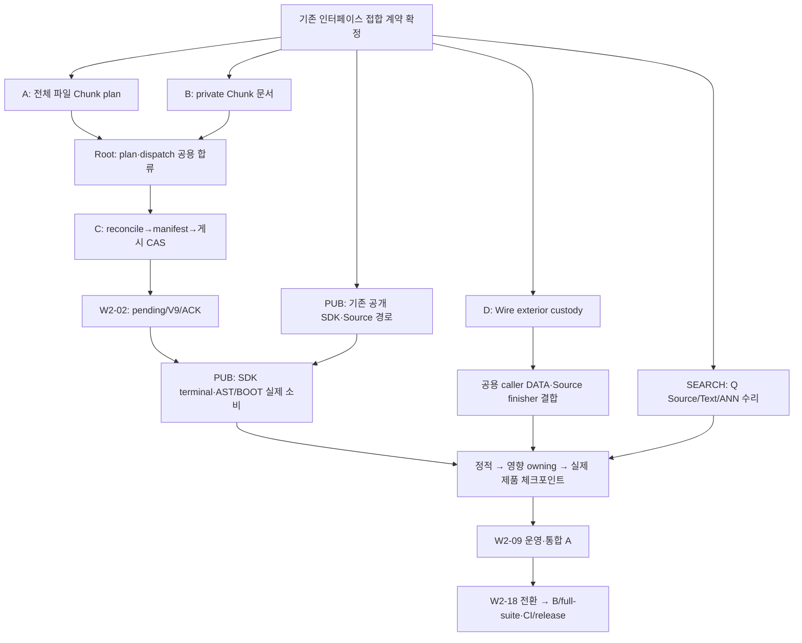

> HISTORICAL — pre-migration document from `docs/plans/oct-17-index-closeout/tickets/README.md`. Current work: [Oct-22 SSOT](../../../../plans/oct-22-finalizing/README.md). Old TODO/status/counts do not create work or qualify current source.

# Oct-17 Index closeout — 작업 SSOT

**현재 할 일·담당·상태·다음 완료 조건은 아래 7개 행만 갱신한다.** 개별 티켓은 고정 구현/수용 계약, [검증 요약](../../oct-10-index-closeout/VALIDATION.md)은 source/selector별 결과, [보존 이력](../../../oct-17-index-closeout/tickets/README-2026-10-21.md)은 과거 배정·후보·진척을 소유한다. 과거 TODO·host/disk 관측·채팅 active 상태로 새 작업이나 완료를 만들지 않는다.

2026-10-21 문서 정리 기준. Q shared HEAD `c32cd191554031b9a7d04207ffa3410e8fc201ba`와 dirty source를 관측했다. 이는 전체 실행의 공통 source가 아니다. 형식은 Native18 / QIMAP004 / inline data32·real children5다. source 적용·컴파일·owning 회귀·제품·운영·출시는 각각 판정한다.

## Remaining work

| ID | 유일한 작업 경계 | 담당 | 상태 | 다음 완료 조건 |
| --- | --- | --- | --- | --- |
| [W2-02](W2-02-pending-recovery.md) | signed pending·claim·복원·terminal custody | Root(Runtime/pending 통합)·PUB(SDK); I 기존 계약 재사용 | CODE+CHECKS. SQL51·signed Store·claim/restore·pending/scheduler와 opaque admitted ACK/SDK 소비2곳은 source 적용·재사용 대상이다. funded client→scoped RPC도 source에서 연결을 확인했다. 실제 게시 artifact→같은 pending/V9/ACK·SDK terminal과 동일 operation 복구 수용이 남았다. 설치 signed worker의 기대 digest/provenance 입력은 해당 process gate만 BLOCKED이며 Linux/Docker 자체 부재로 재발급하지 않는다. | [terminal 실행 packet](W2-02-pending-recovery.md#terminal-publication-join)의 실제 artifact→같은 Store/Original·pending→V9/ACK·SDK를 닫는다. canonical wire·CAS/거절·cancel/drop owner 회귀와 기존 first-FULL3/Facts2 process cut을 같은 operation/target/policy로 수용한다. SQL/decoder/ACK/SDK 소비자/worker 재구현·재수집·새 키·예산 reset 금지. |
| [W2-05](W2-05-producer-full-delta.md) | 실제 FULL/delta·Chunk·generation·게시 | Root(공용 합류/C·terminal)·A/B/D 전담·P(writer bank)·PUB(E); M/I 기존 코드 재사용 | CODE+CHECKS. A의 여러 파일 preplan과 실제 plan 전달, B의 private paid 문서 producer·gold 소스, D의 exterior bank/try-reserve override는 현재 source에 있다. 이전 incomplete/planner None·Wire bank 부재를 근거로 재개발하지 않는다. 남은 Root 코드는 공용 plan/source-members/token-count·dispatch, D 실제 caller DATA/finisher, C의 reconcile→manifest→실제 게시와 terminal 접합이다. P는 bank, PUB는 SDK/Facts consumer, Semantica lower는 기존 canonical owner가 한 번 수정한다. 실제 타입·회귀·제품/복구 수용은 NOT_RUN이며 private source를 전체 완료로 승격하지 않는다. | [단일 owner map](WRITE-OWNERSHIP.md#compiled-handoff-owner-map)에 따라 기존 A/B/D 결과를 소비해 공용 계약을 결합한 뒤 [C](W2-05-producer-full-delta.md#native-publication-caller)→[W2-02 terminal](W2-02-pending-recovery.md#terminal-publication-join)을 닫는다. [PUB E](W2-05-producer-full-delta.md#sdk-producer-custody)는 lower 반환물→SDK를 한 번 결합하고 P/Root 내부 writer를 수정하지 않는다. 같은 Source/target·highest/finisher·typed failure·backing-last를 유지해 W2-19 수용으로 합류. 지원 bank·IR·codec·issuer·예산 재개발/증액 금지. |
| [W2-13](W2-13-ann-product-integration.md) | Source/Text/ANN 제품·고정4K | SEARCH; 기존 Catalog/storage owner | CODE+CHECKS. 기존 terminal/fence·VFS·renewal 수리는 보존. 새 RCA 수리: 같은 attempt/cut의 AppliedSource 검증 증거로 coverage의 중복 record decode를 제거했고 Core/Kernel187/187 통과. 두 scalar coverage edit은 기존 bounded resident COW·단일 DAG installer로 처리해 SQLite scratch를 피하며 Storage/Kernel54/54 통과. 이어 CAS 확인/수정의 중복 radix walk도 합쳤으며 최종 CAS 포함 Storage/Kernel 영향54/54·확장 pair gold2/2·NativeText consumer3/3·Core/Kernel/Storage strict·hexagonal·해당3개 module snapshot도 통과했다. 원4K Off 첫 정상 제출은 foreign Rust3·load18.01>8로 Cargo/body 전에 BLOCKED였다. 단일 대기 launcher는512.6초 뒤 정상 preflight를 통과. 원4K Off는 최적화 빌드3m39s/본문654.49s 뒤 FAILED(exit101,daemon0). SourceAdvance30s는 통과했으나 후속 row-668의 worker10s deadline 거절(reads44,212/bytes23,414,732)이 관측됐다. map 설치 checkpoint는 만료 관측점이며 지배 단계는 미확정이다. 후속 bulk CAS 수리로 같은 원본 루트의 admitted 경로를 재사용한다. 독립1028-key 결과3076→3 node-object 읽기,Storage/Kernel/Semantic64/64·Storage strict·hexagonal 통과. Storage module snapshot도 해당 private module만 반영 후 unchanged 통과. 이 수리 소스의 원4K 단일 launcher는602.1초 정상 preflight 대기 후 BLOCKED(exit1,최종 host load22.92627>8;본문·Cargo0). 새 제품 실패가 아니며 해당 수리의 제품 본문은 NOT_RUN이다. 관측890/4096은 전체 처리량 증거가 아니다. 이전 원4K Off30.0027s deadline 실패와 이후 변경 전 Record+OS sample Source22.639153s 게시는 별도 관측이다. 해당 진단은 후속 ANN에서 의도 중단. 최신 전체4K Off 제품 수용은 위 worker deadline으로 FAILED이며 Q64/reopen/delta/path/overlay는 미도달이다. 공용 public API gate는 이번에 수정하지 않은 Contract-base/Contract/SDK drift로 FAILED;전체 통합 결과로 승격하지 않는다. | bulk CAS 경로 수리와 영향 검증은 완료. 호스트 경합이 해소된 정상 preflight에서 원4K ANN/Q64/reopen/delta/path/overlay를 수용한다. 종료한 대기 launcher를 실행 중으로 취급하거나 같은 경합에서 즉시 재제출하지 않는다. 새 실패가 있을 때만 해당 owner의 단계/배정·grant 시간을 분리하고 근거가 확인된 scratch 또는 selected-member 비용을 추가 수리한다. 미측정 후보를 필수 신규 기능으로 발급하지 않는다. 같은 mutation/root-diff/CAS/EOF·snapshot 오염 거절·원 memory/custody와 lease2000ms·SDK30s/worker10s·1M축/512MiB·oracle를 유지한다. Catalog/VFS/Common 본문·W2-09 운영·W2-19 전체 CI는 기존 owner 경계다. 같은 경합 실패 반복·예산 확대·새 엔진/worker/ledger 금지. |
| [W2-16](W2-16-stub-authority.md) | AST queue·certificate·source-owner guarded apply | Root(Source 인계 통합)·PUB(SDK caller); 기존 AST/SQL owner | CODE+CHECKS. copier/custody·Stub route·signed SQL·복구/Refused·Full-gated Superseded 하위 계약은 구현. 실제 committed Source의 fresh Original·owner/path 인계와 SDK 실행/supersession caller는 미완료. SQL/protocol의 scoped 결과는 실제 queue/process 수용이 아님. | [기존 실행 packet](W2-16-stub-authority.md#implementation-packet)에 W2-05의 실제 Source/owner/path를 인계→점조회·signed writer→실제 queue/restart/Full supersession→ONE Delta/CAS/drop. SDK parent는 PUB가 결합하고 설치 provenance가 필요한 process gate는 별도로 유지. |
| [W2-18](W2-18-native-cutover.md) | genuine FULL 결과→BOOT·선택 전환 | Root(FULL evidence 인계)·PUB(SDK); 기존 BOOT/launcher owner | CODE+CHECKS. launcher switch/rollback·prior Legacy selection 보존 API/CLI와 Q-only fixture 구현·scoped 검증 완료. genuine S FULL→operation/view/source/digest 인계·실제 BOOT caller·process stop/join/lease 연결은 미완료. | [기존 실행 packet](W2-18-native-cutover.md#implementation-packet)의 genuine 선택형 FULL 결과→보존 predecessor→candidate Verify/Serve/reopen→Legacy rollback. SDK parent는 PUB가 결합하고 actual default switch는 W2-19 A 후. launcher/target issuer 재구현 금지. |
| [W2-09](W2-09-cost-observability.md) | trace·총비용·mixed·운영 압박 | PHYSICAL·기존 harness owner | CHECKS. ReadSession/Release·settlement 코드 수리와 선정17/17·strict 완료. mixed12·Off tooling132 PASS/2 N/A·retained-read snapshot은 각 source 결과로 보존. 추가 Catalog phase 진단2/2·strict도 완료. 이전 clean 후보는 stale이며 현재 source 증거로 사용하지 않는다. | W2-13 제품 수용→coherent clean 입력→Native Large/XL ACK/search/reopen→원960s mixed·Off/Record교대3쌍. continuous aggregate RSS/전체 roots allocated peak·delegated Linux 수용은 사용자 유예. 운영·성능·release NOT_RUN. |
| [W2-19](W2-19-integration-acceptance.md) | coherent 통합 A/B·full suite·CI/release | Root(QIDX 수용 통합)·P(Runtime)·PUB/기존 PY(SDK/CP) | CHECKS. 전체 완료 아님. source별 compile/owning/정적 결과를 합산하지 않는다. SDK/CP·P2의 실패/수리는 입력별 이력으로 보존하며 최신 전체 green은 미입증. 과거 compiler 오류를 확인 없이 재발급하지 않는다. | [통합 packet](W2-19-integration-acceptance.md#integration-packet)이 각 기능 oracle를 한 번 소비한다. 실제 producer/publish·terminal·AST/BOOT·복구/운영→A→default 전환→B/full suite·exact-source CI/release. Root가 종결 책임을 유지하며 누락 authority/input은 해당 gate만 BLOCKED. |

## Execution order

**코드는 5개 독립 흐름으로 진행하고 공용 caller는 Root 한 곳에서 합류한다.** [파일별 병렬 배치](WRITE-OWNERSHIP.md#parallel-implementation-schedule)가 private 수정 범위와 공용 seam을 소유한다. 기존 PUB·SEARCH·PHYSICAL·P 큐를 유지하며 M/I/W 완료 지원 코드를 다시 배정하지 않는다. 먼저 plan/unit·owner, Wire exterior DATA, 실제 artifact→ACK 인수를 기존 canonical 계약으로 고정한다.

1. **기존 A/B/D private 코드를 소비하고 공용 계약부터 한 번 합친다.** A의 여러 파일 preplan·실제 planner 인수, B의 topology별 paid producer, D의 exterior bank는 현재 source를 재사용한다. 각 담당은 자기 private 코드의 확인된 잔여만 마감한다. Root는 merged candidate/source-members·기존 token-count 정책/권한·공용 owner/enum/export·실제 dispatch를 producer/consumer와 함께 결합한다. Wire의 실제 caller DATA/finisher도 Root 통합 hunk다. query·TextBasis·lexical/semantic/SearchPlan bank와 M/I/W 완료 코드를 다시 만들지 않는다. [compiled owner map](WRITE-OWNERSHIP.md#compiled-handoff-owner-map)의 같은 함수·ABI에는 한 writer만 둔다.
2. **C는 기존 bank를 소비해 준비하고 실제 연결은 A/B 수락 뒤 결합한다.** actual drain/모든 writer 수락→기존 facade의 same-writer serial→parent pin→기존 reconciliation highest/finisher→반환된 paid request를 기존 manifest bank에 move·normalize/digest→manifest 순서 stage 선택→settled generation→P FinalDocs→Root witness+원 FinalDocs move→I generation0 receipt→P vector 검증(receipt+같은 FinalDocs+mutations)→M FullSearchPlan→issued prepared→P paid payload/root4phase→기존 CAS. 현재 v165의 request 선소비를 이 순서로 옮긴다. P는 기존 writer/generation/vector/root 엔진과 owning 검증, Root는 이를 부르는 상위 caller·공용 export 인수 결합을 소유한다. 같은 serial 재획득·receipt/root 순환·request 재구성·새 게시 엔진은 만들지 않는다.
3. **PUB와의 경계는 실제 게시 artifact다.** Root는 내부 artifact→같은 pending/V9/ACK와 오류·취소·Source-last 반환을 닫는다. PUB는 SDK/public entry·install/recovery 소비와 기존 target clone failure owner 재사용·Facts/recompute 후반 실패 custody 실제 잔여를 소유한다. PUB의 generic final-publication 표현을 Root 내부 writer 본문의 중복 수정권으로 사용하지 않는다. 공용 SDK parent는 PUB가 한 번 변경하며 기존 opaque ACK 소비2곳을 재사용한다.
4. **같은 제품 결과를 기존 consumer로 보낸다.** Root가 원 committed Source/owner/path를 기존 AST publisher/queue에, genuine 선택형 FULL의 operation/view/source/digest를 기존 BOOT consumer에 인계한다. SDK parent는 PUB, Q launcher/selection은 기존 BOOT hunk를 유지한다. 후속 IDE 명령은 자체 genuine Current/Original을 사용하고 FULL의 deadline/권한을 재사용하지 않는다. C5 reservation·stage receipt·projection ACK로 target이나 실제 Q publication을 합성하지 않는다.
5. **영향 검증은 한 체크포인트에 모은다.** P의 기존 Runtime owning profile/진행 중인 결과를 재사용하고 Root가 중복 Runtime compile/capture를 시작하지 않는다. SDK/CP는 기존 PUB/PY 큐의 독립 분모로 수용한다. latest failed immutable 입력과 live source를 구분하며 확인된 의존 오류만 원 owner 경계에서 수리한다. 필터/feature 축소·Clone 추가·Ordinary fallback으로 authority 수명을 우회하지 않는다. Chunk 다중 파일/세 topology, reconcile→manifest join, same-writer/foreign Original·CAS 거절, 실패/cancel/unwind/마지막 drop 환급을 같은 영향 소스로 검증한다.
6. **제품 수용과 나머지7티켓의 마감을 분리해 끝낸다.** 실제 FULL→delta→query·같은 operation/target/policy의5 crash cut을 먼저 확인한다. 설치 signed worker expected digest/provenance 누락은 해당 process gate만 BLOCKED다. SEARCH의 현재 원4K 실행은 하나만 소비하고 W2-09 Large/XL·mixed/Off/Record는 그 제품 결과 뒤에 진행한다. 기존 W2-19 A→default 전환→B/full-suite·CI/release 순서를 유지한다. Root의 W2-02/05 코드 완료나 M/I/W 정적 결과를 전체7개 완료로 승격하지 않는다.

## Owners

| 기존 채팅/역할 | 독점 경계 |
| --- | --- |
| 증분 / Root | A/B/D 전용 채팅의 private 결과를 직접 읽고 공용 plan/port/dispatch·Wire caller·실제 publication/pending의 상위 caller를 구현·직렬 합류. SDK parent는 기존 PUB가 결합 |
| A plan 전용 · `01a15ed8-2d3d-7513-a9b5-aafa4dbb4996` | Chunk 전체 파일 plan private 구현. 공용 parent/port/dispatch·다른 lane은 수정하지 않음 |
| B 문서 전용 · `01a15ed8-44c5-74a1-ab37-8c2a527f48c2` | 기존 plan/unit을 소비하는 Native Chunk 문서 private 구현. A의 plan 생산·공용 dispatch는 수정하지 않음 |
| D Wire 전용 · `01a15ed8-4a66-76b3-8ebd-83f938e19a4c` | Wire exterior bank·admitter·owner tests. Runtime caller DATA/Core 공용 접합은 Root에 반환 |
| 증분 (2) / I | 기존 manifest/receipt·Parent pin·reconciliation·preplan query 인계를 소비. 같은 leaf 구현 재배정 없이 Root가 실제 publisher/pending caller에서 사용 |
| QIDX M Native metadata 조회 마무리 | 기존 metadata·generation·FullSearchPlan 코드와 인계를 Root가 소비. 실제 상위 caller는 Root, M helper 재작성 금지 |
| QIDX P Native projection RepoMap 마무리 | 기존 stage/generation·FinalDocs·vector·root/CAS 엔진과 현재 Runtime owning 검증. Root의 상위 caller와 exact hunk를 구분하고 SDK parent는 변경하지 않음 |
| Oct10 Native 게시·SDK 마무리 / PUB | 공개 SDK/install/recovery·Orchestrator/Facts 실패 입력 보존. Root의 내부 Chunk/manifest/root orchestration을 별도로 재구현하지 않음 |
| 웨이브 마스터 (2) / 기존 S 통합자 | S 공용 main·별도 전역 campaign 통합. QIDX의 실제 Native upper caller 마감은 Root가 소유하며 전체 S 청결/다른 campaign 완료를 전제로 기다리지 않음 |
| Review Oct 10 index closeout / SEARCH | Source/Text/ANN 실제 실패 수리·phase RCA·원4K 단일 실행 |
| Review Oct 10 index closeout --보완 / PHYSICAL | Catalog/파일·FD·capacity/fault·W2-09 운영; 확인된 local code/회귀는 완료 |
| 기존 AST·BOOT·PY/중앙 통합 | 실제 Source/FULL consumer 연결·기존 설치 authority·단일 owning/통합 검증 |

채팅 상태와 위 ID는 라우팅 참고다. 작업 채팅끼리 메시지·질문·진행 조회·재배정을 하지 않고 본인 독점 코드와 회귀 소스를 끝내 자기 채팅에 최종 결과를 남긴다. Root가 현재 소스와 결과를 직접 읽어 합류한다. 구체 path/function/hunk와 [공용 파일 규칙](WRITE-OWNERSHIP.md)을 확인하며, idle·usage interruption을 무주인으로 간주하지 않는다. W의 archived 채팅 응답을 새 dependency로 두지 않고 기존 인계를 Root가 재사용한다.

## Legacy ID mapping

| 이전 ID | 현재 유일한 잔여 소유자 |
| --- | --- |
| W2-01/03/04 | W2-19; signed pending은 W2-02 |
| W2-06/12/14 | W2-05; 기존 chunker/RepoMap 엔진 재개발 금지 |
| W2-07 | W2-19 물리 수용; 새 ANN caller는 W2-13 |
| W2-08 | W2-18 실제 선택/BOOT |
| W2-10 | W2-09 측정 후 확인된 upkeep 수리만 |
| W2-11/15/17 | W2-19; lexical/overlay/Auto 기존 구현 재개발 금지 |

## Closure

- 상태·담당·다음 완료 조건은 위7행만 수정한다. 새 dated 상태표·진척률·별도 TODO를 아래에 덧붙이지 않는다.
- 검증은 VERIFIED / FAILED / BLOCKED / NOT_RUN / NOT_APPLICABLE과 source·scope로 기록한다. 컴파일만으로 테스트 성공을, owning만으로 제품 수용을, local proof만으로 release 수용을 판정하지 않는다.
- Accepted ADR/RFC·고정 수용 계약은 유지한다. 새 문서 정리·채팅 배정·준비 API·정적 hash 일치는 코드/제품/출시 완료가 아니다.
- [검증 요약](../../oct-10-index-closeout/VALIDATION.md)과 [전체 보존 이력](../../../oct-10-index-closeout/VALIDATION-2026-10-21.md)을 구분한다. 이전 배정/후보는 [복구 색인](../../../../ARCHIVE-INDEX.md#oct-21-closeout-document-compaction)에서 찾는다.

## Historical section links

이전 fragment는 아래 anchor로 보존한다. 상세 본문은 [README-2026-10-21.md](../../../oct-17-index-closeout/tickets/README-2026-10-21.md)의 같은 fragment에서 확인한다. 현재 상태는 SSOT만 따른다.

