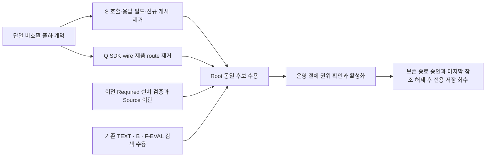

# RepoMap 출하 제거 및 저장 퇴역

2026년 11월 23일 KST. **한 번의 S/Q 비호환 출하에서 RepoMap 호출·발행·공개 SDK·wire를 제거한다.** 중간 disabled 릴리스와 구 API stub은 출하 범위에서 뺀다. 이전 `Required` 세대는 승인된 이전 실행물과 보존 root로 읽는다. 새 root로 절체하는 데 필요한 과거 형식 검증은 기존 D/E08 복구 경계에 둔다. 역사 데이터의 물리 회수는 보존 계약을 따른다.

**검색 수용은 지금 시작한다.** 기존 TEXT의 SDK60·Large, B의 ANN4K·제품 4K, F-EVAL의 Hybrid를 기존 오너와 실행기로 진행한다. 특히 B의 제품 fixture는 이미 Text와 Semantic만 활성화하므로, RepoMap 퇴역은 4K 실패 수리의 선행 조건이 아니다. Root/F는 해당 출하 후보의 공통 입력과 실제 본문을 한 번 인수한다. [기존 검색 오너](../nov-20-native-cutover-closeout/tickets/LANES.md) · [4K fixture](../../../crates/quanta-index-searchd-runtime/tests/native_product_process/ann_quality.rs#L1984) · [4K 수용 계약](../nov-21-bugbash-source-advance-4k/04-product-acceptance.md#고정한-실행과-판정)

## 티켓과 담당

| 티켓 | 기존 담당 | 완료 조건 |
| --- | --- | --- |
| [01 · Semantica] 호출자·발행·새 세대 재생 | S CLI/SDK·R5와 기존 Source 생산자, Root 통합 | 필수 RepoMap root, 공개 요청·빌더·응답, exporter와 게시를 제거한다. 일반 검색·ClusterCard/Graph 유지와 새 RepoMap 산출물 0건을 확인한다. |
| [02 · Quanta Index] 공개 SDK·IPC·BOOT | 기존 Q Graph/SDK와 D 설치 | RepoMap CLI·SDK·wire와 전용 member·projection·보호 route를 제거한다. 퇴역 인스턴스의 `QueryGraph` 거절과 독립 Graph·File/Path·History의 실제 호출을 확인한다. |
| [03 · 저장 퇴역] S/Q·Legacy 데이터 | 기존 S Store, Q Catalog/GC, D/H 복구 | 보존 종료 뒤 설치별로 독립 이전 root의 전체 퇴역 또는 공유 root의 전용 객체 회수를 판정한다. 실제 할당 바이트와 적용 quota를 대조한다. |
| [04 · 통합과 수용] Root/F·E08 | 기존 Root/F, D, E08 및 TEXT/F-EVAL | 이전 승인 설치에서 Required를 복구하고, Source·History만 이관한 서명 후보에서 SDK 게시·조회·재시작과 실제 설치 절체를 검증한다. |

## 착수와 합류

1. **01과 02를 병렬로 준비한다.** S는 호출자·발행·응답을, Q는 SDK·wire·제품 등록을 맡는다. 지원 소비자의 동시 업그레이드 또는 지원 종료를 확인한 뒤 한 번에 출하한다.
2. **Root가 기존 큐에서 한 S/Q 후보를 수용한다.** D/E08은 이전 `Required`의 쓰기를 차단하고 미결 작업을 정산한다. 현 Native restore-forward 검증은 이전 보호 RepoMap head의 복제를 요구하므로 Source-only 이관의 생성기와 검증기를 함께 전환한다. **기존 설치 활성화는 BLOCKED**다. 같은 서명 S/Q로 실제 Linux 선택 CAS·새 PID 조회를 관측하고 기존 E08 복구 조건을 충족한 뒤 승인한다. [운영 절체 조건](04-integration-acceptance.md#설치-절체와-중단-지점)
3. **03은 보호 참조를 병렬로 조사한다.** 운영 절체와 보존 종료 뒤 물리 회수를 판정한다. 이전 root의 활성 선택이 바뀌어도 자체 BOOT·projection 보호는 남는다. [회수 방식](03-storage-retirement.md#선택할-이행-방식)

새 root에 격리 후보를 만드는 경로를 먼저 검증한다. Q의 `Reconfigure`는 `CatalogView.projections`를 유지한다. 공유 root에서 전용 객체를 회수하거나 동일 root 절체가 요구되면 해당 참조를 해제하는 계약이 필요하다. [Q Catalog view 생성](../../../crates/quanta-index-kernel/src/update.rs#L2852)

## 합류 때 고정할 계약

- **RepoMap 공개 계약의 브레이킹 체인지를 허용한다.** S 요청·응답·Workset과 Q SDK·CLI·wire를 같은 출하에서 교체한다. 유지할 소비자는 새 계약으로 전환하고, 종료할 소비자는 지원 대상에서 제거한다. 과거 저장물과 절체 증거는 이전 승인 실행물·새 후보의 이관 검증 경계에 각각 결속한다. 이 범위는 [04의 운영 절체](04-integration-acceptance.md#설치-절체와-중단-지점)와 [03의 보존·회수](03-storage-retirement.md#완료-조건과-회수-증거)에서 판정한다.
- [01 · Semantica]와 [02 · Quanta Index]는 같은 승인 프로필에서 repo·revision·Source 세대·배포 선택을 대조한다. `NotApplicable`은 기존 영속 증명이 요구하는 곳에서만 사용한다. 이전 root의 `Required`는 이전 입력과 권위에 결속한다.
- [04 · 통합과 수용]은 **한 번의 공개 계약 제거와 운영 절체**, [03 · 저장 퇴역]은 **이전 데이터의 물리 회수**를 판정한다.
- 기존 S 생산자, Q Graph/SDK와 D 설치, Store/Catalog의 파일 소유를 유지한다. 이전 실행 결과는 기존 원장에 남기고, 같은 대상·feature·선택자·동결 입력은 기존 큐에서 재사용한다. [S 기존 생산자 원장](/Users/songmin/Documents/code-new/semantica-codegraph-v2/docs/plans/oct-26-replay-query-read-custody/tickets/CURRENT_REMAINING.md) · [Q 기존 작성 범위](../nov-20-native-cutover-closeout/tickets/LANES.md)
- 기존 06의 S/Q 오너는 이전 `Required` 복구와 이번 01/02 전환을 맡는다. 신규 RepoMap DELTA 최적화는 이번 출시에서 보류한다. 유지할 SDK·CLI·daemon 소비자의 전환 또는 지원 종료를 확인한 뒤 절체를 승인한다. 기존 검색 실행은 병렬로 진행한다. [기존 06의 작업 이력](../nov-20-native-cutover-closeout/tickets/06-tantivy-retirement.md#현행-코드-작업-순서)

기존 증거와 DELTA 설계는 [06 이력](../nov-20-native-cutover-closeout/tickets/06-tantivy-retirement.md#현행-코드-작업-순서)에 보존한다. 후보 구현과 정적 검사는 진행 중이며 제품 실행과 출하 수용은 **NOT_RUN**이다. 현 상태와 실패한 검사는 [통합 검증](04-integration-acceptance.md)을 따른다.

[01 · Semantica]: 01-semantica.md
[02 · Quanta Index]: 02-quanta-index.md
[03 · 저장 퇴역]: 03-storage-retirement.md
[04 · 통합과 수용]: 04-integration-acceptance.md
