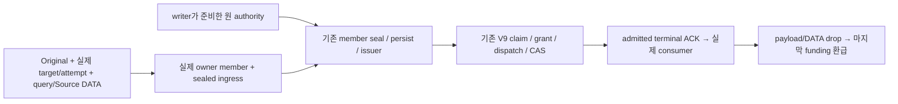
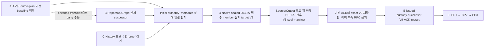

# E02 — 단일 게시·복구·custody·예산

## 코드 잔여 재점검 — 2026-11-07 KST

**현재 판단: 아래 수리 항목은 SOURCE_APPLIED / owning·SDK 수용 미완료.** 기존 C02/P60/C03와 reconcile한 exact hunk만 수정했으며 Source/IFDS/DFG·이미지 codec 본문은 보존했다. 기존 batch 구문16/16·whitespace·회귀 integrity3종·영향 경계25/25와 추가 Wire6/6·Trace5/5는 VERIFIED다(정책 집합은 중복되므로 합산하지 않음). 추가 FULL source cfg2곳과 SolverPrep handoff2곳의 정적 범위는 아래에 분리한다. 고정dec33의 Native Trace dependency compile 통과·Checkout DFG4진단은 해당 과거 cohort 결과다. 현재 owning source admission과 Linux 설치 SQL image/SHA의 적격 입력이 남는다. 이 범위는 전체 E01–E08의 코드 마감 수가 아니다.

| 수리 항목·현재 상태 | 현재 근거·영향 | 수정 경계·완료 조건 |
| --- | --- | --- |
| Java conditional-constructor helper re-export — SOURCE_APPLIED | Analysis [original_producer_v3.rs](/Users/songmin/Documents/code-new/semantica-codegraph-v2/packages/analysis/quanta-v2/crates/quanta-runtime-analysis/src/queries/intraprocedural/dfg_query/original_producer_v3.rs:182)의 기존 re-export에 `visit_conditional_constructor_reaching_v1`을 추가했다. 실제 정의는 `original_core_reaching_v3/native_mixed_reaching_v142_v183.rs:478`이며 기존 상위 facade·PTA caller가 이를 소비한다. 40cd의 E0432 세 진단은 이 동일 원인으로 묶는다. | 별도 helper 구현·IR·새 facade는 없다. 실제 owning feature 구성의 import/컴파일 수용은 재실행 결과로 판정한다. |
| Java mixed-span reader 모듈 경로 — SOURCE_APPLIED | [java_mixed_span_preparation_v142.rs](/Users/songmin/Documents/code-new/semantica-codegraph-v2/packages/analysis/quanta-v2/crates/quanta-runtime-analysis/src/queries/intraprocedural/dfg_query/original_producer_v3/java_mixed_span_preparation_v142.rs:362)의 `super::super::original_result_read_v3`를 실제 형제 모듈 경로 `super::original_result_read_v3`로 고쳤다. 40cd의 관련 E0433·E0282는 같은 검증 closure에서 발생했으며 후자의 독립 잔여 여부는 수리 후 컴파일로 판별한다. | 기존 `W2-C02-PTA-ABI-20261105`와 reconcile한1줄 hunk다. 파일 전체를 재배정하지 않으며 owning 수용은 아직 없다. |
| 공개 phase→SDK 진단 위임 회귀 — SOURCE_APPLIED | [native_phase_cause_visit_v16.rs](/Users/songmin/Documents/code-new/semantica-codegraph-v2/packages/analysis/quanta-v2/crates/quanta-sdk-runtime-executor/src/client/tests/native_phase_cause_visit_v16.rs:10)는 기존 genuine Java FULL→Watch fixture와 실제 이전 Original session을 사용한다. canonical validator가 `OriginalExecutionSessionMismatch`를 발급하며 공개 pending-diagnostics의 두 번 대여에서 원본 typed cause·같은 주소와 원 analysis epoch·Native 미게시를 검사한다. Runtime unit5개만으로는 public tail 위임 삭제를 검출하지 못했던 공백을 대상으로 한다. | 기존 observer의 one-shot fault slot→실제 SDK v94 request→Runtime phase→TAINT tail로 연결했다. 새 Source/가짜 phase·forced Err는 없다. Linux cfg와 SDK class435088에 mount하고 suite/Stage L consumer로 등록했다. 마지막 refund/독립 process 및 실제 본문은 별도 수용이며 이 새 회귀의 작성으로 완료 처리하지 않는다. |
| 후속 owning strict import — SOURCE_APPLIED | 고정77f0는 `quanta-runtime-orchestration-wire/src/query_outcome_v1/unit_read_v4.rs:7`의 미사용 `FallibleTypedOutputCopyV3` import를 `-D unused-imports`로 거절했다. 현재 그 import1건을 제거했다. | lint/feature/예산을 바꾸지 않았다. 추가 구문1/1·Wire 영향 경계6/6은 VERIFIED이며 body는 동일 Runtime 요청 결과를 기다린다. |
| 후속 Native Trace resident 컴파일2구간 — SOURCE_APPLIED | 고정9886의 실제 컴파일에서 `native_resident_v3.rs`의 nested const가 outer `Self`를 참조하는 E0401이11개, `Result<(), ()>` 메서드가 Option에 `?`를 쓰는 E0277이2개 발생했다. 현재 tag 배열은 정확한 enum명으로 바꾸고 census를 `as_ref().ok_or(())?`로 빌린다. | tag0–10/variant 순서를 유지한다. terminal·root 부재·새 census 한도·기존 census 부재·비어 있지 않거나 overflow인 기존 physical rows·다른 limit는 모두 거절하며 실패 때 census를 바꾸지 않는다. root-image/decode의 별도3원인은 기존 D가 수리했고 이 채팅은 그 파일을 수정하지 않았다. Trace 구문1/1·경계5/5는 VERIFIED이며 실행은 아래 동일 Runtime 요청으로 판정한다. |
| 후속 Checkout 타입/대여2구간 — SOURCE_APPLIED | `work_v4/checkout_v1.rs`에서 positional actual reader의 u32 인수에 usize가 들어가고, `checkout_call_chain_link_v1.rs`의 검사 배열이 mutable 참조를 이동해 이후 재사용하지 못했다. 실제 scoped owning 컴파일에서 각각 E0308/E0382를 관측했다. | 기존 C02 claim과 reconcile한 exact hunk다. loop index는 usize로 보존하고 호출 위치에만 checked u32를 전달한다. 검사 배열은 `&*` 공유 재대여로 바꿔 뒤의 mutable 사용과 입력 검증을 유지한다. clone·cast unwrap·예산/프로필 변경은 없다. 구문2/2·영향 경계6/6 VERIFIED, 수리 후 owning 본문은 아직 NOT_RUN이다. |
| SolverPrep 환급 참조·모듈 경로2곳 — SOURCE_APPLIED | [success_handoff_v16.rs](/Users/songmin/Documents/code-new/semantica-codegraph-v2/packages/analysis/quanta-v2/crates/quanta-runtime-analysis/src/queries/taint/query/run_stages/solver_prep_stage_impl/run_pipeline/native_solver_prep_v11/success_handoff_v16.rs:4)의 잘못된 상대 경로를 기존 `run_stages::solver_inputs::PostSolverPreparationCrossV1` import로 교체했다. 실제 Source session getter가 이미 `Option<&Handle>`이므로 환급 callee에 붙인 추가 `&`를 제거했다. attempt21의 E0433/E0308에 대응한다. | type 선언·사용과 동일한 test-support cfg를 유지한다. 새 handle·clone·authority·budget은 없다. 실제 getter/callee/type 정의 대조, 비변경 rustfmt parse·whitespace는 VERIFIED다. C03/Consumer claim과 reconcile했고 D의 다음 SDK cut에 전달했다. 새 compile/body는 NOT_RUN이며 다른 owner의 Mutex bank 수리는 중복하지 않았다. |

**attempt22 coordination 접합 — SOURCE_APPLIED:** Runtime lib(test)의27진단을8원인으로 묶었다. re-export cfg는 Product V4 모듈 선언과 맞추고, Python finite protocol은 parent 내부 가시성만 허용한다. rebind는 공유 재대여, 빈 일반 계획의 기존 세 회귀는 canonical Default를 사용하며 assertion·test 수는 유지한다. IFDS는 callback 오류형과 기존 typed Native refusal 변환·read 대여를 명시하고, 네 funding 검사 closure는 canonical custody 참조형으로 고정했다. 새 profile·authority·Clone·fallback·원 예산 변경은 없다. Main의5파일을 수리하고 동시에 반영된3파일은 재작성하지 않았다. 별도 failure-bank16줄을 제외한8파일 exact-hunk patch를 D 준비본에 적용 가능함을 확인해 인계했다. 실제 compiler/body는 다음 owning 결과로 판정한다. [실행·source 근거](VALIDATION.md#e02-peer-ownership-refresh-20261106).

**FULL source cfg 수리 — SOURCE_APPLIED:** `OriginalFullSourceV3`의 Python cache arm이 variant 선언과 달리 `taint-solver` 없이 나타나고, Java read arm은 variant/callee가 허용하는 solver-off를 불필요하게 막았다. `full_source_v111.rs`의 두 cfg만 수정했다. 기존 Rust cfg predicate owner로 실제 HEAD/수정본의 양방향 함의를 비교해 불일치2→0과 수정 전 반례를 확인했다. AST 파싱·diff는 VERIFIED, NoSolver/Runtime body는 NOT_RUN이다. producer·Source 권한·캐시 본문·예산·wire는 유지한다. Java/Python Source가 모두 없는 solver 조합은 제품 계약을 확정하지 못했으므로 새 fallback을 만들거나 전체 feature matrix 지원을 주장하지 않는다.

**검증 입력 closure 잔여:** scoped overlay는 기존 canonical casectl API를 사용하며 새 Snapshot 구현이 아니다. 선택한 부모 파일이 새 untracked child `work_v4/value_call_sequence_v1.rs`를 mount하는데 첫 고정 입력은 이 파일을 빠뜨렸다. 이는 캡처 구성 오류이며 생산 코드 결손으로 세지 않는다. 실제 child를 추가하고 snapshot의 재귀 rustfmt 파싱을 Rust 실행 전 검사로 준비했다. 다음 캡처는 그 child가 비교 중 바뀐 것을 검출해 Rust 전에 거절됐다. C02의 안정된 module closure를 받아 같은 원 요청을 재개하며, 해당 거절을 성공으로 바꾸거나 모듈/feature를 제외하지 않는다. 최신 전달·실행 상태는 [현재 담당 원장](VALIDATION.md#e02-peer-ownership-refresh-20261106)만 따른다. Runtime5·SDK1은 D가 기존 pair 뒤 큐에 인수한 기록을 확인했다. Runtime5는 D의 교정a744 공통 floor에 Product V4를 유지한 후계 class `5b587ae0aadb`, 요청 `14914c56322ed9cb8f06d837892b5c28`로 정합화됐다. 이전551/ca89739e는 superseded NOT_RUN이며 새 요청은 기존 D batch 뒤 대기한다. SDK1 원 요청은 유지하며 실제 본문 실행은 NOT_RUN이다. D의 기존 Runtime/capsule pair는 이6개와 별개이며, attempt19는 test-helper feature gate/import 관련 컴파일 오류489건으로 FAILED(exit101/body0) 종료됐다. 적격 Linux image/daemon 뒤에도 원래 CP3의 동일 operation/target 복구 수용은 남는다.

**회귀의 실제 caller 연결:** 기존 composition의 `post_local_v11`은 observer를 전달했지만 새 SDK `phase_stage_v94/execute_v94.rs`는 전달하지 않았다. 현재는 실제 target attribution authority가 공유하는 기존 controls에서 one-shot observer를 가져와 같은 Runtime request에 붙인다. Native tail scope도 그 observer를 전달한다. 주입된 값은 실제 prior session이며 새 execution/Source authority를 발급하지 않는다. canonical validator의 거절·입력 보유·공개 진단과 게시 코드는 그대로다. test support feature를 끄면 이 fault 경로와 typed Error 재공개는 제외된다.

**검증 등록:** Runtime5의 현재 class는 D가 교정a744 공통 floor + Product V4로 등록한 `5b587ae0aadb`다. 이전 `e9c356aa3d2a`·`551be31564aa`는 실행 성공 없이 대체됐다. required suite `native-incremental-runtime-phase-cause-visit-owner` 하나에 정확한5함수 witness로 등록했다. 기존 Stage L에서 SDK 회귀 바로 앞에 소비하며 `--resolve-only`는 expected_tests=5로 통과했다. 초기 정렬 스키마 거절은 witness를 정렬해 고쳤고, 이후 동시 생성 중이던 `taint_flow/native_authority_v4.rs` 부재로 거절된 검사도 실제 child 생성 뒤 같은 명령으로 통과했다. 이는 등록·선택 검증이며 Rust 본문 수용은 NOT_RUN이다. 기존 SDK class177eaa는 observer feature를 켜지 않으므로 그 class를 재사용해0-body 수용을 선언하지 않는다. 정확한5-feature class `quanta-sdk-runtime-executor.no-default.435088202943`, suite `native-incremental-sdk-phase-cause-visit-owner`, 실제 SDK lib-test 요청 `34dc4964065b6fad2c7c1265da214fef`를 등록/해석했다. 기존177eaa는 바꾸지 않았다. 새 SDK 본문은 Linux·설치 SQL image/SHA256 입력이 요구된다. Linux 환경은 확인했지만 기존 SQL producer가 old Source의 DFG delimiter 컴파일 오류와 exact custody mismatch로 종료됐고 검증된 image는 없다. 값을 추정하거나 실패한 binary를 적격 이미지로 승격하지 않는다. 전체 parity gate의 다른 P07 selector12건 실패도 별도 기존 owner의 잔여다.

**Runtime lib(test) floor 계약:** 공통 floor의 단일 writer는 D다. Root의 profile/suite writer claim2개는 release됐고 D가 현재 suite·후속 request·기존 추가요청 큐를 `5b587ae0aadb` / `14914c56322ed9cb8f06d837892b5c28`로 갱신했다. exact5 witness·Product V4·threads0·원 예산과 SDK1은 유지한다. Root는 별도 profile을 반복 작성하지 않는다. class resolve·선택 성공은 compile/body PASS가 아니다.

**검증 도구의 실제 계약 수리:** `suite_registry_v1.py`의 consumer scanner가 실제 runner가 지원하는 `--snapshot-source`를 unknown 옵션으로 거절했다. 해당 canonical flag 하나를 반영하고 suite 이름 앞/뒤 양성 회귀와 기존 `--lane` 음성·literal consumer 결속 검사를 유지했다. 수리 전3개 실패, 수리 후 self-test65개 통과다. 현재 실제 소비자에서 이 옵션 거절116→0, 이 채팅 Runtime/SDK suite의 소비자 finding0을 확인했다. 다른 required suite180개 미연결은 별도 잔여이며 이를 gate에 일괄 연결하거나 baseline을 늘리지 않았다. 전체 registry 수리 후 재실행·Rust/SDK 수용과 구분한다.

**완료 구현의 재발급 제외:** 기존 transaction/tail/disposition 진단 수리, L1 predecessor→DELTA selector→collector, L2 ImportGraph carry·CallGraph caller, L3 RepoMap pair→installer→terminal/cold recovery, Native Watch, Memo/reuse/GC/lifecycle 및 configured macOS owned Voyage의 생산 연결은 현재 source에 있다. raw panic visitor의 `native_outer_panics_v3`와 `native_component_outer_panics_v3`도 서로 다른 bank이므로 중복 방문 수리를 배정하지 않는다. 정적 연결 사실은 Runtime/SDK/독립 process·비용 수용을 대체하지 않는다.

**실행과 코드 수의 분리:** 고정45e2는 DFG delimiter7건으로 FAILED했고 그 파일은 현재 수리됐다. 후속40cd는 Analysis 컴파일 오류12건으로 FAILED(exit101/body0)다. 현재에는 CurrentMemberRead/rebind export·CFG crate 경로·collection iterator·payload borrow 관련 수리가 반영돼 있으므로12건을12개 새 코드 작업으로 세지 않는다. 현 코드의 추가 compiler 진단 유무는 재실행 전 미확정이다. [정확 실행 범위](VALIDATION.md#e02-l1-d-closeout-20261031).

### 이전 감사와 반영된 수리

이 채팅에서 배정한 E02 코드의 생산자→호출자→소비자 감사다. 관측 중 Semantica HEAD가4245dc3c에서a9379a98로 이동했으며, mutable source의 정적 판정이다. 아래 결손은 후속 구현에서 수리했다. 새 작업 큐를 만들거나 Rust/SDK/제품 실행 대기를 코드 결손 수에 합산하지 않는다.

**후속 구현 — 2026-11-06 KST / SOURCE_APPLIED, Rust 수용 미완료.** 기존 owner의 보관 방식과 Source·grant·실행·게시 코드를 유지하며 진단용 대여 경계만 확장했다. `RetainedPublicationTransactionV16::visit_causes_v16`은 Arc 원인의 기존 우선순위를 유지하고 보관한 transaction 거절을 방문한다. `TaintScheduleBirthV16::visit_causes_v16`은 target/attach/publication 오류를 그대로 빌리며, 공개 phase visitor가 이를 위임한다. phase disposition으로 이동하는 Native target/cohort/CallGraph/GraphRead/adapter의 Runtime 원인 선택도 기존 접근자에 연결했다. canonical attach/publication enum2개는 정적 Display와 borrowed `Error::source`를 구현했고, 새 wrapper·DTO·Source issuer나 오류 String을 만들지 않았다.

회귀는 기존 transaction bank의 empty·같은 typed error 반복 대여·nested Runtime 보존과 attach/publication의 nested Runtime 대여5개다. 실제 공개 Product phase→SDK 호출 전체를 실행한 증거는 아니며, 해당 공개 위임의 genuine SDK 회귀 코드는 현재 `native_phase_cause_visit_v16.rs`와 class435 required exact1에 있다. 그 본문·설치 입력 수용은 NOT_RUN이며 회귀 코드 부재로 재발급하지 않는다. 정식 Runtime lib-test 요청 `d20ad251471c7642fab76b7c8686897e`, class `quanta-runtime.no-default.e9c356aa3d2a`, selector `coordination::product_v4_complete_reusable_execution_v1::retained_taint_schedule_v16::cause_visit_tests_v16`가 해석된다. 초기 D parent 미등록과 mutable capture 거절 후, 실제 등록된 기존 worktree-heavy lane의 canonical snapshot-artifact 경로에서 고정45e2·40cd를 실행했다. 두 실행은 위 의존성 컴파일에서 실패했으며 authored5개 본문은 NOT_RUN이다. 새 lane/token·별도 실행 큐를 만들지 않았으며, 해석 성공·정적 통과를 body 성공으로 승격하지 않는다.

| 확인된 코드 수정 | 원인·실제 소비자 | 최소 변경·기존 담당 |
| --- | --- | --- |
| P60 transaction 실패 원인의 공개 visitor 연결 — SOURCE_APPLIED | Runtime `may_alias_transaction_input_v3.rs`의 typed transaction 거절은 기존 bank에 보관되며, 현재 `retained_phase_birth_v16.rs`가 tail visitor를 위임한다. 실제 SDK `status_v94.rs`도 이 공개 visitor를 소비한다. 이전의 원인 조회 누락은 수리됐으며 payload 소실이나 성공 오판으로 확장해 주장하지 않는다. | 기존 owner의 구현을 재사용한다. 공개 phase→SDK 통합 회귀 코드는 SOURCE_APPLIED이며 남은 owning/SDK 수용만 위 현재 표에 남기며 새 오류 bank/DTO/문자열 복제·별도 구현 담당을 만들지 않는다. |

이번 감사에서 새 코드 작업으로 재발급하지 않는 범위:

- **Cold binding 가시성:** 실제 E0624의 대상 `try_stage_native_binding_cold_root_v3`는 기존 D가 `pub(in super::super)`로 수리해 현재 dirty source에 반영했다. 추가 구현이 아니라 동일 owner의 수리 후 검증 대상이다. 앞선 `u32`/`usize` checked conversion도 이미 있다.
- **L1/L2/L3·Watch 생산 연결:** 실제 predecessor 재인증·DELTA selector→collector, ImportGraph retained 생성자와 CallGraph dispatch, RepoMap pair→installer/terminal 및 Native Watch Product lender 경로가 있다. 과거의 caller0/생성자 부재/Ordinary Watch만 존재한다는 항목으로 같은 코드를 다시 만들지 않는다. Graph full-root dispatch의 비용은 별도 조사 후보이며 현재 확정 성능 결함으로 세지 않는다.
- **Native Memo/GC/lifecycle·configured provider:** 이번 읽기 전용 감사 범위에서 추가 미구현을 확정하지 못했다. macOS configured Voyage는 owned Host 경로를 사용한다. borrowed API의 `TransportAdmissionUnavailable`, 의도된 feature/backend gate와 실행 영수증 부재만으로 미구현을 선언하지 않는다. 실제 실행 수용 및 추가 OS/쿼리 지원 여부는 해당 원 계약과 별도로 판단한다.

TAINT target/attach/publication의 같은 보관 오류와 도달 가능한 Native disposition의 누락은 위 후속 코드에 함께 연결했다. 선언만 있고 생산자가 없는 NativeBuilder/NativeJoin variant를 새 구현 항목으로 만들지 않았다. 완료·담당·수용의 SSOT는 [README E02](README.md#e02), 실행 결과는 [기존 D checkpoint](VALIDATION.md#e02-l1-d-closeout-20261031)를 유지한다.

## B Trace/Evidence·predecessor 현재 source — 2026-11-03

[최신 source·검증·담당별 잔여](VALIDATION.md#e02-b-trace-reuse-final-audit-20261030)를 현재 B 판정으로 사용한다. 준비10파일과 실제 prior producer→family→QE caller, Native/SDK Java transport는 같은 Semantica checkout에 반영됐다. Trace/Evidence→closed memo→admitted Store·공통 ticket/역보상 경로도 source에 있다. 아래 W66–W70 설명은 유지할 계약/역사이며 이를 caller 부재·Store 전체 미연결로 해석하지 않는다. query capability 기본false와 현재 owning/body/제품 수용 미완료는 유지한다.

Root는 committed retained semantic/terminal lender→기존 successor chain과 durable memo capsule/restore·Java V7 hydration source를 연결했다. 이전 census-only/direct-finish/parent custody 전체 부재는 과거 상태다. 실제 cross-generation/Runtime/SDK/cold 수용은 미완료다. 이후 QE11은 Source94ca에서374/374(scalar4 포함) 실제 통과했으나 current QE test파일이 달라 현재 Source 전체 proof로 승격하지 않는다. 현재 단일 큐는 D이며 accepted45/historicalGREEN7과 새prepared54미접수 상태를 분리한다. L3 current-M/fault/cancel/unwind와Chunk 수리·cold suite/consumer는source-present다. 실제 current gate/Linux/SDK 수용은 위 checkpoint를 따른다. 실제 설치 Java provider와 configured HTTP/Voyage는 구분한다.

상태는 [SSOT E02](README.md#e02). 원 요구 R01/R02/R05–R12와 종전 W2-01/02/03/04/07, W2-05의 C/D를 소유한다. 기존 canonical IR·Store/claim/decoder/ACK·writer/generation/vector/root·D exterior bank를 재사용한다.

Current L1 source/verification routing: [the existing L1 final audit](VALIDATION.md#e02-l1-final-audit-20261030).

## L3 실제 소스 합류와 잔여 검증 — 2026-11-01

소유 `native_checked_delta_v3.rs`의23/current-M·26/real signed fault·30/canonical SDK 오류 계약에 공용27/31/34/35/39/37/40과 private32/33/36/38/41/42를 실제 합류했다. 사용자 명시 승인으로 이번 준비된 최소 공용 hunk와 문서11의 직접 적용만 허용됐다. 기존 complete ItemIndex10/7/7·독립 Chunk/문서 identity·span·OwnsChunk·prior-M·cold oracle은 유지한다. 공용13/17/19/22/25는 재적용하지 않고28/29·과거 apply-set은 superseded다.

- 27/31/32: 기존 paid SDK M 전체 슬롯과 JSON 변환 직전 typed 오류를 빌려 opaque alias·Source weak·7개 live 축의 최종 환급을 검사한다. 기존 generic whole-C loan을 재사용하며 새 root/payer/issuer를 만들지 않는다.
- 34/39/40/33: 실제 admitted daemon request와 같은 cancellation signal, 발급 직후 같은 Original의 거절 전 probe, actual V9 producer의 typed Control(Cancelled)를 사용한다. 같은 budget의 기록된 sticky cause를 poll 없이 읽기 전에 실제 거절 결과를 요구하며 IFX normal optional dependency 누락을 연결했다.
- 35/36: 기존 confirmation phase 오류와 정상 query 순서를 보존하고 test feature에서 같은 signed child·exact M key의 추가 유료 SELECT를 수행한다. typed no-row와 정상 secondary만 인정한다. feature off는 기존8-row bank·DATA layout·함수 인자를 유지한다. 확인 transaction snapshot의 부재이며 미래 영구 부재가 아니다.
- 37/38: 실제 Source target operation/plan/attempt를 대조한 M producer가 paid exterior DATA 설치 뒤 전용 marker panic을 발생시키고 SDK 호출 외곽에서 같은 marker를 요구한다. observer panic·release panic=abort와 별개다. 42가 취소/unwind fixture의 추가 Original keeper를 제거했다. 최종 Weak/7축 검사는 내부 packet DATA/Source 파기 시점 각각을 독립 계측하지 않는다.
- 42: 취소/unwind fixture는 거절 전 유료로 확보한 동일 budget과 Source Weak만 남긴다. 실제 V9 typed Cancelled 뒤 budget의 이미 기록된 원인을 읽으며 검증용 lifecycle poll로 원인을 새로 기록하지 않는다. 중복 발급 guard와 최종 Weak 만료·7축 zero를 유지한다. 실행 수용은 NOT_RUN이다.
- 41: 취소·producer unwind가 실제 Source/journal·예상 G2·미관측 M을 검사한 뒤 자기 SDK journal/ItemIndex fixture를 소비한다. 전역 fixture가 남아 다음 fresh G1을 거절하던 경로를 수정했다. callback 미호출 자체를 durable M 부재로 승격하지 않는다.

실제 G2 exact test1의 소스는 fresh fixture5개(정상/precommit/reply-loss/취소/producer unwind)를 순차 실행한다. 등록·expected_tests·표준 예산은 올리지 않았다. 실제 API/호출부·feature 합류, Rust 문법13/TOML1·소유 파일 format/honesty·변경14파일 diff는 정적으로 확인했다. compiler/type/borrow/link/body/SQL 결과/추가 read·probe·5개 fixture 예산/SDK/설치/process/product는 NOT_RUN, Rust body0, SourceReady=false다. source-only와 다른 chat 조회·연락 금지를 유지한다. 소스 합류 BLOCKED는 해소됐고 실제 수용은 기존 승인 owning executor의 별도 범위다.

## Actual publication join

공개 initial FULL과 Runtime delta는 별개 입구다. FULL은 기존 `SourceBoundFinalAssemblyIngressV1`→`PreparedSourceBoundPublishBatchV1`의 request·projection/chunk/RepoMap·completeness·required handoff/member를 기존 aggregate preparation/issuer로 인계한다. delta는 `NativeReplayMetadataStageV159`의 paid request·실제 accepted receipt·plan/lender를 소비한다. metadata durable만으로 FULL authority나 publication을 증명하지 않는다. 아래 writer bank는 해당 입력 계약이 맞는 실제 caller에서 재사용하며, FULL-only 입력을 delta에서 합성하지 않는다.

Root는 delta의 E01 전체 writer 수락 후 같은 initial writer serial에서 parent pin→기존 reconciliation highest/finisher→반환된 원 paid request의 manifest normalize/digest→manifest 순서 stage→settled generation→FinalDocs/witness→generation0 receipt→같은 FinalDocs vector 검증→FullSearchPlan을 결합한다. 이후 immutable artifact와 generation/host token을 결속한 prepared receipt·기존 authority를 완성하고 initial serial을 해제한다. P는 bank와 owner 회귀를 소유한다. initial 준비 중 serial 해제/재획득·request 선소비/재구성·receipt/root 순환·새 publisher는 허용하지 않는다.

FullSearchPlan 뒤 같은 serial에서 기존 V2 immutable artifact를 exact request와 admitted manifest의 실제 shard 선택으로 persist/readback한다. 이 file reference는 게시 권한이 아니다. root 준비 전에는 실제 expected generation·host token과 아래 prepared receipt digest를 결속해야 한다. 구체 인계 순서는 [웨이브의 E02 접합](WAVES.md#next-execution-batch)을 따른다.

Native artifact loader는 같은 decoded DTO와 exact ref/wire 검증 결과를 non-Clone `NativeCompletedPreparedArtifactReadbackV3`에 보존한다. Runtime exterior DATA가 wire·decoder·Original backing을 함께 보유하고 highest Source finisher 뒤에만 소비를 허용한다. Required 목록은 이 immutable owner에서만 빌리며 metadata 수집·seal 발급·출력 직전 binding 비교가 handoff 전체 검증을 반복하지 않는다. Raw DTO/ref/seal API는 전체 검증을 유지한다. seal은 실제 각 Required member owner 검증 뒤에만 발급하며 canonical 순서·개수·종류·digest와 prepared/handoff/seal 출력 슬롯을 대조하고 기존 DTO로 이동한다. 비교 work와 Original-funded output birth는 유지한다. ACK reader는 같은 DTO와 retained DATA를 함께 인계받고 DTO를 backing보다 먼저 해제한다. Dirty/Structural 재진입 거절은 validated 플래그만 닫으며 이전 prepared wire·DTO·grant를 교체하거나 해제하지 않는다. getter/take는 닫힌 상태로 유지하고 exterior DATA의 마지막 drop에서 환급한다. 이 proof는 영속 IR·Source·게시 authority를 발급하지 않는다.

Native persist는 artifact/frozen 검증과 같은 Original encoder를 결속한 private pair를 만든 뒤 immutable write를 수행한다. 저장 직후에는 기존 Original-funded wire reader로 실제 파일 전체를 다시 읽어 그 출력과 exact 비교한다. 사용하지 않는 두 번째 decoded DTO를 생성하지 않는다. 별도의 artifact load는 full decode/ref 검증을 유지하고, 기존 digest 파일명에 손상·잘림·초과 바이트가 있어도 persist 성공으로 간주하지 않는다.

Source closure의 private immutable issuer는 발급 당시 map과 canonical closure digest의 결속을 보유한다. 재검증은 snapshot·개수·정렬 경로와 실제 본문 digest를 빌려 비교하고, Native caller의 기존 Original work control을 통과한다. 전체 map/문자열/CBOR를 다시 만들지 않는다. 본문 재해시 비용은 O(전체 본문 bytes)이며 이 수정만으로 O(delta)를 주장하지 않는다. 공개 raw DTO와 영속 artifact는 전체 검증을 유지한다. Native prepared witness는 같은 Original Output group으로 기존 DTO의 vector·문자열·typed authority를 생성하고 기존 canonical binding 정책의 고정64bytes 결과만 Source 밖으로 가져온다. issuer가 최종 DTO와 backing을 함께 이동하며 마지막 payload drop 뒤에만 환급한다. issuer 앞단의 receipt/member 복사·검증도 이 계약의 대상이며, downstream store 회귀 통과로 upstream 생성 비용을 입증하지 않는다.

Native prepared artifact의 최초 canonical 게시·transfer marker·exact retry는 DTO의 일반 `Serialize` 대신 Contract의 `validate_and_native_fields_v3`를 같은 Original callback 안에서 호출하고, 반환된 non-Clone borrowed field view를 기존 Core encoder에 넘긴다. 전체 artifact 의미 검증은 한 번 수행하며 request/manifest/receipt의 검증된 필드는 기존 serializer field helper를 재사용한다. 공개 digest 함수의 입력 검증과 중첩 child guard는 유지한다. 별도 wire/codec/schema나 전역 skip-validation 정책은 추가하지 않는다. V2 prepared envelope도 기존 borrowed `IndexCommitRequestRefV3`의 같은 Native 검증 view를 사용한다. Runtime one-shot encoder facade는 callback 안에서만 존재하며 codec 결과를 exterior DATA에 직접 기록한다. callback의 `Ok(())`가 codec 거절이나 출력 누락을 성공으로 바꿀 수 없다.

canonical encoder의 완성/부분 bytes, validation attempt DATA와 typed result는 가장 바깥 Source보다 오래 유지한다. 성공 output은 validation DATA와 encoder backing을 소유하고 최종 Original group보다 먼저 해제한다. Source/allocator 원 cause를 관측한 뒤 Contract/codec 결과를 선택한다. 출력 bytes 일치·원16MiB·거절/최종 drop 검증 전에는 성능 또는 동작 완료로 판정하지 않는다.

dispatch custody는 source closure witness나 전체 delta plan을 복사·보유하지 않는다. endpoint host는 기존 불변 Arc를 유지하고, dispatch가 실제 소비하는 두 root·runtime epoch·pending owner identity만 보유한다. Native 필드는 같은 Original metadata group으로 생성하며 payload 뒤에 grant를 배치한다. pending plan은 최초 V9 전송과 uncertain transfer 재조정 때만 원 producer에서 빌리고, plan ID·attempt·owner token·workspace·generation·lease를 고정 identity와 대조한 뒤 기존 coordinator의 전체 plan/artifact/CAS 검증을 실행한다. borrowed row/plan은 반환된 dispatch나 RuntimeError custody에 들어가지 않는다. 이 비용은 source member/job 수가 아니라 root·identity 문자열 길이에 비례한다. 원 plan 검증·영속화 자체를 O(1)로 줄였다는 주장은 하지 않는다.

initial authority와 terminal root는 서로 다른 수명이다. 기존 `PreparedSourceBoundCommitAuthorityV2`는 receipt·delta/full plan·structured read view·observer token·owner witness·Native backing을 보유하며 prepared root를 보유하지 않는다. pending/V9/restart를 넘어 initial serial이나 미게시 root를 운반하지 않는다. terminal의 기존 artifact 재검증/replay가 새 terminal serial을 얻은 뒤 authenticated receipt의 generation/host token으로 Native root/discard candidate를 준비하고 기존 단일 CAS/activation을 소비한다. 기존 Native stage의 prior row도 원 Native payload/grant를 보유해야 한다. generic map의 Ordinary root retain 허용을 domain Native payload-copy 허용으로 해석하거나, COW 과정에서 Ordinary backing을 Native로 재표시하지 않는다. 이 terminal의 정상적인 새 serial은 initial 준비를 중간에 풀었다 재획득하는 우회와 구분한다. 기존 `prepare_publish_generation_native_v3`와 root bank를 terminal에 연결하며, Native 분기가 ordinary root 준비로 내려가는 경로도 함께 제거한다.

| 기존 값 | 결속하는 입력 | 의미 |
| --- | --- | --- |
| V2 artifact reference / content digest | exact request·staged structured/vector payload·witness의 기존 canonical file bytes | immutable 준비 파일의 위치·길이·hash. generation/host token을 포함한다고 간주하지 않음 |
| prepared receipt / prepared artifact digest | request·derived manifest·chunk receipt·실제 expected generation/host token·projection/vector/plan digest·기존 file reference | 기존 receipt의 논리적 게시 준비 identity. file hash나 root에서 역산한 값으로 대체하지 않음 |
| issued SourceBound authority | 위 prepared authority/receipt와 실제 required handoff/member·scope/fence | 기존 issuer→pending/V9가 소비하는 capability. 단순 file reference로 합성하지 않음 |

Native delta의 실제 consumer는 다음 세 owner를 함께 이동해야 한다. 현재 `InitialAuthorityPrepared`에서 authority만 따로 꺼내거나 Pending을 성공으로 바꾸면 종료 시 custody가 소실될 수 있으므로 완료 구현이 아니다. 제거한 bare-take API를 다시 만들지 않는다.

SDK Facts 경로의 실제 target과 Original snapshot은 존재한다. Native DELTA의 Source custody는 기존 committed FULL census의 유료 literal/witness와 실제 target을 함께 보유한다. 이는 aggregate 발급 입력이 완성됐다는 뜻은 아니다. accepted job outcomes와 shard receipts는 writer-persisted History/RepoMap/Structural/Dirty member capability가 아니다. 이 입력의 실제 생산·보존 경계부터 연결해야 하며, source witness를 FULL 재수집하거나 비어 있는 Required로 대체하지 않는다.

**DELTA batch 입력 계약:** dirty 파일의 checked FileText/HIR/ItemIndex·Chunk preplan, 실제 unchanged carry와 complete target을 동일 operation의 custody에 결속한다. `PreparedSourceBoundCommitAuthorityV2`의 final structured read view는 기존 Original 유료 visitor로 빌리며, Source의 literal/witness/target과 sealed aggregate host authority를 유지한다. projection bindings·chunk units/kinds·pending records·completeness·retained ports·target-bound RepoMap·ImportGraph carry/admission은 모두 같은 paid request·receipt에 속해야 한다. raw predecessor DTO 복원이나 별도 predecessor 재수집을 선행조건으로 만들지 않는다. 기존 FULL batch preparer를 재호출해 재stage·새 request를 발급하지 않으며, 유효한 batch와 member 입력 뒤에만 원 authority/state를 한 번 이동한다. 구현 존재와 실행 수용의 현재 판정은 DELTA 담당의 source별 결과를 따른다.

**Final-view·capability 계약:** 같은 Output group을 검증하는 기존 `NativeProducerBirthV3::try_from_existing_output_v3`와 visitor를 재사용한다. 행 방문 자체는 `PreparedSourceBoundPublishBatchV1`의 query-owned RepoMap·ImportGraph capability 발급을 대신하지 않는다. Native ImportGraph origin/request loan은 원 DELTA paid request와 target을 보존하고, terminal이 다시 읽는 authority 내부 `exact_request_v3`를 batch로 단순 take하지 않는다. Source closure의 aggregate ingress 인계도 실제 paid owner와 sealed target-bound publication authority를 유지한다. 기존 `ImportGraphPublicationAdmissionV1::from_authenticated_prepared_receipt_with_birth_v3`를 재사용하며 새 request/digest/target issuer로 입력을 합성하지 않는다. 과거 특정 cohort에서 없던 getter나 origin을 현재의 새 구현 목록으로 다시 배정하지 않는다.

기존 FULL execution wrapper의 attach/prepare와 prepared authority의 member 검증/issuer, batch-independent V9/ACK tail은 같은 기존 owner를 재사용한다. 현재 source에는 SDK의 `prepare_sdk_handoff_v3`, collector의 `collect_and_install_native_delta_successor_v3`, successor의 `finish_native_delta_entry_v3` 호출이 있으므로 “DELTA production caller가 없다”를 현재 잔여로 재사용하지 않는다. 각 호출이 final-row paid borrower·DELTA request loan → 실제 target RepoMap/ImportGraph/ingress → prepared-authority V9/ACK tail을 동일 operation으로 소비하는지와 실제 terminal 도달 여부는 기존 DELTA 담당이 수용한다. 호출 존재나 borrower helper만으로 compiler·본문·제품 완료를 선언하지 않는다.

| 입력 owner | 기존 producer → consumer 계약 | 금지되는 대체 |
| --- | --- | --- |
| prepared authority | 실제 accepted job/paid request가 만든 `NativeReplayMetadataStageV159.initial_authority_v3` → aggregate owner. initial serial 종료 뒤 한 번 move | metadata에서 authority 재구성, writer prepare 재실행 |
| operation target | SDK caller의 실제 journal custody가 인증한 target/attempt → Original snapshot source에 1회 bind. snapshot/plan·workspace/contract·attempt를 함께 대조 | generic watcher에서 다른 SDK journal을 읽거나 host endpoint로 target 재발급 |
| Required aggregate members | 실제 History·Lexical/Structural/Dirty·RepoMap export authority·semantic/source-closure producer → 기존 member seal/persist/issuer → V9/opaque ACK | FULL 재수집, 빈 member, Delta request를 FULL ingress로 합성 |

기존 `prepare_ordinary_source_bound_aggregate_v2`의 attach/prepare와 이후 `prepare_source_bound_aggregate_with_authority_v3`의 member/issuer 단계를 분리한다. 후자는 이미 발급된 authority를 소비하며 attach/prepare를 반복하지 않는다. 실제 FULL 호출도 같은 member/issuer 단계를 사용한다. member I/O 전 canonical writer와 exact producer request·snapshot·publication intent를 대조하며, Native 요청 비교는 ACK admission과 같은 기존 Contract canonical encoder/Original work를 사용한다. prepared authority의 실제 Output group을 빌려 같은 Original과 대조하며 별도 sibling group으로 대체하지 않는다. 같은 birth를 source-closure witness 누락·불일치 진단에도 재사용하고 Work 거절 원인을 먼저 반환한다. 실패에서도 원 authority와 member batch를 기존 실패 carrier와 abort owner에 보존한다. 발급 이후에는 `ordinary_aggregate_prepare_v2/prepared_completion_v3.rs::complete_prepared_aggregate_to_acked_v3`가 기존 `IssuedPreparedAggregateDispatchCustodyV1`을 빌려 begin/reconcile V9→기존 phase 전이→dispatch→ACK reader를 실행한다. writer prepare나 FULL batch를 받지 않으며 pending/dispatch owner는 같은 sealed ingress에서 가져온다. 실패의 typed DATA와 실제 prepared owner는 호출자가 함께 보존한다. ordinary abort 불확실성도 `ordinary_abort_failure_v3`가 원 오류·abort 오류·exact custody를 하나의 Mutex owner에 유지한다. 함수 분리만으로 연결 완료를 판정하지 않는다. 현재는 `sdk_successor_v3::finish_native_delta_entry_v3`의 실제 호출과 `terminal_handoff_v3.rs`의 sealed ingress/member issuer, `stage_v3.rs`의 final validation→ACK tail 연결이 있다. 남은 것은 동일 operation/paid custody의 owning body·설치 CP3 수용이며, 이 연결을 새 구현 TODO로 재발급하지 않는다. DELTA 입력을 FULL ingress/batch로 합성하지 않는다. generic `apply_verified_batch`에 SDK custody가 없다는 이유로 프로세스 전역 target을 재사용하지 않는다.

또한 전체 교체 `full_plan`과 실제 증분 `emission_plan`은 다른 입력이다. 기존 authority는 둘을 별도로 보유한다. 첫 generation의 동등성을 입증하지 않은 채 full plan을 delta plan으로 사용하거나, 작은 delta마다 full replay를 보내는 우회는 허용하지 않는다.

## DELTA 접합의 네 코드 절단

현재 판정·다음 조건은 [README E02](README.md#e02), 10/24 호출 경로와 검증 공백은 [코드 감사](VALIDATION.md#e02-code-audit-20261024)가 소유한다. 아래는 같은 잔여의 구현 계약이며 새 티켓/상태 원장이 아니다. 경로 prefix `R`은 Semantica `packages/analysis/quanta-v2/crates/quanta-runtime/src/`, `N`은 `R/coordination/change_event_recompute_invalidator/incremental_rail/native_delta_v3/consumer_v3/`, `W`는 `R/retrieval/port_impls/index_projection_writer/`다.

| 절단 | 기존 수정 경계 | 해야 할 변경 | 완료 오라클 |
| --- | --- | --- | --- |
| 1. 거절과 첫 I/O | `N/native_manifest_handoff_v165.rs::prepare_delta_initial_authority_v165`; `W/mod.rs::writer_for_prepared_source_bound_authority_v2`와 실제 Native caller | DELTA 메서드의 reattach보다 현재 Original·입력/상태를 먼저 검사한다. 정상 product 설치는 동일 root를 이미 attach하므로 전역 첫 open은 설치 owner의 별도 계약으로 검증한다. writer/store/epoch의 동일한 canonical 검증 정책을 재사용하면서 Native 거절의 일반 `String` 생성과 `.try_lock().ok()?`의 원인 소실을 제거한다. 별도 issuer·Source·예산은 만들지 않는다 | 잘못된 Original/상태·foreign writer·취소·work/memory 거절에서 member write/RPC0, 첫 typed cause와 모든 partial 보유. 정상 DELTA의 같은-root no-op과 설치 시 최초 open을 구분; field 주입/다른 root로 도달 불가 fixture를 만들지 않음 |
| 2. 실제 입력과 공용 member 경계 | `N/custody_v3.rs`의 completed-query borrower; `native_delta_v3/source_custody_v3.rs`의 literal/witness/target; `W/source_bound_projection_assembly/authority_assembly/ordinary_aggregate_prepare_v2.rs`와 기존 owner pipeline | 실제 operation/attempt의 sealed ingress와 실제 History·SearchPlane·RepoMap capability를 생산/보존해 넘긴다. `PreparedAggregateOwnerPipelineInputV1` 등 기존 typed member 입력과 필요한 borrowed fields를 재사용한다. FULL wrapper 전체를 요구하는 함수만 분리한 것으로 DELTA API를 완료 처리하지 않는다. 실제 producer가 없는 입력은 생산 경계부터 연결 | 실제 DELTA caller가 각 필수 member owner까지 도달하고 scope/target/fence·source closure가 일치. 없는 member·합성 FULL batch·FULL 재수집·빈 Required로 통과시키지 않음 |
| 3. authority와 상태의 이동 | `N/native_manifest_handoff_v165.rs`의 실제 준비 전이; `N/replay_metadata_handoff_v159.rs::retains_prepared_initial_authority_v159`; `N/entry_handoff_v130.rs::InitialAuthorityPrepared` | 원 authority와 Source/accepted query/outcomes를 기존 aggregate custody에 한 번 인계한다. 이동 직후 요청/authority 슬롯이 비는 것을 유효한 issued/transfer 상태와 함께 표현한다. 실패/불확정 전송은 기존 whole-failure/abort/reconcile owner가 보유한다. bare take만 호출하거나 메타데이터에서 재구성하지 않는다 | 두 번째 소비 거절, move 뒤 허위 pending/성공 없음, uncertain insert에서 같은 identity로 reconciliation, payload가 payer보다 먼저 drop. initial serial/borrow가 await·V9를 넘지 않음 |
| 4. V9·terminal·재시작 | 기존 `begin_v9_transfer_v2`/`reconcile_v9_transfer_v2`·coordinator/native transfer; `N/entry_handoff_v130.rs`; `incremental_rail/native_delta_v3.rs::stage_native_handoff_for_entry_v130`; `core_invalidator.rs`의 실제 committed-source consumer | 실제 issued members를 기존 V9/dispatch/root/CAS에 연결하고 admitted terminal custody를 최종 consumer까지 보존한다. `RestoredNeedsReconciliation`의 실제 operation 재진입을 같은 attempt/target의 exact replay로 연결한다. PUB의 공개 ACK parent는 기존 담당이 결합한다. NativeInitialPending을 TerminalPending으로 바꾸는 상태 치환은 금지 | 진짜 terminal receipt가 있어야 committed-source continuation/checkpoint가 진행. restart·ACK 유실에서 재stage/새 operation/중복 CAS0. unbound Dispatching은 Pending, bound exact replay와 마지막 환급을 함께 수용 |

현재 DELTA census의 files·closure witness·target은 실제 Source keeper에서 공급되며 SDK와 committed preparation 모두 census를 전달한다. SDK fresh는 기존 complete pair/installer→terminal caller를 소비한다. committed 경로도 `change_event_handoff_stage_v16::finish_after_retained_v16`→`sdk_successor_v3::finish_committed_v3`→실제 `lend_native_delta_semantic_v11`을 거쳐 target Source/world digest·import/provider inventory·paid alias를 검증·대여하고 seed/collect/finish에 연결돼 있다. 제품 provider의 `product_v11/target_v11.rs`가 terminal·semantic을 공급한다. 과거 committed complete successor/입력 부재 진술은 폐기한다. 호출 연결은 실행 수용과 구분하며, 일반 initial-FULL issuer/BoundV2 guard와 Native 전용 SDK chain을 혼동하지 않는다. census·SDK caller·committed lender를 중복 구현하거나 FULL batch 재구축을 새 TODO로 만들지 않는다.

기존 structured writer의 `begin_native_delta_stage_transaction_v3`는 published parent root에서 변경 scope만 교체하고 나머지 scope를 승계한다. 준비된 authority의 final read view를 우선 재사용하고, 기존 generation lease/chunk seam 인증이 필요한 경계에서만 빌린다. canonical DELTA batch는 이 실제 successor rows와 Source closure/target·원 request/accepted receipts를 결속해야 하며, 전량 raw query DTO 복원이나 두 번째 FULL projection을 전제하지 않는다. RepoMap authority는 target snapshot·전체 ItemIndex 수·closure에 묶이므로 predecessor 것을 replay하지 않는다. FULL batch를 다시 stage하거나 새 request를 발급하지 않고 기존 owner의 successor state·RepoMap·ImportGraph 발급 경계를 확장한다. paid row visitor의 존재만으로 batch producer나 O(delta) 비용을 입증하지 않는다.

completed Chunk 입력은 `N/custody_v3.rs::try_with_completed_chunk_inputs_v3`가 기존 query bank를 scoped 대여한다. 이 bank의 FileText/HIR/ItemIndex를 없는 데이터로 재발급하지 않는다. 다만 checked `&ItemIndexOutput`만으로 기존 verified map admission을 충족하지는 않는다. 실제 `NativeChunkQuerySourcesV3.item_v3`의 verified carrier·receipt·retained read context를 유료 `NativeItemIndexBankOwnerV3`로 보유해 canonical managed map에 전달하는 구현을 재사용한다. Source B 인증과 Output A funding 인증을 구별하고 late refusal DATA·원 cause·마지막 alias funding을 보존해야 한다. 해당 접합의 현재 소스/실행 수용은 [L1-C 감사](VALIDATION.md#e02-l1-final-audit-20261030)를 따른다. ImportGraph/CallGraph의 실제 sideoutput은 별도 계약이다. 이 입력이 없는 상태에서 authority만 take하거나 raw map/default member로 통과시키지 않는다.

코드 합류 뒤 같은 owner checkpoint에서 실제 Delta 입력/필수 member, 요청·writer·Original 불일치, move/이중 소비, initial claim/restart takeover, stale epoch/revision, uncertain V9 재조정, ACK custody, 취소·panic/unwind·최종 환급을 묶어 검증한다. 요청 비교 helper의3개 테스트는 이 통합 오라클을 대체하지 않는다.

기존 Linux5 cut은 그대로 재사용하되, 새 DELTA member/authority 경로를 실행했다는 proof로 치환하지 않는다. 실제 committed-source successor DELTA의 member/issuer/V9/terminal 진입과 동일 attempt 복구를 별도 scenario로 기존 owner target에 추가한다. 설치 입력 누락은 해당 process gate만 막으며 위 네 코드 절단을 막지 않는다.

### 이 채팅의 코드 마감 순서와 종료 판정

아래는 네 절단을 실행하는 순서이며 새 티켓·진행률·담당 원장이 아니다. 현재 상태는 README E02, 수정권은 [exact hunk 경계](OWNERSHIP.md#delta-integration-hunks), 소스 관찰과 실행 결과는 VALIDATION에만 기록한다. 다른 채팅에 메시지·질문·추가 배정을 하지 않는다. 기존 producer의 구현을 읽고 소비하며 같은 함수를 새 담당에게 재배정하지 않는다.

| 순서 | 이 채팅이 끝낼 코드와 입력/반환 계약 | 재사용하는 기존 owner / 구현 경계 | 종료 조건 |
| --- | --- | --- | --- |
| 1. 실제 operation 입력 인증·보유 | 실제 host/attempt/epoch·change-event pending binding·History Git revision·Source closure/target과 completed Chunk query의 verified carrier/context·Graph sideoutput을 사전 대조하고 원 owner에 보유한다. paid sealed ingress의 실제 생성·결속은 순서2의 상태 이동 뒤 순서3에서 수행한다 | 기존 host의 `issue_change_event_publication_v2`·pending binding과 `SourceBoundAggregatePublicationIngressV2`; Source census·query/context bank는 기존 E01 owner의 반환을 소비 | repo/snapshot/target/plan/attempt/epoch가 모두 일치. 범위가 다른 host·predecessor witness·결손 sideoutput은 member I/O 전에 거절. 일반 clone constructor를 Native after-Source 경로에 그대로 추가하지 않음 |
| 2. authority/state 단일 이동 | member 준비 진입 전에 initial authority와 기존 drain/metadata·Source/query/outcomes를 동일 preparation custody로 한 번 이동한다. 이미 제거한 bare take를 복구하지 않는다. `InitialAuthorityPrepared`가 보존한 metadata·authority를 함께 소비하며 retained-pending을 깨뜨리지 않는다. member/issuer 성공 뒤에는 발급된 dispatch custody만 순서4에 넘기며 initial authority를 다시 take/prepare하지 않는다 | `entry_handoff_v130.rs`, `replay_metadata_handoff_v159.rs`, `native_manifest_handoff_v165.rs`, 기존 owner pipeline과 retained failure bank | 재소비 거절, 이동 뒤 허위 Pending/성공 없음. issuer/persist 실패도 payload/원 typed cause·abort/reconcile 책임을 보유하고 불확정 insert는 동일 identity로 조정. initial serial/borrow는 await·V9 전에 종료 |
| 3. DELTA member·target V5·최종 검사 | 준비된 authority의 structured view와 E01의 실제 successor 반환으로 SearchPlane·RepoMap·ImportGraph를 결합하고 History도 실제 Git revision으로 기존 owner에서 준비한다. 공통 member suffix/issuer로 target V5를 발급한 뒤 Source/Output를 닫고 baseline·target·seal·manifest 최종 검사를 실행한다 | `PreparedAggregateOwnerPipelineInputV1`, 기존 History/SearchPlane/RepoMap prepare·export authority·ImportGraph admission; 새 publisher/serializer/전역 registry 없음 | 실제 Required payload·독립 producer authority·same-request binding과 이전 ACK의 exact V9 재확인이 모두 충족. unchanged 승계·최종 closure는 독립 gold와 일치. 실패 시 미게시 payload/원 cause와 abort 책임 보존. predecessor authority 재사용·dirty-only FULL·FULL query 재수집 없음 |
| 4. 실제 V9·terminal·exact restart | issued dispatch를 기존 coordinator의 begin/reconcile/claim/dispatch/CAS에 연결한다. admitted ACK와 Native backing을 실제 committed-source consumer·checkpoint cleanup까지 운반한다. restored entry는 같은 operation/attempt/target의 durable phase로 재진입한다 | `stage_native_handoff_for_entry_v130`, 기존 `begin_v9_transfer_v2`/`reconcile_v9_transfer_v2`, coordinator Native transfer/closeout, `RuntimeOwnedTerminalPublicationPendingV1`과 `core_invalidator.rs`의 Native consumer hunk | 진짜 terminal evidence 이후에만 continuation/checkpoint 진행. 재stage·새 key·새 target·중복 visibility/CAS 없음. unbound Dispatching은 Pending, bound dispatch/ACK 유실은 exact replay, 마지막 DATA drop 뒤 원 funding 환급 |

이미 연결된 DELTA attach 전 입력 gate, Native History 준비/보존, FULL에서 사용하는 공통 member suffix, typed writer/uncertainty bank는 재사용한다. 최신 결합 코드의 컴파일·동작은 아직 수용되지 않았다. 아래 A–F는 위 네 절단의 구체 실행 묶음이며 별도 티켓·상태 원장이 아니다. 현재 판정은 README E02, 실제 수리·검증과 잔여 호출 경로는 [최신 checkpoint](VALIDATION.md#e02-wave-structural-audit-20261026)에 둔다. 이전 source의 감사는 그 당시 관찰로 보존한다.

다음 세 코드 묶음은 아래 B→D/A→E의 실제 접합 지점이다. 새 티켓·담당·상태 원장을 만들지 않는다.

1. **B / E01 공급:** `NativeRuntimeHandoffCustodyV3::try_with_completed_chunk_inputs_v3`의 checked 입력 대여와 실제 complete successor 반환을 구분한다. 기존 Source/query owner가 동일 operation·target·closure의 전체 successor와 target-bound RepoMap export/issuer·ImportGraph carry/admission을 보존해 반환해야 한다. unchanged·dirty·delete를 포함한 전체 결과의 독립 FULL gold가 종료 조건이다. 입력 getter나 inventory transition만으로 이 반환을 충족하지 않는다.
2. **D/A / E02 member·target V5:** `prepare_delta_initial_authority_v165`의 입력 검사를 재사용한다. 현재 `InitialAuthorityPrepared`가 authority·metadata를 같은 custody에 유지한다. member consumer가 이 owner를 함께 한 번 이동하며 bare take를 새로 만들거나 Pending을 깨뜨리지 않는다. 실제 `ExactAggregateMemberPrepareInputV3`를 `prepare_exact_aggregate_members_with_authority_v3`에 전달하고 DELTA 분기·target V5 발급·Source/Output 종료 뒤 최종 검사까지 생산 caller가 도달해야 한다. 늦은 거절은 미게시 member·원 cause·abort/orphan 책임을 보존한다.
3. **E / E02 terminal:** `stage_native_handoff_for_entry_v130`와 `retains_pending_publication_v159`의 기존 상태를 issued dispatch 인계에 결속한다. 최종 검사·이전 ACK exact V9 재확인 뒤에만 기존 begin/reconcile V9와 committed-source consumer로 이동한다. 동일 operation/attempt/target의 ACK 유실·재시작에서 재stage·중복 visibility/CAS가 없고 마지막 DATA drop 뒤 환급되는 것이 종료 조건이다.

**B의 필수 선행 계약:** live retained predecessor에는 Root의 managed prior execution/context/key·paid scope/Args와 family reauthentication이 source에 있다. 이를 producer 부재로 재배정하지 않는다. 다만 실제 generation이 다른 양성은 미검증이며 durable cold readback과는 구분한다. 현재 parent ItemIndex lender는 process-retained initial custody가 없으면 거절한다. durable export bundle/ranked RepoMap/V9만으로 HIR/ItemIndex owner를 복원한 것으로 보지 않는다. 기존 Source/query owner 안에서 same operation/attempt/target·원 cap/policy를 보존하는 권한 있는 재취득을 수용한다. 회수된 generation은 typed unavailable→허용된 Resync/rebuild 또는 명시 거절이다. cold 전체 재질의는 작은 DELTA/O(delta) 수용이 아니며 retention/pin·GC/work 비용과 독립 FULL gold를 함께 검증한다.

**live 공급 계약:** SDK map 삽입·Native evidence/structural·retained port caller는 재사용한다. 아래는 고정 계약이며 현재 연결/미연결 판정은 README E02·최신 VALIDATION을 따른다. canonical portable FULL 선택과 HIR/ItemIndex Args helper가 있어도 loader가 ordinary Args를 계속 사용하면 Original query는 거절된다. 실제 authenticated RuntimeCtx/session·같은 Original/file/target을 공급하여 helper→query→whole ExecutionResult를 연결하고, Clone 원 owner의 공통 선택 전환·bind typed cause 관측도 마감한다. FileText의 기존 selected Args/selection birth와 whole query bank는 유지한다. RepoMap은 기존 canonical state를 여러 nonnested checked loan에 이어 쓰되 per-loan Current/target 인증과 최종 finisher 후 hash authority를 실제 Graph/RepoMap caller에 연결한다. helper/state-only 구현은 B2 공급 완료가 아니다.

[W1 공급·SDK 소비→W2.0–W2.2 실행 배치](WAVES.md#e02-residual-wave-plan)와 [private hunk 경계](OWNERSHIP.md#e02-supplier-hunks)를 따른다. whole query failure는 기존 Runtime Send-only retained bank에 query 전에 사전 수용하고, Origin/Source finisher와 body/physical 원인을 exterior DATA에 함께 유지한다. 단순 finite RuntimeError 매핑만으로 whole OriginalNativeContextAdmission custody를 보존했다고 판정하지 않는다.

기존 FULL·History·Store·encoder·ACK를 다시 구현하지 않는다. 위 코드 접합의 영향 검증과 기존 회귀 대기 목록, 설치 제품 복구 수용은 아래 CP1–3에서 각각 판정한다.

| 묶음 | 실제 해야 할 변경 / 반환 계약 | 독점 범위와 선행 조건 | 끝났다고 판정할 조건 |
| --- | --- | --- | --- |
| A — 실제 Source 전이·이전 baseline | 기존 admitted baseline/V5 proof pair·Required DATA·post-finisher manifest borrower·cold/FULL admission을 재사용한다. 적용된 Original replay-validation typed 오류·V9/recovery 선확인은 영향 검증으로 수용하고, D의 실제 target V5·seal·manifest를 최종 DELTA scoped continuation에 연결한다 | Kernel 검증 private body와 Runtime receipt/readback private body는 분리. coordinator·cold facade·FULL/DELTA pipeline 호출과 export는 Root가 직렬 결합. Source issuer·E01 query/context·기존 FULL producer body와 PUB SDK parent는 원 owner 보존 | A 단독: first-FULL retry와 SDK cold가 필수 admitted baseline을 실행하고 ordinary V5/SQL/decode 우회·proof 없는 loan 발급이 없음. A+D 결합: 실제 전후 artifact/manifest·base/ACK/active-head/transition을 최종 검사하고 이전 V9 exact 재확인 후에만 successor V9로 진행. 조기 거절과 target V5 뒤 거절의 시점은 아래 계약으로 구분 |
| B — 완전한 RepoMap/Graph successor | 기존 map의 Native checked owner 계약은 E01/원 query owner가 소유한다. unchanged per-file ItemIndex의 generation-bound typed 보존/재취득·current Original/target 재인증과 소비에 필요한 parent HIR/source custody, dirty owner 교체·delete 제거, 동일 target Graph/Call carry를 반환한다. E02는 완전한 map을 기존 Native RepoMap builder/export issuer에 전달한다. 전체 U HIR durable memo를 새 선행 필수로 만들지 않는다 | managed map/visitor·SDK 삽입·paid J planner/emitter·Native metadata/outline/batch/binding의 연결분은 재사용한다. SDK raw→policy→views→artifact 소비는 이미 연결됐으며 genuine nonempty raw 회귀와 동작 수용이 남는다. pinned/retained predecessor의 실제 old Args/QueryKey/RuntimeCtx 공급→canonical current 재인증→managed seed 소비 caller는 현행 소스에 연결돼 있다. durable cold/expired/restart typed 재취득의 구현·실행 수용은 별도 미수용이며 L1 fixture로 완료 처리하지 않는다. finalizer의 export bundle·ranked RepoMap·V9 metadata만으로 future typed ItemIndex owner를 복원할 수 없다. [현행 caller·B 증거 경계](VALIDATION.md#e02-l1-b-plan-source-binding-20261030)를 따르며 기존 QE/Root caller나 unused adapter를 중복 구현하지 않는다. A와 독립 private 준비는 병렬, carry 정합성은 checked transition 이후 수용 | unchanged sibling·rename/delete/no-op/restart의 전체 결과가 독립 FULL gold와 일치. 지원되는 pinned/retained DELTA에서 predecessor target export authority 재사용·SCV2 행→raw DTO 복원·FULL query 재수집 없음. expired predecessor의 typed 거절/기존 Resync 전이·최종 pin 해제·GC 진전도 검증. canonical 전체 map digest의 순회/직렬화 비용도 과금·기록하며 O(delta)를 추정하지 않음 |
| C — History 구현 재사용·영향 수용 | 구현된 caller-owned factory/IPC 슬롯, frozen-field 보존, kernel-owned canonical 비교와 production/recovery 호출을 재사용한다. Git/파생 route·encoder·batch→issued custody를 다시 만들지 않는다. 잔여는 결합 Runtime owner에서 오류/취소/unwind·최종 drop과 실제 DELTA 소비를 실행 검증하는 것 | `history_handoff_dispatch{.rs,/native_git_capture_v3.rs}`, retrieval-kernel `history_prepare_v1{.rs,/borrowed_validation_v3.rs}`의 기존 owner. 새 History 엔진/codec 없음. batch/pipeline 필드는 Root가 직렬 결합. A/B와 private body는 병렬 가능 | canonical ordinary 결과·정확한 wire/digest 동일성, altered wire 거절, same/foreign Original·work/memory/cancel·unwind·최종 환급. 현재 production 비교가 틀렸다고 단정하지 않으며 proof 발급 경계 자체의 생략 가능성을 회귀로 막음 |
| D — sealed DELTA와 공통 member 호출 | 초기 authority+metadata 상태를 동일 preparation custody로 한 번 인계한 뒤 실제 host/attempt authority·pending binding을 Native paid ingress에 결속한다. A/B/C 입력과 그 authority를 `prepare_exact_aggregate_members_with_authority_v3`에 전달해 genuine target V5를 발급한다. 지원 change-event의 실제 committed producer 입력도 요구한다 | A/B의 genuine 입력 필요. `native_manifest_handoff_v165`, `aggregate_publication_ingress_v2`, `ordinary_aggregate_prepare_v2`의 DELTA caller만 Root가 수정. FULL attach/prepare·witness와 SDK parent는 기존 담당 | Native ingress와 `BoundDeltaPlan` 분기가 실제 생산 호출에서 실행. 조기 request·host·repo/snapshot·plan·target/fence 불일치는 member write/RPC 전에 거절. target V5/Required receipt의 최종 거절은 member 쓰기 후·successor V9 이전이며 abort/orphan 책임 유지. target 자체 검사를 host-target 동등성 증명으로 과장하지 않음 |
| E — issued custody→V9→ACK/restart | D의 실제 issued dispatch custody를 소비한다. initial authority는 D에서 이미 소비했으므로 다시 take/prepare하지 않는다. 최종 checker·Source/Output finisher·이전 ACK의 exact V9 재확인 성공 뒤 기존 begin/reconcile/claim/dispatch/CAS와 terminal consumer를 연결한다. `RestoredNeedsReconciliation`도 같은 operation/attempt/target의 durable phase로 재진입 | D와 같은 Root 한 writer. `entry_handoff_v130`, `replay_metadata_handoff_v159`, pipeline/coordinator·`core_invalidator`의 Native hunk만 결합. P generation/root·PUB 공개 ACK parent 재작성 없음 | authority 이중 소비 거절, uncertain write 동일 identity 조정, ACK 전 continuation 금지, unbound Dispatching 유지, bound replay·ACK 유실 뒤 중복 stage/CAS0, 마지막 payload/DATA 후 funding 환급 |
| F — 영향 검증·제품 수용 | 최종 결합 CP2는 CP1 뒤 고정 Source의 기존 owning QBC에서 영향 module을 일괄 실행한다. 비영향/독립 private 회귀는 자체 Source에서 선행 가능하며 합류 후 바뀐 closure만 재검증한다. CP2가 통과하면 Linux installed worker의 기존 Facts2/first-FULL3와 별도의 genuine DELTA 복구 scenario를 수용한다 | 같은 host heavy 실행은 기존 큐로 직렬화. E01의 R46/R47·writer 검증, SEARCH/PHYSICAL의 원4K/성능을 복제하지 않음. 아래 CP1–3의 원 oracle 유지 | compile/선택/실행 본문·owner 결과·process 수용을 각각 기록. 설치 provenance 부재는 CP3만 BLOCKED. 통합 전 snapshot 실패나 FULL5 cut을 최신 DELTA 증거로 승격하지 않음 |

**A의 단일 합류점:** 기존 `with_revalidated_acked_native_source_v3`/`revalidate_acked_checkpoint_admitted_v3`의 Lexical callback에서 실제 `OriginalRequiredArtifactReadDataV3`와 private Kernel terminal loan을 소비한다. `required_data.validate_contract_join_v3(actual_original, |artifact, admission| ...)` 안에서 admitted baseline을 검증한다. Source finisher의 첫 typed cause 확인 → terminal checkpoint → 최종 exact V9 재읽기 이후에만 성공을 노출한다. callback에 검증을 맡기는 no-op 우회가 없도록 공통 경로가 이 필수 검사를 소유한다. first-FULL retry와 `quanta-sdk-runtime-executor/.../retained_sdk_mutation_restart_v1/phases_v1.rs::ensure_checkpoint_v1`의 Native cold 복구가 모두 이 경로를 소비한다. cold 함수 자체는 live이며 삭제하지 않는다. stale baseline visitor만 공통 검사로 대체하고 그 함수의 source/pin/checkpoint 동등성 검사는 유지한다.

**A의 Native 비용 경계:** work callback을 ordinary validator에 붙여도 Native allocation으로 바뀌지 않는다. `validate_native_source_artifact_admitted_v3`는 기존 `validate_and_native_fields_v3`와 V5 검사로 opaque proof를 발급하며 Native baseline/DELTA는 그 정책을 소비한다. FULL도 같은 pure predicate를 재사용하되 Native artifact proof와 실제 work를 전달하고 prep/persist/recovery·dispatch의 무과금 재검증을 제거한다. FULL 전용 empty-head와 DELTA의 exact active-head/base-generation 비교는 구분한다. 두 artifact proof를 실제 Source에서 각각 검증한 뒤 Source loan을 닫고, 메모리 예약을 포함하는 DELTA checker를 실행해 재진입을 피한다. callback의 `Ok(())`나 공개 skip bool로 proof를 만들 수 없다. 불가피한 전수 방문·중복 decode 비용은 과금하며 예산을 올리지 않는다.

**Original 오류 경계:** `original_native_memory_scope_v1/replay_validation_v3.rs::with_original_replay_validation_v3`의 callback 부재와 lower validation 오류는 같은 Original의 typed cause 또는 기존 static retained 오류로 전달한다. Native 경계에서 `format!`·ordinary `CommitRejected(String)`을 새로 만들지 않는다. 기존 `map_original_store_refusal_v3`의 다른 호출자·ordinary oracle를 전역 치환하지 않는다. pipeline의 V9/recovery는 실제 Original이 있으면 missing issued/seal·semantic mismatch를 선택하기 전에 sticky first cause를 확인한다. Original이 없는 입력은 기존 typed 부재 오류로 거절한다. 이 수리는 FULL-only predicate를 DELTA 지원으로 바꾸는 작업이 아니다.

**A의 cold Native 조회:** 기존 `open_existing_native_replay_v3`·`load_acked_source_bound_replay_identity_admitted_v3`와 query-attempt-resolution의 retained DATA 방식을 재사용한다. installed worker config는 실제 host provider에서 전달받는다. 임의 env/path·별도 SQL enum/codec·ordinary store fallback을 추가하지 않는다. 기존 NativeReplayQueryV1 closed AST/worker에 completed-generation metadata와 completed V9의 고정 statement/variant를 추가하는 것은 같은 canonical readback owner의 확장이며 새 저장소나 우회 경로가 아니다. metadata 후보 선택과 full V9 canonical 승인·same-Original custody를 별도로 검증한다. pin/generation identity의 문자열 생성도 같은 Original 비용 계약을 적용한다. 설치 입력 누락은 해당 실행 수용만 BLOCKED이며 이 Native 코드 접합을 생략하는 이유가 아니다. SDK manifest bank를 다시 읽는 별도 `transition_read_v3` helper는 재도입하지 않는다.

**A의 실제 입력 가용 시점:** 조기 Source/plan/target·이전 baseline 입력 gate와 최종 DELTA 검증은 같은 실행 시점이 아니다. `check_native_source_delta_with_work_v3`가 요구하는 target V5는 D의 Required member persist와 기존 aggregate issuer 뒤에야 존재한다. 따라서 조기 gate → B/D 실제 입력·member → target V5 발급 → 최종 DELTA 검증 → E V9 순서다. final checker를 D의 선행 조건으로 두면 순환이며 임시 target artifact로 해소하지 않는다. 최종 검증은 FULL의 `native_preparation_for_transfer_v1`에 대응하는 artifact 발급 후·V9 이전 절단에 연결한다. 늦은 거절 뒤에는 이미 쓴 immutable member/issued custody를 기존 abort·orphan/reconcile 경계에서 회수하며 visibility나 새 key로 우회하지 않는다.

**A의 Source 종료와 proof 인계:** `validate_contract_join_v3`의 내부 callback은 활성 Source 안이다. 여기서는 실제 artifact/terminal의 proof만 발급하고 메모리 예약·다른 Original work/Source를 호출하지 않는다. mandatory baseline 검증은 같은 실행에서 발급한 V5 artifact/baseline proof pair를 보유하고 Source 종료·최초 cause 확인 뒤에만 scoped continuation에 대여한다. Required DATA의 안정된 artifact borrow에 lifetime을 결속하고 terminal loan·admission 자체는 callback 밖으로 반환하지 않는다. target V5 proof도 실제 Source를 닫은 뒤 소비한다. 최종 DELTA checker는 외부 terminal visitor에서 실행하고 coordinator의 마지막 exact V9 비교까지 통과해야 결과를 반환한다. 추가 baseline 재검증·두 번째 read·public skip flag는 만들지 않는다. 이 lifetime/비재진입 계약은 실제 Runtime 컴파일과 genuine fixture로 판정한다.

최종 checker의 성공만으로 visitor 안에서 후속 successor V9 stage·dispatch/publication RPC·visibility를 실행하지 않는다. D에서 genuine target V5를 만들기 위한 선행 immutable member persist/prepare는 이 금지와 구분하며 실패 시 기존 abort/orphan custody가 책임진다. checked target 결과는 retained outer custody에 보관하고 Source/Output finisher·최초 cause·이전 ACK의 coordinator exact V9 재읽기가 모두 성공한 반환 뒤에만 E가 소비한다. 그 전 실패는 D의 prepared/issued payload와 원 typed cause를 기존 abort/reconcile 경계에 유지한다.

**A의 manifest 인계:** `ClosedNativeSdkSourceManifestV3`는 highest Source 이후의 manifest와 funding을 보유한다. `borrow_sdk_source_manifest_after_output_v3`는 같은 owner·operation/output를 실제 Output에서 재인증하고 enclosing Source/Output finisher가 성공한 뒤에만 owner lifetime에 결속한 참조를 반환한다. 이를 다시 읽거나 복사하지 않고 활성 Output 안에 ACK/readback/checker를 중첩하지 않는다. 실제 pre-attach 입력 gate는 SDK binding과 이 manifest의 transition/target을 비교하며 한쪽만 존재하면 거절한다. 최종 DELTA checker도 이 대여 계약을 소비해야 한다. funding-last와 원 typed failure를 유지하며 neutral funding marker만으로 Source/Output 권한을 발급하지 않는다. SDK manifest가 없는 지원 change-event는 원 producer의 실제 transition 반환을 요구한다.

**Lexical seal 계약:** Native FULL/DELTA는 V5 proof만으로 Q batch의 의미 검증을 생략하지 않는다. Kernel이 기존 Q shape·funded borrowed surface scratch·canonical unit-set hash·정확한 CBOR 비교를 수행한 뒤 private move-only `NativeValidatedLexicalBatchSealV3`를 발급한다. 같은 frozen wire의 과금된 length/BLAKE3 비교로 seal을 결속하고 ordinary 집합 할당 경로를 사용하지 않는다. Runtime의 검증된 Required DATA는 seal을 보유하며, Fresh 준비도 실제 batch/wire/target/Original에서 같은 issuer를 실행해 member 영속 쓰기 전에 보유한다. initial/V9는 그 seal을 재사용하고 recovery/dispatch는 readback seal을 대여한다. 원 wire/schema/serializer는 유지한다. Fresh 추가 검증·wire 재방문 비용은 기록하며 예산 증액이나 공개 skip flag로 줄이지 않는다.

**B의 선행 계약:** dirty query bank의 한 파일 checked ItemIndex와 완전한 successor map을 구분한다. `OrdinaryItemIndexOwnedV3`의 ordinary 변환으로 Managed carrier를 공급하지 않는다. map 노드만 Native로 조달해도 값의 owner 계약은 충족되지 않는다. 기존 map을 scoped checked read로 이행하고 canonical builder/encoder는 재사용한다. ItemIndex와 HIR 양쪽의 genuine carrier·RuntimeCtx·receipt/permit 수명을 연결하며 HIR metadata는 기존 authenticated read를 소비한다. raw DTO iterator의 참조를 callback 밖에 보관하지 않는다. 원 생산자가 Native checked owner·완전한 target map·target `SourceBoundImportGraphAccessV3`·retained CallGraph+query custody·successor Chunk docs/count/closure를 반환한다. `authority_finalize.rs`가 현재 소비하는 RepoMap bundle은 다음 generation용 typed owner 보존으로 간주하지 않는다. unchanged 공유의 generation 결속과 restart 재취득도 공급 계약에 포함한다. inherited structured rows로 ItemIndex 전체 원본 필드를 역변환하지 않는다. ImportGraph inventory 변경에는 실제 target graph가 필요하다. 공급 반환 계약 없이 full query 수집기·fake target authority·사용되지 않는 adapter를 만들지 않는다.

**구현/재사용 경계:** Native paid ingress와 실제 DELTA 생산 caller·sealed member 소비가 현재 소스에 있다. History Native factory와 기존 FULL 공통 suffix도 재사용한다. caller 부재는 과거 상태이며 owning compile/body·설치 CP3 미수용과 구분한다. 같은 ingress·factory·caller를 새로 만들지 않는다. bound Source witness를 가진 ingress의 `Clone`은 owned map을 깊게 복사할 수 있으므로 실제 Native 소비 경로에서는 move/paid alias를 사용하고, FULL witness/caller 변경은 원 담당 범위로 남긴다. Source FULL checker는 첫 generation 전용이다. DELTA에서 source mode 문자열만 바꾸거나 dirty subset을 full closure로 승격해 우회하지 않는다. A/B/C의 계약별 변경 집합·전후 closure와 carry 정합성을 D 합류에서 보존한다. 이 문단의 과거 단계 설명을 현재 private 미구현 목록으로 재사용하지 않으며 잔여는 README 현재 표만 따른다. 공용 서명·pipeline·state는 Root가 한 번 결합한다.

**sideoutput과 비용의 완료 조건:** ImportGraph transition/carry는 실제 producer가 발급한 것을 소비한다. SDK callback이 채우는 inventory transition은 재사용하고 carry pin/완전 successor의 공급과 따로 판정한다. raw query output에서 authority를 제조하지 않는다. successor RepoMap의 snapshot·projection version·total ItemIndex count·closure를 원 export owner가 재결속한다. unchanged rows 승계와 changed projection만으로 올바른 결과를 만드는 것과 비용이 변경량에 비례하는 것은 별도 판정이다. 필요한 전체 aggregate digest/검증 순회가 남으면 방문 rows/bytes를 포함해 기록한다. full Source census 비용은 E01에 귀속하되 통합 총비용에서 제외하지 않는다. 원16MiB·work/자원 상한을 늘리거나 비용을 다른 단계로 숨겨 성능 수용을 선언하지 않는다.

검증 계약은 아래 [단일 CP1–3 표](#e02-checkpoint-acceptance)만 유지한다. 코드 마감은 실제 순서1–4와 CP1, 동작 수용은 CP2·CP3로 각각 판정한다. E02 완료를 전체 E01–E08·성능·CI/release 완료로 승격하지 않는다.

전체 committed FULL의 본문을 복사/해시하는 Source census 비용은 [E01 source owner](OWNERSHIP.md#native-query-closeout-writes)가 소유한다. 이 채팅에서 두 번째 census/증분 엔진을 만들지 않는다. Root는 넘겨받은 입력으로 작은 delta의 work/bytes·원16MiB·최종 환급을 검증하고, full plan과 delta emission plan의 구분을 유지한다.

exact request는 writer가 받은 completed request다. 공개 FULL producer가 completed request를 만들기 전 수행하는 draft 정규화 자체를 결함으로 취급하지 않는다. FULL은 이 completed request→prepared receipt→issued artifact→V9 frozen request의 exact equality와 digest를 유지한다. delta에서는 writer 입력 뒤 reconciliation/manifest 정규화 전에 원 paid request를 보존한다.

exact request와 normalized manifest의 필드 순서를 혼동하지 않는다. 기존 full receipt는 둘을 별도 입력으로 digest에 결속한다. manifest 기반 borrowed view/paid copier는 현재 manifest의 필드만 재현하며, 정규화 전 request나 기존 frozen identity를 복원하지 않는다. 실제 접합은 기존 admitted frozen owner/정확한 request custody를 보존하고, 역순 입력에서도 원 request wire·파생 manifest·artifact/frozen digest가 각 계약과 일치하는지 확인해야 한다.

Core canonical encoder는 완성 bytes가 부모 scratch로 이동한 뒤 backing·pending storage·permit·custody가 모두 빈 child frame만 intrusive free list에서 O(1)로 재사용한다. compound/실패/활성 frame과 모든 retired allocation은 유지한다. Root index를 재사용하지 않고 work gate 뒤에만 free-list를 변경하며 stale logical capacity를 포함한 빈 frame metadata 전체를 초기화한다. 고정 RFC 8949 wire·동시 key/value 슬롯 수·물리 회계·최종 custody drop oracle로 검증한다. 이 최적화는 동일 Native 검증 비용을 실제로 과금하는 원16MiB 수용을 통과해야 효과를 인정한다.

큰 typed DATA와 제어 흐름을 분리한다. search-plan/terminal typed failure는 Source가 거절하기 전에 같은 Original의 single slot을 예약하고, 실패 뒤에는 allocation 없이 원 bank를 이동한다. terminal preparation은 one-shot exterior receiver의 성공/실패 slot을 실제 commit caller가 소비하며 큰 `Result<Prepared, Failure>`를 호출층마다 운반하지 않는다. 기존 native payer·원 typed cause·partial은 그대로 보유한다.

Native projection receiver는 wire-selected variant만 유지하고 실제 record fields를 기존 admitted boxed storage에 둔다. scalar/vector payload 자체를 일반 DTO로 복제하거나 모든12개 variant의 recursive DATA를 미리 보유하지 않는다. finite CBOR의 긴 text는 기존 parser-text backing으로 실제 길이만큼 예약해 scoped borrow로 공급하며, 같은 Text 한도/최종 finisher/거절·unwind DATA 보유를 유지한다. 고정 stack/scratch 증액·ordinary decoder 우회·새 ledger는 해법이 아니다.

SDK semantic 소비는 기존 raw plan→admitted policy/model→Native views→admitted provider→artifact→packet을 같은 Original로 연결한다. 실제 provider policy를 source entity/view identity에 사용하며 hardcoded Voyage model·ordinary local ANN materialization으로 우회하지 않는다. Native provider의 오류도 allocation/work 계약과 원 typed cause를 지켜야 한다. 미지원 provider의 typed 거절은 구현 범위를 드러내는 것이며 필수 configured provider의 제품 수용 면제가 아니다. raw/views/provider partial·physical/Source/body 실패와 backing은 성공/거절 packet의 마지막 소비까지 유지한다. private helper만 있고 mount/caller가 없으면 미연결이다.

## C2 — Native unchanged output 재사용 계약

실행 순서와 writer는 [W1.0→W1.1](WAVES.md#e02-supplier-subwaves)·[OWNERSHIP](OWNERSHIP.md#e02-current-wave-hunks-20261026)만 따른다. 아래는 기존 Query/ArtifactStore/ItemIndex carrier의 계약이며 새 wire IR·독립 cache·Source issuer가 아니다.

1. **생산·저장:** 실제 checked ItemIndex를 기존 canonical schema3 encoder/memo envelope로 저장한다. Original output·wire·bytes·retention은 같은 operation의 paid owner에 결속한다. 논리 permit만 추가한 ordinary allocation이나 decoder 지원 없는 write 활성화는 금지한다.
2. **관측·준비:** exact `MemoObservedRowV1`와 scope/dependency/recipe/currentness를 보유한다. row를 bare entry로 deep clone하지 않는다. 실제 Source 안에서 기존 canonical key와 exact-size buffer를 선과금해 prepared read를 만든다. 부분 key/buffer/guard·모든 원 typed cause를 exterior DATA에 둔다.
3. **I/O·재검증:** 최고 Source 종료 뒤 같은 prepared request로 exact read한다. size/hash/schema/codec과 row/current/source/target·recipe/policy를 I/O 전후 해당 안정성 계약에 맞춰 확인한다. stale/foreign/expired/GC/refused는 typed 실패 또는 원래 Resync 계약이다. missing을 성공·합성 DTO·새 target으로 바꾸지 않는다.
4. **Typed decode:** QueryExecutor의 검증 증거를 query owner가 현재 Original/target과 함께 소비한다. canonical admitted seed가 중첩 map/vector/text의 실제 allocation/work를 출생 전에 부담하고, 불완전 DATA도 최종 오류까지 유지한다. 기존 `Output::decode`의 ordinary 경로와 `.clone()`을 Native로 재표시하지 않는다. schema·정렬·중복·projection/semantic invariant의 fixed gold는 구현과 독립이다.
5. **Checked 소비:** 같은 ItemIndex output 타입의 persisted backing이 verified bytes·memo/retention·current source proof·funding을 소유한다. index-only proof가 성립하는 소비에만 checked loan을 준다. HIR 전용 소비는 genuine HIR owner가 없으면 typed unavailable이다. index DTO에서 parser/HIR proof를 재발급하지 않으며 full-U HIR durable memo를 무조건 새 선행 과제로 확대하지 않는다.
6. **활성화·실패:** Native write/read/decode/carrier/caller가 같은 candidate 변경에서 연결돼야 capability를 지원으로 표현한다. capability는 테스트 결과를 저장하는 boolean이 아니다. current-source owner/restart/실제 unchanged DELTA 소비 수용 전 제품 완료·default 전환을 선언하지 않는다. 성공/거절/cancel/unwind에서 payload와 partial DATA를 backing/grant보다 먼저 해제하고 마지막 drop에 환급한다.

**W67 재사용 결정·수용 한계:** FileText의 저장된 네 canonical CBOR 필드를 현재 Args의 실제 selected Source·경로·본문 hash/length/language에 재결속하는 책임은 query owner에 둔다. 기존 ItemIndex `native_decode_v3/persisted_v3`의 admitted parser/seed·Args 선검사, FileText `original_args_v3`의 selected loan, `original_paid_output_v3`의 paid typed/wire pair와 `canonical_encode_v3`의 borrowed wire를 대조했다. 공통 parser/encoder/allocator/Source owner를 재사용·확장하고 FileText 고유 의미 검사만 private decode child에 둔다. raw `FileTextOutput::Deserialize`는 Ordinary backing을 만들므로 Native 후보에서 제외한다. packet trace는 이미 존재하는 move-only `AdmittedExecutionTraceV3`로 이행하며 별도 trace IR을 만들지 않는다. Store의 Ordinary 소비는 이 enum의 guarded borrow로 연결한다.

W67/W68에서 정한 Native physical proof·closed-row checked loan 계약은 현재 Native observed lookup→prepared artifact reader→checked binder/decoder→read authority로 연결돼 있다. 과거 Ordinary observed row만 운반/생산 소비자 미연결이라는 판정은 폐기한다. 실제 이전 physical scope와 current Args admission은 분리하고 동일 row의 artifact I/O 전후·decoder 후 currentness와 typed binding을 유지한다. source의 Trace/Evidence encoder·Native reservation·coherent Store/역보상 존재와 Runtime/SDK/GC/제품 수용은 구분한다. query별 capability 기본false와 지원되지 않는 정책의 typed refusal를 유지한다.

**실제 decoder 접합의 종료 경계:** W68 Native binder 입력은 CP row loan에 묶였다. FileText·ItemIndex decoder는 자기 B/A Source 대여를 다시 열므로, binder 단독 회귀를 이 중첩 경로의 수용으로 세지 않는다. 실제 concrete control이 항상 재진입을 거절한다는 근거도 없다. W70은 기존 `VerifiedPersistedOutputReadV3`와 `QueryPersistedOutputDecodeBirthV3`를 확장한다. Kernel binder가 실제 Source를 열고 CP checked loan에서 scope/query/schema/artifact를 검사하며 고정 `ArgsHash`만 선과금 복사한다. 실제 A finisher와 B 재검사 뒤 기존 물리 currentness proof·복사한 hash·artifact proof로 동일 입력을 발급하고 decoder는 순차 B/A 대여를 사용한다. Wire·Runtime read birth와 원 실패는 caller exterior DATA에 보존한다. 새 CP row owner·Source issuer·wire IR·ordinary DTO 변환·완료 boolean은 추가하지 않는다. 이는 CP physical proof/Wire retained lender/Runtime actual Source/기존 query binder의 의미 계약을 대조한 재사용·확장 결정이다. 물리 row·snapshot은 원 소유자가 유지하고 decoder 뒤 물리 currentness를 다시 확인한다. 실제 decode 양성·Source의 늦은 거절·최종 환급 회귀가 이 접합의 완료 조건이며 현재 실행 판정은 VALIDATION만 따른다.

실제 metadata 생산/게시의 결합 경계는 `MemoEntry`의 중첩 revision-vector·snapshot-input DATA, packet의 trace/snapshot owner, storage의 row/인덱스·receipt/rollback이다. Arc header나 전역 semantic retention lease만 과금해 중첩 DTO를 Native로 표시하지 않는다. unsupported persist는 기존 Source current/최초 거절을 먼저 확인하고 인자 인코딩·context/session 준비·memo 예약·본문 실행 전에 거절한다. 이 선검사는 누락된 Native metadata 구현의 대체물이 아니다. 실제 canonical storage receipt가 게시 row와 predecessor·lease를 이미 보유하므로 rollback을 위해 동일 logical DTO를 다시 복제하지 않는다.

storage의 Source admission/lifecycle callback을 write lock 안에서 호출할 수 있다고 가정하지 않는다. 실제 row 및 모든 보조 인덱스·reservation/generation 변경은 하나의 실패 원자성 계약으로 결합하고, 중간/최종 거절과 unwind에서도 prepared·predecessor·partial DATA가 회수될 때까지 정확한 grant를 유지한다. 기존 preadmitted physical permit은 callback 없는 잠금 내 birth의 후보지만, permit만으로 Source group 인증·여러 인덱스의 rollback이 성립한 것으로 처리하지 않는다. source/payment 전검사·짧은 물리 변경·Source 후 완료 선택을 기존 owner에 연결한 후에만 gate를 연다.

Native physical root의 Core funding과 canonical MemoEntry closed header의 Wire funding은 서로 다른 owner다. generic header의 funding을 physical-root 타입으로 downcast해 실제 Wire row를 인증하지 않는다. 실제 이전 payload는 기존 retained Wire lender가 새 Current/Output A와 함께 검사하고, 물리 root/node·각 copied scope는 각각 자기 funding을 인증한다. 오래된 root를 새 operation에서 읽는 명시적 retained loan을 사용하되 기존 same-operation loan의 외부 operation 거절은 유지한다. 새 loan은 controller·Source·group을 발급하지 않는다.

Native commit은 root pointer/generation/count뿐 아니라 prepared table ID·reservation table ID·실제 table, compartment·exact scope를 모두 결속한다. 서로 다른 빈 table의 같은 generation이나 살아 있는 X reservation으로 Y publication을 승인하지 않는다. rollback은 receipt의 정확한 published root에만 적용하며 predecessor를 복원하더라도 generation을 되돌리지 않는다. 새 successor 위에 이전 receipt를 적용하면 거절한다. 실제 root·receipt·예약 취소·GC의 detached payload는 coherent lock을 놓은 뒤 폐기한다. 격리 뒤 예약 정리 전용 guard는 normal FIFO ticket을 발급·진행하거나 publication을 승인할 수 없으며 정상 read/write의 fail-stop은 유지한다.

필수 oracle은 unchanged sibling의 query/decode 횟수, cold FULL 대비 exact successor, old pin/restart/cache eviction/GC·foreign/stale recipe/altered wire·원 memory/work 거절, backend+Source 동시 실패·최종 drop이다. private API 존재·process-local Arc 유지·memo metadata만으로 이 계약을 수용하지 않는다.

## 생산 경로 접합 계약

아래 일곱 변경 단위는 기존 E02의 구현 경계를 구체화한 것이며 새 티켓·진척률·상태 원장이 아니다. 현재 판정은 [README E02](README.md#e02), 수정권은 [OWNERSHIP](OWNERSHIP.md#e02-owner-exclusion-20261029), source별 실행 결과는 README가 연결한 [검증 원장](VALIDATION.md)을 따른다. [2026-10-28 소스 감사](VALIDATION.md#e02-current-source-residual-audit-20261028)는 당시 source의 기록이며 현재 미구현 목록으로 재사용하지 않는다. 숫자는 작업 분해이며 동일 LoE나 완료율 분모가 아니다.

| 변경 단위 | 기존 코드와 결합할 생산 경계 | 완료 계약 |
| --- | --- | --- |
| 1. Native 조회·재사용 | QE `execute.rs`, meta `memo_lookup.rs`, `snapshot_validation.rs`, `memo_hit_read/native_prepared_v3.rs`, `execute/reuse_admission_v1.rs`에서 기존 Native lookup/currentness·W70 binder·FileText/ItemIndex decoder를 소비 | Ordinary row/metadata 복원 없이 freshness·exact binding·artifact I/O 전후/decoder 후 물리 currentness·실제 read authority를 동일 row에 결속. SharedInFlight도 checked Native identity로 수용. capability는 coherent write/read/consumer cut에서만 개방 |
| 2. Native 실행·persist Flow | 기존 admitted trace/snapshot·closed memo packet을 actual Native reservation과 Immediate/Deferred worker로 이동 | nonempty binding·unpinned revision 및 trace_ref가 필요한 정책의 admitted artifact를 지원 계약대로 공급. no-store와 durable persist를 구분하고 조기 거절/write0·취소·worker의 마지막 drop 보장. 기존 packet/metadata producer 재작성0 |
| 3. 단일 epoch 게시·rollback | Store가 기존 Memo phase·admitted Trace prepared owner·Native binding phase를 같은 coherent ticket에서 소비 | 모든 세 reader가 같은 gate/epoch를 관측. Source 밖 순수 commit/CAS, exact reverse rollback, ticket 밖 retirement. artifact/evidence·예약·partial/F도 실패·supersede·unwind에 보존 |
| 4. Native GC | 기존 SnapshotLocator/root/retirement를 public Native bounded cursor/page/hook에 연결 | old pin/live receipt·retention floor를 지키며 page와 work/자원 상한 내 삭제·회수. Memo/Trace/binding 가시성 및 마지막 release 후 회수 진전·환급 검증. ordinary-mode GC guard만 제거하지 않음 |
| 5. complete DELTA successor 인계 | E01의 unchanged 재취득·dirty 교체·delete 제거 결과와 기존 History/Chunk/Graph/RepoMap carry를 기존 DELTA authority에 결속 | 동일 transition/target의 완전 경로·closure와 exact paid request 유지. E01 producer 재작성·dirty-only FULL·전체 unchanged 재수집0. E02는 받은 owner의 final-row/batch/RepoMap/ImportGraph 인계만 결합 |
| 6. DELTA member·terminal caller | 보유 `initial_authority_v3`를 기존 `prepare_exact_aggregate_members_with_authority_v3` 및 공통 V9/opaque ACK tail로 한 번 이동 | 실제 Required member·target V5→최고 Source/Output 종료→final/prior exact V9 검사→기존 V9/CAS/ACK→committed-source continuation. 같은 operation/attempt/target의 restore도 연결; 재stage/중복 visibility0. 기존 FULL member·V9/ACK 엔진 재작성0 |
| 7. configured Native provider | 기존 `EmbeddingPort`/Voyage HTTP transport·codec의 admitted batch 요청/응답/정규화/실패와 SDK Native artifact caller 결합 | 실제 선택 provider의 allocation/work·bounded I/O·정확한 정책/model을 유지. paid policy만으로 batch 지원을 선언하지 않음. credential 부재는 remote 수용만 BLOCKED이며 내부 구현 결손을 면제하지 않음 |

### Configured Native provider 소스 경계 — 2026-11-05

현재 configured SDK는 [native_configured_voyage_host_v3.rs](/Users/songmin/Documents/code-new/semantica-codegraph-v2/packages/analysis/quanta-v2/crates/quanta-sdk-runtime-executor/src/client/native_configured_voyage_host_v3.rs:120)의 `run_native_voyage_host_v3`를 통해 실제 ingress를 설치하며, adapter의 [embed_batch_owned_native_v3](/Users/songmin/Documents/code-new/semantica-codegraph-v2/packages/analysis/quanta-v2/crates/quanta-runtime/src/retrieval/voyage_adapter/mod.rs:617)는 nonempty 입력을 owned transport에 제출한다. 이 경로는 macOS cfg다. 별도 borrowed `embed_batch_into_native_v3`의 `TransportAdmissionUnavailable`를 configured 생산 경로 전체의 미구현으로 해석하지 않는다. 이 판정은 소스 연결 확인이며 HTTP/TLS/SDK/환급 수용 성공이나 다른 OS 지원 완료가 아니다.

**10-30의 이력:** 당시 Provider C의 Native batch override·기존 SDK caller와 canonical paid request/admitted response codec은 소스에 있었고 `NativeEmbeddingPortSlotsV3`가 scratch·부분 벡터·전체 parser 오류와 scalar provider cause를 exterior DATA로 보유했다. 당시 borrowed nonempty 호출의 전송 선행 거절과 아래 supplier 요구는 당시 구현 경계다. 현재 owned Host 경로를 중복 구현하라는 지시가 아니다.

당시 최종 감사에서 생산 enum5와 테스트 패턴1을 실제 `SearchPlaneErrorCodeV2::Lexical(LexicalErrorCode)` 계약으로 수리했다. 네 child에 작성·mount된 28개 회귀는 실행 분모가 아니다. format·diff·boundary17·적용 가능한 source/honesty lints는 VERIFIED이며 compiler/body·실제 HTTP·SDK·최종 환급은 C에서 NOT_RUN이다. 상세 판정은 [Provider 최종 감사](VALIDATION.md#e02-provider-final-audit-20261030-c), 소유권은 [C 경계](OWNERSHIP.md#e02-provider-c-boundary-20261030)를 따른다.

당시 필요한 외부 입력은 reqwest0.12.28의 동일 configured client가 실제 request/header/channel/TLS/socket/response/full-error backing을 같은 Original로 admit하고 caller-owned attempt DATA에 보존하는 operation이다. 비정적 borrowed request와 non-Send/Sync admission을 private worker로 단순 전달할 수 없다. 추정 grant로 opaque send를 감싸거나 Ordinary 결과를 복사하지 않는다. 당시 요구했던 encoder→실제 admitted operation→기존 decoder 연결은 현재 owned Host caller와 대조한다. 같은 전송을 새로 만들지 않으며 genuine local HTTP/환급 및 remote/SDK 수용은 원 담당이 별도 판정한다.

P05의 SDK seed→collector→pair→installer→terminal 호출은 별도로 추가됐다. genuine predecessor identity 공급·QE current 재인증·L1–L4의 구현/회귀는 기존 담당의 작업이며 Provider C에 새 DELTA lane으로 배정하지 않는다. C의 10-29 installer 무호출 관측은 역사적 기록이다.

Snapshot Store/provider와 genuine SDK Java/ItemIndex receipt·bank fixture source는 이미 있다. fixture/Store 전체 부재를 새 구현 요구로 만들지 않는다. 현재 L1-D post-repair owning 요청은 source capture 실패로 body0이며 Linux-only plan은 signed SQL image/digest·실제 Native supplier가 별도 필요하다. 실제 Native FileText/ItemIndex positive·late Source·no-store/pair·SharedInFlight 및 first-FULL/Facts/DELTA의 독립 process cut을 기존 oracle로 수용한다. [현재 증거/범위](VALIDATION.md#e02-b-trace-reuse-final-audit-20261030).

**Acked canonical 검증의 재사용 결정 — 2026-10-28:** 기존 Prepared receipt의 closed decoded-child 검증과 `ValidatedManifestFieldsV3`·동일 field serializer를 대조했다. Published projection/aggregate와 Terminal receipt는 strict Native field seed가 완료한 불변 child를 같은 owner의 private 후속 검사에 인계하도록 확장한다. raw DTO의 공개 validation/Serialize는 전체 child 검증을 유지하며, codec·wire·digest domain·Source/allocator·예산·scratch 수명을 추가하거나 변경하지 않는다. serializer의 선택은 같은 이름의 필드가 아니라 실제 owner 타입에 결속한다. Required member의 순서/중복/완전성, receipt digest·readback seal·ACK·source binding 검사는 후속 검사에서도 유지한다. 실제 합격은 기존 고정4MiB Acked 양성·변조/거절·마지막 환급 및 owning 회귀 결과로 판정한다. P01 현재 판정·잔여는 [단일 현재 원장](VALIDATION.md#e02-deduplicated-current-work-20261030-root)에 유지한다.

### Acked 행 readback의 동일 완료 DTO 계약

`NativeCompletedCloseoutReplayRefV3`는 strict Native decoder DATA가 완료한 동일 DTO만 빌리며 decoder owner만 생성할 수 있는 불변·non-Clone view다. view 자체는 Source·예산·행 승인·게시 권한을 발급하지 않는다. strict JSON end가 성공한 뒤에도 원래의 row identity·revision·phase·canonical bytes·published predicates와 해당 phase의 frozen predicates를 통과해야 같은 DTO를 기존 record로 이동할 수 있다. frozen request를 가진 Preparing/Prepared/ReadyToActivate는 그 payload와 SQL identity를 대조한다. Acked에는 frozen request payload가 없으며 published 3컬럼의 정확한 조합·값을 검증한다. Ordinary/raw DTO의 전체 검증은 유지한다.

실패 시 후보 DTO·decoder partial·canonical/header backing은 exterior DATA에 보존한다. 재진입은 새 backing을 발급하거나 첫 원인을 덮지 않으며, DATA와 validation의 drop 및 마지막 closed alias 해제 순서에 따라 원래 비용이 환급돼야 한다. 기존 private4MiB·work·취소/거절 조건을 유지한다. 실제 수용은 정상 행·변조·JSON end·write0·재사용 거절·DATA 보존·마지막 환급과 기존 양성의 owning 실행으로 판정한다.

이 절은 구현/수용 계약이다. 현재 실행 판정·잔여는 [P01 현재 원장](VALIDATION.md#e02-deduplicated-current-work-20261030-root), 담당 경계는 [기존 배정](OWNERSHIP.md#e02-owner-exclusion-20261029), 에픽 색인은 [README E02](README.md#e02)가 소유한다. 공용 gate나 다른 담당의 provider/DELTA 구현을 P01 회귀로 대신 수용하지 않는다.

### 최종 실행 묶음 — 기존 일곱 계약의 합류

일곱 세부 계약을 다음 세 코드 묶음과 기존 담당의 공급으로 실행한다. 범위·DoD를 줄이거나 새 진행 분모를 만드는 것이 아니다. 파일별 단일 writer는 OWNERSHIP의 같은 경계를 따른다.

| 실행 묶음 | 기존 계약 | 실제 변경과 출구 |
| --- | --- | --- |
| 조회·재사용 | 1 | QE lookup/meta/freshness→Native observed/currentness→기존 prepared artifact read·W70 binder→기존 query decoder→Original read authority/finalizer·SharedInFlight를 연결한다. 출구는 Ordinary row 복원 없는 동일 row의 실제 재사용 결과다 |
| 저장·회수 | 2·3·4 | Native entry/reservation·Immediate/Deferred Flow→기존 closed packet→Memo/Trace/binding 동일 epoch Store·reverse rollback→공통 가시성의 bounded Native GC를 한 integrator가 결합한다. 출구는 저장·거절·취소·회수까지 동일 owner/epoch를 유지하는 published row다 |
| DELTA 게시·복구 | 5·6 | E01 complete successor를 받아 기존 initial authority와 exact paid request를 공통 member/target V5→finisher/final 검사→기존 V9/opaque ACK·동일 operation restore/continuation으로 이동한다. 출구는 pending 표시가 아닌 실제 terminal receipt다 |
| 기존 담당 공급 — 중복 구현 제외 | 5의 생산부·7 | E01의 genuine complete successor, 기존 provider owner의 configured Native batch를 소비한다. supplier 준비와 E02 caller 결손을 별개로 판정하고, 이 채팅에서 동일 producer/HTTP adapter를 다시 만들지 않는다 |

조회·재사용과 저장·회수의 private 코드는 ABI 확정 뒤 병렬 가능하지만 공용 query/packet/CP/Kernel과 실제 reader gate hunk는 Root가 한 번 합류한다. 저장 담당은 조회 담당의 `execute.rs`/`reuse_admission_v1.rs`를 따로 수정하지 않고 필요한 동일 epoch read 계약을 Root에 넘긴다. DELTA의 private custody/entry 연결과 genuine fixture 준비도 병렬 가능하며 공용 aggregate/member/terminal parent는 Root가 직렬 합류한다. capability는 조회와 저장의 일관된 생산 경로를 같은 candidate에서 연결한 뒤 지원 계약에 맞춰 선언하고 실제 제품 검증을 수행한다. capability를 끈 상태에서만 가능한 테스트를 제품 양성으로 세거나 검증 성공 boolean으로 기능을 활성화하지 않는다.

코드 마감은 위 세 묶음의 actual caller→consumer와 기존 담당의 필수 공급이 연결되는 시점이다. E02 수용 마감은 이후 동일 source의 owning 회귀, genuine semantic/no-store/pair/shared body, first-FULL/Facts/DELTA 동일 operation 독립 process 복구와 원 예산·실패·최종 환급을 모두 충족하는 시점이다. 그 뒤 다른 에픽의 성능·출시 결과를 소비하며, E02 수용을 전체 E01–E08 완료로 승격하지 않는다.

## Exterior ownership

D의 raw TryReserveError·header partial bank를 재사용하고 실제 Runtime caller DATA가 highest Source 이후까지 보유하도록 Root가 연결한다. request/ref/frozen/target·claim fence·원 typed cause와 payload-before-backing drop을 보존한다. ordinary decode/clone·bare record 추출·별도 allocator/ledger로 우회하지 않는다.

Canonical validation의 header·payload birth DATA도 같은 exterior validation owner에 둔다. 각 adapter 호출은 기존 Original group과 이 bank를 빌리며, 성공한 birth/custody 이동 후에만 비어 있는 bank를 재사용한다. 실패 bank와 첫 typed cause는 Source 종료 이후까지 유지한다. 재진입 거절 신호를 consumer가 무시해도 외부 admission은 성공으로 바뀌지 않아야 한다. 새 group·ledger·serializer나 예산 증액으로 이 수명 계약을 대체하지 않는다.

## Pending and terminal

실제 artifact와 whole failure를 같은 Store/operation/target/Original의 pending→V9/opaque admitted ACK로 이동한다. PUB는 SDK의 기존 ACK 소비자와 scoped RPC를 결합한다. discovery는 per-operation Original을 합성하지 않는다. unbound Dispatching은 Pending을 유지하고 bound exact resume는 기존 CAS/원 typed cause를 보존한다.

V1 replay envelope가 있으면 V2 execution owner fence만으로 Prepared에 진입할 수 없다. 실제 writer-issued prepared receipt를 요구한다. V1 replay가 없는 aggregate rail의 기존 BoundV2 계약과 구분한다. RecoveryRequired 전이는 closeout·attempt·연결 trigger journal을 동일 트랜잭션에 반영하며, 공유 trigger의 다른 plan과 phase가 충돌하면 전체 롤백한다. Snapshot 재로딩에서는 invalid replay와 terminal receipt 유실 복구를 모두 마친 뒤 한 번의 journal 정합성 경계를 거친다. 이전 코드가 남긴 완전한 quarantine metadata도 동일 경계에서 처리하고, 정합한 재진입은 revision·telemetry를 변경하지 않는다.

V2 prepared artifact ref와 SourceBound issued authority를 구분한다. 전체 `PreparedIndexCommitReceiptV1`·기존 prepared authority와 required handoff/member를 기존 issuer에 넘겨야 Native coordinator의 `IssuedPreparedSourceBoundArtifactV3` 입력을 충족한다. 일반 metadata V1 receiver의 prepared receipt 거절을 완화해 우회하지 않는다. root 준비와 실제 visibility commit도 구분하고, durable pending→claim→V9 이후 기존 dispatch/commit owner에서 게시한다. intermediate가 보유한 borrowed writer serial은 Runtime의 `Send + Sync` custody나 await 경계로 넘기지 않으며 기존 authority로의 인계·abort 책임을 검증한다.

Terminal retention: the4096 limit applies to eligible failures and ACKed committed rows. RecoveryRequired and existing pin/custody-protected rows remain ineligible for automatic pruning;4096 is not a global cap on protected recovery evidence.

## E02 checkpoint acceptance

현재 코드 잔여·담당·상태는 [README 현재 표](README.md)만 소유한다. 아래 CP2의 후속 write/RPC0 조건은 기존 SQL checkpoint/readback·Kernel transport·signed M 시험 각각의 부분 증거를 합산해 완료 처리하지 않는다. 기존 owner 회귀는 실제 DELTA dispatch의 거절 이후 새 SQL begin·쓰기 AST·commit 및 Q UDS 요청의 증가를 검사한다. FULL predecessor manifest의 인증된 Output 이후 Source 종료에서 work overflow·유한 memory 거절·같은 요청 취소를 각각 발급하고, SDK에서 원 typed cause와 오류 alias 수명을 검사한다. 실행 판정은 README와 VALIDATION의 현재 source 결과를 따른다. write는 이 publication의 논리 변경 명령이며, 앞서 발행한 요청의 완료나 별도 유지보수의 물리 VFS xWrite와 구분한다. fault 기준점 전의 동기 요청은 완료 상태를 확인한다. 이미 첫 RPC가 발생한 뒤의 fault에는 그 이후 추가 RPC0을 요구한다. 별도 SQLite 연결의 `total_changes`·최종 row 불변은 Native worker의 실제 실행/쓰기를 계수한 증거가 아니다.

테스트 전용 `visit_delta_terminal_causes_after_source_for_test_v3`의 callback은 같은 custody를 다시 빌릴 수 있다. 이 공개 loan은 재진입에서 대기하지 않고 명시적 busy를 반환해야 하며, busy callback은 실행하지 않는다. 원인 열거는 기존 terminal bank를 재사용하고 poison에서도 같은 typed cause를 보존한다. 기존 실제 SDK retained-packet 회귀가 nested busy와 이후 정상 재대여를 검사한다. production private visitor의 진단 계약이나 Source/Original authority를 이 테스트 API 수리로 변경하지 않는다.

이 표는 새 실행 큐가 아니라 A–F의 최소 수용 범위다. 코드·정적 합류를 먼저 끝내고 같은 owning rail을 checkpoint마다 일괄 실행한다.

| Checkpoint | 실행 대상 / 고정 oracle | 종료 조건 |
| --- | --- | --- |
| CP1 — 소스 합류 | 지원 feature의 module/export/호출자·Native FULL/DELTA 분기·cold cross-crate caller, ordinary clone/decode/SQL·오류 문자열 birth·no-op proof 발급·Source 재진입·error/drop 순서. V9/recovery missing issued/seal도 Original first cause를 덮지 않는지 확인 | 폐기 API0, 실제 baseline/DELTA caller 존재. prior ACK mismatch·member 이후 늦은 거절에서 successor V9/dispatch/RPC0·abort/orphan 책임·payload/DATA-before-backing을 대조. Root/private 경계·scoped format/diff 통과. 이는 compiler/body proof가 아님 |
| CP2 — owning batch | 기존 E02 lane의 Runtime History→Native ingress/target→terminal readback→coordinator owning modules를 같은 고정 Source/feature로 일괄 실행. 최초 compile 실패면 뒤 selector를 중복 실행하지 않는다. Kernel `index_sdk_ingress`의 기존170/170은 입력이 유지된 범위에서 재사용하고 바뀐 proof closure만 재검증. Parser dependency 수정도 현재 소스에서 대조 | admitted V5/terminal loan 양성·no-op/foreign/altered wire 거절; FULL first generation와 DELTA active-head 구별; work/memory/cancel/late Source/unwind에서 첫 typed cause·partial·후속 write/RPC0·마지막 환급. first-FULL retry와 SDK cold 복구가 공통 baseline을 실행. baseline/target/manifest 불일치, 삭제/rename/no-op/unchanged sibling은 독립 gold 유지 |
| CP3 — 실제 DELTA 복구 | 아래 Facts2/first-FULL3는 원 scope로 재사용. 추가로 genuine first-FULL→DELTA를 실제 installed SDK/daemon에서 실행하고 persist/claim/V9/ACK-loss/restart cut을 기존 fault 지점으로 판별 | 같은 operation/attempt/target·원 예산으로 exact resume. unbound Dispatching은 Pending, 중복 stage/visibility/CAS0, old view 유지·reopen·최종 backing 환급. 기존5 cut이나 Runtime unit green으로 DELTA process 수용을 대체하지 않음 |

전체 RepoMap digest의 canonical6필드 순회와 cold readback의 물리/검증 비용은 별도로 계측한다. owner 공유만으로 전체 처리 O(delta) 또는 latency 상한을 보장하지 않는다. 성능/원4K·XL 수용은 E03/E04/E07 기존 owner의 oracle로 남기고 이 채팅에서 같은 벤치를 복제하지 않는다.

회귀 코드는 기존 Kernel `native_source_validation.rs`·`terminal_receipt_v1/tests.rs`, Runtime `prepared_commit_artifact_v2/terminal_receipt_admitted_readback_v3/tests.rs`·coordinator `acked_reader_control_tests_v3.rs`/`native_readback_reuse_v3/tests.rs`·History `history_handoff_dispatch/tests.rs`를 우선 확장한다. 공개 cold 호출과 process cut은 기존 SDK recovery owner rail이 소비한다. helper-only 양성 테스트로 두 공개 재개 입구와 DELTA 종단 호출을 대신하지 않는다.

## Five durable cuts

기존 `ifx150_restart_recovery_product_owner`·검토된 SDK feature class와 installed signed worker를 사용한다. 재수집·새 key·예산 reset 없이 같은 operation/target/policy로 복구한다.

| Cut | Existing selector | Existing required suite |
| --- | --- | --- |
| Facts carrier persist 뒤 claim 전 | `native_pending_carrier_recovers_after_persist_before_claim_v3` | `ifx150-native-pending-persist-before-claim-product-owner` |
| Facts initial claim 뒤 V9 전 | `native_pending_carrier_recovers_after_initial_claim_before_v9_v3` | `ifx150-native-pending-claim-before-v9-product-owner` |
| first-FULL stage 뒤 binding 전 | `native_initial_full_keeps_unbound_dispatch_pending_after_stage_crash_v3` | `ifx150-native-unbound-dispatch-stage-crash-product-owner` |
| first-FULL Q Published 뒤 ACK 전 | `native_initial_full_recovers_q_publication_before_terminal_ack_v3` | `ifx150-native-q-published-before-ack-product-owner` |
| first-FULL V9 Acked 뒤 SDK 반환 전 | `native_initial_full_recovers_acked_before_sdk_return_v3` | `ifx150-native-acked-before-sdk-return-product-owner` |

2026-11-06 정적 재확인에서 위5개는 모두 실제 SDK integration source와 기존 exact1-body suite에 있다. Linux·`QUANTA_INDEX_SEARCHD_BIN`·설치 SQL image 절대 경로와 기대 SHA256을 같은 기존 provider가 요구한다. 새 suite/fixture로 재구현하지 않는다. 이 다섯 source 연결과 실제 독립 process 실행 수용은 구분하며 후자는 NOT_RUN이다.

**DELTA process cut의 실제 재사용 관계 — 2026-11-07:** Facts2 pending selector는 `run_native_initial_full_recovery_v3`가 `pending_change_event_v3`로 보내며, 실제 Java FULL G1/ACK 뒤 Native G2 target과 `dispatch_apply_changes_v1`을 사용한다. 따라서 persist/claim DELTA selector를 다시 만드는 것은 중복이다. 기존 DELTA ACKed cold retry와 합쳐, 아래 두 selector가 나머지 Q cut을 보완한다.

| DELTA Q cut | 실제 selector / required suite | 고정 oracle |
| --- | --- | --- |
| stage 뒤 binding 전 | `native_delta_keeps_unbound_dispatch_pending_after_stage_crash_v3` / `ifx150-native-delta-unbound-dispatch-stage-crash-product-owner` | 실제 G2 writer 종료, Dispatching·binding 없음·Q Unknown. 다른 PID의 같은 요청은 retained SDK terminal packet과 원래 cause bank의 정확한 Pending 거부를 보유한다. V9·Source 불변, lease 재취득·재stage·새 ACK·fresh producer0, 오류/client drop 뒤 Source 해제·7축 환급 |
| Q Published 뒤 ACK 전 | `native_delta_recovers_q_publication_before_terminal_ack_v3` / `ifx150-native-delta-q-published-before-ack-product-owner` | bound Dispatching·실제 Q Published 뒤 writer 종료. 다른 PID가 같은 operation/attempt/target/view/source로 Acked 재개, Q 재게시·Source CAS·fresh producer0, 기존 reader 마지막 환급 |

**시험 oracle 보완 — SOURCE_APPLIED:** QPublished cut은 Lexical member receipt가 V9에 기록되기 전이다. bound cold resume는 같은 member를 재호출하며 동일 operation의 Published 응답을 재사용한다. reader는 exact G2 operation·closeout·attempt에 묶인 OperationSubmit·QPublished 관측을 각각1회 요구하며, Source 재stage·foreign/missing operation·새 pair/member/V9 insert는 거절한다. 전후 exact Q operation/view/source·최종 ACK·환급·same-key retry도 유지한다. SDK crate 참조6곳은 기존 core dependency에 맞췄고 Eq 없는 hook enum 비교는 matches로 처리한다. shared cold writer와 phase별 reader/parent/원인·환급 helper를 private하게 분리했으며 공개 IR·codec·Source/권한·예산은 바꾸지 않는다. 실제 결과와 잔여 수용은 README/VALIDATION이 소유한다.

**생산 수리:** `reconcile_exact_native_delta_to_acked_v3`는 exact admitted current row가 Dispatching이고 native binding이 없으면 `Native DELTA unbound Dispatching remains pending`을 Original 비용으로 반환한다. 기존 FULL 입구의 guard만으로 DELTA는 보호되지 않았다. 이 검사는 lease 재취득과 recovery preparation 재생성 전에 실행하며, bound QPublished·다른 phase 재개는 차단하지 않는다. 테스트 전용 HRTB loan은 기존 보유 cause bank만 빌리고 DATA 복사·추가 Source·권한을 만들지 않는다.

두 경우 모두 부모가 실제 G1 Q read session을 G2 진입 전에 보유한다. 30초 lease는 독립 갱신기가8초마다2초 요청 예산으로 갱신하므로 부모 SQL 진단/자식 대기 중에도 유지한다. 고정 G1 `rendered` hit·`changed` 부재와 G2 `changed` hit를 대조하고 명시적 release/no remaining pin을 확인한다. Source target·publication authority를 handshake 파일에서 만들지 않는다. 기존 fixture의 누락된 필수 `maintenance.wal_reclaim`과 `resources.catalog_writer_cache_kib=8192`를 현재 Q parser 계약으로 수리했으며 read_sessions는 신규 두 시나리오 전용이다. 이 표는 소스/수용 계약이며 실제 결과는 VALIDATION이 소유한다.

`None` restart baseline은 별도 사례이며 여섯 번째 cut이 아니다. Facts2와 first-FULL3는 서로 대체하지 않는다. Linux zero-selected/ignored·local hash는 installed provenance나 process 실행 수용이 아니다.

## DoD

- [ ] canonical paged IR·typed extensible adapters/다중 instance·EOF/count/digest/역순 manifest·duplicate/missing/unknown/foreign/trailing 거절.
- [ ] persistent COW·bounded scratch·reservation-before-birth/write·child-first durable install과 단일 Catalog roots/event/work/terminal CAS.
- [ ] 위 actual publication/terminal·5 cut·stale owner/epoch/revision·same-key ACK loss와 old-view/reopen.
- [ ] real lease/pin·renewal/process-death/expiry·retention floor·incarnation/adoption fencing·bounded DAG reclaim와 마지막 release 후 진전.
- [ ] RAM/disk/WAL/provider aggregate reservation·draining work·spill/scratch/crash cleanup의 실제 상한.
- [ ] 성공·거절·cancel/unwind·late Source·transaction 거절에서 원 failure/partial을 보존하고 후속 write/RPC0·마지막 drop 환급 확인.

설치 manifest/worker expected digest/provenance 누락은 process gate BLOCKED이며 독립 코드 마감을 막지 않는다. 세부 SQL/row/custody 계약은 [이전 recovery 사양](../../history/oct-22-finalizing/oct-17-index-closeout/tickets/W2-02-pending-recovery.md), 물리 계약은 [이전 운영 사양](../../history/oct-22-finalizing/oct-17-index-closeout/tickets/W2-09-cost-observability.md)을 보존한다.

### C2 Native metadata — invariants and production integration

paid memo producer는 이미 구현돼 있으며 아래는 재개발 목록이 아니라 유지할 생성 불변식이다. output decoder와 bytes의 paid owner만으로 실제 memo row의 비용·수명을 대신 증명하지 않는다. `RevisionVector` 두 map, `ExecutionScopeKey`의 선택적64자 identity, `SnapshotInput` URI/state는 실제 Output A에서 생성한다. Complete(empty)/Incomplete(empty), 두 limit, capacity에서의 동일 key 갱신, snapshot digest의 None/Some 의미는 기존 단일 타입 그대로 보존한다. 외부 birth bank가 paid map·pending 문자열·typed 실패·원 A grant를 보유하고 같은 기존 metadata 타입으로 이동한다.

기존 checked Trace·Snapshot reader가 빌려주는 `OriginalOutputAllocationAdmissionV3`에서 표준 BTree 노드를 생성하고, 같은 `RevisionVector::try_take_owned_maps_with_limits_v3`로 노드 복사 없이 이동한다. 생성자는 limit·completeness만 검증하며 과금 권한을 발급하지 않는다. 각 visit의 실제 operation/group을 외부 DATA가 보존하고 모든 Source 종료 후 이동해야 한다. Artifact 읽기 전 scope/query/schema·물리 currentness, 대기 후 B/A 및 읽기 후 currentness/typed binding을 모두 유지하며, 이 검사만으로 snapshot/function/host의 Native metadata 검증을 대체하지 않는다.

봉인 순서에는 trace artifact 참조와 canonical exact function-binding digest도 포함한다. 기존 ordinary flow의 prepare 이후 trace/binding/evidence 필드 대입을 closed Native row에 그대로 적용할 수 없다. 실제 caller가 해당 참조와 증인을 준비한 뒤 같은 `MemoEntry`의 마지막 birth에 전달하며, 봉인 뒤 DTO 복사·추가 stamp로 보완하지 않는다. QueryKey 보조 digest는 기존 canonical 계약으로 계산한 caller 소유 입력이어야 한다. evidence 참조가 필요한 모드도 같은 순서를 충족해야 하며, 준비되지 않은 모드는 선행 typed 거절을 유지한다. 해당 optional 필드 운반만으로 참조 artifact의 저장·바인딩 증인이나 전체 persisted 수용을 주장하지 않는다.

현재 `execute_core_flow`에는 Native reservation/packet 이동 분기가 있고 `execute_core_prepare`는 admitted trace/snapshot→read authority→canonical Trace/Evidence/Args/provenance→closed memo material을 준비한다. Native Store는 required artifact 결손·ordinary payload를 거절하고 실제 admitted trace/evidence store와 rollback을 사용한다. ‘Native reservation None’, ‘forensic producer 없음’, ‘Flow/Store caller 전체 미연결’은 과거 상태다. 다만 `supports_persisted_original_output_decode_v3` 기본false와 query/policy gate는 남으므로 실제 public persist 성공을 주장하지 않는다. Immediate/Deferred/no-store·지원 query/mode의 genuine Runtime/SDK 수용은 별도 필요하다.

Ordinary 물리 row의 `Arc<MemoEntry>`·cache retention·generation 계약은 그 rail에서 유지한다. Native physical owner는 같은 closed Wire MemoEntry header와 실제 A-paid Core COW index를 사용하고 mandatory locator6개 및 snapshot locator를 검증한다. Source callback과 paid metadata 준비는 table gate 밖에서, root/generation CAS는 gate 안 순수 이동으로 수행한다. Native phase의 snapshot·stage·root birth·reservation·receipt·rollback과 모든 partial은 같은 private header 안에 유지하고 physical root를 상위 producer가 발급하지 않는다. 하위 Memo/cache/Trace 접합은 W64에 이어 W65/W66 Sourcee8fd75be의4 owner1157/1157로 검증됐다. 새 phase/query F는 same-current로, 역사적 root/node/key F는 canonical retained 검증기로 구분하며 snapshot/read DATA는 highest Source 밖 슬롯에 남긴다. A→B 동일 scope 갱신은 old header/generation 및 optional locator를 기존 checked remove로 제거한 뒤 새 row를 삽입한다. genuine 반복 갱신·stale receipt 거절·exact rollback·외부 DATA·최종 환급은 완료 범위다. 현재 Flow/Store production caller는 source에 있다. query별 capability·multi-root read/GC와 실제 Runtime/SDK 제품 수용이 미완료이므로 Native capability=false를 유지한다. [명령·결과·한계](VALIDATION.md#e02-native-memo-ab-prepared-trace-w65-w66-20261027).

**서로 다른 execution의 읽기:** 생산 Original의 grant는 저장된 payload의 비용·수명을 보존한다. 기존 same-operation lender는 유지하고 retained 전용 lender가 새 실제 B/A checkpoint·원 recorded F·storage currentness proof를 별도로 검증한다. CP는 Core closed custody 및 Native feature에서 기존 Wire Current/Output A의 타입을 소비한다. 이 의존은 Source·group·allocation issuer를 CP에서 발급할 권한이 아니다. observed/rollback의 무상 Clone은 허용하지 않으며 새 Current가 선청구한 단일 retain attempt만 소비한다. raw DTO/Arc 추출·옛 controller 재사용·검증 없는 marker 비교로 이 경계를 대신하지 않는다.

Trace/RFC14 등록도 같은 생산 경로의 필수 비용 경계다. 기존 ordinary `ExecutionTrace` 경로와 별개로 public admitted residency hook과 실제 Native registrar가 연결됐고 해당 genuine owner 회귀는 통과했다. 현재 QE Native persisted Store는 admitted Trace residency와 coherent ticket을 실제 compound publication에 연결한다. 과거 ordinary trace publication만 사용한다는 미접합 진단은 폐기한다. 삭제·snapshot mapping·binding visibility·GC·rollback도 같은 A-paid physical state와 결합해야 한다. Native trace snapshot의 조회용 복사나 빈 ordinary Trace·no-residency 기본 성공을 이 transaction의 수용 증거로 사용하지 않는다.

저장 root의 준비와 잠금 경계는 분리한다. 실제 A로 단일 strong CAS의 비용을 먼저 지불하고 최고 Source 완료를 확인한 뒤, 잠금 안에서는 해당 move-only token으로 한 번만 alias를 취한다. CAS 충돌은 alias 없는 재시도 조건이며 새 실제 admission은 잠금 밖에서 받는다. alias된 root의 이전 funding·currentness 검증과 COW 편집도 잠금 밖에서 수행하고, 최종 generation/reservation 비교 후 완성 root만 이동한다. 예약 취소는 Source callback·추가 할당 없이 exact token을 제거하고 잠금 밖에서 회수할 수 있어야 한다. 무기한 tombstone이나 lock 안에서 Source를 호출하는 std Entry birth를 수리 완료로 인정하지 않는다.

조회는 root를 빌린 뒤 잠금 밖에서 실제 방문한 AVL key만 과금하고, 결과를 수용하기 전에 같은 coherent gate에서 root 주소·generation·count가 여전히 같은지 다시 확인한다. 전체 map 길이만큼의 선과금은 단건 조회 계약이 아니다. 기존 Wire scope-copy가 반환한 scope와 keeper를 함께 유지하며, Native observed 결과 슬롯은 실제 최고 Source 종료 전까지 외부 DATA로만 취급한다. Validating decorator는 이 물리 조회/검사만 위임하고 ordinary revision·DTO 복사로 대체하지 않는다.

예약 제어는 memo row와 별도 수명을 가진 단일 제어 인덱스다. key는 실제 scope의 모든 고정폭 축으로 만들고 최신 generation을 값으로 둔다. Source 안에서 유료 노드와 삽입·조회·최종 취소의 작업 토큰을 준비한다. 동일 lock에서 최신 generation을 확인한 뒤 이동/교체하고, Drop은 이미 준비한 조회·삭제 토큰으로 자기 generation만 제거한다. 잠금 안에서는 Source를 호출하거나 scope의 유료 문자열을 읽지 않는다. 교체된 노드와 마지막 취소 노드는 unlock 뒤 해제하며, stale handle은 새 예약을 제거하지 못한다.

게시 절단에는 payload뿐 아니라 table/index node·scope key·future/prepared header·receipt/eviction/rollback retain의 물리 birth와 마지막 drop이 포함된다. 기존 `MemoRetentionLeaseV1`은 cache quota이며 Original A의 대체 증거가 아니다. 표준 BTree 노드가 row보다 오래 살면 row drop에 grant를 환급할 수 없다. 기존 Native ordered-map/Core custody의 실제 node 수명과 모든 index를 함께 대조하며, 단독 header wrapper나 사후 계측으로 닫지 않는다.

Core는 같은 header·partial·funding의 물리 수명과 prepaid count 이동만 담당한다. CP는 Core와 이미 존재하는 Wire authority 타입을 사용하며 semantic Source/Output issuer가 되지 않는다. Wire가 실제 operation·Output group을 원 Current 아래 인증하고 Query가 기존 freshness/currentness/function/host 검증을 소비한다. 실제 최상위 Source 종료와 첫 원인 확인 전에 pending completion·staged root completion·publish를 허용하지 않는다. Native row의 ordinary Clone/Deref/bare Arc export·일반 async Box 우회는 금지한다. Native Trace·binding/GC 원자성, 실제 positive/refusal/restart/최종 환급까지 합류하기 전 capability=false를 유지한다.

**동일 pending header 계약:** weak metadata 작업은 typed header birth보다 먼저 실제 A에서 선청구한다. empty private phase owner를 같은 유료 header에 생성한 뒤 admission-free erasure로 exterior CP bank에 옮기고, actual F validator를 먼저 실행하는 exclusive pending loan으로 partial을 채운다. consumer 거절·panic/unwind에서도 partial·header가 F보다 먼저 해제되며 최고 Source 전 조기 환급하지 않는다. CP completion은 이미 예약된 strong/weak count 이동뿐이고 새 할당·grant·callback·재시도를 하지 않는다. 완성 후 여러 phase는 private slots를 잠깐 꺼내는 RAII loan으로 작업하며 Source를 phase mutex 안에서 호출하지 않는다.

**저장 identity와 모드 격리:** stage는 실제 closed MemoEntry header를 받고, adapter가 실제 reservation scope/F와 root snapshot을 확인해 별도 paid scope copy로 row identity를 발급한다. reservation start-order generation과 physical publication generation은 다른 축이며 후자는 같은 root snapshot의 successor를 사용한다. Native 활성 시 ordinary lookup의 빈 miss·snapshot의 빈 성공·ordinary shadow mutation을 금지한다. 중앙 mode guard를 empty fastpath보다 먼저 적용하며 typed refusal/unsupported를 반환한다. 오류를 반환할 수 없는 ordinary DTO projection은 명시적으로 fail-stop한다. 이 전체 절단 전에는 unpublished Native constructor를 공개하지 않는다. 단일 binding cache의 paid prepared/commit/rollback은 W64에 완료됐다. 남은 결손은 실제 Flow/Store·reader·GC가 같은 epoch를 소비하는 연결이며 두 번째 binding map으로 해결하지 않는다.

**Admitted Trace의 실제 등록 절단:** 기존 `AdmittedExecutionTraceV3`를 그대로 받는 public residency hook을 추가하고 Source 원인/기존 residency 거절/Unsupported를 구별한다. InvalidatorRegistering과 Coordinating은 동일 TraceInvalidator owner를 사용하고, 투명한 RuntimeErrorAdapter만 위임한다. 실제 recorded Output A의 header→inputs→exact calls→최종 root 준비를 각각 checked reader로 빌리며 외부 pending DATA를 유지한다. Borrowed scope 조각은 기존 Wire paid scope-copy body로 복사하고, 모든 Source reader 반환을 확인한 후 same-owner complete→순수 epoch CAS를 실행한다. Binding cache가 붙은 Native 실행은 canonical cache의 paid prepared/commit/rollback·조회 epoch가 연결되기 전 계속 거절한다. 이 공개 hook 구현/회귀와 QE persisted Flow→prepared trace→Store production 전환은 서로 다른 수용 조건이다.

**완료된 generic prepared Trace 경계:** W66은 기존 concrete prepare의 실제 Source finisher가 끝난 뒤 scoped publisher를 빌려준다. Kernel·registering·TaskLocal·RuntimeErrorAdapter와 Coordinating이 한 canonical port를 사용하고, 즉시 commit도 같은 helper를 소비한다. `(snapshot alias, prior physical root)`는 ticket 뒤 해제한다. genuine wrapper chain·외부 gate·callback1/0·원 Source cause·최종0은 owner 검증 범위이며, Coordinating Runtime product body는 NOT_RUN이다. 이는 아래 persisted transaction 완료가 아니다.

**현재 Native 생산 접합과 후속 수용 경계:** `execute_core_flow`의 reservation→prepare closed packet→`execute_core_store/native_v3`의 admitted artifact·Memo/Trace/binding compound publication과 reverse rollback은 source에 있다. packet의 `AdmittedExecutionTraceV3`·read authority·closed memo producer를 재개발하지 않는다. MemoHit/meta/Deferred·SharedInFlight의 Native observed/currentness·성공 authority 구현을 같은 supported candidate의 실제 Runtime/SDK body로 검증한다. generic query capability를 근거 없이 켜거나 DTO 복제/guard 해제로 중간 성공을 만들지 않는다.

**Binding/GC 후속 경계:** canonical binding port/cache의 A-paid replacement/retired custody·commit/rollback은 기존 Native Store의 compound publication이 소비한다. 같은 map/adapter를 새로 만들지 않는다. 공개 Native GC의 SnapshotLocator·bounded seek/page·actual A·prepaid cursor/phase·observed row/live receipt와 세 reader의 visibility/retirement·release 후 진전은 기존 GC/Native Root 범위에서 수용한다. cap 수리나 Store 회귀만으로 전체 public GC D3를 완료 처리하지 않는다. DELTA successor/member→V5/V9/ACK·installed CP3도 별도 유지한다.

**단일 가시성 계약의 현재 구현과 검증:** Native Store의 `commit_native_compound_v3`는 같은 `MemoCoherentPublicationGateV1` ticket 아래 Memo·binding·Trace를 소비하고 역보상한다. 공통 ticket 부재·세 lock만 독립 CAS한다는 과거 진단은 현재 source 상태가 아니다. 유지할 계약은 모든 reader가 같은 gate identity/epoch를 관측하고, Source 안에서 paid prepared owner/원인/partial을 완료한 뒤 Source 밖 ticket 아래 순수 CAS/move만 수행하며 retirement를 ticket 밖에서 처리하는 것이다. stale/CAS 충돌·취소·unwind·concurrent three-reader 관찰과 public GC의 current Runtime/SDK 수용은 source 존재/과거 R13만으로 닫지 않는다.

**고정 예산의 계획 컴파일 과금:** 기존 quadratic concurrent-entry 수는 peak memory/permit 상한으로 유지한다. 그 수 전체에 최악 삽입 비용을 곱하던 work 선청구는 실제 Compiler BTree 검색·삽입·삭제·clone/extend/subset/순회 직전의 기존 Core 상한으로 대체한다. scan-slot 정렬은 기존 fallible sort의 비교·이동 callback을 사용하며 dedup도 선청구한다. 가변 문자열의 source/field/alias/path 비교·복사, schema 생성/비교와 order/partition key, correlation 비교, 최종 canonical digest도 실행 전에 과금한다. 총 work는 감소하지 않고 거절 시 private Compiler/plan permit이 partial DATA를 회수한다. 정식1M 회귀를 unbounded rail로 바꾸거나 선청구 상수만 낮추지 않는다. 해당 컴파일 개선은 Native persisted caller·원자적 게시나 전체 인덱싱 throughput 수용과 별개다.

**Source 종료와 공개 phase API의 한계:** 현재 CP/Core의 `after_source` 완료 API는 payload/header/funding을 기계적으로 이전하며, 최고 enclosing Source의 최종 성공을 비위조 token으로 증명하지 않는다. 따라서 실제 caller는 모든 Source 반환/첫 원인을 확인한 후에만 완료·commit을 호출해야 한다. Callback 안에서 commit하고 나중에 Source를 거절시키는 사용은 계약 위반이며 타입 수준에서 차단되지 않는다. 현재 확인한 genuine Memo caller는 Source 반환 후에만 commit한다. 합법 production caller의 실제 결함이나 API 오용 재현을 실행 없이 확정하지 않는다. 미사용 helper·올바른 호출 순서의 unit 통과만으로 일반 API 강제성/전체 Native 제품 수용을 주장하지 않는다. 최고 finisher와 phase의 결속을 강화하려면 기존 Source provider 반환 경계에서 같은 header와 연결되는 sealed completion authority가 필요하며 새 issuer나 thread-local 우회는 허용하지 않는다.

**실제 A 결합과 최종 순수 이동:** 준비 단계는 `OriginalOutputAllocationAdmissionV3` 하나를 받고 그 `current_v3()`에서 Current를 유도한다. 별도 Current와 개방형 `NativeAllocationAdmissionV3`를 병렬 인수로 받아 비용을 다른 operation에 청구하는 경로를 허용하지 않는다. F가 그 Current의 operation/group에 속한다는 검증과 A가 실제 그 Source의 Output이라는 검증은 별개의 조건이다. 최종 commit/rollback/cancel은 opaque physical custody만 받고 Source/admission 인수를 받지 않는다. 준비에서 실제 A 아래 모든 F·유료 scope 비교와 work를 처리하고, private prepared/receipt에 고정폭 table·reservation key/start generation·root/publication generation 결합을 보유한다. 최고 Source와 첫 원인 수용 후에는 고정 identity·prepaid control lookup·exact root/generation CAS와 기존 owner 이동만 수행한다. 취소된 Source에서도 reservation cleanup은 prepaid retirement로 가능해야 한다. Source 종료 전 callback 안 게시, 무상 재시도, Root가 만든 storage identity로 이 계약을 우회하지 않는다.

## L1 ItemIndex successor acceptance boundary

L1은 기존 closed plan/lender·collector와 same Original을 확인한 selector, retained ItemIndex bank, genuine plan/SDK 소비자를 연결한다. 성공 selection과 시도 상태를 구분하고 실패/zero-result retry를 거절한다. unchanged positions와 query scratch는 원 exact paid group을 보유하며 partial DATA·first/secondary cause가 payer보다 먼저 해제된다. production의 raw affected-list ingress나 fabricated Verified/Source/receipt는 허용하지 않는다.

검증용 recompute 입력과 실제 executed query/SDK 결과를 구분한다. public seed/packet caller가 존재하더라도 current repaired cohort의 Rust 본문을 실행하기 전에는 동작 수용이 아니다. SQLite-off fixture 노출, 독립 Source B/Output A, genuine owned query receipt, 실제 alias/refund oracle를 유지한다. 전체 census/digest 순회와 query dispatch 비용을 구분하고 이 계약만으로 O(delta) 제품 성능을 선언하지 않는다.

B Linux SDK는 한 본문의 다섯 case를 [독립 literal/typed oracle](VALIDATION.md#e02-l1-b-plan-source-binding-20261030)로 검증한다. collector fixture module과 re-export 모두 `integration-test-support + sqlite-store` floor를 유지한다. required feature/실제 SQL image·digest·searchd·committed FULL Source 없이 filtered-out 0 body로 수용하지 않는다.

하위 pending/terminal은 기존 composition owner를 opaque DATA로 보유하며, broad execution과 일회성 query key의 투영 권한은 기존 composition에만 남긴다. 실제 거절 후 original Source-map identity와 재시도 거절을 별도 owning 회귀로 확인한다. 실제 composition 재진입에서는 새 caller 입력도 소비·교체하지 않아야 한다. bank 본문 실행이 그 회귀의 실행을 뜻하지 않는다. 현재 source/static·Rust/gate 잔여와 레인별 DoD는 [최종 감사](VALIDATION.md#e02-l1-final-audit-20261030), writer는 [L1 경계](OWNERSHIP.md#e02-l1-final-owner-map-20261030), 실행은 [종료 순서](WAVES.md#e02-l1-proof-order-20261030)를 따른다. 이 계약은 기존 QE exact predecessor/current 재인증, Root의 SDK P30/terminal, L3 same-operation cold/product DoD를 대체하지 않는다.
