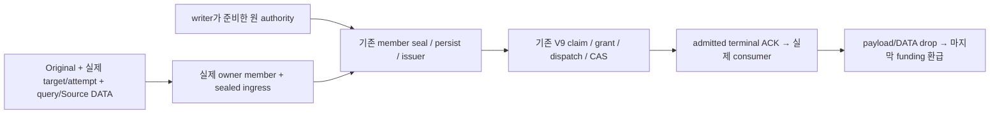
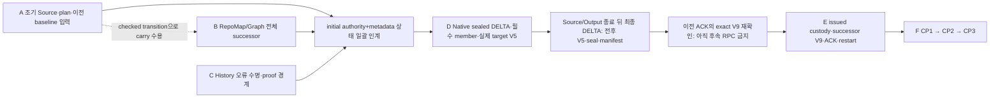

# E02 — 단일 게시·복구·custody·예산

상태는 [SSOT E02](README.md#e02). 원 요구 R01/R02/R05–R12와 종전 W2-01/02/03/04/07, W2-05의 C/D를 소유한다. 기존 canonical IR·Store/claim/decoder/ACK·writer/generation/vector/root·D exterior bank를 재사용한다.

## Actual publication join

공개 initial FULL과 Runtime delta는 별개 입구다. FULL은 기존 `SourceBoundFinalAssemblyIngressV1`→`PreparedSourceBoundPublishBatchV1`의 request·projection/chunk/RepoMap·completeness·required handoff/member를 기존 aggregate preparation/issuer로 인계한다. delta는 `NativeReplayMetadataStageV159`의 paid request·실제 accepted receipt·plan/lender를 소비한다. metadata durable만으로 FULL authority나 publication을 증명하지 않는다. 아래 writer bank는 해당 입력 계약이 맞는 실제 caller에서 재사용하며, FULL-only 입력을 delta에서 합성하지 않는다.

Root는 delta의 E01 전체 writer 수락 후 같은 initial writer serial에서 parent pin→기존 reconciliation highest/finisher→반환된 원 paid request의 manifest normalize/digest→manifest 순서 stage→settled generation→FinalDocs/witness→generation0 receipt→같은 FinalDocs vector 검증→FullSearchPlan을 결합한다. 이후 immutable artifact와 generation/host token을 결속한 prepared receipt·기존 authority를 완성하고 initial serial을 해제한다. P는 bank와 owner 회귀를 소유한다. initial 준비 중 serial 해제/재획득·request 선소비/재구성·receipt/root 순환·새 publisher는 허용하지 않는다.

FullSearchPlan 뒤 같은 serial에서 기존 V2 immutable artifact를 exact request와 admitted manifest의 실제 shard 선택으로 persist/readback한다. 이 file reference는 게시 권한이 아니다. root 준비 전에는 실제 expected generation·host token과 아래 prepared receipt digest를 결속해야 한다. 구체 인계 순서는 [웨이브의 E02 접합](WAVES.md#next-execution-batch)을 따른다.

Native artifact loader는 같은 decoded DTO와 exact ref/wire 검증 결과를 non-Clone `NativeCompletedPreparedArtifactReadbackV3`에 보존한다. Runtime exterior DATA가 wire·decoder·Original backing을 함께 보유하고 highest Source finisher 뒤에만 소비를 허용한다. Required 목록은 이 immutable owner에서만 빌리며 metadata 수집·seal 발급·출력 직전 binding 비교가 handoff 전체 검증을 반복하지 않는다. Raw DTO/ref/seal API는 전체 검증을 유지한다. seal은 실제 각 Required member owner 검증 뒤에만 발급하며 canonical 순서·개수·종류·digest와 prepared/handoff/seal 출력 슬롯을 대조하고 기존 DTO로 이동한다. 비교 work와 Original-funded output birth는 유지한다. ACK reader는 같은 DTO와 retained DATA를 함께 인계받고 DTO를 backing보다 먼저 해제한다. Dirty/Structural 재진입 거절은 validated 플래그만 닫으며 이전 prepared wire·DTO·grant를 교체하거나 해제하지 않는다. getter/take는 닫힌 상태로 유지하고 exterior DATA의 마지막 drop에서 환급한다. 이 proof는 영속 IR·Source·게시 authority를 발급하지 않는다.

Native persist는 artifact/frozen 검증과 같은 Original encoder를 결속한 private pair를 만든 뒤 immutable write를 수행한다. 저장 직후에는 기존 Original-funded wire reader로 실제 파일 전체를 다시 읽어 그 출력과 exact 비교한다. 사용하지 않는 두 번째 decoded DTO를 생성하지 않는다. 별도의 artifact load는 full decode/ref 검증을 유지하고, 기존 digest 파일명에 손상·잘림·초과 바이트가 있어도 persist 성공으로 간주하지 않는다.

Source closure의 private immutable issuer는 발급 당시 map과 canonical closure digest의 결속을 보유한다. 재검증은 snapshot·개수·정렬 경로와 실제 본문 digest를 빌려 비교하고, Native caller의 기존 Original work control을 통과한다. 전체 map/문자열/CBOR를 다시 만들지 않는다. 본문 재해시 비용은 O(전체 본문 bytes)이며 이 수정만으로 O(delta)를 주장하지 않는다. 공개 raw DTO와 영속 artifact는 전체 검증을 유지한다. Native prepared witness는 같은 Original Output group으로 기존 DTO의 vector·문자열·typed authority를 생성하고 기존 canonical binding 정책의 고정64bytes 결과만 Source 밖으로 가져온다. issuer가 최종 DTO와 backing을 함께 이동하며 마지막 payload drop 뒤에만 환급한다. issuer 앞단의 receipt/member 복사·검증도 이 계약의 대상이며, downstream store 회귀 통과로 upstream 생성 비용을 입증하지 않는다.

Native prepared artifact의 최초 canonical 게시·transfer marker·exact retry는 DTO의 일반 `Serialize` 대신 Contract의 `validate_and_native_fields_v3`를 같은 Original callback 안에서 호출하고, 반환된 non-Clone borrowed field view를 기존 Core encoder에 넘긴다. 전체 artifact 의미 검증은 한 번 수행하며 request/manifest/receipt의 검증된 필드는 기존 serializer field helper를 재사용한다. 공개 digest 함수의 입력 검증과 중첩 child guard는 유지한다. 별도 wire/codec/schema나 전역 skip-validation 정책은 추가하지 않는다. V2 prepared envelope도 기존 borrowed `IndexCommitRequestRefV3`의 같은 Native 검증 view를 사용한다. Runtime one-shot encoder facade는 callback 안에서만 존재하며 codec 결과를 exterior DATA에 직접 기록한다. callback의 `Ok(())`가 codec 거절이나 출력 누락을 성공으로 바꿀 수 없다.

canonical encoder의 완성/부분 bytes, validation attempt DATA와 typed result는 가장 바깥 Source보다 오래 유지한다. 성공 output은 validation DATA와 encoder backing을 소유하고 최종 Original group보다 먼저 해제한다. Source/allocator 원 cause를 관측한 뒤 Contract/codec 결과를 선택한다. 출력 bytes 일치·원16MiB·거절/최종 drop 검증 전에는 성능 또는 동작 완료로 판정하지 않는다.

dispatch custody는 source closure witness나 전체 delta plan을 복사·보유하지 않는다. endpoint host는 기존 불변 Arc를 유지하고, dispatch가 실제 소비하는 두 root·runtime epoch·pending owner identity만 보유한다. Native 필드는 같은 Original metadata group으로 생성하며 payload 뒤에 grant를 배치한다. pending plan은 최초 V9 전송과 uncertain transfer 재조정 때만 원 producer에서 빌리고, plan ID·attempt·owner token·workspace·generation·lease를 고정 identity와 대조한 뒤 기존 coordinator의 전체 plan/artifact/CAS 검증을 실행한다. borrowed row/plan은 반환된 dispatch나 RuntimeError custody에 들어가지 않는다. 이 비용은 source member/job 수가 아니라 root·identity 문자열 길이에 비례한다. 원 plan 검증·영속화 자체를 O(1)로 줄였다는 주장은 하지 않는다.

initial authority와 terminal root는 서로 다른 수명이다. 기존 `PreparedSourceBoundCommitAuthorityV2`는 receipt·delta/full plan·structured read view·observer token·owner witness·Native backing을 보유하며 prepared root를 보유하지 않는다. pending/V9/restart를 넘어 initial serial이나 미게시 root를 운반하지 않는다. terminal의 기존 artifact 재검증/replay가 새 terminal serial을 얻은 뒤 authenticated receipt의 generation/host token으로 Native root/discard candidate를 준비하고 기존 단일 CAS/activation을 소비한다. 기존 Native stage의 prior row도 원 Native payload/grant를 보유해야 한다. generic map의 Ordinary root retain 허용을 domain Native payload-copy 허용으로 해석하거나, COW 과정에서 Ordinary backing을 Native로 재표시하지 않는다. 이 terminal의 정상적인 새 serial은 initial 준비를 중간에 풀었다 재획득하는 우회와 구분한다. 기존 `prepare_publish_generation_native_v3`와 root bank를 terminal에 연결하며, Native 분기가 ordinary root 준비로 내려가는 경로도 함께 제거한다.

| 기존 값 | 결속하는 입력 | 의미 |
| --- | --- | --- |
| V2 artifact reference / content digest | exact request·staged structured/vector payload·witness의 기존 canonical file bytes | immutable 준비 파일의 위치·길이·hash. generation/host token을 포함한다고 간주하지 않음 |
| prepared receipt / prepared artifact digest | request·derived manifest·chunk receipt·실제 expected generation/host token·projection/vector/plan digest·기존 file reference | 기존 receipt의 논리적 게시 준비 identity. file hash나 root에서 역산한 값으로 대체하지 않음 |
| issued SourceBound authority | 위 prepared authority/receipt와 실제 required handoff/member·scope/fence | 기존 issuer→pending/V9가 소비하는 capability. 단순 file reference로 합성하지 않음 |

Native delta의 실제 consumer는 다음 세 owner를 함께 이동해야 한다. 현재 `InitialAuthorityPrepared`에서 authority만 따로 꺼내거나 Pending을 성공으로 바꾸면 종료 시 custody가 소실될 수 있으므로 완료 구현이 아니다. 제거한 bare-take API를 다시 만들지 않는다.

SDK Facts 경로의 실제 target과 Original snapshot은 존재한다. Native DELTA의 Source custody는 기존 committed FULL census의 유료 literal/witness와 실제 target을 함께 보유한다. 이는 aggregate 발급 입력이 완성됐다는 뜻은 아니다. accepted job outcomes와 shard receipts는 writer-persisted History/RepoMap/Structural/Dirty member capability가 아니다. 이 입력의 실제 생산·보존 경계부터 연결해야 하며, source witness를 FULL 재수집하거나 비어 있는 Required로 대체하지 않는다.

실제 DELTA query custody는 dirty 파일의 checked FileText/HIR/ItemIndex와 Chunk preplan을 보유한다. 준비된 `PreparedSourceBoundCommitAuthorityV2`는 successor의 final structured read view를 이미 보유하므로, 그 실제 투영 행을 기존 Original 유료 visitor로 빌리는 owner 확장이 우선 후보이다. Source custody의 literal/witness/target과 rail의 sealed aggregate host authority도 존재한다. 미접합 범위는 final rows에서 만드는 projection bindings·chunk units/kinds·pending records·completeness·retained ports, target-bound RepoMap bundle/issuer, ImportGraph target carry/admission을 같은 paid request·receipt와 묶는 DELTA batch producer다. raw predecessor query DTO 복원이나 별도 predecessor 재수집이 필수라고 단정하지 않는다. 기존 FULL batch preparer는 다시 stage하고 새 request를 발급하므로 그대로 재호출하면 원 DELTA authority의 exact-request 계약을 깬다. 유효한 batch와 member 입력이 준비된 뒤에만 원 authority/state를 한 번 이동한다.

격리 owning cohort의 추가 확인: final-view visitor는 같은 Output group을 검증하는 기존 `NativeProducerBirthV3::try_from_existing_output_v3`로 빌릴 수 있다. 그러나 행 방문만으로 `PreparedSourceBoundPublishBatchV1`의 query-owned RepoMap·ImportGraph capability가 생산되지는 않는다. `PreparedImportGraphRequestV3`의 Native owner에는 Initial/Carried origin만 있고 DELTA의 원 paid request를 빌리는 경계가 없다. authority 내부 `exact_request_v3`는 기존 Native terminal이 다시 읽으므로 batch로 단순 take하면 안 된다. Source closure witness 역시 현재 borrowed getter/Clone만 있으며 aggregate ingress에 필요한 paid owned 인계와 sealed target-bound publication authority는 별도 upper owner 접합이 필요하다. 기존 `ImportGraphPublicationAdmissionV1::from_authenticated_prepared_receipt_with_birth_v3`를 재사용하고, 새 request/digest/target issuer로 빈 부분을 채우지 않는다.

기존 FULL execution wrapper는 먼저 attach/prepare를 호출한다. member 검증/issuer는 prepared authority 경계로 분리돼 있고, V9/ACK tail도 batch-independent issued custody 경계로 추출해 실제 FULL caller가 사용한다. DELTA가 이미 가진 authority에서 이 두 경계로 진입하는 production caller는 아직 없다. final-row paid borrower·DELTA batch/request loan → 실제 target RepoMap/ImportGraph/ingress → prepared-authority V9/ACK tail 순으로 producer와 consumer를 함께 결합한다. 사용되지 않는 borrower helper만 추가하는 것은 이 절단의 완료가 아니다.

| 입력 owner | 기존 producer → consumer 계약 | 금지되는 대체 |
| --- | --- | --- |
| prepared authority | 실제 accepted job/paid request가 만든 `NativeReplayMetadataStageV159.initial_authority_v3` → aggregate owner. initial serial 종료 뒤 한 번 move | metadata에서 authority 재구성, writer prepare 재실행 |
| operation target | SDK caller의 실제 journal custody가 인증한 target/attempt → Original snapshot source에 1회 bind. snapshot/plan·workspace/contract·attempt를 함께 대조 | generic watcher에서 다른 SDK journal을 읽거나 host endpoint로 target 재발급 |
| Required aggregate members | 실제 History·Lexical/Structural/Dirty·RepoMap export authority·semantic/source-closure producer → 기존 member seal/persist/issuer → V9/opaque ACK | FULL 재수집, 빈 member, Delta request를 FULL ingress로 합성 |

기존 `prepare_ordinary_source_bound_aggregate_v2`의 attach/prepare와 이후 `prepare_source_bound_aggregate_with_authority_v3`의 member/issuer 단계를 분리한다. 후자는 이미 발급된 authority를 소비하며 attach/prepare를 반복하지 않는다. 실제 FULL 호출도 같은 member/issuer 단계를 사용한다. member I/O 전 canonical writer와 exact producer request·snapshot·publication intent를 대조하며, Native 요청 비교는 ACK admission과 같은 기존 Contract canonical encoder/Original work를 사용한다. prepared authority의 실제 Output group을 빌려 같은 Original과 대조하며 별도 sibling group으로 대체하지 않는다. 같은 birth를 source-closure witness 누락·불일치 진단에도 재사용하고 Work 거절 원인을 먼저 반환한다. 실패에서도 원 authority와 member batch를 기존 실패 carrier와 abort owner에 보존한다. 발급 이후에는 `ordinary_aggregate_prepare_v2/prepared_completion_v3.rs::complete_prepared_aggregate_to_acked_v3`가 기존 `IssuedPreparedAggregateDispatchCustodyV1`을 빌려 begin/reconcile V9→기존 phase 전이→dispatch→ACK reader를 실행한다. writer prepare나 FULL batch를 받지 않으며 pending/dispatch owner는 같은 sealed ingress에서 가져온다. 실패의 typed DATA와 실제 prepared owner는 호출자가 함께 보존한다. ordinary abort 불확실성도 `ordinary_abort_failure_v3`가 원 오류·abort 오류·exact custody를 하나의 Mutex owner에 유지한다. 이 분리만으로 DELTA caller가 연결됐다고 판정하지 않는다. 실제 DELTA member/authority 소비·V9·ACK는 별도 연결 대상이며, DELTA 입력을 FULL ingress/batch로 합성하지 않는다. generic `apply_verified_batch`에 SDK custody가 없다는 이유로 프로세스 전역 target을 재사용하지 않는다.

또한 전체 교체 `full_plan`과 실제 증분 `emission_plan`은 다른 입력이다. 기존 authority는 둘을 별도로 보유한다. 첫 generation의 동등성을 입증하지 않은 채 full plan을 delta plan으로 사용하거나, 작은 delta마다 full replay를 보내는 우회는 허용하지 않는다.

## DELTA 접합의 네 코드 절단

현재 판정·다음 조건은 [README E02](README.md#e02), 10/24 호출 경로와 검증 공백은 [코드 감사](VALIDATION.md#e02-code-audit-20261024)가 소유한다. 아래는 같은 잔여의 구현 계약이며 새 티켓/상태 원장이 아니다. 경로 prefix `R`은 Semantica `packages/analysis/quanta-v2/crates/quanta-runtime/src/`, `N`은 `R/coordination/change_event_recompute_invalidator/incremental_rail/native_delta_v3/consumer_v3/`, `W`는 `R/retrieval/port_impls/index_projection_writer/`다.

| 절단 | 기존 수정 경계 | 해야 할 변경 | 완료 오라클 |
| --- | --- | --- | --- |
| 1. 거절과 첫 I/O | `N/native_manifest_handoff_v165.rs::prepare_delta_initial_authority_v165`; `W/mod.rs::writer_for_prepared_source_bound_authority_v2`와 실제 Native caller | DELTA 메서드의 reattach보다 현재 Original·입력/상태를 먼저 검사한다. 정상 product 설치는 동일 root를 이미 attach하므로 전역 첫 open은 설치 owner의 별도 계약으로 검증한다. writer/store/epoch의 동일한 canonical 검증 정책을 재사용하면서 Native 거절의 일반 `String` 생성과 `.try_lock().ok()?`의 원인 소실을 제거한다. 별도 issuer·Source·예산은 만들지 않는다 | 잘못된 Original/상태·foreign writer·취소·work/memory 거절에서 member write/RPC0, 첫 typed cause와 모든 partial 보유. 정상 DELTA의 같은-root no-op과 설치 시 최초 open을 구분; field 주입/다른 root로 도달 불가 fixture를 만들지 않음 |
| 2. 실제 입력과 공용 member 경계 | `N/custody_v3.rs`의 completed-query borrower; `native_delta_v3/source_custody_v3.rs`의 literal/witness/target; `W/source_bound_projection_assembly/authority_assembly/ordinary_aggregate_prepare_v2.rs`와 기존 owner pipeline | 실제 operation/attempt의 sealed ingress와 실제 History·SearchPlane·RepoMap capability를 생산/보존해 넘긴다. `PreparedAggregateOwnerPipelineInputV1` 등 기존 typed member 입력과 필요한 borrowed fields를 재사용한다. FULL wrapper 전체를 요구하는 함수만 분리한 것으로 DELTA API를 완료 처리하지 않는다. 실제 producer가 없는 입력은 생산 경계부터 연결 | 실제 DELTA caller가 각 필수 member owner까지 도달하고 scope/target/fence·source closure가 일치. 없는 member·합성 FULL batch·FULL 재수집·빈 Required로 통과시키지 않음 |
| 3. authority와 상태의 이동 | `N/native_manifest_handoff_v165.rs`의 실제 준비 전이; `N/replay_metadata_handoff_v159.rs::retains_prepared_initial_authority_v159`; `N/entry_handoff_v130.rs::InitialAuthorityPrepared` | 원 authority와 Source/accepted query/outcomes를 기존 aggregate custody에 한 번 인계한다. 이동 직후 요청/authority 슬롯이 비는 것을 유효한 issued/transfer 상태와 함께 표현한다. 실패/불확정 전송은 기존 whole-failure/abort/reconcile owner가 보유한다. bare take만 호출하거나 메타데이터에서 재구성하지 않는다 | 두 번째 소비 거절, move 뒤 허위 pending/성공 없음, uncertain insert에서 같은 identity로 reconciliation, payload가 payer보다 먼저 drop. initial serial/borrow가 await·V9를 넘지 않음 |
| 4. V9·terminal·재시작 | 기존 `begin_v9_transfer_v2`/`reconcile_v9_transfer_v2`·coordinator/native transfer; `N/entry_handoff_v130.rs`; `incremental_rail/native_delta_v3.rs::stage_native_handoff_for_entry_v130`; `core_invalidator.rs`의 실제 committed-source consumer | 실제 issued members를 기존 V9/dispatch/root/CAS에 연결하고 admitted terminal custody를 최종 consumer까지 보존한다. `RestoredNeedsReconciliation`의 실제 operation 재진입을 같은 attempt/target의 exact replay로 연결한다. PUB의 공개 ACK parent는 기존 담당이 결합한다. NativeInitialPending을 TerminalPending으로 바꾸는 상태 치환은 금지 | 진짜 terminal receipt가 있어야 committed-source continuation/checkpoint가 진행. restart·ACK 유실에서 재stage/새 operation/중복 CAS0. unbound Dispatching은 Pending, bound exact replay와 마지막 환급을 함께 수용 |

현재 DELTA census의 files·closure witness·target getter는 실제 source keeper에서 빌릴 수 있다. 결손은 이를 Native DELTA publication/BoundV2 owner와 완전한 RepoMap successor export authority·bundle에 결합하는 공급 API다. 현 `try_issue_native_publication_v3`는 initial FULL만 검증하고 `try_bind_change_event_pending_v2`는 Native를 거절한다. 이 결손을 census 전체 부재, DELTA member 연결 완료, 또는 FULL batch 재구축 필요로 바꿔 쓰지 않는다.

기존 structured writer의 `begin_native_delta_stage_transaction_v3`는 published parent root에서 변경 scope만 교체하고 나머지 scope를 승계한다. 준비된 authority의 final read view를 우선 재사용하고, 기존 generation lease/chunk seam 인증이 필요한 경계에서만 빌린다. canonical DELTA batch는 이 실제 successor rows와 Source closure/target·원 request/accepted receipts를 결속해야 하며, 전량 raw query DTO 복원이나 두 번째 FULL projection을 전제하지 않는다. RepoMap authority는 target snapshot·전체 ItemIndex 수·closure에 묶이므로 predecessor 것을 replay하지 않는다. FULL batch를 다시 stage하거나 새 request를 발급하지 않고 기존 owner의 successor state·RepoMap·ImportGraph 발급 경계를 확장한다. paid row visitor의 존재만으로 batch producer나 O(delta) 비용을 입증하지 않는다.

completed Chunk 입력은 `N/custody_v3.rs::try_with_completed_chunk_inputs_v3`가 기존 query bank를 scoped 대여한다. 이 bank의 FileText/HIR/ItemIndex를 없는 데이터로 재발급하지 않는다. 다만 checked `&ItemIndexOutput`만으로 기존 verified map admission을 충족하지는 않는다. 실제 `NativeChunkQuerySourcesV3.item_v3`의 verified carrier와 read context를 같은 owner가 보유한 채 canonical map owner에 전달하는 계약이 필요하고, ImportGraph/CallGraph의 실제 sideoutput은 별도로 결합해야 한다. 이 입력이 없는 상태에서 authority만 take하거나 raw map/default member로 통과시키지 않는다.

코드 합류 뒤 같은 owner checkpoint에서 실제 Delta 입력/필수 member, 요청·writer·Original 불일치, move/이중 소비, initial claim/restart takeover, stale epoch/revision, uncertain V9 재조정, ACK custody, 취소·panic/unwind·최종 환급을 묶어 검증한다. 요청 비교 helper의3개 테스트는 이 통합 오라클을 대체하지 않는다.

기존 Linux5 cut은 그대로 재사용하되, 새 DELTA member/authority 경로를 실행했다는 proof로 치환하지 않는다. 실제 committed-source successor DELTA의 member/issuer/V9/terminal 진입과 동일 attempt 복구를 별도 scenario로 기존 owner target에 추가한다. 설치 입력 누락은 해당 process gate만 막으며 위 네 코드 절단을 막지 않는다.

### 이 채팅의 코드 마감 순서와 종료 판정

아래는 네 절단을 실행하는 순서이며 새 티켓·진행률·담당 원장이 아니다. 현재 상태는 README E02, 수정권은 [exact hunk 경계](OWNERSHIP.md#delta-integration-hunks), 소스 관찰과 실행 결과는 VALIDATION에만 기록한다. 다른 채팅에 메시지·질문·추가 배정을 하지 않는다. 기존 producer의 구현을 읽고 소비하며 같은 함수를 새 담당에게 재배정하지 않는다.

| 순서 | 이 채팅이 끝낼 코드와 입력/반환 계약 | 재사용하는 기존 owner / 구현 경계 | 종료 조건 |
| --- | --- | --- | --- |
| 1. 실제 operation 입력 인증·보유 | 실제 host/attempt/epoch·change-event pending binding·History Git revision·Source closure/target과 completed Chunk query의 verified carrier/context·Graph sideoutput을 사전 대조하고 원 owner에 보유한다. paid sealed ingress의 실제 생성·결속은 순서2의 상태 이동 뒤 순서3에서 수행한다 | 기존 host의 `issue_change_event_publication_v2`·pending binding과 `SourceBoundAggregatePublicationIngressV2`; Source census·query/context bank는 기존 E01 owner의 반환을 소비 | repo/snapshot/target/plan/attempt/epoch가 모두 일치. 범위가 다른 host·predecessor witness·결손 sideoutput은 member I/O 전에 거절. 일반 clone constructor를 Native after-Source 경로에 그대로 추가하지 않음 |
| 2. authority/state 단일 이동 | member 준비 진입 전에 initial authority와 기존 drain/metadata·Source/query/outcomes를 동일 preparation custody로 한 번 이동한다. 이미 제거한 bare take를 복구하지 않는다. `InitialAuthorityPrepared`가 보존한 metadata·authority를 함께 소비하며 retained-pending을 깨뜨리지 않는다. member/issuer 성공 뒤에는 발급된 dispatch custody만 순서4에 넘기며 initial authority를 다시 take/prepare하지 않는다 | `entry_handoff_v130.rs`, `replay_metadata_handoff_v159.rs`, `native_manifest_handoff_v165.rs`, 기존 owner pipeline과 retained failure bank | 재소비 거절, 이동 뒤 허위 Pending/성공 없음. issuer/persist 실패도 payload/원 typed cause·abort/reconcile 책임을 보유하고 불확정 insert는 동일 identity로 조정. initial serial/borrow는 await·V9 전에 종료 |
| 3. DELTA member·target V5·최종 검사 | 준비된 authority의 structured view와 E01의 실제 successor 반환으로 SearchPlane·RepoMap·ImportGraph를 결합하고 History도 실제 Git revision으로 기존 owner에서 준비한다. 공통 member suffix/issuer로 target V5를 발급한 뒤 Source/Output를 닫고 baseline·target·seal·manifest 최종 검사를 실행한다 | `PreparedAggregateOwnerPipelineInputV1`, 기존 History/SearchPlane/RepoMap prepare·export authority·ImportGraph admission; 새 publisher/serializer/전역 registry 없음 | 실제 Required payload·독립 producer authority·same-request binding과 이전 ACK의 exact V9 재확인이 모두 충족. unchanged 승계·최종 closure는 독립 gold와 일치. 실패 시 미게시 payload/원 cause와 abort 책임 보존. predecessor authority 재사용·dirty-only FULL·FULL query 재수집 없음 |
| 4. 실제 V9·terminal·exact restart | issued dispatch를 기존 coordinator의 begin/reconcile/claim/dispatch/CAS에 연결한다. admitted ACK와 Native backing을 실제 committed-source consumer·checkpoint cleanup까지 운반한다. restored entry는 같은 operation/attempt/target의 durable phase로 재진입한다 | `stage_native_handoff_for_entry_v130`, 기존 `begin_v9_transfer_v2`/`reconcile_v9_transfer_v2`, coordinator Native transfer/closeout, `RuntimeOwnedTerminalPublicationPendingV1`과 `core_invalidator.rs`의 Native consumer hunk | 진짜 terminal evidence 이후에만 continuation/checkpoint 진행. 재stage·새 key·새 target·중복 visibility/CAS 없음. unbound Dispatching은 Pending, bound dispatch/ACK 유실은 exact replay, 마지막 DATA drop 뒤 원 funding 환급 |

이미 연결된 DELTA attach 전 입력 gate, Native History 준비/보존, FULL에서 사용하는 공통 member suffix, typed writer/uncertainty bank는 재사용한다. 최신 결합 코드의 컴파일·동작은 아직 수용되지 않았다. 아래 A–F는 위 네 절단의 구체 실행 묶음이며 별도 티켓·상태 원장이 아니다. 현재 판정은 README E02, 실제 수리·검증과 잔여 호출 경로는 [최신 checkpoint](VALIDATION.md#e02-wave-structural-audit-20261026)에 둔다. 이전 source의 감사는 그 당시 관찰로 보존한다.

다음 세 코드 묶음은 아래 B→D/A→E의 실제 접합 지점이다. 새 티켓·담당·상태 원장을 만들지 않는다.

1. **B / E01 공급:** `NativeRuntimeHandoffCustodyV3::try_with_completed_chunk_inputs_v3`의 checked 입력 대여와 실제 complete successor 반환을 구분한다. 기존 Source/query owner가 동일 operation·target·closure의 전체 successor와 target-bound RepoMap export/issuer·ImportGraph carry/admission을 보존해 반환해야 한다. unchanged·dirty·delete를 포함한 전체 결과의 독립 FULL gold가 종료 조건이다. 입력 getter나 inventory transition만으로 이 반환을 충족하지 않는다.
2. **D/A / E02 member·target V5:** `prepare_delta_initial_authority_v165`의 입력 검사를 재사용한다. 현재 `InitialAuthorityPrepared`가 authority·metadata를 같은 custody에 유지한다. member consumer가 이 owner를 함께 한 번 이동하며 bare take를 새로 만들거나 Pending을 깨뜨리지 않는다. 실제 `ExactAggregateMemberPrepareInputV3`를 `prepare_exact_aggregate_members_with_authority_v3`에 전달하고 DELTA 분기·target V5 발급·Source/Output 종료 뒤 최종 검사까지 생산 caller가 도달해야 한다. 늦은 거절은 미게시 member·원 cause·abort/orphan 책임을 보존한다.
3. **E / E02 terminal:** `stage_native_handoff_for_entry_v130`와 `retains_pending_publication_v159`의 기존 상태를 issued dispatch 인계에 결속한다. 최종 검사·이전 ACK exact V9 재확인 뒤에만 기존 begin/reconcile V9와 committed-source consumer로 이동한다. 동일 operation/attempt/target의 ACK 유실·재시작에서 재stage·중복 visibility/CAS가 없고 마지막 DATA drop 뒤 환급되는 것이 종료 조건이다.

**B의 필수 선행 계약:** dirty checked loan과 process-local managed map만으로 complete predecessor를 재취득할 수 없다. 기존 exact transition lease·source seal/committed query authority 재인증은 재사용하지만 completed replay는 lexical/semantic member뿐이다. Original live-output routing의 FileText/일부 SemanticModule·ItemIndex nonpersisted 경로와 durable readback은 별개다. ItemIndex live 지원은 memo entry를 만들지 않으며 memo hit의 ordinary-context guard와 index-only wire는 parent HIR/source custody를 복원하지 못하므로 unchanged Native artifact 재취득의 대용이 아니다. [W0의 보존 방식 결정](WAVES.md#e02-residual-wave-plan)에서 기존 source/query owner 안의 권한 있는 per-file 보존/readback 또는 sealed source+canonical recipe 재실행 중 하나를 확정하고 artifact·restart·GC·work 비용을 함께 고정한다. cold 전체 재질의는 작은 DELTA/O(delta) 수용이 아니다. 유효한 retention/pin 중에는 exact predecessor를 현재 genuine Original/RuntimeCtx로 재인증하며, 회수된 generation은 typed unavailable→허용된 Resync/rebuild 또는 명시 거절이다. operation/attempt/target·원 cap/policy를 바꾸지 않는다. map/projection/embedding/RepoMap 소비자는 같은 checked owner 계약을 사용한다.

**live 공급 계약:** SDK map 삽입·Native evidence/structural·retained port caller는 재사용한다. 아래는 고정 계약이며 현재 연결/미연결 판정은 README E02·최신 VALIDATION을 따른다. canonical portable FULL 선택과 HIR/ItemIndex Args helper가 있어도 loader가 ordinary Args를 계속 사용하면 Original query는 거절된다. 실제 authenticated RuntimeCtx/session·같은 Original/file/target을 공급하여 helper→query→whole ExecutionResult를 연결하고, Clone 원 owner의 공통 선택 전환·bind typed cause 관측도 마감한다. FileText의 기존 selected Args/selection birth와 whole query bank는 유지한다. RepoMap은 기존 canonical state를 여러 nonnested checked loan에 이어 쓰되 per-loan Current/target 인증과 최종 finisher 후 hash authority를 실제 Graph/RepoMap caller에 연결한다. helper/state-only 구현은 B2 공급 완료가 아니다.

[W1 공급·SDK 소비→W2.0–W2.2 실행 배치](WAVES.md#e02-residual-wave-plan)와 [private hunk 경계](OWNERSHIP.md#e02-supplier-hunks)를 따른다. whole query failure는 기존 Runtime Send-only retained bank에 query 전에 사전 수용하고, Origin/Source finisher와 body/physical 원인을 exterior DATA에 함께 유지한다. 단순 finite RuntimeError 매핑만으로 whole OriginalNativeContextAdmission custody를 보존했다고 판정하지 않는다.

기존 FULL·History·Store·encoder·ACK를 다시 구현하지 않는다. 위 코드 접합의 영향 검증과 기존 회귀 대기 목록, 설치 제품 복구 수용은 아래 CP1–3에서 각각 판정한다.

| 묶음 | 실제 해야 할 변경 / 반환 계약 | 독점 범위와 선행 조건 | 끝났다고 판정할 조건 |
| --- | --- | --- | --- |
| A — 실제 Source 전이·이전 baseline | 기존 admitted baseline/V5 proof pair·Required DATA·post-finisher manifest borrower·cold/FULL admission을 재사용한다. 적용된 Original replay-validation typed 오류·V9/recovery 선확인은 영향 검증으로 수용하고, D의 실제 target V5·seal·manifest를 최종 DELTA scoped continuation에 연결한다 | Kernel 검증 private body와 Runtime receipt/readback private body는 분리. coordinator·cold facade·FULL/DELTA pipeline 호출과 export는 Root가 직렬 결합. Source issuer·E01 query/context·기존 FULL producer body와 PUB SDK parent는 원 owner 보존 | A 단독: first-FULL retry와 SDK cold가 필수 admitted baseline을 실행하고 ordinary V5/SQL/decode 우회·proof 없는 loan 발급이 없음. A+D 결합: 실제 전후 artifact/manifest·base/ACK/active-head/transition을 최종 검사하고 이전 V9 exact 재확인 후에만 successor V9로 진행. 조기 거절과 target V5 뒤 거절의 시점은 아래 계약으로 구분 |
| B — 완전한 RepoMap/Graph successor | 기존 map의 Native checked owner 계약은 E01/원 query owner가 소유한다. unchanged per-file ItemIndex의 generation-bound typed 보존/재취득·current Original/target 재인증과 소비에 필요한 parent HIR/source custody, dirty owner 교체·delete 제거, 동일 target Graph/Call carry를 반환한다. E02는 완전한 map을 기존 Native RepoMap builder/export issuer에 전달한다. 전체 U HIR durable memo를 새 선행 필수로 만들지 않는다 | managed map/visitor·SDK 삽입·paid J planner/emitter·Native metadata/outline/batch/binding의 연결분은 재사용한다. SDK raw→policy→views→artifact 소비는 이미 연결됐으며 genuine nonempty raw 회귀와 동작 수용이 남는다. unchanged typed owner의 durable 재취득은 코드 결손이다. finalizer가 소비한 export bundle·ranked RepoMap·V9 metadata만으로 future ItemIndex owner를 복원할 수 없다. E01의 실제 반환 ABI 후 consumer를 결합하며 unused adapter로 공급을 대신하지 않는다. A와 독립 private 준비는 병렬, carry 정합성은 checked transition 이후 수용 | unchanged sibling·rename/delete/no-op/restart의 전체 결과가 독립 FULL gold와 일치. 지원되는 pinned/retained DELTA에서 predecessor target export authority 재사용·SCV2 행→raw DTO 복원·FULL query 재수집 없음. expired predecessor의 typed 거절/기존 Resync 전이·최종 pin 해제·GC 진전도 검증. canonical 전체 map digest의 순회/직렬화 비용도 과금·기록하며 O(delta)를 추정하지 않음 |
| C — History 구현 재사용·영향 수용 | 구현된 caller-owned factory/IPC 슬롯, frozen-field 보존, kernel-owned canonical 비교와 production/recovery 호출을 재사용한다. Git/파생 route·encoder·batch→issued custody를 다시 만들지 않는다. 잔여는 결합 Runtime owner에서 오류/취소/unwind·최종 drop과 실제 DELTA 소비를 실행 검증하는 것 | `history_handoff_dispatch{.rs,/native_git_capture_v3.rs}`, retrieval-kernel `history_prepare_v1{.rs,/borrowed_validation_v3.rs}`의 기존 owner. 새 History 엔진/codec 없음. batch/pipeline 필드는 Root가 직렬 결합. A/B와 private body는 병렬 가능 | canonical ordinary 결과·정확한 wire/digest 동일성, altered wire 거절, same/foreign Original·work/memory/cancel·unwind·최종 환급. 현재 production 비교가 틀렸다고 단정하지 않으며 proof 발급 경계 자체의 생략 가능성을 회귀로 막음 |
| D — sealed DELTA와 공통 member 호출 | 초기 authority+metadata 상태를 동일 preparation custody로 한 번 인계한 뒤 실제 host/attempt authority·pending binding을 Native paid ingress에 결속한다. A/B/C 입력과 그 authority를 `prepare_exact_aggregate_members_with_authority_v3`에 전달해 genuine target V5를 발급한다. 지원 change-event의 실제 committed producer 입력도 요구한다 | A/B의 genuine 입력 필요. `native_manifest_handoff_v165`, `aggregate_publication_ingress_v2`, `ordinary_aggregate_prepare_v2`의 DELTA caller만 Root가 수정. FULL attach/prepare·witness와 SDK parent는 기존 담당 | Native ingress와 `BoundDeltaPlan` 분기가 실제 생산 호출에서 실행. 조기 request·host·repo/snapshot·plan·target/fence 불일치는 member write/RPC 전에 거절. target V5/Required receipt의 최종 거절은 member 쓰기 후·successor V9 이전이며 abort/orphan 책임 유지. target 자체 검사를 host-target 동등성 증명으로 과장하지 않음 |
| E — issued custody→V9→ACK/restart | D의 실제 issued dispatch custody를 소비한다. initial authority는 D에서 이미 소비했으므로 다시 take/prepare하지 않는다. 최종 checker·Source/Output finisher·이전 ACK의 exact V9 재확인 성공 뒤 기존 begin/reconcile/claim/dispatch/CAS와 terminal consumer를 연결한다. `RestoredNeedsReconciliation`도 같은 operation/attempt/target의 durable phase로 재진입 | D와 같은 Root 한 writer. `entry_handoff_v130`, `replay_metadata_handoff_v159`, pipeline/coordinator·`core_invalidator`의 Native hunk만 결합. P generation/root·PUB 공개 ACK parent 재작성 없음 | authority 이중 소비 거절, uncertain write 동일 identity 조정, ACK 전 continuation 금지, unbound Dispatching 유지, bound replay·ACK 유실 뒤 중복 stage/CAS0, 마지막 payload/DATA 후 funding 환급 |
| F — 영향 검증·제품 수용 | 최종 결합 CP2는 CP1 뒤 고정 Source의 기존 owning QBC에서 영향 module을 일괄 실행한다. 비영향/독립 private 회귀는 자체 Source에서 선행 가능하며 합류 후 바뀐 closure만 재검증한다. CP2가 통과하면 Linux installed worker의 기존 Facts2/first-FULL3와 별도의 genuine DELTA 복구 scenario를 수용한다 | 같은 host heavy 실행은 기존 큐로 직렬화. E01의 R46/R47·writer 검증, SEARCH/PHYSICAL의 원4K/성능을 복제하지 않음. 아래 CP1–3의 원 oracle 유지 | compile/선택/실행 본문·owner 결과·process 수용을 각각 기록. 설치 provenance 부재는 CP3만 BLOCKED. 통합 전 snapshot 실패나 FULL5 cut을 최신 DELTA 증거로 승격하지 않음 |

**A의 단일 합류점:** 기존 `with_revalidated_acked_native_source_v3`/`revalidate_acked_checkpoint_admitted_v3`의 Lexical callback에서 실제 `OriginalRequiredArtifactReadDataV3`와 private Kernel terminal loan을 소비한다. `required_data.validate_contract_join_v3(actual_original, |artifact, admission| ...)` 안에서 admitted baseline을 검증한다. Source finisher의 첫 typed cause 확인 → terminal checkpoint → 최종 exact V9 재읽기 이후에만 성공을 노출한다. callback에 검증을 맡기는 no-op 우회가 없도록 공통 경로가 이 필수 검사를 소유한다. first-FULL retry와 `quanta-sdk-runtime-executor/.../retained_sdk_mutation_restart_v1/phases_v1.rs::ensure_checkpoint_v1`의 Native cold 복구가 모두 이 경로를 소비한다. cold 함수 자체는 live이며 삭제하지 않는다. stale baseline visitor만 공통 검사로 대체하고 그 함수의 source/pin/checkpoint 동등성 검사는 유지한다.

**A의 Native 비용 경계:** work callback을 ordinary validator에 붙여도 Native allocation으로 바뀌지 않는다. `validate_native_source_artifact_admitted_v3`는 기존 `validate_and_native_fields_v3`와 V5 검사로 opaque proof를 발급하며 Native baseline/DELTA는 그 정책을 소비한다. FULL도 같은 pure predicate를 재사용하되 Native artifact proof와 실제 work를 전달하고 prep/persist/recovery·dispatch의 무과금 재검증을 제거한다. FULL 전용 empty-head와 DELTA의 exact active-head/base-generation 비교는 구분한다. 두 artifact proof를 실제 Source에서 각각 검증한 뒤 Source loan을 닫고, 메모리 예약을 포함하는 DELTA checker를 실행해 재진입을 피한다. callback의 `Ok(())`나 공개 skip bool로 proof를 만들 수 없다. 불가피한 전수 방문·중복 decode 비용은 과금하며 예산을 올리지 않는다.

**Original 오류 경계:** `original_native_memory_scope_v1/replay_validation_v3.rs::with_original_replay_validation_v3`의 callback 부재와 lower validation 오류는 같은 Original의 typed cause 또는 기존 static retained 오류로 전달한다. Native 경계에서 `format!`·ordinary `CommitRejected(String)`을 새로 만들지 않는다. 기존 `map_original_store_refusal_v3`의 다른 호출자·ordinary oracle를 전역 치환하지 않는다. pipeline의 V9/recovery는 실제 Original이 있으면 missing issued/seal·semantic mismatch를 선택하기 전에 sticky first cause를 확인한다. Original이 없는 입력은 기존 typed 부재 오류로 거절한다. 이 수리는 FULL-only predicate를 DELTA 지원으로 바꾸는 작업이 아니다.

**A의 cold Native 조회:** 기존 `open_existing_native_replay_v3`·`load_acked_source_bound_replay_identity_admitted_v3`와 query-attempt-resolution의 retained DATA 방식을 재사용한다. installed worker config는 실제 host provider에서 전달받는다. 임의 env/path·별도 SQL enum/codec·ordinary store fallback을 추가하지 않는다. 기존 NativeReplayQueryV1 closed AST/worker에 completed-generation metadata와 completed V9의 고정 statement/variant를 추가하는 것은 같은 canonical readback owner의 확장이며 새 저장소나 우회 경로가 아니다. metadata 후보 선택과 full V9 canonical 승인·same-Original custody를 별도로 검증한다. pin/generation identity의 문자열 생성도 같은 Original 비용 계약을 적용한다. 설치 입력 누락은 해당 실행 수용만 BLOCKED이며 이 Native 코드 접합을 생략하는 이유가 아니다. SDK manifest bank를 다시 읽는 별도 `transition_read_v3` helper는 재도입하지 않는다.

**A의 실제 입력 가용 시점:** 조기 Source/plan/target·이전 baseline 입력 gate와 최종 DELTA 검증은 같은 실행 시점이 아니다. `check_native_source_delta_with_work_v3`가 요구하는 target V5는 D의 Required member persist와 기존 aggregate issuer 뒤에야 존재한다. 따라서 조기 gate → B/D 실제 입력·member → target V5 발급 → 최종 DELTA 검증 → E V9 순서다. final checker를 D의 선행 조건으로 두면 순환이며 임시 target artifact로 해소하지 않는다. 최종 검증은 FULL의 `native_preparation_for_transfer_v1`에 대응하는 artifact 발급 후·V9 이전 절단에 연결한다. 늦은 거절 뒤에는 이미 쓴 immutable member/issued custody를 기존 abort·orphan/reconcile 경계에서 회수하며 visibility나 새 key로 우회하지 않는다.

**A의 Source 종료와 proof 인계:** `validate_contract_join_v3`의 내부 callback은 활성 Source 안이다. 여기서는 실제 artifact/terminal의 proof만 발급하고 메모리 예약·다른 Original work/Source를 호출하지 않는다. mandatory baseline 검증은 같은 실행에서 발급한 V5 artifact/baseline proof pair를 보유하고 Source 종료·최초 cause 확인 뒤에만 scoped continuation에 대여한다. Required DATA의 안정된 artifact borrow에 lifetime을 결속하고 terminal loan·admission 자체는 callback 밖으로 반환하지 않는다. target V5 proof도 실제 Source를 닫은 뒤 소비한다. 최종 DELTA checker는 외부 terminal visitor에서 실행하고 coordinator의 마지막 exact V9 비교까지 통과해야 결과를 반환한다. 추가 baseline 재검증·두 번째 read·public skip flag는 만들지 않는다. 이 lifetime/비재진입 계약은 실제 Runtime 컴파일과 genuine fixture로 판정한다.

최종 checker의 성공만으로 visitor 안에서 후속 successor V9 stage·dispatch/publication RPC·visibility를 실행하지 않는다. D에서 genuine target V5를 만들기 위한 선행 immutable member persist/prepare는 이 금지와 구분하며 실패 시 기존 abort/orphan custody가 책임진다. checked target 결과는 retained outer custody에 보관하고 Source/Output finisher·최초 cause·이전 ACK의 coordinator exact V9 재읽기가 모두 성공한 반환 뒤에만 E가 소비한다. 그 전 실패는 D의 prepared/issued payload와 원 typed cause를 기존 abort/reconcile 경계에 유지한다.

**A의 manifest 인계:** `ClosedNativeSdkSourceManifestV3`는 highest Source 이후의 manifest와 funding을 보유한다. `borrow_sdk_source_manifest_after_output_v3`는 같은 owner·operation/output를 실제 Output에서 재인증하고 enclosing Source/Output finisher가 성공한 뒤에만 owner lifetime에 결속한 참조를 반환한다. 이를 다시 읽거나 복사하지 않고 활성 Output 안에 ACK/readback/checker를 중첩하지 않는다. 실제 pre-attach 입력 gate는 SDK binding과 이 manifest의 transition/target을 비교하며 한쪽만 존재하면 거절한다. 최종 DELTA checker도 이 대여 계약을 소비해야 한다. funding-last와 원 typed failure를 유지하며 neutral funding marker만으로 Source/Output 권한을 발급하지 않는다. SDK manifest가 없는 지원 change-event는 원 producer의 실제 transition 반환을 요구한다.

**Lexical seal 계약:** Native FULL/DELTA는 V5 proof만으로 Q batch의 의미 검증을 생략하지 않는다. Kernel이 기존 Q shape·funded borrowed surface scratch·canonical unit-set hash·정확한 CBOR 비교를 수행한 뒤 private move-only `NativeValidatedLexicalBatchSealV3`를 발급한다. 같은 frozen wire의 과금된 length/BLAKE3 비교로 seal을 결속하고 ordinary 집합 할당 경로를 사용하지 않는다. Runtime의 검증된 Required DATA는 seal을 보유하며, Fresh 준비도 실제 batch/wire/target/Original에서 같은 issuer를 실행해 member 영속 쓰기 전에 보유한다. initial/V9는 그 seal을 재사용하고 recovery/dispatch는 readback seal을 대여한다. 원 wire/schema/serializer는 유지한다. Fresh 추가 검증·wire 재방문 비용은 기록하며 예산 증액이나 공개 skip flag로 줄이지 않는다.

**B의 선행 계약:** dirty query bank의 한 파일 checked ItemIndex와 완전한 successor map을 구분한다. `OrdinaryItemIndexOwnedV3`의 ordinary 변환으로 Managed carrier를 공급하지 않는다. map 노드만 Native로 조달해도 값의 owner 계약은 충족되지 않는다. 기존 map을 scoped checked read로 이행하고 canonical builder/encoder는 재사용한다. ItemIndex와 HIR 양쪽의 genuine carrier·RuntimeCtx·receipt/permit 수명을 연결하며 HIR metadata는 기존 authenticated read를 소비한다. raw DTO iterator의 참조를 callback 밖에 보관하지 않는다. 원 생산자가 Native checked owner·완전한 target map·target `SourceBoundImportGraphAccessV3`·retained CallGraph+query custody·successor Chunk docs/count/closure를 반환한다. `authority_finalize.rs`가 현재 소비하는 RepoMap bundle은 다음 generation용 typed owner 보존으로 간주하지 않는다. unchanged 공유의 generation 결속과 restart 재취득도 공급 계약에 포함한다. inherited structured rows로 ItemIndex 전체 원본 필드를 역변환하지 않는다. ImportGraph inventory 변경에는 실제 target graph가 필요하다. 공급 반환 계약 없이 full query 수집기·fake target authority·사용되지 않는 adapter를 만들지 않는다.

**구현/재사용 경계:** Native paid ingress는 이미 있으나 생산 caller가 없고, History Native factory는 FULL 공통 suffix에 연결돼 있다. 이를 새로 만들지 않는다. bound Source witness를 가진 ingress의 `Clone`은 owned map을 깊게 복사할 수 있으므로 실제 Native 소비 경로에서는 move/paid alias를 사용하고, FULL witness/caller 변경은 원 담당 범위로 남긴다. Source FULL checker는 첫 generation 전용이다. DELTA에서 source mode 문자열만 바꾸거나 dirty subset을 full closure로 승격해 우회하지 않는다. A/B의 잔여 private 구현과 C의 영향 검증 준비는 병렬화하되, A의 검증된 변경 집합·전후 closure로 B의 carry 정합성을 수용한 뒤 D로 합류한다. 공용 서명·pipeline·state는 Root가 한 번 결합한다.

**sideoutput과 비용의 완료 조건:** ImportGraph transition/carry는 실제 producer가 발급한 것을 소비한다. SDK callback이 채우는 inventory transition은 재사용하고 carry pin/완전 successor의 공급과 따로 판정한다. raw query output에서 authority를 제조하지 않는다. successor RepoMap의 snapshot·projection version·total ItemIndex count·closure를 원 export owner가 재결속한다. unchanged rows 승계와 changed projection만으로 올바른 결과를 만드는 것과 비용이 변경량에 비례하는 것은 별도 판정이다. 필요한 전체 aggregate digest/검증 순회가 남으면 방문 rows/bytes를 포함해 기록한다. full Source census 비용은 E01에 귀속하되 통합 총비용에서 제외하지 않는다. 원16MiB·work/자원 상한을 늘리거나 비용을 다른 단계로 숨겨 성능 수용을 선언하지 않는다.

검증 계약은 아래 [단일 CP1–3 표](#e02-checkpoint-acceptance)만 유지한다. 코드 마감은 실제 순서1–4와 CP1, 동작 수용은 CP2·CP3로 각각 판정한다. E02 완료를 전체 E01–E08·성능·CI/release 완료로 승격하지 않는다.

전체 committed FULL의 본문을 복사/해시하는 Source census 비용은 [E01 source owner](OWNERSHIP.md#native-query-closeout-writes)가 소유한다. 이 채팅에서 두 번째 census/증분 엔진을 만들지 않는다. Root는 넘겨받은 입력으로 작은 delta의 work/bytes·원16MiB·최종 환급을 검증하고, full plan과 delta emission plan의 구분을 유지한다.

exact request는 writer가 받은 completed request다. 공개 FULL producer가 completed request를 만들기 전 수행하는 draft 정규화 자체를 결함으로 취급하지 않는다. FULL은 이 completed request→prepared receipt→issued artifact→V9 frozen request의 exact equality와 digest를 유지한다. delta에서는 writer 입력 뒤 reconciliation/manifest 정규화 전에 원 paid request를 보존한다.

exact request와 normalized manifest의 필드 순서를 혼동하지 않는다. 기존 full receipt는 둘을 별도 입력으로 digest에 결속한다. manifest 기반 borrowed view/paid copier는 현재 manifest의 필드만 재현하며, 정규화 전 request나 기존 frozen identity를 복원하지 않는다. 실제 접합은 기존 admitted frozen owner/정확한 request custody를 보존하고, 역순 입력에서도 원 request wire·파생 manifest·artifact/frozen digest가 각 계약과 일치하는지 확인해야 한다.

Core canonical encoder는 완성 bytes가 부모 scratch로 이동한 뒤 backing·pending storage·permit·custody가 모두 빈 child frame만 intrusive free list에서 O(1)로 재사용한다. compound/실패/활성 frame과 모든 retired allocation은 유지한다. Root index를 재사용하지 않고 work gate 뒤에만 free-list를 변경하며 stale logical capacity를 포함한 빈 frame metadata 전체를 초기화한다. 고정 RFC 8949 wire·동시 key/value 슬롯 수·물리 회계·최종 custody drop oracle로 검증한다. 이 최적화는 동일 Native 검증 비용을 실제로 과금하는 원16MiB 수용을 통과해야 효과를 인정한다.

큰 typed DATA와 제어 흐름을 분리한다. search-plan/terminal typed failure는 Source가 거절하기 전에 같은 Original의 single slot을 예약하고, 실패 뒤에는 allocation 없이 원 bank를 이동한다. terminal preparation은 one-shot exterior receiver의 성공/실패 slot을 실제 commit caller가 소비하며 큰 `Result<Prepared, Failure>`를 호출층마다 운반하지 않는다. 기존 native payer·원 typed cause·partial은 그대로 보유한다.

Native projection receiver는 wire-selected variant만 유지하고 실제 record fields를 기존 admitted boxed storage에 둔다. scalar/vector payload 자체를 일반 DTO로 복제하거나 모든12개 variant의 recursive DATA를 미리 보유하지 않는다. finite CBOR의 긴 text는 기존 parser-text backing으로 실제 길이만큼 예약해 scoped borrow로 공급하며, 같은 Text 한도/최종 finisher/거절·unwind DATA 보유를 유지한다. 고정 stack/scratch 증액·ordinary decoder 우회·새 ledger는 해법이 아니다.

SDK semantic 소비는 기존 raw plan→admitted policy/model→Native views→admitted provider→artifact→packet을 같은 Original로 연결한다. 실제 provider policy를 source entity/view identity에 사용하며 hardcoded Voyage model·ordinary local ANN materialization으로 우회하지 않는다. Native provider의 오류도 allocation/work 계약과 원 typed cause를 지켜야 한다. 미지원 provider의 typed 거절은 구현 범위를 드러내는 것이며 필수 configured provider의 제품 수용 면제가 아니다. raw/views/provider partial·physical/Source/body 실패와 backing은 성공/거절 packet의 마지막 소비까지 유지한다. private helper만 있고 mount/caller가 없으면 미연결이다.

## C2 — Native unchanged output 재사용 계약

실행 순서와 writer는 [W1.0→W1.1](WAVES.md#e02-supplier-subwaves)·[OWNERSHIP](OWNERSHIP.md#e02-current-wave-hunks-20261026)만 따른다. 아래는 기존 Query/ArtifactStore/ItemIndex carrier의 계약이며 새 wire IR·독립 cache·Source issuer가 아니다.

1. **생산·저장:** 실제 checked ItemIndex를 기존 canonical schema3 encoder/memo envelope로 저장한다. Original output·wire·bytes·retention은 같은 operation의 paid owner에 결속한다. 논리 permit만 추가한 ordinary allocation이나 decoder 지원 없는 write 활성화는 금지한다.
2. **관측·준비:** exact `MemoObservedRowV1`와 scope/dependency/recipe/currentness를 보유한다. row를 bare entry로 deep clone하지 않는다. 실제 Source 안에서 기존 canonical key와 exact-size buffer를 선과금해 prepared read를 만든다. 부분 key/buffer/guard·모든 원 typed cause를 exterior DATA에 둔다.
3. **I/O·재검증:** 최고 Source 종료 뒤 같은 prepared request로 exact read한다. size/hash/schema/codec과 row/current/source/target·recipe/policy를 I/O 전후 해당 안정성 계약에 맞춰 확인한다. stale/foreign/expired/GC/refused는 typed 실패 또는 원래 Resync 계약이다. missing을 성공·합성 DTO·새 target으로 바꾸지 않는다.
4. **Typed decode:** QueryExecutor의 검증 증거를 query owner가 현재 Original/target과 함께 소비한다. canonical admitted seed가 중첩 map/vector/text의 실제 allocation/work를 출생 전에 부담하고, 불완전 DATA도 최종 오류까지 유지한다. 기존 `Output::decode`의 ordinary 경로와 `.clone()`을 Native로 재표시하지 않는다. schema·정렬·중복·projection/semantic invariant의 fixed gold는 구현과 독립이다.
5. **Checked 소비:** 같은 ItemIndex output 타입의 persisted backing이 verified bytes·memo/retention·current source proof·funding을 소유한다. index-only proof가 성립하는 소비에만 checked loan을 준다. HIR 전용 소비는 genuine HIR owner가 없으면 typed unavailable이다. index DTO에서 parser/HIR proof를 재발급하지 않으며 full-U HIR durable memo를 무조건 새 선행 과제로 확대하지 않는다.
6. **활성화·실패:** Native write/read/decode/carrier/caller가 같은 candidate 변경에서 연결돼야 capability를 지원으로 표현한다. capability는 테스트 결과를 저장하는 boolean이 아니다. current-source owner/restart/실제 unchanged DELTA 소비 수용 전 제품 완료·default 전환을 선언하지 않는다. 성공/거절/cancel/unwind에서 payload와 partial DATA를 backing/grant보다 먼저 해제하고 마지막 drop에 환급한다.

실제 metadata 생산/게시의 결합 경계는 `MemoEntry`의 중첩 revision-vector·snapshot-input DATA, packet의 trace/snapshot owner, storage의 row/인덱스·receipt/rollback이다. Arc header나 전역 semantic retention lease만 과금해 중첩 DTO를 Native로 표시하지 않는다. unsupported persist는 기존 Source current/최초 거절을 먼저 확인하고 인자 인코딩·context/session 준비·memo 예약·본문 실행 전에 거절한다. 이 선검사는 누락된 Native metadata 구현의 대체물이 아니다. 실제 canonical storage receipt가 게시 row와 predecessor·lease를 이미 보유하므로 rollback을 위해 동일 logical DTO를 다시 복제하지 않는다.

storage의 Source admission/lifecycle callback을 write lock 안에서 호출할 수 있다고 가정하지 않는다. 실제 row 및 모든 보조 인덱스·reservation/generation 변경은 하나의 실패 원자성 계약으로 결합하고, 중간/최종 거절과 unwind에서도 prepared·predecessor·partial DATA가 회수될 때까지 정확한 grant를 유지한다. 기존 preadmitted physical permit은 callback 없는 잠금 내 birth의 후보지만, permit만으로 Source group 인증·여러 인덱스의 rollback이 성립한 것으로 처리하지 않는다. source/payment 전검사·짧은 물리 변경·Source 후 완료 선택을 기존 owner에 연결한 후에만 gate를 연다.

필수 oracle은 unchanged sibling의 query/decode 횟수, cold FULL 대비 exact successor, old pin/restart/cache eviction/GC·foreign/stale recipe/altered wire·원 memory/work 거절, backend+Source 동시 실패·최종 drop이다. private API 존재·process-local Arc 유지·memo metadata만으로 이 계약을 수용하지 않는다.

## Exterior ownership

D의 raw TryReserveError·header partial bank를 재사용하고 실제 Runtime caller DATA가 highest Source 이후까지 보유하도록 Root가 연결한다. request/ref/frozen/target·claim fence·원 typed cause와 payload-before-backing drop을 보존한다. ordinary decode/clone·bare record 추출·별도 allocator/ledger로 우회하지 않는다.

Canonical validation의 header·payload birth DATA도 같은 exterior validation owner에 둔다. 각 adapter 호출은 기존 Original group과 이 bank를 빌리며, 성공한 birth/custody 이동 후에만 비어 있는 bank를 재사용한다. 실패 bank와 첫 typed cause는 Source 종료 이후까지 유지한다. 재진입 거절 신호를 consumer가 무시해도 외부 admission은 성공으로 바뀌지 않아야 한다. 새 group·ledger·serializer나 예산 증액으로 이 수명 계약을 대체하지 않는다.

## Pending and terminal

실제 artifact와 whole failure를 같은 Store/operation/target/Original의 pending→V9/opaque admitted ACK로 이동한다. PUB는 SDK의 기존 ACK 소비자와 scoped RPC를 결합한다. discovery는 per-operation Original을 합성하지 않는다. unbound Dispatching은 Pending을 유지하고 bound exact resume는 기존 CAS/원 typed cause를 보존한다.

V1 replay envelope가 있으면 V2 execution owner fence만으로 Prepared에 진입할 수 없다. 실제 writer-issued prepared receipt를 요구한다. V1 replay가 없는 aggregate rail의 기존 BoundV2 계약과 구분한다. RecoveryRequired 전이는 closeout·attempt·연결 trigger journal을 동일 트랜잭션에 반영하며, 공유 trigger의 다른 plan과 phase가 충돌하면 전체 롤백한다. Snapshot 재로딩에서는 invalid replay와 terminal receipt 유실 복구를 모두 마친 뒤 한 번의 journal 정합성 경계를 거친다. 이전 코드가 남긴 완전한 quarantine metadata도 동일 경계에서 처리하고, 정합한 재진입은 revision·telemetry를 변경하지 않는다.

V2 prepared artifact ref와 SourceBound issued authority를 구분한다. 전체 `PreparedIndexCommitReceiptV1`·기존 prepared authority와 required handoff/member를 기존 issuer에 넘겨야 Native coordinator의 `IssuedPreparedSourceBoundArtifactV3` 입력을 충족한다. 일반 metadata V1 receiver의 prepared receipt 거절을 완화해 우회하지 않는다. root 준비와 실제 visibility commit도 구분하고, durable pending→claim→V9 이후 기존 dispatch/commit owner에서 게시한다. intermediate가 보유한 borrowed writer serial은 Runtime의 `Send + Sync` custody나 await 경계로 넘기지 않으며 기존 authority로의 인계·abort 책임을 검증한다.

Terminal retention: the4096 limit applies to eligible failures and ACKed committed rows. RecoveryRequired and existing pin/custody-protected rows remain ineligible for automatic pruning;4096 is not a global cap on protected recovery evidence.

## E02 checkpoint acceptance

이 표는 새 실행 큐가 아니라 A–F의 최소 수용 범위다. 코드·정적 합류를 먼저 끝내고 같은 owning rail을 checkpoint마다 일괄 실행한다.

| Checkpoint | 실행 대상 / 고정 oracle | 종료 조건 |
| --- | --- | --- |
| CP1 — 소스 합류 | 지원 feature의 module/export/호출자·Native FULL/DELTA 분기·cold cross-crate caller, ordinary clone/decode/SQL·오류 문자열 birth·no-op proof 발급·Source 재진입·error/drop 순서. V9/recovery missing issued/seal도 Original first cause를 덮지 않는지 확인 | 폐기 API0, 실제 baseline/DELTA caller 존재. prior ACK mismatch·member 이후 늦은 거절에서 successor V9/dispatch/RPC0·abort/orphan 책임·payload/DATA-before-backing을 대조. Root/private 경계·scoped format/diff 통과. 이는 compiler/body proof가 아님 |
| CP2 — owning batch | 기존 E02 lane의 Runtime History→Native ingress/target→terminal readback→coordinator owning modules를 같은 고정 Source/feature로 일괄 실행. 최초 compile 실패면 뒤 selector를 중복 실행하지 않는다. Kernel `index_sdk_ingress`의 기존170/170은 입력이 유지된 범위에서 재사용하고 바뀐 proof closure만 재검증. Parser dependency 수정도 현재 소스에서 대조 | admitted V5/terminal loan 양성·no-op/foreign/altered wire 거절; FULL first generation와 DELTA active-head 구별; work/memory/cancel/late Source/unwind에서 첫 typed cause·partial·후속 write/RPC0·마지막 환급. first-FULL retry와 SDK cold 복구가 공통 baseline을 실행. baseline/target/manifest 불일치, 삭제/rename/no-op/unchanged sibling은 독립 gold 유지 |
| CP3 — 실제 DELTA 복구 | 아래 Facts2/first-FULL3는 원 scope로 재사용. 추가로 genuine first-FULL→DELTA를 실제 installed SDK/daemon에서 실행하고 persist/claim/V9/ACK-loss/restart cut을 기존 fault 지점으로 판별 | 같은 operation/attempt/target·원 예산으로 exact resume. unbound Dispatching은 Pending, 중복 stage/visibility/CAS0, old view 유지·reopen·최종 backing 환급. 기존5 cut이나 Runtime unit green으로 DELTA process 수용을 대체하지 않음 |

전체 RepoMap digest의 canonical6필드 순회와 cold readback의 물리/검증 비용은 별도로 계측한다. owner 공유만으로 전체 처리 O(delta) 또는 latency 상한을 보장하지 않는다. 성능/원4K·XL 수용은 E03/E04/E07 기존 owner의 oracle로 남기고 이 채팅에서 같은 벤치를 복제하지 않는다.

회귀 코드는 기존 Kernel `native_source_validation.rs`·`terminal_receipt_v1/tests.rs`, Runtime `prepared_commit_artifact_v2/terminal_receipt_admitted_readback_v3/tests.rs`·coordinator `acked_reader_control_tests_v3.rs`/`native_readback_reuse_v3/tests.rs`·History `history_handoff_dispatch/tests.rs`를 우선 확장한다. 공개 cold 호출과 process cut은 기존 SDK recovery owner rail이 소비한다. helper-only 양성 테스트로 두 공개 재개 입구와 DELTA 종단 호출을 대신하지 않는다.

## Five durable cuts

기존 `ifx150_restart_recovery_product_owner`·검토된 SDK feature class와 installed signed worker를 사용한다. 재수집·새 key·예산 reset 없이 같은 operation/target/policy로 복구한다.

| Cut | Existing selector |
| --- | --- |
| Facts carrier persist 뒤 claim 전 | `native_pending_carrier_recovers_after_persist_before_claim_v3` |
| Facts initial claim 뒤 V9 전 | `native_pending_carrier_recovers_after_initial_claim_before_v9_v3` |
| first-FULL stage 뒤 binding 전 | `native_initial_full_keeps_unbound_dispatch_pending_after_stage_crash_v3` |
| first-FULL Q Published 뒤 ACK 전 | `native_initial_full_recovers_q_publication_before_terminal_ack_v3` |
| first-FULL V9 Acked 뒤 SDK 반환 전 | `native_initial_full_recovers_acked_before_sdk_return_v3` |

`None` restart baseline은 별도 사례이며 여섯 번째 cut이 아니다. Facts2와 first-FULL3는 서로 대체하지 않는다. Linux zero-selected/ignored·local hash는 installed provenance나 process 실행 수용이 아니다.

## DoD

- [ ] canonical paged IR·typed extensible adapters/다중 instance·EOF/count/digest/역순 manifest·duplicate/missing/unknown/foreign/trailing 거절.
- [ ] persistent COW·bounded scratch·reservation-before-birth/write·child-first durable install과 단일 Catalog roots/event/work/terminal CAS.
- [ ] 위 actual publication/terminal·5 cut·stale owner/epoch/revision·same-key ACK loss와 old-view/reopen.
- [ ] real lease/pin·renewal/process-death/expiry·retention floor·incarnation/adoption fencing·bounded DAG reclaim와 마지막 release 후 진전.
- [ ] RAM/disk/WAL/provider aggregate reservation·draining work·spill/scratch/crash cleanup의 실제 상한.
- [ ] 성공·거절·cancel/unwind·late Source·transaction 거절에서 원 failure/partial을 보존하고 후속 write/RPC0·마지막 drop 환급 확인.

설치 manifest/worker expected digest/provenance 누락은 process gate BLOCKED이며 독립 코드 마감을 막지 않는다. 세부 SQL/row/custody 계약은 [이전 recovery 사양](../../history/oct-22-finalizing/oct-17-index-closeout/tickets/W2-02-pending-recovery.md), 물리 계약은 [이전 운영 사양](../../history/oct-22-finalizing/oct-17-index-closeout/tickets/W2-09-cost-observability.md)을 보존한다.

### C2 Native metadata — actual remaining source cut

현재 output decoder와 bytes의 paid owner는 실제 memo row의 비용·수명을 증명하지 않는다. 생성부의 `RevisionVector` 두 map, `ExecutionScopeKey`의 선택적64자 identity, `SnapshotInput` URI/state를 실제 Output A에서 생성해야 한다. Complete(empty)/Incomplete(empty), 두 limit, capacity에서의 동일 key 갱신, snapshot digest의 None/Some 의미는 기존 단일 타입 그대로 보존한다. 외부 birth bank가 paid map·pending 문자열·typed 실패·원 A grant를 보유하고 같은 기존 metadata 타입으로 이동한다.

기존 checked Trace·Snapshot reader가 빌려주는 `OriginalOutputAllocationAdmissionV3`에서 표준 BTree 노드를 생성하고, 같은 `RevisionVector::try_take_owned_maps_with_limits_v3`로 노드 복사 없이 이동한다. 생성자는 limit·completeness만 검증하며 과금 권한을 발급하지 않는다. 각 visit의 실제 operation/group을 외부 DATA가 보존하고 모든 Source 종료 후 이동해야 한다. Artifact 읽기 전 scope/query/schema·물리 currentness, 대기 후 B/A 및 읽기 후 currentness/typed binding을 모두 유지하며, 이 검사만으로 snapshot/function/host의 Native metadata 검증을 대체하지 않는다.

현재 실제 호출 경로는 `execute_core_flow`의 ordinary materialization fence와 `FinalizedExecutionSnapshotV1::try_into_ordinary_parts_v3`에서 Original recorder를 차단한다. `execute_core_prepare`는 ordinary trace/snapshot으로 `MemoEntry`를 만들고 기존 `PreparedExecutionPersistV1`·`ExecutionArtifactsV1`은 bare DTO를 담는다. 따라서 metadata helper나 capability 한 곳만 바꾸지 않는다. 같은 변경 단위에서 Original recorder→funded canonical metadata→closed packet→publication/observed/rollback→외부 소비를 연결해야 한다. 빈 input/call의 실제 A admission은 기존 checked header callback에서 한 번 빌린다. callback1·거절 시 callback0·마지막 환급을 기존 genuine owner6건과 의존 QE287건에서 검증했다. 이 reader seam은 재사용하며 metadata producer·물리 저장 수용으로 승격하지 않는다.

물리 row는 현재 `Arc<MemoEntry>`·marker·cache retention을 공유하고, observed/receipt/rollback은 같은 Arc identity+generation을 사용한다. 이를 보존하면서 Original funding을 운반하되 Native의 ordinary Clone/Deref/bare Arc 추출을 닫아야 한다. 기본·보조 std BTree 인덱스의 삽입은 현재 write lock 안이다. Source callback을 그 잠금 안에서 열면 재진입 위험이 있으므로, 잠금 전 실제 admission/준비와 잠금 안의 검증된 순수 이동을 나눌 수 있는 기존 Core/physical owner 계약부터 합류한다. 조사한 entry-birth helper는 live Entry 안에서 Source를 호출하므로 이 계약을 충족한 것으로 취급하지 않는다. row와 수명이 다른 공유 index node의 grant도 별도로 실제 마지막 drop까지 유지해야 한다.

**서로 다른 execution의 읽기:** 생산 Original의 grant는 저장된 payload의 비용·수명을 보존한다. 현재 Wire의 same-operation checked lender는 새 Original에서의 persisted read 권한이 아니므로 그 비교를 완화하지 않는다. 새 Original B/A checkpoint와 storage의 table/compartment/scope/generation/physical-row currentness proof를 결합한 뒤에만 private stored-payload lender가 읽기를 허용해야 한다. CP는 기존 Core closed custody만 보유하고 Wire를 의존하지 않는다. observed/rollback의 무조건 `Clone`을 그대로 closed strong retain으로 치환하지 않으며, 실제 읽기 Original의 A work를 받는 기존 port 확장이나 명시적으로 과금된 storage handle을 사용한다. raw DTO/Arc 추출과 old Source controller 재사용으로 이 경계를 대신하지 않는다.

게시 절단에는 payload뿐 아니라 table/index node·scope key·future/prepared header·receipt/eviction/rollback retain의 물리 birth와 마지막 drop이 포함된다. 기존 `MemoRetentionLeaseV1`은 cache quota이며 Original A의 대체 증거가 아니다. 표준 BTree 노드가 row보다 오래 살면 row drop에 grant를 환급할 수 없다. 기존 Native ordered-map/Core custody의 실제 node 수명과 모든 index를 함께 대조하며, 단독 header wrapper나 사후 계측으로 닫지 않는다.

의존 방향은 CP→Core, Wire→Core, Query→CP·Wire를 유지한다. Core의 completed opaque custody는 물리 수명만 증명하며 Native/Source 권한을 발급하지 않는다. Wire가 실제 operation·Output group을 원 Current 아래 인증하고 Query가 기존 freshness/currentness/function/host 검증을 소비한다. 기존 Core의 동일 header/final weak는 필요 시 전체 private payload의 안전한 이동에도 재사용할 수 있으나 bare `MemoEntry`를 backing과 분리하지 않는다. Native row에 ordinary `Clone`·`Deref`·bare Arc export·일반 async Box를 허용하지 않는 producer/consumer 동시 절단이 필요하다. 위 계약과 실제 positive/refusal/restart/마지막 환급 증인이 함께 합류할 때까지 capability는 false다.
