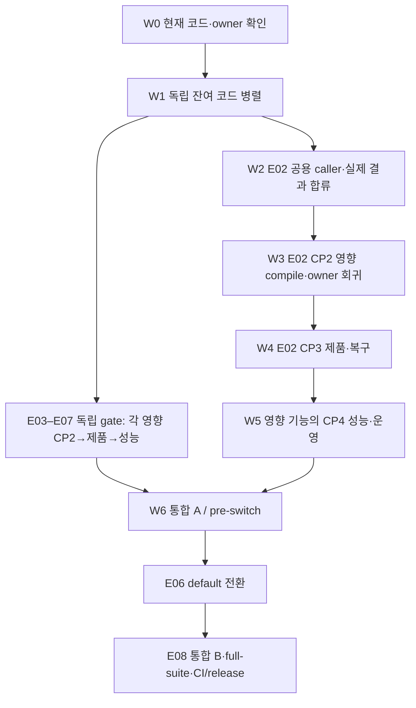

# Quanta Index finalizing — 작업 SSOT

**현재 작업·담당·상태·다음 완료 조건은 아래 8개 에픽 행만 갱신한다.** 이 마감의 전체 범위는 [DoD와 R01–R40 추적표](DOD.md), 독점 수정 경계는 [OWNERSHIP](OWNERSHIP.md), source별 실행 결과는 [VALIDATION](VALIDATION.md)이 소유한다. 에픽 문서는 고정 구현/수용 계약이며 별도 상태 원장이 아니다.

2026-10-22 전환. 문서 통합은 코드·제품·성능 완료가 아니다. 기존 7개 잔여 티켓과 원래 40개 요구사항을 아래 8개 실행 경계로 묶었다. 완료 구현/영수증은 해당 source와 scope로 재사용하고 오래된 TODO로 새 작업을 만들지 않는다.

## Epics

| 에픽 | 유일한 범위·기존 배정 | 현재 확인과 미수용 범위 | 다음 완료 조건 |
| --- | --- | --- | --- |
| [E01 — 실제 producer·Chunk·RepoMap](E01-producer-generation.md) | Root 공용 접합·직렬 QBC; 기존 K/H/T 분리 산출물 합류 | **전체 미완료.** R75는 genuine Source→모든 Copy 행 birth/mutation→두 closed Set 출구→기존 Native solver→report/PTS read를 Source94c0df82에서 **18/18 VERIFIED**로 닫았다. C1/U1·chain/shared C2/U2·반복 Copy C2/U1, typed cancellation, 실제 다른 admission 객체 거절을 확인했다. 객체는 같지만 trait vtable이 달라 거절하던 kernel identity 검사를 수리했다. Source C·고유 Set U·solver 방문 수를 별도로 검증하며 dedup은 유지한다. SourceReady=false; 통합211(18동일/193차이)·검토215. [실제 원인·결과·한계](VALIDATION.md#r75-native-copy-cohort) R76a의 컴파일 오류4건은 해소됐다. R76b 실제 SDK1은 초기 Original 발행에서 FAILED(0 pass/1 fail), recovery capability 단위1은 같은 Source에서 VERIFIED다. R76c 진단도 FAILED1이며 실제 원인은 `MissingIndexedImportAuthority`다. 초기 Java inventory가 필요한 precommit보다 실제 build authority/orchestrator가 늦게 생성되는 순환이 확인됐다. [같은 owner의 구성 순서·supplier·전체 census 수정](OWNERSHIP.md#r76-installed-sdk-whole-product-pta-witness)이 남았으며, 병렬 감사3건은 소스 읽기만 수행했다. R77은 기존 batch의 precommit snapshot 읽기와 canonical FileText 발행 연결점, 실제 FD 회귀5개를 구현했다. 첫 backend QBC는 컴파일 FAILED3/body0였고 R78에서 세 원인을 수정했다. 실제 token의 target/head 구성과 새 fresh FileText API를 직접 쓰는 SDK 증인도 구현했다. Source68·claim134의 backend 재검증은 컴파일·링크 후 실제5 중2통과/3실패다. 정상 읽기가 visitor 전에 거절돼 R78b 진단 오류를 수정한 R78c에서 실제 Store InvalidBoundary를 확인했다. R79는 A revision→B text 순서와 owned Send+Sync 경계를 수정했다. 첫 backend6은5통과/1실패였고 postcommit 테스트의 Source custody를 수정한 R79b에서 **6/6 VERIFIED**다. Fresh FileText의 외부 query key/admission 거절도 기존 paid-child owner로 보완했다. 같은 owning 코드73경로와 일치한 격리 스냅샷의 SDK 증인1은 미사용 import 1건으로 컴파일 FAILED·본문0이다. R80은 해당 import와 기존 FileText 실패 보존·BuildContext row 선택/finisher·공유 query identity 검사·실제 SDK 증인까지7파일을 적용했다. 선택은 반복 A 안에서, fresh 출력과 기존 model/wire 완성은 A 종료 후 수행한다. 현재78경로를 고정했고 boundary7/whitespace7/format6은 VERIFIED, honesty는 실제 deadline용 Instant::now3건으로15/16 FAILED다. SDK 재실행은 Sourcef6f6034f에서 컴파일·링크 후 실제1건이 실행돼 FAILED(0통과/1실패)다. 이미 pin에 결합된 FD capture로 unjoined SourceSpec 생성 경로를 호출해 initial_source_already_joined가 발생했다. Fresh FileText 이전의 fixture 구성 순서 실패다. R82는 관련4파일에서 기존 fixture owner의 prejoin callback으로 canonical workspace birth를 이동했고, 최고 Source 종료 후 SourceSpec을 이전한다. Boundary4/13정책·format4·whitespace4는 VERIFIED다. R82의 Source2b2d7ce4 실행은 컴파일·링크 후 실제1건이 FAILED(0통과/1실패)로 종료됐다. paid RuntimeCtx의 SourceSpec 검사에서 snapshot ID가 없는 closed workspace 때문에 MissingContext가 발생했다. R83의 실제 pin 기반 workspace 수정은 snapshot ID 검사를 통과했다. SDK 본문1은 Sourcea500ca44에서 실패한 base context 폐기 후 Source B 예산1415바이트가 남아 FAILED(0통과/1실패)로 종료됐다. R84는 deep copy가 원본 pin의 오래 사는 group에 새 DATA를 청구하던 경로를4파일에서 수정했다. 원본 operation/group 검증 후 같은 operation의 별도 destination group으로 pin·closure·alias·workspace를 복사하며, 기존 예산 회수 oracle은 유지한다. Boundary4·구문4·whitespace4는 VERIFIED다. R84의 Source02ad2dc9 실행은 컴파일·링크 후 실제1건이 FAILED(0통과/1실패)로 종료됐다. 기존 Source B1415바이트 회수 assert는 통과했고, 다음 foreign BuildContext key 생성에서 fixture의 rulepack_digest 누락을 확인했다. R85는 두 precommit fixture에 기존 bootstrap rulepack·실제 runtime framework registry·실제 paid rail solver identity를 연결했다. 고정 text/hash/head/cell 및 외부 query key/admission 거절 oracle은 유지한다. Boundary2/13정책·format2·whitespace2는 VERIFIED다. R85는 Source67e54d19에서 private Runtime orchestration 경로 참조2건으로 컴파일 FAILED·본문0이다. R85b는 두 fixture를 이미 존재하는 SDK bridge 공개 경로로 수정했고, boundary2/13정책·format2는 VERIFIED다. R85b는 Sourceaff29050에서 private AnalysisOptions.execution을 포함한 struct update 오류2건으로 컴파일 FAILED·본문0으로 종료됐다. R85c는 공개 Default·필드 대입으로 컴파일 오류를 해소했지만 Source424ab6d4의 실제1건은 FAILED(0통과/1실패)로 끝났다. 공통 fixture의 의도된 rail=None과 실제 request rail이 달라 paid rail 연결에서 거절됐다. tuning과 rail 불일치를 같은 오류문구로 처리하므로 tuned 정책 결손으로 해석하지 않는다. R91은 기존 None 경로·실패 시 예산 전액 회수 oracle을 보존하면서 실제 request rail을 사용하는 공유 fixture 경로와 두 caller를 수정했다. Boundary3/13정책·format3은 VERIFIED다. R91 Source48738cf2는 rail 소유값/참조 타입 불일치 E0308 3건으로 컴파일 FAILED·본문0으로 종료됐다. R97은 실제 Copy rail을 복사하고 참조끼리 비교하도록3파일만 수정했다. Boundary3/13정책·format3은 VERIFIED다. R97 Source621e89e8은 컴파일·링크 후 실제1건이 FAILED(0통과/1실패)로 종료됐다. TraceOff에서도 필요한 root Trace를 시작하기 전에 child context를 대여해 Trace(ConcurrentUse)가 발생했다. R101은 두 fixture에서 실제 선택된 인자의 canonical key로 root Trace를 시작·종료한다. 외국 key/admission·고정 출력·head/cell oracle은 유지했다. Boundary2/13정책·구문2는 VERIFIED다. R101 Sourcecf8fbfdc의 SDK56 FileText1은 컴파일·링크와 실제1건이 통과해 VERIFIED(1통과/0실패/0무시)로 종료됐다. 실제 외국 key/admission 거절과 text/hash/head/cell oracle은 그대로 통과했다. 같은 실제 스냅샷의 BuildContext R112는 정식 디스크 기준50GiB·2.75% 미달로 BLOCKED·본문 NOT_RUN이다. 이후 캐시에서 해당 스냅샷이 사라져 R117은 고정된 owning83을 정식 QBC로 다시 캡처해 BuildContext1을 요청했다. R117은 FileText와 같은 Sourcecf8fbfdc에서 컴파일·링크 후 실제 BuildContext1이 FAILED(0통과/1실패)로 종료됐다. canonical snapshot/model/wire suffix의 AuthorityRejected를 보존한다. R119는 같은 실제 입력·고정 출력·부정 oracle과 기존 공개 suffix 증인을 유지하면서 canonical 단계별 조립 회귀1건을 추가해 Source1947d460에서 실행 중이다. Source B에서 발행한 snapshot group을 Output A로 읽는 구조적 불일치를 확인했으며, SourceOnly·Full Java·Python의 기존 owner9파일 B/A 분리 초안은 외부에만 있고 구문9 PASS·Rust NOT_RUN이다. Owning83경로는 R119 종료까지 고정한다. 기준 변경·수동 외부 삭제는 없었다. R85c의 format2 FAILED는 과거 Source에 남기며 R91에서 정리됐다. Production의 pinned workspace·실제 initial caller·configured descriptor·Full metadata·Core 검증 변경안은 checkout 밖에 있으며 Rust NOT_RUN이다. Maven·Gradle initial 모델은 실제 파싱부터 truth 조립까지 외부 변경안이 있고, 현재67경로+XML vendor10의 통합 적용 검사는 통과했다. Rust 컴파일은 NOT_RUN이다. Full Maven·Gradle FD 회귀3파일도 외부에 작성했다. 그 회귀에서 확인한 미래 build provider 의존은 같은 closed Source의 전체 경로·해시 census를 검증하는 초기 전용 경로로 외부 변경안을 보완했다. R87은 실제 configured descriptor의 Source·선언 classpath 좌표를 확인한 뒤 기존 binary-gap 검증과 되돌릴 수 있는 동일 모델 투영을 통해 shared Exact metadata를 만든다. R88은 manifest 없는 실제 Java-only 초기 경로와 JDK-only Product descriptor를 보존하고, 같은 SourceOnly metadata에는 descriptor를 넘기지 않는다. 실제 유효 JDK/JAR와 선언 좌표를 쓰는 외부 JAR 양성·필수 artifact 누락 음성 회귀도 작성했다. R104 합류87경로는 공유 오류 우선순위 수정·실제 paid-header 회귀·Full-model fixture와 production 초기 BuildContext caller의 실제 root Trace 수명주기를 포함한다. Production은 ContextChild/Trace의 전체 원인, 완료 Trace 및 종료 실패 시 fresh 출력/context도 preborn bank에 보존한다. 적용 검사·공백 검사·Rust78 구문(기존77 해시 재사용+변경1 파싱)·기존 TOML4 파싱은 통과했고 owning 적용·타입·행동은 NOT_RUN이다. 음성은 typed cause와 RepoState 미발행을 관측하며 직접 store-head CAS 검증은 남는다. 공개 인증 심볼 read가 없어 Helper 심볼의 직접 소비 assert도 아직 없다. public Native MayAlias 소비는 기존 Source·NativeCopy·flow solver 소유자를 재사용해 병렬 구현 중이다. 전체 수용 전 공통 co-cut과 실행 증거가 필요하다. 기존 prejoin seed 운송 변경안은 이 경로의 해법으로 사용하지 않는다. Backend6은 이전 Source의 결과로 유지한다. [현재 구현·검증 한계](VALIDATION.md#r77-precommit-source-read) [R81 병렬 소유·미적용 변경안과 실제 접합 잔여](OWNERSHIP.md#r81-initial-java-co-cut) [현재 owning 상태: R130 실패·model B 수정·R146 재검증](OWNERSHIP.md#r136-current-owning-cocut) [재개한 6개 목표·병렬 소유·필수 실행](OWNERSHIP.md#r165-six-item-goal) [현재 SDK 실행 범위](VALIDATION.md#r76-installed-sdk-pta) Native SDK ItemIndex/HIR의 canonical managed Args·owned query dispatch와 FileText selected Args/checked lender는 E02에서 연결했다. 해당 최신 Runtime 양성과 실제 Native planner 소비·RepoMap 영향 수용은 남아 있으며 E02의 최신 상태·source 범위를 따른다. [생산 호출 근거](VALIDATION.md#e02-map-prepass-and-reader-checkpoint-20261025). | 다음은 전체 worker의 function census·summary/graph/domain/anchor와 fixpoint·public 출력/CS의 실제 연결 검증이다. 해당 consumer 코드는 컴파일됐으나 전체 runtime은 NOT_RUN이다. CS admission 정책 단위1도 같은 Source에서 VERIFIED(1 pass/0 fail)다. 전체 CS 실행과는 별도다. live 통합·Linux CP3·legacy PTA580·생성자2·pre-key10·FULL/DELTA 및 E01–E08 원 DoD 유지. |
| [E02 — 게시·복구·수명·예산](E02-publication-recovery.md) | Root 공용 caller·SDK·packet 합류/직렬 검증; M metadata, P 물리 owner, D BoundV2/DELTA exact hunk | **전체 미완료.** 기존 entry 선검사·rollback 복사 제거·artifact currentness/B/A 수리는 재사용한다. Source1d8254의 trace owner6/6·QE whole lib287/287은 이전 범위 VERIFIED다. 10/27 기존 persistent map 갱신·삭제7/7(Source0533b6), closed same-header owner4/4(Source226b103c)는 VERIFIED다. 실제 A-paid canonical metadata·genuine Present snapshot을 closed owner에 결합했고, Source16daf1의 QE whole lib290/290이 VERIFIED다(필터·무시0). 최신 SDK rail은 이전 QE draft 의존 컴파일3건·본문0 FAILED 후 재검증 대기다. D는 signed SQL epoch와 StartBoundV2를 같은 transaction으로 묶고 실제 Native target/plan·owner/epoch를 SDK issuer로 연결 중이며 아직 NOT_RUN이다. Native capability=false. [실행·실패·한계](VALIDATION.md#e02-c2-partial-code-checkpoint-20261026) | closed metadata→canonical packet→다중 물리 index/receipt→observed/rollback·새 Original에서의 persisted read를 연결해야 한다. 새 Source/decoder/serializer·초기 issuer를 중복 제작하지 않는다. 실제 DELTA의 durable owner exact 복구·complete successor RepoMap bundle/export→member/V5→V9/ACK와 최신 CP2가 남는다. 설치 authority 부재는 CP3만 BLOCKED이며 전체 E01–E08/W5–W6 DoD는 유지한다. |
| [E03 — Lexical·초기 구축·증분](E03-lexical-construction.md) | 기존 lexical/planner/Kernel owner; SEARCH·PHYSICAL의 확인된 hunk만 결합 | 기존 NativeText/paged/COW·literal/token/BM25/regex·저장 개선은 재사용 대상. term별 불변 avg/IDF 재계산 제거와 변경 없는 lexical143/143의 해당 source 범위도 재사용하며 ANN 수용으로 합산하지 않는다. capability별 전체 gold·cold/reopen/catch-up·지속 증분의 최종 수용은 별도 | 지원 capability의 독립 gold와 fixed-delta N/H/M 비용·bounded 초기 구축/유지보수 증거. 미지원은 계약대로 명시 |
| [E04 — Semantic·ANN 제품](E04-semantic-ann.md) | 기존 SEARCH; 파일/FD/capacity는 PHYSICAL | **원4K Off FAILED, 전체 미수용.** 184c9fe2에서 Catalog260·Runtime478 합계738/738·strict와 실제 FUSE fault6/6 통과. native FD 경합4건과 동일 confirm 자식 큐의 불필요한2DML을 수리했다. 같은 소스 원4K는 SourceAdvance18.1647s 뒤 공통1200s에 관측3680/4096으로 실패해 품질·재오픈·증분에 미도달했다. 최신5df5cbc5의 짧은 Record 구간에서 coverage 저장은 worker SQLite 요청 쓰기의83.03%, worker lock 대기는0.094s다. 이 구간은 observer mutex 주범설을 지지하지 않는다. [실제 결과·범위](VALIDATION.md#e07-native-retirement-race-and-queue-20261026). | 현재 정적 감사에서 추가 미구현·호출 단선·구체 P0–P2 수리는 확인되지 않았다. [코드 잔여 감사](VALIDATION.md#e04-e07-code-residual-audit-20261027). 지속 저장 비용과 호스트 영향을 분리하고 확인된 결함만 수리한다. 원래4096 완료·Q64·고정 recall/score·재오픈·증분 전체 수용이 필요하다. renewal 결과 연결 코드는31/31·strict 통과, relay2/2·실제 prefix1/1도 통과했다. 오류 표본0은 NOT_OBSERVED이며 원인 해소 증거가 아니다. [최신 진단 코드](VALIDATION.md#e07-renewal-followup-20261027). 변경 없는 전체 재실행·예산/내구성/품질 완화는 하지 않는다. 과거1182969a 실패/80.76%와 새 소스 결과를 합치지 않는다. |
| [E05 — IDE·Stub·Overlay·Auto](E05-ide-auto.md) | 기존 AST/언어·source owner·query/Auto owner; PUB SDK parent·Root 실제 Source 인계 | 기존 port/converter/queue/apply·overlay/Auto 지원은 재사용. genuine Source→AST/apply·live same-intent 정책/실제 editor 통합의 전체 수용은 미완료 | 실제 source-owner 원자 apply·overlay/save·Fast/Deep/Auto·좌표/취소와 UX/AUTO 고정 oracle를 닫음 |
| [E06 — SDK·서비스·BOOT 전환](E06-sdk-service-cutover.md) | PUB SDK·Root FULL evidence·기존 BOOT/launcher/runtime owner | funded scoped RPC·opaque ACK·launcher/predecessor/rollback lower 구현과 source8b63 UDS 수리는 재사용. 공개 Status/ReadView는 canonical Core→Catalog→Kernel→Runtime으로 원 budget을 전달한다. 실패 후 reconciliation과 COMMIT 뒤 pin 보존·취소 Open 재조회·retained ticket trace 수명은 cf6a3314… 영향176/176·daemon3/3의 해당 회귀로 VERIFIED. [범위·한계](VALIDATION.md#e04-e06-catalog-control-closure-20261024). genuine FULL→BOOT·전체 transport/provider·default 수용은 남음 | 실제 결과로 candidate verify/serve/reopen·rollback. E08 통합 A 뒤 default 전환, B에서 default/cleanup 재확인. 완료된 budget/pin/context 경계는 재개발하지 않음 |
| [E07 — 비용·관측·성능·운영](E07-performance-operations.md) | 기존 PHYSICAL/harness·SEARCH 원4K 결과 소비 | **확정 결함 수리·선택 검증 완료, 원4K 처리량·전체 운영 미수용.** 184c9fe2의 library738/738·strict와 실제 fsync/close/parent-fsync/ANN EIO·ENOSPC6/6, 소유 자원 정리를 확인했다. Io 진단으로 찾은 live DB 관찰자 쓰기/permit fixture도 수리했다. 후속6fac956c의 원 grant를 빌리는 bounded renewal/followup 진단은31/31·strict 통과했다. 성공 로그 relay 누락도 연결했고5df5cbc5에서 relay2/2·실제 prefix1/1과 complete/loss0 capture를 확인했다. renewal 표본0은 NOT_OBSERVED다. Python253/Ruff2는 별도 변경 없는 scope다. [최신 코드·검증](VALIDATION.md#e07-renewal-followup-20261027). | 추가 필수 관측 코드 결함은 확인되지 않았고 renewal CLI 확장은 선택 개선이다. [코드 잔여 감사](VALIDATION.md#e04-e07-code-residual-audit-20261027). 실제 prefix 관측은 마쳤으며, E04의 원인 분리와 원4K 전체 결과를 소비한다. 기존 renewal 오류의 원인은 표본 부재로 미확정이다. 최종 정식 Mac 성능 preflight는 외부 Rust4개·load12.37>8.0으로 BLOCKED다. 정식 overhead≤5%·전체 수명 aggregate RSS/all-roots 공간·quiet paired/Large/XL·mixed/churn·전체 통합/출시는 미수용이다. 최신31과 이전738/6은 각 source·scope만 검증하며 full-workspace/all-target/CI/release green이 아니다. 종료 guard·실제 sync·기존 품질/비용 상한을 유지한다. |
| [E08 — 통합·IntelliJ·CI/release](E08-integration-release.md) | Root 통합·기존 Runtime/SDK/PY/CI/운영 target owner | 전체 완료 아님. native_text_policy CI registry 항목은 현재 dirty 소스에 이미 적용됐으며 이번 `just rust-test-authority`는 exit0/VERIFIED다. 미적용 후보를 다시 적용하지 않는다. [이전 감사와 최신 정정](VALIDATION.md#code-residual-audit-20261026) [최신 실행 범위](VALIDATION.md#e02-code-integration-checkpoint-20261026). 현재 source의 full-suite/hosted CI/release·actual IntelliJ 비교 green은 미입증. 외부 authority/target 부재는 해당 gate BLOCKED | R01–R40·필수 P2I/UX/AUTO·E01–07 수용→통합 A→E06 전환→B/full-suite·CI/release·동등 품질 IntelliJ 비교를 모두 충족 |

## Execution order

구체 실행은 [W0–W6 웨이브 계획](WAVES.md#wave-map)을 따른다. 이 채팅 E02는 [Root SDK 실제 소비 ∥ J/raw 회귀 ∥ provider/artifact 오류·예산 ∥ C2 unchanged typed 공급](WAVES.md#e02-next-parallel-batch)을 exact hunk로 분리한다. 반환·배치 CP1/영향 compile 뒤 W2.0 complete successor→W2.1 member/V5·최종 검사→W2.2 V9/ACK를 Root가 직렬 합류한다. 구형 B1a–B4 명칭은 기존 계약 참조이며 별도 작업 큐가 아니다. E01 source/query·PUB SDK parent·기존 E03–E07 owner를 중복 배정하지 않는다. 독립 기능은 자기 입력이 준비되면 진행하고 공유 parent·같은 host heavy 실행만 직렬화한다.

**코드 마감점은 W1/W2의 FULL·delta별 실제 source 연결**, 전체 종료는 W6의 [전체 DoD](DOD.md#final-dod)다. 완료된 구현/영향 결과를 재사용하며, 새 실패가 확인된 hunk만 원 owner가 좁게 수리한다. 독립 gate는 필요한 입력이 준비되면 먼저 진행할 수 있고, 외부 authority 부재는 해당 검증만 BLOCKED로 남긴다.

작업 채팅끼리 독자적인 메시지·질문·진행 조회·재배정·추가 채팅/하위 에이전트 생성을 하지 않는다. 이번 사용자 병렬 요청은 [Root 내부4슬롯 절단](OWNERSHIP.md#native-query-closeout-writes)으로 실행하며 기존 PUB·SEARCH 등의 같은 범위를 복제하지 않는다. 각자 독점 코드의 실제 caller·오류/drop·미합류 hunk를 반환하고 Root가 현재 소스/결과를 직접 읽어 합류한다. 구체 채팅 라우팅·공용 파일 규칙은 [OWNERSHIP](OWNERSHIP.md)에 둔다.

## Completion rule

이 폴더의 모든 필수 DoD를 충족하면 원래 합의한 Quanta Index 범위를 완료한 것이다. 새 에픽으로 옮겼다는 이유로 완료 조건을 줄이거나 분모를 바꾸지 않는다. 코드만 마쳤거나 외부 입력이 없어서 멈춘 상태를 전체 완료로 쓰지 않는다.

검증은 VERIFIED / FAILED / BLOCKED / NOT_RUN / NOT_APPLICABLE과 source·scope로 기록한다. conditional 기능의 N/A는 근거를 명시한다. 단순 유예·환경 부재·미실행은 N/A가 아니다. 기능/운영 수용, CODE_QUALIFIED, DEPLOYED, ACTIVATED, ROLLBACK_PROVEN은 구분한다.

## Previous IDs

W2-01/02/03/04/07→E02, W2-05/06/12/14→E01(게시/terminal은 E02), W2-08/18→E06, W2-09/10→E07, W2-11→E03, W2-13→E04, W2-15/16/17→E05, W2-19→E08. 종전 고정 수용 계약과 실행 원문은 [보존 색인](../../ARCHIVE-INDEX.md#oct-22-finalizing-migration)에 있다.
