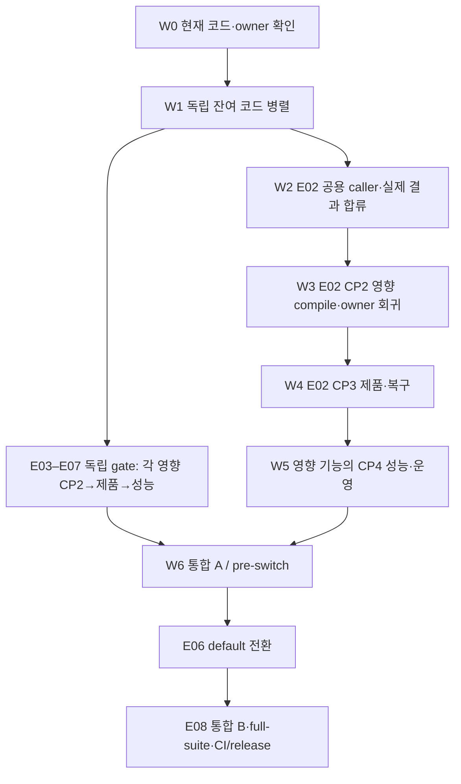

# Quanta Index finalizing — 작업 SSOT

## 현재 작업과 판정 위치

2026-11-16 정리. 이 문서는 전체 범위와 활성 원장으로 가는 진입점이다.
실제 source·dirty hunk·작성자·원 receipt를 대조한 뒤 해당 원장의 잔여만 수행한다.
완료된 구현이나 과거 compiler/벤치 결과를 여기서 새 작업으로 발급하지 않는다.

- Native 출하 후보·SDK 호출자·설치 복구·Tantivy/History 퇴역:
  [Nov-12 계획](../nov-12-native-cutover/README.md)과 [퇴역 계획](../nov-20-native-cutover-closeout/tickets/06-tantivy-retirement.md).
  B/D/F/H/TEXT의 최신 코드·실행 판정은 각 활성 티켓이 소유한다. 완료된 C 공급 범위는 Query ADR에서 재사용한다.
- C0·설치 DELTA/P09: [B05](../nov-12-bugbash-c0-p09/tickets/B05-final-verification.md#p09-observer-acceptance).
  완료된 로컬 IPC/SDK 계약은 ADR에서 재사용하고 설치 수용을 별도로 판정한다.
- Native 인덱싱 성능: [bugbash 현재 판정](../nov-5-indexing-bugbash/README.md#현재-판정)과
  [최종 실행 게이트](../nov-5-indexing-bugbash/WORKPLAN.md#final-audit-execution-20261110).
- 전체 producer/게시·복구 접합: 아래 E01/E02의 고정 계약,
  [소유권](OWNERSHIP.md#exclusive-boundaries)과 [source별 검증](VALIDATION.md).
  공용 SQL worker/searchd는 기존 공급자의 image/SHA/provenance를 확인해 소비한다.

### 활성 작업 문서

| 활성 티켓 | 다음 작업 | 남은 수용 |
| --- | --- | --- |
| [B05](../nov-12-bugbash-c0-p09/tickets/B05-final-verification.md) | 현행 common owner·Native caller 조합을 검토하고 공식 worker/searchd를 공급한다. | 같은 입력의 P09 설치 본문 1/1과 container·claim 정리. |
| [NC-B](../nov-12-native-cutover/tickets/NC-B-semantic.md#current-remaining-acceptance) | Kernel carry 3/3 결과를 재사용하고 수정본 ANN4K·전체 SDK를 검증한다. | 독립 품질, materialization deadline, 이전 view·overlay·두 번째 재시작. |
| [NC-D](../nov-12-native-cutover/tickets/NC-D-boot.md#d-current-disposition-20261116) | 영향받은 S/Q owning 검증과 CP2 mixed를 실행하고 동일 서명 입력을 인수한다. | 정상·게시 후·ACK 유실 복구에서 Original Source·선택·조회와 유실·중복 0. |
| [NC-F](../nov-12-native-cutover/tickets/NC-F-integration.md#이-채팅의-잔여-코드-범위--2026-11-15) | F-DSL-H/A·F-CODE-1/2의 현행 코드·인수를 마감한다. 실행은 기존 Root 큐를 따른다. | R16·WorkStorage·Caller/Published, Linux DSL·독립 홀드아웃·Mixed, 전체 그래프와 서명 설치 번들 수용. |
| [NC-H](../nov-12-native-cutover/tickets/NC-H-history.md#current-actionable-backlog--2026-11-16-re-audit) | 수리본 S CLI와 서명 설치를 검증한다. 복수 Legacy 활성 head 및 이전 Native History의 이관·유지 경로를 공급한다. | 서명 FULL/DELTA·누락 inventory 거절·ACK 유실·재시작. |
| [NC-TEXT](../nov-12-native-cutover/tickets/NC-TEXT-build-final.md#admission-decision-and-remaining-product-verification) | Scan·SQL 구현과 고정 코호트 결과를 재사용하고 원 etcd FULL·고정 funding 충돌을 해결한다. | 원 Caddy Record·동일 daemon Large는 해당 코호트에서 재사용한다. Quiet Off 두 본문과 원 etcd 수용·최종 후보 영향 검증은 남았다. |

완료된 NC-C의 Query·History 공급과 인터페이스 마감은 [구현 ADR](../../adr/NOV-12-001-native-query-and-semantic-engine.md#closed-query-supplier-scope)로 통합했다. 실제 caller·설치 수용은 D/F/H에 남긴다.
Provider/P07의 현행 입력·검증은 [NC-F 실행 패킷](../nov-12-native-cutover/tickets/NC-F-integration.md#p07-final-actions-20261115)으로 통합했다.
일반 Native SDK 연결, 03B/03D 인계와 Q root/peer 관측의 완료 구현은 재사용한다.
현재 source의 실제 Source/Store/AST 연결·fresh FULL·Runtime/archive·설치 복구는
각 티켓의 producer→caller→consumer 경계와 원 수용 조건으로 확인한다.
관측/집중 회귀를 설치·SDK60·whole ANN·holdout·release 수용으로 전용하지 않는다.

전체 완료 분모는 [E01–E08 / R01–R40 DoD](DOD.md) 그대로다.
[ADRs](../../adr/README.md)는 상시 구현 계약,
[복구 색인](../../ARCHIVE-INDEX.md#2026-11-15-active-plan-and-control-contract-consolidation)은
퇴역한 상태표·배정·회귀 수치의 원문 위치를 제공한다.

## Epics

| 에픽 | 고정 범위 | 현재 담당·판정 경로 | 최종 수용 |
| --- | --- | --- | --- |
| [E01 — producer·Chunk·RepoMap](E01-producer-generation.md) | R03/R04/R23/R24/R37/R38, 실제 complete Source/query·affected output | [W205 경계](OWNERSHIP.md#w205-closeout-20261030)·[실행 원장](VALIDATION.md#w205-proof-20261030) | 여섯 목표·공개 SDK/Runtime·Java/precommit·provider와 실제 downstream 소비. 분모는 원 W205 계약 유지 |
| [E02 — 게시·복구](E02-publication-recovery.md) | R01/R02/R05–R12, Native read/reuse·공동 visibility·GC/lifecycle·successor/DELTA | [기존 D 큐](VALIDATION.md#e02-peer-ownership-refresh-20261106)·[L1](VALIDATION.md#e02-l1-final-audit-20261030)·[P01](VALIDATION.md#e02-deduplicated-current-work-20261030-root)·[Provider/P07](../nov-12-native-cutover/tickets/NC-F-integration.md#p07-final-actions-20261115) | [생산 접합 계약](E02-publication-recovery.md#production-join-contracts)·다섯 durable cut·same-operation installed DELTA·실제 비용/환급. supplier와 공용 parent는 기존 owner 재사용 |
| [E03 — Lexical·초기 구축·증분](DOD.md#e03-lexical-acceptance) | R14–R17, 지원 literal/token/BM25/regex/filter·정확한 증분 | [NC-TEXT](../nov-12-native-cutover/tickets/NC-TEXT-build-final.md)·[Native F](../nov-12-native-cutover/tickets/NC-F-integration.md)·[성능 원장](../nov-5-indexing-bugbash/README.md) | capability별 독립 gold·cold/reopen/catch-up·고정 delta의 N/H/M 비용·bounded construction/maintenance |
| [E04 — Semantic·ANN](E04-semantic-ann.md) | R18–R22, Native graph·선택 corpus/filter·품질·게시/복구 | [NC-B](../nov-12-native-cutover/tickets/NC-B-semantic.md)·[NC-F](../nov-12-native-cutover/tickets/NC-F-integration.md); 이전 원4K는 E04의 source별 영수증 재사용 | 현재 후보의 whole ANN·exact recall/score·reopen/delta/overlay와 E07 성능/운영. Legacy 원4K 결과로 대체하지 않음 |
| [E05 — IDE·Stub·Overlay·Auto](E05-ide-auto.md) | 실제 AST/source-owner apply·editor·overlay·Fast/Deep/Auto | [AST/Auto 경계](OWNERSHIP.md#exclusive-boundaries)·[검증 원장](VALIDATION.md) | 원자 apply·save/frontier·좌표/취소·필수 UX/AUTO와 실제 client workflow |
| [E06 — SDK·서비스·BOOT](E06-sdk-service-cutover.md) | R31–R36, 공개 transport·genuine FULL/BOOT·selection·rollback | [NC-D](../nov-12-native-cutover/tickets/NC-D-boot.md)·[NC-F](../nov-12-native-cutover/tickets/NC-F-integration.md) | 실제 후보의 verify/serve/reopen·installed rollback/restore-forward·E08 A/B와 default/cleanup 수용. 일반 SDK/CLI Native 라우팅은 완료 구현 재사용 |
| [E07 — 총비용·성능·운영](E07-performance-operations.md) | Large/XL·mixed·Off/Record·전체 자원·churn/debt·운영 | [bugbash](../nov-5-indexing-bugbash/README.md)·[NC-F](../nov-12-native-cutover/tickets/NC-F-integration.md)·[SEARCH RCA](VALIDATION.md#e07-search-benchmark-rca-20261105) | [고정 profile/DoD](E07-performance-operations.md#fixed-profiles-and-oracles)와 원 합격선. source가 다른 결과는 합산하지 않음 |
| [E08 — 통합·IntelliJ·CI/release](E08-integration-release.md) | R40, E01–E07 통합·P2I/UX/AUTO·전체 출하 판정 | [통합·release 계약](E08-integration-release.md#integration-gates)·[검증 원장](VALIDATION.md) | A→E06 전환→B·current full-suite/공개 API/module·exact-source hosted CI/release·동등 품질 IntelliJ 비교 |

## Execution order

전체 의존 순서는 [W0–W6](WAVES.md#wave-map), E02의 고정 검증 순서는
[기존 웨이브](WAVES.md#e02-residual-wave-plan)를 따른다. 최신 Native 전환과
C0/P09 실행은 위 현재 작업 라우팅을 따른다. 기존 owner와 공용 파일의 수정 경계를
확인하고 완료된 구현·source별 결과를 재사용한다. 공용 parent 합류와 같은 호스트의
heavy 실행은 해당 단일 담당이 조정한다.

**코드 마감점은 W1/W2의 FULL·delta별 실제 source 연결**, 전체 종료는 W6의 [전체 DoD](DOD.md#final-dod)다. 완료된 구현/영향 결과를 재사용하며, 새 실패가 확인된 hunk만 원 owner가 좁게 수리한다. 독립 gate는 필요한 입력이 준비되면 먼저 진행할 수 있고, 외부 authority 부재는 해당 검증만 BLOCKED로 남긴다.

## Completion rule

이 폴더의 모든 필수 DoD를 충족하면 원래 합의한 Quanta Index 범위를 완료한 것이다. 새 에픽으로 옮겼다는 이유로 완료 조건을 줄이거나 분모를 바꾸지 않는다. 코드만 마쳤거나 외부 입력이 없어서 멈춘 상태를 전체 완료로 쓰지 않는다.

검증은 VERIFIED / FAILED / BLOCKED / NOT_RUN / NOT_APPLICABLE과 source·scope로 기록한다. conditional 기능의 N/A는 근거를 명시한다. 단순 유예·환경 부재·미실행은 N/A가 아니다. 기능/운영 수용, CODE_QUALIFIED, DEPLOYED, ACTIVATED, ROLLBACK_PROVEN은 구분한다.

## Previous IDs

W2-01/02/03/04/07→E02, W2-05/06/12/14→E01(게시/terminal은 E02), W2-08/18→E06, W2-09/10→E07, W2-11→E03, W2-13→E04, W2-15/16/17→E05, W2-19→E08. 종전 고정 수용 계약과 실행 원문은 [보존 색인](../../ARCHIVE-INDEX.md#oct-22-finalizing-migration)에 있다.
