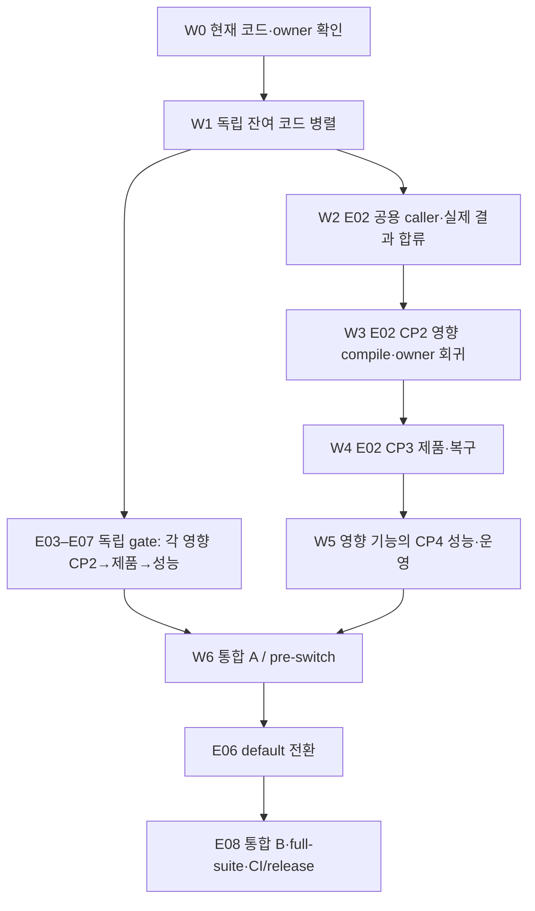

# Quanta Index finalizing — 작업 SSOT

**E02 이 채팅의 현재 마감 판정 — 2026-11-07 00:53 KST: PARTIAL / SourceReady=false.** 현재 상태는 아래 표 한 곳에 기록한다. 개별 source·실행 이력은 [VALIDATION](VALIDATION.md#e02-peer-ownership-refresh-20261106), 생산 계약은 [E02](E02-publication-recovery.md#code-residuals-20261105), 고정 실행 순서는 [WAVES](WAVES.md#e02-residual-wave-plan)를 따른다. 과거 compile 실패·캡처 거절·종료된 worker를 현재 실행 중인 작업으로 세지 않는다.

| 마감 경계 | 현재 근거·판정 | 남은 작업 / 기존 담당 |
| --- | --- | --- |
| 이 채팅의 생산 수리·회귀 코드 | 기존 수리와 attempt22의8원인/coordination8파일 수정이 Main에 있다. D의32-path frozen source에8개 수리·Runtime5 파일/mount가 실제 포함됐으며 attempt23에서 이전27진단은 재발하지 않았다. 구문8/8·whitespace·영향 경계19/19도 VERIFIED다. | attempt23 전체 lib(test)는 별도 privacy1로 FAILED다. 원래 Runtime5·SDK1 본문과 CP3 수용은 아직 없다. Root는 별도 producer·profile·실행 큐를 만들지 않았다. |
| 회귀 실행 계약 | D가 공통a744 floor + Product V4의 후계 class `5b587ae0aadb`와 요청 `14914c56322ed9cb8f06d837892b5c28`을 등록·해석했다. 기존551/ca89739e는 superseded NOT_RUN이다. required suite·정확 witness5개·threads0와 SDK1 suite·Stage L consumer는 유지한다. Root metadata claim2개는 release됐고 D가 단일 writer다. | Runtime5는 기존 D batch·current source admission 뒤 대기한다. SDK1 요청34dc4964065b6fad2c7c1265da214fef는 유지. 본문6개 NOT_RUN. |
| 검증 도구·전체 gate | `--snapshot-source` CLI/consumer 불일치 수리는 self-test RED3→GREEN65, 실제 소비자의 해당 거절116→0으로 VERIFIED. 마지막 전체 registry와 이후 전체 consumer 검사는 FAILED이며 세부 범위·잔여는 VALIDATION에 보존한다. | 이 채팅 두 suite의 consumer finding0은 전체 registry GREEN이 아니다. 수리 후 전체 gate는 NOT_RUN. 별도 미연결 suite를 일괄 등록하거나 baseline을 늘리지 않는다. |
| 기존 D 통합 회귀 | attempt23에서 이전27진단은 재발하지 않았고 남은 privacy1은 Main·coherent33에 수정됐다. attempt24는 자원 압박으로 exit130 중단됐다. 후속 attempt25의 running 기록과 달리 담당이 기록된 PID·자식·도구 세션 유실을 확인해 canonical 복구 중이다. 본문 통과 결과는 없다. | D가 같은 source·lane·1/1 자원 설정·선택/예산으로 기존 큐를 복구한다. 비정상 종료는 신규 소스 오류로 세지 않는다. Runtime/SDK 미실행과 아래 추가 테스트 코드 잔여를 구분한다. |
| 설치 SQL worker·SDK/독립 process | 앞선 OOM과 Docker/VM 재시작 중단을 보존한다. 현재 후계 run20261106T154611.329405Z-5abcf315c953는 같은 source/lock/artifact-env/toolchain에서 캐시를 재사용해 재개됐다는 담당 기록이 있다. jobs1/frontend1·compiler24GiB, Native child128MiB 계약은 유지한다. 적격 image/SHA·SDK supplier/daemon 수용은 아직 없다. | RQR-E의 기존 supplier 경계다. 설치 의존 gate는 BLOCKED, 본문 NOT_RUN이며 신규 코드 결손으로 합산하지 않는다. |
| C02 공용 source 합류 | SDK/PTA 소유자8개 수정은 current Main·ready manifest·D coherent33 frozen source에서8/8 일치한다. 미적용 hunk나 명백히 불가능한 시그니처는 정적 감사에서 찾지 못했다. D의 다른9/33 경로는 current Main과 달라 frozen 결과를 전체 Main GREEN으로 확대할 수 없다. | 기존 소유자의 코드가 이미 있으므로 재개발하지 않는다. 해당 SDK owning 컴파일·본문과 최종 current-source 합류/검증은 D가 수용한다. |
| 원래 복구·최종 환급 수용 / 테스트 코드 잔여 | Facts2·first-FULL3, genuine FULL→DELTA·DELTA→DELTA·Source pointer 전후 fault·DELTA V9 ACK 후 독립 PID 재개·reader 최종 환급 코드는 존재한다. DELTA 전용 persist→claim, claim→V9, stage→binding, Q Published→ACK의4개 독립 process cut과 G2 복구 중 pinned old-view oracle는 현재 owner target에서 확인되지 않았다. 이는 실행 대기와 별개의 테스트 코드 잔여다. | 기존 native_checked_delta_v3 driver/ifx150 target을 확장하는1묶음으로 관리한다. ACK 후 cold retry·FULL5 cut·기존 refund 코드는 재사용한다. 현재 해당 driver 추가 작업의 활성 claim은0이며 기존 SDK process 소유 경계에서 단일 writer를 배정해야 한다. 설치 수용은 SourceReady=false 유지. |

**전체 작업·담당·수용 범위는 아래8개 에픽이 소유한다. Native 초기 인덱싱 성능 RCA와 신규 패킷은 [11월5일 bugbash SSOT](../nov-5-indexing-bugbash/README.md)에 위임한다.** 이 마감의 전체 범위는 [DoD와 R01–R40 추적표](DOD.md), 독점 수정 경계는 [OWNERSHIP](OWNERSHIP.md), source별 실행 결과는 [VALIDATION](VALIDATION.md)이 소유한다. 에픽 문서는 고정 구현/수용 계약이며 별도 상태 원장이 아니다.

2026-10-22 전환. 문서 통합은 코드·제품·성능 완료가 아니다. 기존 7개 잔여 티켓과 원래 40개 요구사항을 아래 8개 실행 경계로 묶었다. 완료 구현/영수증은 해당 source와 scope로 재사용하고 오래된 TODO로 새 작업을 만들지 않는다.

## Epics

| 에픽 | 유일한 범위·기존 배정 | 현재 확인과 미수용 범위 | 다음 완료 조건 |
| --- | --- | --- | --- |
| [E01 — 실제 producer·Chunk·RepoMap](E01-producer-generation.md) | W205 Root Main 구현·검증 | **OPEN / SourceReady=false.** R792 wire owning whole-target는 동결 r1에서17/17 통과했다(backing2·digest3 포함). PTA private 연결부2파일/3줄과 R793 Chunk 후보3파일 수리는 Main에 반영됐다. R793는 빈 Module 아래 child 순회를 유지하고 key·shape 판정을 통일했으며 회귀3개를 추가했다. 정적 구문3/3·경계17/17·honesty16/16 통과는 실행 증거와 구분한다. | 수리 후 owning 컴파일, Chunk 모듈6·packet2·Runtime floor3/A-B·Strong2/Java5·precommit 모델2·Linux SDK7·provider의 실제 수용이 남는다. 최신 단일 D 큐는 Source255f에서 QE 전체374/374·오류 계약1/1·Root lifecycle18/18·retained-cause2/2가 통과했다. Runtime selector23의 현재 컴파일 실패·후속 실행은 위 D 판정과 VALIDATION을 따르며 SDK/QRA/Host/Linux/product 수용은 별도다. 마지막 Copy owner ACK는 ABI 미완성/SourceReady=false다. bounded freeze는 모두 RESUME이며 기존 source 접합 완료 후 새 cohort가 필요하다. P04 실제 allocation·shutdown snapshot과 P07 accepted transport는 상위 owner의 별도 지원·수용 경계다. 현재 E02의 추가 코드 결손으로 자동 재발급하지 않는다. [단일 계획](OWNERSHIP.md#w205-closeout-20261030)·[실행 사실](VALIDATION.md#w205-proof-20261030). |
| [E02 — 게시·복구](E02-publication-recovery.md) | P01 Acked 생산 수리·owning 회귀=증분 작업 상태 전수 파악. GC·trace·lifecycle·공용 접합/검증=QIDX E02 Native 조회·재사용 구현. Voyage=QIDX E02 C Native Provider·Successor…. successor/DELTA=QIDX E02 DELTA 게시·복구 구현. [최신 중복 제외 경계](OWNERSHIP.md#e02-owner-exclusion-20261029) | **제품 OPEN / capability=false.** Native lookup→binder→decoder·성공 권한, Deferred packet, Memo/Trace/binding 공통 가시성·역보상은 생산 코드에 있다. QE334/334@Source c13f1068에는 실제 lookup·Deferred·typed failure·Trace CAS unwind 회귀가 포함된다. binder 생산 호출0·공용 역보상 부재·Store 전체 미연결은 폐기된 TODO다. **P01:** Acked 생산 수리·owning 회귀의 현재 판정과 단일 잔여는 [P01 현재 원장](VALIDATION.md#e02-deduplicated-current-work-20261030-root), 수용 조건은 [Acked 계약](E02-publication-recovery.md#acked-row-readback-contract)을 따른다. **중복 제외:** 공용 Native gate·ABI는 Native Root, provider/DELTA/Trace/Watch/Graph/ItemIndex는 기존 담당이다. 이전 inner metadata BLOCKED는 옛 lock에 묶인 결과이며, 변경된 lock의 별도 검증은 공용 통합 범위다. 과거 수리·실행은 [source별 결과](VALIDATION.md#e02-acked-row-loan-green-20261029-root), 공용 gate의 과거 결과는 [고정본 기록](VALIDATION.md#e02-parallel-validation-20261029-root)에 보존한다. L1의 공용 합류·검증·잔여는 [L1 최종 감사](VALIDATION.md#e02-l1-final-audit-20261030)를 따른다. [10-31 D 마감](VALIDATION.md#e02-l1-d-closeout-20261031)에 따라 기존 L1-A에게서 D가 동일 단일 검증 큐를 인수했으며 D가 실행·공용 연결·결과/문서 검토를 담당한다. | **별도 담당5묶음(이 채팅 제외 범위; 현재 미완료 수가 아닌 소유 범위 목록):** 공개 Native bounded GC → 이미 연결된 trace/evidence/forensic의 owning·Runtime/SDK 정책/환급 수용 → lifecycle 실제 과금·추가 retry/refill → E01 complete successor 공급/설치와 SDK Pending→기존 DELTA terminal 접합 → Voyage Native batch(기존 provider owner; configured macOS owned Host 경로 구현, 실행 수용 별도). 이어서 query/mode별 genuine read/reuse co-cut·동일 operation installed CP3를 수용한다. complete successor installer·terminal 함수와 SDK target/census는 이미 있으므로 실제 supplier/consumer만 접합하며 일반 Watch Ordinary capture와 구분한다. [7개 계약](E02-publication-recovery.md#production-join-contracts)·원 DoD와 예산은 유지한다. |
| [E03 — Lexical·초기 구축·증분](E03-lexical-construction.md) | 기존 lexical/planner/Kernel owner; SEARCH·PHYSICAL의 확인된 hunk만 결합 | 기존 NativeText/paged/COW·literal/token/BM25/regex·저장 개선은 재사용 대상. term별 불변 avg/IDF 재계산 제거와 변경 없는 lexical143/143의 해당 source 범위도 재사용하며 ANN 수용으로 합산하지 않는다. capability별 전체 gold·cold/reopen/catch-up·지속 증분의 최종 수용은 별도 | 지원 capability의 독립 gold와 fixed-delta N/H/M 비용·bounded 초기 구축/유지보수 증거. 미지원은 계약대로 명시 |
| [E04 — Semantic·ANN 제품](E04-semantic-ann.md) | 기존 SEARCH; 파일/FD/capacity는 PHYSICAL, Root 단일 검증 큐 | **원4K Off/Record 제품 gate는5c6d0f8a에서 VERIFIED다.** Q64·cold reopen·증분·선택 경로·overlay가 Off1030.42s/Record1163.71s에 통과했다. 두 trace canonical도 통과했으며 정식 성능/운영 수용은 [E07](#e07) 단일 큐를 따른다. Source DATA 두 후보 충돌 수리는 슬롯≤32768·4MiB·원 인증/비용 계약을 유지한다. Kernel strict·library121/121, 후속 Source6/6·Resync5/5는 각 고정 source에서 VERIFIED다. lifecycle71통과/2실패/1제외 뒤 구절 질의·플랫폼 barrier의 오래된 기대값만 수정했고0d990e43 strict·선택2/2가 VERIFIED다. 과거0d990e43 일반 bench 원4K Off는 Source22.9300s 게시 뒤1200s watchdog에서 완료영수증2715/4096으로 FAILED0/1이다. provider2746unique/중복0/query0, 후속 비원자 스냅샷2739완료/1355pending/2claimed/blocked0. [현재 코드·실패 원인·정확 범위](VALIDATION.md#e04-source-data-collision-20261027).  이전 b19668ad Record는 Source30.001s 초과·사후 Published/provider0으로 FAILED다. 후속 be31193f ingress 큐 왕복 제거는 Catalog strict·264/264·실제 daemon3/3 VERIFIED이나 원4K 수용은 아니다. [최신 경계](VALIDATION.md#e07-ingress-queue-20261028). | 공용 원4K/Q64·recall/score·cold reopen·증분·선택 경로·overlay Off 수용은 [E07 영수증](VALIDATION.md#e07-wal-frame-product-20261031)을 재사용한다. 같은 gate를 별도 ANN 실행·저장 수리 큐로 중복 배정하지 않는다. 남은 정식 성능·운영 수용은 E07이 소유한다. 현재 audit에서 안전하게 삭제할 추가 중복은 미확정이다. 현재 수리된 WAL 원4K gate를 재구현하지 않고 남은 capability별 독립 수용은 기존 SEARCH 범위를 유지한다. 원30s/1Mreads/512MiB·worker10s·watchdog1200s를 유지하며 같은 소스 재실행으로 완료를 만들지 않는다. E01/E02 owner는 유지한다. |
| [E05 — IDE·Stub·Overlay·Auto](E05-ide-auto.md) | 기존 AST/언어·source owner·query/Auto owner; PUB SDK parent·Root 실제 Source 인계 | 기존 port/converter/queue/apply·overlay/Auto 지원은 재사용. genuine Source→AST/apply·live same-intent 정책/실제 editor 통합의 전체 수용은 미완료 | 실제 source-owner 원자 apply·overlay/save·Fast/Deep/Auto·좌표/취소와 UX/AUTO 고정 oracle를 닫음 |
| [E06 — SDK·서비스·BOOT 전환](E06-sdk-service-cutover.md) | PUB SDK·Root FULL evidence·기존 BOOT/launcher/runtime owner | funded scoped RPC·opaque ACK·launcher/predecessor/rollback lower 구현과 source8b63 UDS 수리는 재사용. 공개 Status/ReadView는 canonical Core→Catalog→Kernel→Runtime으로 원 budget을 전달한다. 실패 후 reconciliation과 COMMIT 뒤 pin 보존·취소 Open 재조회·retained ticket trace 수명은 cf6a3314… 영향176/176·daemon3/3의 해당 회귀로 VERIFIED. [범위·한계](VALIDATION.md#e04-e06-catalog-control-closure-20261024). genuine FULL→BOOT·전체 transport/provider·default 수용은 남음 | 실제 결과로 candidate verify/serve/reopen·rollback. E08 통합 A 뒤 default 전환, B에서 default/cleanup 재확인. 완료된 budget/pin/context 경계는 재개발하지 않음 |
| [E07 — 총비용·성능·관측·운영](E07-performance-operations.md) | Native 인덱싱 RCA·신규 패킷은 [bugbash](../nov-5-indexing-bugbash/README.md). 기존 Catalog/PHYSICAL·producer/DELTA·SDK·SEARCH 담당과 Root 단일 검증 큐를 보존한다 | **OPEN.** Native의 source별 성공·실패·미실행과 다음 결정은 [현행 원장](../nov-5-indexing-bugbash/README.md)이 소유한다. 검색 benchmark/ranking은 별도 [SEARCH RCA](VALIDATION.md#e07-search-benchmark-rca-20261105)를 따른다. 기존 수리와 근거는 VALIDATION 및 이력에 보존한다 | 원 Large120s·동일 source/입력의 수용, 정식 overhead·XL/mixed·전체 자원/운영 및 E08 인계. [고정 DoD](E07-performance-operations.md#dod)를 유지한다 |
| [E08 — 통합·IntelliJ·CI/release](E08-integration-release.md) | Root 통합·기존 Runtime/SDK/PY/CI/운영 target owner | 전체 완료 아님. native_text_policy CI registry 항목은 현재 dirty 소스에 이미 적용됐으며 이번 `just rust-test-authority`는 exit0/VERIFIED다. 미적용 후보를 다시 적용하지 않는다. [이전 감사와 최신 정정](VALIDATION.md#code-residual-audit-20261026) [최신 실행 범위](VALIDATION.md#e02-code-integration-checkpoint-20261026). 선행 구조 gate의 module-cycle 생산 SCC9개 FAILED는 [해당 source 감사](VALIDATION.md#e07-write-boundary-cost-20261027)에 유지한다. 후속 guarded module tree는 실제 선언·소비자와 Core6/Kernel2 항목을 대조 반영한 Root89124에서 VERIFIED다. module-cycle 전체 후속 재검증은 NOT_RUN이며 두 gate를 합쳐 green으로 쓰지 않는다. 현재 source의 full-suite/hosted CI/release·actual IntelliJ 비교 green은 미입증. 외부 authority/target 부재는 해당 gate BLOCKED | R01–R40·필수 P2I/UX/AUTO·E01–07 수용→통합 A→E06 전환→B/full-suite·CI/release·동등 품질 IntelliJ 비교를 모두 충족 |

## Execution order

L1 ItemIndex의 현재 source·검증 잔여는 [단일 최종 감사](VALIDATION.md#e02-l1-final-audit-20261030), 후속 composition 수리·실제 진입점 재시도 보강·오늘 D 재개 증거는 [현재 L1 checkpoint](VALIDATION.md#e02-l1-c-resume-20261031), B의 정확한 다섯 case는 [source/oracle](VALIDATION.md#e02-l1-b-plan-source-binding-20261030), 수정권은 [기존 A–D 경계](OWNERSHIP.md#e02-l1-owner-boundary-20261030)를 따른다.

**E02 B 최신 마감(2026-11-03):** B source/공용 인계·cold exact suite/runner 접합 완료, 현재 QE/Kernel7파일 syntax7/7·영향정책7/7 및 cold 등록/negative 검사 통과. QE11의374/374와scalar4실행은 Source94ca의 실제 결과이며 현재 Source 전체 통과는 아니다. L3/common/Chunk·L2는 미적용 코드0으로 회수했고, 현재 단일 검증자는 D다. P60 source gate·P07 Native/SDK와 current owning/Linux/process 수용은 남는다. [현재 source·정확 receipt·잔여](VALIDATION.md#e02-b-trace-reuse-final-audit-20261030).

구체 실행은 [W0–W6 웨이브 계획](WAVES.md#wave-map)을 따른다. 이 채팅 E02는 [Root SDK 실제 소비 ∥ J/raw 회귀 ∥ provider/artifact 오류·예산 ∥ C2 unchanged typed 공급](WAVES.md#e02-next-parallel-batch)을 exact hunk로 분리한다. 반환·배치 CP1/영향 compile 뒤 W2.0 complete successor→W2.1 member/V5·최종 검사→W2.2 V9/ACK를 Root가 직렬 합류한다. 구형 B1a–B4 명칭은 기존 계약 참조이며 별도 작업 큐가 아니다. E01 source/query·PUB SDK parent·기존 E03–E07 owner를 중복 배정하지 않는다. 독립 기능은 자기 입력이 준비되면 진행하고 공유 parent·같은 host heavy 실행만 직렬화한다.

**코드 마감점은 W1/W2의 FULL·delta별 실제 source 연결**, 전체 종료는 W6의 [전체 DoD](DOD.md#final-dod)다. 완료된 구현/영향 결과를 재사용하며, 새 실패가 확인된 hunk만 원 owner가 좁게 수리한다. 독립 gate는 필요한 입력이 준비되면 먼저 진행할 수 있고, 외부 authority 부재는 해당 검증만 BLOCKED로 남긴다.

현재 사용자 명시 지시에 따라 E02는 quanta-index 아래 [세 독립 채팅](OWNERSHIP.md#e02-independent-chats-20261028)에 생성·위임했다. 조회·재사용 / 저장·회수 / DELTA 게시·복구의 전용 파일·함수만 구현하며, worker는 부모를 포함한 다른 채팅의 조회·메시지·질문·진행 조회·재배정·추가 채팅/하위 agent 생성을 하지 않는다. 각자 실제 caller·오류/drop·미합류 최소 patch를 자기 결과로 반환한다. Root는 공용 ABI·parent·reader gate·SSOT와 체크포인트 검증을 단일 큐에서 합류한다. E01·PUB·provider·SEARCH·physical 기존 owner의 같은 범위를 복제하지 않는다. 생성/착수 확인을 코드·제품 수용으로 세지 않는다.

## Completion rule

이 폴더의 모든 필수 DoD를 충족하면 원래 합의한 Quanta Index 범위를 완료한 것이다. 새 에픽으로 옮겼다는 이유로 완료 조건을 줄이거나 분모를 바꾸지 않는다. 코드만 마쳤거나 외부 입력이 없어서 멈춘 상태를 전체 완료로 쓰지 않는다.

검증은 VERIFIED / FAILED / BLOCKED / NOT_RUN / NOT_APPLICABLE과 source·scope로 기록한다. conditional 기능의 N/A는 근거를 명시한다. 단순 유예·환경 부재·미실행은 N/A가 아니다. 기능/운영 수용, CODE_QUALIFIED, DEPLOYED, ACTIVATED, ROLLBACK_PROVEN은 구분한다.

## Previous IDs

W2-01/02/03/04/07→E02, W2-05/06/12/14→E01(게시/terminal은 E02), W2-08/18→E06, W2-09/10→E07, W2-11→E03, W2-13→E04, W2-15/16/17→E05, W2-19→E08. 종전 고정 수용 계약과 실행 원문은 [보존 색인](../../ARCHIVE-INDEX.md#oct-22-finalizing-migration)에 있다.
