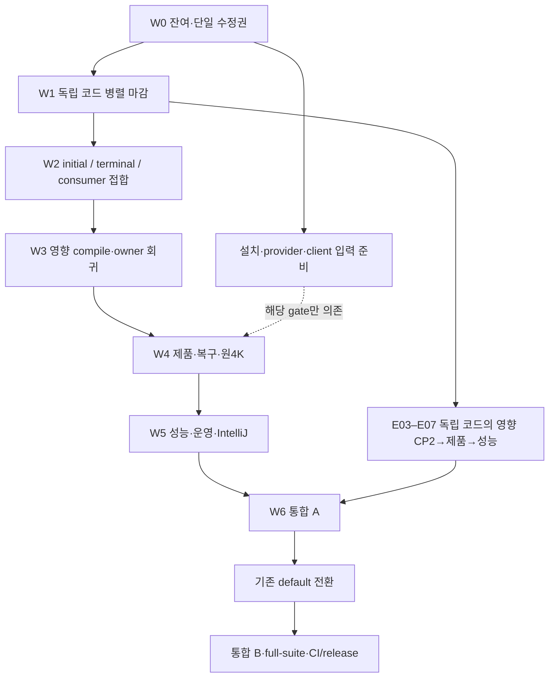
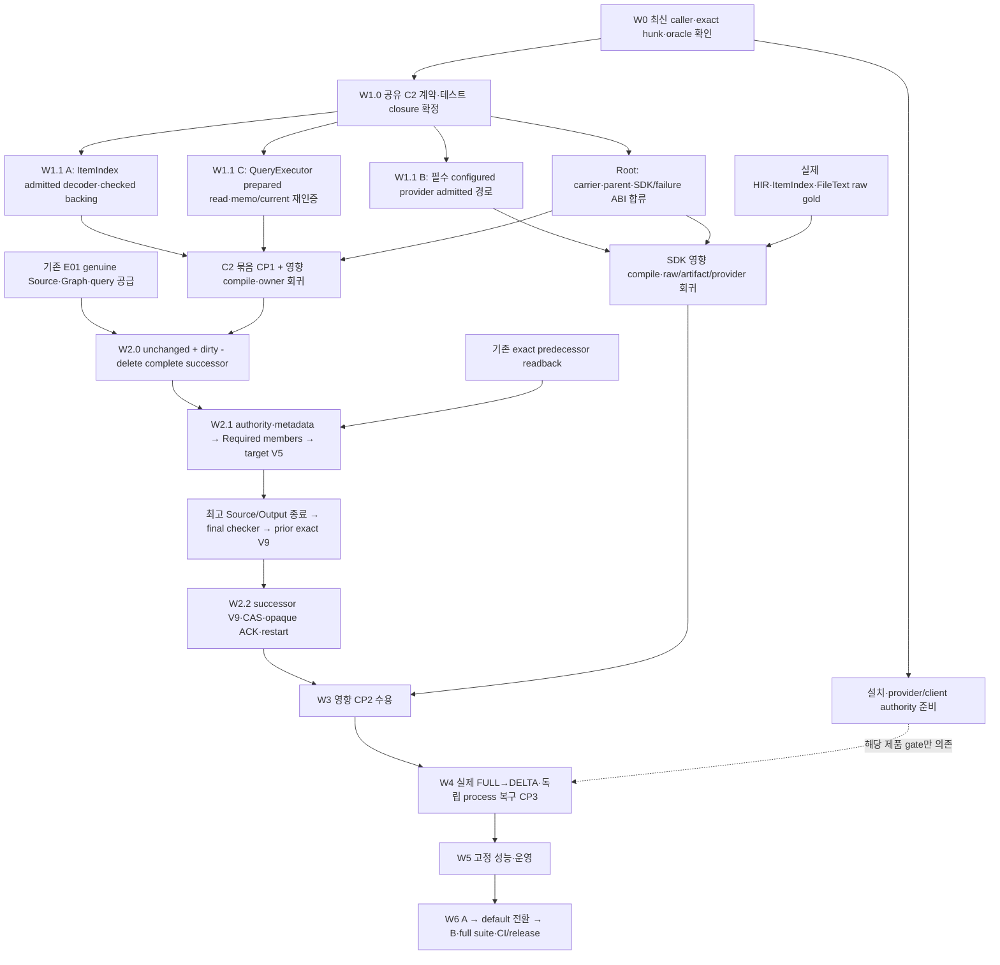

# Finalizing — 웨이브 실행 계획

상태·담당·다음 조건은 [README의 8개 에픽](README.md#epics), 실행 결과는 [VALIDATION](VALIDATION.md), 독점 파일/함수는 [OWNERSHIP](OWNERSHIP.md)만 갱신한다. 이 문서는 실행 순서와 입출력 계약이다. 새 티켓·상태 원장·담당을 만들지 않는다. 전체 종료 분모는 [E01–E08 / R01–R40](DOD.md#final-dod) 그대로다.

## Wave map

| 웨이브 | 작업과 산출물 | 병렬 범위 / 합류 | 종료 조건 |
| --- | --- | --- | --- |
| W0 — 잔여·수정권 확정 | 최신 caller·dirty hunk·기존 실행 결과를 대조해 실제 미완료만 추림 | Root가 공용 접합을 소유. 기존 owner는 자신의 경계만 확인 | 실제 결손마다 단일 writer와 기존 oracle 확정. 완료 코드·동일 실행 재발급0 |
| W1 — 독립 코드 마감 | 실제 Source/query 공급, SDK Native 소비·provider admission·unchanged typed artifact 공급, 확인된 Runtime/PUB 실패 custody, SEARCH/lexical·PHYSICAL·IDE/BOOT 수리 | 아래 독점 lane을 병렬 진행. 공급 내부는 공통 ABI 확정 후 소비자/재취득을 분리. 공용 parent·feature/export는 Root 또는 기존 SDK parent owner가 결합 | 정적 경계/서명·원인/partial/drop 계약 충족. 실제 typed 공급과 W2 연결점 제출. helper 존재만으로 공급 완료 처리0 |
| W2 — 실제 게시·소비 연결 / CP1 | initial receipt/authority → pending/V9 → terminal Native generation/root → 기존 CAS/ACK → SDK/AST/BOOT | FULL/delta 입력 준비는 분리. 공용 writer parent는 Root, SDK parent는 PUB 한 writer | 성공과 거절 모두 실제 caller→consumer 연결. ordinary 우회·guard 재진입·합성 authority 없음 |
| W3 — 영향 compile·owner 회귀 / CP2 | 합류 코드의 Runtime·SDK/CP·Q owning 검증 | 기존 요청 재사용. 같은 host heavy 작업은 admission 아래 직렬 | 컴파일과 실제 선택 본문 각각 통과. 실패 원인 수리 뒤 동일 rail 재검증 |
| W4 — 제품·복구 / CP3 | 공개 FULL/delta/delete/query, 5 durable cut, 원4K, IDE/BOOT candidate | 각 기능의 영향 CP2와 입력이 준비되면 실행. SEARCH 원4K·독립 IDE/BOOT gate는 E02의 미완료를 전역 대기 조건으로 삼지 않음 | cold gold·same-operation 복구·오류/취소/환급·실제 consumer 수용. 독립 결과는 W6에서 합류 |
| W5 — 성능·운영 / CP4 | 초기/증분, Large/XL, mixed, Off/Record, 압박·유지보수, 실제 IntelliJ 비교 | 해당 기능을 수용한 고정 source/profile별 진행. 공유 host 성능 부하는 직렬 | 품질 AND latency/처리율 AND 총자원/유지보수 한도 충족 |
| W6 — 통합 A → 전환 → B | pre-switch A → 기존 default 전환 → post-switch B/full-suite/CI/release | 기존 E06/E08 owner가 앞 결과를 소비 | 모든 필수 DoD 수용. 필수 FAILED/BLOCKED/NOT_RUN0 |

**계획된 코드 마감은 W1/W2, 전체 종료는 W6다.** 아래 도식은 영향 기능별 의존 경로이며 전역 실행 barrier가 아니다. W3–W5에서 확인한 결함은 원 owner가 수리하고 영향 gate를 다시 통과해야 한다. SEARCH 제품 검증은 무관한 Runtime 접합이나 전체 Semantica campaign 완료를 기다리지 않는다. 설치/provider/client 입력 준비도 W0부터 병렬이며 입력 부재는 해당 gate만 BLOCKED다.

## Next execution batch

실행 순서만 정의한다. 현재 판정은 [README E01](README.md#e01)·[E02](README.md#e02), 소스별 실패/실행 결과는 [VALIDATION](VALIDATION.md), 유일 writer는 [OWNERSHIP](OWNERSHIP.md#native-query-closeout-writes)이 소유한다. 아래 작업 이름은 새 담당·채팅·진행 원장이 아니다.

1. **E01 / 실제 producer 선행 조건.** 기존 precommit Source snapshot·canonical FileText·BuildContext/Java inventory·전체 Python/Java import census의 실제 반환을 기존 source/query owner가 연결한다. initial Graph commit에 필요한 inventory를 그 commit 뒤의 orchestrator에서만 만드는 순환부터 끊는다. genuine capture/pin/session과 실제 execution authority를 기존 composition/context owner에서 먼저 결합한 뒤 paid FileText→BuildContext/Java inventory→complete import census→기존 단일 Source/Graph commit으로 연결한다. 검증된 build output을 capture alias로 대신하지 않는다. keeper·paid request/base·FULL/provider·오류 bank·writer의 완료 구현은 재사용한다. 현재 수리 지점과 실패는 [기존 Source read packet](OWNERSHIP.md#r77-precommit-source-read-and-canonical-filetext-prerequisite)과 [SDK witness](VALIDATION.md#r76-installed-sdk-pta)만 따른다. 이 공급의 출구는 실제 Source/Graph 초기 commit 양성 및 foreign/cancel/late failure의 custody 보존이다. 이후 Index FULL/DELTA 전체 게시나 전체 PTA 캠페인 완료를 이 공급의 선행 조건으로 추가하지 않는다.
2. **기존 K/H/T / 독점 source 절단.** [공용 hunk map](OWNERSHIP.md#native-query-closeout-writes)에 따라 K=Query hook·Kernel port, H=SemanticModule·PTA/cohort·FunctionSummary, T=동기 family, Root=Runtime caller·공용 export·실제 fixture를 분리한다. 실제 미구현 hunk에만 writer를 둔다. 기존 sync/async 의미와 Args Eq/Hash/wire, 같은 caller-owned typed failure bank를 유지한다. issuer/IR/registry·ordinary fallback을 추가하지 않는다.
3. **E01 / genuine query→planner→writer.** 기존 1→1/N→1/1→N·upsert/delete의 독립 ID/span/text/order/digest, 실제 uncached query 횟수·delete query0·역순/늦은 실패/취소/환급, 실제 writer receipt/artifact와 cold-target gold를 수용한다. 테스트용 opaque query output·synthetic Source는 사용하지 않는다. 기존 owning 실행은 중복 제출하지 않는다.
4. **E01 공급→E02 소비 / complete DELTA successor.** 변경되지 않은 ItemIndex의 권한 있는 재취득과 dirty checked owner 교체·delete 제거를 기존 canonical owner에서 완성한다. History·Chunk·Graph/CallGraph·RepoMap과 target-bound carry를 함께 반환한다. 아래 [E02 W1→W2](#e02-residual-wave-plan)를 따른다. dirty-only FULL packet·predecessor target authority·전체 query 재수집은 대체 입력이 아니다.
5. **Root / E02 실제 게시·복구.** 조기 입력·authority+metadata 단일 이동→member/target V5→Source/Output 종료 뒤 최종 검사→이전 ACK exact V9→successor V9/ACK·동일 identity 재시작을 직렬 합류한다. 독립 오류/fixture·설치 입력은 병렬 준비하고 CP1 뒤 영향 CP2, 이후 installed CP3로 수용한다.
6. **기존 E03–E08 / 독립 gate와 전체 마감.** lexical·원4K·IDE/Auto·SDK/BOOT·성능/운영은 각 입력이 준비되면 병렬 진행한다. E08이 E01–E07·R01–R40·필수 P2I/UX/AUTO·실제 IntelliJ를 대조해 A→default 전환→B/full-suite·exact-source CI/release를 마감한다. E02 완료로 전체 DoD를 축소하지 않는다.

후속 디버깅에서 QBC가 지원하는 mutable cohort를 사용해도 같은 target·features·전체 선택 본문·oracle를 유지한다. 해당 guard의 Source가 바뀌면 결과를 갱신하고, 최종 frozen 제품/성능 수용을 대신하지 않는다. 공유 writer/index/HEAD/commit/push와 동일 host heavy 검증·성능은 직렬화한다. 외부 authority 부재는 해당 gate만 BLOCKED이며 무관한 코드 수리를 막지 않는다.

## W1 — 독점 병렬 묶음

파일/함수의 유일한 수정 경계는 [OWNERSHIP](OWNERSHIP.md#parallel-implementation-schedule)·[공용 hunk map](OWNERSHIP.md#compiled-handoff-owner-map)이 소유한다. 아래 lane은 기존 owner를 뜻하며 새 담당이나 채팅을 만들라는 지시가 아니다.

| 기존 lane | 이번 코드 산출물 | 중복 금지·합류점 |
| --- | --- | --- |
| Root / Runtime 테스트 closure | 공통 test-support mount·명시 support gate·재export·actual capability와 fixture API 정합성 | 공용 `testing.rs`/helpers/`lib.rs` 한 writer. private orchestration·writer fixture는 exact 파일로 분리. Clone/Eq 복원·assertion/시나리오 축소 금지 |
| Root + P / E02 | initial borrowed receipt/authority 조립과 terminal Native replay/root의 정확한 반환·실패 계약 | Root는 upper caller와 공용 parent, P는 기존 bank의 확인된 private 결손. 같은 root 함수/serial을 둘이 변경하지 않음 |
| PUB / E01·E05·E06 | 실제 lower whole failure → 공개 SDK terminal, ACK custody 소비와 Source/FULL 인계 | PTA/Product/Source/Store lower는 기존 Semantica owner. 내부 writer/CAS와 A/B/D producer 재작성 금지 |
| SEARCH·lexical / E03·E04 | 원4K materialization 및 초기/증분의 확인된 비용 원인 수리 | Catalog/VFS/Common은 PHYSICAL. 동일 함수·원4K 실행 중복0. 새 worker/engine을 원인 없이 추가하지 않음 |
| PHYSICAL / E02·E07 | 실제 file/FD/capacity/fault 결손과 운영 입력·기존 oracle | 확인된 local 수리는 재사용. SEARCH의 알고리즘/worker를 별도로 변경하지 않음 |
| AST·BOOT·Auto / E05·E06 | 기존 queue/apply/candidate/rollback·교체 가능한 정책 consumer의 잔여 | 실제 committed Source/FULL 소비. 합성 target/Original/receipt 금지. default 전환은 W6 |

A/B/D private producer·Wire exterior·P generation/root bank·funded SDK·opaque ACK는 기존 구현을 먼저 소비한다. 해당 코드의 새 결손이 확인된 경우에만 원 owner가 수리한다. 적용된 stage snapshot·ReplaceScope changed-docs·별도 delta/full plan도 재개발하지 않는다.

**반환 계약:** 변경 파일/함수, 재사용한 owner, 실제 caller/consumer 또는 정확한 W2 연결점, first/secondary typed cause·partial·최종 drop, 고정 expected oracle, 실행/미실행 범위. 작업 채팅끼리 질문·메시지·상태 조회·재배정하지 않으며 Root가 현재 소스와 최종 결과를 직접 읽어 합류한다.

## E02 shared join order

### E02 — 현재 코드에서 시작하는 구조적 실행 순서

이 절만 E02의 다음 실행 순서를 정의한다. 현재 상태는 [README E02](README.md#e02), 최신 코드/검증 대조는 [2026-10-26 C2 checkpoint](VALIDATION.md#e02-c2-partial-code-checkpoint-20261026), 유일 writer는 [OWNERSHIP](OWNERSHIP.md#e02-current-wave-hunks-20261026)이 소유한다. C의 partial 반환 뒤 미완성 QueryExecutor 통합은 Root가 인수했고 A/B의 private 범위만 독립 유지한다. 새 채팅·티켓·상태 원장을 만들지 않는다. E01–E08/R01–R40 종료 분모는 유지한다.

**현재 시작점:** Native SDK raw→policy→views→artifact→proof ingress와 입력 수집 전부터의 whole-failure bank는 소스에 연결됐다. C2는 공유 currentness/artifact proof와 Query persisted hook, schema3 finite decoder 본문, QueryExecutor same-scope prepared-read, 선택된 재사용 소비자 6곳의 checked hook, Source 후 paid exterior error bank, unsupported Original의 metadata 복사·artifact I/O 이전 capability 선검사까지 부분 연결됐다. ItemIndex의 구체 Query hooks·persisted checked 저장 owner와 packet read-authority/meta·deferred finalizer는 부분 연결됐다. 실제 A-paid memo metadata·publication/observed/rollback·write gate가 남아 capability는 false이며 genuine persisted Original 양성과 unchanged 재사용은 미수용이다. cross-generation은 Native ArgsHash의 generation witness 때문에 별도 typed owner/target rebirth가 필요하다. DELTA authority take→member/V5→V9/ACK caller도 남는다. [이번 코드/검증 범위](VALIDATION.md#e02-c2-partial-code-checkpoint-20261026)를 따른다.

도식은 기능별 의존 관계다. E01 초기 Source/Graph commit에 Index FULL/DELTA 성공을 역으로 요구하지 않는다. E03–E07은 각자의 준비된 입력으로 계속 진행하며 E02 완료를 전역 barrier로 삼지 않는다. 같은 host의 heavy compile·제품·성능은 admission 큐 하나에서 직렬화한다.

#### W0 — 매 배치 착수 시 확인

- 최신 HEAD·dirty hunk·실제 caller·live claim을 읽고 **함수별 writer 하나**를 확정한다. claim은 lock·구현·완료 증거가 아니다. Root가 같은 hunk를 조정하고 독립 private 작업은 진행한다.
- J의 paid plan/metadata/outline·7 sideoutputs·State/batch/publish, FileText/literal/substrate, C1 query8/9·row/pin, FULL/History/Store·opaque ACK는 재사용한다. 새 serializer·Source issuer·IR twin·별도 cache/store를 만들지 않는다.
- 각 묶음의 고정 oracle와 source/compile/body/product 경계를 먼저 적는다. 설치 입력 부족을 C2/DELTA 코드 미구현의 이유로 쓰지 않는다.

#### W1.0 — 공유 계약과 현재 소스의 작은 결손 마감

| 병렬 슬롯 | 해야 할 일 | 다음 묶음에 넘길 것 |
| --- | --- | --- |
| **Root / 공유 계약·parent** | 기존 Query hook·verified output carrier에 Native persisted decode 경계를 정의한다. exact memo row·artifact·current source/target·recipe/policy·retention을 함께 증명하는 issuer/borrow/drop 계약을 고정한다. SDK parent/test mount·feature closure와 전체 partial-error 수명도 대조한다 | decoder와 QueryExecutor가 함께 소비할 한 ABI. 입력은 검증된 owner/loan, 출력은 기존 checked carrier의 exterior slot. bare DTO·raw bytes+boolean으로 권한 발급0 |
| **A / genuine raw 회귀** | 이미 있는 raw 생산자와4개 회귀는 재사용. 실제 managed HIR+ItemIndex+FileText로 direct/merge/split·ID/span/text/order/model 정책의 비어 있지 않은 양성과 Source/body 동시 실패·마지막 drop을 추가 | 기존 paid projection fixed gold와의 독립 비교. 문서-owner gold만으로 SDK raw 양성을 대신하지 않음 |
| **B / artifact 테스트 closure·provider 경계** | artifact3개 테스트의 GQLang 전용 gate/import를 실제 Native SDK profile에 맞춘다. 기존 proof provider·Q hash/normalization·오류 cause/선과금 수리는 재사용. 필수 configured provider의 canonical transport/codec에서 실제 미과금 hunk만 확정한다 | Native SDK profile에서 수집되는 artifact 회귀와 configured provider의 정확한 수정 경계. Unsupported를 지원 완료로 세지 않음 |
| **C / prepared store 실패 계약** | 기존 Source 안 paid key/preborn buffer 준비→Source 종료 후 exact read 경로의 hit/miss/size/hash/backend error·partial/unwind/last-drop을 마감한다. 실제 memo write caller와 미도달 ItemIndex branch를 구분한다 | QueryExecutor가 소비할 기존 prepared request/read API와 전체 오류/guard 반환. 별도 read API를 새로 만들지 않음 |

C2 proof는 QueryExecutor가 exact memo/currentness와 실제 ArtifactRef의 size/hash/schema/codec을 확인한 뒤에만 발급한다. query owner는 이 증거와 현재 Original/target을 소비해 typed semantic invariant를 검증한다. 검증 순서 때문에 자기 발급 전 proof를 요구하는 순환을 만들지 않는다. 기존 carrier/owner 확장을 우선하며 proof는 wire IR나 Source issuer가 아니다.

#### W1.1 — ABI 고정 뒤 Root+3개 병렬 구현

| 실행 슬롯 | 독점 산출물 | 합류·제외 |
| --- | --- | --- |
| **Root / 공용 carrier·SDK** | 공유 Query/verified carrier/export·feature를 한 번 결합하고 입력 bank→highest Source→semantic packet/proof ingress 수명을 대조한다 | 아래 A/C의 private body를 중복 수정하지 않음. 이미 연결된 raw/views/artifact caller는 재사용. PUB SDK ACK parent는 기존 owner |
| **A / ItemIndex typed decoder** | 기존 schema3의 admitted decode seed/partial DATA와 정확한 invariant 검사. 기존 ItemIndex output 안에 persisted checked backing을 연결하고 current Original/target·recipe·bytes/guard를 보유한다 | wire schema/별도 ItemIndex IR0. index-only로 인증 가능한 소비만 허용. HIR 전용 소비는 실제 HIR owner가 없으면 typed unavailable; DTO에서 HIR/parser proof를 복원하지 않음 |
| **B / 실제 configured provider** | 선택된 기존 provider/transport의 요청·응답·정규화·오류를 사전 allocation/work admission과 연결하고 SDK의 동일 policy/model/recipe에 결속한다 | 별도 funded SDK RPC와 Q canonical hash는 재구현하지 않는다. Voyage HTTP의 admitted pre-I/O/요청·응답 경로 자체는 아직 구현 대상이다. 네트워크 credential 부재는 실제 remote 수용만 BLOCKED; 구현 결손을 환경 문제로 표시0. proof hash 양성으로 remote provider 수용 대체0 |
| **C 반환 → Root / QueryExecutor Native memo hit 마감** | C의 observed row move·same-scope prepared read→Source 종료→I/O→memo/current/source/recipe→Kernel decode partial caller를 재사용한다. Root가 upper caller와 store/lookup/ordinary guard의 Native 분기, error/metadata funding을 직렬 합류한다 | `into_entry` deep clone·ordinary decode/Arc 우회0. read 전/후 동일성 검사·first/secondary error·partial/guard 보유. capability만 먼저 켜거나 쓰기만 활성화0 |

현재 합류 소스에는 A의 단일 paid validator·persisted checked owner·구체 Query hooks·retained semantic cause와 Root의 packet read authority/meta finalizer·lookup 전 선검사가 있다. Physical currentness는 기존 저장소가 exact 행을 재검증하고 decorator가 revision과 함께 요구한다. 인증된 Ordinary Issued carrier의 기존 저장 경로와 Original typed 거절을 구분하는 helper 수리도 합류했다. 개별 owner 결과·단일 fixture oracle 수리·실행 중 항목은 [README E02](README.md#e02)와 [VALIDATION](VALIDATION.md#e02-c2-partial-code-checkpoint-20261026)만 따른다. 실제 A-paid memo metadata의 prepare→publication→observed/rollback·Native snapshot/public consumer/write closure가 남아 capability는 false다.

A의 ItemIndex private 구현과 Root의 QueryExecutor 통합은 별도 hunk로 진행한다. raw 양성 fixture에 진짜 공급 결손이 있으면 그 원 producer의 정확한 hunk만 먼저 수리한다. raw 양성에 필요한 E01 공급이 없으면 해당 fixture의 정확한 입력 결손을 남기고 A의 독립 decoder/validator를 진행한다. raw/provider 검증 대기를 W2.0 successor 코드의 전역 선행 조건으로 만들지 않는다.

**Capability의 의미:** 지원 표시는 구현 계약이지 테스트 통과 플래그가 아니다. 완성된 Native write/read/decode/checked-consumer를 같은 변경 묶음에서 candidate로 연결하고 영향을 검증한다. 경로를 비활성 상태로 둔 채 그 경로의 성공을 요구하는 순환도 만들지 않는다. 검증 전 소스 연결을 제품 수용으로 승격하거나 default를 전환하지 않는다. 폐기된 상위 preborn bypass는 caller 이행 뒤 제거하며 준비 단계와 실제 I/O의 책임 분리는 유지한다.

#### 소스 묶음별 체크포인트

- W1.0와 W1.1의 coherent source 묶음마다 CP1과 **한 번의 영향 compile·owner 회귀 배치**를 실행한다. 미컴파일 코드를 W2 끝까지 계속 누적하지 않는다. heavy 실행은 Root 단일 큐다.
- 현재 D/A의 actual initial-authority 준비는 기존 metadata stage를 통째로 보존하는 상태로 이전한다. 이 상태를 member/V5·ACK 완료로 해석하지 않는다. 검증은 Symbol·물리 currentness·QE·Native-delta owner별 실제 본문 범위를 분리하고, 완전 SDK entry fixture 부재는 VALIDATION의 미수용 항목으로 유지한다.
- Native SDK는 이미 등록된 `quanta-runtime.no-default.73ab9f2c701b` (`original-snapshot-v3`+`search-plane-sdk-ingress-product-proof`)의 실제 raw/view/provider/artifact 경로와 테스트 수집을 확인한다. 기존 ordinary-only feature의 GREEN으로 대신하지 않는다.
- source 변경이 필요한 compiler/body 실패는 원 hunk에서 수리한 뒤 같은 rail을 재검증한다. 같은 상위 실패를 selector/feature 축소로 반복하지 않는다. 무관한 유효 GREEN은 재사용한다.

#### W2 — complete successor와 게시·ACK의 단일 writer

| 순서 / Root 단일 writer | 실제 입력 → 산출물 | 종료 조건 |
| --- | --- | --- |
| **W2.0 / complete successor** | C2 unchanged checked owner + dirty checked output − delete를 동일 transition/target에 합성한다. History·Chunk·Graph/CallGraph·RepoMap complete path-set/closure와 target-bound export 입력을 기존 E01 owner에서 받아 결합한다 | no-op/delete/rename/recreate·unchanged sibling·동일 key를 cold FULL gold와 비교. dirty-only FULL·predecessor export authority·전체 unchanged query 재수집0. aggregate 준비와 V5 후 proof 결속을 나눔 |
| **W2.1 / authority·member·V5** | initial authority+entry/metadata·Source/query/outcomes를 한 번 이동→기존 BoundDeltaPlan/Required member→target V5→target proof→최고 Source/Output 종료→final checker→이전 ACK exact V9 | 조기 거절은 member I/O 전. 늦은 거절은 successor V9/visibility 전. immutable orphan/abort·전체 partial/원 cause 보유. active Source visitor 내부 V9/RPC0 |
| **W2.2 / V9·ACK·재시작** | issued custody→기존 begin/reconcile/claim/V9/dispatch/CAS→opaque ACK→committed-source consumer·checkpoint cleanup | 동일 operation/attempt/target·원 cap/policy. unbound Dispatching은 Pending; bound ACK 유실은 exact replay. 재stage·중복 visibility/CAS0. payload/DATA drop 뒤 최종 funding 환급 |

W2의 공용 authority/state/coordinator/ACK는 직렬이다. 옆에서는 독립 fault fixture와 설치 입력만 준비한다. 기존 FULL/History/Kernel seal·Store·opaque ACK/PUB를 재작성하지 않는다.

**성능 경계:** 현재 RepoMap recipe/export의 전체 map 순회·해시·직렬화는 비용에 포함한다. C2 재사용만으로 전체 DELTA O(delta)나 latency 상한을 주장하지 않는다. W5에서 원 고정 profile의 실제 query/decode/provider·publication·maintenance·scratch/physical 비용을 측정하고, 초과하면 기존 changed-node/root/closure seam을 수리한다. cap 증가·full scan 은폐·유지보수 비용 제외는 통과 방법이 아니다.

**코드 마감은 W1+W2+CP1, 동작 마감은 영향 CP2+실제 CP3, 원래 전체 마감은 W6다.** 설치 입력 부재는 해당 수용만 막으며 코드 잔여를 없애지 않는다.

## W3 — CP2 영향 compile·owner 회귀

- Q는 Justfile/`./scripts/cargow`, S Runtime은 기존 owning QBC, SDK/CP·TSJS는 기존 등록 요청을 재사용한다. 같은 host heavy 실행은 한 큐다.
- E02의 기존7+supplemental2+Linux3은12개 논리 회귀 요청이며 전체 CP2/DoD 분모가 아니다. 현재 DELTA caller·member·최종 검사·ACK/restart의 실제 영향 본문을 추가로 수용한다. Source59 opened-root3/3은 당시 Source의 이력이며 삭제된 root/lease로 재개하지 않는다. Host/Linux는 플랫폼별 새 공식 Source·feature·실행 결과에 결속한다.
- canonical wire/digest·역순 manifest·duplicate/missing/unknown/foreign/trailing JSON·before-write/RPC 거절·stale owner/epoch/revision CAS를 독립 expected로 검증한다.
- 성공/거절/cancel/panic/unwind·late Source·payload-before-backing·마지막 drop 환급과 Vector artifact/undo를 실제 본문으로 확인한다.
- compile0, 선택 본문 수, 본문 결과를 분리한다. module filter는 lib(test) 전체 컴파일을 줄이지 않는다. canonical 53본문의 feature별 28/25를 구분하고 실행하지 않은 본문을 성공으로 세지 않는다.
- 새 실패는 현재 source/원인과 대조해 원 owner에 되돌린다. feature 축소·쉬운 selector·assertion 제거·private API의 무근거 확장으로 우회하지 않는다.

## W4 — CP3 제품·복구

- 실제 FULL/delta/delete/rename/recreate/no-op/Resync·전체 affected domain·RepoMap/lexical/semantic/public query를 cold-target gold/P2I01–08로 검증한다. Q native와 Semantica 연동 결과를 구분한다.
- [Facts2 + first-FULL3의 5 durable cut](E02-publication-recovery.md#process-proof-routing)을 같은 operation/target/policy로 수용한다. helper(None)·재수집·새 key·budget reset으로 대체하지 않는다. discovery는 per-operation Original을 발급하지 않고 unbound Dispatching은 Pending을 유지한다.
- E02는 위5 cut과 별도로 [genuine first-FULL→DELTA 복구](E02-publication-recovery.md#e02-checkpoint-acceptance)를 수용한다. 실제 DELTA의 persist/claim/V9/ACK 유실·재시작을 current source와 signed SQL worker provenance에 결속한다. first-FULL 양성이나 owner-unit GREEN만으로 DELTA process 수용을 대체하지 않는다.
- SEARCH는 [원4K](E04-semantic-ann.md#original-4k-gate)의 aggregate completion → Q64/filter recall → reopen/delta/path/overlay를 원 cap/deadline으로 검증한다. 원인/수리/입력 변경 없는 실패 재실행은 하지 않는다.
- actual editor overlay/save/좌표/action·Fast/Deep/Auto와 BOOT candidate verify/serve/reopen·predecessor rollback을 수용한다. 이 단계는 candidate/opt-in이다.
- installed searchd·SQL worker 절대 경로와 신뢰된 expected SHA/provenance, 승인된 Linux target·실제 provider/client가 필요한 gate는 그 입력을 먼저 확인한다. Docker 존재나 자체 계산 hash는 설치 authority가 아니다.

## W5 — CP4 성능·운영·실제 IDE 비교

- 측정 전에 source/dependency/binary·hardware/profile·corpus·독립 품질 gold·cap/latency/표본 기준을 고정한다. ANN 원4K·Large/XL 기능·Linux2CPU/6GiB 운영·native/IDE100K profile은 구분한다.
- full bootstrap·고정 delta/no-op·N/H/M/history/fanout·1/100/1000파일 batch·지속 churn을 기존 harness로 측정한다. CPU/bytes/objects/IO/provider·maintenance debt·actual total RSS/scratch/physical peak를 포함한다.
- [E07 운영 계약](E07-performance-operations.md#fixed-profiles-and-oracles)의 Large/XL ACK/search/reopen·원960초 mixed·long pin/pressure/fault/shutdown·직렬 교대 Off/Record≥3쌍을 수용한다.
- [IntelliJ 수용](E08-integration-release.md#actual-intellij-acceptance)은 같은 workflow·언어/capability·품질·cache/hardware 비교와 RFC absolute gate를 함께 요구한다. fixture는 실제 editor 비교를 대신하지 못한다.
- bulk/sort/spill·group commit·bounded compaction·재사용은 관측된 비용 원인의 기존 seam에서만 실험한다. budget 확대·실패 표본 제외·유지보수 이연으로 합격시키지 않는다. hint 선택 O(M + 2VM) 등 남은 비용도 실제 작업량에 포함한다.

## W6 — 통합 A→default 전환→B

1. A에서 E01–E07 필수 기능·5 cut·원4K·성능/운영·IDE/IntelliJ·설치 authority 결과를 대조한다. 유효한 기존 결과를 통합 명목으로 전부 재실행하지 않는다.
2. A 수용 후 기존 E06 daemon/CLI/launcher default를 전환한다. predecessor·rollback·단일 Catalog head를 유지한다.
3. B에서 post-switch smoke·rollback·cleanup·current coherent full-suite/strict/public API/module·exact-source hosted CI/release를 수용한다.
4. [R01–R40](DOD.md#requirements)·P2I/UX/AUTO·필수 에픽 DoD를 모두 대조한다. 조건부 N/A만 원 계약의 근거로 허용한다. CODE_QUALIFIED·DEPLOYED·ACTIVATED·ROLLBACK_PROVEN은 구분한다.

## Checkpoint and retry rules

- 착수 직전 최신 exact path/function·실제 authority/caller·dirty/claim·기존 oracle를 확인한다. 같은 hunk는 한 writer, 공용 parent는 지정 통합자만 수정한다. 무관한 repo 청결이나 다른 campaign 완료를 기다리지 않는다.
- 코드 배치가 정적으로 합류되면 그 영향 compile/owner 회귀를 한 번 수행한다. 제품·성능은 source와 필수 입력이 준비된 checkpoint에 모은다. checkpoint에서 결함이 나오면 해당 절단만 수리한다.
- 새로운 진행률 원장·중복 queue·one-off repo evidence 파일을 만들지 않는다. source/input/profile이 달라진 결과를 섞어 성공으로 올리지 않는다.

E01의 실제 SDK/precommit 실패·수리·source별 실행 결과는 [R76 SDK](VALIDATION.md#r76-installed-sdk-pta)·[R77 Source read](VALIDATION.md#r77-precommit-source-read)에만 기록한다. 이 문서에 Source/claim/통과 수를 복제하지 않는다.
