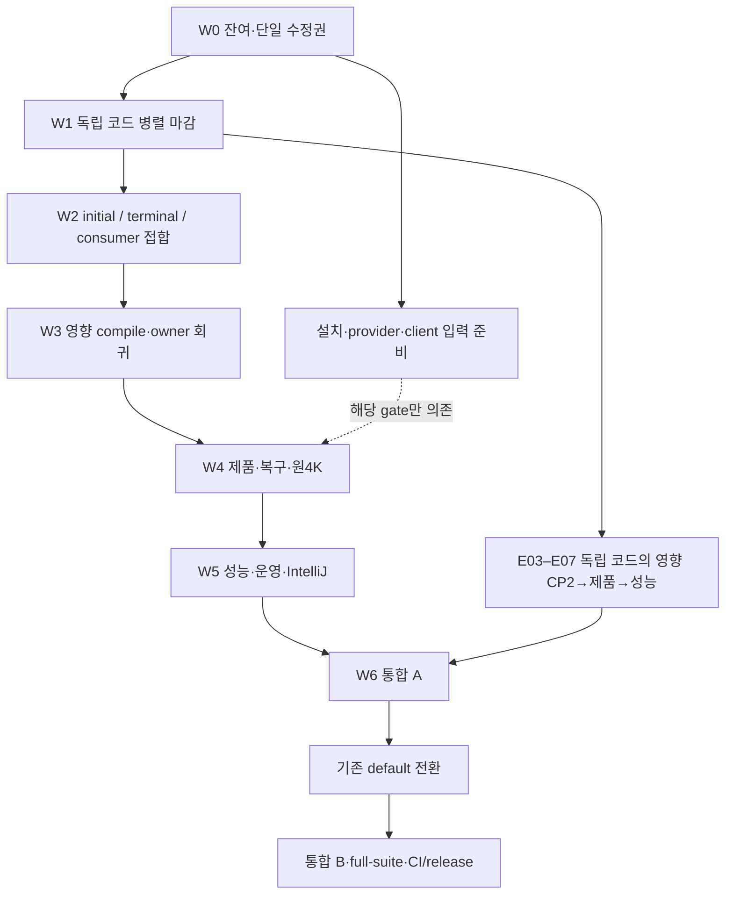
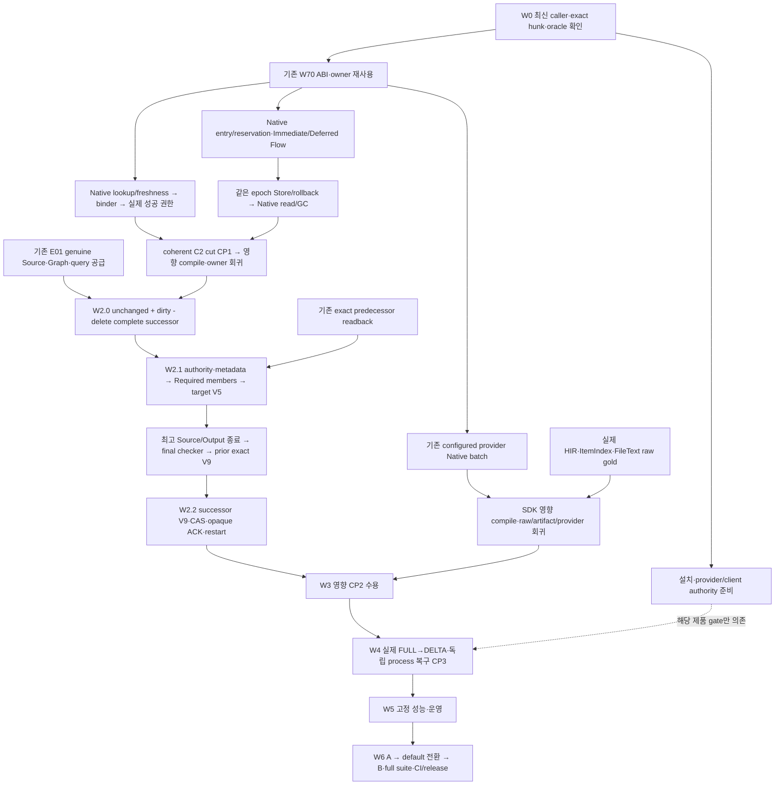

# Finalizing — 웨이브 실행 계획

상태·담당·다음 조건은 [README의 8개 에픽](README.md#epics), 실행 결과는 [VALIDATION](VALIDATION.md), 독점 파일/함수는 [OWNERSHIP](OWNERSHIP.md)만 갱신한다. 이 문서는 실행 순서와 입출력 계약이다. 새 티켓·상태 원장·담당을 만들지 않는다. 전체 종료 분모는 [E01–E08 / R01–R40](DOD.md#final-dod) 그대로다.

L1의 최신 단일 수정/실행 경계는 [2026-10-30 L1 구획](#e02-l1-closeout-order-20261030)과 [최종 검증](VALIDATION.md#e02-l1-final-audit-20261030)을 따른다. 과거 dispatch/active 관찰을 별도 현행 배정으로 복제하지 않는다.

D 실행 재개 순서: 실제 경계 수리 → 영향 정적 검사 → 용량·OS·supplier·완전한 source cohort admission → 기존 L1 owning 큐. P60는 I의 실제 통합 static PASS와 canonical exact requests를 추가로 받은 뒤 같은 실행자에서 owning → SDK → process/restart/next-event를 검증한다. [필수 입력·기존 lane·중복 제외 계약](/Users/songmin/.codex/artifacts/qidx-e02-delta-packets-20261028-01a17e61/executor/finalization-20261101T141910Z/P60-WAITING.md). Gate 파일 존재·idle·static fixture 선언은 실행 완료가 아니다.

2026-10-30 P07 후속 순서: C의 기존 request/response codec·SDK method selection·retained DATA를 유지하고, 실제 dependency-owner admitted transport ABI가 공급된 뒤 encoder→동일 configured client→decoder를 연결한다. 생산 enum5+테스트 패턴1은 lexical 계약으로 소스 수리됐으므로 외부 후보 패치를 다시 적용하지 않는다. P05 seed/pair/installer·QE prior identity와 L1–L4 생산/회귀는 기존 담당을 유지하며 C의 새 병렬 작업으로 배정하지 않는다. owning Runtime P07 module→genuine local HTTP/환급→public/remote SDK는 각 입력이 준비된 뒤 기존 Native/common Root 큐에서 별도 판정한다. [현재 소스·실행 범위](VALIDATION.md#e02-provider-final-audit-20261030-c)·[C 수정 경계](OWNERSHIP.md#e02-provider-c-boundary-20261030).

## Wave map

| 웨이브 | 작업과 산출물 | 병렬 범위 / 합류 | 종료 조건 |
| --- | --- | --- | --- |
| W0 — 잔여·수정권 확정 | 최신 caller·dirty hunk·기존 실행 결과를 대조해 실제 미완료만 추림 | Root가 공용 접합을 소유. 기존 owner는 자신의 경계만 확인 | 실제 결손마다 단일 writer와 기존 oracle 확정. 완료 코드·동일 실행 재발급0 |
| W1 — 독립 코드 마감 | 실제 Source/query 공급, SDK Native 소비·provider admission·unchanged typed artifact 공급, 확인된 Runtime/PUB 실패 custody, SEARCH/lexical·PHYSICAL·IDE/BOOT 수리 | 아래 독점 lane을 병렬 진행. 공급 내부는 공통 ABI 확정 후 소비자/재취득을 분리. 공용 parent·feature/export는 Root 또는 기존 SDK parent owner가 결합 | 정적 경계/서명·원인/partial/drop 계약 충족. 실제 typed 공급과 W2 연결점 제출. helper 존재만으로 공급 완료 처리0 |
| W2 — 실제 게시·소비 연결 / CP1 | initial receipt/authority → pending/V9 → terminal Native generation/root → 기존 CAS/ACK → SDK/AST/BOOT | FULL/delta 입력 준비는 분리. 공용 writer parent는 Root, SDK parent는 PUB 한 writer | 성공과 거절 모두 실제 caller→consumer 연결. ordinary 우회·guard 재진입·합성 authority 없음 |
| W3 — 영향 compile·owner 회귀 / CP2 | 합류 코드의 Runtime·SDK/CP·Q owning 검증 | 기존 요청 재사용. 같은 host heavy 작업은 admission 아래 직렬 | 컴파일과 실제 선택 본문 각각 통과. 실패 원인 수리 뒤 동일 rail 재검증 |
| W4 — 제품·복구 / CP3 | 공개 FULL/delta/delete/query, 5 durable cut, 원4K, IDE/BOOT candidate | 각 기능의 영향 CP2와 입력이 준비되면 실행. SEARCH 원4K·독립 IDE/BOOT gate는 E02의 미완료를 전역 대기 조건으로 삼지 않음 | cold gold·same-operation 복구·오류/취소/환급·실제 consumer 수용. 독립 결과는 W6에서 합류 |
| W5 — 성능·운영 / CP4 | 초기/증분, Large/XL, mixed, Off/Record, 압박·유지보수, 실제 IntelliJ 비교 | 해당 기능을 수용한 고정 source/profile별 진행. 공유 host 성능 부하는 직렬 | 품질 AND latency/처리율 AND 총자원/유지보수 한도 충족 |
| W6 — 통합 A → 전환 → B | pre-switch A → 기존 default 전환 → post-switch B/full-suite/CI/release | 기존 E06/E08 owner가 앞 결과를 소비 | 모든 필수 DoD 수용. 필수 FAILED/BLOCKED/NOT_RUN0 |

**계획된 코드 마감은 W1/W2, 전체 종료는 W6다.** 아래 도식은 영향 기능별 의존 경로이며 전역 실행 barrier가 아니다. W3–W5에서 확인한 결함은 원 owner가 수리하고 영향 gate를 다시 통과해야 한다. SEARCH 제품 검증은 무관한 Runtime 접합이나 전체 Semantica campaign 완료를 기다리지 않는다. 설치/provider/client 입력 준비도 W0부터 병렬이며 입력 부재는 해당 gate만 BLOCKED다.

## Next execution batch

실행 순서만 정의한다. 현재 판정은 [README E01](README.md#e01)·[E02](README.md#e02), 소스별 실패/실행 결과는 [VALIDATION](VALIDATION.md), 유일 writer는 [OWNERSHIP](OWNERSHIP.md#native-query-closeout-writes)이 소유한다. 아래 작업 이름은 새 담당·채팅·진행 원장이 아니다.

1. **E01 / 실제 producer 합류 뒤 수용.** W205의 precommit pin/capture·canonical FileText/BuildContext·Java inventory·Product/context·provisional import graph·공개 commit caller와 BC/FT/Java mount3개는 Main에 구현됐다. [현재 여섯 목표·정확한 다음 작업](OWNERSHIP.md#w205-closeout-20261030)과 [원 검증](VALIDATION.md#w205-proof-20261030)만 현재 실행 큐로 사용한다. 과거 R77 packet을 재적용하지 않는다. 동일 Source의 canonical 입장→owning compile→Runtime floor3/Strong2→공개 Java5·별도 precommit 모델2·Linux SDK7→실제 설치 provider 실패/최종 alias 관측 순서다. 공개 Java5의 Maven/Gradle2는 기존 ensure_indexed 본문을 재사용한다. R789 provider fixture·공개 alias/최종 환급 관측·실제 Native caller/wire/cfg/header 연결은 Main에 구현됐다. R790의 typed terminal·실제 서비스 readiness·canonical digest·exterior Source/Host 보완까지 같은 묶음으로 소비한다. 기존17 SDK selector와 별도 wire/packet/digest7 단위 본문의 owning 실행을 진행하며 같은 코드를 다시 발주하지 않는다. 코드 후 검증에서 용량 하한을 회복한 뒤에도 Source closure 변경으로 Cargo는 시작하지 못했다. Source capture가 세 번 변경되어 중단된 요청은 compiler/body NOT_RUN으로 유지한다. L1-D 구현/검증·E02 DELTA·Watch·Graph를 W205에 재배정하지 않는다. initial Source/Graph commit 양성 및 foreign/cancel/late failure의 custody 보존은 여전히 실제 실행 출구이며, Source tracing이나 다른 Source의 결과로 대체하지 않는다.
2. **기존 K/H/T / 독점 source 절단.** [공용 hunk map](OWNERSHIP.md#native-query-closeout-writes)에 따라 K=Query hook·Kernel port, H=SemanticModule·PTA/cohort·FunctionSummary, T=동기 family, Root=Runtime caller·공용 export·실제 fixture를 분리한다. 실제 미구현 hunk에만 writer를 둔다. 기존 sync/async 의미와 Args Eq/Hash/wire, 같은 caller-owned typed failure bank를 유지한다. issuer/IR/registry·ordinary fallback을 추가하지 않는다.
3. **E01 / genuine query→planner→writer.** 기존 1→1/N→1/1→N·upsert/delete의 독립 ID/span/text/order/digest, 실제 uncached query 횟수·delete query0·역순/늦은 실패/취소/환급, 실제 writer receipt/artifact와 cold-target gold를 수용한다. 테스트용 opaque query output·synthetic Source는 사용하지 않는다. 기존 owning 실행은 중복 제출하지 않는다.
4. **E01 공급→E02 소비 / complete DELTA successor.** 변경되지 않은 ItemIndex의 권한 있는 재취득과 dirty checked owner 교체·delete 제거를 기존 canonical owner에서 완성한다. History·Chunk·Graph/CallGraph·RepoMap과 target-bound carry를 함께 반환한다. 아래 [E02 W1→W2](#e02-residual-wave-plan)를 따른다. dirty-only FULL packet·predecessor target authority·전체 query 재수집은 대체 입력이 아니다.
5. **Root / E02 실제 게시·복구.** 조기 입력·authority+metadata 단일 이동→member/target V5→Source/Output 종료 뒤 최종 검사→이전 ACK exact V9→successor V9/ACK·동일 identity 재시작을 직렬 합류한다. 독립 오류/fixture·설치 입력은 병렬 준비하고 CP1 뒤 영향 CP2, 이후 installed CP3로 수용한다.
6. **기존 E03–E08 / 독립 gate와 전체 마감.** lexical·원4K·IDE/Auto·SDK/BOOT·성능/운영은 각 입력이 준비되면 병렬 진행한다. E08이 E01–E07·R01–R40·필수 P2I/UX/AUTO·실제 IntelliJ를 대조해 A→default 전환→B/full-suite·exact-source CI/release를 마감한다. E02 완료로 전체 DoD를 축소하지 않는다.

후속 디버깅에서 QBC가 지원하는 mutable cohort를 사용해도 같은 target·features·전체 선택 본문·oracle를 유지한다. 해당 guard의 Source가 바뀌면 결과를 갱신하고, 최종 frozen 제품/성능 수용을 대신하지 않는다. 공유 writer/index/HEAD/commit/push와 동일 host heavy 검증·성능은 직렬화한다. 외부 authority 부재는 해당 gate만 BLOCKED이며 무관한 코드 수리를 막지 않는다.

## E07 Native 인덱싱 RCA 전환

현재 판단과 신규 패킷은 [bugbash SSOT](../nov-5-indexing-bugbash/README.md),
[구현·검증 계획](../nov-5-indexing-bugbash/WORKPLAN.md)이 소유한다.
이전 C/R/F 패킷과 실행 순서는 [보존 본문](../../history/nov-5-indexing-bugbash/E07-WAVES.md)에 있다.
기존 구현·과거 요청을 새 잔여 작업으로 재발급하지 않는다.

[이전 계획 이력](../../history/nov-5-indexing-bugbash/E07-WAVES.md#e07-closeout-plan-20261030)

[이전 계획 이력](../../history/nov-5-indexing-bugbash/E07-WAVES.md#e07-remaining-rca-plan-20261031)

[이전 계획 이력](../../history/nov-5-indexing-bugbash/E07-WAVES.md#e07-residual-packets-20261102)

[이전 계획 이력](../../history/nov-5-indexing-bugbash/E07-WAVES.md#e07-wal-policy-execution-20261103)

[이전 계획 이력](../../history/nov-5-indexing-bugbash/E07-WAVES.md#e07-entry-map-rca-plan-20261103)

[이전 계획 이력](../../history/nov-5-indexing-bugbash/E07-WAVES.md#e07-entry-map-contract-parallel-tests-20261103)

## W1 — 독점 병렬 묶음

파일/함수의 유일한 수정 경계는 [OWNERSHIP](OWNERSHIP.md#parallel-implementation-schedule)·[공용 hunk map](OWNERSHIP.md#compiled-handoff-owner-map)이 소유한다. 아래 lane은 기존 owner를 뜻하며 새 담당이나 채팅을 만들라는 지시가 아니다.

| 기존 lane | 이번 코드 산출물 | 중복 금지·합류점 |
| --- | --- | --- |
| Root / Runtime 테스트 closure | 공통 test-support mount·명시 support gate·재export·actual capability와 fixture API 정합성 | 공용 `testing.rs`/helpers/`lib.rs` 한 writer. private orchestration·writer fixture는 exact 파일로 분리. Clone/Eq 복원·assertion/시나리오 축소 금지 |
| Root + P / E02 | initial borrowed receipt/authority 조립과 terminal Native replay/root의 정확한 반환·실패 계약 | Root는 upper caller와 공용 parent, P는 기존 bank의 확인된 private 결손. 같은 root 함수/serial을 둘이 변경하지 않음 |
| PUB / E01·E05·E06 | 실제 lower whole failure → 공개 SDK terminal, ACK custody 소비와 Source/FULL 인계 | PTA/Product/Source/Store lower는 기존 Semantica owner. 내부 writer/CAS와 A/B/D producer 재작성 금지 |
| SEARCH·lexical / E03·E04 | 원4K materialization 및 초기/증분의 확인된 비용 원인 수리 | Catalog/VFS/Common은 PHYSICAL. 동일 함수·원4K 실행 중복0. 새 worker/engine을 원인 없이 추가하지 않음 |
| PHYSICAL / E02·E07 | 실제 file/FD/capacity/fault 결손과 운영 입력·기존 oracle | 확인된 local 수리는 재사용. SEARCH의 알고리즘/worker를 별도로 변경하지 않음 |
| AST·BOOT·Auto / E05·E06 | 기존 queue/apply/candidate/rollback·교체 가능한 정책 consumer의 잔여 | 실제 committed Source/FULL 소비. 합성 target/Original/receipt 금지. default 전환은 W6 |

A/B/D private producer·Wire exterior·P generation/root bank·funded SDK·opaque ACK는 기존 구현을 먼저 소비한다. 해당 코드의 새 결손이 확인된 경우에만 원 owner가 수리한다. 적용된 stage snapshot·ReplaceScope changed-docs·별도 delta/full plan도 재개발하지 않는다.

**반환 계약:** 변경 파일/함수, 재사용한 owner, 실제 caller/consumer 또는 정확한 W2 연결점, first/secondary typed cause·partial·최종 drop, 고정 expected oracle, 실행/미실행 범위. 작업 채팅끼리 질문·메시지·상태 조회·재배정하지 않으며 Root가 현재 소스와 최종 결과를 직접 읽어 합류한다.

## E02 shared join order

**현재 채팅의 최종 합류 순서 — 2026-11-06:** 상태·담당은 [README](README.md), 실행 근거는 [VALIDATION](VALIDATION.md#e02-peer-ownership-refresh-20261106)이 소유한다. 이 절은 순서·입출력 계약만 유지한다.

1. **기존 C02 Source/Full/Solver:** actual producer와 consumer, 새 child를 포함한 안정된 전체 module closure를 반환한다. 공용 `original_java_final_rows_v7/nested_constructor_v1.rs`는 Source claim 아래 단일 hunk로 검토·합류하며 Full의 별도 소비 코드와 중복 발주하지 않는다.
2. **Root 코드 인계 → 기존 D 단일 실행:** 진단 visitor/observer·typed cause 생산 수리와 Runtime5/SDK1의 원 선택 본문·예산을 보존해 소비한다. D는 이미 정합화한 공통 lib(test) floor + Product V4의 현재 등록 class·suite·기존 추가요청 큐를 사용하며, 그 식별자와 실행 상태는 README/VALIDATION에서만 관리한다. 폐기된 profile의 재생성을 새 작업으로 발급하지 않는다. exact5 witness·threads0·예산과 SDK1 원 요청은 유지한다. Runtime은 required suite `native-incremental-runtime-phase-cause-visit-owner`의 정확5 witness, SDK는 기존 `native-incremental-sdk-phase-cause-visit-owner`의 정확1 witness를 요구한다. D의 기존 ItemIndex/capsule pair를 대체하지 않으며, compiler feature/helper 수리는 D의 같은 owning 경계에서 수행한다.
3. **기존 RQR-E 공급:** 기존 worker의 terminal 원인을 수리한 coherent source에서 기존 typed 경로로 재개하고 source/lock/recipe·Linux architecture·서명된 Native runtime memory ceiling에 결속된 실제 설치 image 절대 경로·기대 SHA256·daemon을 반환한다. compiler의 thread/container 자원은 제품 runtime 예산과 분리해 QBC로 입장·기록하며, 환경을 바꾸면 새 receipt/artifact identity를 요구한다. 종료된 worker나 stale RUNNING 파일을 대기로 세지 않으며, 입장 제어 프로세스와 실제 compiler 실행을 구분한다. Root는 중복 worker/daemon 빌드를 발급하지 않는다.
4. **D 설치·복구 수용 → Root 마감:** 새 SDK1 뒤 원래 Facts2/first-FULL3와 genuine DELTA의 동일 operation/target 복구·취소/늦은 오류·최종 drop을 기존 suite/oracle에서 수용한다. [기존 다섯 durable cut](E02-publication-recovery.md#five-durable-cuts)을 새 fixture로 재작성하지 않는다. Root가 실제 terminal result·nonzero witness와 source 영향만 대조하고 README/VALIDATION을 마감한다.

각 담당에게 한 번 전달한 작업을 그대로 소비한다. 채팅 간 질문·재배정·중복 실행 큐를 만들지 않으며, 접수/정적 통과/컴파일과 실제 본문/설치 process 수용을 분리한다. 이 순서는 전체 E01–E08·원 DoD·성능/CI/release의 완료 조건을 줄이지 않는다.

**E02 B 마감 순서(2026-11-03):** B source·cold suite/consumer는 닫혔고 L3 current-M/fault/cancel/unwind·Chunk19·L2 공용 인계도 source-present다. A의 과거 takeover 이후 현재 단일 executor는 D다. D가 actual final source/독립 gate·정확 tuple·Cargo/OS/supplier admission을 확인한 적격 요청만 owning→지원 Linux/process로 수용한다. 새54prepared는 accepted45와 별도이며 기존 결과를 무조건 재실행하지 않는다. P60/P07 실제 source 잔여는 원 owner가 마감한다. [current checkpoint](VALIDATION.md#e02-b-trace-reuse-final-audit-20261030).

### E02 — 현재 코드에서 시작하는 구조적 실행 순서

이 절은 E02의 실행 순서만 정의한다. 현재 상태는 [README E02](README.md#e02), 최신 코드 근거는 [최신 B source/증거 감사](VALIDATION.md#e02-b-trace-reuse-final-audit-20261030)(다른 E02 범위는 해당 owner checkpoint), 변경 단위는 [기존 E02의 일곱 접합 계약](E02-publication-recovery.md#production-join-contracts), 유일 writer는 [OWNERSHIP](OWNERSHIP.md#e02-current-wave-hunks-20261026)이 소유한다. 기존 private/공용 owner는 유지하며 과거 A/B/C 명칭을 새 작업 배정으로 해석하지 않는다. 새 채팅·티켓·상태 원장을 만들지 않는다. E01–E08/R01–R40 종료 분모는 유지한다.

**재사용할 시작점:** Native SDK raw/policy/views/artifact/proof ingress와 whole-failure bank, FileText/ItemIndex decoder, paid closed memo producer, admitted trace/read-authority packet, Native physical phase·Trace prepared owner·binding phase, W70 Source 종료 후 Native binder는 이미 구현돼 있다. 이를 다시 정의하지 않는다. 실제 연결 순서는 Native lookup/freshness/성공 권한과 Native entry/reservation/persist Flow → 같은 epoch Store/rollback·Native read/GC → complete DELTA successor → 기존 member/V5/V9/ACK 및 같은 operation restore다. configured Voyage Native batch는 독립 기존 provider owner의 코드 절단이다. Source-bound owning 회귀와 genuine persisted 제품 양성을 구분하고 coherent caller cut 전 capability=false를 유지한다.

**최종 실행의 합류:** [조회·재사용 / 저장·회수 / DELTA 게시·복구](E02-publication-recovery.md#production-join-contracts)의 세 묶음으로 실행하며 기존 일곱 세부 계약은 유지한다. 이미 source에 있는 조회·저장 요소는 재사용하며 private 잔여·영향 회귀와 DELTA 입력/fixture 준비는 공용 ABI 고정 뒤 병렬 가능하다. 공용 query/packet/CP/Kernel·reader gate는 Root가 직렬 합류하고, 동일 epoch Store/rollback/GC의 integrator는 하나다. complete successor 생산과 Native configured provider는 기존 owner가 공급한다. 각 coherent 코드 합류 뒤 CP1·영향 회귀를 한 번 실행하고 실제 SDK/독립 process 복구를 다음 체크포인트에서 수용한다. 아래 과거 슬롯명은 담당 변경이나 완료된 decoder/phase의 재개발 지시가 아니다.

도식은 기능별 의존 관계다. E01 초기 Source/Graph commit에 Index FULL/DELTA 성공을 역으로 요구하지 않는다. E03–E07은 각자의 준비된 입력으로 계속 진행하며 E02 완료를 전역 barrier로 삼지 않는다. 같은 host의 heavy compile·제품·성능은 admission 큐 하나에서 직렬화한다.

#### W0 — 매 배치 착수 시 확인

- 최신 HEAD·dirty hunk·실제 caller·live claim을 읽고 **함수별 writer 하나**를 확정한다. claim은 lock·구현·완료 증거가 아니다. Root가 같은 hunk를 조정하고 독립 private 작업은 진행한다.
- J의 paid plan/metadata/outline·7 sideoutputs·State/batch/publish, FileText/literal/substrate, C1 query8/9·row/pin, FULL/History/Store·opaque ACK는 재사용한다. 새 serializer·Source issuer·IR twin·별도 cache/store를 만들지 않는다.
- 각 묶음의 고정 oracle와 source/compile/body/product 경계를 먼저 적는다. 설치 입력 부족을 C2/DELTA 코드 미구현의 이유로 쓰지 않는다.

#### W1.0 — 공유 계약과 현재 소스의 작은 결손 마감

| 병렬 슬롯 | 해야 할 일 | 다음 묶음에 넘길 것 |
| --- | --- | --- |
| **Root / 공유 계약·parent** | 기존 Query hook·verified carrier·W70 binder/birth 및 Native phase/gate 계약을 재사용한다. 실제 Native 조회·Flow/Store·동일 epoch reader의 반환/실패 ABI를 필요한 exact hunk에서 결합한다 | existing ABI를 소비하는 caller. decoder/packet/새 Source·IR twin·raw bytes+boolean 권한 발급0 |
| **A / genuine raw 회귀** | 이미 있는 raw 생산자와4개 회귀는 재사용. 실제 managed HIR+ItemIndex+FileText로 direct/merge/split·ID/span/text/order/model 정책의 비어 있지 않은 양성과 Source/body 동시 실패·마지막 drop을 추가 | 기존 paid projection fixed gold와의 독립 비교. 문서-owner gold만으로 SDK raw 양성을 대신하지 않음 |
| **B / artifact 테스트 closure·provider 경계** | artifact3개 테스트의 GQLang 전용 gate/import를 실제 Native SDK profile에 맞춘다. 기존 proof provider·Q hash/normalization·오류 cause/선과금 수리는 재사용. 필수 configured provider의 canonical transport/codec에서 실제 미과금 hunk만 확정한다 | Native SDK profile에서 수집되는 artifact 회귀와 configured provider의 정확한 수정 경계. Unsupported를 지원 완료로 세지 않음 |
| **C 반환 → Root / Native 조회·Store 연결** | 기존 paid prepared-read/key/buffer·Native observed/currentness를 실제 lookup/freshness·I/O·binder·성공 read-authority에 연결한다. Native Flow/Store/coherent ticket·rollback/GC는 별도 private hunk로 직렬 합류한다 | 실제 Native row의 요청/오류/guard 보존. 기존 prepared API/phase/helper를 다시 만들지 않고 ordinary metadata 복원0 |

C2 proof는 QueryExecutor가 exact memo/currentness와 실제 ArtifactRef의 size/hash/schema/codec을 확인한 뒤에만 발급한다. query owner는 이 증거와 현재 Original/target을 소비해 typed semantic invariant를 검증한다. 검증 순서 때문에 자기 발급 전 proof를 요구하는 순환을 만들지 않는다. 기존 carrier/owner 확장을 우선하며 proof는 wire IR나 Source issuer가 아니다.

#### W1.1 — ABI 고정 뒤 Root+3개 병렬 구현

| 실행 슬롯 | 독점 산출물 | 합류·제외 |
| --- | --- | --- |
| **Root / 공용 carrier·SDK** | 공유 Query/verified carrier/export·feature를 한 번 결합하고 입력 bank→highest Source→semantic packet/proof ingress 수명을 대조한다 | 아래 A/C의 private body를 중복 수정하지 않음. 이미 연결된 raw/views/artifact caller는 재사용. PUB SDK ACK parent는 기존 owner |
| **A / query owner 소비·실제 fixture** | 이미 구현된 FileText/schema3 decoder·paid validator·persisted checked backing을 실제 Native binder 입력과 소비자에 연결한다. genuine snapshot row/Revision/provider fixture·현 Original/target·recipe·bytes/guard를 함께 검증한다 | decoder 재작성/새 Store/별도 ItemIndex IR0. index-only 소비와 genuine HIR 전용 소비 구분. 테스트 fixture 결손을 제품 provider 부재로 기록0 |
| **B / 실제 configured provider** | 선택된 기존 provider/transport의 요청·응답·정규화·오류를 사전 allocation/work admission과 연결하고 SDK의 동일 policy/model/recipe에 결속한다 | 별도 funded SDK RPC와 Q canonical hash는 재구현하지 않는다. Voyage HTTP의 admitted pre-I/O/요청·응답 경로 자체는 아직 구현 대상이다. 네트워크 credential 부재는 실제 remote 수용만 BLOCKED; 구현 결손을 환경 문제로 표시0. proof hash 양성으로 remote provider 수용 대체0 |
| **C 반환 → Root / QueryExecutor Native memo hit 마감** | C의 observed row move·same-scope prepared read→Source 종료→I/O→memo/current/source/recipe→Kernel decode partial caller를 재사용한다. Root가 upper caller와 store/lookup/ordinary guard의 Native 분기, error/metadata funding을 직렬 합류한다 | `into_entry` deep clone·ordinary decode/Arc 우회0. read 전/후 동일성 검사·first/secondary error·partial/guard 보유. capability만 먼저 켜거나 쓰기만 활성화0 |

기존 decoder·validator·closed memo producer·Native reservation·admitted artifact/Deferred packet·W70 binder와 Memo/Trace/binding 공통 게시/역보상 구현은 재사용한다. 실제 Native observed row/read authority 소비도 source에 있으므로 Ordinary-only/Store 전체 미연결을 새 TODO로 배정하지 않는다. query capability 기본false와 실제 Runtime/SDK·cross-generation·cold 수용은 별도 미완료다. B의 적용·검증·committed supplier 잔여와 정확한 실행 순서는 [2026-10-30 감사](VALIDATION.md#e02-b-trace-reuse-final-audit-20261030)를 따른다. GC·HTTP/Voyage·Graph·Watch와 공용 parent/검증 담당은 유지한다.

A의 ItemIndex private 구현과 Root의 QueryExecutor 통합은 별도 hunk로 진행한다. raw 양성 fixture에 진짜 공급 결손이 있으면 그 원 producer의 정확한 hunk만 먼저 수리한다. raw 양성에 필요한 E01 공급이 없으면 해당 fixture의 정확한 입력 결손을 남기고 A의 독립 decoder/validator를 진행한다. raw/provider 검증 대기를 W2.0 successor 코드의 전역 선행 조건으로 만들지 않는다.

**Capability의 의미:** 지원 표시는 구현 계약이지 테스트 통과 플래그가 아니다. 완성된 Native write/read/decode/checked-consumer를 같은 변경 묶음에서 candidate로 연결하고 영향을 검증한다. 경로를 비활성 상태로 둔 채 그 경로의 성공을 요구하는 순환도 만들지 않는다. 검증 전 소스 연결을 제품 수용으로 승격하거나 default를 전환하지 않는다. 폐기된 상위 preborn bypass는 caller 이행 뒤 제거하며 준비 단계와 실제 I/O의 책임 분리는 유지한다.

#### 소스 묶음별 체크포인트

- W1.0와 W1.1의 coherent source 묶음마다 CP1과 **한 번의 영향 compile·owner 회귀 배치**를 실행한다. 미컴파일 코드를 W2 끝까지 계속 누적하지 않는다. heavy 실행은 Root 단일 큐다.
- 현재 D/A의 actual initial-authority 준비는 기존 metadata stage를 통째로 보존하는 상태로 이전한다. 이 상태를 member/V5·ACK 완료로 해석하지 않는다. 검증은 Symbol·물리 currentness·QE·Native-delta owner별 실제 본문 범위를 분리하고, 완전 SDK entry fixture 부재는 VALIDATION의 미수용 항목으로 유지한다.
- Native SDK는 이미 등록된 `quanta-runtime.no-default.73ab9f2c701b` (`original-snapshot-v3`+`search-plane-sdk-ingress-product-proof`)의 실제 raw/view/provider/artifact 경로와 테스트 수집을 확인한다. 기존 ordinary-only feature의 GREEN으로 대신하지 않는다.
- source 변경이 필요한 compiler/body 실패는 원 hunk에서 수리한 뒤 같은 rail을 재검증한다. 같은 상위 실패를 selector/feature 축소로 반복하지 않는다. 무관한 유효 GREEN은 재사용한다.

#### W2 — complete successor와 게시·ACK의 단일 writer

| 순서 / Root 단일 writer | 실제 입력 → 산출물 | 종료 조건 |
| --- | --- | --- |
| **W2.0 / complete successor** | C2 unchanged checked owner + dirty checked output − delete를 동일 transition/target에 합성한다. History·Chunk·Graph/CallGraph·RepoMap complete path-set/closure와 target-bound export 입력을 기존 E01 owner에서 받아 결합한다 | no-op/delete/rename/recreate·unchanged sibling·동일 key를 cold FULL gold와 비교. dirty-only FULL·predecessor export authority·전체 unchanged query 재수집0. aggregate 준비와 V5 후 proof 결속을 나눔 |
| **W2.1 / authority·member·V5** | initial authority+entry/metadata·Source/query/outcomes를 한 번 이동→기존 BoundDeltaPlan/Required member→target V5→target proof→최고 Source/Output 종료→final checker→이전 ACK exact V9 | 조기 거절은 member I/O 전. 늦은 거절은 successor V9/visibility 전. immutable orphan/abort·전체 partial/원 cause 보유. active Source visitor 내부 V9/RPC0 |
| **W2.2 / V9·ACK·재시작** | issued custody→기존 begin/reconcile/claim/V9/dispatch/CAS→opaque ACK→committed-source consumer·checkpoint cleanup | 동일 operation/attempt/target·원 cap/policy. unbound Dispatching은 Pending; bound ACK 유실은 exact replay. 재stage·중복 visibility/CAS0. payload/DATA drop 뒤 최종 funding 환급 |

W2의 공용 authority/state/coordinator/ACK는 직렬이다. 옆에서는 독립 fault fixture와 설치 입력만 준비한다. 기존 FULL/History/Kernel seal·Store·opaque ACK/PUB를 재작성하지 않는다.

**성능 경계:** 현재 RepoMap recipe/export의 전체 map 순회·해시·직렬화는 비용에 포함한다. C2 재사용만으로 전체 DELTA O(delta)나 latency 상한을 주장하지 않는다. W5에서 원 고정 profile의 실제 query/decode/provider·publication·maintenance·scratch/physical 비용을 측정하고, 초과하면 기존 changed-node/root/closure seam을 수리한다. cap 증가·full scan 은폐·유지보수 비용 제외는 통과 방법이 아니다.

**코드 마감은 W1+W2+CP1, 동작 마감은 영향 CP2+실제 CP3, 원래 전체 마감은 W6다.** 설치 입력 부재는 해당 수용만 막으며 코드 잔여를 없애지 않는다.

## W3 — CP2 영향 compile·owner 회귀

- Q는 Justfile/`./scripts/cargow`, S Runtime은 기존 owning QBC, SDK/CP·TSJS는 기존 등록 요청을 재사용한다. 같은 host heavy 실행은 한 큐다.
- E02의 기존7+supplemental2+Linux3은12개 논리 회귀 요청이며 전체 CP2/DoD 분모가 아니다. 현재 DELTA caller·member·최종 검사·ACK/restart의 실제 영향 본문을 추가로 수용한다. Source59 opened-root3/3은 당시 Source의 이력이며 삭제된 root/lease로 재개하지 않는다. Host/Linux는 플랫폼별 새 공식 Source·feature·실행 결과에 결속한다.
- canonical wire/digest·역순 manifest·duplicate/missing/unknown/foreign/trailing JSON·before-write/RPC 거절·stale owner/epoch/revision CAS를 독립 expected로 검증한다.
- 성공/거절/cancel/panic/unwind·late Source·payload-before-backing·마지막 drop 환급과 Vector artifact/undo를 실제 본문으로 확인한다.
- compile0, 선택 본문 수, 본문 결과를 분리한다. module filter는 lib(test) 전체 컴파일을 줄이지 않는다. canonical 53본문의 feature별 28/25를 구분하고 실행하지 않은 본문을 성공으로 세지 않는다.
- 새 실패는 현재 source/원인과 대조해 원 owner에 되돌린다. feature 축소·쉬운 selector·assertion 제거·private API의 무근거 확장으로 우회하지 않는다.

## W4 — CP3 제품·복구

- 실제 FULL/delta/delete/rename/recreate/no-op/Resync·전체 affected domain·RepoMap/lexical/semantic/public query를 cold-target gold/P2I01–08로 검증한다. Q native와 Semantica 연동 결과를 구분한다.
- [Facts2 + first-FULL3의 5 durable cut](E02-publication-recovery.md#process-proof-routing)을 같은 operation/target/policy로 수용한다. helper(None)·재수집·새 key·budget reset으로 대체하지 않는다. discovery는 per-operation Original을 발급하지 않고 unbound Dispatching은 Pending을 유지한다.
- E02는 위5 cut과 별도로 [genuine first-FULL→DELTA 복구](E02-publication-recovery.md#e02-checkpoint-acceptance)를 수용한다. 실제 DELTA의 persist/claim/V9/ACK 유실·재시작을 current source와 signed SQL worker provenance에 결속한다. first-FULL 양성이나 owner-unit GREEN만으로 DELTA process 수용을 대체하지 않는다.
- SEARCH는 [원4K](E04-semantic-ann.md#original-4k-gate)의 aggregate completion → Q64/filter recall → reopen/delta/path/overlay를 원 cap/deadline으로 검증한다. 원인/수리/입력 변경 없는 실패 재실행은 하지 않는다.
- actual editor overlay/save/좌표/action·Fast/Deep/Auto와 BOOT candidate verify/serve/reopen·predecessor rollback을 수용한다. 이 단계는 candidate/opt-in이다.
- installed searchd·SQL worker 절대 경로와 신뢰된 expected SHA/provenance, 승인된 Linux target·실제 provider/client가 필요한 gate는 그 입력을 먼저 확인한다. Docker 존재나 자체 계산 hash는 설치 authority가 아니다.

## W5 — CP4 성능·운영·실제 IDE 비교

- 측정 전에 source/dependency/binary·hardware/profile·corpus·독립 품질 gold·cap/latency/표본 기준을 고정한다. ANN 원4K·Large/XL 기능·Linux2CPU/6GiB 운영·native/IDE100K profile은 구분한다.
- full bootstrap·고정 delta/no-op·N/H/M/history/fanout·1/100/1000파일 batch·지속 churn을 기존 harness로 측정한다. CPU/bytes/objects/IO/provider·maintenance debt·actual total RSS/scratch/physical peak를 포함한다.
- [E07 운영 계약](E07-performance-operations.md#fixed-profiles-and-oracles)의 Large/XL ACK/search/reopen·원960초 mixed·long pin/pressure/fault/shutdown·직렬 교대 Off/Record≥3쌍을 수용한다.
- [IntelliJ 수용](E08-integration-release.md#actual-intellij-acceptance)은 같은 workflow·언어/capability·품질·cache/hardware 비교와 RFC absolute gate를 함께 요구한다. fixture는 실제 editor 비교를 대신하지 못한다.
- bulk/sort/spill·group commit·bounded compaction·재사용은 관측된 비용 원인의 기존 seam에서만 실험한다. budget 확대·실패 표본 제외·유지보수 이연으로 합격시키지 않는다. hint 선택 O(M + 2VM) 등 남은 비용도 실제 작업량에 포함한다.

## W6 — 통합 A→default 전환→B

1. A에서 E01–E07 필수 기능·5 cut·원4K·성능/운영·IDE/IntelliJ·설치 authority 결과를 대조한다. 유효한 기존 결과를 통합 명목으로 전부 재실행하지 않는다.
2. A 수용 후 기존 E06 daemon/CLI/launcher default를 전환한다. predecessor·rollback·단일 Catalog head를 유지한다.
3. B에서 post-switch smoke·rollback·cleanup·current coherent full-suite/strict/public API/module·exact-source hosted CI/release를 수용한다.
4. [R01–R40](DOD.md#requirements)·P2I/UX/AUTO·필수 에픽 DoD를 모두 대조한다. 조건부 N/A만 원 계약의 근거로 허용한다. CODE_QUALIFIED·DEPLOYED·ACTIVATED·ROLLBACK_PROVEN은 구분한다.

## Checkpoint and retry rules

- 착수 직전 최신 exact path/function·실제 authority/caller·dirty/claim·기존 oracle를 확인한다. 같은 hunk는 한 writer, 공용 parent는 지정 통합자만 수정한다. 무관한 repo 청결이나 다른 campaign 완료를 기다리지 않는다.
- 코드 배치가 정적으로 합류되면 그 영향 compile/owner 회귀를 한 번 수행한다. 제품·성능은 source와 필수 입력이 준비된 checkpoint에 모은다. checkpoint에서 결함이 나오면 해당 절단만 수리한다.
- 새로운 진행률 원장·중복 queue·one-off repo evidence 파일을 만들지 않는다. source/input/profile이 달라진 결과를 섞어 성공으로 올리지 않는다.

E01의 실제 SDK/precommit 실패·수리·source별 실행 결과는 [R76 SDK](VALIDATION.md#r76-installed-sdk-pta)·[R77 Source read](VALIDATION.md#r77-precommit-source-read)에만 기록한다. 이 문서에 Source/claim/통과 수를 복제하지 않는다.

## E02 DELTA L1 — final integration to owning proof

**D session hardening — 2026-11-01 KST.** A stale duplicate QRA guard requirement was repaired;186 related tests and the owning source-policy closeout passed. Full build boundary checks remain238 PASS/1 SDK-boundary FAIL; both production dependency fences still fail. Confirmed additional original D implementation after repair:0; Runtime/SDK acceptance remains open. Existing36 proof requests and their owners are unchanged. [Current scope, actual proof and finite residuals](VALIDATION.md#e02-l1-d-closeout-20261031).

소유권은 [L1 경계](OWNERSHIP.md#e02-l1-owner-boundary-20261030), 최신 상태/증거는 [README E02](README.md#e02)·[최종 감사](VALIDATION.md#e02-l1-final-audit-20261030)만 따른다. 이전 initial patch와 hardening delta를 구분하고 이미 적용된 postimage를 다시 적용하지 않는다.

1. D가 A/B/C source·cfg·fixture postimage와 소비 ABI를 먼저 대조한다. 실제 Source B와 독립 Output A, genuine ItemIndex receipt, 기존 Source/keeper/allocator·실패 DATA/drop 계약을 유지한다. Type 품질 수리와 SDK private fixture module path 3곳은 소스에 반영됐다. C의 후속 마감에서 Python Native facade 4파일도 기존 crate-visible 공개면으로 접합됐다. 두 supplier 제안 패치를 재적용하지 않는다. D는 현재 SDK parent/fixture·canonical facade의 postimage를 결속하고 영향 gate를 갱신한다. 후속 사용자 재개에서 기존 PTA/C02 후보의 남은 callback2 인자 접합도 D가 해당 한 파일에만 반영했다. 이미 적용된 나머지2파일은 보존하며, 원 후보 전체 reverse-check가 통과한다. [새 source와 Rust 미검증 경계](VALIDATION.md#e02-l1-d-closeout-20261031)를 따른다. [반영·검증·남은 수용](VALIDATION.md#e02-l1-c-static-blockers-repaired-20261030)을 따른다. 후속 pending execution/whole-failure DATA 경계3곳도 C가 W2 실제 비충돌 hunk를 대조하고 기존 composition owner를 재사용한 6파일 수정으로 반영했다. 미적용 patch 재실행은 없다. C의 기존 composition 회귀 본문에는 실제 진입점 재시도에서 새 입력 미소비·원 map identity 보존 검사도 반영됐다. [현재 적용·D 재개·레인별 DoD](VALIDATION.md#e02-l1-c-resume-20261031)를 따르며 영향 source drift와 내용 결함, owner proof와 전체 종료 판정을 구분한다.
2. 기존 QBC lane에서 root/inner manifest·lock·features·실제 supplier를 포함한 안정된 canonical cohort를 한 번 admit한다. changing-overlay이면 실패를 그대로 남기고 다른 selector로 같은 capture를 반복하지 않는다. 이전 capacity/lock 오류와 최신 source-capture 오류를 같은 현행 원인으로 합치지 않는다.
3. D의 기존 단일 큐에서 Source94ca의 QE whole374/374·contract-ids100/100·memo-wire7/7이 통과했다. Source255f의 오류 계약1/1·Root lifecycle18/18·retained-cause2/2·RecordOnly3/3은 이전 Source의 통과로 유지한다. Runtime selector 판정은 FAILED: owning compiler212 errors / body0, exit101 on Source94ca; not a current-Main error count이다. 중첩 lock edge 수리 후 별도 canonical 고정본의59경로 static gate는 FAILED: observed 6 policy failures; full run incomplete after 600-second timeout이다. 실제 feature closure가 허용하면 preplan3 → SDK bank2/provider5/Type1 → QRA1 → 별도 Host를 이어간다. 공통 컴파일 실패 뒤 종속 body0 반복은 하지 않는다. 기존 C/G3/master 구현은 재배정하지 않으며, Linux의 lawful supplier와 Root/L3 product는 별도 수용한다. 모든 freeze-r1–r8은 RESUME이다. [현재 영수증·잔여](VALIDATION.md#e02-l1-d-closeout-20261031). 기존 큐에서 누락됐던 W20521요청/29본문도 인계 목록에 반영했다. Runtime7·QRA Full-floor3·Public Ingress packet2·SDK17의 실제 패키지/정책을 유지하고 Strong2·provider1은 목표별로 중복 실행하지 않는다. 기존 통합76요청과 같은 요청/선택 중복은0이다. 04:40 감사 당시 Source94ca 캐시가 없어 예전 준비 명령14개를 재사용하지 않도록 했다. Source9b6의 ENOSPC 중단은 이력이며, 현재 코드·검증 잔여와 새 cohort 조건은 위 현행 노트를 따른다. [최종 범위·중복 감사](/Users/songmin/.codex/artifacts/qidx-l1-closeout-20261030-01a1838d/D/closeout-20261031/final-audit-20261031T191630Z/REPORT.md).
4. 지원 Linux 환경/원 Native SQL image·signed digest·searchd/root custody가 준비되면 genuine committed-FULL plan/collector exact SDK 본문을 실행한다. Darwin에서 빠진 본문/zero-selected/ignored는 통과가 아니다.
5. 단일 실행자의 source-bound selected/executed/pass/fail/ignored·scope별 gate 결과를 D가 검토하고 영향 문서를 갱신해 L1을 닫는다. Source capture/정적 검사·컴파일·SDK body·Root/L3 process/product는 각각 별개 판정이다. 기존 QE/Root/L3와 E01–E08 종료 조건은 유지한다.
