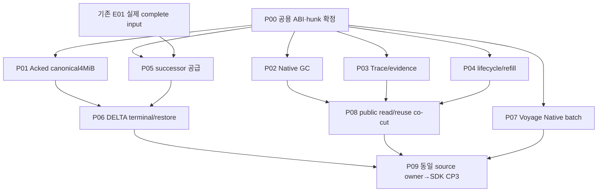

# E02 Native closeout — 병렬 실행 패킷

<!-- b-closeout-20261103 -->
**2026-11-03 현재:** B source·cold exact suite/Just consumer 및 L3/common/Chunk 인계는 source에 반영됐다. 현재 syntax7/7·영향policy7/7 및 registry/consumer/negative 검사는 통과했다. QE11 374/374·scalar4실행은 historical Source94ca 결과이며 current Source는 별도 검증한다. 현재 단일 executor는 D, accepted45와 prepared54newaccepted0은 분리한다. P60 source gate와 P07 current Native/SDK·Linux/process 수용은 남는다. [단일 현재 checkpoint](../oct-22-finalizing/VALIDATION.md#e02-b-trace-reuse-final-audit-20261030). 아래 최초 배정/예산/DoD는 유지한다.

<!-- e02-b-current-20261030 -->
**B 현재 상태(2026-10-30):** P03 실제 Trace/Evidence/forensic→closed memo→admitted Store와 P08 Native reader/checked binder는 source에 연결됐다. 준비10파일과 provider/census도 같은 checkout에 반영됐다. 기존 P03/P08 미착수·미적용·producer 부재 문구는 과거 지시다. 새 predecessor4 scalar tests와 genuine Runtime/SDK/cross-generation/cold는 현재 수용되지 않았고 capability=false다. [유일한 현재 결과·담당별 잔여](../oct-22-finalizing/VALIDATION.md#e02-b-trace-reuse-final-audit-20261030). 아래 최초 배정·D0–D3·예산/DoD는 유지한다.

**2026-10-30 최신화:** C의 직접 잔여는 [P07 실제 Native HTTP와 그 검증](/Users/songmin/Documents/code-new/quanta-index/docs/plans/oct-28-e02-native-closeout/tickets/P07-native-provider.md)이다. 요청/응답 코덱·오류/부분 backing·28개 작성 회귀는 소스에 있고, 생산 enum5+테스트 패턴1을 실제 lexical 계약으로 수리했다. 실제 HTTP D1은 dependency hook 부재로 BLOCKED, owning compiler/body·Runtime/SDK D2/D3는 C에서 NOT_RUN이다. P05의 SDK seed/pair/installer 호출은 이미 추가됐으며 predecessor identity와 제품 수용은 기존 DELTA Root/B·L1–L4의 작업이다. C의 P05 재작업·별도 회귀 lane을 만들지 않는다. [현재 Provider 감사와 증거 범위](/Users/songmin/Documents/code-new/quanta-index/docs/plans/oct-22-finalizing/VALIDATION.md#e02-provider-final-audit-20261030-c).

2026-10-29 최초 실행 배정은 [실제 레인·Root 역할·후속 순서](/Users/songmin/Documents/code-new/quanta-index/docs/plans/oct-28-e02-native-closeout/LANE-ASSIGNMENTS.md)에 보존한다. 당시 C=P07→조건부 P05였으나 현재 P05 source/담당이 확정되어 C의 직접 목록에서 제외했다. P01/P06과 기존 E01 생산자의 소유권을 변경하지 않는다.

최초 작성일: 2026-10-28 KST. **10패킷 = 독립 준비 6개(P01/P02/P03/P04/P05/P07) + 후행 접합 2개(P06/P08) + 공용 관리·최종 검증 2개(P00/P09)**. 실제 구현 결함 개수가 10개라는 뜻은 아니다. 10-28에는 계획만 작성했고, 10-29에는 위 실행 배정에 따라 worker를 할당하고 production 소스 수정·owning 검증을 시작했다.

이 패키지는 직전 보고의 **E02 Native 잔여 코드와 수용**을 다룬다. E01–E08 전체를 새로 재분할하거나 기존 owner의 작업을 복제하지 않는다. 프로젝트 전체 종료 분모는 [기존 DOD](/Users/songmin/Documents/code-new/quanta-index/docs/plans/oct-22-finalizing/DOD.md) 그대로다. 진척·owner·결과의 SSOT는 기존 [README](/Users/songmin/Documents/code-new/quanta-index/docs/plans/oct-22-finalizing/README.md), [OWNERSHIP](/Users/songmin/Documents/code-new/quanta-index/docs/plans/oct-22-finalizing/OWNERSHIP.md), [VALIDATION](/Users/songmin/Documents/code-new/quanta-index/docs/plans/oct-22-finalizing/VALIDATION.md)이며 이 패키지는 작업 지시/입출력/DoD의 분해다. 10-28 최초 계획 작성에서는 기존 SSOT를 수정하지 않았다. 이후 실행·감사의 최신 결과는 위 SSOT에 반영한다. L1 ItemIndex bank의 현재 구현·D 접합·미실행 본문은 [2026-10-30 L1-C 최종 감사](/Users/songmin/Documents/code-new/quanta-index/docs/plans/oct-22-finalizing/VALIDATION.md#e02-l1-final-audit-20261030)를 따른다. 별도 Source issuer·bank 재구현이나 검증 큐를 만들지 않는다.

## 최초 패킷 분해 — 현재 담당은 최신 배정 우선

| 패킷 | 기존 담당 또는 역할 | 실제 산출물 | 실행 시점 |
| --- | --- | --- | --- |
| [P00](/Users/songmin/Documents/code-new/quanta-index/docs/plans/oct-28-e02-native-closeout/tickets/P00-shared-integration.md) | Root | 공용 ABI·parent·단일 검증 큐 | 전후 합류 |
| [P01](/Users/songmin/Documents/code-new/quanta-index/docs/plans/oct-28-e02-native-closeout/tickets/P01-canonical-acked.md) | 기존 canonical 담당 | 원 Acked4MiB 실패 수리 | W1 |
| [P02](/Users/songmin/Documents/code-new/quanta-index/docs/plans/oct-28-e02-native-closeout/tickets/P02-native-gc.md) | GC 전용 | public Native bounded GC·동일 epoch | W1 |
| [P03](/Users/songmin/Documents/code-new/quanta-index/docs/plans/oct-28-e02-native-closeout/tickets/P03-native-trace-evidence.md) | Trace/evidence 전용 | 실제 Native artifact producer | W1 |
| [P04](/Users/songmin/Documents/code-new/quanta-index/docs/plans/oct-28-e02-native-closeout/tickets/P04-persist-lifecycle.md) | 기존 Deferred/lifecycle | worker·ledger·refill 실제 과금 | W1 |
| [P05](/Users/songmin/Documents/code-new/quanta-index/docs/plans/oct-28-e02-native-closeout/tickets/P05-successor-supply.md) | 기존 E01 supplier | complete successor bundle/issuer 반환 | W1 준비; E01 입력 의존 |
| [P06](/Users/songmin/Documents/code-new/quanta-index/docs/plans/oct-28-e02-native-closeout/tickets/P06-delta-terminal.md) | 기존 DELTA terminal | supplier 소비·terminal·exact restore | W2; P01/P05 뒤 |
| [P07](/Users/songmin/Documents/code-new/quanta-index/docs/plans/oct-28-e02-native-closeout/tickets/P07-native-provider.md) | configured provider | Voyage Native batch/transport | W1 |
| [P08](/Users/songmin/Documents/code-new/quanta-index/docs/plans/oct-28-e02-native-closeout/tickets/P08-native-read-reuse.md) | 기존 Query/reuse + Root | read/reuse·query별 capability co-cut | W2; P02/P03/P04 뒤 |
| [P09](/Users/songmin/Documents/code-new/quanta-index/docs/plans/oct-28-e02-native-closeout/tickets/P09-qualification.md) | Root 검증 | owner cohort→installed SDK CP3 | 입력별 준비; heavy 직렬 |

10-28 계획상 독립 준비는 P01/P02/P03/P04/P07과 P05 supplier ABI·fixture였다. 현재 구현/진행 중인 같은 작업을 이 목록에서 새로 배정하지 않는다. P05 genuine complete input은 기존 생산 담당이 반환한다. credential 부재는 P07 remote 수용만 막으며 현재 transport admission ABI 결손과 별개다. 공용 parent와 host heavy 검증은 기존 단일 owner 큐를 사용한다.

### 자원 제한을 적용한 실행 순서

공용 담당 1명과 실제 구현 슬롯 3개를 사용한다. P01/P06은 기존 담당을 유지한다. 레인 간 통신 없이 Root가 입력과 반환을 중계하며, 실제 dispatch와 미접합 출구는 위 실행 배정 문서를 따른다.

| 단계 | 구현 슬롯 | 공용 담당 / 합류 조건 |
| --- | --- | --- |
| 1 | A=P02 / B=P03 / C=P07 | Root=P00/P04. 공용 ABI·parent·worker를 담당하고 기존 E01의 P05 입력 공급은 복제하지 않음 |
| 2 | C=P07 외부 transport ABI/실제 전송·검증; A/B는 반환된 본인 오류 수리 | P05는 기존 DELTA/E01 담당이 현재 SDK seed/pair/installer 연결과 genuine predecessor 공급을 마감. C에 재배정하지 않음 |
| 3 | B=P08; A/C의 남은 해당 기능 | P08은 P02·P03·P04의 실제 계약과 소비가 함께 성립한 뒤 배정. 임의 capability 개방 금지 |
| 4 | 실행에서 실패가 나온 packet만 수리 | P09가 같은 source cohort에서 owning 검증→Runtime/installed SDK를 직렬 실행 |

의존 경로는 `max(P01,P05)→P06`, `max(P02,P03,P04)→P08`, `P07`의 세 갈래가 P09에서 합류한다. E01 입력이 늦어도 GC/trace/lifecycle/provider 구현은 진행한다. 정확한 소요시간은 현재 owning compile/link 시간과 외부 입력 준비시간을 확인하기 전에는 확정하지 않는다.

## 10-28 착수 전 관측과 재사용

아래 source·실행 수는 당시 snapshot에 속한다. 10-29의 추가 구현과 실제 미접합 지점은 실행 배정 문서의 후속 표를 따른다. 이 기록을 현재 source의 재감사 결과나 현재 테스트 성공으로 재발급하지 않는다.

- 소스 조사 시점의 main: Q `90a0ec340388400828c193809e533de2b1fb9001`, S `27a011d9972c193b8ef700dd46627737ad19ade4`. 두 저장소 모두 공유 dirty 작업이 있다. 아래는 working source와 claim 조사이며 formal frozen/current-main qualification이 아니다. 실행 직전에 정확한 source/hunk를 다시 확인한다.
- 마지막 owning replay: R34 source `14e87ec9f7b927ebd4ca07bb856345ce9ea284e640b448ad39ed1f8b80635921`, 컴파일 오류0, 76실행/75통과/1실패/0무시/0필터. 원 Acked 양성이4MiB에서 거절됐다. 당시 결과 경로 `/tmp/qidx-e02-native-runtime-replay-r34-result.json`과 snapshot cache는 현재 회수되어 유효한 링크/현재 실행 증거로 제공하지 않는다. 현재 코드가 같은 실패라는 주장은 하지 않는다. P01 현재 실행 판정은 기존 담당의 최신 VALIDATION을 따른다.
- QE334/334·정책16/16·Runtime 기능별 check green은 각 고정 source 범위에서 재사용한다. 이 패킷의 구현 완료나 전체 제품 green으로 합산하지 않는다.
- Native paid memo/Deferred packet·typed failure/3회 rollback bank·unknown-write 보존·coherent Memo/Trace/binding publication·empty binding root reuse는 재구현 대상이 아니다.
- Native binder의 생산 caller가 현재 있고 FileText/ItemIndex의 admitted decoder가 이미 있다. public capability는 기본false이며 query별 소비/GC/필수 artifact의 실제 co-cut과 수용이 남는다.
- DELTA `finish_native_delta_entry_v3`와 restored ingress의 실제 caller가 있다. complete successor installer의 생산 caller는 이번 src 검색에서 확인하지 못했다. finish/member 엔진 전체를 재개발하지 않는다. 옛 wrapper의 무호출은 대표 경로 결손과 구분한다.
- public SnapshotGC에는 actual A를 받는 Native page 경계가 없고, Native trace/evidence 필수 모드는 현재 거절된다. Voyage는 Native policy만 구현하고 Native batch는 기본 Unsupported다.

## DoD 수준과 최종 종료

| 수준 | 요구 | 다음으로 승격할 증거 |
| --- | --- | --- |
| D0 착수 가능 | 현재 source/caller/claim·dirty hunk·단일 writer·기존 타입/입출력·필수 mode/query matrix 고정 | 수정권 충돌 미정0, 공급 ABI 명시 |
| D1 코드 접합 | 실제 producer→production caller→consumer, 오류·partial·drop/finisher 순서 구현 | unused helper/테스트 전용 공급/허위 success0; 정적 경계 통과 |
| D2 owner 수용 | owning compile와 실제 positive/refusal/cancel/unwind/환급 body, 고정 gold/예산 | 각각 source·target·features·실제 수·VERIFIED/FAILED/BLOCKED/NOT_RUN |
| D3 E02 제품 수용 | 같은 source의 public Runtime/SDK/installed consumer, GC·provider·DELTA·same-operation restore/ACK/checkpoint | 실제 입력/provenance와 독립 observer; 필수 시나리오 미해결0 |

**코드 패킷 완료는 D1+D2**, E02 Native 마감은 모든 필수 packet의 D3다. 프로젝트 전체 완료는 기존 E01–E08/R01–R40·성능/운영/IntelliJ·A→전환→B/full-suite/CI/release까지 충족해야 한다. 이 패키지에서 완료 분모를 축소하지 않는다.

## 기존 일곱 생산 계약의 누락 확인

아래 번호는 [기존 E02 생산 경로 접합 계약](/Users/songmin/Documents/code-new/quanta-index/docs/plans/oct-22-finalizing/E02-publication-recovery.md#production-join-contracts)을 그대로 따른다. 새 진행률 분모가 아니다.

| 기존 계약 | 이번 패킷 | 새 구현과 재사용 경계 |
| --- | --- | --- |
| 1. Native 조회·재사용 | P08 + P00 | 기존 binder/decoder를 소비. currentness·SharedInFlight·query별 capability 수용 |
| 2. Native 실행·persist Flow | P03/P04 + P00 | 기존 closed packet/Deferred worker를 유지. 실제 artifact와 물리 birth/refill 연결 |
| 3. 단일 epoch 게시·rollback | P02/P08 + P00, P04 실패 custody | 기존 coherent publication을 재구현하지 않음. GC/read observer가 같은 gate를 소비하는지 수용 |
| 4. Native GC | P02 | 기존 SnapshotLocator/retirement에 actual A·public bounded page/cursor 연결 |
| 5. complete DELTA successor 인계 | P05 | E01의 실제 complete owner를 기존 bundle/issuer로 전달. query/Source/map 재작성 없음 |
| 6. DELTA member·terminal caller | P01/P06 | 기존 finish/member/V9/ACK를 재사용. Acked 검증과 supplier 소비·same-operation restore 수용 |
| 7. configured Native provider | P07 | 기존 Voyage transport/codec에 실제 Native batch와 bounded request/response 연결 |

## 주요 실패 위험과 철회 기준

| 패킷 | 실패 위험 | 수리·철회 기준 |
| --- | --- | --- |
| P01 | 다른 DTO/Source에 proof를 재사용하거나 중첩 검증을 통째로 생략 | immutable child에 결속한 borrowed proof만 사용. raw DTO 전체 검증과 원 4MiB oracle 유지 |
| P02 | pinned row 조기 회수·Memo/Trace/binding의 서로 다른 epoch | canonical gate·live receipt·retirement oracle 불일치 시 해당 page 게시 거절. ordinary GC 우회 금지 |
| P03 | memo 봉인 뒤 artifact stamp 추가·빈 forensic 성공 | 실제 artifact/ref와 binding을 마지막 closed birth 전에 공급. 누락 모드는 typed refusal 유지 |
| P04 | command/receipt보다 funding 조기 해제·3회 bank 무상 reset | 기존 worker와 payload-before-funding 순서 유지. 새 admission 없는 추가 retry는 custody를 보존하며 거절 |
| P05 | dirty-only map 또는 predecessor target을 complete successor로 오인 | unchanged/dirty/delete의 독립 complete gold와 target-bound authority 불일치 시 installer 호출 금지 |
| P06 | 복구 중 새 identity·중복 member/CAS·무서명 ACK 수용 | 원 Store/operation/attempt/target과 기존 signed authority 고정. 다섯 durable cut 및 DELTA 고유 cut을 별도 수용 |
| P07 | HTTP/codec 내부 할당을 실제 과금 없이 Native로 표시 | 실제 transport/admission ABI가 없으면 그 경계를 미구현으로 반환. Ordinary embed 결과 복사 금지 |
| P08 | 필수 producer/GC가 없는데 capability만 활성화 | producer·read authority·currentness가 같은 candidate에서 검증되기 전에는 해당 capability를 개방하지 않음 |

철회는 이 작업의 해당 변경만 되돌리는 최소 역패치 또는 typed refusal 유지다. 공유 dirty 파일 전체 reset/revert, 다른 담당의 변경 제거, 예산/fixture/분모 완화는 철회 수단이 아니다.

## 공통 금지와 인계

- 기존 Original/IR/allocator/adapter/serializer/Source/worker/map/registry를 재사용한다. Ordinary fallback·empty Required·가짜 target/receipt/root·public skip flag·새 issuer로 결손을 채우지 않는다.
- first+secondary typed cause, exterior partial, highest Source, data-before-funding drop, 동일 operation/target/epoch의 관찰과 마지막 환급을 모두 유지한다.
- 원 Acked fixture/4MiB, DELTA의 원 예산, provider/worker deadline, GC page/work, 원4K/XL/기능 품질 denominator를 결과에 맞춰 올리거나 줄이지 않는다.
- 구현은 전용 파일/hunk에서 병렬. 공용 schema/parent/feature/export, shared index/HEAD/commit/push, 같은 host heavy QBC/성능은 지정 owner가 직렬화한다. Git publish는 이번 계획에 포함되지 않는다.
- [WRITE-MAP](/Users/songmin/Documents/code-new/quanta-index/docs/plans/oct-28-e02-native-closeout/WRITE-MAP.md)에 수정 writer가 있다. 파일 경로 일치만으로 duplicate를 확정하지 말고 함수/hunk/dirty hash/direct caller까지 대조한다. 같은 불변식을 두 번 구현하지 않는다.
- 레인 간 조회/메시지·다른 채팅 접근·하위 agent 생성은 금지한다. 사용자가 요청한 A/B/C 배정과 Root의 해당 레인 후속 전달만 수행한다. 기존 P01/P06의 claim을 새 worker에게 인계하지 않는다.

## 전체 계획에서 외부 owner가 계속 소유하는 항목

| 외부 공급/게이트 | 기존 owner | 이 패키지의 소비 |
| --- | --- | --- |
| complete Source/Query/Graph·unchanged/dirty/delete successor | E01/FNL410/W205/PY 등 실제 producer | P05 반환과 P06의 same-request member |
| 공개 SDK/ACK·client·installed authority/worker provenance | 기존 PUB/SDK/E06 | P06 consumer와 P09 CP3 |
| lexical/ANN 원4K·후반 worker·Catalog/VFS 비용, Large/XL·Off/Record | 기존 E03/E04/E07 SEARCH/PHYSICAL | 독립 기능 gate는 계속 진행, 기존 E08 최종 AND |
| IDE/Stub/Overlay/Auto·IntelliJ 비교 | 기존 E05/E08 | public Native 수용 결과 소비; 별도 engine 만들지 않음 |
| root feature/lock/boundary/full-suite·hosted CI/release | 기존 dependency/P00/E08 | 현재 실패를 재확인하고 원 owner가 수리; stale19개를 현재 code bug 수로 세지 않음 |

이 외부 항목들은 전체 완료에서 제외되지 않는다. 단지 같은 source 알고리즘을 E02 패킷에서 다시 만들지 않는다는 뜻이다.

## 작성 검증

10개 ticket에 수정 파일·함수, 담당/선행, 입출력/custody, 구현 순서, 실패 oracle, D2/D3 DoD, 재사용/제외, 반환 형식을 넣었다. 현재 실재하는 소스61경로를 대조했고 제안한 write map은 56파일·파일별 중복 writer0이다. Markdown 13파일의 절대경로 링크181개·필수 항목·줄끝 공백 검사는 VERIFIED다. 기존 E02의 일곱 생산 계약을 모두 패킷에 매핑했다. owning replay 요청의 resolver는 exit0이며 Rust/제품/remote 검증은 이번 계획 작성에서 NOT_RUN이다.
