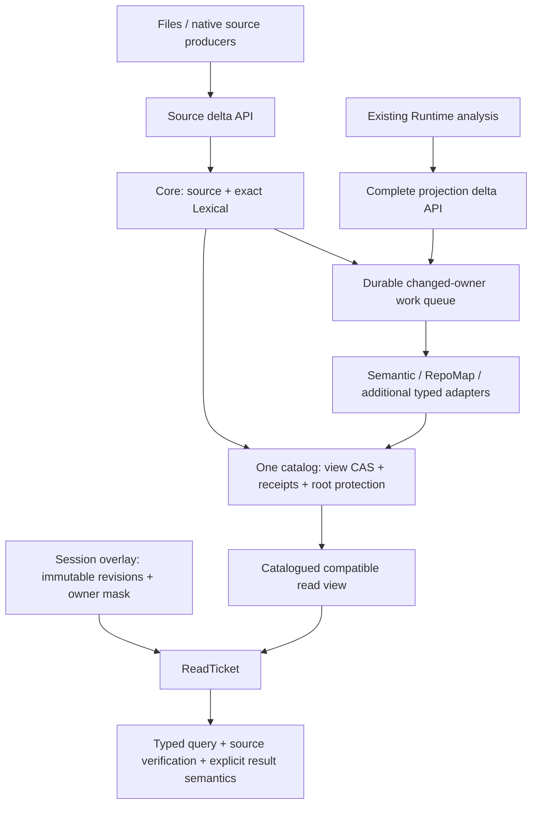
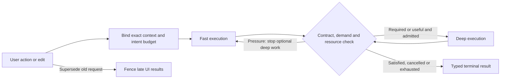
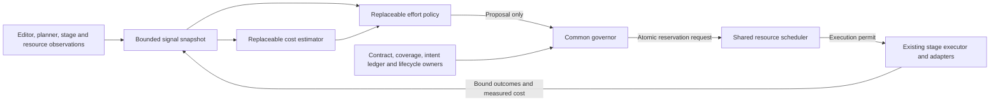
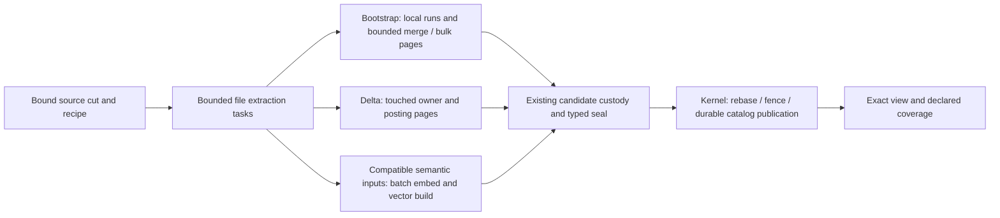
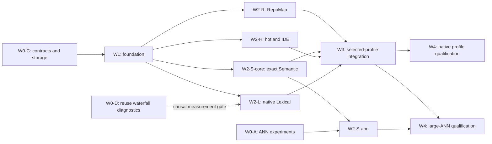
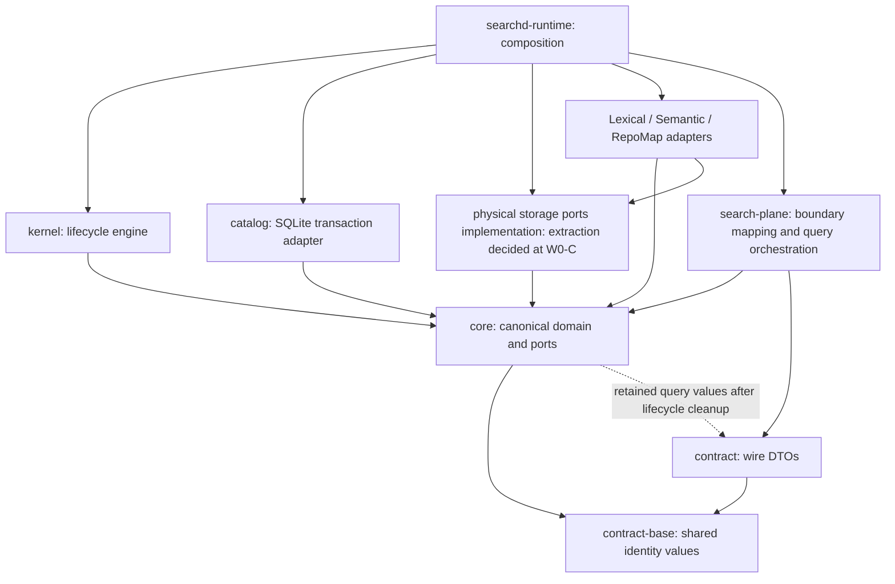
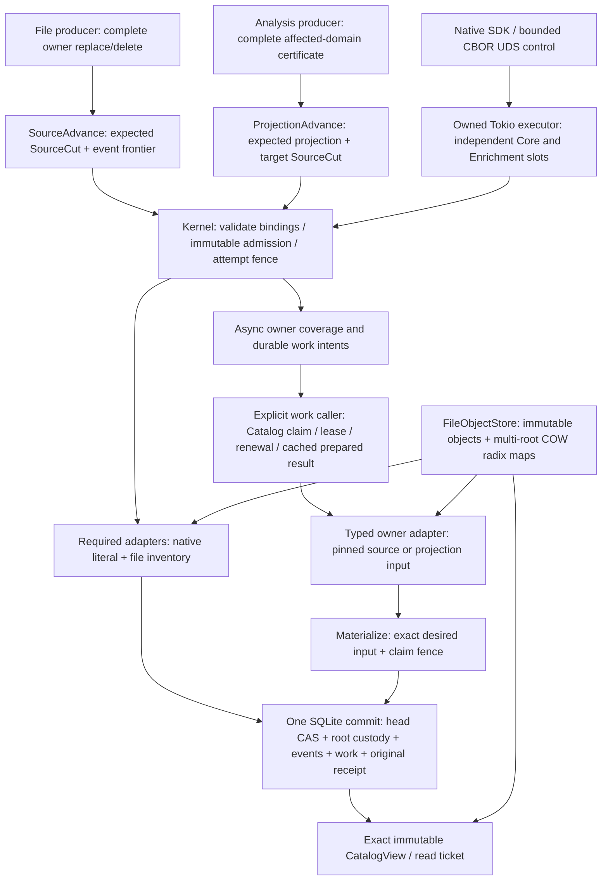

# RFC-QIDX-VNEXT-001 — Native Incremental Indexing and Qualified Performance

- Date: 2026-10-10
- Index-construction and parallel-ownership follow-up: 2026-10-11, section 9.6.
- Status: Native foundation slice implemented; product cutover and full qualification pending.
- Decision: Replace coupled lifecycle/storage contracts inside the existing
  quanta-index workspace. Reuse suitable components; do not create a second product
  repository or permanent parallel internal IR.
- Supersedes: the previous Native Incremental Index Contract RFC and conflicting
  proposals in the supplied VNext draft. This file is the single replacement RFC.
- Source basis: quanta-index `8f11cad9587a` plus the inspected working tree;
  Semantica integration/host mapping refreshed at `3153c66d6f63`, then the
  producer-capture follow-up at `23ec2686bc00`; the IDE buffer/position follow-up
  was read with HEAD `cace73b4d914`; the adaptive-IDE follow-up inspected
  recompute/cancellation, completion and rename owners at `7942f4012bdd`. These
  are static working-tree observations, not one qualified cross-repository executable snapshot.
- Evidence: native focused compilation/tests and opt-in UDS composition are
  recorded in section 22.4. Full suite, model checking, product migration and
  performance qualification remain separate. Prior implementation acceptance
  is recorded separately in section 2.1.
- Reference refresh: 2026-10-10. Section 19 reconciles the external review;
  section 14 is the implementation dependency authority. Research results are
  mechanism evidence, not Quanta performance qualification. Section 16 admits
  only research with verified conference/journal publication into the core
  research basis and separates it from official implementation documentation.

## 1. Decision and the exact guarantee

quanta-index owns native incremental materialization, publication, recovery,
retention and search without quanta-runtime. Runtime may produce complete
analysis-derived projection deltas; it does not own Index storage or commits.

The architecture has one catalog authority, registered typed index instances,
multiple publication groups, immutable read views, and a separate session overlay.
Source plus exact Lexical publish in the Core group. Semantic and other expensive
derived indexes may publish asynchronously with explicit coverage. No query may
infer compatibility from two independently selected latest heads.

The intended performance guarantee has three distinct contracts:

| Contract | What must be established | What it does not establish |
|---|---|---|
| Structural | Ordinary local updates touch changed contributions, indexed paths and bounded regions | A universal millisecond bound |
| Sustainable | Foreground plus mandatory upkeep has bounded amortized work and bounded debt under admitted load | Infinite throughput or storage |
| Operational | A pinned implementation meets latency, freshness, throughput, memory and quality thresholds on its declared envelope | Performance on arbitrary hardware, queries or corpora |

Only a profile passing all applicable gates in sections 12–14 may advertise
`QualifiedNativeIncremental`. Writing a delta API, returning quickly with Pending,
or passing correctness tests alone does not earn that capability. In particular,
enrichment delay must be measured through searchable coverage, not enqueue time.
This RFC specifies an enforceable target, not an already proved implementation
or a measured SOTA result.

First-release scope: durable Core, asynchronous Semantic, native SDK, exact views,
recovery/GC and session overlays. Light Stub is optional for the general search
profile and required for languages advertised by the IDE fast-search profile
in section 6.3; that profile does not promise a complete IDE analysis engine.
RepoMap must fit the same contract; its migration is a separately owned lane,
not a reason to hard-code two index kinds. A deterministic adaptive Fast/Deep
policy is required for the IDE profile.
Learned auto-tuning and shared packs are follow-on features; native incremental
correctness does not depend on a learned controller. Comparing
bounded pack retention is permitted in the foundation experiment (section 8.3.1);
it is not a requirement to build a general packing/auto-tuning framework.

## 2. Current evidence and before → after

These are source-confirmed structures and costs, not fresh measurements of the
historical 94-second update. Dirty status alone proves neither implementation
completion nor failure; retain the scoped execution evidence in section 2.1.

| ID | Current source / observation | Required change |
|---|---|---|
| A01 | [Corpus wire](../../crates/quanta-index-contract/src/ipc/ingest/corpus_wire.rs) already carries base/replace/tombstone | Preserve delta semantics; do not restart from a full-batch-only model |
| A02 | [Control identity](../../crates/quanta-index-contract/src/ipc/control.rs), `SearchCorpusGenerationIdentityV1`, fixes a Lexical/Semantic pair | Replace with group/instance/view identities |
| A03 | [Proof custody](../../crates/quanta-index-core/src/publication_validation.rs), `PublicationValidationOwner`, fixes two proof slots | Register typed adapter verification under a generic lifecycle |
| A04 | [Lexical store](../../crates/quanta-index-lexical/src/lexical_store.rs) and [paged authority](../../crates/quanta-index-lexical/src/file_authority/paged.rs) already implement immutable objects/COW roots | Reuse after conformance; no competing lexical object pool |
| A05 | [Regex necessary grams](../../crates/quanta-index-lq-regex/src/necessary_gram.rs) and [code search](../../crates/quanta-index-lexical/src/searcher/code_search.rs) already implement candidate/source paths | Preserve independent search oracles and source verification |
| A06 | [Chunk publication](../../crates/quanta-index-search-plane/src/ingest_dispatcher/search_corpus.rs) clones inherited state and emits the whole target | Persistent owner/contribution maps and delta transactions |
| A07 | [Semantic commitment](../../crates/quanta-index-semantic/src/semantic_row_integrity_v1.rs) counts/collects/sorts whole rows | Incrementally maintainable logical commitments |
| A08 | [Semantic build](../../crates/quanta-index-semantic/src/build.rs), `inherit_dataset_tree`, walks and hard-links the dataset | Exact immutable version sharing or bounded physical regions |
| A09 | [Semantic search](../../crates/quanta-index-semantic/src/search.rs) also verifies inherited row commitments | Remove global work from base verification as well as target seal |
| A10 | [Vector policy](../../crates/quanta-index-semantic/src/vector_index.rs) bounds append segments and can retrain | Qualify the entire maintenance cycle, not only cheap appends |
| A11 | [Repository envelope](../../crates/quanta-index-search-plane/src/readiness/activation_catalog/repository_envelope.rs) retains capped event/stream collections and encodes the envelope | Indexed ordered replay state with safe retention floors |
| A12 | [Read view](../../crates/quanta-index-search-plane/src/query_dispatcher/read_view/view.rs) does not promise one instant across all domains | Catalogued compatible view and exact-root leases |
| A13 | [RepoMap store](../../crates/quanta-index-repomap/src/store.rs) and [pair retention](../../crates/quanta-index-search-plane/src/search_corpus_retention.rs) have separate lifetime boundaries | One root-protection authority for participating groups |
| A14 | [SDK preparation](../../crates/quanta-index-sdk/src/preparation/implementation.rs) owns prior preparation manifests | Committed membership belongs to Index; SDK hints have no authority |

The [paged Lexical ADR](../adr/OCT-10-002-shared-paged-lexical-authorities.md)
explicitly retains corpus-dependent coverage rehashing and quota work. Its data
structures are reuse candidates, not proof that the whole pipeline is incremental.
The [coverage cost test](../../crates/quanta-index-lexical/tests/sealed_commitment_cost.rs)
currently expects inherited coverage hashing. Change the integrity contract and
its tests together; do not merely delete an inconvenient assertion.



### 2.1 Accepted baseline and outstanding closeout

The [closeout verdict](../plans/oct-10-index-closeout/VALIDATION.md#마감-판정)
is the historical acceptance authority. The table below summarizes its scopes,
not a fresh execution against the current dirty tree. This reconciliation made
no production-code changes and did not re-establish source/binary equality with
the prior run. New contracts must preserve these accepted behaviors; prior passes
do not automatically qualify their replacement implementations.

| Scope | Recorded evidence | Treatment in this plan |
|---|---|---|
| A: Semantic compatibility | VERIFIED: persisted model/policy, compatibility before provider/first window, completed-target recovery | Preserve in instance/schema bindings, exact-ref open and recovery; port existing negative/restart tests |
| D: RepoMap lifetime | VERIFIED: serialized acquire/pin/publish/activation/GC, actual panic/unwind releases pins and permits reclamation | Preserve the linearization and unwind behavior when moving to catalog root protection; extend rather than restart the defect investigation |
| C5: generation reservation | VERIFIED: durable nonreused numbers, final event binding, restart/ACK-loss recovery, control/SDK integration | Carry reservation/fence/replay obligations into the new identity axes; one allocator authority per namespace, no uncoordinated replacement counter |
| Lexical storage/search | Shared paged store, Native/File authority, lazy body reads, map V2, segment intersection and request metadata cache implemented; major scoped regressions accepted | Reuse subject to conformance; whole-pipeline incrementality and operational acceptance remain open |
| Scoped integration | Recorded check/Clippy/static checks, actual daemon SDK 6, GC 6 and doctests 4 passed | Preserve their scope and fixtures; these are not whole-suite or XL acceptance |
| Large / XL lifecycle | Large VERIFIED; XL whole lifecycle FAILED twice under the same 900-second ceiling; pre-reopen publish/activation/search passed | Keep both failed runs. Reopen completion and post-reopen searches have no passing evidence; stop/join/start attribution is unresolved |
| Full workspace suite | FAILED: 4,531 passed and one old-format GC fixture failed; after repair GC 6 passed, full rerun NOT_RUN | Do not combine separate runs into a synthetic green suite; require the final affected implementation's full closeout |
| Operations and delivery | Sustained churn, long pins, space pressure, launcher switch and independent-process recovery NOT_RUN; recorded changes uncommitted/unpushed | Explicit W3/W4 gates and separate Git delivery status |
| Waterfall | Contract and P00–P09 execution packets exist; packet status says implementation in progress, no integrated completion evidence; verification NOT_RUN | Reuse this diagnostic workstream through W0-D; do not count documentation as working instrumentation |
| External qualification | External producer, remote CI, formal performance comparison and release qualification NOT_RUN and outside the original repair acceptance | Required where the selected VNext release promises them; not retroactive prerequisites for A/D/C5's original scoped verdicts |

For C5, importing a reservation namespace preserves its durable high-water mark
and final event binding. An explicit fresh-state rebuild uses a new incarnation
and rejects old identities/receipts; it cannot reset a counter in an old namespace.
The original pair-specific representation may change without weakening any of
these laws. Tests must exercise the new producer/consumer boundary together.

### 2.2 Known costs, unresolved attribution and repair ownership

The [static RCA](../plans/oct-10-index-closeout/LEXICAL-QUERY-PLAN.md)
sections 10.29–10.31 own the detailed historical observations. These values are
from the recorded XL captures, not measurements of this proposal and not promised
savings. Each cost has a separate hypothesis and acceptance gate.

| ID | Evidence and limitation | Required work and decisive proof |
|---|---|---|
| RC1: seal retention/accounting | Every seal performs retained-object closure and physical inode/track census. Finalization was about 46–49 s, including delta/no-op; its residual is not all SHA or SQLite time | W0-D splits root-lock wait/hold, snapshot, Lexical closure, Semantic census, each physical track and durable history write. W0-C/W1 select and implement section 8.3 accounting per measured path; fixed-delta/no-op counters must cease growing linearly with unchanged retained state, with shared objects, hardlinks, pins, crash and actual-unlink oracles |
| RC2: initial adoption sync | Existing Native and File producers already use adoption batches. Full publication created 4,019 groups with repeated journal/control synchronization | W0-C/W1 storage owner changes bounded group commit and recovery units together; record group refs/bytes/flush cause and sync counts. Prove every new crash cut preserves adoption, orphan custody, epoch/GC fences and acknowledgment durability; a larger numeric batch limit alone is insufficient |
| RC3: delta write amplification | One-file delta recorded 5,644 new data-object writes, including possible intermediates. Native pays at most two queued segments in a publication; File compacts touched segments plus at most one older debt | W2-L separates normal delta writes from compaction by ObjectKind and rederived docs/bytes. Improve the existing bounded foreground policy only with measured benefit; preserve visibility, exact old views, ranking, recovery and finite query/space/debt bounds. This is not a missing-compaction-bound finding |
| RC4: reopen and observer blind spots | Last marker is same_process_reopen, before stop/join/start; two 900 s timeouts do not isolate one of those stages. Boundary probes and trace output also consume the outer budget | W0-D reuses the existing waterfall contracts to expose lazy boot, stop/join/start, proof/maintenance and observer lanes. Bounded failure-prefix capture must retain completed work and explicit loss/incomplete states; qualify actual recorder Off/Record overhead before another XL attribution claim |

Current source anchors are
[retention history](../../crates/quanta-index-search-plane/src/readiness/search_corpus_history.rs)
`record_sealed_search_corpus`,
[Lexical measurement](../../crates/quanta-index-lexical/src/adapter_lifecycle.rs)
`measure_sealed_generations`,
[closure census](../../crates/quanta-index-lexical/src/lexical_gc.rs)
`measure_unique_closure_bytes`,
[adoption storage](../../crates/quanta-index-lexical/src/lexical_store/store.rs),
[Native compaction](../../crates/quanta-index-lexical/src/text_authority/paged_writer.rs)
`compact_due_segments` and
[File compaction](../../crates/quanta-index-lexical/src/file_authority/paged/producer.rs)
`compact_segment`. Native body rederivation and File posting/mask work differ;
do not assume identical compaction algorithms or costs.

Keep causal limits explicit:

- Pair-set closure is measured once per seal and each physical track separately;
  the finding is repeated full census across seals, not repeated identical closure
  calls within a seal. Cross-pair lock contention is a structural risk, unmeasured.
- Finalization is nested in publication. Do not add it to the parent duration.
  Aggregated sync-call waits are not independent wall-clock savings. The four
  completed publish phases totaled 737.327 s and 705.753 s in the two captures;
  the remaining outer time is not a measured standalone reopen duration.
- Existing sorted map batch updates are not a proven per-key full-root rewrite.
  The 5,644 writes are not a count of final live objects or all attributable to
  compaction without the proposed split. Background GC alone cannot remove the
  synchronous retention census.
- Refcount/closure accounting and physical-space accounting have different
  correctness obligations. Removing one census does not prove the other cheap.
  Incremental accounting must explicitly preserve or revise corruption-detection
  timing; deleting scans without a replacement integrity contract is unacceptable.

Repair reusable storage primitives once, under their existing owner, and migrate
their custody into the selected Kernel/catalog design. Do not build both a new
legacy retention authority and a competing VNext ledger. An interim legacy-only
change needs an explicit consumer, acceptance gate and retirement point.

## 3. Ownership and scope boundaries

| Owner | Responsibility |
|---|---|
| Source producer | Authentic bytes/events, path/owner mapping, ordered source transition |
| File-local preparation | Deterministic bytes-to-projection transformation, declared unsupported domain |
| Runtime projection producer | Complete affected-set calculation, dependency/config bindings, analysis truth |
| Logical catalog | Source refs, committed owner contributions, desired/covered roots, producer frontiers |
| Kernel | Admission, attempts/fences, group/view publication, replay, leases, accounting, recovery/GC |
| Index adapter | Physical incremental algorithm, sealed-root verification, exact-ref reads, bounded maintenance |
| Hot workspace | Immutable session revisions, ordered edits, masks, save/close reconciliation |
| Query planner | Capability selection, scope, budgets, result semantics; no independent source authority |

Runtime HIR/CFG/DFG/query/memo internals need not be rewritten. Its SDK ingress,
projection metadata, outbox and receipts must change with the new contract.
"Runtime unchanged" applies to analysis authority, not every integration line.
Native source/lexical/file-local semantic E2E must run without Runtime.

Initial deployment is local, with one exclusive process owner per state root.
Tenant and workspace identities are checked at every boundary. Registered adapters
are trusted compiled code; persisted/wire input is untrusted. Arbitrary plugin ABI,
new language resolver and distributed multi-writer commits are outside this RFC.

## 4. Canonical IR and identities

Rust below is schematic, not compiled API evidence. Use one current internal IR.
Persisted/wire formats have explicit versions and rejection rules; this does not
authorize parallel legacy IRs or implicit upcasters.

### 4.1 Identity axes

```rust,ignore
struct CorpusKey { tenant: TenantId, collection: CollectionId }
struct WorkspaceKey { corpus: CorpusKey, worktree: WorktreeId, slot: SlotId }
struct WorkspaceEpoch(u64);
struct HeadToken { incarnation: u64, sequence: u64, digest: Digest }
struct ViewRef { workspace: WorkspaceKey, epoch: WorkspaceEpoch, token: HeadToken }
struct GroupRef { group: PublicationGroupId, token: HeadToken, manifest: ImmutableRef }
struct SourceCut { manifest: ImmutableRef, producer_frontiers: ImmutableRef }
struct OwnerKey { producer: ProducerId, stable_id: StableOwnerId }
struct OperationKey { workspace: WorkspaceKey, epoch: WorkspaceEpoch,
                      producer: ProducerId, stream: StreamId,
                      stream_epoch: StreamEpoch, sequence: u64 }
struct AttemptRef { operation: OperationKey, attempt: AttemptId, fence: Fence }
struct IndexInstanceId(StableId);
struct IndexKind(RegisteredKind);
struct ProjectionId(StableId);
struct SchemaId(RegisteredSchema);
struct PolicyDigest(Digest);
struct StorageFormatId(RegisteredFormat);
```

- View/group/source/operation/attempt identities are distinct. Source revision is
  a value, not a new CAS namespace. A corpus-wide revision digest commits both
  the source manifest and complete producer frontier; producer labels are scoped.
- Workspace switching/restore changes the applicable epoch/incarnation. Stale
  branch jobs cannot publish; paths alone never identify a source incarnation.
- Source-event ordering and operation sequence are separate. Control/maintenance
  operations use a catalog-owned stream and cannot advance source frontiers.
- Semantic policy contains output-affecting parser/chunker/render/model/metric/
  normalization inputs. Pure memory/queue/provider ceilings are admission options.
  Chunk-size changes that affect output are policy changes.
- An instance is not its kind: two models can coexist as two Semantic instances.
  Immutable model artifacts or verifiable immutable provider revisions are required
  for strong cache identity. Mutable provider labels are insufficient.
- Hash preimages are domain-separated canonical payloads excluding their own
  digest field; HeadToken is not recursively hashed into itself. Reference order
  is source/projection roots -> sealed artifacts/groups -> coverage -> view.
  An artifact cannot reference a later view/certificate that already references it.

### 4.2 Source and projection changes

```rust,ignore
struct UpdateRequest {
    operation: OperationKey,
    request_digest: Digest,
    expected_view: ViewRef,
    kind: UpdateKind,
}
enum UpdateKind {
    SourceAdvance(SourceTransition),
    ProjectionAdvance(ProjectionTransition),
    Materialize(MaterializationInputRef),
    Reconfigure { target_profile: ProfileRef, bootstrap: BootstrapPlanRef },
    Maintain { group: PublicationGroupId, plan: MaintenancePlanRef },
    ReconcileComplete(CompleteSourceSetRef),
}
struct SourceTransition {
    expected_source: SourceCut,
    events: BoundedStreamRef<SourceEvent>,
    owners: BoundedStreamRef<SourceOwnerMutation>,
    impact: Option<BoundedStreamRef<ProducerImpactCertificate>>,
}
struct ProducerImpactCertificate {
    projection: ProjectionId,
    prior_source: SourceCut,
    target_source: SourceCut,
    producer_policy: PolicyDigest,
    prior_context: ContextRoot,
    target_context: ContextRoot,
    domain: CoverageDomain,
    affected_owners: ImmutableRef,
    completeness: ProducerCompleteness,
}
enum SourceOwnerMutation {
    Replace { owner: OwnerKey, expected: PriorContribution,
              next: SourceRecordRef },
    Delete { owner: OwnerKey, expected: ExistingContribution },
}
struct ProjectionTransition {
    projection: ProjectionId,
    schema: SchemaId,
    producer_policy: PolicyDigest,
    expected_projection: PriorProjection,
    target_source: SourceCut,
    dependency_context: ContextRoot,
    completeness: ProducerCompleteness,
    owners: BoundedStreamRef<TypedOwnerMutation>,
}
enum PriorProjection { Absent, Present(ImmutableRef) }
enum DeltaInput<D> { Patch(D), Bootstrap(CompleteProjectionRef) }
```

Replace supplies the complete next contribution for that owner; omission in a
patch inherits other owners. Delete requires the existing contribution. Replay
is resolved before mutation preconditions, so replay is not an absent-delete
heuristic. Rename atomically updates path/owner mappings; policy decides whether
path participates in rendered embedding input. Path collisions are checked.

Index computes target persistent roots. Clients do not reconstruct whole-corpus
manifests. Streams are bounded, canonical and unique by owner; bounded external
sort is allowed with admitted scratch. Staged immutable inputs survive restart.
Complete reconciliation is a distinct O(N) operation, never inferred from a patch.

A SourceCut names the ingested immutable source state, not an instantaneous live
filesystem snapshot. Watcher dedup/gap/overflow handling must expose a pending
frontier and request an explicit complete reconciliation when event continuity is
lost. Source revision labels or wall clocks cannot certify missing events. Queries
needing read-after-write specify the acknowledged event/document frontier at pin
time; an ongoing read does not silently follow later filesystem changes.

Native capture binds immutable bytes/digest to a source-authority version and an
observation fence. A watcher notification is a change hint, not proof of the file's
contents at that event's timestamp. The producer must declare its stable-read or
retained-snapshot protocol and close observations that race capture. Path, size
and mtime equality alone are insufficient. If consistency/continuity cannot be
established, keep freshness Pending and retry or explicitly reconcile; do not
advance a complete event frontier using unverified captured bytes. Acknowledge
delivery only through a durable receipt or retained inbox/outbox recovery custody.
This contract does not claim an instantaneous global filesystem snapshot.

Only Reconfigure changes the active profile. SourceAdvance and Maintain retain
it. Materialize consumes already validated desired inputs; it cannot independently
invent a new source/projection truth or reclassify a pending domain as complete.

Shared graph/entity contributions require either a unique canonical owner or
provenance-aware multisets and reverse membership indexes. Deleting one file must
not delete a node still owned by another. Genuine dependency fanout is part of K.

Producer completeness is an attestation backed by separate source/reference
tests. Index cannot infer a missing affected owner from a truthful-looking digest.
For Runtime-derived inputs, unchanged file bytes do not imply unchanged projection:
dependency/context changes can change HIR-derived chunks or facts.

ProducerCompleteness covers the declared affected-owner domain and each required
output, not merely successful serialization or end-of-stream. A failed/skipped
owner cannot become an empty successful Replace, Delete or OwnerNotApplicable.
Owner contributions are staged until their complete decode/validation succeeds;
prefix records from a failed owner cannot enter its covered contribution. Valid
siblings may progress only under the existing partial-coverage/group contract.
Section 21 defines the producer-to-consumer conformance cases for this boundary.

The producer's dependency context includes output-affecting configuration,
environment and observed absence/lookup results through its existing dependency
owner. A file watcher receipt alone does not establish their invalidation. A
config-only change may retain source bytes but changes the applicable context or
policy binding and must resolve affected coverage. Equal emitted values do not
permit Runtime to retain an obsolete dependency/support set; Index need not
rewrite equal artifacts when the new complete binding proves valid reuse.

### 4.3 Profiles, groups and sealed members

```rust,ignore
struct IndexProfile {
    groups: PersistentMap<PublicationGroupId, GroupSpec>,
    instances: PersistentMap<IndexInstanceId, InstanceSpec>,
    dependencies: DependencyDagRef,
}
struct GroupSpec {
    members: PersistentSet<IndexInstanceId>,
    activation: GroupActivation, // CoreRequired or AsyncCoverage
}
struct InstanceSpec {
    kind: IndexKind,
    inputs: PersistentMap<ProjectionId, ProjectionInputSpec>,
    policy: PolicyDigest,
    storage_format: StorageFormatId,
    descriptor_contract: DescriptorContractId,
    work_contract: WorkContractId,
    query_capabilities: QueryCapabilities,
}
struct ProjectionInputSpec {
    schema: SchemaId, producer_policy: PolicyDigest,
    coverage_domain: CoverageDomain, dependency_rule: DependencyBindingRule,
}
struct InputBinding {
    projection_root: ImmutableRef, schema: SchemaId,
    producer_policy: PolicyDigest, dependency_context: ContextRoot,
    coverage_domain: CoverageDomain,
}
struct SealedArtifactRef {
    instance: IndexInstanceId, format: StorageFormatId,
    namespace: StorageNamespace, physical_root: ImmutableRef,
    logical_commitment: CommitmentRef, derivation_policy: PolicyDigest,
}
struct MemberBinding {
    artifact: SealedArtifactRef,
    inputs: PersistentMap<ProjectionId, InputBinding>,
}
struct GroupManifest { source: SourceCut, profile: ProfileRef,
                       members: PersistentMap<IndexInstanceId, MemberBinding> }
struct CatalogView {
    identity: ViewRef, profile: ProfileRef, source: SourceCut,
    core: GroupRef,
    async_groups: PersistentMap<PublicationGroupId, AsyncBinding>,
    logical_catalog: ImmutableRef,
}
struct AsyncBinding {
    materialized: Option<GroupRef>,
    desired_root: ImmutableRef,
    coverage: CoverageCertificateRef,
}
```

Core atomically contains source and all profile-required Core members. Light Stub
may be a separate instance with explicit degraded syntax state; parse failure
must not manufacture an exact symbol index or unnecessarily block lexical bytes.

Every published group has all its declared members sealed. AsyncCoverage permits
an absent initial group or incomplete source coverage, explicitly represented by
the binding. It never means a partially constructed group can be called complete.
An async group seal attests its complete materialized subset, not all desired
source contributions. Desired membership and covered/materialized membership are
separate typed projections. An initial partial-coverage group bootstraps a complete
covered-subset projection (possibly empty) and declares the remaining desired
inputs Pending. It never passes a partial desired stream as complete bootstrap.
A profile requiring atomic Lexical+Semantic may put them in one group and accept
its readiness cost; that profile cannot claim the nonblocking Core SLA.

All required projection inputs have exact bindings. Multi-input reuse requires
all relevant roots/policies/context bindings to be equivalent. An unchanged
artifact can be rebound to a new compatible view without copying it. Generation
numbers alone do not prove freshness. Large sets/maps/frontiers are persistent
roots, not inline arrays serialized on each publication.
Current roots resolve current state directly through shared immutable objects.
They must not replay an unbounded chain of parent deltas on read, seal or recovery.
Lineage digests are not automatic retention edges to every ancestor generation;
any ancestry needed for serving/proof has an explicit bounded retention cost.

Declared dependencies order immutable inputs. Cycles are rejected unless an
adapter explicitly owns a specified fixed-point algorithm. The kernel does not
become a second Runtime query/memo engine.

## 5. Coverage and asynchronous publication protocol

### 5.1 Desired input, covered membership and physical searchability

```rust,ignore
struct OwnerInputStamp {
    source_record: Digest, projection_contribution: Digest,
    producer_policy: PolicyDigest, dependency_context: ContextRoot,
}
enum ExpectedOwnerInput {
    SourcePending { source_record: Digest, producer_policy: PolicyDigest },
    Projected(OwnerInputStamp),
}
enum OwnerReadiness {
    PendingExtraction, PendingMaterialization, Ready,
    Unsupported(Reason), Excluded(ExclusionPolicy), Failed(Reason),
}
struct OwnerCoverage {
    expected: ExpectedOwnerInput,
    desired_members: Option<ImmutableRef>,
    covered_members: ImmutableRef,
    readiness: OwnerReadiness,
}
struct CoverageCertificate {
    source: SourceCut, profile: ProfileRef, group: PublicationGroupId,
    materialized: Option<GroupRef>, desired_root: ImmutableRef,
    covered_root: ImmutableRef, searchable_membership_root: ImmutableRef,
    producer_completeness: ProjectionFrontierRef,
    counts: CheckedCoverageCounts,
}
```

Counts/root cover owners AND their complete chunk/record membership. One embedded
chunk does not make a ten-chunk owner Ready. PendingExtraction means the eligible
chunk count is unknown, not zero. Empty eligible output needs a completed
projection result. Exclusions are profile-bound policy, not a way to hide failed
files. Unsupported/failed eligible owners prevent Complete.

Coverage map keys include instance and owner; counts are per instance, policy and
domain. A group-level root commits these maps. One model's Ready count cannot
qualify another model. An owner dependency stamp commits the relevant dependency
inputs; a global revision label is not substituted for every owner's dependency
set. Otherwise unrelated changes would invalidate the whole corpus.
SourcePending has no invented projection digest. ProjectionAdvance installs a
checked Projected stamp; materialization cannot skip that transition. While a
domain frontier is pending, current-valid counts are unknown unless separately
proved. Stored/historical covered counts retain their old frontier provenance;
they must not be displayed as verified current coverage.

Complete requires: the projection frontier proves a complete transition to the
selected source/context, every eligible owner contribution is ready, and every
desired record is in the queryable sealed membership. Physical ANN membership
may be supplemented by a sealed exact-search delta. Cache presence alone is not
searchability. ANN recall/TopKExact remains a separate property.

Owner entries and aggregate counters are updated from validated old/new
contributions in persistent maps. No per-query or per-Core-update corpus recount.
Certificates are generated with CatalogView transitions, not by combining any
historical C/E pair on demand. There is one binding per registered group in the
view, with structurally shared history; no all-Core-by-all-Enrichment cross product.

### 5.2 Required transitions

| Transition | Required atomic view effect |
|---|---|
| Core C1 → C2 | Install C2/source/frontier; update changed native owner stamps and their coverage; mark unresolved external projection frontiers pending; persist work intent; retain compatible E1 |
| Projection delta arrives | Check source/context/frontier and complete affected set; apply projection contributions/invalidations; update desired/coverage roots and durable work |
| Embedding finishes | Put immutable result in input-addressed cache; this alone has no visible membership effect |
| Enrichment E1 → E2 | Validate current desired inputs; install sealed E2 and matching coverage certificate in one view transaction |
| Delete/rename | Change membership/path and masks in the same source transition; stale job cannot restore old ownership |
| Physical maintenance | Preserve logical membership or declare a policy/quality transition; publish exact new refs through the same protocol |

For a native file-local recipe, a source delta touches changed owners and indexed
paths. For an external Runtime projection, a new source cut first invalidates its
domain completeness frontier in O(1) metadata per affected instance. Until a
complete delta arrives, unchanged-file freshness is not assumed. Existing rows
may serve only under declared historical/partial semantics with valid per-result
bindings. They cannot claim exact-current Runtime facts. A later complete affected
set permits inherited unchanged contributions without rewriting every owner.
AllowDeclaredPartial does not authorize stale facts labeled as exact-current.
For an inherited materialized group, the certificate supplies checked rebinding
from its build-time source to the selected source; GroupManifest.source alone
does not imply the whole current source is covered.

For early scoped freshness, Runtime may attach a complete impact certificate to
the source transition, before expensive projection materialization. It binds
old/new source cuts, producer policy/context, a persistent affected-owner set and
the proof that every other owner in the declared domain is unaffected. Index
authenticates the producer binding and uses indexed affected-set membership;
it does not infer this complement from unchanged file bytes. Only a certificate
covering the entire source transition may rebind unaffected owners. When one is
unavailable, retain the existing domain-Pending behavior. A later certificate is
published through ProjectionAdvance and the ordinary view protocol.
Do not hold up ordinary Core publication waiting for this optional certificate;
its producer computation and dependency traversal are charged to Runtime work.

The unaffected part and affected pending part compose one coverage root. Scoped
Complete requires a sound scope/affected-set disjointness proof plus inherited
coverage; arbitrary query scopes may require budgeted intersection. Hit-only
checks never establish scope completeness. This transfers dependency computation
from the Runtime owner, not into Index. The granularity follows the motivation
of [rust-analyzer's ItemTree/invalidation boundaries](https://rust-analyzer.github.io/book/contributing/architecture.html),
but that precedent is not proof of our producer's affected-set completeness.

Example: C1/E1 is complete. A changes: publish C2 with A pending and E1 retained.
Embedding for A runs. B changes: publish C3 with A and B pending. A's result may
still be used if its exact desired input stamp is unchanged in C3. Revalidate and
publish a NEW materialization operation against the current view, reusing cached
vector bytes. A becomes Ready; B remains pending. If A was deleted/changed again,
its old result stays cache-only. Rejecting all results solely because an unrelated
Core revision advanced is not an acceptable liveness strategy.

### 5.3 CAS, retries and progress

Every admitted publication request freezes expected_view, input and digest.
Candidate metadata/roots are prepared outside the catalog transaction. Commit
checks that exact view, group bases and attempt fence. On conflict, the original
operation is terminal Conflict; it is never silently rebased. The coordinator may
create a new operation after revalidating current input stamps. Immutable vectors
and unchanged sealed fragments are reusable; stale group manifests are not.

CatalogView changes include coverage-only changes, so metadata CAS conflicts are
possible even when Core is unchanged. Retries and wasted work are counted. Use a
fair per-workspace publication queue with a bounded optimistic retry limit. The
serialized fallback reserves the next publication slot only for bounded metadata
merge/seal from already prepared immutable contributions, with read-set validation.
It does not hold the SQLite transaction across parsing, embedding or ANN building.
If validation fails, resolve Conflict and release the slot. Deadline/admission and
fault recovery bound slot ownership; no worker owns an eternal reservation.

The fallback has a concrete ordering: terminalizing the original Conflict and
creating a bounded durable retry entry transfer the selected prepared roots from
attempt custody to retry custody in the SAME catalog transaction. Preserve the
dependency-scoped read set and immutable input binding; no unprotected interval
is permitted. Schedule that entry only after Conflict is durable.
When the fair slot is granted, capture the current view, revalidate owner inputs,
and create a NEW immutable operation against that view while holding the slot.
Its admission atomically claims the retry entry and transfers root protection to
the new attempt; the old operation retains its original Conflict outcome.
Merge/rebind bounded metadata and commit before releasing it. Competing view
commits cannot pass this slot. Do not freeze the retry's expected_view before
waiting for the slot and then reproduce the same starvation. Changed dependencies
release the slot and require new preparation; stable dependencies must progress
within the profile's bounded eligible queue turns under admitted load. No parsing,
embedding, ANN rebuild or unbounded root merge is allowed inside the slot. Include
the source-event release/rebind protocol below for retries that advance source.

Retry entries have admitted root/byte/entry quotas, a claim fence and a declared
deadline. Cancellation/expiry first revokes the claim and waits for live borrowers
to quiesce before releasing protection; a wall-clock expiry cannot authorize
unlink under a worker. Restart reconciles claims and retained roots. If no retry
custody is admitted, terminalization releases the original roots and the retry
must rebuild/re-register, never reuse bare object IDs. That extra work counts;
the qualified stable-input fallback must provision retry custody rather than
depend on repeated rebuilds. Test Conflict -> concurrent GC -> fair-slot admission,
crash, expiry and duplicate claim/transfer.

Ordinary-operation qualification includes this fallback and contention cost.
Unrelated writes must not starve a stable owner's adoption under admitted load.
For an owner edited faster than preparation, newest-state coalescing is allowed;
every source transition remains ordered and the skipped derived versions are
observable. There is no promise to embed every transient keystroke.

### 5.3.1 Current-root composition algorithm

Reusable preparation is an immutable set of owner contributions, not a replacement
workspace root. It carries explicit assumptions and deterministic actions. This
distinction is also used in [Iceberg retry validation](https://iceberg.apache.org/docs/1.9.2/reliability/).
Quanta additionally requires protected input objects and bounded composition;
Iceberg's protocol alone supplies neither our cost bound nor multi-adapter safety.

```rust,ignore
struct PreparedContributionSet {
    input: ImmutableRef,
    profile: ProfileRef,
    read_set: ImmutableRef,       // paged predicates, including absence/range guards
    contributions: ImmutableRef, // typed owner outputs; immutable payload objects
    custody: RetryCustodyRef,
}
enum ComposeDecision {
    Ready(SealedGroupTransition),
    Reprepare(ChangedDependencySetRef),
    OutsideLocalEnvelope(WorkClass),
}
trait IndexComposePort {
    type Contributions;
    fn compose(&self, current: &MemberBinding, prepared: &Self::Contributions,
               context: &mut CompositionContext)
        -> Result<ComposeDecision, IndexError>;
}
```

IndexComposePort is a separate typed capability registered with IndexBuildPort,
not an extra publication authority. Kernel owns slot/fence/operation binding;
the adapter owns contribution meaning and deterministic map edits. Bootstrap
uses its existing absent-base path. The signatures remain schematic until W0-C.

1. Outside the slot, produce source/term/chunk/graph contributions, vectors and
   immutable backend fragments under attempt/retry custody. Persist policy,
   owner-input and dependency predicates. Range/absence assumptions use indexed
   range-version or membership guards so a newly inserted dependency is detected;
   point reads alone cannot prove a negative/range result. A source-advancing
   contribution also names the exact event and predecessor.
2. Admit the full composition envelope before joining the fair queue: touched
   keys, new map pages, direct edges, bytes, CPU and sync operations. Estimate
   conservatively from input size and enforced map-height/region bounds. Reserve
   physical capacity and worker capacity. No embedding, parse or model training
   belongs to this envelope.
3. Acquire the per-workspace slot with a fencing token, select and protect the
   current view, then check profile/source-event/dependency predicates with
   indexed reads. All workspace head-changing commits, including maintenance,
   reconfiguration and optimistic writers, must validate this same slot authority.
   Slot acquisition drains an already committing short transaction; it does not
   stop readers, preparation or independent workspaces.
4. If predicates hold, admit a NEW operation freezing this current view and
   transfer retry custody atomically as in section 5.3. Read each touched owner's
   CURRENT contribution. Diff it against the prepared replacement; delete old
   membership and insert new membership, adjust checked counters/statistics from
   that actual old/new pair. Preserve untouched branches of the current COW maps.
   Identical current output is a logical no-op, not a double counter increment.
   Shared keys aggregate owner deltas according to the declared ownership algebra.
5. Patch only touched paths in source/owner/posting/statistics/coverage/membership
   maps and the paged instance/group directory. Reuse immutable vector/segment
   payloads; never merge a stale whole root with the current root by whole-tree
   comparison. A fragment dependent on a replaced ANN region or physical base
   fails its predicate and is reprepared outside the slot. Unchanged vector bytes
   may still be reused; backend quality/routing assumptions are not bypassed.
   Semantic adoption must also support a source-valid sealed exact-search delta
   that does not depend on the stale ANN region root. This allows stable A to
   become searchable while unrelated B keeps changing that region. Admission
   reserves delta capacity; the qualified bounded-delta drain policy must sustain
   it. Endless overflow/refusal is a failed profile, not a liveness solution.
6. Durably write and register new bounded pages/manifests outside any SQL write
   transaction while retaining the slot. Commit the sealed view, operation
   outcome, event/work/coverage changes and custody transfer in one short catalog
   transaction checking the exact view and slot/attempt fences. On ambiguous
   completion, reconcile that operation before releasing/rebinding its claim.
7. Failed validation releases the slot and reprepares the affected inputs.
   Composition exceeding its admitted envelope terminalizes with an explicit
   outcome, preserves/retires custody correctly, and leaves ordinary qualification
   failed for that workload. It is not allowed to serialize an unbounded rebuild
   under the label metadata. Bulk changes use the declared bulk work class;
   one promised atomic source event is not silently split into visible subevents.

For K touched logical keys, the algorithm targets the indexed map/catalog costs
of section 12, including current-value reads, counter changes, page registration
and fsync. The slot excludes head changes, not filesystem latency: measure its
hold time and head-of-line blocking. Reserve fair queue service across Core,
enrichment and maintenance; priorities cannot starve an admitted stable job.
With bounded eligible predecessors n and qualified maximum slot service S, the
conditional queue bound is (n+1)S plus admitted recovery delay. A hung worker is
fenced and its I/O reconciled; timeout alone cannot permit two committers or unlink
objects still borrowed. No unconditional bound is promised under failing storage.

The executable oracle checks that compose(current, prepared) equals a rebuild of
the affected logical state with unrelated contributions retained. Include two
writers changing different owners sharing one term/region, same-owner competing
results, an inserted dependency, conflict followed by GC, slot timeout and crash
before/after page fsync. Track provider calls separately: an unrelated update
must not trigger re-embedding an unchanged input.

### 5.4 Exact mutable-delta boundary

Mutable buffers are private writer state. Published vector/posting deltas are
immutable sealed segments referenced by GroupRef. ReadTicket never reads an
adapter's live mutable delta. This is the chosen first implementation; adding
MVCC-backed mutable reads later requires a pinned sequence/lifetime contract.
The query searches the exact sealed ANN segments plus exact sealed delta named
in the ticket, applying the matching owner-version membership mask.

## 6. Hot overlays and query contracts

### 6.1 Overlay identity and lifetime

```rust,ignore
struct OverlayRef {
    workspace: WorkspaceKey, workspace_epoch: WorkspaceEpoch,
    session: SessionId, session_epoch: u64,
    sequence: u64, owner_map_root: ImmutableRef,
    base_view: ViewRef, minimum_source_frontier: SourceFrontierRef,
}
struct SearchView { durable: ViewRef, overlay: Option<OverlayRef> }
struct ReadTicket { view: SearchView, selected_groups: GroupBindingsRef,
                    coverage: CoverageBindingsRef, lease: ReadLeaseId }
```

Session sequence commits an immutable owner-map revision; per-file edits check
expected document version. A missing edit predecessor yields ResyncRequired.
Reopen creates a new session epoch. Concurrent files are allowed, but a returned
overlay token defines which completed writes it includes. Source buffers use
persistent/COW storage; a token never points at mutable current text.

Overlay/base pairing is validated, not a Cartesian product of two latest tokens.
Each immutable overlay revision anchors its durable base and minimum acknowledged
source frontier. This frontier is a per-stream ordered source obligation under the
workspace incarnation, not a numeric comparison of unrelated generation labels.
A different durable view requires a checked rebind/rebase: verify
profile/owner identity, indexed source/path/rename changes and dependency frontiers,
then issue a new overlay revision or explicit Conflict/Resync/Pending. A view-only
enrichment change with unchanged source/profile may reuse overlay pages after
coverage rebinding. An external edit/delete/rename cannot silently remap an overlay
by path or make uncomputed Runtime facts current. Rebase uses changed-owner indexes
and shared roots; it does not reread all hot bytes. Large/gapped transitions follow
the declared bounded resync protocol, not an unreported full scan.

Overlay owners replace all base contributions for those owners, including deletes.
Query semantics are `(durable owners minus overlay owners) union overlay owners`.
Base ANN/stub matches for masked owners are excluded even when no new embedding
or stub exists. Exact bytes are available by the ticket; current filesystem paths
are never a fallback for retained source.

Overlay coverage combines the durable certificate with the pinned replacement
set using bounded indexed owner operations. A cached overlay summary binds both
overlay root and durable view; it is invalidated when either changes. A Runtime
projection also needs a complete overlay-context frontier: editing A can invalidate
facts about unedited B. Merely masking A is sufficient only for file-local inputs,
not for cross-file semantic facts. Missing overlay analysis means Pending coverage.

Buffer apply, LexicalReady, StubReady, DurableCoreReady and SemanticCovered are
distinct acknowledgements. Derived work may be coalesced; accepted edit order
and buffer state may not be discarded. A missing acceleration index permits a
budgeted exact scan of pinned overlay bytes or explicit incomplete/error status.

Save records `(session epoch, document revision, source digest)`. A durable save
ACK retires a replacement only if that exact revision is still the session head
and the committed Core contains the same source. v10 ACK cannot remove v11.
Retirement, advancing the session's minimum acknowledged durable frontier and
publishing its next anchored overlay revision are one session transition. After
save at C2, a new query cannot combine the emptied overlay with historical C1;
it must select a compatible base at/after the acknowledged frontier or fail typed.
An already issued ticket retains its original (C1, old-overlay) pair and leases.
Unsaved close requires explicit client disposition; it does not silently become a
disk update. Closed-session new queries fail; already leased views remain readable
until release/explicit negotiated expiry. Process loss invalidates session tickets
and requests resync; hot state is not advertised as crash-durable.

Quota eviction first removes derived caches. Leased source revisions cannot be
evicted. If unleased buffers cannot be retained, reject/admit less work or explicitly
resync/release the session. No silent switch to disk data. Pin source and overlay
roots under the shared lifecycle protocol before opening readers.

### 6.2 Separate coverage, execution and result meaning

```rust,ignore
enum Freshness { ExactSelectedView, Historical(ViewRef) }
enum CoverageRequirement { CompleteRequired, AllowDeclaredPartial }
enum CoverageStatus { Complete, Partial(MissingScopeRef), Pending, Unsupported }
enum ExecutionStatus { Finished, BudgetStopped, Cancelled }
enum ResultSemantics { ExhaustiveMatches, ExactTopK, ApproximateTopK }
struct ResultPage { hits: BoundedHits, continuation: Option<CursorRef> }
struct SearchResponse {
    bound_view: SearchView, coverage: CoverageStatus,
    execution: ExecutionStatus, semantics: ResultSemantics,
    page: ResultPage, quality: QualityDescriptor, work: WorkReceipt,
}
```

The request fixes capability, query/scope, freshness, coverage requirement, result
semantics, k/page size, total ordering/tie policy, deadline, memory/work budgets and
cancellation. Fast/Auto/Deep choose execution effort; none can change those hard
semantics. Auto is the IDE default. These are the canonical names in this RFC;
the earlier Speed/Balanced/Precise proposal is superseded, not another API.
Result truncation is not missing source coverage.

For complete scope and finished exhaustive enumeration, concatenating its pages
equals the independent reference match set. A single page need not contain all
matches. Finished ExactTopK equals reference top-k under the fixed ordering, with
an admissible complete candidate proof; exactly k returned hits is not that proof.
ApproximateTopK states approximation even when vector coverage is complete.

Every literal/regex hit is verified against selected immutable bytes with explicit
encoding/normalization/range rules. Necessary-gram pruning must be a sound superset;
unselective/short/unsupported regexes scan the admitted domain or report budget
termination. Arbitrary exact regex cannot have a universal sublinear cost promise.
Fuzzy/stub candidates do not claim resolved definitions. Hybrid fusion preserves
per-leg provenance, coverage and quality; a complete lexical leg does not make
missing Semantic coverage complete.

Cursors bind query, ordering, policy, selected view and lease/expiry. A continuation
never chooses a new head. Relevance/top-k claims after filtering stale ANN rows
require validity-aware search/refill and measured recall; overfetch by a constant
alone cannot prove enough valid candidates remain. LSP mappings must use supported
progress/errors or a documented extension when native states cannot be represented.

### 6.3 Light Stub

LightStub is a deterministic function of file bytes, parser version and local
recipe only. It stores declaration names/kinds/anchors, modifiers, imports as
written and scope hints. It excludes resolved types/calls and cross-file facts.
Recovered/Degraded/Unsupported syntax states are explicit. Old stubs are masked
on edit even when replacement parsing fails. Parser trees have a bounded hot LRU;
closed files do not require resident ASTs. Runtime facts remain separate projections.

The optional general-search capability becomes required for each language named
in an IDE fast-search profile. That profile declares parser/recipe versions and
supported declaration/name/scope queries; unsupported languages remain explicit.
It supplies name/kind/file/parent access paths and a masked hot contribution.
Definition candidates remain candidates until the Runtime owner resolves them.
Closed-file data uses compact serialized declarations; file-local, rarely needed
summaries may use a lazy content/recipe-keyed gist. These choices follow
[IntelliJ stub ownership](https://plugins.jetbrains.com/docs/intellij/stub-indexes.html)
and [index/gist separation](https://plugins.jetbrains.com/docs/intellij/indexing-and-psi-stubs.html).

NoUnnecessaryASTLoad is a required IDE profile gate: after indexing a 100K-file
fixture, hot lexical/name/stub queries and scoped declaration candidates must
load zero unrelated closed-file full ASTs. Requested semantic verification may
load explicitly identified dependency files under its own budget and trace.
Count parser/AST/file-body opens, not just resident cache size. The gate adopts
the testable principle of [IntelliJ AST loading checks](https://plugins.jetbrains.com/docs/intellij/psi-performance.html),
not IntelliJ's implementation or an assertion that all languages support cheap
token-local reparsing. Hot/background layering also has a precedent in
[clangd's index layers](https://clangd.llvm.org/design/indexing).

### 6.4 Adaptive execution policy and backend-independent effort

Extend the existing search-plane planner; do not create a second planner or move
query ranking into the lifecycle Kernel. A QueryExecutionPlan fixes the query,
scope, ticket, ranking/statistics binding, semantics and one cumulative budget.
An execution controller may change eligible stages and resource allocation only.
The Core domain owns policy types/ports; search-plane's replaceable policy proposes
work; its common governor validates proposals; the shared scheduler alone grants
reservations. Adapters execute bounded stages; Runtime alone owns semantic
recomputation authority. No query controller writes publication state. Policy
selection is dependency injection, not a branch duplicated across backend adapters.

```rust,ignore
enum EffortPreference { Fast, Auto, Deep }
enum ExecutionPhase { Fast, Deep }
struct QueryIntent {
    id: IntentId, contract: QueryContractRef, preference: EffortPreference,
    policy: PolicyBinding, budget: IntentBudgetLease,
}
// Detailed observation/proposal/port contract is defined in sections 6.4.3-6.4.7.
// The policy receives snapshots, never reservation or publication authority.
struct PolicyBinding {
    bundle: PolicyBundleId, algorithm: AlgorithmId,
    config_digest: Digest, estimator: EstimatorId,
    model_digest: Option<Digest>,
}
```

Types above are interface sketches, not implemented API. Pressure/hints may affect
cost and ordering; only typed coverage/semantic proofs may affect correctness.
Use an immutable policy binding with replayable observations/state; a learned
policy also pins its model, feature schema and seed. An opaque score never proves
that results are complete. Fast/Deep are execution
phases; Auto controls transitions. User preference is not dataset coverage.

| Stage | Fast | Auto (default) | Deep |
|---|---|---|---|
| Hot text/stub | Verified current-buffer results first | Same immediate path | Same immediate path; expensive work never delays it |
| Lexical | Selective eligible paths and bounded exact checks | Expand when useful/required and admitted | More candidate/verification work within the same scope |
| Semantic retrieval | Reuse searchable members and cached query vectors where eligible | Start or expand the qualified vector leg when intent needs it and capacity exists | Larger qualified search/rerank allowance; no claim of exact top-k from ANN |
| Language semantics | Use valid scoped memo results or bounded requested resolution | Schedule required resolution with Runtime authority | More admitted dependency analysis; full required closure or explicit incomplete/error |
| Outcome | Complete only when the requested contract is met | Fast result then bounded refinement if negotiated | Terminal contract satisfied or explicit failure/budget stop |

A natural-language semantic request may start its vector leg immediately in
parallel with the first useful path; Auto does not impose an unnecessary lexical
waterfall. Conversely, a proved exact filename/symbol result does not trigger
embeddings simply because the machine is idle. Empty/short result lists and score
gaps may suggest more work, but never prove absence or completeness. Optional
hybrid ranking must be requested; an exact lexical request cannot become hybrid.

### 6.4.1 Transition rules and cancellation boundaries

| Trigger | Decision | Invariant |
|---|---|---|
| New request / typing | Start Fast; Deep preference may admit required deep stages immediately | Current source revision and requested semantics are fixed before stages start |
| Explicit semantic action, unfinished required proof, or stable idle intent with useful refinement | Auto promotes to Deep when budget, coverage prerequisites and reservations allow | No scope/model/provider authorization change; no fresh total budget |
| New edit/query/caret context | Supersede the old request; create a request for the new exact context | Late result cannot replace current UI; durable admitted updates remain owned by Kernel |
| Interactive pressure, approaching deadline, or user selects Fast | Stop admitting optional Deep stages; cooperatively cancel private work | Never convert unfinished exact analysis to Complete; charged work remains charged |
| Pressure subsides while the same intent is relevant | Promote only after hysteresis/dwell checks and remaining-budget admission | Bounded transitions and bounded aggregate outstanding work |
| New compatible coverage arrives | A follow-latest client may open a successor ticket under the same intent | Never mutate the old ticket; section 6.5 emission/cursor rules still apply |
| Contract satisfied, cancelled or deadline exhausted | Terminal response, then release after workers quiesce | No restart loop that evades the deadline or hides final incompleteness |



The initial reference-policy experiment starts with 200 ms stable-idle dwell and
100 ms pressure-clear dwell. These are uncalibrated pilot values, not established
defaults or backend constants. The proposed governor profile separately caps
optional automatic phase changes at two per request and automatic successors at
one per 250 ms per intent, and coalesces telemetry reevaluations to at most one
per 50 ms per active intent. These deployment limits are independently versioned
and enforced if selected; the policy cannot change them. Section 6.4.8 separates
their calibration from the qualification thresholds. In every profile,
cancel, deadline, context change, required-work readiness and stage completion
wake the governor promptly. Required explicit actions do not wait for idle dwell.
Hot buffer application is never debounced. Reference-policy promotion requires
fresh measurements below configured low watermarks; a high watermark inhibits
optional Deep admission. Units, freshness and low/high values are configuration
fields. W0-C fixes their schemas and validation laws; W2-H calibrates values and
freezes each candidate before qualification. A replacement
algorithm may use different decision rules within the same governor envelope;
correctness, cancellation and admission never depend on a policy sampling timer.
The optional-transition cap cannot withhold eligible required work; such work
remains subject to the same hard budget, deadline and preference ceiling.

Automatic successors, retries, refill and parallel stages share the intent's
absolute deadline, provider allowance and work ledger; retain charges for old work
still draining. A user explicitly requesting additional work may authorize a new
budget, represented as a new action, not hidden Auto renewal. A continuous search
subscription has a separately admitted rate/lease rather than an infinite intent.
Reusable work must match input/context/model and have cache custody; a new view
revalidates membership/masks. One subscriber leaving a shared computation does not
cancel the work of another subscriber or abandon an admitted durable operation.

Switching phase is a scheduling action, not preemption of arbitrary native code.
The current RequestBudgetV1::checkpoint documentation allows non-cooperative
native calls to finish. Therefore each interactive stage must have a bounded work
quantum or a measured maximum non-preemptible interval in its admitted envelope.
Otherwise execute it in a separately limited background worker/process with
resource isolation and fenced results; keep memory/IO/CPU reservations until it
actually finishes. Putting an unbounded call on the same thread pool is not
isolation. A backend that cannot meet the interference bound fails the IDE gate.

### 6.4.2 Semantic invariants and ownership reuse

Every preference uses the same masking, source verification, permission and
coverage laws. Deep is not ExactTopK; reranking approximate candidates does not
prove a complete candidate set. Exhaustive is a result requirement, not a mode.
Backend-neutral controls are visited pages/regions, candidates, distance work,
rerank inputs, stage concurrency and budgets. Adapters map these to backend knobs
only where supported. An authorized query-embedding call may be scheduled when
needed; changing mode alone never authorizes provider calls or source egress.

Runtime verification binds the exact source cut and dependency context. Its
existing Cold/TargetedRecompute modes express recomputation authority, not user
Fast/Deep intent; keep that distinction. Bridge existing cancellation handles and
canonical buffer owners. A scheduler hint cannot mint IdeRecomputeAuthorityV1.
Native Index still performs its own file/projection updates without Runtime.
Changing query preference never changes durable membership, skips required
invalidation or labels uncomputed materialization complete.
A larger search/rerank budget is not a theorem of monotonically better relevance.
Fast, Auto and Deep must independently pass the declared quality floors and
critical task goldens; qualify the actual adaptive mix as well as fixed modes.
Do not compare raw scores across different rankers to assert an improvement.
Background indexing priority is governed separately by section 11.1.

### 6.4.3 Replaceable policy, fixed governor and execution ports

The extension point is a proposal over the existing planner's eligible stage
frontier. It is not a plugin that may execute arbitrary backend work or rewrite
the query. Fast/Deep summarize the selected effort; the actionable output is
which stages to request, with which admitted effort parameters, and when to
reevaluate. One policy therefore works across Lexical, vector and Runtime adapters.



| Component | Responsibility | Prohibited authority |
|---|---|---|
| Existing planner | Derive stage DAG/frontier, required obligations and supported knob ranges from the immutable query contract | Treat a policy hint as a new query scope or language-resolution proof |
| Signal collector | Capture bounded, typed observations from existing owners; timestamp telemetry locally | Re-scan the corpus, synchronously probe a backend or infer authoritative readiness |
| Cost estimator port | Predict marginal remaining cost per eligible stage and flag uncertainty | Reserve resources or certify a deadline/complexity bound from a percentile estimate |
| Effort policy port | Rank admissible stage requests and suggest optional pause/wakeup | Start work, publish, change coverage, allocate permits or issue terminal success |
| Common governor | Enforce contract, mandatory-work progress, caps, stale-decision checks and lifecycle; validate each proposal | Override Runtime's semantic authority or duplicate the global scheduler |
| Shared scheduler / executor | Atomically reserve global and intent capacity; dispatch with permits; account outcomes and draining work | Treat predicted cost as actual accounting or free capacity on cancel acknowledgement alone |

All domain records/traits live under core/index; implementations are injected into
the existing search-plane controller at assembly. Index adapters expose stage
capabilities/cost observations and execute permits; they do not import a concrete
Auto algorithm. The governor is the query-side client of the existing shared
admission authority, not a second resource pool or publication Kernel.

```rust,ignore
struct SignalSample<T> {
    value: SignalValue<T>, // Known(T) or Unknown(reason), never an implicit zero
    observed_at: MonotonicTick, valid_for: Duration,
    source: SignalSourceId, sequence: u64,
}
struct StageOffer {
    id: StageId, plan_epoch: PlanEpoch, input: StageInputBinding,
    obligation: StageObligation, // Required or Optional
    prerequisites: BoundPrerequisites, allowed: EffortEnvelope,
    cost: StageCostEstimate,
}
struct QueryContractSummary {
    binding: QueryContractRef, operation: QueryKind,
    preference: EffortPreference, semantics: ResultSemantics,
    scope: ScopeDigest, required: RequiredCapabilities,
}
struct DecisionFrame {
    intent: IntentId, request: QueryId, context: QueryContextBinding,
    observation: ObservationSeq, now: MonotonicTick,
    contract: QueryContractSummary, authority: AuthoritySnapshot,
    signals: SignalFrame, offers: BoundedStageFrontier,
    remaining: RemainingBudgetSnapshot,
    consumed: ConsumedWork, outstanding: ReservedWork,
    guard_limits: GovernorLimits,
}
struct StageCostEstimate {
    remaining_time: Estimate<Duration>, cpu: Estimate<CpuWork>,
    io_read: Estimate<Bytes>, io_write: Estimate<Bytes>,
    peak_memory: Estimate<Bytes>, provider: Estimate<ProviderWork>,
    estimator: EstimatorId,
}
enum ProposedAction {
    RequestStage { id: StageId, effort: EffortParameters },
    PauseOptional { id: StageId },
    Await { event: WakeCondition },
}
struct PolicyProposal {
    based_on: DecisionBinding, target_phase: ExecutionPhase,
    ranked_actions: BoundedActions, reason: DecisionReason,
    next_state: BoundedPolicyState,
}
trait EffortPolicy: Send + Sync {
    fn descriptor(&self) -> PolicyDescriptor;
    fn decide(&self, frame: &DecisionFrame, state: &BoundedPolicyState)
        -> Result<PolicyProposal, PolicyError>;
}
trait StageCostEstimator: Send + Sync {
    fn estimate(&self, context: &EstimateContext, stage: &StageFeatures)
        -> StageCostEstimate;
}
```

These are proposed shapes. Core owns the single current schema; algorithm IDs,
config/model digests and private state format tags identify implementations, not
parallel IR versions or compatibility upcasters. BoundedPolicyState is opaque to
other policies, size-capped and scoped to one binding/intent. The controller owns
its lifecycle; policies have no hidden per-request global maps. decide is logically
pure: no filesystem/network access, clock reads, sleeps, backend calls or permits;
time, randomness/seed and observations are explicit inputs. The frame contains
all needed contract summaries/features/history; reference IDs identify provenance,
not a requirement for a policy to dereference live owners. Optional estimator
training is outside the request path and produces an immutable model artifact.

### 6.4.4 Signal catalog, provenance and missing-data behavior

This catalog lists supported signal roles, not a requirement to build every
telemetry producer before the first policy. Contract/coverage/ledger snapshots
are authoritative only through their owners and are revalidated before execution.
Telemetry is a prediction input, even if it originates from a trusted process.
The reference policy initially needs exact context/obligations and budgets, actual
stage lifecycle, local interaction time and a scoped scheduler-pressure observation.
Use fixed bounded cost priors for its offered stages. Add provider, cache, learned
quality or detailed resource signals when the selected stage/policy actually uses
them; unavailable telemetry stays Unknown. All resources used by a stage still
require authoritative reservation, regardless of which predictive signals exist.

| Signal | Producer and units / binding | Use and stale/missing behavior |
|---|---|---|
| User intent and preference | Admitted query contract: operation kind, scope, required result semantics, Fast/Auto/Deep, explicit user action | Determines eligible work; cannot be inferred or broadened from low result count |
| Interaction cadence | Editor event receipt: current context epoch, idle duration in ms, edit/caret cadence and visibility | Predict whether optional refinement will survive; stale hint means no idle-based promotion, not delayed buffer apply |
| Current source and capability coverage | Ticket/coverage owners: exact source/context, required groups, Pending/Ready, unresolved obligations | Hard eligibility/validity boundary; missing proof stays Pending/Unsupported, never a probabilistic confidence score |
| Stage progress | Executor: completed/in-flight/draining IDs, verified hit count, candidate count, duplicate rate and remaining proof obligations | Decide next useful work; hit count/score gap cannot prove completeness or absence |
| Reusable inputs | Scoped memo/cache owners: content/context/model key and availability hint | Avoid duplicate cost; cache custody and binding must be acquired again; a lost cache hit becomes an accounted miss |
| Remaining allowance | Intent/global reservation owners: absolute deadline, consumed/reserved CPU/IO/memory/provider work | Hard admission checks; unknown/invalid ledger stops admission, not unlimited execution |
| Interactive pressure | Shared scheduler: queue age, dispatch lag and reserved capacity per class/resource | Optional admission and concurrency; stale observation disables pressure-based promotion while authoritative admission remains active |
| Memory/IO/provider pressure | Resource owners: actual RSS/headroom, IO queue/service time, scratch/disk allowance, provider inflight/token capacity | Protect the relevant bottleneck; CPU utilization alone cannot authorize Deep |
| Required background progress | Index scheduler: oldest stable pending owner age, Core/Semantic backlog and maintenance debt in declared units | Reduce optional query work to preserve service floors; policy cannot cancel mandatory indexing |
| Marginal stage cost | Cost estimator: remaining latency/work/memory estimates, sample count/window, uncertainty and estimator ID | Rank proposals and reserve slack; unknown cost permits only a declared bounded probe or required bounded work, not an unlimited prediction |
| Quality opportunity | Planner/ranker: requested candidate target, unexamined allowed leg, calibrated quality features for the same task/model/ranker | Suggest optional refinement; uncalibrated/cross-ranker scores are Unknown; no implication of semantic correctness |
| Recent outcomes | Bounded stage-class telemetry: actual cost, budget stops, cancellation waste, refusal and completion | Update cost estimates/health outside authority; no raw source/query text or unbounded per-query metric labels |

AuthoritySnapshot contains owner-issued context/coverage/ledger facts separately
from SignalFrame telemetry. A telemetry TTL never grants or revokes semantic
truth; authoritative owners decide validity. Every telemetry field declares its
unit, scope, observation time and validity window. Use one controller-local monotonic clock for age/deadline calculations;
remote wall clocks are not subtracted from it. Remote telemetry carries bounded
receipt-age/transport uncertainty or is Unknown. Sequence gaps/out-of-order events
cannot roll back context, coverage or budget authority. A consistent exact read
view does not require globally simultaneous telemetry: stale prediction may lower
performance, but execution must still pass current authoritative admission.

Signals are collected from O(1)/bounded cached aggregates and the bounded stage
frontier, never a whole-corpus scan per keystroke. Per-intent collection/evaluation,
queued wakeups, histograms, model state and traces have their own memory/work caps.
Pressure observations may be coalesced; cancellation and source-context epochs
may not be dropped. An exhausted optional-telemetry buffer loses telemetry with
an explicit unknown reason, not authoritative lifecycle events.

The policy descriptor declares the signal subset it needs. Validate that subset
and its Unknown behavior when selecting the policy; do not silently remove a
missing required input to make promotion succeed. Do not build global histograms,
cross-process telemetry or an online training loop solely to fill this catalog.

### 6.4.5 Initial algorithm and interchangeable strategies

The initial implementation is HysteresisPolicy: explicit rules, named thresholds
and deterministic tie order. It needs no online model training. A separate
conservative estimator uses fixed stage-class priors and bounded measured history,
with uncertainty for cold samples. Fixed priors alone are sufficient initially;
measured history is an optional refinement, not a new telemetry service prerequisite.
Record the estimator revision and any history
summary that influenced each decision. Estimates guide scheduling; actual work is
charged by the common ledger and hard work limits still apply.

The first algorithm evaluates the following in order:

1. Use only the supplied eligible frontier. The governor has already handled
   cancellation, obsolete context and terminal contract evidence independently.
2. Propose ready required work and the first useful path allowed by the current
   preference/cost envelope. Explicit semantic actions bypass idle dwell. Required
   work uses its protected scheduler class rather than competing as optional work.
3. Under high interactive/resource pressure or insufficient residual allowance,
   request no new optional Deep work; pause only private/subscriber-owned optional
   stages. Await a bounded readiness/resource event while required work proceeds.
4. Under Auto, promote optional work only when the context is stable for the idle
   dwell, fresh signals remain below low watermarks for the clear dwell, and there
   is a concrete allowed refinement opportunity. For example, an unexamined vector
   leg in a hybrid query or additional candidates needed by its declared reranker.
5. Propose effort that fits the offered envelope and estimated remaining critical
   path with configured response slack. Include queue wait, prerequisites and
   already running stages; summing parallel times or ignoring queue time is invalid.
   Unknown estimates allow a profile-bounded probe, not an assumed zero cost.
6. Order equal-class actions by declared stage priority, conservative remaining
   cost, then stable StageId. Request the next readiness/pressure/dwell event; a
   no-progress loop must not busy-poll or repeatedly reprepare identical work.

Hysteresis prevents optional work from oscillating around a threshold; mandatory
correctness and minimum progress are governor/scheduler properties. The policy
cannot endlessly return Await to withhold ready required work. If it supplies no
valid proposal, the governor's declared required-work rule either dispatches an
eligible bounded mandatory stage, queues it fairly within the original deadline,
or returns the appropriate typed terminal outcome. Fast remains an effort ceiling;
if that ceiling cannot satisfy the query, it does not produce a weaker Complete.

The same ports can later host CostAwarePolicy (estimated quality gain per cost),
a deadline-aware planner, or a learned ranking policy with frozen model/seed.
A replacement may change ordering, optional breadth, batching/concurrency requests
and promotion/demotion decisions within offered ranges. Changing query meaning,
index contents, required coverage, source authority or admission laws requires a
separate reviewed contract change; it is not an algorithm configuration option.
These future algorithms are extension examples, not selected or qualified SOTA.

### 6.4.6 Applying a proposal without granting it authority

There is one serialized decision/application loop per intent and bounded shared
execution across intents. The stage executor consumes permits, never raw policy
proposals. Every application performs these steps:

1. Validate decision binding: intent/request/context/plan/policy IDs, stage IDs,
   proposal size, knob ranges, state size and monotonic decision sequence. Reject
   a foreign stage, unknown parameter, nonfinite estimate or stale context.
2. Recheck cancellation/deadline, immutable ticket/input binding, prerequisite and
   permission proofs, preference ceiling and the governor's optional-transition/
   successor limits. A new source
   context needs a successor; the policy cannot mutate the existing ticket.
3. Validate required obligations and fairness constraints independently of the
   proposal. No guessed terminal success, no cancellation of another subscriber,
   no new provider authority and no abandonment of admitted durable work.
4. Atomically reserve current global and intent resources through the shared
   scheduler, including outstanding/draining work. Reject or explicitly downsize
   within the allowed action range if the reservation no longer fits; record the
   applied action. Old pressure estimates are not reservation tokens. Avoid an
   observation-equality CAS that retries forever on irrelevant telemetry changes.
5. Dispatch once using a scoped permit and stage-attempt identity. Charge real
   work at bounded checkpoints, release only confirmed unused resources, and
   report bound stage outcomes. Failure between reservation and dispatch has an
   explicit release/reconciliation path; a duplicate proposal cannot double-start.
6. Evaluate completion from actual coverage/result proofs, independent of the
   policy. Record target phase, running and draining stages separately so a Fast
   target does not falsely imply that previous Deep work has already stopped.

Commit bounded policy state only for a validated, sequenced evaluation and record
whether it was accepted. The next frame includes an application receipt listing
proposed, actually applied and denied actions; private state must not assume that
a requested stage ran. Governor counters and resource accounting derive only
from actual accepted actions/outcomes, never from private policy state.

Pure policy evaluation is not automatically cheap or preemptible. A proposed pilot
profile allows at most 64 offers per evaluation and <= 256 KiB transient policy
state/scratch, with evaluation p99 <= 1 ms as an unverified measurement target on
the selected reference host. Size caps are enforceable limits if selected; the
latency percentile is not a runtime enforcement mechanism. Qualify the values
before selecting them as product defaults.
A bounded frontier is a window over obligations, not permission to drop the rest.
The builtin implementation must have a bounded loop/allocation argument. Start
with this bounded in-process implementation; no evaluator worker process is needed
for it. If alternative native/model policies are later enabled, they run off
UI/dispatch threads with a bounded evaluation slot;
if they cannot guarantee bounded execution, use an isolated, time-limited worker
and reject late results. A timer around a blocking function is not hard cancellation.
Timeout/invalid output uses the explicitly bound reference policy and preserves
all governor counters, budget, deadline, work and source binding. A reserved
bounded control slot must remain available for the governor/reference fallback;
a failed evaluator cannot occupy every control slot. Fallback use, stranded
evaluation work and resulting latency are counted in qualification, not hidden
as normal success.

### 6.4.7 Policy binding, replacement and conformance

A PolicyBundle binds algorithm/config, signal schema, stage capability profile,
estimator/model versions and the allowed fallback. Validate compatibility and
resource limits when selecting a bundle. Unknown IDs or invalid configs fail
selection; the last valid configured policy is not silently replaced by defaults.
Initially select a compiled implementation with validated immutable configuration
at process assembly. A constructor/factory behind the existing ports is sufficient;
no production policy registry, live reload API or separate service is required.

Pin one bundle per admitted intent. Initial experiments use separate configured
runs; dynamic Fast/Deep decisions do not require live algorithm replacement.
If live configuration rollout is later enabled, it affects new intents;
automatic successors retain the original bundle and shared allowance. In-flight
intents finish under their pinned bundle or are explicitly cancelled. The bound
fallback is an intentional part of that bundle, recorded as a different decision
implementation; it cannot reset governor counters or import incompatible private
state. Emergency retirement fences optional evaluation and preserves required
work/terminal outcomes under the same common rules. Model updates are new bundle
identities; no moving model weights halfway through a request.

Replace an algorithm by adding its implementation and descriptor and selecting
the new bundle in the composition root. Core IR, backend adapters,
publication, Runtime authority and UI protocols remain unchanged. Extending the
canonical signal/action schema is a separate coupled change, not an opaque JSON
escape hatch that allows vendor-specific safety controls.

Before activation, replay bounded traces against independent expected constraints
and run the governor conformance suite with at least two distinct valid policy
implementations plus deliberately invalid proposals. Exact semantic outcomes must
match the same oracle when their required work completes; approximate outcomes
must satisfy the same declared quality floors, not match another policy's ranking.
Then qualify actual fixed-mode and Auto latency/quality/freshness under section
12.5. Shadow evaluation is optional and can remain harness-only. When enabled,
shadow decisions run with a separate bounded overhead allowance, receive no
execution permits and cannot mutate live state. Replaying a trace checks decisions
and invariants; it cannot measure counterfactual live performance, so matched live
experiments are still required. No online exploration consumes production budget
without an explicitly admitted experiment.

Decision diagnostics bind policy/estimator IDs, observation/context IDs, supplied
cost estimates, proposed/applied/denied actions, denial reasons, consumed/reserved
work and actual outcomes. Store bounded structured metadata; redact content and
avoid unbounded query-ID metric labels. This answers why Auto changed effort and
makes algorithm comparisons auditable without exposing implementation details in
the normal editor UI.

### 6.4.8 Gate semantics, sensitivity and bounded policy experiments

This subsection refines the existing ports; it adds no policy framework, service,
generic rule language or new authority. The 2026-10-11 source check at Index
`8f11cad9587a` plus the existing dirty work found
[query planning](../../crates/quanta-index-search-plane/src/query_dispatcher/planning.rs:62)
and [open-loop measurement](../../crates/quanta-index-searchd-harness/src/open_loop.rs:1)
as reusable owners. A crates-wide search found no Rust definitions named
EffortPolicy, StageCostEstimator or HysteresisPolicy: the RFC's interfaces remain
planned. The existing harness separately records offered/served/dropped/error
outcomes and its [saturation rule](../../crates/quanta-index-searchd-harness/src/open_loop.rs:581)
uses a 0.95 delivery-ratio threshold alongside error/drop checks. That diagnostic
threshold is not an Auto sensitivity parameter or the product acceptance oracle.

**Four meanings of gate must remain separate:**

| Kind | Examples | Owner and permitted change |
|---|---|---|
| Correctness invariant | Source/context match, required coverage, deletion support, permission, replay identity, no live reclaim | Existing authoritative owners and governor. No threshold, confidence score or experimental bypass; changing semantics requires a coupled contract change |
| Enforced operating limit | Memory/work allowance, concurrency, evaluator size, transition/successor caps, service floors | Existing governor/scheduler profile. Values are configurable and versioned, but validated independently of the policy, fixed for a policy comparison and rechecked at execution; a policy can request less, never raise the effective limit |
| Decision threshold | Pressure watermarks, dwell, sample freshness, cost slack, optional refinement opportunity | EffortPolicy/config and StageCostEstimator; independently replaceable within the offered contract/envelope. These yield proposals, not execution permits |
| Qualification criterion | Latency/freshness/quality floors, failure rate, detector error allowance, minimum practical improvement | Existing benchmark/test owner under a frozen evaluation specification. A candidate cannot rewrite its judge. Changing criteria creates a new named comparison/profile and does not rehabilitate an old failure |

Keep the initial dwell/cap values above as pilot inputs. Calibration chooses
policy values on a development workload; qualification evaluates a frozen candidate
against an independent workload and the same acceptance criteria. There is no
evidence here for a universally optimal 200 ms, 100 ms or two-transition setting.

**Small replaceable logic, not a universal detector abstraction.** Preserve
EffortPolicy and StageCostEstimator as the public extension seams. Keep signal
filtering, pressure classification and threshold predicates as pure, testable
functions inside the selected policy implementation. Changing detection logic
selects a new algorithm/config identity behind the same EffortPolicy port. Extract
an additional private strategy only when two real implementations need independent
composition; do not prebuild a plugin system for hypothetical detectors.

Representative shapes below belong to the reference policy, not to all adapters
or the public wire IR. Other policies own their own validated configurations.

```rust,ignore
struct PressureGateConfig {
    enter_queue_age: Duration,
    clear_queue_age: Duration,
    enter_dwell: Duration,
    clear_dwell: Duration,
    max_sample_age: Duration,
    max_sample_gap: Duration,
    min_distinct_samples: NonZeroU16,
}
enum GateHint { Favorable, Unfavorable, Unknown(SignalUnknownReason) }
fn evaluate_pressure(
    config: &PressureGateConfig,
    sample: &SignalSample<Duration>,
    now: MonotonicTick,
    previous: &PressureState,
) -> (GateHint, PressureState, GateEvidence);
```

This illustrates queue-age pressure only. Existing SignalFrame carries other
resource observations; a queue-age hint cannot establish available memory, provider
capacity or semantic readiness. GateEvidence is bounded decision diagnostic data
under section 6.4.7, not proof custody. It identifies the signal/scope/sample,
computed feature, threshold/operator, state transition, config and Unknown reason.
Keep numeric units typed; no generic JSON predicates or arbitrary callbacks.

Reference classification has explicit boundary semantics: a value >= enter starts
or continues an unfavorable run; a value <= clear starts or continues a favorable
run; the interior band retains a fresh known state, otherwise Unknown. Validate
clear < enter, positive freshness/gap limits, max_sample_gap <= max_sample_age,
bounded state and nonzero sample count. Zero dwell is allowed only with its explicit
meaning of no additional dwell; it does not bypass sample/freshness requirements.
Validate units, finite estimates, arithmetic and configured resource-envelope
compatibility before bundle activation. Bad config fails activation, not silently
clamps into another policy.

A sample that fails a run's predicate resets that unfinished run, even when the
interior band retains the last classified state. Unknown invalidates favorable
classification immediately. For reference-policy promotion, every configured
required pressure input must be favorable; any unfavorable input inhibits it,
and missing required input leaves it Unknown. Do not use one green metric to
substitute for an unknown resource dimension.

Sampling semantics are part of the algorithm: only distinct samples from the same
signal scope/producer incarnation count toward minimum observations. Re-reading a
cached value is not a new sample. A dwell is supported by eligible observations
spanning its duration without an excessive gap; elapsed time alone is insufficient.
Missing/stale data, a source incarnation change or an unexplainable sequence reset
invalidates favorable history. Do not borrow another workspace's history except
for an explicitly host-scoped signal. Collector-issued SignalSourceId must retain
incarnation/scope identity. This is an observation-based scheduling heuristic, not
proof the physical system remained continuously below a threshold between samples.
Authoritative cancellation, invalidation and hard admission bypass its dwell.

Sensitivity is a vector of named parameters, not an unexplained 0–100 slider:
watermarks, observation aggregation rule, dwell, minimum samples, freshness and
response slack have different effects. An aggregate rule change is included in
algorithm/config identity; it cannot silently change the units of an existing
threshold. A UI preset may name a full validated bundle, with its resolved values
recorded. A lower enter watermark admits more values to the pressure predicate;
a lower clear watermark admits fewer values to the recovery predicate. Shorter
dwell reduces the required observation span. Their combined effect on unnecessary
backoff, switching and delayed work must be measured. Claim monotonicity only for
a specific predicate with fixed inputs,
not for whole-system latency, recall or the closed-loop policy.

**Experiment identity and state.** Reuse PolicyBundle for algorithm, estimator,
model, preprocessing/feature schema, exact config and seed binding. Include the
filter/window/dwell rules in that identity. GovernorLimits must carry its owner
profile identity and effective-limit revision in decision/application diagnostics.
Pin policy state per intent as in section 6.4.7; rollout affects new intents and
never reinterprets old private state. A valid emergency tightening by the resource
owner still applies to existing intents and is recorded; pinning a policy does
not grant a right to stale capacity. Such a changed envelope is reported separately
from the controlled policy comparison.

Add a harness-local typed experiment specification beside the existing benchmark
configuration: baseline/candidate bundle refs, fixed governor/resource profile,
workload/fixture identity, arrival schedule and seeds, initial cache/index/history
state, calibration versus held-out split, repetitions, measurement boundaries and
fixed acceptance criteria. This is input to the existing harness, not a production
experiment registry. Store bounded diagnostics in its normal result artifacts;
no new per-request synchronous log or always-on full-frame trace is required.
Exact decision replay requires a complete bounded frame, initial private state,
clock/seed inputs and application receipts in the selected fixture/debug capture.
Sampled outcome counters alone are insufficient. Missing capture data makes that
replay unavailable; it cannot be filled from current live state. Account capture
overhead and keep recording mode matched between compared runs.

| Experiment layer | What it can establish | What it cannot establish |
|---|---|---|
| Pure gate fixtures / parameter sweep | Boundary behavior, sensitivity and detection delay against independent labeled pressure episodes; duplicate/gapped/stale samples and cold history behavior | Product-quality improvement or a soundness proof for source-change detection |
| Same-policy deterministic replay | The recorded frame + prior state + actual application receipt reproduces that policy's decisions | Performance of a different policy under the old policy's workload feedback |
| Candidate shadow / independent scenario model | Proposal validity, disagreement, decision overhead; a simulator advances its own candidate actions and ledger against fixed external events | Shadow has no real action outcomes; baseline stage completions/admission receipts cannot be applied as if a different candidate had caused them |
| Controlled live workload replay | Actual latency, quality, freshness, resource use, switching and required-work progress under each frozen candidate | Universal superiority outside the declared workload/environment |

For live comparisons, reuse scheduled arrivals in open_loop.rs and add the required
edit/coverage/stage workload through its existing harness. Reset or equivalently
prepare corpus, retained generations, caches and controller history for each run;
classify cold/warm separately. Run baseline/candidate in alternating or randomized
order on isolated matched resources. Do not run competing variants on one saturated
pool and call their difference a policy effect. Predeclare the practical-improvement
threshold, repetitions and uncertainty treatment. If the evidence is insufficient,
the outcome is inconclusive; retain the simpler reference policy. Parameter search
uses development cases, followed by a fresh held-out confirmation; selecting the
best of many runs on the qualification set is not a valid confirmation.

Detector labels must come from fixed scenario facts or an independent observation
contract, not from the threshold under test. Report false-positive/false-negative
rates only when those labels and the evaluated population exist; count Unknown
and censored/missing outcomes separately. Real traces often lack a counterfactual
label for a suppressed action, so report observed backoff/delay/denial and subsequent
outcomes instead of inventing detector accuracy. Include every offered intent and
all typed outcomes, plus state/telemetry/evaluation overhead; a lower latency among
fewer served requests is not sufficient. One decision trace cannot measure the
quality of a stage that its baseline never executed.

**Apply the separation to indexing too.** Source-event coalescing/debounce may
change batching while preserving durable continuity and the complete union of
affected owners. Required invalidation, delete/rename, dependency completeness,
source equality, schema/model compatibility and corruption checks have no tunable
false-negative tolerance. A similarity score may suggest extra work but cannot
certify no-op/reuse. Cost-based incremental-versus-full selection chooses only
already valid paths under existing authority and budgets. Compaction trigger/batch
size experiments stay in adapter planning/maintenance; Auto has no write authority.
Such parameters must preserve the existing debt, space and progress bounds under
repeated updates; postponing maintenance beyond the measurement window is no win.
Changing chunking, tokenization, normalization or a model changes semantic input
policy and requires its existing migration/coverage contract, not just Auto tuning.
Share benchmark conventions across those owners, not one universal gate trait.

**Implementation order and restraint.** W0-C fixes the shared authority boundary;
it does not wait for Auto implementation or tuning. The W2-H owner can independently
compile the policy ports with one deterministic reference policy and one test-only
alternative, then add fake-clock/boundary/replay cases before live integration.
Bounded decision observations and an existing-harness comparison follow. First
sweep one threshold/dwell group with the other settings fixed; do not start with
a combinatorial search over every proposed knob. Add another product algorithm
only for a concrete measured limitation; learned/online tuning stays optional.
W2-L/Kernel/Runtime producers retain
their independent ownership and first native-index milestones. AUTO02/06/08/09/10
below absorb these cases; no new gate namespace or cross-cutting approval service
is introduced. Behavioral and performance qualification of this supplement is
NOT_RUN; no threshold is declared optimal by this plan.

### 6.5 Progressive results and immutable ranking epochs

Progressive search is an explicitly negotiated query API capability. A request
pins ONE internally compatible SearchView and selected group/statistics refs
for its lifetime. Complete coverage is determined separately by the requested
capability; a typed Pending leg cannot be presented as a completed result.
Later stages may examine more data within those refs; a Semantic generation
published after admission is not silently incorporated. Following new publications
starts a new query/ticket with an explicit supersession relationship.

```rust,ignore
struct QueryEmission {
    query_id: QueryId,
    revision: u64,
    replaces: Option<u64>,
    bound_view: SearchView,
    ranking_binding: RankingBindingRef,
    state: EmissionState, // Provisional or Terminal(execution/coverage/semantics)
    result: BoundedResultRef,
}
```

Revision replacement supports reordering/retraction with stable result identities;
it is not append-only paging. A cursor binds query, revision, ticket, ranking
policy, normalization and statistics roots. Pagination is offered only from a
frozen result revision with an explicit retention bound; a provisional top-k list
does not expose an ordinary continuation cursor. A new ranking revision cannot
reuse an older cursor; a retained older cursor continues its frozen revision or
returns explicit expiry, never a mixed page. Requests without
replacement capability receive one final result or protocol-compatible partials.
LSP partial results are append operations, so do not use them for arbitrary
reranking/retraction. A client that negotiated no extension must receive the
standard method's allowed response. See the official
[LSP partial-result contract](https://raw.githubusercontent.com/microsoft/language-server-protocol/gh-pages/_specifications/lsp/3.17/types/partialResults.md).

Define ranking deterministically from the selected membership, statistics,
normalization, ranking policy and total tie order. Bind float behavior/NaN refusal
and tie policy in the qualified profile. Reject NaN/infinite input scores unless
the public policy explicitly defines their ordering. A different effort budget
may produce different provisional candidates, but cannot change the terminal
ExactTopK oracle. [Lucene BM25](https://lucene.apache.org/core/10_2_2/core/org/apache/lucene/search/similarities/BM25Similarity.html)
illustrates collection/term statistics dependencies; Quanta's live-statistics and
overlay semantics are its own explicit contract in section 9.1.

### 6.6 Editor transport, coordinates and end-to-end proof

Index domain ranges are offsets into identified immutable bytes, with an explicit
encoding/range policy. The IDE/LSP boundary converts negotiated position encodings
using the exact document revision used by the query or edit. UTF-16 is the LSP
default; do not conflate bytes, scalar columns, grapheme columns and UTF-16 code
units. Line indexes are revision-bound and reused; conversion work is measured.
Follow protocol-defined out-of-range handling, and reject malformed internal byte
boundaries rather than slicing a code point. These boundaries follow
[LSP positions](https://raw.githubusercontent.com/microsoft/language-server-protocol/gh-pages/_specifications/lsp/3.17/types/position.md)
and [gopls' mapper/snapshot separation](https://go.dev/gopls/design/implementation).

Apply each notification's content changes sequentially to their prescribed
intermediate states, not all against the initial buffer. Enforce session/document
incarnation and version ordering, and fence late responses after supersession.
Once cancellation is accepted, emit no new result revisions; still resolve the
RPC with its protocol-valid terminal response. Data already delivered cannot be
unsent and retains its original revision/incomplete status. Release resources
once workers quiesce; cancellation does not roll back an independently admitted
durable update. A request already completed wins the normal completion race.
Use [LSP didChange ordering](https://raw.githubusercontent.com/microsoft/language-server-protocol/gh-pages/_specifications/lsp/3.17/textDocument/didChange.md)
at the producer boundary. Keep existing Semantica buffer/coordinate authorities
and bridge them; Index does not own a second editor buffer authority.

The IDE profile measures didChange receipt -> hot visibility -> selected query ->
verified response bytes, plus client render time in a separate client-inclusive
run. Both time to first usable provisional result and requested terminal result
need p95/p99, cancellation/supersession/refusal rates and AST/work counters.
Fixed goldens cover Hangul, emoji/surrogate pairs, combining marks, CRLF, multiple
sequential edits, two sessions, delete/recreate, save ACK races, cancellation during
each stage, reordered workers and unsupported/incomplete syntax. Exercise actual
transport/client capability negotiation; an internal Index test is not LSP E2E.

### 6.7 IDE usability is an integrated release requirement

The target is IntelliJ-level or better behavior for the declared language and
code-navigation workflows, tested in the actual editor. Fast search alone does
not meet this requirement. The release profile must enumerate its languages,
language versions, generated/excluded roots, dependency setup and client features
before implementation acceptance; unsupported cases cannot disappear from the
qualification denominator. Index provides native retrieval, Runtime provides
language meaning, and the editor provides interaction and safe edit application.

| User operation | Immediate usable path | Required terminal behavior / owner |
|---|---|---|
| Find file / symbol / text | Current overlay plus eligible exact Lexical/Stub paths | Defined matching/ranking and explicit scope/coverage; Index + editor |
| Go to definition / hover | Valid scoped semantic memo or explicitly labeled declaration candidates | Runtime-resolved symbol/type for the requested revision; ambiguity opens choices, not a guessed jump |
| Completion while typing | Revision-bound local/keyword/name candidates where supported | Scope/type/import-sensitive refinement from Runtime; accepted insertion and additional edits validate their original revision |
| Find usages / references | Verified matches may stream under method semantics | Complete requested dependency/symbol scope or visible incomplete status; text coincidences never become resolved usages |
| Rename preview and apply | Progress or verified preview | Runtime owns resolved edit set; complete safe scope, conflict checks and versioned workspace edit before application; no approximate rename |
| Edit during indexing or provider outage | Editing, local syntax/candidates and already valid scoped search remain usable | Missing global/type/Semantic capabilities are explicit; no empty result interpreted as no matches |
| Refresh/refine results | Stable IDs, selection and scroll anchor | No focus theft, duplicate rows or navigation against stale ranges; selected item survives rerank when still valid |

Do not block the editor UI/dispatch thread on parsing, disk IO, RPC, embeddings,
ANN build or waiting for global indexes. Only bounded snapshot capture and result
application happen there. The principle follows IntelliJ's official
[threading model](https://plugins.jetbrains.com/docs/intellij/threading-model.html);
actual Quanta/client responsiveness still needs measurement. Its official
[resolve](https://plugins.jetbrains.com/docs/intellij/references-and-resolve.html)
and [completion](https://plugins.jetbrains.com/docs/intellij/code-completion.html)
contracts also distinguish name candidates from language-aware actions.

Auto is the default; a visible Fast/Deep override does not require the user to
understand index types. Ordinary UI shows results, searching/refining, or a scoped
indexing/unavailable state. Internal roots, policy traces and budgets belong in
diagnostics. Required-scope Pending/partial must remain visible without flooding
the user with per-file notices. An empty final list means no matches only after
the relevant complete computation; otherwise it is not a negative answer.

Refinement preserves selected item identity rather than its old list position.
If the item becomes invalid, disable its action and show the updated state; never
redirect Enter/click to whichever item now occupies that row. Completion acceptance,
rename and navigation revalidate revision/range/symbol binding at the application
boundary. Batch rendering is bounded/coalesced; repaint storms count as regressions.
Workspace switch, branch switch, rapid typing and Escape fence late results.

## 7. Public API and adapter abstraction

```rust,ignore
fn create_workspace(config: WorkspaceConfig) -> Result<ViewRef, AdmissionError>;
fn submit(request: UpdateRequest, admission: AttemptAdmission) -> SubmitOutcome;
fn status(operation: OperationKey) -> Result<OperationStatus, ReadError>;
fn pin_view(request: ViewSelection, budget: ReadBudget) -> Result<ReadTicket, ReadError>;

trait IndexBuildPort {
    type Delta;
    type Plan;
    fn plan(&self, base: BaseMember, input: DeltaInput<Self::Delta>,
            context: &PlanContext) -> Result<PlanDecision<Self::Plan>, IndexError>;
    fn prepare(&self, plan: Self::Plan, context: &mut AttemptContext)
        -> Result<DurableCandidateRef, IndexError>;
    fn verify_and_seal(&self, candidate: DurableCandidateRef,
                       context: &mut AttemptContext) -> Result<MemberBinding, IndexError>;
}
enum BaseMember { Absent(ValidatedBootstrapPermit), Present(MemberBinding) }
enum PlanDecision<P> {
    Reuse(ValidatedReuse), Incremental(P),
    MaintenanceRequired(MaintenancePlanRef), RebuildRequired(RebuildReason),
}
trait IndexReadPort {
    type Reader;
    fn open_exact(&self, member: &MemberBinding, ticket: &ReadTicket,
                  budget: &ReadBudget) -> Result<Self::Reader, ReadError>;
}
trait IndexRecoveryPort {
    fn recover(&self, attempt: AttemptRef) -> Result<RecoveredAttempt, IndexError>;
}
trait ObjectGraphPort {
    fn trace_children(&self, object: ObjectRef, cursor: TraceCursor,
                      budget: MaintenanceBudget) -> Result<TraceStep, IndexError>;
}
trait IndexCompactionPort {
    fn compact_step(&self, plan: CompactPlanRef, budget: MaintenanceBudget)
        -> Result<CompactionCandidate, IndexError>;
}
trait IndexScrubPort {
    fn scrub_step(&self, cursor: ScrubCursor, budget: MaintenanceBudget)
        -> Result<ScrubStep, IndexError>;
}
trait PhysicalReclaimPort {
    fn reclaim(&self, permit: ReclaimPermit) -> Result<ReclaimOutcome, IndexError>;
}
```

The production implementation uses the repository's async/future convention.
These are separate capability ports, not one mandatory maintenance supertrait.
Compaction and format-specific scrubbing are registered capabilities; mandatory
recovery, exact-read, custody and physical-lifetime laws cannot be opted out of.
Physical reclaim executes a catalog-issued, revalidated permit; it does not decide
which object is dead. Section 17 fixes port ownership and the registry bridge.
ObjectGraphPort decodes bounded direct edges for registration, scrub or recovery.
It is not a permission to enumerate the entire reachable closure during ordinary
publication, admission or reclamation; those use the registered direct-edge ledger.
Provider/disk work cannot block an interactive dispatcher. AttemptContext provides
immutable original inputs, base pins, fence, memory/work/provider leases and durable
progress. Every execution path enforces actual budgets; planner estimates are not
enforcement. Plan may perform bounded indexed reads, not embedding or hidden scans.

Object/cache reuse is scoped to authorized tenant/workspace policy. A digest alone
does not grant read access; cross-tenant embedding reuse is disabled by default.
Remote provider calls obey the corpus egress policy. Source capture defines its
symlink/exclusion/decoding rules; lookup never bypasses those rules using a cached
path or content hash.

A compiled descriptor registry validates kind/instance/schema/format, decodes a
bounded payload and calls a typed adapter. Its private object-safe bridge handles
heterogeneous associated types. Neither public Any nor universal JSON CRUD is the
contract. Kernel checks the returned envelope against original input/base/profile/
namespace and durable custody; adapter-specific proof stays typed/private. Restart
reopens/verifies durable artifacts rather than trusting an old in-memory proof flag.

Adding an index requires its descriptor, schema/codec, implementation, typed query
route and conformance tests. It must not add index-name branches to publication,
CAS, replay, accounting, leases or GC. Test a fourth adapter and two instances of
the same kind before accepting extension completeness. Query semantics stay typed.

Each adapter's existing descriptor/schema contract also specifies, for every
consumer-visible output it actually owns, dependencies, equality, retraction,
serialization/absence semantics and failure recovery. Main-value equality or a
restored primary artifact does not establish readiness of a required side output.
Do not add a second output registry or move Runtime-only diagnostics into Index.
Internal RebuildRequired and errors must survive aggregate preparation; a successful
sibling cannot mask them. Rebuild is a policy- and budget-admitted decision, never
an implicit catch-all recovery path. Decode into isolated candidate state, or
prove restoration before allowing the same mutable instance to be reused.

Genesis is an empty source plus an empty reserved Core group/profile with zero
required instances. No search capability is ready. Reconfigure bootstraps real
members using complete inputs and the checked Absent variant; no fabricated base.
Activating an async instance may explicitly begin Pending, but a declared complete
profile/model cutover must satisfy its readiness requirement before activation.

Submit distinguishes Accepted, durable TerminalRefused, known pre-adoption
NotAdmitted and Unknown(operation). After admission, the kernel owns eventual
publication or terminal resolution even if the client disconnects. SDK update is
submit plus wait, not a second activate authority. Client timeout/cancellation of
waiting does not cancel a durable update. Query/derived-work cancellation is
separate. Any future durable-operation cancel API must resolve a catalogued
nonpublication outcome; it cannot race a successful commit into false failure.

Error families include Conflict, ResyncRequired, StaleView, SnapshotUnavailable,
CoveragePending, UnsupportedRecipe, TooBroadForBudget, ResourceLimited,
ReplayExpired, UnknownOperation, CorruptRoot and BackendViolation. Unknown or
corrupt input cannot become an empty successful query or zero accounting value.

## 8. Durability, replay, object lifetime and accounting

### 8.1 One authority and one linearization point

Evolve existing catalog/lifecycle owners into one local SQLite control catalog.
Immutable source/maps/segments live in shared or adapter stores. Adapter manifests
describe physical state; they are not independent product heads. Publication is:

1. Durably adopt immutable inputs and candidate roots under attempt protection.
2. Prepare/seal all group members and coverage/view metadata outside the DB write
   transaction. Check exact inputs, namespaces, formats and object custody.
3. In one short transaction, compare expected ViewRef/group bases/fence, install
   the new CatalogView, update source/projection frontiers as applicable, record
   the original terminal receipt and durable work, and transfer root protection.
4. ACK the recorded outcome. An ACK loss does not undo publication.

Source, coverage invalidation and work intent cannot be split across independent
commits. No separately swapped head file or second journal decides visible truth.
Serialize only changed rows and bounded roots, never a repository envelope.

Select explicit SQLite WAL/synchronous and filesystem durability settings for the
promised failure model. Candidate file data and required directory entries must
be durable before referenced roots commit. SIGKILL tests do not prove power-loss
durability. Checkpoint, disk-full, sync failure and torn/corrupt input are tested.
Read leases do not hold SQLite read transactions for their full lifetime: register
root protection, close the DB transaction, then read immutable objects. Otherwise
long queries can prevent WAL recycling. Background checkpoint still consumes the
operational resource budget; disabling automatic checkpoint is not free durability.

### 8.2 Operation lifecycle and source ordering

```text
Staging -> Admitted -> Preparing -> Sealed -> Published(original receipt)
                         |            +--> Conflict / Refused
                         +--> Recovering -> resume immutable input with new fence
Ambiguous commit -> Unknown to caller -> reconcile catalog -> original outcome
```

Same operation/different digest is a hard conflict. Budgets may differ on a
recovery attempt, but semantic input and terminal results cannot change. Fences
protect authority-changing writes and commit; attempt namespaces prevent stale
workers overwriting newer candidates. Prepared tokens name durable attempt state.

Source events bind stream epoch/position, predecessor and payload. Publication
advances their frontier atomically. A pending/unknown operation retains its event
claim. Terminal nonpublication releases event claims transactionally and either
releases attempt roots or atomically transfers selected roots into admitted retry
custody under section 5.3;
a later source operation must supply a complete transition from the last published
frontier. It cannot skip a failed predecessor. Rebinding is allowed only after the
old event claim is proven terminal nonpublication. Control operations never forge
source events. Exactly-once visible operation effect does not mean exactly-once
embedding/provider I/O; duplicate physical work is counted.

Event identity/payload/predecessor survive operation retries. If event e42's
operation o7 conflicts with a coverage-only view update, terminalize o7 and release
its event claim atomically. A new operation o8 may claim exactly e42 again only
after that outcome is known and the published source predecessor still matches.
It cannot mutate e42's payload or mint a replacement event position merely to
bypass deduplication. Event e43 waits for the required source predecessor; releasing
o7's claim does not advance it. Unknown o7 must be reconciled before rebind. If the
source already advanced incompatibly, use explicit resync/reconciliation rather
than skipping or force-applying e42. Replay returns o7's original Conflict, never
o8's successful receipt. Ordered operation stream positions still obey their own
admission rules independently of source event positions.

Replay state uses indexed rows, epoch/high-water/floor summaries and bounded
receipt retention. Above the floor, return the retained original outcome, even
after later views publish. Below it, return ReplayExpired; never treat an old key
as new. Pending operations and bootstrap/event obligations block unsafe floor
advancement. Closed stream epochs remain rejectable after detailed records expire.
Stream creation has explicit quotas; there is no lifetime 8,192-event ceiling.

Policy rollback is a new Reconfigure at current source. Content revert is a new
SourceAdvance with fresh source events. Neither rewinds head sequence or replay
frontiers. Backup restore is exclusive, creates a new incarnation and reconciles
producers before writes. Historical reads open old immutable views without
reactivating them.

First-release backup remains OFFLINE, matching the existing state_migration
contract. A live state-root owner is refused; writer/GC workers cannot run while
the catalog snapshot and referenced object set are copied and verified under
exclusive custody. Online backup would require a separate protected backup-root
protocol and is out of scope. The source remains read-only during offline backup.

For this release, backup refuses any admitted nonterminal operation, including
Sealed-but-unpublished and unresolved Unknown. Resume daemon recovery/drain first:
quiesce new source/materialization admission, resolve admitted operations, and
release daemon custody before offline backup. Queued unadmitted derived work is
retained. Backup itself does not abort those obligations. The manifest includes terminal
operation receipts/replay floors, source/projection frontiers, work intents and
every referenced immutable input/root, including pending derived work. Restore
creates a new incarnation, invalidates old live tickets/fences and exposes the
restored frontier plus retained original terminal outcomes for outbox reconciliation.
An old operation absent from the backup is reported as outside the restored
boundary/ResyncRequired, never fabricated as committed or never-admitted. Producers
must reconcile later acknowledgements and current source before writes resume;
derived jobs are revalidated/reissued against the restored source under new fences.
Operation-to-receipt lookup for that handshake is read-only and does not preserve
a legacy writable engine. Test backup refusal before commit and recoverability
after Published-before-ACK, including a producer outbox spanning restore.

### 8.3 Incremental object graph and safe reclamation

The protocol below is the reference lifetime algorithm. Section 8.3.1 decides its
physical reclaim granularity at W0-C; the publication, retention, accounting and
no-live-delete invariants apply to every candidate.

Use an indexed durable object DAG ledger in the kernel catalog: object identity,
physical bytes, bounded direct child edges, incoming references, custody state
and retirement generation. Immutable pages/manifests have bounded fanout. Large
child sets are paged graphs, not one unbounded row.

New objects register their direct edges and byte charge under attempt custody
before publication can refer to them. Transferring a view/root reference changes
O(1) root/edge records per root, with indexed lookup costs counted in section 12;
it does not traverse all descendants. Retiring a zero-reference object
first fences re-adoption and queues physical reclamation. Its child edges remain
protective until physical deletion is confirmed; only then does an idempotent,
durable retirement cursor apply bounded child-reference decrements. Crash can
temporarily over-retain, never release a live parent's children. Re-adoption can
cancel queued retirement under the same gate before Reclaiming is entered. Once
Reclaiming begins, adoption waits until unlink and durable confirmation complete;
later reuse requires a new registered physical incarnation and child protections.
The exact serialization protocol is in section 17.3. Cascading work is charged to
previously created objects/edges and included in amortized
maintenance. Adapter-owned bundles must expose bounded closure/cost; an opaque
unbounded directory is not one constant-cost object.

Registering parent P also protects every direct child C. Authenticate its bounded
edge list before entering SQL. In the same catalog transaction, bind that verified
list to P's immutable identity, validate each child's exact registered
physical incarnation/state, and add its protective reference before P can be
used. A Reclaiming child cannot be resurrected by a parent refcount increment;
wait for reconciliation/re-registration and retry P's binding. Coordinate child
state changes through the same exclusion protocol, acquiring multiple gates in
deterministic order outside SQL transactions. A parent written before registration
remains unpublished; child refusal cannot leave a partially registered parent.
Children must already be durably registered before their parent; batch registration
is child-first. A checked monotonic topological rank, or equivalent local ordering
proof, rejects forward/cyclic edges without a whole-graph DFS on ordinary updates.

This ledger is the single object-accounting/reclaim authority. Integrate existing
object-pool custody rather than maintaining a conflicting refcount database.
Reconciliation/scrub checks ledger and object graph independently. Unknown/corrupt
edges or accounting stop reclaim/admission in the affected scope; they never
become zero. Cycles are forbidden and local edge ordering is checked at object
registration. Refcounts
alone are not integrity evidence.

Select CatalogView and register root protection in the same lifetime transaction
before opening adapter refs. Failed open releases protection. Roots cover active/
retained views, read tickets, overlays, attempts, retry entries, bootstrap, recovery
and maintenance.
Reclamation obtains a durable zero-reference retirement permit, rechecks under
the adoption exclusion gate, then unlinks in bounded batches. Re-adoption may
cancel queued retirement under that gate; it cannot cancel Reclaiming or race
its unlink. It waits for confirmation before registering replacement bytes.
Restart reconciles uncertain unlink/bytes state. Stale permits cannot delete
newly live objects. Repeated global mark restarts are not a sustainable collector.

Physical accounting counts shared blobs once and includes private staging,
orphans, temporary sorts, ANN rebuild scratch, WAL and retired-but-pinned data.
Reserve before writes; release only after confirmed reclamation. Ordinary admission
cannot use whole-root du, file walks or full reachable-closure authentication.
Pins can cause explicit backpressure; live bytes cannot be deleted to pass quota.
Owner death/lease expiry procedures must fence readers before releasing protection.

### 8.3.1 Reclaim-unit selection and simpler alternatives

Do not assume one catalog row per tiny payload is optimal. Start W0-C/W1 with the
bounded page/blob design and reusable existing primitives as the reference
implementation. The alternatives below are conditional options, not three backend
prototypes required before foundation work. All must obey identical root, retry,
crash and accounting laws. Implement an alternative only if the reference misses
a required contract or a measured material cost justifies a specific comparison;
section 9.8 does not establish pack layout as the dominant repair. Select one
production lifetime design. Storage-crate packaging is a separate decision.

| Candidate | Concrete ownership | Main cost / rejection condition |
|---|---|---|
| Bounded page/blob DAG | Catalog records bounded direct edges and root custody; physical ports obey permits | Indexed metadata and per-object I/O; reject if registration/maintenance misses the work envelope |
| Bounded immutable pack/segment | Catalog retains whole bounded packs; page lookup resolves through a persistent directory; cross-pack edges remain bounded/indexed | Dead-byte retention and relocation writes; reject unbounded pack size, growing all-pack inventories or per-update epoch scans |
| Embedded KV with immutable logical roots | Catalog remains view/replay owner; adapter retains versioned keys or durable root manifests through a subordinate backend retention contract | Backend compaction/WAL plus retention integration; reject ordinary volatile snapshots as durable historical roots |

For packs, intra-pack references may avoid individual durable refcount rows only
when an immutable authenticated pack descriptor proves those references stay in
the pack. Cross-pack references and root-to-pack reachability still require
indexed protection. Compaction writes new packs and publishes a new mapping;
old roots/readers retain old mappings and old pack bytes. Packing must preserve
the acyclic cross-unit reference rule or supply an explicitly qualified alternative;
an arbitrary grouping of logical DAG nodes need not remain acyclic. Coarse epoch retention
cannot promise bounded space under unbounded pins. Measure dead/live ratio and
space/write amplification while an old reader pins only a tiny surviving item.

[RocksDB snapshots](https://github.com/facebook/rocksdb/wiki/Snapshot) do not survive
restart; [checkpoints](https://github.com/facebook/rocksdb/wiki/Checkpoints) provide
a distinct persistent directory mechanism. Neither lets an adapter substitute a
per-update whole-database checkpoint for indexed root persistence. The selected
backend must show exact restart reads and safe backend file reclamation while the
catalog owns application-visible retention. A second independent active head is
still forbidden.

Use fixed-delta growth, shared branches, long/short pins, repeated delete/recreate,
retry custody, disk-full, lost ACK, crash at each unlink/confirmation boundary and
orphan recovery. Compare bytes and catalog operations per delta, peak disk/RSS,
recovery work, p99 publication and maintenance debt. Count the states/fences/atomic
boundaries required by each candidate as an implementation-complexity inventory;
do not invent a numerical LoE from a diagram. Reject any correctness failure first,
then choose the least complex candidate meeting all selected profile bounds.
W0-C records the initial design, reuse boundary and required conformance cases.
W1 executes its lifecycle/cost-contract tests on real catalog/storage operations;
W2-L measures the actual lexical workload. Failed applicable bounds block that
stage/profile's acceptance and trigger a focused alternative investigation, not
an automatic rewrite or three-way bake-off. ANN-only backend retention selection
may continue in W0-A but cannot weaken the common lifetime port.

### 8.4 Integrity model

Seal verifies changed derivation, exact immutable base provenance, new objects,
root transitions and durability. It does not freshly hash every inherited byte.
Read paths authenticate actual bytes used for decoding/matching; bounded scrub
eventually checks retained closures. Missing referenced data is corruption, while
proven absent keys may be valid empty membership.

Merkle roots do not prove that untouched disk bytes have not since corrupted.
Detection timing differs from full rehash on every update and is an explicit
format/operational contract. Preserve corruption/read/quarantine tests with the
new timing. Shared damaged objects fence affected references under a documented
quarantine/reconciliation path. Scrub budget and detection interval scale with
stored bytes and are included in operational provisioning.

## 9. Concrete index work packages

### 9.1 Lexical native incremental

Reuse the existing paged object/maps, source verifier, normalization, necessary-gram
logic and independent goldens after conformance. Required persistent access paths:
owner -> current contribution/source, term/gram -> bounded posting blocks, document
version -> visibility, path/name -> owner, and segment -> bounded metadata.

For create/edit/delete/rename: read old owner contribution by key, compute new
file-local contribution, update touched maps/pages and emit version tombstones.
Hot/common terms have bounded blocks; appending one owner cannot rewrite every
posting. Stage/seal source and lexical roots, coverage invalidation and work intent
together through Core. No corpus-wide source checkpoint, coverage rehash, all-file
count, full inventory or side-authority clone may remain in the ordinary path.

Exact candidate verification, boolean/Unicode/regex semantics and query ordering
remain independent of storage layout. Popular terms, no-op, tiny files, huge files,
short literals and pathological regexes need separate query/work profiles. Updates
cost at least changed-file bytes under file-replacement input; token-local time
requires a separately specified text-edit algorithm, not a smaller declared D.

Ranking statistics are part of native incremental state. Existing live_bm25.rs
walks segment metadata, scans all document IDs in a changed deletion bitmap and
aggregates a flat per-segment sidecar; doc_freq also visits segment corrections.
Keep persistent document-to-distinct-term/token census, live document counts,
per-field token totals and per-term live document frequencies, updated from old/new
document contributions with checked arithmetic. Deleted-document detection uses
authenticated touched blocks/changed-ID sets, not a whole segment bitmap scan.
Statistics roots and the segment directory are paged/indexed; exact open and
term lookup authenticate only required pages. Seal's Count query is not assumed
constant-time merely because it is one API call.

Changing document count/average length can change every BM25 score without
requiring every document to be rewritten. Query scoring uses statistics pinned
to the same selected view. Ranking caches and pruning/upper bounds must bind that
statistics root or remain conservatively valid; stale bounds cannot discard a
new top-k hit. Overlay scoring derives matching masked/replacement statistics.
Test append/delete/no-op with many segments and large old deletion segments,
including seal/open/query work and independent full-state BM25 ranking/tie parity.

Tantivy remains a candidate backend/component. If used by a required path, its
commit/merge/deletion/statistics and wrapper costs are included in qualification.
Native-path success cannot qualify a still-global required fallback.

RC2/RC3 in section 2.2 are mandatory work items, not presumed solved by COW maps.
Bound adoption groups by both references and bytes, including manifest overhead;
change producer and recovery validators together. Compaction admission must cap
foreground work and retained debt, with scheduled progress and explicit pressure
handling. Query visibility must exclude retired document versions before any
deferred compaction runs. Include maintenance work in sustained update throughput.

### 9.2 Semantic native incremental

Separate source projection, chunk membership, embedding input, exact vector storage
and ANN layout. Persistent paths include owner -> chunks, chunk -> input stamp,
fingerprint -> immutable embedding, record -> vector ref, region -> members and
desired/covered/searchable membership. Logical record keys never equal physical
ANN row offsets. Deletion removes membership before later cache/job completion.

An embedding fingerprint binds exact rendered bytes, immutable model/tokenizer,
render/normalization policy and all output-affecting inputs. Runtime dependency
changes first change the producer contribution/context; source digest alone cannot
declare equality. Same text under a different owner may share vector bytes within
authorized scope but has separate membership/path. Freeze nondeterministic provider
outputs by identity with explicit limitations; never claim reproducible generation
from a mutable model name.

Use hierarchical logical commitments for both target and inherited-base proof.
Index uniqueness checks and delete membership; no full-column scan disguised as
one merge call. Do not recursively copy/hard-link the entire Lance dataset.

Historical open validates an authenticated descriptor and the objects it uses,
with indexed membership/cardinality summaries. It does not count all rows or
recompute the whole base row root. Filtered ANN shortfall must use the admitted
visibility-aware routing/refill contract; a full count_rows(filter) or exact scan
cannot be silently inserted to make a short result look exhaustive. Broad exact
execution is an explicitly budgeted work class. If required completeness/top-k
semantics cannot be met within the profile, return the specified incomplete/error
outcome and fail that qualification case; do not relabel a short approximate page
as complete. Measure open, membership/filter probes and refill, not only seal.

The physical architecture is fixed at: immutable exact vector records, sealed
bounded delta, immutable bounded ANN regions, persistent region directory,
visibility-aware routing and local maintenance. Algorithm/backend choice is an
implementation decision constrained by the following acceptance gate:

| Requirement | Decisive evidence before selecting a backend |
|---|---|
| Historical exact open | Pin E1, update/compact E2, read E1 bytes and membership unchanged |
| Local physical work | Fixed logical delta, growing live corpus/history; object/IO/CPU counters satisfy section 12 |
| Bounded maintenance | Many append/delete cycles include optimizer work, scratch and stable debt |
| Searchability | Desired live records searchable through ANN plus sealed exact delta; no live mutable leakage |
| Query scaling | Qualified routing avoids mandatory all-region search for claimed large ANN tier |
| Quality | Recall against exact vectors after deletion, churn, filters and compaction |
| Ownership | Kernel can retain/reclaim exact refs without backend deleting shared live files |

First test the pinned current Lance integration against the required contracts,
exact-vector gold and work bounds. Compare an alternative behind the same port
when a concrete contract gap or measured cost warrants it; supporting a second
library is not itself an acceptance requirement. A comparative superiority claim
does require a matched comparison. Do not preselect a replacement because its API
says upsert. A backend with bounded native version reuse may supply the region layer;
otherwise independently sealed bounded regions must satisfy it. No custom HNSW
implementation is required by this RFC.

Small-scope exact flat search is a valid separately named profile, not evidence
for large-corpus ANN qualification. Bounded regions alone do not solve routing:
hashing data into many regions and querying all of them does not meet a sublinear
query claim. No universal sublinear exact kNN or ANN recall theorem is asserted.
The large profile is a no-go until its concrete routing/maintenance implementation
passes both update and query gates. This is a release blocker, not a silent
fallback, perpetual rejection path or reduced-coverage workaround.

### 9.2.1 Dynamic ANN evidence and independent selection gate

W0-A is the large-ANN feasibility gate, independent of W0-C foundation and the
Lexical/Hot vertical slice. Small-scope exact vector search establishes membership,
coverage and reference results first; it never qualifies the large-ANN profile.
Freeze vectors, exact gold, update trace and filters independently of each backend.
Benchmark local capture-to-searchability and sustained query/update mix separately
from embedding-provider time. Existing Lance is a required comparison where it
supports the contract, not an assumed winner or a mandatory production fallback.

| Published research, publication verified on 2026-10-10 | Mechanism to evaluate | Applicability limit / required test |
|---|---|---|
| [DiskANN, NeurIPS 2019](https://proceedings.neurips.cc/paper/2019/hash/09853c7fb1d3f8ee67a61b6bf4a7f8e6-Abstract.html) | Memory/SSD graph ANN and its query/build tradeoffs | Static baseline in this paper; it does not establish bounded native updates, deletion repair or retained immutable roots |
| [SPANN, NeurIPS 2021](https://proceedings.neurips.cc/paper/2021/hash/299dc35e747eb77177d9cea10a802da2-Abstract.html) | Memory-resident routing and disk postings | Partition/routing baseline; separately qualify dynamic repair, fanout and retention |
| [SPFresh, SOSP 2023](https://www.microsoft.com/en-us/research/publication/spfresh-incremental-in-place-update-for-billion-scale-vector-search/) | Partition split and nearby reassignment under LIRE | Direct dynamic-update evidence; measure repair under distribution shift and skew. In-place repair does not establish immutable-history support |
| [ACORN, PACMMOD / SIGMOD 2024](https://doi.org/10.1145/3654923) | Predicate-aware graph traversal for filtered ANN | Filter/query evidence; it does not establish our update, crash or historical-root contracts. Vary selectivity and vector/predicate correlation |

The distinct roles matter: static ANN, dynamic ANN and filtered ANN results do
not establish each other's contracts. None establishes a universal winner as of
October 2026. Do not transplant speedup or recall numbers across datasets,
hardware, filters, update rates or retention requirements. Section 16 records
the publication identities and exact limits of the research basis.

[Qdrant optimizer documentation](https://qdrant.tech/documentation/ops-optimization/optimizer/)
is a separate implementation reference for segment/COW/vacuum mechanisms, not
a research paper or conformance proof. Regardless of algorithm, count all
mandatory cleanup/consolidation CPU, I/O and scratch, including passes doing no
distance calculations. Recycled identifiers and finite generations must not
permit ABA: use an explicit exhaustion/reuse policy and test wrap/restart.
These are Quanta safety and accounting requirements, independent of any preprint.

The first comparison implements the existing candidate plus one compatible
external implementation, not every research algorithm. The others guide failure
cases and rejection criteria. Prefer library reuse; no custom HNSW rewrite is
required. In-place algorithms need exact retained-version support or a qualified
bounded COW/region adaptation. Such adaptation can change their measured costs.
Select the concrete routing method, region/delta limits, deletion strategy,
maintenance thresholds and filter/refill policy together. An implementation
choice that requires a different physical architecture must amend this section
with evidence before coding that architecture; it cannot silently bypass it.

The experiment includes growing corpus/history, clustered and shifting data,
uniform and concentrated deletes, same-ID replacements, selective/adversarial
filters, hot-query/write contention, long-lived readers and repeated maintenance
cycles. Record recall versus exact vectors, all region probes and distances,
foreground/background I/O and CPU, p95/p99, scratch/retained bytes, refusal rates
and debt at the final boundary. No finite experiment proves every distribution;
the structural argument and profile-qualified measurements remain distinct.
Exercise continuous B updates in the SAME physical region as stable A, with a
nearly full exact delta. A must obtain its reserved searchable slot, and region
drain/maintenance must make sustained progress. Re-preparing stale ANN roots until
timeout does not satisfy the semantic-adoption liveness contract.

### 9.3 RepoMap and future adapters

Replace full bundle/identity-only delta with owner-provenance node/edge mutations,
reverse membership and persistent graph roots. Shared nodes survive deletion of
one contributor. Exact reads use GroupRef, not adapter-local active head. Global
layout/packing and true dependency fanout have explicit nonlocal work classes.
Register RepoMap in a suitable publication group; it cannot claim complete current
graph coverage until its complete producer frontier is available.

Preserve query semantics during the representation change: current query.rs scores
query terms by substring containment in folded search text, not whole-token equality.
Candidate acceleration therefore uses sound substring/necessary-gram conditions
plus exact verification, or an explicitly reviewed breaking query contract.
Persistent subject/owner-path indexes still require fanout budgets: one owner may
have many entries. Broad focus/no-focus ranking and token-budget prefix expansion
are measured separately. Include infix, Unicode/case-fold, CJK and large owner
fanout goldens against the independent string/ranking oracle.

Future instances follow the same admission/seal/publish/read/reclaim protocol.
Two embedding models and a fourth synthetic index exercise extension before
claiming that the abstraction is stable.

### 9.4 SDK and Semantica

Native SDK supplies source changes and immutable inputs; Index owns previous
membership and target roots. Runtime supplies source-cut/context-bound projection
deltas with complete affected-set attestations and replayable outbox identity.
Change producers/DTOs/receipt consumers together. SDK prior manifests are optional
preparation hints, not a correctness prerequisite or full-corpus reconstruction.
Do not reassemble a whole Runtime snapshot merely to call the delta API.

This includes the change-event capture path before handoff. The current
SnapshotBoundTargetedSourceV3::capture_v3 iterates workspace_input_paths_v1, reads
the full workspace into workspace_texts_v3 and then copies the source closure.
Replace that ordinary path with a retained snapshot/source-authority handle plus
a bounded affected-owner/dependency-closure iterator. Keep snapshot/generation
leases and authority checks through projection computation and immutable outbox
sealing. Enumerating affected owners at C1 and reading their bytes at C2 cannot
produce Complete. Full workspace materialization remains an explicit bootstrap/
reconciliation operation. Charge producer files/bytes/allocations to the end-to-end
update, including independent genuine dependency fanout rather than only Index D.

Reuse the existing canonical source authority's subset materialization validation
and scoped serving issuance; do not invent a second source authority or treat a
checked subset as proof that the affected set is complete. Runtime's dependency
owner supplies that separate completeness attestation. Existing issuance already
accepts a scoped source map, but copy_projection_alias_bindings_v1 walks the whole
provider alias map. Replace that intersection with indexed lookups for scoped
paths, preserve alias precedence/identity and charge lookup/hash/allocation work
through a bounded ServingSourceIssuanceControlV1. Changing only capture's outer
loop or retaining UnboundedServingSourceIssuanceControlV1 is insufficient.
Source-only serving issuance also rejects an empty projection: delete-only,
empty-repository and auxiliary-input changes use typed delta/completeness paths,
never a fabricated source member to satisfy that precondition.

Lexical and syntactic retrieval remain usable without Runtime. Features needing
unavailable resolved facts return Unsupported/Pending. They do not infer semantic
truth from names or silently use old Runtime outputs as current.

The Runtime analysis/retraction SSOT remains
[final-design-contracts.md, section 14](../../../semantica-codegraph-v2/docs/bugbash/oct-10-incremental-engine/final-design-contracts.md#oss-downstream-closure).
Section 21 below specifies only its handoff into the Index contracts above;
PTA/callgraph/ModRef/MemorySSA/IFDS owners and their dependency graph are not
reimplemented inside Index.

### 9.5 Cold indexing, warm reopen and foreground availability

Initial indexing must inspect the admitted source and produce its actual logical
contributions; it cannot have the fixed-delta bound of an ordinary edit. Use a
bounded streaming pipeline: authoritative source-cut capture -> extraction ->
external sorted runs/bulk COW construction -> seal -> publication -> catch-up.
Batch page/catalog writes and avoid a complete manifest/receipt re-encode per file.
Batch limits bound memory, scratch, non-preemptible work and time before yielding;
end-of-input, age/deadline and buffer limits trigger a flush without waiting for a
full batch. Live Core edits do not wait for embedding batches to fill.

Measure four separate milestones: local active-file usability, complete native
Core/Stub for the declared workspace, complete Runtime language capabilities, and
complete required vector coverage. A staged counter or finished enqueue is none
of these. Publish only conformant roots; a private partial bootstrap cannot be
advertised as complete global search. Before the first valid Index view, the
editor may serve buffer-local operations using the existing canonical buffer
owner with explicit local scope; do not manufacture an Index ticket or disk
fallback. Once a view exists, bind overlays under section 6.1. This early local
path does not replace the global-readiness acceptance gate.

Prioritize open/changed files and dependency work requested by an interaction,
while fair background service completes the entire declared profile. Expensive
optional per-file summaries may be lazy; required symbol/lexical coverage and
language semantics cannot remain perpetually lazy to improve indexing numbers.
Semantic extraction/embedding has its own progress and resource allocation; Core
completion never waits for a provider. Common source capture/parsing is reused by
immutable content/config key where valid, without duplicating source authority.

Bootstrap captures a coherent source cut and retains ordered subsequent events;
catch-up produces a compatible publication before claiming current completeness.
Lost events or unstable source capture require authoritative reconciliation;
mtime/size equality alone does not prove unchanged content. On warm reopen, open
roots and reconcile pending operations/journal continuity first. With proven
continuity, visit changed owners; without it, expose and budget reconciliation.
Branch switch, model/parser/config changes and true dependency-wide invalidation
are separate workloads, not hidden inside the single-file incremental result.
Large bulk changes use bounded batches and keep old pinned readers valid.

The full-build gate includes directory discovery, actual source bytes, parsing,
index construction, seal, sync, publication and required catch-up. Record optional
dependency downloads separately and equally on both comparison systems. Warm
cache, cached embeddings, fresh clone and retained-history runs are separate.

### 9.6 Index-construction performance as an independent workstream

Native incrementality and efficient index construction are separate acceptance
axes. An O(delta) update can still perform excessive work per changed byte; an
efficient full builder can still have O(corpus) updates. Improve both, including
initial construction, large imports, semantic materialization and sustained
maintenance. No speedup is inferred from the architecture alone.

There is already a disk-backed Native bulk path:
[NativeBootstrapMaps](../../crates/quanta-index-lexical/src/text_authority/paged_bootstrap.rs)
stages keyed rows in private SQLite scratch and feeds sorted rows to
`ObjectStore::map_bootstrap`. The
[File producer](../../crates/quanta-index-lexical/src/file_authority/paged/producer.rs)
also distinguishes bootstrap from map updates. Treat these as implementations to
profile/reuse, not evidence that all construction phases are efficient or that
there is no existing bulk builder. Replacing SQLite scratch with sorted runs is
a candidate comparison, not a predetermined repair. Scratch durability settings
do not authorize weaker durability for published objects.

The two physical preparation paths converge before product publication:



This diagram does not create a barrier that waits for E before publishing Core.
Core and enrichment use their declared groups/coverage. Bootstrap completeness
and event catch-up still follow section 9.5; a faster private stage cannot bypass
the source-cut or visibility contract.

| Construction concern | Candidate improvement | Required comparison / failure boundary |
|---|---|---|
| Discovery, read and extraction | Bounded read-ahead; file-local extraction workers; reuse immutable bytes/projections under exact content/recipe/config/authorization bindings | Measure reads, decoded bytes and CPU per source byte. Do not assume every stage reparses today; retain exclusions, decoding, cancellation and source continuity |
| Lexical initial construction | Existing SQLite-sorted bootstrap versus bounded local posting runs and external merge; bulk page assembly, batched statistics construction | Compare equivalent logical roots/search/ranking, scratch I/O, peak RSS/disk and full usable latency; hot terms and huge files must not form unbounded lists |
| Storage installation | RC2 group commit, page/segment sizing and approved reclaim-unit layout | Include object creation, fsync, adoption, verification and reopen; any packed layout must pass section 8.3.1 retention/GC tests before selection |
| Ordinary edits | RC3 bounded page changes and compaction; shared extraction optimizations | Measure work per changed owner/byte independently of N, plus foreground query/space cost and eventual debt drainage |
| Semantic construction | Compatible-input token/byte-bounded provider batching; deduplicated embedding reuse; exact-vector ingestion and selected ANN construction separately | Keep model/policy compatibility, membership and provider concurrency/token limits; measure extraction, provider wait/compute, vector writes and ANN training separately |
| Runtime coexistence | Bounded stage concurrency, IO limits and reserved Interactive/Core/maintenance service | Improve full-build throughput without failing edit freshness, query latency, RSS/scratch or maintenance gates; saturation/backpressure is observable |

For large lexical construction, the authors' textbook descriptions of
[BSBI](https://nlp.stanford.edu/IR-book/html/htmledition/blocked-sort-based-indexing-1.html)
and [SPIMI](https://nlp.stanford.edu/IR-book/html/htmledition/single-pass-in-memory-indexing-1.html)
justify bounded blocks and subsequent merging rather than holding the corpus in
RAM. They are algorithm background, not current Quanta measurements or evidence
of a SOTA claim. The winner between the existing scratch builder and a new run
builder requires the same workload and full publication/maintenance accounting.

**Stable seams for parallel development.** Keep `IndexBuildPort::plan/prepare/
verify_and_seal` as the single adapter boundary. Bulk and delta are strategies
inside that boundary; do not introduce a second indexing lifecycle or a generic
DAG execution framework. Reuse the Kernel work queue, AttemptContext and resource
authority for stage scheduling. Freeze these seams in W0-C:

| Seam | Shared contract | Authority deliberately retained elsewhere |
|---|---|---|
| Input / extraction | Immutable source or projection ref, owner/source revision, recipe/config binding, bounded input range and explicit completeness | Source owner decides truth; Runtime decides dependency-complete semantic projections. File-local workers cannot invent either |
| Stage scheduling | Bounded task/continuation, resource request, stable attempt/fence identity and accounted progress | Existing scheduler grants permits. Adapter-local strategy selection proposes tasks but cannot increase budgets or change required outputs |
| Physical construction | Typed adapter-private payloads and bounded runs/pages under attempt custody; stable ordering and duplicate-resolution rules | Store owns physical installation; workers do not publish heads or update a competing lifetime ledger |
| Seal / publication | Existing DurableCandidateRef -> verified MemberBinding, exact source/base/profile bindings and current-root composition | Kernel/catalog alone decide successful publication, replay outcome and protection transfer |

The adapter may replace its construction algorithm or batching policy while
preserving these seams. Its typed private plan records the selected strategy,
recipe and applicable format; retries retain that binding or explicitly replan
under existing attempt/recovery rules. An ordinary sparse update cannot be
silently promoted to an unbudgeted full rebuild. Nonsemantic layout changes need
not invalidate embedding inputs; changed normalization/chunk/model semantics do.
No new public wire flag is required merely to select a physical build strategy.

**Execution parallelism is bounded.** Extraction and private run construction
can run concurrently; merging is partitioned or staged with bounded fan-in.
Publication ordering and the short catalog transaction retain one authority,
but parsing, provider work, bulk page building and large verification reads do
not run inside that transaction. The measured serial portion and CPU/disk/provider
bottlenecks bound scaling; adding threads does not remove RC1/RC2.

- Queue and in-flight bounds count bytes/tokens/scratch, not just task count.
  Reserve before allocation or spill. Backpressure reaches input discovery;
  upstream output cannot grow while downstream sync or merge is blocked.
- Partition by stable owner/key ranges or adapter-declared shards. Split hot
  posting keys into bounded blocks and bound merge fan-in/file descriptors.
  Large files require bounded processing or an explicit admitted size limit;
  one file is not a constant-size task.
- Canonical input identity, logical ordering and conflict rules do not depend on
  worker completion order. Require logical/search/ranking parity across worker
  counts; require identical physical bytes only for formats promising that law.
  ANN implementations retain their declared seed/recall qualification instead of
  borrowing an exact bitwise parity claim.
- Failed/cancelled tasks retain custody and reservations until quiescence or
  durable recovery. Another task cannot reuse a temp path/output identity, drop
  its sibling's pin, or acknowledge an unpublished result. Bounded restart redo
  or durable checkpoints must be explicit; persisted scratch is not assumed.
- Reuse shared extraction only when the input and recipe contracts actually
  match. Semantic language analysis is not interchangeable with lexical tokens.
  Provider batching uses compatible models/policies with byte/token/age limits;
  downstream backpressure does not stall required Core publication.

**Parallel coding lanes under the existing stage plan:**

| Lane | Owns | May proceed independently after |
|---|---|---|
| Foundation/storage (W1) | Catalog custody, allocator/fences, group commit, physical map/store ports | W0-C; storage and catalog hunks have named owners and coupled crash tests |
| Extraction (W2-L sublane) | New Lexical extraction modules and their pure contract/oracle tests | Frozen input/recipe seam; prototype before W1 against a bounded fake, integrate after W1 |
| Bulk construction (W2-L sublane) | Bootstrap/runs/merge and bulk statistics modules | Frozen physical port and extraction payload; test privately before W1, real publication after W1 |
| Sparse updates (W2-L sublane) | Owner/posting deltas, visibility and compaction policy | W1 and common logical/stats contract; do not edit bulk-owned code concurrently |
| Semantic construction (W2-S-core / W2-S-ann) | Embedding-input batches, vector materialization, backend-specific build | Common seams; exact work does not wait for W0-A, large ANN follows W0-A |
| Scheduling and diagnostics (W1 / W0-D) | Existing resource scheduler, waterfall counters and failure capture | Frozen shared contracts and explicit file handoff; one scheduler and one trace pipeline |

Current mixed producer files are not safe simultaneous write sets. The integration
owner first extracts/assigns cohesive functions while preserving behavior; only
then may bulk/extraction/delta workers edit disjoint modules. The Lexical owner
alone integrates adapter constructors and common root/statistics codecs. New
capabilities do not authorize concurrent edits to shared store.rs, Cargo.lock or
public core ports. Heavy performance runs remain serial on the measurement host.

Acceptance compares full bootstrap and sequential/batched deltas against an
independent logical/ranking oracle, including permuted worker completion order,
duplicate/retried batches, hot-key/large-file skew, disk-full and each durability
cut. Report initial bytes/s and time-to-usable-Core/vector coverage, per-stage
CPU/I/O/provider time, object/sync and byte amplification, peak RSS/scratch, and
mixed-load edit/query tails. Throughput counts unique committed input bytes or
owners, not retries, queued work or intermediate writes. Test 1 and multiple
admitted workers at the same total memory/disk caps; scaling may plateau and is
not assumed linear. Preserve cold/warm and provider-cache distinctions. Passing
microbenchmarks alone cannot close full-build, XL or sustained-maintenance gates.

### 9.7 Evidence-ranked construction audit and discriminating experiments

Audit date: 2026-10-11; source basis: Index `8f11cad9587a` plus inspected dirty
files. This is static review and reconciliation with historical measurements,
not a fresh benchmark or proof that those executables match today's entire tree.
RC1–RC4 remain the known baseline in section 2.2. The following table ranks
construction work by evidence; a confirmed call path is not a measured bottleneck.

| ID / priority | Confirmed evidence | Technique and decision boundary | Narrow decisive experiment / owner |
|---|---|---|---|
| IP1 / first repair design | Historical full publication: 4,019 adoption groups; six direct sync-wrapper categories accumulated 225.596 s. store.rs already batches, but group completion synchronizes pool/journal/control state | Bounded group commit / flush pipelining with the same durable acknowledgment and GC fences (R9). The accumulated call time is not independent wall time or guaranteed savings; record refs/bytes/explicit-flush causes before changing limits | W0-D + W1 storage: identical bounded object stream, current versus revised group protocol; count sync kinds and lock wait/hold, then crash each new durability boundary |
| IP2 / downgraded layout hypothesis | Raw full-seal trace has 230,982 data-file syncs totaling 7.126 s and 230,982 parent syncs totaling 0.381 s. High call count alone does not establish dominant sync latency | Keep bounded page/pack comparison for the foundation's reclaim-granularity decision, not as the first proven performance repair. Object allocation/open/hash/retention costs may matter but need separate attribution; fewer adoption groups do not remove per-object files | Same objects/content/history/pins: quantify non-sync overhead before a layout rewrite; require total build/reopen benefit without random-read, retention or GC regression. A reduction in file count alone fails this gate |
| IP3 / first repair design | Historical finalization 45.751–49.091 s including no-op/delta; retained closure and physical census remain full walks | Incrementally maintained closure/custody and physical accounting under section 8.3. Measure these separately; neither SHA nor SQLite is proved to own the entire residual | W1 with W0-D: fixed changed input and growing retained objects/history; independent physical/closure oracle including hardlinks, sharing, crash, pin and confirmed unlink |
| IP4 / measured amplification, existing bounds | Historical one-file delta: 5,644 new object writes. Native already has a persistent debt map and pays at most two queued segments per publication; File compacts all touched segments plus at most one older debt | Change foreground work admission/debt service only if measured latency justifies it. This is not adding missing bounded compaction and does not prove corpus-wide rewriting. R3/R11 motivate sustained maintenance tests, not a drop-in LSM policy | W2-L: separate ordinary writes from compaction; Native/File publish took 5.400/3.430 s in the recorded delta, separately from 47.251 s finalization. Require no query/space regression and stable debt under single-owner and multi-segment churn |
| IP5 / profile before algorithm change | Native BuiltSegment builds postings, independently verifies semantic relations, and derives term membership again for serialization; the segment loop builds/writes one cohort at a time. No exclusive CPU share measured | Separate builder, independent verifier, membership derivation and encoding. Consider a bounded immutable verified result carrying reusable verifier outputs, then admitted parallel private segment preparation. Never remove independent checking or use the writer as its own oracle | W2-L extraction/construction: 1 versus multiple workers at equal total caps; changed-segment corruption/gold oracles, deterministic IDs/order and CPU/allocation cost per byte. Retain serial publication/fences |
| IP6 / replacement not justified yet | NativeBootstrapMaps uses private SQLite WITHOUT ROWID, 2 MiB configured page cache, file-backed temp work, per-surface cohort transactions and CBOR refs, then sorted map_bootstrap. It sorts key/reference rows after postings exist; its exclusive share is unmeasured | First measure the existing reference-sort path. Grouped cohorts or bounded external merge are conditional alternatives. R10 concerns token-to-posting inversion, not a direct substitute for this key/reference sort, and cannot justify replacing SQLite | W2-L bulk: identical keyed reference stream; measure insert/scan/decode/page-build CPU and scratch I/O at fixed total caps. A negligible measured share rejects this optimization; keep the existing builder unless full-build benefit is demonstrated |
| IP7 / conditional pipeline opportunity | Semantic apply_scope_stream completes one window's table writes and drops its lease before next_window performs the next embedding batch. The issuer explicitly requires no outstanding window | Bounded producer/consumer overlap requires an explicit multi-slot lease/budget contract; it cannot be added as an unaccounted prefetch thread. Preserve compatibility before provider calls, ordered scopes, duplicate handling and admitted-operation recovery | W2-S-core: fixed fake provider for ordering/fault tests, then the actual selected provider/cache profile; split embedding/cache/table-write time, compare one slot with bounded overlap at the same total resource caps |
| IP8 / remote-profile-only hypothesis | CachingEmbeddingProvider already deduplicates misses and batches the provider; enabled FileEmbeddingCache synchronizes each entry before returning. The scale factory uses Hash and its runtime branch has no FileEmbeddingCache; the matching Large artifact records Hash provenance | Exclude disk-cache writes from the explanation of this scale capture. In a separately demonstrated cache-enabled workload, compare actual grouped durability work; a put_batch API alone need not remove per-entry file sync. Write-behind is deferred pending measurements and an explicit cache durability/queue contract | Embed owner: qualify cold/hit/mixed cache-enabled profile first; if material, require fewer measured durability operations and full latency improvement with corruption/eviction/restart safety. Remote/cache performance remains unqualified by Hash scale results |
| IP9 / measured seal-verification cost | Raw full seal: Native transition 10.797 s, Native changed-segment verification 47.894 s, File transition/segment verification 35.839 s; sequential sibling scopes total 94.530 s, nested in full publication | Prioritize read/hash/decode/rederivation attribution and bounded verifier optimization. These check persisted objects independently; in-memory builder verification is not the same obligation. Preserve changed-data validation and corruption detection; no writer-provided self-certification | W0-D + Lexical owner: separate object reads/bytes/hash, map reuse, expected-posting derivation and comparison. Test corrupted persisted body/posting/route/current data and stale proof binding. Promote only a same-integrity implementation with demonstrated complete-publication benefit |

Source anchors for the newly inspected paths:

- [Physical object installation](../../crates/quanta-index-lexical/src/lexical_store/store.rs):
  `flush_adoption_batch_locked`, `AtomicSync::BatchedPoolData`,
  `pool_data_file_posix` and `pool_data_shard_posix`. Current macOS batching is
  already a durability optimization; replacing its barrier with a weaker flush
  is not an acceptable benchmark improvement.
- [Native segment construction](../../crates/quanta-index-lexical/src/text_authority/paged_segment.rs):
  `BuiltSegment::build` and `independent_term_members`;
  [independent verifier](../../crates/quanta-index-lexical/src/text_authority/shard.rs):
  `ShardBody::verify_semantics`, `verify_positions`, `ShardBuilders::upsert`;
  [sequential cohort owner](../../crates/quanta-index-lexical/src/text_authority/paged_writer.rs).
- [Native scratch builder](../../crates/quanta-index-lexical/src/text_authority/paged_bootstrap.rs):
  `new`, `stage`, `finish`, `bootstrap_map`. The five surface transactions and
  reference serialization are confirmed work, not yet a material cost finding.
- [Semantic stream consumer](../../crates/quanta-index-semantic/src/build.rs):
  `apply_scope_stream`; [producer](../../crates/quanta-index-search-plane/src/semantic_derive.rs):
  `DerivedSemanticScopeSource::next_window`, `embed_window`. One-window residency
  is a deliberate contract. Its tests must change with a proved bounded replacement.
- [Embedding cache](../../crates/quanta-index-embed/src/cache.rs):
  `CachingEmbeddingProvider::embed_batch_within`, `FileEmbeddingCache::put`,
  `write_atomic`; [runtime composition](../../crates/quanta-index-searchd/src/app/runtime.rs)
  enables it conditionally through `tuning.cache_enabled` on the inspected remote
  provider path. Current `embedding_elapsed_ns` surrounds the composed provider,
  so cache lookup/write time must not be described as remote inference alone.

IP5's safe reuse candidate is the output of an independent verifier over an
immutable bounded candidate, bound to source/normalizer/segment identity. Reusing
that output later in the same construction does not mean reusing unverified writer
claims or skipping changed-input verification. Mutations invalidate the proof;
fresh persisted bytes still require their storage/integrity checks. Whether this
saves meaningful time remains unmeasured.

IP7's overlap benefit is conditional even in an ideal model. With m equal windows,
provider stage P and storage stage W on independent available resources, serial
time is m(P+W); a two-stage pipeline takes P+W+(m-1)max(P,W). Startup/drain,
validation, contention, provider limits, cache I/O and extra buffer capacity make
the real result different. If P dominates and W is tiny, overlap alone saves
little. The corpus need not fit in memory: only admitted windows are resident.

Before performance changes, W0-D splits these costs using the existing trace
authority: Native build / independent verify / term-membership / encode; scratch
insert / ordered scan / map build; Semantic provider / cache read-write / table
mutation; storage data sync / group metadata / barrier / retention. Use bounded
aggregate counters and timed stage scopes, not per-token/per-object stderr.
Record failed and timed-out scopes explicitly. No new diagnostic framework is
required.

Existing batching, cache deduplication, bulk maps and batched map_apply are ruled
out as missing-feature diagnoses. Whole-store replacement, global in-memory
materialization and a worker-count increase have no current evidence as the first
repair. SIMD/compression/ANN changes require their own measured CPU, byte or
quality evidence; they do not substitute for the measured-cost work in
IP1/IP3/IP9 or the separately bounded amplification investigation in IP4.

The next execution packet must state one hypothesis, exclusive owner/time/counter,
unchanged semantics and a rejection criterion. A reduced-cost stage only becomes
a product improvement when its effect survives complete publication/reopen and
mixed-load/maintenance checks. IP1/IP3/IP9 have the strongest recorded cost basis;
IP4 is a separate bounded-work amplification investigation. IP2/IP5/IP6/IP7/IP8
remain conditional and must not displace those measured costs merely because
their techniques look attractive. Section 9.8 records the corrective audit.
Their instrumentation and experiments are NOT_RUN in this audit.

### 9.8 Adversarial correction, direct evidence and rejection gates

This 2026-10-11 follow-up re-read the retained XL raw log rather than relying only
on the prior RCA prose. It corrects proposal priority and research applicability;
it does not execute a new benchmark or authorize removal of correctness checks.

**Evidence provenance.** The original artifacts remain outside the checkout:

- [XL execution metadata](/private/tmp/qi-oct10-final-cache-xlarge/execution.json):
  FAILED, timed_out=true, exit_code=null, 900.078632 s; recorded source before/after
  `a15d994989f547a80d7b102a76429481503cc2d0`, binary before/after
  `ba1b69cdf692987546097bc4e748670abcece9e08d49dba074ce4f8fd5cf5929`,
  dirty_after=false. These are recorded run bindings, not this checkout's identity.
- [XL raw stderr](/private/tmp/qi-oct10-final-cache-xlarge/stderr): 674,091 lines;
  this audit recomputed SHA-256 and matched execution.stderr_sha256. It aggregated
  elapsed_ns by phase and exact label and confirmed the last marker is
  same_process_reopen start at line 674091. These artifact paths are temporary
  historical locations; if removed, their proof must be marked unavailable.
- [Matching Large summary](/private/tmp/qi-oct10-final-cache-large/artifact/summary.json)
  records model revision `search-owned-hash-text-v1@fnv1a64-slots-l2unit-v1:d64`.
  Large/XL execution records have identical source/binary bindings; tier differs.
  Current scale factory -> boot_with_client_request_timeout -> boot -> hash_dev,
  and the Hash runtime branch does not construct FileEmbeddingCache. This supports
  excluding the remote-provider/cache optimization from the scale RCA; it does
  not qualify production remote-provider performance.

The historical export commit is not available in this checkout's Git object
database (`git cat-file -t a15d994...` did not resolve). This audit therefore does
not renew the prior whole-tree byte-equality claim or revalidate the recorded
binary. Direct trace integrity, recorded execution provenance and current source
inspection are distinct evidence scopes.

| Observation, raw location | Recomputed result | Permitted inference / rejected inference |
|---|---|---|
| full_seal pool_data_file_posix / pool_data_shard_posix, first occurrences lines 546/547 | 230,982 calls each; 7.125666 s + 0.380674 s = 7.506340 s | High metadata operation count; direct sync wait alone does not justify a major pack rewrite. Other file-management costs are not measured by these timers |
| full_seal adoption barrier/journal, control file/parent, AttemptBatch object file/parent | Six-category sum 225.595983 s; group-related counts 4,019 and control counts 12,065 | Strong target for protocol-aware attribution; not 225.596 s of guaranteed removable wall time |
| full_seal seal_native_transition / seal_native_changed_segments / seal_file_transition_and_segments, lines 642930/642931/642933 | 10.797265 s / 47.893749 s / 35.839082 s; sum 94.530096 s | Material independent seal work, not exclusive CPU time and not redundant merely because the builder also verified an in-memory candidate |
| delta finalization line 657889; noop finalization line 658029 | 47.250868/61.815308 = 76.44%; 46.002011/48.014079 = 95.81% of the respective publication scopes | Retention/finalization dominates these measured publications; exact closure/physical/lock/write allocation remains unknown |

These spans are from one diagnostic run, not repetitions establishing a latency
distribution. Child timers must not be added to publication parents. timed_sync
measures the operation before eprintln executes; its direct wait excludes the
following diagnostic print, while enclosing work includes trace perturbation.
Failure/capture-boundary observers remain incompletely measured. Do not derive
a no-tracing production speedup by subtracting these numbers.

**Specific source counterchecks and corrections:**

1. Native `paged_writer.rs:582–597` already maintains debt and selects at most
   two segments. File `paged/producer.rs:1335–1379` handles touched segments then
   at most one older debt. Both verifiers recognize retained compaction debt.
   IP4 is foreground policy/write amplification, not missing bounded maintenance
   or a demonstrated whole-corpus delta rebuild. Repeated multi-segment churn
   still needs a progress/debt bound; a per-call cap alone does not prove stability.
2. `store.rs:49–55`, `873–954` already define bounded groups and release the
   physical gate on explicit flush. `paged_writer.rs:389–419` flushes around
   private tokenization/scratch. Groups need not be full. Increasing the 64-ref
   limit alone cannot safely eliminate barriers or predict throughput; manifest,
   recovery, dependency bounds, lock ownership and GC epochs change together.
3. `paged_segment.rs:75` validates in-memory semantics; `seal.rs:410–471` calls
   independent persisted transition/segment checks; `paged_verify.rs:549`
   reauthenticates new stored bodies/postings. File `verify.rs:1191` deliberately
   creates a fresh metered verification store. A producer's cached success cannot
   substitute for these storage-bound obligations. IP5 and IP9 are distinct.
4. `paged_bootstrap.rs:56–70,89–114,150–179` sorts key/BlobRef rows, not tokens.
   R10's single-pass inversion mechanism is relevant earlier in postings
   construction. Withdraw the claim that it directly supports replacing this
   SQLite scratch stage. A reference-sort alternative needs its own experiment.
5. `semantic_derive.rs:329–336` enforces one resident window and `build.rs:1968–1981`
   drops it after writes. Overlap intentionally changes a tested memory/custody
   contract. R9/R10/R11 do not prove its benefit or safety. IP7 needs measured
   provider/storage overlap potential and a bounded replacement before adoption.
6. `cache.rs:535–540,1396–1418,1465–1513` shows synchronous verified cache writes;
   runtime.rs:620–635 versus 699–723 confines the inspected disk-cache path to the
   applicable configured provider. Neither a generic cache claim nor a new batch
   API establishes fewer I/Os. Keep IP8 out of this scale repair's critical path.

**Decision gates, including the outcome that rejects a proposal:**

| Proposal | Needed before implementation selection | Reject or defer when |
|---|---|---|
| IP1 revised group protocol | Attribute flush reasons/wait/hold; specify crash cuts and one custody authority | It weakens durable ACK/recovery/GC safety, or merely moves the same sync work to another counted phase |
| IP3 incremental accounting | Separate closure, physical census, lock and write costs; independent shared-object/hardlink/unlink oracle | Accounting becomes stale/undercounted, unknown becomes zero, or full scans survive in ordinary admission |
| IP9 verifier optimization | Separate read/hash/decode/expected-state work; explicit immutable proof binding and corruption oracle | It trusts producer state instead of persisted bytes, loses existing detection, or only hides verification outside the timing scope |
| IP4 revised compaction | Normal-versus-compaction write breakdown and sustained single/multi-segment churn | Foreground savings increase query tails/space beyond profile limits or leave growing debt |
| IP2/IP5/IP6 | Exclusive material cost plus same-cap candidate comparison | Cost share is negligible, apparent gain is within measurement variability, or final usable latency does not improve |
| IP7/IP8 | Actual enabled provider/cache workload and material stage cost | Hash-only evidence is used, extra residency/queued work escapes accounting, or cache crash/durability semantics silently change |

Use paired/interleaved runs for candidate selection once implementations exist,
with the same source, corpus, cache class, resource caps, correctness workload and
recording mode. Record variability and a predeclared practical gain threshold;
do not choose a winner from a single best run. Diagnose raw Off/Record overhead
separately. Final acceptance still includes full publication, reopen, mixed-load
queries, retention and debt drainage. None of these candidate A/B runs occurred
in this audit.

## 10. Adding an instance or changing policy

1. Register typed schema/descriptor and stage the target profile. Pin a source view
   and source/projection replay fence coherently. Retain sufficient raw input or
   new-projection producer output; old-policy deltas alone may be insufficient.
2. Bootstrap new instances with complete inputs in private attempt storage while
   the old profile serves. Pin candidates, replay history and source dependencies.
3. Replay contiguous changes into desired/materialized state outside the commit
   gate. Reconcile unknown/gapped input explicitly; never certify catch-up by time.
4. Prepare the final group/coverage/view candidates. Under the short publication
   transaction only validate current source/profile/fences and install the new
   profile/view. Conflict returns to bounded catch-up outside the transaction.
5. If continuous writes prevent convergence, explicitly pause source admission,
   drain a finite retained tail, prepare outside the DB transaction and cut over.
   This bounded maintenance mode is observable and has a deadline/abort plan.
6. Retain old views/objects while readers or rollback obligations reference them.
   Missing source yields RebuildRequiresRefetch. Never delete unreadable old state
   merely because the new executable cannot decode it.

Model/parser/tokenizer/chunker/render/metric changes are policy transitions.
Physical compaction with equivalent logical content is maintenance; quantization
or ANN structure changes still need explicit quality qualification. A stricter
scope/coverage policy cannot be hidden in tuning or adaptive query effort.

## 11. Resource model and scheduling

| Class | Work | Required scheduling behavior |
|---|---|---|
| Interactive | Buffer apply, explicitly awaited query, pinned-byte verification | Bounded work, prompt cancellation; no provider/ANN build on dispatch |
| Core | Native extraction, durable source/Lexical commit | Reserved capacity and ordered publication; independent of embedding |
| Enrichment | Projection/chunk work, embedding, vector materialization | Per-owner coalescing, bounded provider tokens/backlog |
| Maintenance | Compaction, checkpoint, retire/GC, scrub | Reserved progress and measured debt; cannot starve indefinitely |

Admission reserves heap, cache, IO/CPU work, provider tokens and disk peak for the
entire attempt including temporary output. Account actual use at stage boundaries
and bounded inner-loop checkpoints. Input windows do not authorize unbounded
backend allocations. Control concurrency by the sum of reservations, not only
thread count. RSS includes mapped/resident backend memory outside custom caches.

Long pins, large files and large fanout are explicit budget dimensions. Deadline
expiry can stop queries or an uncommitted attempt, but ambiguous durable writes
must first be resolved. Hard external-provider timeout cannot guarantee canceling
already billed work. Cache-only late completion cannot change live membership.

Fairness and minimum maintenance service are part of performance acceptance.
Under overload, reject before identity adoption or queue within a declared bound;
do not accept unlimited work and report low enqueue latency as completed indexing.
Admission cannot make all ordinary updates inadmissible to satisfy the tests.

### 11.1 Adaptive service without starvation

Query effort and indexing priority are separate axes. Typing limits optional
query refinement and speculative prefetch; it never stops accepted source-order
application, required Core invalidation or the minimum progress of Semantic and
maintenance. Background service borrows idle capacity, then yields at bounded
work quanta. Manual Deep is a priority/budget preference, not permission to
consume the editor's reserved capacity or bypass other users' fairness.

Admission uses one resource-reservation authority for interacting pools. Freeze
positive service floors and burst limits for Interactive, Core, Enrichment and
Maintenance in each applicable CPU/IO/memory/provider domain. Their sum must fit
measured sustainable capacity with headroom; unbounded queues are invalid.
Minimum service is required for stable pending semantic owners as well as GC.
Age unfinished required work; protect workspace/session fairness, cap speculative
work, and release unused reservations for borrowing. Debt or memory/IO pressure
reduces new optional admission before consuming the protected service floors.

A producer-coalesced obsolete derived job may be discarded, but accepted source
events and durable operation outcomes must resolve. Shared work has subscriber
leases and explicit ownership: cancellation of one query releases its subscription,
not another query's needed result. A cancelled but non-cooperative worker keeps
its reservation and is counted as interference until completion; process isolation
must not terminate unrelated durable work. No unbounded restart-on-typing loop.

Qualification includes continuous typing, long explicit Deep queries and a large
background bootstrap simultaneously. Within the declared load envelope, local
edits meet freshness, stable Semantic owners progress, and compaction/checkpoint/
GC debt drains. Beyond it, the response is bounded backpressure and honest status;
repeated refusal inside the declared envelope is a failed acceptance gate.

## 12. Structural and sustainable performance contracts

### 12.1 Units and local-update bounds

- N: current logical units under the adapter's declared key/contribution model;
  H: retained event/operation records; M: indexed physical objects/catalog rows,
  including history, staging and pin-retained state. All three are measured.
- D: changed source/projection bytes, including complete old/new file contributions
  where the chosen API requires file replacement.
- K: old/new affected logical keys/contributions, including term statistics,
  visibility, graph edges and genuine dependency fanout, from an independent
  reference model. It is not observed implementation visits or COW page copies.
- B/P: fixed bounded map fanout/page bytes with enforced occupancy/height rules.
- A: changed physical regions; L_bytes and L_cpu: per-region byte and CPU-work
  ceilings under the fixed physical layout/profile. They are different units.
- Q: necessary provider tokens/work for non-reusable changed inputs.
- I: registered instances affected by selection/invalidation; scanning the admitted
  small profile is O(total instances) and must be counted explicitly.

For each adapter and the common kernel, instantiate separate bounds for each work
metric j (CPU units, bytes read/written, object/catalog operations, allocations,
provider calls/tokens). Do not add raw bytes and operation counts into one untyped
F and multiply it by one coefficient. A dimensionally explicit target shape is:

```text
h_data = 1 + ceil(log_B(N+2))
h_catalog = 1 + ceil(log_B(M+H+2))
U_map = ceil(D/P) + (K+1) h_data
U_object <= c_obj (U_map + A + I + 1)
U_edge <= bounded_fanout U_object
U_catalog = (U_map + U_object + U_edge + I + 1) h_catalog
R_bytes <= A L_bytes
R_cpu <= A L_cpu
W_local[j] <= a0[j] + aD[j] D + aMap[j] U_map + aCat[j] U_catalog
              + aBytes[j] R_bytes + aCpu[j] R_cpu + aQ[j] Q
R_bytes <= b0 + bD D + bK (K+1) h_data^p
R_cpu <= d0 + dD D + dK (K+1) h_data^q
M_attempt <= admitted_input_window + bounded_map_paths + admitted_backend_working_set
             + bounded_query_or_write_buffers + admitted_cache
```

U_map/U_object/U_edge/U_catalog are operation-count components, not bytes.
M_attempt and every term in its sum are peak resident bytes under the admitted
concurrency/cache policy, not path, buffer or object counts.
Each coefficient has the unit required by its own measured metric; b0/bK are byte
quantities and d0/dK CPU-work quantities, while bD/dD convert input bytes.
p/q and all coefficients/policies are fixed before observing benchmark results.
Q's provider unit is explicitly tokens/calls or split into those separate metrics.
Per-region metadata and object registration are included in U_object/U_edge;
catalog index work and physical I/O are counted rather than treated as free.
The region bounds are mandatory: renaming an all-corpus walk to R/A is not a proof.
Region/page policies and constants cannot grow with N to hide linear work. Bulk
updates batch touched paths. No-op/replay still pay indexed identity/base checks.
The conservative product of heights includes indexed object/reference accounting
for newly created COW pages; those operations are not free. A tighter sum-of-logs
bound requires an actual batched algorithm/proof. Historical physical M is not
silently substituted with live N. Counter units and allocation/write costs are
instantiated per implementation, including the catalog's own index maintenance.
Large sorts spill within a declared scratch bound, not a corpus-sized Vec.
Logical ID widths, checked overflow and region-local IDs replace accidental fixed
corpus ceilings; hardware/retention/admission limits remain explicit.

Count all paths: staging/input verification, dedupe, plan, extraction, materialize,
base/target verification, seal, accounting, CAS, invalidation, reopen and recovery
of bounded pending work. Warm-cache results alone cannot establish the bound.
All-source metadata, growing inline manifests and per-generation file inventories
are prohibited in ordinary updates, including SDK/producer integration wrappers.

### 12.2 Amortized upkeep and old-state growth

For m ordinary admitted updates, total foreground plus required compaction,
reclamation, catalog/checkpoint and quality-maintenance work, including unfinished
debt at the boundary, must satisfy the sum of instantiated local bounds plus a
declared initial credit/debt. Supply a potential/accounting argument tying upkeep
to changed pages/edges/records, then validate it with independent counters.

A full ANN retrain every fixed number of tiny updates fails as N grows. Moving it
to a worker or returning MaintenanceRequired periodically does not pass. Object
reclamation cascades are charged to prior object/edge creation, not omitted.
Physical amplification from tombstones/old segments is bounded under declared
retention and reader behavior; grow history/churn independently from live N.

Periodic integrity scrub is a separately provisioned safety workload with an
explicit detection interval and measured total cost. It is included in operational
load tests. A full proof required to finish every update is not periodic scrub and
cannot be excluded. Full reconciliation/bootstrap/model replacement are explicit
nonlocal jobs; routine churn must not continually force those classes.

Live historical pins can prevent reclaim. Qualification fixes pin concurrency/
age and storage allowance, tests the boundary, and exposes backpressure beyond it.
It does not claim bounded storage for infinitely retained exact history.

### 12.3 Latency, stability and qualification envelope

Work bounds alone do not imply latency bounds. A qualification profile must record
hardware/filesystem, source/data distributions, backend/model versions, query mix,
write/query arrival rates, concurrency, retention/pins, budgets and independent
measurement intervals. Each resource needs service headroom; queue stability
requires admitted work rate below its measured sustainable service rate, including
maintenance/scrub. Provider availability/throughput is an explicit premise.

Publish separate distributions for edit-to-hot visibility, source-event-to-durable
Core, source-event-to-searchable Semantic coverage, operation terminal resolution,
query latency and restart readiness. Include queue wait, retries, conflict and
provider time. Conditional success-only latency must accompany success/refusal/
timeout rates; it cannot hide unserved work or coordinated omission.

Proposed first operational targets below are qualification gates to validate,
not observed results. W0-C/W0-A fix the respective hardware/data/rates before measurement;
changing a threshold afterwards creates a different named profile.

| Surface | Proposed target | Defined boundary |
|---|---|---|
| Hot exact text visibility | p95 <= 30 ms; p99 <= 100 ms | <= 64 KiB open file, <= 20 hot files; apply through searchable pinned bytes |
| Durable Core local edit | p95 <= 250 ms; p99 <= 1 s | One <= 64 KiB file, <= 100K-file qualified local-SSD profile; no embedding dependency |
| Warm literal top-50 | p95 <= 60 ms; p99 <= 250 ms | Declared selective query set, fixed ordering, complete scope; broad regex separate |
| Cached-input Semantic adoption | p95 <= 500 ms; p99 <= 2 s | Bounded changed chunks, qualified ANN regions; enqueue through searchable binding |
| Uncached Semantic freshness | Profile-specific provider + local end-to-end deadline | Provider queue/service and retries included; no universal external-service promise |
| Large ANN query | Recall@10 >= 0.95 plus profile latency SLO | Fixed vectors/gold exact search; separate relevance set, filters/churn included |
| IDE first usable response | Proposed p95 <= 100 ms; p99 <= 250 ms | Same <= 64 KiB/20-hot-file and 100K closed-file profile; didChange receipt through serialized response; includes query admission/mapping |

The IDE row requires a declared selective lexical/name/stub query mix, client
capabilities and an actual transport test. It does not promise completion/resolve
quality for unsupported languages or unconstrained Runtime analysis. Terminal
precision/freshness and client-render latency have separately frozen thresholds;
first-result timing alone cannot qualify either one.
The scripted edit-triggered workload issues the query immediately after the ordered
change notification and records both timestamps; human think time is not charged
to the server, and deferred query admission is not omitted from latency.

No product claim uses an unset SLO or missing backend choice. Larger source tiers
must pass structural/maintenance gates even if their operational SLO differs.
These targets alone do not establish IntelliJ-equivalent usability; the integrated
feature, quality and comparison gates in section 12.5 are also mandatory.

### 12.4 Mandatory work observability

Counters include source/projection bytes, owners/contributions visited, map and
catalog pages, postings/segments, exact verifications, chunk outputs, embedding
tokens/calls, vector distances/training, hashed inherited/new bytes, file metadata
ops/hard links, compaction bytes, reference-edge operations, WAL/checkpoint bytes,
fsyncs, scratch/live/orphan/retired bytes, pins, retry work, queue time, CPU and RSS.
Stage timers are nested consistently so total time does not double-count children.
Instrumentation must expose all required paths, not only successful adapter calls.

The diagnostic contract authority is the existing
[waterfall plan](../plans/oct-10-index-closeout/TRACE-WATERFALL-PLAN.md), with
[execution packets](../plans/oct-10-index-closeout/TRACE-EXECUTION-PACKETS.md)
P00–P09. Extend its common context, bounded recorder and exporter; do not create
a second tracing pipeline for this RFC. Bind capture events to actual attempts,
retain explicit incomplete/lost states after failure, and separate observer work
from product stages. Auto's signal adapter consumes owner observations; recorder
availability is not correctness, admission or deadline authority. Coalesce policy
telemetry without erasing the counters needed to account for actual resource use.

### 12.5 IDE and indexing acceptance against an actual IntelliJ baseline

The numbers in this section are proposed product budgets, not values proved by
papers or observed in this repository. The first reference workload targets
100K admitted source files totaling at most 1 GiB of uncompressed source, at most
20 hot files of at most 64 KiB each, a local SSD, 8 physical/performance CPU cores
and at least 32 GiB host RAM; the Index daemon RSS ceiling is 8 GiB. W0-C pins an
actual CPU/OS/filesystem, language mix, dependency corpus, event rates and the
whole client/Runtime/Index memory envelope. Data shape and dependency fanout must
also be declared. These caps are one comparison profile, not architecture limits.
All existing section 12.3 gates still apply; larger files/fanout have explicit tiers.

| Metric / scenario | Proposed acceptance | Boundary and quality condition |
|---|---|---|
| First local use after cold project open | p95 <= 2 s | Active-file local navigation/candidates actually usable; does not mean global project ready |
| Cold native Core + required Stub build | <= 120 s per successful reference run | Discovery through complete searchable, durable roots at the declared cut; all admitted source bytes included |
| Warm reopen, proven journal continuity | p95 <= 1 s; p99 <= 2 s | First complete native query view; recovery/reconciliation branch measured separately |
| Typing to first useful rendered result | p95 <= 150 ms; p99 <= 400 ms | Client event to visible correct revision; includes IPC, queue, server work and render, with minimum result quality |
| Warm selective resolved navigation | p95 <= 250 ms; p99 <= 1 s | Real Runtime symbol authority, not name match or stale target; bounded declared dependency closure |
| Deep refinement on eligible local/cached inputs | p95 <= 1 s; p99 <= 3 s | Requested terminal quality/coverage; large references/uncached provider work have their own fixed envelope |
| Cancellation visible to client | p95 <= 20 ms; p99 <= 50 ms | Cancel receipt through protocol-valid terminal acknowledgement; worker quiescence measured separately |
| Editor main-thread interference | Attributable task p99 <= 8 ms; no attributable task > 50 ms in the qualified trace | Includes result rendering/application; no waiting for Index/Runtime/backend work |
| Sustained edits + Auto queries + background indexing | Section 12.3 freshness/latency gates and declared success rate >= 99.9% for stable ordinary requests | Exclude intentional supersession only with separate counts; refusal/timeout are failures, not missing samples; stable owners and debt must progress |
| Full Runtime / full Semantic readiness | Predeclared per-capability deadline plus comparator where a genuinely equivalent capability exists | Measure all required language work and searchable vectors; external provider time/cost included separately and end to end; no Core-only substitution |

Cold full-build, durable incremental, hot visibility and vector freshness are
separate numbers. Report files/s AND source MiB/s, changed bytes/keys, IO bytes,
CPU, sync time, peak RSS/disk/scratch and maintenance debt. No-op, single-file edit,
rename/delete, 1/100/1000-file batches, hot common terms, branch switch, watcher
loss, deep dependency edits and parser/model changes each have their own row.
The request denominator follows the original externally scheduled user intents.
Only a real recorded user edit/cancel can count as intentional supersession;
controller-generated successors, retries and overload refusal cannot erase an
unfinished intent from success/freshness accounting.

No ordinary local edit performs unrelated whole-corpus extraction/hash/inventory
work; existing structural bounds are mandatory in addition to elapsed time.

IntelliJ comparison is a required experiment, not an assumed result. Pin its
exact edition/build, language plugins, JDK/SDK, memory and indexing configuration;
pin the Quanta editor/client and Runtime as well. Use identical source revisions,
file inclusion rules, dependencies, user action traces and hardware with the same
cache-state definitions. Run systems separately in interleaved order; compare the
same user capability at the same freshness and independent gold standard. Record
full application startup/readiness and matched indexing scopes separately; never
compare Quanta's text-only index against IntelliJ's full semantic readiness.

For every mandatory workflow in section 6.7, require all fixed correctness goldens
and no stale/misapplied edits. For ranked discovery/completion require independently
labeled task success/Hit@k/MRR floors fixed before the run and at least baseline
quality; returning one easy correct hit does not qualify the first-result metric.
Exact references and rename use complete reference/edit-set gold, not a recall
average that hides a wrong edit. Tests must cover shadowing, overloads, imports,
unsaved cross-file dependencies, incomplete syntax and Unicode identifiers.

Report paired confidence intervals and distributions for first usable, terminal,
freshness, user task completion, UI stalls, memory and initial/incremental index
costs. For a declared 'IntelliJ-level or better' profile, the upper 95% confidence
bound of the Quanta/baseline time ratio must be <= 1.0 for each mandatory comparable
latency/readiness metric while quality gates pass. Predeclare repetitions/sample
counts adequate for the stated quantiles; insufficient evidence is NOT_RUN or
inconclusive, never a win. A superiority claim additionally needs a predeclared
material gain on a named metric without regression on the others. There is no
IntelliJ ANN comparison if its selected capability does not implement that task.
An unavailable baseline or missing client/Runtime workflow blocks this product
claim; it does not block reporting a narrower native Index test result.

The benchmark need not prove universal optimality. It must falsify the specific
claims at the declared boundary. Static contracts, synthetic work counters and
native daemon passes cannot alone qualify the user's integrated IDE requirement.

## 13. Correctness obligations and verification plan

### 13.1 Laws and assumptions

For projection P, complete source transition S -> S', policy p and a complete
producer delta d, the logical law is:

```text
Observe(Apply(Build(P(S,p)), d)) = P(S',p)
```

Physical layout and ANN candidate order need not be equal. Compare canonical
logical source/owner/member relations, and fixed-vector exact scores separately.
For partial async materialization, covered membership is a proved subset of desired
membership, and Complete is legal only at equality with valid producer frontier
and searchability. For multiple contributors, equality uses the declared ownership
algebra. False completeness cannot be repaired by result ranking.

Exact lexical match soundness and exhaustive/TopK laws are as defined in section
6.2. For a scoped query, Complete needs a scope certificate or budgeted verification
of that scope. Whole-domain Complete suffices for a subset; hit-only checks do not.
A cursor cannot promise complete continuation after its retention lease expires.

Safety assumes immutable-object access discipline, authenticated decoding,
specified storage durability and correct trusted adapter/producer implementations.
These assumptions have fault/reference tests; source hashes do not prove producer
completeness. Liveness additionally assumes fair scheduling, available resources,
provider progress, releasable pins and workload within the admitted envelope.
An endlessly edited owner need not have every transient version materialized.

### 13.2 Models scoped to the owner and acceptance stage

Use small independent executable reference state machines and deterministic
interleaving/fault cases at the changed owner. W0-C specifies the publication,
replay and lifetime transitions; W1 acceptance tests two writers/readers, competing
adoption/reclaim, fence replacement and relevant crash cuts against that model.
Add async coverage/materializer transitions with W2-S-core, session/save behavior
with W2-H, and query-budget/required-work behavior with the W2-H governor. Preserve
cross-owner races at their integration boundary; splitting the models does not
justify ignoring publish/retire, cancel/reserve or late-completion interactions.
Map modeled actions to actual Rust API/state transitions.

No single model containing every subsystem, or new TLA+/PlusCal/Loom toolchain,
is required before coding. Use specialized model checking when the targeted
interleaving/property needs it; report its coverage/limits separately. Hand-picked
tests and randomized property tests are not exhaustive model checking. The
following obligations apply when the corresponding capability is implemented,
not as prerequisites for unrelated lanes.

| Property | Required statement |
|---|---|
| CoreAtomic | A visible Core has source and every required Core member |
| GroupAtomic | A published group never exposes an unsealed/missing member |
| ViewCompatible | Every selected async group has the exact selected coverage binding |
| NoFalseComplete | Pending extraction/frontier/member/searchability never becomes Complete |
| NoSourceMix | Owner/workspace/session/profile identities cannot cross |
| NoStaleAdoption | Late compute cannot restore replaced/deleted membership |
| ReplayStable | Retained original operation result cannot change or republish |
| SourcePrefix | No source event overtakes an unresolved predecessor |
| NoABA | Restore/branch/epoch transitions invalidate old publication tokens |
| NoLiveReclaim | Root leases/custody prevent direct or cascading live deletion |
| OverlayExact | Ticket source revisions remain fixed; save ACK cannot erase a later edit |
| EventualResolution | Under stated fairness/resource premises, admitted work resolves and stable desired owners become searchable |
| ModePreservesContract | Fast/Deep transitions preserve source, scope, authority, coverage rules and required result semantics |
| IntentBudgetConserved | Retries, successors and parallel/draining stages cannot reset or overspend the admitted intent ledger |
| CurrentInteractionOnly | Superseded/cancelled requests cannot apply later UI changes; already delivered data keeps its original identity |
| RequiredWorkProgress | Within the admitted envelope, sustained typing cannot starve stable Core, Semantic or maintenance obligations |

Model checking is bounded-state evidence, not a proof of all Rust behavior or
latency. For cost, supply a separate potential argument for persistent-map writes,
region upkeep and object-edge retirement. Counterexamples become regression
fixtures. Neither task status nor an unexecuted model is a passed gate.

If Loom is used, normal process return does not establish schedule exhaustion.
Report exhausted/capped/failed/unknown termination separately, with the effective
model, feature/configuration and exploration bounds. Resume only a checkpoint
whose model and bounds are compatible; otherwise start a fresh bounded run. Keep
instrumentation/model omissions explicit. A capped run may supply partial bug-
finding evidence, but cannot satisfy a gate requiring exhaustive bounded search.

### 13.3 Unit and storage integration matrix

All tests below are required/planned unless an existing source test is explicitly
linked; no execution result is asserted here.

| Area | Mandatory cases | Independent oracle |
|---|---|---|
| Source IR | create/edit/delete/rename/no-op; duplicate key; wrong expected contribution; gap/reorder | Hand-authored source/owner map transitions |
| Projection | A dependency edit changes B projection with unchanged B bytes; empty affected output; unknown frontier | Full analysis goldens outside the incremental projector |
| Coverage | One missing chunk; zero chunks after completed extraction; absent E; wrong model; stale certificate; scoped query | Explicit desired/covered/searchable sets and fixed counters |
| Async adoption | A result after unrelated B edit; A changes twice; delete/recreate same path; repeated CAS contention | Expected membership state machine, not worker completion flags |
| Mutable boundary | Publish E1, mutate writer buffer, re-read E1 before/after E2 | Pinned exact member/vector bytes |
| Overlay | v10 save/v11 edit/late ACK; reopen epoch; two sessions; close with reader; cache eviction; base changes | Independent text edit interpreter and immutable snapshots |
| Query | > page-size matches; exact top-k ties; budget stop; no safe grams; Unicode/zero-width/multiline/alternation | Reference matcher/ranker over pinned original bytes |
| Semantic | same dims/different model; changed render; cache hit with different owner; old embedding; delete mask | Fixed provider outputs, explicit member sets and brute-force vectors |
| Object graph | shared child, last-ref release, duplicate adoption, stale retire permit, crash in cascade | Separate graph traversal/reference counts |
| Integrity | changed/new/inherited corruption; missing blob; corrupt count; invalid schema | Fixed malicious artifacts and expected typed refusal/detection point |
| Extension | fourth typed adapter; two same-kind instances; missing input; incompatible format | Descriptor/profile conformance fixtures |
| Bootstrap | source changes during build; replay gap/floor; refetch needed; cutover conflict | Complete source log and independently rebuilt target |

Existing [map tests](../../crates/quanta-index-lexical/src/lexical_store/tests.rs),
[Unicode goldens](../../crates/quanta-index-lexical/tests/unicode_normalization_goldens.rs)
and [SDK publication tests](../../crates/quanta-index-sdk/tests/l2_daemon_publication.rs)
are assets to migrate. A test expecting an obsolete O(N) verification algorithm
must be replaced with separate logical/corruption/cost assertions, while preserving
the actual failure it was meant to detect.

### 13.4 Daemon E2E, fault and performance matrix

| Gate | Required end-to-end scenario / pass condition |
|---|---|
| Native independence | SDK -> daemon -> source/Core -> delayed Semantic -> exact read; no Runtime process; zero stale-current contamination |
| Producer integration | Runtime affected projection -> Index -> search/RepoMap; unchanged-file dependency case; no full snapshot reconstruction |
| Nonblocking Core | Deliberately slow/failing embedding; Core continues within its admitted SLA; Semantic remains visibly pending |
| Durable operation | Client disconnect and lost ACK; restart/status returns original outcome; unknown commit is never reported as definite failure |
| Crash matrix | Faults before/after object adoption, seal, sync, view CAS, work intent, ACK and reclaim; reopen has no dangling published refs |
| Retention | Old ticket across publication, compaction, quota pressure and GC; reads unchanged or explicit negotiated expiry |
| Long life | >= 100K source operations including restart, rollover and replay expiry; no lifetime event cliff |
| Fixed-delta scale | N at 10K/100K/1M logical owners where hardware permits, plus current 4,096/32,768-file baseline; fixed D/K and independent H growth |
| Adversarial churn | Hot common gram, repeated replacement/deletion, tombstones, many small flushes, model migration, retained readers |
| Sustainable mixed load | Queries+Core+enrichment+maintenance+scrub with open-loop arrivals; bounded debt/queues and declared success rates |
| ANN quality | Exact-vector gold plus independently labeled retrieval tasks; cold/warm, deletion/filter/compaction and varying shard counts |
| Hard resource limits | Heap/RSS/disk/WAL/scratch pressure and provider outage; bounded reservation/cleanup and honest terminal states |

Do not compare different source/binary/config snapshots as one qualification.
Run independent output oracles; fresh full-build parity alone can share the same
bug. Fixed logical expectations are chosen before implementation counters. Include
cold/reopen/no-op and long-history cases; tiny freshly built E2E does not establish
incremental cost, replay lifetime or maintenance stability.

For structural tests, predeclare constants/access-count bounds from the algorithm
and test increasing scales; do not fit a favorable bound after seeing results.
Empirical growth is evidence, not an asymptotic proof. For operational tests,
predeclare rates, admission envelope, repetitions, confidence intervals and failure
thresholds. Stable ordinary cases inside the functional envelope must succeed;
conflict-retry storms, periodic rebuilds or repeated capacity refusal fail progress.
Injecting faults tests safe failure, not healthy-workload throughput.

### 13.5 Verification commands and evidence status

Implementation lanes use relevant `just` / `./scripts/cargow` rails discovered
from Justfile and the command playbook. Add reusable tests/tools to their existing
owners; do not invent a command that is not wired. Focused tests, daemon E2E,
bounded model, operational benchmarks and full CI are separate claims.

Formal benchmark qualification binds source, dependencies, inputs, model/provider,
binary/config and environment according to the selected benchmark contract.
Disposable logs/results remain outside the checkout unless separately requested.
That planning snapshot had no passed implementation gates. Section 22 records
the later executable slice and separately scoped checkpoints.

### 13.6 Adaptive IDE adversarial verification matrix

This is planned verification, not executed evidence. Start with an independent
virtual-clock policy model and work ledger; then run the actual native backends,
Runtime and editor. A stub returning instant cancellation cannot qualify a real
non-cooperative backend. Existing entry-cancellation tests remain necessary but
are insufficient for interactive isolation and dynamic switching.

| ID | Adversarial scenario | Decisive oracle / failure condition |
|---|---|---|
| UX01 | Rapid typing while Auto promotes; then Escape, close/reopen or workspace switch | Independent edit/revision log; zero late UI apply or wrong location, bounded retained workers/leases |
| UX02 | Fast -> Deep -> Fast under alternating pressure | Virtual-clock transition table, dwell/hysteresis and transition cap; no duplicate publication or policy-dependent semantics |
| UX03 | Deep stage, refill and automatic view successor race for the last budget units | Independent atomic reservation ledger; charged + outstanding <= allowance; no deadline/budget reset |
| UX04 | Backend ignores cancel while Core saves and user types | Real contention and worker/process limits; UI/Core targets pass, ghost work remains charged until quiescence |
| UX05 | Stable A needs Semantic while B is continually edited and foreground stays busy | A reaches current searchable coverage, Core stays fresh and maintenance debt drains under declared load |
| UX06 | Indexing incomplete, provider offline, invalid syntax, or only lexical leg ready | Explicit readiness states; no false empty/Complete/definition/usages; allowed local functions still operate |
| UX07 | Rerank replaces selected row immediately before Enter/click/completion apply | Stable item/revision binding; same item or explicit invalidation, never the newly occupying row |
| UX08 | Completion/rename edit races with Unicode edit or other-session save | Independent versioned text-edit interpreter, symbol/edit gold; refuse/recompute stale action without partial guessed edits |
| UX09 | Source changes during cold build; watcher gap; crash during catch-up | Authoritative final source-cut oracle, no lost event, bounded restart resources, honest readiness timings |
| UX10 | One shared-query subscriber cancels; another remains; durable indexing also uses the result | Remaining subscribers and durable operation resolve; no global cancellation from one UI request |
| UX11 | Manual Fast/Deep and Auto on identical exact and approximate tasks | Exact results match gold; approximate quality passes its declared floor; Auto decisions do not grant provider/source authority |
| UX12 | Fresh clone, warm reopen, branch switch and long mixed-load traces versus IntelliJ | Section 12.5 matched capability/quality/timing gates; client render and all failure outcomes counted |

Single-view model tests and snapshot-preserving query tests run before UI tests.
The editor harness then asserts the same invariants at the actual transport and
render/application boundaries. An unsupported profile must fail qualification
explicitly; silently dropping hard scenarios or comparing unequal scopes fails.

### 13.7 Auto policy substitution and governor conformance

The port is not considered extensible merely because a trait compiles. Bind the
same engine/governor to two different policies and compare invariant outcomes
using a separate reference ledger/state machine. A simple deterministic priority
policy can be the second conformance implementation; it need not become a product
preset. All cases below are planned; no execution success is asserted.

Apply each case to enabled behavior: immutable binding, admission, cancellation
and required progress are mandatory for the first Auto implementation. Model-based
or non-cooperative evaluators, live configuration reload and production shadow
execution are conditional features, not obligations to implement those features.
Their subcases are NOT_APPLICABLE with the absent capability named; baseline
invalid-proposal handling, startup configuration validation, per-intent identity
and test-only policy substitution still run. AUTO09 may remain harness-only.
AUTO10's live performance comparison is required to claim tuning improvement, not
before the first local policy unit test or to force a second product algorithm.

| ID | Case | Decisive expected result |
|---|---|---|
| AUTO01 | Hysteresis and a second valid policy rank optional stages differently | Same immutable contract and exact terminal oracle when complete; both preserve declared approximate quality; no backend/IR changes |
| AUTO02 | Stale/unknown/NaN telemetry, duplicate sample, producer restart, wrong signal scope, out-of-order context event, cache hint lost before execution | No zero-cost/headroom defaults or false sample accumulation, no invalid context revival; actual custody/admission checked and required work retained |
| AUTO03 | Policy proposes foreign stage, excess knobs/actions/state or illegal phase/successor | Rejected before reservation/dispatch; no side effects or false success |
| AUTO04 | Two intents reserve final capacity; duplicated/late proposal races cancel or stage completion | Independent ledger proves no overspend/double-start; reservations released/reconciled exactly once |
| AUTO05 | Policy returns Await forever while required work is ready; optional transition cap exhausted | Governor enforces declared required progress or truthful terminal deadline/ceiling outcome; no policy-induced starvation inside the admitted envelope |
| AUTO06 | Exact low/high boundaries, dwell/gap/sample-count boundaries, threshold chatter, rapid typing, timer delay and immediate explicit semantic action | Hand-authored fake-clock cases establish section 6.4.8 classification; repeated cached samples/time alone do not satisfy a dwell; optional hysteresis/caps hold and authoritative events/explicit required work bypass telemetry debounce |
| AUTO07 | Estimator/policy timeout, invalid output or non-cooperative evaluator | Reserved governor/reference capacity remains usable; failed/draining work remains bounded/charged; no request budget or context reset |
| AUTO08 | New config/filter/bundle/model activates during a live intent; automatic successor, fallback and emergency retirement or owner-imposed capacity tightening follow | Original policy binding/ledger preserved; invalid config refuses activation; effective owner limits are rechecked/recorded, fallback identity explicit, no interpretation of another algorithm's private state |
| AUTO09 | Shadow policy proposes expensive/provider stages and mutates its private state; candidate diverges from recorded baseline actions | Zero execution permits/source egress/live-state changes; overhead bounded; no attribution of baseline completions/receipts to unexecuted candidate actions; shadow is not live performance evidence |
| AUTO10 | Same-policy decision replay, labeled detector sweep and held-out mixed-load policy comparison with fixed acceptance criteria | Deterministic reference decisions reproduce; independent labels/Unknown denominator and frozen config/seed are retained; latency/quality/freshness/served rate and full overhead qualify together; candidates cannot alter the evaluation criteria |

Test partial-stage outcomes, restart/lost evaluation reply and cancellation at
reservation/dispatch/accounting boundaries. Include hard-deadline and memory
pressure while the reference fallback runs. Do not write expected decisions by
calling the policy under test; use hand-authored event traces/invariants. Algorithm
selection must alter only assembly/configuration and algorithm implementation,
not adapter source, query semantics, publication or Runtime authority.

Section 6.4.8 is the experiment procedure for these existing gates. Keep the
qualification evaluator independent of candidate decision helpers. Test that a
candidate's lower pressure threshold or latency claim cannot change the frozen
acceptance threshold, population, labels or failure accounting. Policy/conformance
tests run before any expensive live comparison; editor/release qualification does
not block a local pure-function experiment.

## 14. Delivery sequence, write ownership and stop conditions

This is the single dependency plan. Section 17.8 assigns write ownership to these
same stages; it does not add an implicit ANN prerequisite to the foundation.

| Stage | Depends on | Concrete exit / scope |
|---|---|---|
| W0-C: common contracts and storage | Current source/interface audit and section 2.1 preservation baseline | Compile canonical index ports with two minimal fake adapters; freeze shared authority and section 9.6 preparation seams; specify publication/replay/lifetime transitions and RC1/RC2 repair; start with the section 8.3.1 page/blob reference and name the conformance cases. No Auto implementation, telemetry catalog or multi-backend comparison prerequisite |
| W0-D: diagnostic readiness | Existing waterfall contract and explicit handoff of overlapping files | Reuse P00–P09 seams; narrow lifecycle/failure-prefix and actual Off/Record checks expose RC1–RC4. Required before renewed causal XL measurements, not before independent contract design or functional unit work |
| W0-A: large ANN feasibility | Shared contract constraints; experiments may run alongside W0-C | Sections 9.2/9.2.1 qualify a concrete backend/routing/retention design, starting with the existing integration; compare alternatives for a demonstrated gap/cost or an explicit comparative claim. Failure blocks large ANN only |
| W1: foundation slice | W0-C | Real catalog/COW storage, fake index: create/edit/delete/restart/old-reader, replay/fault/GC and composition work bounds |
| W2-L: real Lexical slice | W1; W0-D for causal lifecycle measurements | Native file -> contribution -> publication -> exact query; no Runtime; fixed-delta growing-N counters and ranking oracle; RC3 write/debt bounds; bounded cold bulk-build/reopen/catch-up from section 9.5; separate extraction/bulk/delta lanes and full-construction gates from section 9.6 |
| W2-H: hot and IDE search | W1 for live integration; pure policy/contract tests can start independently; integrate with W2-L | Overlay/mask/save, required Stub, one bounded reference Auto policy plus a test-only alternative, fixed governor/intent budget and minimal used signals; progressive/coordinate/AST and applicable isolation tests. Startup-configured policy experiments first; actual integrated UX cases finish in W3/W4; no durable commit on each keystroke |
| W2-S-core: Semantic membership | W1 | Desired/covered membership, fingerprints, cache and sealed exact delta; small-scope exact oracle, late jobs/delete/restart; no large-ANN claim |
| W2-S-ann: large Semantic | W2-S-core and W0-A | Concrete immutable ANN adaptation; sustained update/query/recall/retention gates |
| W2-R: RepoMap | W1 | Provenance graph deltas, exact view/lifetime and query parity; may run in parallel, not a prerequisite to the first Lexical experiment |
| W3-I / W3-P: integration | Actual participating W2 paths | Native SDK/daemon plus actual Runtime/editor workflows in section 6.7; transport/render/action safety; new-format cutover/backup/restore |
| W4: qualification | All features promised by the selected release profile | Full conformance plus section 12.5 matched IntelliJ/Auto mixed-load qualification; no integrated usability claim from a native-only pass |



Graph edges into W3 mean the participating feature is ready before its integration;
nonparticipating profile capabilities remain explicit. W4 for a native Lexical
profile does not depend on ANN; W4 for the required full product does. Stage success
is not permission to drop existing required functionality from final cutover.
Keep SDK/transport test clients from the first real slice; W3 is full integration,
not the first time the daemon gets called.

W0-A failure must not block W1/W2-L/W2-H/W2-S-core. It still blocks any large Semantic
release claim and overall completion where that feature was promised. First
prove one small source edit through the real query path before implementing all
adapter variants. Parallelize isolated owners after the common seam is fixed;
serialize shared contract/catalog integration and heavy qualification.

For RC1–RC4, follow static call-path/invariant review -> explicit repair design
-> coupled code repair/static checks -> the narrow execution that discriminates
the hypothesis. First qualify failure-surviving instrumentation and measure the
relevant stage; do not repeat the same opaque 900-second run. After the relevant
repairs pass focused fault/work tests, run the full XL lifecycle with the original
900-second ceiling and unchanged workload semantics, including post-reopen
delete/retained queries. Capture-profile changes require a declared comparison
boundary and Off/Record calibration; they cannot erase the historical failures.
Reuse a compatible existing executable only when its required source/config
binding is established; rebuild for changed compiled inputs, not merely to repeat
a run. Operational acceptance also requires churn, long pins, space pressure,
launcher switch and independent-process recovery. Full-suite, Git delivery,
external producer, remote CI and release qualification retain separate verdicts.

Use the existing repository and add an independently testable kernel crate with
the boundaries in section 17. A separate repository with selective code import
is a viable alternative, but no measured LoE advantage has been established for
either location. Do not equate a new repository with rewriting every primitive.
Keep reusable Lexical/LQ/embed/SDK primitives and independent tests.
Replace pair identities, whole-state checkpoints, global proof paths and separate
product heads together. Do not hide old semantics behind permanent adapters.

Use a clean branch/worktree and isolated state directory when implementing the
breaking format, respecting ownership of existing dirty work. Old/new engines
may be compared with read-only inputs and separate stores; they cannot compete
for write authority. The undeployed service can use explicit rebuild/cutover with
retained old artifacts; no automatic destructive startup conversion. Rollback
uses a retained compatible executable/state plus explicit incarnation/reconciliation,
not perpetual legacy readers inside the new core.

Stop production qualification if any required backend cannot open exact roots,
ordinary deltas require global proof/inventory, coverage can be false-complete,
maintenance debt diverges, or a required producer cannot supply complete deltas.
Report the failing profile/gate. Do not silently shrink scope, loosen quality,
increase timeouts or reject the workload and call the plan achieved.

### 14.1 Proportionality audit and first executable slice

The 2026-10-11 review found avoidable implementation prerequisites in the earlier
wording. These are planning defects, not reproduced runtime defects. The direct
corrections in sections 6.4, 8.3.1, 9.2 and 13.2 govern implementation:

| Excess requirement or ambiguity | Correction and retained obligation |
|---|---|
| W0-C waited for two Auto policies and a governor model, although native Index must be independent | Move executable policy conformance to W2-H. W0-C/W1 still establish publication, replay, lifetime and common resource ownership |
| The full signal catalog looked mandatory for the first policy | Implement only declared used signals; retain exact authority/reservations and honest Unknown. Detailed predictive telemetry is added for a concrete policy/stage need |
| Policy replacement implied live registration/reload, evaluator isolation and shadow infrastructure | Start with a bounded in-process policy selected at assembly. Keep ports/test substitution; apply extra lifecycle/isolation contracts only when those capabilities are enabled |
| Three storage designs and two ANN libraries looked like required prototypes | Start with reusable page/blob primitives and the existing ANN integration. A violated contract or measured cost motivates an alternative. Selected-backend correctness and profile bounds remain mandatory |
| A large all-subsystem model could block all implementation | Use owner-scoped executable reference models, then test cross-owner races at integration. Add formal tools for a specific uncovered concurrency obligation; do not call ordinary tests exhaustive proof |
| Every experiment looked like full performance/release qualification | Pure boundary/config/replay tests first; actual controlled measurements before a performance claim; full IDE/IntelliJ evidence before the promised integrated product claim |

The first real native slice is SDK/daemon source create/edit/delete/no-op and
rename through persistent contributions, catalog publication and exact lexical
read, including replay, reopen and an old reader. It reuses the existing tokenizer,
matcher and source/error semantics. Its acceptance checks complete expected rows,
stale absence, base preservation, relevant fault/recovery races and fixed-delta
work growth. It does not need a new Auto service, online calibration, editor
integration or an alternative ANN backend. A foundation fake-adapter pass remains
only foundation proof; this real slice is required before claiming native indexing.

The first Auto experiment uses one reference policy, one test-only replacement,
typed immutable config, fake time, scoped pressure samples and existing admission.
All detector history/freshness rules still require tests, but initially vary one
watermark/dwell group; hold other knobs fixed. A constructor and a local parameter
table are sufficient. Production hot reload, learned policies, distributed signals,
a generic gate DSL and a standalone experiment registry are not in this initial
scope. Existing modules may remain combined until their size/ownership requires
a split. The file map is an ownership map, not a count of files to create.

This sequencing does not remove the promised native Semantic/RepoMap, Runtime or
adaptive IDE work. Their corresponding stage/profile requirements remain. A
disabled experimental mechanism can be NOT_APPLICABLE; a promised but unfinished
capability is NOT_RUN/BLOCKED as appropriate, never silently excluded to pass.

## 15. Final adversarial resolution checklist

| Challenge | Normative resolution | Decisive regression |
|---|---|---|
| Two heads can be mixed | One CatalogView CAS and generated coverage bindings; no arbitrary latest pairing | C1/E1 -> C2/E1 -> C2/E2 with concurrent readers |
| Async completion starves under unrelated changes | Input-addressed cache, fresh immutable operation, bounded retry + fair metadata slot | Stable A embedding while B keeps changing |
| Mutable delta changes an old ticket | Only sealed delta roots are published/read | E1 reader while writer appends/compacts E2 |
| Source digest misses external semantic impact | Complete projection frontier/context and affected-owner delta | Edit A dependency, unchanged bytes in B |
| Save ACK loses newer buffer | Exact revision/digest retirement and leased overlay roots | Save v10, edit v11, ACK v10 |
| Complete conflicts with top-k/pages | Separate coverage/execution/result semantics/cursor contract | 10K matches, page 50, exact top-k and budget stop |
| New index requires another core rewrite | Instance/group registry, typed input maps and common lifecycle | Fourth kind + two same-kind instances |
| O(N) moves to GC/quotas | Incremental DAG ledger/accounting; amortized edge retirement | Large unchanged corpus and constant-size update |
| Bounded ANN shards hide all-shard queries | Independent routing/quality/query SLO gate | Growing shard count, churn and filtered recall |
| Proof reuse hides corruption | Changed-object verification, authenticated reads, explicit scrub timing | Corrupt inherited shared object after seal |
| Refusals make latency look good | Completion/freshness and success rates inside fixed admission envelope | Open-loop load with terminal outcome accounting |
| Better interface repeats old tests' blind spots | Independent reference states, fault cuts, cold/history/churn cost tests | New test matrix plus existing golden preservation |

This checklist records required resolutions in the design. It is not a record
that their implementation tests have run.

## 16. Published research, implementation sources and applicability limits

### 16.1 Research admission rule and verified publications

The core research basis requires a verified conference/journal publication,
matching title and publication identity, and a primary publisher, proceedings
or author source. An arXiv upload, recent date, citation count, vendor benchmark
or aggregator summary alone does not qualify. A manuscript of a subsequently
published paper is not rejected merely because it is also hosted on arXiv;
the archival identity and the version supporting a particular claim must be clear.
Publication is an evidence filter, not a correctness or performance certificate.

| ID | Published paper and verified identity | Supported mechanism | Limit for this RFC |
|---|---|---|---|
| R1 | **DBSP: Automatic Incremental View Maintenance for Rich Query Languages**, Budiu et al., PVLDB 16(7), 1601–1614, 2023; DOI `10.14778/3587136.3587137`; [official paper](https://www.vldb.org/pvldb/vol16/p1601-budiu.pdf) | Formal incremental view maintenance using stream differences and compositional operators | Quanta must define its own logical representation and adapter refinement; no theorem here makes arbitrary ANN, embedding or Rust code incremental |
| R2 | **Differential dataflow**, McSherry et al., CIDR 2013; [official proceedings paper](https://www.cidrdb.org/cidr2013/Papers/CIDR13_Paper111.pdf) | Indexed changes over partially ordered versions and incremental iterative computation | Supports retained state/dependency design; no blanket small-input/small-output bound, durability guarantee or required Runtime replacement |
| R3 | **The log-structured merge-tree (LSM-tree)**, O'Neil et al., Acta Informatica 33, 351–385, 1996; DOI `10.1007/s002360050048`; [publisher](https://link.springer.com/article/10.1007/s002360050048) | Deferred batched index maintenance across memory/disk components | Makes maintenance part of the storage cost model; does not select LSM over COW, prove tail latency or establish durable historical-root retention |
| R4 | **DiskANN: Fast Accurate Billion-point Nearest Neighbor Search on a Single Node**, Subramanya et al., NeurIPS 2019; [official proceedings](https://proceedings.neurips.cc/paper/2019/hash/09853c7fb1d3f8ee67a61b6bf4a7f8e6-Abstract.html) | Graph ANN with memory/SSD placement | Static query/build baseline in this publication; not dynamic-update qualification |
| R5 | **SPANN**, Chen et al., NeurIPS 2021; [official proceedings](https://proceedings.neurips.cc/paper/2021/hash/299dc35e747eb77177d9cea10a802da2-Abstract.html) | Memory routing and disk posting-list search | Routing/storage reference; dynamic behavior is a separate question |
| R6 | **SPFresh: Incremental In-Place Update for Billion-Scale Vector Search**, Xu et al., SOSP 2023, 545–561; DOI `10.1145/3600006.3613166`; [author publication record](https://www.microsoft.com/en-us/research/publication/spfresh-incremental-in-place-update-for-billion-scale-vector-search/) | LIRE local partition splitting and nearby vector reassignment | Direct incremental ANN mechanism; distribution assumptions and in-place mutation do not prove our arbitrary-workload or retained-root requirements |
| R7 | **ACORN: Performant and Predicate-Agnostic Search Over Vector Embeddings and Structured Data**, Patel et al., PACMMOD 2(3), Article 120, 2024 / SIGMOD 2024; DOI `10.1145/3654923`; [publisher](https://doi.org/10.1145/3654923), [author implementation](https://github.com/guestrin-lab/ACORN) | Filtered graph search and predicate-subgraph traversal | Filter selectivity and correlation belong in the quality/cost envelope; no inherited deletion, snapshot or crash guarantee |
| R8 | **The Tail at Scale**, Dean and Barroso, Communications of the ACM 56, 74–80, 2013; [author publication record](https://research.google/pubs/the-tail-at-scale/) | Tail latency and interference matter for interactive service composition | Motivates measuring tails under load; not a proof of Quanta's local scheduler, controller thresholds or IDE latency targets |
| R9 | **Aether: A Scalable Approach to Logging**, Johnson et al., PVLDB 3(1), 681–692, 2010; [official proceedings paper](https://vldb.org/pvldb/vol3/R61.pdf) | Group commit, flush pipelining and separating I/O, lock and scheduler bottlenecks | Mechanism basis for IP1; not a license for early acknowledgment, removal of GC fences or transferring database speedups to Quanta's macOS object store |
| R10 | **Efficient single-pass index construction for text databases**, Heinz and Zobel, JASIST 54(8), 713–729, 2003; DOI `10.1002/asi.10268`; [publisher record and abstract](https://onlinelibrary.wiley.com/doi/10.1002/asi.10268) | Resource-bounded single-pass token-to-posting inversion and segmented construction | Relevant to earlier lexical inversion, not direct evidence for replacing IP6's key/BlobRef sorting. Publisher abstract verified; full paper fetch was unavailable in the corrective audit, so its experiments are not claimed as reviewed |
| R11 | **On Performance Stability in LSM-based Storage Systems**, Luo and Carey, PVLDB 13(4), 449–462, 2019; DOI `10.14778/3372716.3372719`; [official proceedings paper](https://www.vldb.org/pvldb/vol13/p449-luo.pdf) | Merge scheduling under I/O budgets and sustained-rate/latency evaluation | Supports IP4 debt/service tests; does not select an LSM backend or establish Quanta's workload capacity |

Publication identities R1–R8 were checked on 2026-10-10 and R9–R11 on 2026-10-11
against the primary sources above. This review uses mechanism-level results; it does not claim to reproduce
any paper's experimental numbers or to have re-proved its theorems. Official
publication records, author manuscripts and artifacts are distinct evidence;
a slide deck or earlier author manuscript is not called the final published PDF.

### 16.2 What the papers justify and what Quanta must establish

For an exact logical projection Q, let S be the committed logical source state,
ApplySource its defined change operation, and ApplyView the projection's defined
retraction/insertion operation. The required Quanta refinement is:

```text
ApplyView(Q(S), IncrementalQ(S, delta)) == Q(ApplySource(S, delta))
```

This is an observable-state law. It requires neither identical physical layout
nor byte-identical rebuilt index files. Replacement retracts the old owner's
contribution before inserting the new one; shared contributions retain their
other owners. DBSP provides an algebraic basis for the law when the representation
and operators meet its assumptions. Citing it does not prove our implementation.

| Quanta surface | Research/implementation basis | Independent proof or experiment still required |
|---|---|---|
| Source, Lexical membership/postings/statistics, RepoMap owner contributions | R1/R2 motivate exact delta semantics | Independent full-recompute oracle at the same source cut; replacement/delete/duplicate replay/shared-owner cases; exact lexical queries and ranking statistics |
| Semantic membership and embedding reuse | Exact delta law for membership; input/context-addressed computation is a Quanta contract | Freeze model/config/vector inputs for the oracle; affected-dependency closure, context changes and stable-owner progress. ANN result lists need not equal a rebuilt graph's approximate results |
| Physical update cost | R3 motivates counting deferred maintenance; section 12 defines our work envelope | Fixed logical delta with growing corpus/history; count preparation, verification, publication, compaction, GC and necessary drain to stable debt |
| Large ANN query/update/filter tradeoffs | R4/R5 baselines, R6 dynamic repair, R7 filtered queries | One pinned workload and exact vector gold; sustained mixed load, churn, skew, filters, retention and recall/latency gates in W0-A |
| Publication, recovery and reader lifetime | Official SQLite/Iceberg/RocksDB mechanisms below plus Quanta's explicit contracts | Model/fault-cut tests and exact old-view reads across update, compaction, crash and GC; research citations do not prove their composition |

Small input changes can have large dependency closures or output deltas. None of
R1–R8 justifies unconditional O(changed files) work. Ordinary local-update bounds
apply only under the declared fanout, record-size, region and admission envelope;
actual necessary fanout must be counted, never dropped to meet a budget. Declared
nonlocal work and overload keep their explicit outcome/coverage semantics.
Incremental logical equivalence, bounded physical work and measured latency are
three separate proof obligations. No new dataflow engine, graph implementation
or storage engine is selected merely to follow a cited paper.

### 16.3 Official implementation and protocol sources

These sources specify real APIs, mechanisms and protocol constraints. They are
not presented as peer-reviewed research or as evidence of Quanta performance.

1. [Apache Iceberg specification](https://iceberg.apache.org/spec/): immutable manifests/snapshots and atomic metadata publication; local multi-store durability remains our obligation.
2. [SQLite atomic commit](https://www.sqlite.org/atomiccommit.html) and [WAL](https://www.sqlite.org/wal.html): transaction/durability, checkpoint costs and long-reader interaction; settings/platforms must be qualified.
3. [clangd indexing](https://clangd.llvm.org/design/indexing): dynamic/background/static index layering. It does not establish Quanta overlay or latency correctness.
4. [IntelliJ stub indexes](https://plugins.jetbrains.com/docs/intellij/stub-indexes.html): compact file-local declarations; external dependencies invalidate the file-only assumption.
5. [Zoekt design](https://github.com/sourcegraph/zoekt/blob/main/doc/design.md): positional trigrams, source checks and sharding tradeoffs; arbitrary regex remains potentially broad.
6. [LanceDB updates](https://docs.lancedb.com/tables/update): key access paths/scalar indexes affect merge costs. Latest documentation is not pinned-version execution evidence.
7. [Tantivy IndexWriter](https://docs.rs/tantivy/latest/tantivy/indexer/struct.IndexWriter.html): mutation/commit mechanisms; wrapper proof/accounting costs are separate.
8. [Qdrant storage](https://qdrant.tech/documentation/manage-data/storage/): independent segment storage and appendability. This does not certify retained exact roots under our GC owner.
9. [PostgreSQL concurrent index creation](https://www.postgresql.org/docs/current/sql-createindex.html): concurrent build/catch-up/validity distinctions.
10. [Salsa algorithm](https://github.com/salsa-rs/salsa/blob/master/book/src/reference/algorithm.md): dependency-sensitive recomputation and unchanged-result reuse; no Runtime migration is required.
11. [TLA+ overview](https://lamport.azurewebsites.net/tla/high-level-view.html): safety/liveness specification and refinement; bounded model checking does not prove implementation performance.
12. [Iceberg 1.9.2 retry validation](https://iceberg.apache.org/docs/1.9.2/reliability/): validate assumptions before reapplying prepared actions; used in section 5.3.1, not as a complete local transaction implementation.
13. [RocksDB snapshots](https://github.com/facebook/rocksdb/wiki/Snapshot) and [checkpoints](https://github.com/facebook/rocksdb/wiki/Checkpoints): volatile read snapshots versus persistent checkpoint directories; lifetime alternatives in section 8.3.1 retain this distinction.
14. [Qdrant optimizer](https://qdrant.tech/documentation/ops-optimization/optimizer/): segment/vacuum/COW maintenance precedent; all required background work remains in our budget.
15. [IntelliJ indexing/gists](https://plugins.jetbrains.com/docs/intellij/indexing-and-psi-stubs.html) and [PSI performance](https://plugins.jetbrains.com/docs/intellij/psi-performance.html): file-local summaries and AST-loading gates for the declared IDE profile.
16. [rust-analyzer architecture](https://rust-analyzer.github.io/book/contributing/architecture.html): ItemTree and dependency-sensitive invalidation motivate producer-owned impact certificates; not a replacement Runtime.
17. [gopls implementation](https://go.dev/gopls/design/implementation): source snapshots, overlays and coordinate mapping remain separate responsibilities.
18. [LSP 3.17 positions](https://raw.githubusercontent.com/microsoft/language-server-protocol/gh-pages/_specifications/lsp/3.17/types/position.md), [partial results](https://raw.githubusercontent.com/microsoft/language-server-protocol/gh-pages/_specifications/lsp/3.17/types/partialResults.md) and [didChange](https://raw.githubusercontent.com/microsoft/language-server-protocol/gh-pages/_specifications/lsp/3.17/textDocument/didChange.md): protocol constraints used in sections 6.5/6.6; no unnegotiated replacement stream.
19. [Lucene 10.2.2 BM25](https://lucene.apache.org/core/10_2_2/core/org/apache/lucene/search/similarities/BM25Similarity.html): dependence on collection/term statistics; Quanta still defines its own exact live-state oracle and tie policy.
20. [IntelliJ threading model](https://plugins.jetbrains.com/docs/intellij/threading-model.html): short UI-thread work and bounded lock/read scopes; section 6.7 requires actual client responsiveness tests.
21. [IntelliJ resolve](https://plugins.jetbrains.com/docs/intellij/references-and-resolve.html) and [completion](https://plugins.jetbrains.com/docs/intellij/code-completion.html): language-aware navigation and completion responsibilities, distinct from candidate lookup.
22. [IntelliJ project analysis](https://www.jetbrains.com/help/idea/project-analysis.html): reference product behavior; its documentation supplies no matched Quanta performance baseline.

Rolling documentation supports mechanisms, not a historical release inventory.
W0-C/W0-A must pin the actual library/version/license and verify the selected
build/API before adoption. The targeted review is not an exhaustive worldwide
SOTA comparison. References support individual mechanisms; their composition,
local-update bound, fault behavior, retrieval quality and operational SLOs require
the explicit gates above. Evidence from another snapshot does not qualify this one.

### 16.4 Removed from the core research basis

FreshDiskANN, IP-DiskANN, LSM-VEC and MERIT are removed as architectural or
performance authorities in this RFC: this review did not establish their archival
conference/journal publication identities. That is a limit of this evidence set,
not a claim that the works are false, worthless or could not have been published.
They cannot determine the architecture, budget or release criteria here.
Paper-specific claims about an unverified revision's cleanup algorithm or counter
width are also removed. Complete maintenance accounting and deterministic no-ABA
behavior remain independently required Quanta contracts in section 9.2.1.

## 17. Final implementation architecture and file-level execution plan

This section is the reconciled result of three parallel, read-only audits:
kernel/catalog/lifetime; native adapters/storage; and SDK/daemon/Semantica/testing.
The inspected Index baseline is 8f11cad9587a plus the current working tree
(223 pre-existing status entries). Existing paths below are source observations;
NEW paths are proposed implementation locations, not files already implemented.
The only edit made for that planning audit was this RFC. This paragraph records
the planning snapshot; executable implementation and checkpoint status are in
section 22 and supersede the proposed NEW-path wording where implemented.

### 17.1 Decisions and newly closed planning gaps

1. Add quanta-index-kernel for the independently testable lifecycle engine.
   Keep quanta-index-core as the single domain/port owner. Do not create another
   identity.rs/ir.rs copy in Kernel.
2. Extend quanta-index-catalog as the single SQLite control authority. Replace
   filesystem activation/history authority and independent RepoMap activation;
   adding a third authority does not meet this design.
3. W0-C implementation decision: add data-only quanta-index-storage alongside
   quanta-index-kernel. The extraction choice below was evaluated during planning;
   the executable slice now uses one immutable FileObjectStore/COW map behind
   core ports, with all publication/custody metadata owned by SqliteCatalog.
   A data-only extraction was a W0-C decision, not a proven prerequisite.
   Compare reusing Lexical's generic COW data path with keeping physical maps
   adapter-local and catalog-owned logical roots behind PersistentMapPort.
   Both choices require bounded indexed updates and exact immutable views;
   mutable SQLite rows alone do not provide historical roots after a read
   transaction closes. W0-C must select and record one implementation and file
   layout before W1; workers cannot invent competing stores. If extracting,
   move map/blob/page algorithms and physical I/O only, not Lexical's journals,
   adopted roots, epoch or mark/sweep authority. The invariant is one catalog
   lifetime ledger, regardless of physical store packaging. Kernel never imports
   Lexical or another concrete store. ANN stores may remain adapter-owned.
4. Replace durable-operation recovery. Existing catalog recovery calls
   recover_unfinished_rows and changes unfinished operations to Aborted
   ([open](../../crates/quanta-index-catalog/src/open.rs),
   [idempotency](../../crates/quanta-index-catalog/src/idempotency.rs)).
   That is not the admitted-operation resume/reconcile contract in section 8.
5. SDK, source producer, read selection, CLI and backup/restore are part of the
   cutover. The producer's predecessor snapshot reconstruction is in scope;
   removing only Index's full-target reconstruction is insufficient.
6. Session overlay is new functionality. Existing durable dirty metadata in
   [auxiliary ingest](../../crates/quanta-index-search-plane/src/ingest_dispatcher/auxiliary.rs)
   is not an implementation of buffer revisions, masks or save-ACK reconciliation.
7. No final backend claim is made for large ANN. W0-A must select a concrete
   routing/region implementation using sections 9.2/9.2.1 before W2-S-ann.
   This is not a W1/Lexical prerequisite; new module names cannot substitute
   for that decision.

Source anchors for the extra ownership findings:

| Finding | Current source | Consequence |
|---|---|---|
| Filesystem lifecycle and SQLite are assembled independently | [Runtime assembly](../../crates/quanta-index-searchd-runtime/src/lib.rs), [lifecycle](../../crates/quanta-index-search-plane/src/search_corpus_lifecycle.rs) | Replace both owners in one cutover |
| Lexical COW store also owns journal/adoption/GC | [Store](../../crates/quanta-index-lexical/src/lexical_store/store.rs), [codec](../../crates/quanta-index-lexical/src/lexical_store/codec.rs), [GC](../../crates/quanta-index-lexical/src/lexical_gc.rs) | Data-path extraction is not a whole-file move |
| RepoMap has independent candidate/active/pin state | [Catalog candidate](../../crates/quanta-index-catalog/src/candidate.rs), [RepoMap store](../../crates/quanta-index-repomap/src/store.rs) | Participating RepoMap roots use CatalogView publication and Kernel leases |
| RepoMap delta currently preserves a whole bundle | [Delta](../../crates/quanta-index-repomap/src/delta.rs), [materializer](../../crates/quanta-index-repomap/src/materializer.rs) | Implement owner contributions/reverse membership; do not label the existing wrapper native incremental |
| Pair assumptions reach query and boot paths | [Read view](../../crates/quanta-index-search-plane/src/query_dispatcher/read_view/view.rs), [daemon runtime](../../crates/quanta-index-searchd/src/app/runtime.rs) | Update every participating route and boot recovery, not just submit |

### 17.2 Dependency direction and SOLID rules

The arrows below mean compile-time dependency, not request flow. Edges shown are
the architectural boundaries; preserved query helper dependencies are omitted.



- New lifecycle IR lives only in core/index. Shared scalar identities/refs that
  also cross IPC live in contract-base. Transport request/response DTOs live in
  contract/ipc. Mapping and validation occur at SDK/server boundaries.
- The diagram is the target, not the current imports. Existing core also imports
  SearchCorpusIngestBatch, SourcePublicationEvent, SearchCorpusPublishOutcome and
  IngestOperationKindV1. Migrate ingest_resource, source_publication, lexical
  outbound and idempotency lifecycle interfaces to domain types at cutover.
  The dependency can remain for retained query values. New core/index modules
  cannot accept IPC envelopes or depend on IPC dispatch/transport.
  Wire and persisted codecs are boundary formats, not
  parallel internal IRs. Contract never imports Kernel.
- Kernel imports core ports; it does not import concrete catalog, storage,
  Lexical, Semantic, RepoMap, IPC, Tantivy or Lance. Production objects are
  injected at the composition root. Kernel tests require none of those engines.
- Catalog and physical stores implement core ports; they do not import Kernel
  policy. Remove catalog's transport-codec dependency when replacing its journal
  encoding; persistence encoding belongs to catalog, wire encoding to IPC.
- Adapters cannot update active heads, commit operation receipts, expire reader
  protection or independently collect shared objects. They return immutable
  artifacts and maintenance candidates.
- Search-plane retains typed query lowering/fusion and wire-to-domain mapping.
  It cannot retain a second source of truth for publication or read selection.
- Small synchronous filesystem/SQLite operations use admitted bounded workers;
  provider/backend work uses cancellation-aware execution outside transactions.
  No await, provider call, candidate build or closure enumeration is permitted
  while a catalog write transaction is held.

| Principle | Concrete rule | Enforcement |
|---|---|---|
| Single responsibility | Kernel decides lifecycle; catalog commits it atomically; storage handles bytes/pages; adapters implement index algorithms | One owner per state transition and manifest field |
| Open/closed | New index adds descriptor, typed codec, adapter and query route | Fourth adapter and two same-kind instances require no publish/replay/GC branches |
| Liskov substitution | Every admitted adapter preserves input binding, exact roots, historical reads, failed-prepare nonpublication and declared work semantics | Shared conformance suite, including a deliberately violating adapter |
| Interface segregation | Separate build/read/recovery/compaction/scrub/physical-I/O capabilities | Read-only implementations do not fabricate no-op mutation support |
| Dependency inversion | Kernel consumes domain ports; composition supplies concrete engines | Cargo/module boundary guards reject concrete imports |

Interface segregation does not permit splitting one atomic commit into independent
update_view, record_receipt and transfer_roots calls. Conversely, one catalog
transaction is not a reason to expose arbitrary SQL or a universal CRUD interface.

### 17.3 Concrete control and adapter seams

Schematic signatures below refine section 7. W0-C must compile the real interfaces
and their composition tests; this document does not claim these snippets compile.

```rust,ignore
trait CatalogPublicationPort: Send + Sync {
    fn commit_transition(
        &self, command: PreparedPublication, budget: ControlBudget,
    ) -> Result<CommitOutcome, CatalogError>;
}
trait CatalogSequencerPort: Send + Sync {
    fn acquire_slot(&self, request: EligiblePublication, budget: ControlBudget)
        -> Result<PublicationSlotGuard, CatalogError>;
    fn release_slot(&self, slot: PublicationSlotGuard)
        -> Result<(), CatalogError>;
}
trait CatalogReadPort: Send + Sync {
    fn acquire_ticket(
        &self, request: ViewSelection, budget: ControlBudget,
    ) -> Result<ProtectedCatalogView, CatalogError>;
}
trait OperationJournalPort: Send + Sync {
    fn admit(&self, request: ImmutableOperationRef, budget: ControlBudget)
        -> Result<AdmissionOutcome, CatalogError>;
    fn inspect(&self, key: OperationKey, budget: ControlBudget)
        -> Result<OperationStatus, CatalogError>;
    fn claim_recovery(&self, key: OperationKey, budget: ControlBudget)
        -> Result<RecoveryClaim, CatalogError>;
}
trait PersistentMapPort: Send + Sync {
    fn lookup(&self, root: MapRoot, key: BoundedKey, budget: ReadBudget)
        -> Result<MapLookup, StorageError>;
    fn apply(&self, base: MapBase, edits: BoundedMapEditStream,
             custody: AttemptObjectScope, budget: WriteBudget)
        -> Result<DurableMapRoot, StorageError>;
}
trait ObjectCustodyPort: Send + Sync {
    fn register_batch(
        &self, attempt: AttemptRef, objects: VerifiedObjectBatch,
    ) -> Result<RegisteredObjectBatch, CatalogError>;
    fn claim_reclaim(&self, cursor: RetirementCursor, budget: MaintenanceBudget)
        -> Result<ReclaimBatch, CatalogError>;
    fn confirm_reclaim(&self, outcome: ConfirmedReclaimBatch)
        -> Result<RetirementProgress, CatalogError>;
}
```

The concrete SQLite catalog implements the control ports over the same database.
PersistentMapPort is a separate physical-data port: the selected storage
implementation supplies it, and Kernel receives it by dependency injection.
Its current/historical root lookup must not replay an unbounded delta chain or
open a corpus-sized Vec. The catalog implements the other control ports above.
PreparedPublication names protected, sealed roots, exact expected view/group/input
bindings, profile, operation and fence. Large changes are staged as paged roots;
it cannot contain a hidden entire-corpus row vector.

commit_transition validates those bindings and atomically installs the view,
frontiers/event claims, operation's original terminal outcome, work intent and
root-protection transfer. No other port can publish a terminal success. Admission
and recovery operations are not independent sources of a successful receipt.
A conflict resolves the original operation; publishing recomputed output uses
a new immutable operation according to section 5.

PublicationSlotGuard is a live fence-bearing authority, not a serializable DTO.
Every head transition validates the slot token at commit, even if it prepared
optimistically. Slot state and recovery use the same catalog; slot wait is outside
SQL. A guard destructor may enqueue release but cannot bypass uncertain-commit
reconciliation or worker quiescence. IndexComposePort performs the section 5.3.1
algorithm through bounded physical ports; CatalogPublicationPort does not do
parsing, vector building or COW writes inside its transaction.

acquire_ticket selects the view and installs root protection in one short
transaction. A live guard travels with the query handles/cursors. Opening members
must use that guard's exact refs; a latest-head lookup is prohibited. Dropping a
reader can enqueue a durable release; leaked protection is safe over-retention
and must be reconciled. Time expiry alone cannot reclaim objects while a live
unfenced reader can still touch them. Wire DTOs carry view selection and opaque
ticket identity/expiry/status, never a serialized ProtectedCatalogView guard or
reclaim permit. The server owns guard lifetimes and authorizes every ticket use;
reconnect/expiry yields explicit reacquisition or stale-ticket failure.

Physical storage writes reserve capacity first, durably write bytes, then register
authenticated object identity/direct child edges under attempt custody. Durable
allocation intents bound/account for crashes between file write and registration.
No published root may refer to an unregistered object. Catalog-issued reclamation
uses an adoption exclusion gate and confirmation before child references fall.
Typed permits are not security by convention: storage/catalog recheck namespace,
incarnation, object version and fence at the authority-changing operation.

The chosen reclamation protocol is explicit. Under a per-object exclusion gate,
the catalog transitions QueuedRetirement to Reclaiming with a unique physical
incarnation/fence. Reclaiming cannot be cancelled. Adoption of that incarnation
waits until physical unlink and durable confirmation finish; it cannot merely
increment a refcount between permit validation and unlink. The gate is shared by
all adoption, physical write-installation and unlink workers and is held through
unlink/confirmation, while
each SQL transaction remains short. Never hold a SQL transaction while waiting
for the gate or doing filesystem I/O. Restart reconciles uncertain Reclaiming
records before permitting reuse; later registration advances the physical
incarnation, so old permits cannot remove recreated bytes. The process's exclusive
state-root lease fences foreign processes; it does not replace this worker-level
protocol. Test adoption precisely between permit issuance and unlink, cancellation
while still queued, duplicate confirmation, process restart and recreated bytes.

The adapter-facing API remains typed (IndexBuildPort, IndexReadPort and separate
maintenance capabilities). A generic registration function constructs one private
dyn-compatible bridge per concrete adapter. The bridge accepts only bounded,
schema-bound immutable input refs and returns sealed references; it decodes to
the adapter's Delta/Plan internally. It is not public Any, unbounded JSON or a
default-success method collection. Descriptor codecs and edge decoders belong
to the adapter's format owner; shared page/blob edge decoding belongs to storage.

A typed proof can stay in the registration closure for one attempt. Restart
reconstructs verification from durable input/artifact/ledger bindings. Different
associated Delta/Reader types cannot be put in one trait-object vector unchanged.
The bridge's execution methods explicitly return boxed Send futures if needed;
they do not assume an async trait method is directly dyn-compatible.
See [Rust dyn compatibility](https://doc.rust-lang.org/reference/items/traits.html#dyn-compatibility).
No catalog transaction lifetime crosses those futures.

Registration declares schemas, formats, capabilities, policy compatibility,
work contract and required maintenance. Missing required capability rejects the
profile during admission. Optional compaction absence is valid only for a storage
profile whose complete sustainable-work gate does not require compaction.
Full rebuild is an explicit operation; it is never an Incremental implementation.

### 17.4 Target file structure

NEW means new crate/module. EXISTING means retained location with selective
changes. Directory listings specify module ownership, not a requirement to create
empty files in advance. Related short modules can remain one file until needed.

```text
crates/
  quanta-index-contract-base/                  EXISTING: shared scalar identity
    src/ids.rs
    src/index_refs.rs                         NEW: workspace/view/operation/object refs
    src/query/pin.rs                          REPLACE generation-only pin contract

  quanta-index-contract/                       EXISTING: boundary DTOs/codecs
    src/ipc/index_update.rs                    NEW: source/projection submit DTOs
    src/ipc/index_operation.rs                 NEW: status/outcome DTOs
    src/ipc/index_view.rs                      NEW: view/coverage/opaque ticket DTOs
    src/ipc/{control,split,publish_receipt}.rs  CHANGE; remove paired activation API

  quanta-index-core/                           EXISTING: canonical domain and ports
    src/index/
      mod.rs
      {update,profile,artifact,coverage,impact,operation,read,query,error}.rs
      ports/{mod,catalog,objects,index,execution}.rs
    # query.rs owns Auto signal/offer/proposal/binding records.
    # ports/execution.rs owns EffortPolicy and StageCostEstimator traits.
    # ports/index.rs also freezes the bounded preparation seams in section 9.6;
    # typed adapter payloads/algorithm choices remain adapter-owned.
    src/request_budget.rs                     RETAIN/ADAPT common budget semantics
    src/domains/*                             RETAIN query algorithms; retire old lifecycle ports

  quanta-index-kernel/                         NEW: implementation of lifecycle policies
    Cargo.toml
    src/{lib,engine,registry,admission,operation,publication,recovery}.rs
    src/{sequencer,composition,retry_custody}.rs NEW: guarded current-root composition
    src/{source,projection,coverage,read_ticket,work,maintenance}.rs
    # work.rs/admission.rs own construction permits as well as incremental work;
    # do not add an independent bulk scheduler or publication authority.
    src/session/{mod,overlay,mask,save}.rs
    tests/{operation_model,publication,read_ticket,coverage,adapter_contract}.rs
    tests/{session,work_bounds}.rs
    tests/{composition,publication_progress}.rs
    tests/support/{model_catalog,reference_state,fake_index}.rs

  quanta-index-catalog/                        EXISTING: one SQLite authority
    src/{connection,open,backup,integrity}.rs   CHANGE
    src/{schema,publication,views,operations,frontiers,profiles}.rs  NEW
    src/{object_ledger,leases,work_queue,recovery,retirement}.rs     NEW
    src/{idempotency,sequence,candidate}.rs     REPLACE authority; remove obsolete paths

  quanta-index-storage/                        CONDITIONAL NEW: decide at W0-C
    Cargo.toml
    src/{lib,format,object_io,blob,cow_map}.rs
    tests/{map_oracle,object_io,durability,cost}.rs
    # No active head, operation journal, retention policy or independent GC.

  quanta-index-lexical/                        EXISTING adapter
    src/{adapter,adapter_ingest,adapter_open,adapter_lifecycle}.rs  CHANGE
    src/native_delta.rs                       NEW
    src/extraction/{mod,recipe,prepared}.rs   NEW/EXTRACT file-local preparation
    src/construction/{mod,bulk,merge}.rs      NEW/EXTRACT selected bulk builder
    # Extract existing paged_bootstrap/producer functions before lane handoff.
    # A separate run-builder module is conditional on the measured comparison.
    tests/{construction_parity,construction_bounds}.rs NEW
    src/stub/{mod,recipe,record,lookup}.rs     NEW: typed IDE-profile adapter
    src/root/{mod,manifest,postings,coverage,statistics}.rs NEW
    src/doc_census.rs                          ADAPT changed-document term/token census
    src/sealed_generation/live_bm25*           REPLACE flat statistics/open/query costs
    src/file_authority/paged/*                 REUSE after new custody integration
    src/searcher/*                            REUSE semantics; exact ticket integration
    src/lexical_store/*                       CONDITIONAL EXTRACT or refactor in place; retire own lifecycle
    src/lexical_gc.rs                          RETIRE mark/sweep authority
    src/sealed_generation/*                   REPLACE full inherited verification path

  quanta-index-semantic/                       EXISTING adapter
    src/{lib,build,search,manifest,codec}.rs    CHANGE
    src/{adapter,membership,embedding_input,vector_records,commitment}.rs NEW
    src/ann/{mod,directory,region,delta,routing,maintenance}.rs       NEW
    src/vector_index.rs                       SPLIT into chosen backend implementation
    src/semantic_row_integrity_v1.rs           REPLACE global commitment; retain oracle in tests

  quanta-index-repomap/                        EXISTING adapter
    src/{lib,model,store,pinned,query,object_store}.rs CHANGE
    src/{contributions,graph_delta,graph_root}.rs NEW
    src/{delta,materializer}.rs                REPLACE full-bundle ordinary update path

  quanta-index-search-plane/                   EXISTING boundary/query layer
    src/ingest_dispatcher/*                    MAP to Kernel submit/status
    src/query_dispatcher/read_view/*           HOLD one protected CatalogView
    src/query_dispatcher/*                     typed routes over exact members/coverage
    src/query_dispatcher/{planning,ranking,continuation,cursor_key}.rs REUSE/ADAPT
    src/query_dispatcher/progressive.rs       NEW: result revisions and intent successor binding
    src/query_dispatcher/effort/{mod,signals,cost,governor}.rs NEW
    # Select compiled policies at assembly; a live policy registry is conditional.
    src/query_dispatcher/effort/policies/{mod,hysteresis}.rs NEW: swappable implementations
    # Reference-policy config, pressure predicates and bounded private state stay here.
    # No separate public detector registry or universal Gate trait (section 6.4.8).
    src/query_dispatcher/tests/{effort_policy,intent_budget,progressive}.rs NEW
    src/query_dispatcher/tests/{effort_conformance,effort_replay}.rs NEW
    src/{search_corpus_lifecycle,search_corpus_retention}.rs RETIRE old authority
    src/readiness/activation_catalog*          RETIRE file head
    src/snapshot_registry.rs                   CACHE only; no lifetime authority

  quanta-index-sdk/src/{updates,operations,views,session}.rs NEW public API modules
  quanta-index-sdk/src/{client,lexical,semantic,repomap,search,transport,binding}.rs CHANGE
  quanta-index-searchd-harness/src/{scale,open_loop}.rs EXTEND build/update/mixed-load traces
  # Extend existing harness config/results for frozen policy comparisons, not a new service.
  quanta-index-searchd-harness/src/ide.rs      NEW editor-driver boundary, UX metrics/comparison
  quanta-index-ipc/src/*                       route/admission mapping as required
  quanta-index-searchd/src/app/{runtime,maintenance,readiness,state_migration}.rs CHANGE
  quanta-index-searchd-runtime/src/{lib,state_migration}.rs CHANGE composition
  quanta-index-searchctl/src/{lib,parse,render}.rs CHANGE view/status/coverage/doctor
```

If the extraction option is selected, the storage crate's neutral format uses
namespaced object-format identifiers,
bounded generic page/blob envelopes and authenticated child edges. Lexical payload
format IDs stay owned by Lexical. Replace lexical-only error strings, hooks into
publication_faults/causal_profile/channel_payloads and constructor visibility at
the extraction boundary. Reuse algorithms and independent oracles; do not imply
that moving store.rs preserves the new transaction or lifecycle contract.
If the adapter-local option is selected, omit this crate and place physical
implementations under the owning adapter and catalog. Freeze those module paths
at W0-C, use the same core ports/conformance tests, and keep independent retention
authority out of those modules. This packaging choice is not a performance claim.

W0-C chooses packaging from the actual dependency boundary and consumer needs;
use a bounded compile spike only if that boundary is uncertain, not two complete
implementations. Shared extraction must compile without Lexical payload enums or
AttemptLease and serve the real consumers without another journal/GC owner. The
adapter-local option must supply indexed Kernel logical roots through the catalog.
Record the selected paths and changed seams before W1; W1 tests only the selected
implementation against the independent map oracle, create/edit/delete/history,
old reads after transaction close and fixed-delta work laws. A failing option is
not rescued by weakening history, moving global work to open/GC or duplicating
lifecycle authority. Reconsider the packaging only for a demonstrated boundary
or maintenance problem; a directory move alone predicts no performance gain.

Keep existing quanta-index-lq-* and embedding-provider implementations unless a
new interface or correctness check requires changes. Do not create permanent
adapter_vnext and adapter_legacy internal twins. During development, compare
isolated builds/state roots; the shipped dependency graph has one current engine.

### 17.5 Existing-file change and retirement map

Paths in this table are relative to crates/. NEW target paths are specified in
17.4. A row denotes responsibility to change, not a claim that every line is wrong.

| Existing path | Required edit / target | Retirement gate |
|---|---|---|
| quanta-index-contract-base/src/{ids.rs,query/pin.rs} | Shared new view/source/operation references; preserve identity validation | Consumers compile against one canonical identity |
| quanta-index-contract/src/ipc/{control.rs,split.rs,ingest/envelope.rs,ingest/corpus_wire.rs,publish_receipt.rs} | Submit/status/view DTOs and bounded wire validation; eliminate independent producer activate | SDK/IPC wire tests and unknown-outcome tests |
| quanta-index-core/src/{lib.rs,publication_validation.rs,ingest_resource.rs,domains/source_publication.rs,domains/idempotency.rs} | Export core/index; replace pair proof/allocation and wire-coupled lifecycle types with domain attempt/member bindings | Fourth adapter has no pair-specific proof path |
| quanta-index-core/src/domains/{generation.rs,reclaim_area.rs,lexical/outbound.rs,semantic/outbound.rs,read_view/*,repomap/*} | Separate domain ports from filesystem lifecycle implementation; move physical helpers to storage adapter | No old lifecycle port is called by new runtime |
| quanta-index-catalog/src/{connection.rs,open.rs,idempotency.rs,sequence.rs,candidate.rs,backup.rs} | Same DB, new complete schema/transaction/recovery; fold participating RepoMap and auxiliary visibility into view bindings | Atomic commit/fault/recovery/backup tests |
| quanta-index-search-plane/src/ingest_dispatcher/{search_corpus.rs,generation_plan.rs,ports.rs,dispatcher.rs} | Remove inherited-state clone/full target upserts; boundary mapping to Kernel | Producer-to-storage small-delta counters and independent logical oracle |
| quanta-index-search-plane/src/{search_corpus_lifecycle.rs,search_corpus_retention.rs,readiness/activation_catalog.rs,readiness/activation_catalog/repository_envelope.rs} | Move publication/history/replay to Kernel + catalog; delete file head/pair lock/envelope rewrite | No production caller or writable head remains; replay/restart pass |
| quanta-index-search-plane/src/readiness/{ledger.rs,ledger_apply.rs,auxiliary_store.rs,search_corpus_history.rs} | Migrate participating authority into catalog; keep unrelated query data only with explicit snapshot binding | All retained query domains have a view-bound authority |
| quanta-index-search-plane/src/query_dispatcher/{selection.rs,read_view/view.rs,read_view/snapshots.rs} | One protected view, route-specific capability/coverage checks and cursor binding | Concurrent Core/Semantic/RepoMap and expired-ticket cases |
| quanta-index-search-plane/src/query_dispatcher/{planning.rs,ranking.rs,continuation.rs,cursor_key.rs,response_budget.rs} | Extend existing planner/ranker with deterministic Auto transitions, shared intent budget and revision/statistics-bound cursors; add progressive module without a second planner | Preset semantics, cancellation, frozen-page ties and replacement-capability conformance |
| quanta-index-search-plane/src/{snapshot_registry.rs,snapshot_inventory_admission.rs} | Retain bounded caching/single-flight; replace whole inventory admission and independent retirement | Cache eviction cannot reclaim live physical roots |
| quanta-index-lexical/src/lexical_store/{codec.rs,map.rs,store.rs} | Extract generic data only if W0-C selects shared storage; otherwise refactor in place behind the same physical ports; always remove old journals/adopted-head/GC owner | Map/reference oracle plus cross-store crash/adoption tests |
| quanta-index-lexical/src/{lexical_gc.rs,adapter_lifecycle.rs,sealed_generation/seal.rs,sealed_generation/coverage_pages.rs} | Ledger-directed reclamation and touched-page logical commitments | No full closure walk in ordinary update/admission; corruption law preserved |
| quanta-index-lexical/src/{doc_census.rs,sealed_generation/live_bm25.rs,sealed_generation/live_bm25/codec.rs,sealed_generation/verify.rs,budgeted_search.rs,searcher/manual_scan.rs} | Persistent live ranking statistics and changed-ID/block accounting; pin statistics with index roots; preserve conservative pruning | Fixed-delta many-segment seal/open/query work and independent BM25 parity |
| quanta-index-lexical/src/text_authority/{paged_segment.rs,shard.rs,paged_writer.rs,paged_bootstrap.rs} | IP5/IP6 attribution first; conditionally reuse immutable verifier outputs and compare bounded private segment/scratch algorithms under section 9.7; integrate via section 9.6 lanes | Independent corruption/semantic oracle retained; fixed-cap worker and full bootstrap comparisons, including ordered maps and scratch |
| quanta-index-semantic/src/{build.rs,search.rs,semantic_row_integrity_v1.rs,vector_index.rs} | Membership/vector/region separation; remove whole tree inheritance and full-row base/target proof | Exact pinned reads, sustainable updates, independent ANN quality |
| quanta-index-repomap/src/{delta.rs,materializer.rs,model.rs,store.rs,object_store.rs,pinned.rs,query.rs} | Owner-provenance graph changes, persistent subject/path/term lookups, bounded read materialization, Kernel lifetime; remove whole Vec/index rebuild on each view | Shared ownership/delete/query oracle and fixed-delta growing-N open cost; retain acquire-to-pin safety |
| quanta-index-embed/src/{cache.rs,pool.rs,model2vec.rs,openai.rs} | Adapt budget/context interfaces where needed; IP8 profiles per-entry cache writes and conditionally introduces bounded batch writes; late cache result is not publication authority | Model/policy identity, cancellation, stale owner rejection; cache corruption/eviction/restart and explicit durability/queue behavior |
| quanta-index-search-plane/src/semantic_derive.rs; quanta-index-semantic/src/build.rs; core SemanticScopeWindow issuer/lease owner | IP7 first separates provider/cache/storage time; any overlapped preparation replaces the one-resident-window contract in producers, consumers and accounting together | Compatibility before all provider work, bounded combined residency, ordered scopes, cancellation/failure custody and restart; fake-provider pass does not qualify real throughput |
| quanta-index-sdk/src/{batch.rs,lexical.rs,generations.rs,client.rs,preparation/implementation.rs} | Changed-owner submission, status wait, view selection; preparation manifest becomes nonauthoritative hint | Native SDK-to-daemon E2E without Runtime |
| quanta-index-searchd-runtime/src/lib.rs; quanta-index-searchd/src/app/{runtime.rs,boot_inventory.rs,semantic_boot.rs,maintenance.rs,integrity_scrub.rs,readiness.rs} | Single runtime assembly; boot recovery and bounded maintenance delegate to Kernel | Single state-root writer and restart/retention/concurrent-read E2E |
| quanta-index-searchctl/src/{lib.rs,parse.rs,render.rs}; quanta-index-searchd-runtime/src/state_migration.rs; quanta-index-searchd/src/app/state_migration.rs | View/profile/coverage diagnostics; new-format backup/verify/restore and explicit old-root refusal | Restore creates correct incarnation; no implicit destructive conversion |

Retirement is authorized only after replacement callers, tests and profile routes
are integrated. Preserve independent golden expectations; update tests whose old
pair/whole-rehash contract intentionally changed. An absent caller found by rg is
necessary cleanup evidence, not sufficient behavior proof. Retained historical
executables/state directories are rollback assets, not a second writable engine.

Auxiliary history/runtime metadata/structural routes need an explicit profile
disposition: migrate their visibility into the catalog view, retain an exact
catalogued epoch with a lifetime edge, or declare a reviewed scope removal.
Silently dropping them to make the new daemon pass is not feature parity.
RepoMap's current model.rs constructs RepoMapSnapshot.entries and rebuilds a
whole snapshot index. Replace this serving representation as well as its writer.
Focused queries use persistent subject/owner-path/search-term indexes and bounded
pages. Broad no-focus ranking remains a separately measured broad-query class;
do not claim corpus-independent latency for it from delta-write measurements.

### 17.6 Semantica file map and producer boundary

Paths here are relative to the sibling semantica-codegraph-v2 repository.
The common crate root is packages/analysis/quanta-v2/crates/.
This audit read those files; it did not modify that repository.

For compactness, P denotes:
quanta-runtime/src/retrieval/port_impls/index_projection_writer/
source_bound_projection_assembly/authority_assembly/search_plane_handoff_dispatch/.

K denotes quanta-runtime-retrieval-kernel/src/index_sdk_ingress/.

| Existing path beneath the common crate root | Required change |
|---|---|
| P/source_publication.rs | Map the host's source event/predecessor/epoch and reconciliation cut into immutable SourceTransition; this file is not the watcher-gap detector |
| P/aggregate_prepare.rs | Remove active-pair and completed-predecessor full snapshot reconstruction from ordinary updates; produce complete affected-owner contributions |
| P/payload_persistence.rs | Persist immutable new operation/input binding before submit; outbox format/version and custody are explicit |
| P/dispatch_replay.rs | Reconcile the same OperationKey after ambiguity; respect terminal result and replay floor; old payload requires explicit refusal/rebuild |
| K/publish.rs and K/search_plane_prepare_v1.rs | Replace pair batch/publish/activate with source/projection submit and terminal status |
| K/terminal_receipt_v1.rs | Replace pair-specific receipt validation/persistence with exact operation/source/view/coverage evidence |
| K/generation_bound_search_index_v1.rs, K/selector.rs, K/query.rs | Read via acknowledged source requirements and a pinned compatible view |
| quanta-runtime/tests/change_event_watchman_internal_engine_e2e.rs | Preserve existing scenarios and add continuity/completeness cases; report ignored/live requirements separately |
| quanta-change-event-host/src/host/watcher_supervisor.rs | Preserve existing SourceGap detection and authoritative reconciliation; connect its replacement cut to the new Index completeness binding where needed |
| quanta-change-event-host/src/host/durable_delivery_inbox.rs | Preserve durable cursor/inbox custody; carry reconciliation and delivery identity consistently into producer/outbox receipt handling |
| quanta-runtime/src/coordination/change_event_recompute_invalidator/change_event_aggregate_input_v3.rs | Replace whole workspace_texts capture with snapshot-bound affected-owner/dependency-closure access; retain source authority and leases |
| quanta-runtime/src/coordination/change_event_recompute_invalidator/core_invalidator.rs | Issue sparse aggregate inputs under the correct captured source authority; preserve stable-read/hash/version checks |
| quanta-runtime/src/coordination/change_event_recompute_invalidator/incremental_rail.rs | Carry typed affected-set completeness and source custody into the selected Index rail |
| quanta-runtime/src/sdk/search_builder/source_bound/facade.rs | Consume sparse retained-source projections without recreating a full workspace carrier on the ordinary path |
| quanta-runtime-kernel-contract/src/domain/contracts/query_source_execution_authority_v1/materialization_v1.rs, quanta-runtime-kernel-contract/src/domain/contracts/query_source_execution_authority_v1/serving_issuance_v1.rs | Reuse canonical subset validation/issuance; keep source custody and affected-set completeness distinct; change the owner interface only if necessary, without a parallel authority |
| quanta-runtime-source-authority-wire/src/serving_source_closure_issuance_v1.rs | Replace whole provider-alias intersection with indexed scoped lookup; bound issuance work and preserve empty-projection semantics |
| quanta-change-event-runtime/src/authorities/buffer_authority/text_edit.rs | Preserve canonical sequential UTF-16 edit/postimage authority; adapt revision-bound Index handoff and measure mapping work rather than duplicate buffer ownership |
| quanta-change-event-watcher/src/lsp/mod.rs | Preserve didChange/didSave ingress identity; wire actual capability/version/cancellation E2E through the existing host |
| quanta-runtime/src/sdk/ide/helpers/position/mod.rs | Preserve explicit Runtime scalar/byte coordinate semantics; connect the protocol conversion owner and test against exact pinned content, not an assumed UTF-16 column |
| quanta-runtime/src/sdk/ide/recompute_mode.rs | Bridge query cancellation/subscription and preserve typed Cold/TargetedRecompute authority; Fast/Deep preference cannot mint invalidation authority |
| quanta-runtime/src/sdk/ide/helpers/completion/{mod,canonical}.rs and quanta-runtime/src/sdk/ide/rename_builders.rs | Preserve existing language owners; bind refinement and application to exact revision/context; complete symbol/edit gold and client acceptance races |

Also update Cargo dependencies and usages in the seven directly dependent crate
manifests observed in this audit: quanta-runtime-retrieval-kernel,
quanta-sdk-query-backend-owner, quanta-sdk-runtime-executor,
quanta-contract-retrieval, quanta-runtime, quanta-sdk-runtime-composition-owner and
quanta-runtime-execution. Dependency declarations alone do not mean every crate
owns publication logic; follow actual imports when implementing.
The change-event host is an additional semantic integration owner even though
it need not directly depend on an Index crate. Its existing gap recovery is
source-confirmed behavior in code, not a newly invented requirement or an
executed E2E result from this audit.

Runtime keeps HIR/CFG/DFG, dependency invalidation and memo/query authority.
Its job is to supply a complete affected projection set bound to source/context.
Index cannot recover an omitted dependent file from the supplied projection.
Watcher -> Runtime completeness and native file producer -> Index completeness
are independent E2E scopes. Neither one substitutes for the other.

The existing buffer edit code explicitly projects sequential UTF-16 edits, while
the IDE position helper documents its own scalar/byte conventions. This is a
boundary to preserve and test, not a source-confirmed coordinate defect. Resolve
the concrete transport handler at implementation time; the event bridge alone
is not a complete LSP server. The Index SDK retains byte-based domain ranges.

### 17.7 Test inventory, new gates and command ownership

Existing test source is reusable evidence of intended scenarios, not evidence that
the replacement passed them. New test filenames below are proposed target files.

| Gate | Existing assets to preserve/adapt | New decisive acceptance |
|---|---|---|
| A/D/C5 preservation | Prior accepted Semantic compatibility, RepoMap lifetime/panic and durable reservation/control/SDK scenarios from section 2.1 | Run against replacement boundaries: reject incompatible model/policy before provider/first window; recover terminal targets; serialize acquire/pin/publication/GC and release on unwind; preserve reservation nonreuse/final binding through restart/ACK loss and explicit incarnation changes |
| RC1–RC4 repair acceptance | Existing retention/map/adoption recovery tests and waterfall P00–P09 assets | Separate closure/physical counters at fixed delta/growing retained state; group-commit crash cuts; normal-write vs compaction/debt accounting; failure-prefix reopen stages and actual Off/Record overhead; same-cap complete XL after decisive narrow checks |
| Initial construction and execution parallelism | NativeBootstrapMaps/map_bootstrap, File bootstrap and independent lexical/ranking oracles | Section 9.6: full vs batched delta parity, worker-order independence, hot-key/large-file skew, bounded queues/merge/scratch, failure custody; 1 vs multiple workers at fixed caps; time to usable coverage and mixed-load tails |
| Conditional IP5–IP8 construction changes | Native independent semantic/position verifier, Semantic stream residency and public embedding-cache tests | Section 9.7 exclusive-stage attribution first; immutable verified-output reuse, bounded multi-slot failure/reorder tests, cache-write batch/restart/eviction behavior; reject an optimization that only shifts work or weakens existing integrity/durability |
| IP9 persisted seal-verification cost | Native changed-segment/transition and File independent seal verifiers, existing corruption fault tests | Sections 9.7–9.8: separate read/hash/decode/derivation costs; corrupt persisted body/posting/route/current and stale proof bindings; no producer-cache substitution, unchanged detection and complete-publication timing |
| Domain/API and extension | contract bounded decode, SDK request tests | Kernel adapter_contract: fourth kind, two same-kind instances, schema/format mismatch, no index-name lifecycle branch |
| Kernel state model | existing replay/CAS examples | operation_model: independent transition model for duplicates/conflicts/fences/fair progress/replay floors and retry-custody transfer versus GC/expiry |
| Root composition/progress | existing paged map oracles and new fake contribution models | Same-term disjoint owners, inserted dependency, current-old counter diffs, stable A/hot B in same ANN region, full delta, slot fence loss and crash at fsync/commit |
| Lifetime alternatives | lexical shared-branch and catalog recovery tests | Identical page/pack/KV conformance; old tiny live item in large pack, cross-pack cycles, restart historical reads, quota/disk-full and physical amplification |
| SQLite publication/recovery | catalog idempotency and RepoMap catalog tests | NEW catalog tests/publication.rs and recovery.rs: stage/fsync/register/CAS/ACK crash cuts; admitted recovery rather than blanket abort |
| Object storage and lifetime | lexical_store/tests.rs map/cursor/shared-branch oracles and stale-mark protection | NEW storage map_oracle; catalog object_lifetime: parent registration vs child reclaim, zero-ref race, physical incarnation, forward/cyclic edges, partial unlink and crash |
| Lexical semantics and cost | unicode_normalization_goldens, sealed_commitment_cost, exact-source/regex/live_bm25 tests | Logical/ranking oracle plus bounded seal/open/query across N/M/H and segment size/count; preserve corruption and statistics-bound pruning laws |
| Semantic correctness and quality | owner deletion/membership tests, ANN append/retrain/recall tests | Frozen exact-vector gold, late result, model change, filters/deletions/churn, old reader, query fanout and maintenance debt |
| RepoMap | shared graph behavior and store acquire-to-pin race | Independent provenance multiset oracle; delete one owner while others still contribute |
| Session overlay | No equivalent session-buffer implementation found | v10 save/v11 edit/ACK, save at C2 followed by C1 query, external rename/delete rebase, two sessions, parse failure masking and old ticket stability |
| IDE Stub and coordinate boundary | existing Semantica buffer authority/position helpers; Lexical independent Unicode goldens | 100K closed-file NoUnnecessaryASTLoad; sequential edits, negotiated UTF-8/UTF-16, Hangul/emoji/combining/CRLF and actual transport response |
| Effort/progressive query | existing planning/ranking/budget/cursor tests and RequestBudgetV1 checkpoints | UX01–UX04/UX07/UX10–UX11: virtual-clock controller + independent ledger; real backend interference; no changed semantics/budget reset; same-ticket results and valid terminal RPC |
| Auto policy replacement | NEW core execution ports and search-plane effort conformance/replay tests | AUTO01–AUTO10: two valid policies, invalid proposals, stale/unknown observations, independent ledgers, required progress, bounded evaluator/fallback, bundle pinning and no-permit shadow |
| IDE workflow/cold availability | existing Runtime recompute cancellation, completion and rename builders; existing scale/open_loop harness | UX05–UX09/UX12: actual editor action/render, independent symbol/edit gold, cold/reopen/catch-up and matched IntelliJ metrics; local first-use does not certify global readiness |
| Native daemon E2E | e2e_read_view, e2e_crash_matrix, e2e_restart_replay_determinism, e2e_physical_gc, e2e_ann_incremental_seal, repo_map_end_to_end | NEW native_incremental_vnext scenario module wired into runtime suites: create/edit/delete/rename/no-op/restart without Runtime |
| Semantica E2E | ingress frozen receipt/outbox tests; ignored live Watchman scenarios | A changes while dependent B bytes do not; no full capture/alias scan at fixed delta/growing N; delete-only/empty/auxiliary transitions; source changes during capture; event rebind after coverage-only CAS; gap/resync and outbox crash cuts |
| Operational qualification | capacity/causal-cost and existing retrieval harness | Fixed delta with independently scaled corpus/objects/history, mixed load, cold/warm, sustained churn, long pins, space pressure, launcher switch and independent-process recovery; final searchable freshness and quality |
| CLI/state format | current migration/doctor tests | Offline/live-owner refusal; nonterminal operation backup refusal; Published-before-ACK backup/restore; original receipt/frontier reconciliation; old-root and old-ticket refusal |

Existing [runtime suite](../../crates/quanta-index-searchd-runtime/tests/runtime_risk_suite.rs)
wires GC/replay/snapshot/RepoMap scenarios, but its expected pair semantics must
be revised. Existing live Watchman cases use ignore/environment/daemon gating;
their source presence or a default-green run does not establish their execution.

Implementation owners must update the following controls together with new crates,
routes and test modules:

- Cargo.toml workspace members and affected crate Cargo.toml dependency edges.
- tools/ci/lint/lint-hexagonal-boundaries.py and module dependency baselines.
- tools/ci/inventory/wire-surface.toml and contract/SDK public API baselines.
- tools/ci/test-authority.toml and runtime source-to-suite inventories.
- .config/nextest.toml, Justfile/profile selectors and .circleci/config.yml only
  where the new targets/lanes require it; do not bypass an existing gate.
- Reusable causal-work counters for candidate preparation, catalog transaction,
  inherited verification, maintenance, WAL and producer preparation.

Actual existing verification entry points, to execute during implementation:

| Surface | Existing command / authority |
|---|---|
| Focused new crate | ./scripts/cargow test -p quanta-index-kernel, after workspace registration |
| Focused storage/catalog/adapter | ./scripts/cargow test -p <owning-crate> |
| Public API / crate DAG | just rust-public-api; just rust-hexagonal; just rust-cargo-modules |
| Storage integration | just rust-profile test-integration-storage |
| Semantic integration | just rust-profile test-integration-semantic |
| Daemon risk and all scenarios | just rust-profile test-daemon; just rust-profile test-daemon-all |
| Full Rust closeout | just rust-profile verify-rust |
| Semantica owner scope | Resolve and run through that repository's owner tooling/instructions at implementation time |
| Qualified performance | Use the existing benchmark authority with pinned profile/source/inputs; unit work counters alone do not qualify latency |

This planning turn runs documentation checks only. Every command in this table
remains NOT_RUN for the new implementation. New models, conformance harnesses and
work counters must themselves be wired to executable gates; a checklist is not
a substitute for execution.

### 17.8 Execution order, exclusive write sets and completion

The stage dependencies and exit gates are defined only in section 14.

| Stage | Exclusive write set / owner |
|---|---|
| W0-C | Contract owner: core/index, contract-base, wire DTOs, Kernel registry/compose ports; storage owner selects the reuse/packaging boundary and isolates any justified compile spike |
| W0-D | Existing waterfall P00–P09 owners and allowlists; hand off shared core/budget/IPC/lexical files before overlapping W0-C/W1/W2 edits; no duplicate recorder or competing diagnostic IR |
| W0-A | Semantic feasibility owner: isolated semantic backend/retention experiments against frozen common constraints; no shared IR edits |
| W1 | Kernel owner: kernel/* except assigned session subtree; catalog owner: catalog/*; storage owner: selected physical modules and approved Lexical extraction |
| W2-L | Lexical owner controls integration/codecs; exclusive extraction/*, construction/* and native_delta/assigned compaction sublanes from section 9.6 after mixed-file extraction; excludes assigned Stub modules; justified LQ changes |
| W2-S-core / W2-S-ann | Semantic/embed owner: semantic/*, embed/*; ANN follows its own feasibility gate |
| W2-R | RepoMap owner: repomap/* |
| W2-H | Session owner: kernel/session/*; query owner: search-plane query planner/progressive/effort modules and assigned core execution contracts/tests; Stub owner: lexical/stub/*; explicit nonoverlapping sublanes. Coordinate shared core edits with the contract owner |
| W3-I | Integration owner: sdk/*, ipc/*, searchd/*, searchd-runtime/*, searchctl/* and assigned search-plane boundary files |
| W3-P | Semantica owner: producer/outbox/ingress/reader and existing IDE/buffer paths in 17.6 |
| W4 | Qualification owner: reusable test/benchmark wiring; final integration owner controls shared CI/workspace files |

Every parallel lane has assigned paths and a frozen shared contract. W1 workers
start after W0-C; W2 lanes use tested W1 seams. W2-S-ann additionally requires
W0-A. Query/session/Stub changes form one integrated W2-H deliverable; independent
files do not imply independently shippable behavior. The Kernel owner must not
edit the session subtree concurrently. Test drafting can start earlier, but stub
success never substitutes for actual adapter/producer behavior.

Only the integration owner edits root Cargo.lock/workspace membership/CI inventories
and merges coupled type changes. Heavy builds and qualification run serially on a
suitable host. Preserve the existing dirty work: establish an agreed source
baseline before creating an implementation worktree; a clean HEAD-only checkout
does not automatically contain the inspected uncommitted Lexical primitives.

There is one canonical IR per boundary throughout the committed product.
Temporary broken work inside an isolated implementation branch is not a reason
to add permanent compatibility readers/upcasters. Old/new executables may use
separate stores and read-only source inputs for comparison. Cutover uses explicit
state-format identification and rebuild/import, never dual writes to one root.

Completion requires all of the following:

1. Native create/edit/delete/rename, replay, old reads and recovery work without
   quanta-runtime; required Semantic/RepoMap/session profiles also pass.
2. Semantica supplies complete deltas and consumes exact receipts/views without
   full predecessor reconstruction in ordinary updates.
3. One authority owns publication and object lifetime. No old pair/file head or
   backend optimizer can independently make data visible or delete live roots.
4. Existing required query domains retain observable behavior and explicit
   coverage/quality semantics; no silent feature removal.
5. Correctness, fault tests, sustained work bounds and profile SLOs are separately
   passed. The large ANN gate may block completion; it cannot be relabeled done.
6. Superseded code paths are removed, new tests are selected by CI, and verified
   scope/status is reported on the integrated source.
7. The promised IDE profile passes every mandatory section 6.7 workflow,
   UX01–UX12, AUTO01–AUTO10, resource/freshness gates and the matched IntelliJ
   comparison.
   Auto cannot be deferred or replaced by manual toggles for this profile;
   native Index completion and integrated IDE completion remain separate results.

The architecture is fixed at these responsibility boundaries. Backend feasibility,
extraction conformance and operational performance are implementation gates still
to be executed; this final audit does not promote them to guarantees.

## 18. Adversarial follow-up: concrete counterexamples and acceptance changes

A further three-lane static audit used Index HEAD 8f11cad9587a plus the inspected
working tree (224 status entries at audit start), and the Semantica producer path
noted in the source basis. No implementation, Rust test, executable state model or
benchmark was run. Source-confirmed costs below describe inspected paths; they
do not reproduce or quantitatively explain the historical 94-second result.

| ID | Evidence / counterexample | Normative repair incorporated | Decisive implementation gate |
|---|---|---|---|
| F01 | [BM25 statistics](../../crates/quanta-index-lexical/src/sealed_generation/live_bm25.rs) scans changed segment document IDs and visits segment statistics; [verify](../../crates/quanta-index-lexical/src/sealed_generation/verify.rs) decodes the flat sidecar | Section 9.1: persistent census/live term statistics, touched deletion blocks, statistics-bound scoring/pruning; file map extended | One small delete across increasing segment size/count: seal, cold open and fixed query counters plus independent rank oracle |
| F02 | [Semantic open/refill](../../crates/quanta-index-semantic/src/search.rs) retains full-base commitment and count/exact completion paths | Section 9.2: indexed historical open and explicit filtered-ANN/refill work semantics | Growing N, fixed query/filter, deletion churn and old pin; no hidden recount or false exhaustive result |
| F03 | [Runtime capture](../../../semantica-codegraph-v2/packages/analysis/quanta-v2/crates/quanta-runtime/src/coordination/change_event_recompute_invalidator/change_event_aggregate_input_v3.rs) materializes workspace paths; [scoped issuance](../../../semantica-codegraph-v2/packages/analysis/quanta-v2/crates/quanta-runtime-source-authority-wire/src/serving_source_closure_issuance_v1.rs) still scans provider aliases | Section 9.4 / 17.6: sparse capture and indexed alias projection under existing canonical source custody; separate affected-set completeness | Fixed one-file delta/growing workspace and alias map; producer reads/allocations, unchanged-byte dependent B and delete-only/empty transitions |
| F04 | [RepoMap ranking](../../crates/quanta-index-repomap/src/query.rs) uses folded substring containment; token-equality indexing would lose infix hits | Section 9.3: sound substring candidates plus exact verification, fanout budget and explicit query classes | Infix/Unicode/CJK/focus fanout and prefix-budget parity |
| C01 | Child C is Reclaiming while new parent P registers P->C | Section 8.3: atomic direct-child validation/reference acquisition, child-first DAG registration and ordered gates | Race parent registration with child permit/unlink; crash/retry and forward-edge rejection |
| C02 | Coverage-only CAS conflict releases e42's operation; e43 or a changed e42 could incorrectly advance source | Section 8.2: immutable event identity and atomic claim release, exact predecessor rebind by a new operation | o7 Conflict, o8 same event, queued e43, lost ACK, original receipt replay |
| C03 | Stable A repeatedly loses global-view CAS to unrelated B; releasing its attempt roots can let GC delete reusable prepared output | Sections 5.3 / 8.2: atomic transfer to bounded retry custody, then fair slot before freezing/revalidating a new operation | A becomes searchable within eligible queue turns while B continues; Conflict/GC/retry/expiry/crash races |
| C04 | Save at C2 removes overlay contribution, then new overlay is paired with C1; external rename can also misbind owners | Section 6.1: immutable base anchor/minimum acknowledged frontier, validated rebase and atomic session retirement | Save ACK then historical-base request, two sessions, external rename/delete and old ticket across GC |
| C05 | File changes during capture, or sparse producer reads C2 bytes under C1 analysis authority | Sections 4.2 / 9.4: declared capture consistency, retained source/snapshot leases through outbox seal and honest Pending/resync | Modify/rename/delete and same-size rewrite during capture; delivery ACK boundaries; no mixed-source Complete |
| C06 | Backup/restore changes incarnation while an accepted operation/outbox is unresolved | Section 8.2: offline quiescent backup, nonterminal-operation refusal, retained terminal outcomes/work roots and restore handshake | Accepted/Sealed backup refusal; Published-before-ACK restore; omitted later operation requires reconciliation |
| M01 | Old F equation added bytes to operation counts before applying one coefficient | Section 12.1: separate map/object/edge/catalog components, region bytes/CPU and metric-specific coefficients | Predeclared unit-aware work ledgers with independently varied N/M/H and region/segment counts |

F01-F04 are current-source findings with explicit paths. C01-C06 are concrete
counterexamples to underspecified proposed contracts, not reproduced production
failures. M01 is a specification correction. Each row adds or strengthens an
implementation gate; none is marked behaviorally passed by this document edit.

These corrections do not add a second engine, a legacy compatibility IR or a new
unrelated product feature. They extend the affected write set to ranking statistics,
producer capture, source/session binding and existing backup semantics. Reviewers
must check the revised sections and file map together rather than implement only
the new Kernel directory.

Before W1, W0-C compiles actual control/adapter interfaces, runs the bounded state
models for C01-C04/C06, selects physical-store/lifetime implementation, and freezes
the local measurement profile. W0-A selects the large-ANN implementation before
W2-S-ann; it does not block the native Lexical slice. During W2/W3, run F01-F04/C05 through the actual
source-to-query path. A passing fake adapter or source-only review does not close
these gates. Final qualification remains subject to all earlier correctness,
durability, quality, resource and liveness requirements.

## 19. External review disposition and evidence-based amendments

This section records the 2026-10-10 follow-up. The existing selective core rewrite
decision remains: new lifecycle Kernel and incremental pipelines, reused suitable
physical/search/provider components, and one canonical domain IR in this workspace.
The external review's rewrite recommendation is consistent with that decision.
Its remaining specification issues are resolved below; execution gates remain
NOT_RUN. No new implementation success, ANN winner or measured LoE is asserted.

| External finding | Disposition and concrete amendment | Owner / decisive evidence |
|---|---|---|
| F01: CAS composition is underspecified | Accept algorithm-level gap. Section 5.3.1 adds assumptions/actions, current-owner diff, touched-path COW updates, slot/fence ordering and real write/sync costs; sealed exact delta avoids stale-region adoption starvation | Kernel + adapter composition; independent oracle, shared-key/phantom dependency and same-region stable-owner progress |
| F02: large ANN remains unselected | Retain release blocker, separate W0-A from W0-C. Sections 9.2.1/16 distinguish verified published ANN research from implementation documentation and retain adaptation limits | Semantic owner; sustained recall/update/query/history experiment, not abstract or append-only throughput |
| F03: fine-grained DAG GC may be too costly | Accept comparison requirement. Section 8.3.1 compares bounded objects, bounded packs and immutable-root KV storage under the same laws; no speculative simpler-winner claim | Storage/catalog owner; correctness first, then work/space/amplification and state-complexity inventory |
| F04: Stub optional versus IDE promise | Make Stub required per advertised IDE language/profile, keep general search independent. Section 6.3 specifies NoUnnecessaryASTLoad and file-local ownership | Stub/query owner; 100K closed-file fixture with parser/body-open counters and independent declaration goldens |
| F05: effort policy/progressive behavior is abstract | Section 6.4 maps strategy/knobs; section 6.5 binds one view and immutable result revisions. Standard LSP partials cannot replace/rerank | Existing planner owner; cross-preset semantics, cumulative budget and client capability tests |
| F06: external frontier makes freshness too coarse | Keep safe Pending default; section 5.2 adds producer-issued complete impact certificate and indexed scoped reuse when available | Runtime dependency owner; unchanged-byte dependent B, config/context changes, absent certificate, missed-owner adversarial fixtures |
| F07: snapshot-bound scoring | Already required by section 9.1; section 6.5 makes ranking epoch/tie/cursor behavior explicit | Lexical/query owner; independent BM25/overlay oracle and frozen-page parity across updates |
| F08: actual editor E2E incomplete | Section 6.6 adds exact-revision encoding, sequential edits, cancellation/supersession and transport timing; section 17.6 maps existing authorities | IDE/Runtime integration owner; real protocol/client tests, separate first/final/render latency |
| Delivery risk / too many modules at once | Section 14 is the one dependency plan; section 17.8 is only its write-set map. First real native Lexical slice precedes full product integration; required feature parity still gates final cutover | Integration owner; no second writable store/IR, source-to-query proof at each participating stage |

```text
Parallel preparation
  -> protected contributions + explicit dependency predicates
  -> fair workspace slot + current-view validation
  -> current-owner diff + touched COW pages + durable registration
  -> short atomic catalog commit
  -> exact ReadTicket / acknowledged source frontier

IDE request
  -> existing revision/coordinate authority
  -> hot mask + pinned durable view
  -> one effort plan and shared budget
  -> provisional revision(s), if negotiated
  -> terminal result with explicit coverage/semantics
```

The added protocols are Quanta design choices informed by the linked sources.
Their composition is not established by citations. Remaining implementation
decisions have named gates: W0-C chooses storage/reclaim realization and compiles
the actual ports; W0-A chooses large ANN/routing; each advertised language/query
profile freezes capabilities, workload and thresholds before qualification.
These decisions are not silently filled with paper claims or unchecked defaults.
The three implementable slices are located in this same RFC: foundation and
composition (5.3.1/7/8), live Lexical/query (6/9.1), Semantic delta/ANN (5/9.2).
Splitting them into separate documents is unnecessary for ownership; section 14
defines their dependencies without duplicating normative contracts.

## 20. Final adaptive-IDE audit disposition

This follow-up changes release requirements, not observed implementation status.
All new behavioral/model/editor/benchmark gates are NOT_RUN. It does not claim
IntelliJ parity, a chosen ANN winner or measured speedup.

| Finding / failure mode | Evidence or reasoning | Required resolution |
|---|---|---|
| P0: adaptive mode was deferred | Previous section 6.4 explicitly required no automatic tuning in the first implementation | Deterministic Auto is now mandatory; learned tuning remains optional; one canonical Fast/Auto/Deep vocabulary |
| P0: policy proposal carried execution authority | Earlier PolicyDecision included a reservation and had no replacement port | Sections 6.4.3–6.4.7 separate signals/estimator/policy/governor/scheduler; only the scheduler issues permits; AUTO01–AUTO10 gate substitution |
| P1: missing or stale signals could look cheap/safe | A plain observation record did not specify units, provenance, age or Unknown behavior | Typed signal catalog, exact authority snapshot, bounded collection and reference-policy handling; current admission is rechecked before execution |
| P0: fast/deep could redefine semantic success | Name lookup and ANN candidates cannot certify resolved language actions or exhaustive references | Sections 6.4/6.7 keep exact contracts; Runtime owns resolution and safe edits |
| P0: budget checkpoint is not native preemption | [RequestBudgetV1](../../crates/quanta-index-core/src/request_budget.rs), checkpoint contract, permits calls that finish before observing interruption | Bounded quanta or real isolated capacity; draining work stays charged; UX04 runs the actual backend |
| P0: mode/view changes could evade a request budget | Repeated automatic successor requests can each look individually bounded | Shared absolute intent deadline/ledger, bounded transitions, subscriber custody and independent UX03 model |
| P0: publication correctness alone cannot guarantee UI correctness | A correct old result may arrive after a new edit or replace the selected row | Exact action binding, selection identity, fencing and real editor tests UX01/UX07/UX08 |
| P1: foreground priority could indefinitely starve freshness | Continuous typing and long Deep queries consume the same physical resources | Positive Core/Enrichment/Maintenance service floors, bounded borrowing, age/fairness and stable-owner UX05 |
| P1: first-use timing could conceal slow/full indexing | Prior targets lacked cold full-build and warm-reopen readiness gates | Separate four readiness milestones; bounded bulk builder/catch-up; section 12.5 measures initial and incremental costs |
| P1: existing tests do not establish adaptive/client behavior | [Planner](../../crates/quanta-index-search-plane/src/query_dispatcher/planning.rs), [budget tests](../../crates/quanta-index-search-plane/src/query_dispatcher/tests/budget.rs), [open-loop harness](../../crates/quanta-index-searchd-harness/src/open_loop.rs) cover reusable seams, not a demonstrated IntelliJ comparison | Preserve assets; add independent policy/ledger models and actual Runtime/editor workload selection |
| P1: research cannot certify a product-level superiority claim | Published IVM/ANN results and official IDE docs have different scopes | Section 16 remains mechanism evidence; section 12.5 requires matched capability, independent gold and paired measurements |

The operational argument is conditional and falsifiable: exact source/coverage
and action-binding laws prevent stale/wrong results; bounded reservations and
non-preemptible intervals bound interference; positive service floors under a
sustainable admitted load permit required work to progress. The implementation
must discharge each premise with its specified model, source path and executed
test. A failed premise blocks the corresponding capability claim; no mode switch,
paper citation or lower-quality result can replace that evidence.

## 21. OSS source audit: producer completeness and recovery conformance

2026-10-11 supplement to sections 4, 7, 9 and 13. The supplied audit's PTA and
downstream-analysis work belongs to Semantica. Its
[existing contract SSOT](../../../semantica-codegraph-v2/docs/bugbash/oct-10-incremental-engine/final-design-contracts.md#oss-downstream-closure)
already includes the OSS retraction, failure, side-output and publication cases.
Keep those owners and the file map in section 17.6. This supplement closes Index
handoff and adapter conformance requirements; it does not introduce another
Runtime, dependency graph, output registry, snapshot authority or GC owner.

**Evidence scope.** Current-source comparison used Index `8f11cad9587a` with the
existing dirty source, and Semantica `4df38efced1a` with its existing dirty contract
document. At the final recheck Semantica HEAD advanced to `0344f353b822`; the five
inspected Runtime source files and its contract document retained identical bytes.
Five Index files and five Runtime source files were inspected directly
for the boundaries below. The supplied
[OSS review-v2](../../../../../Developer/work/oss/static-analysis/docs/analysis/review-v2/README.md)
reports 19 projects, 20 engine documents and four cross-reviews at its pinned
2026-10-10 sources. This follow-up checked six relevant checkout HEADs, nine source
file hashes and one archived source-entry hash against its source-snapshots.json;
this is not a fresh semantic audit of all 19 projects. Its verification.json PASS
means structural/document/source-snapshot validation. Runtime reproduction,
warm/cold equivalence and performance remain NOT_RUN in this follow-up. Prior
Semantica QBC results retain only the scope in its
[validation document](../../../semantica-codegraph-v2/docs/bugbash/oct-10-incremental-engine/pta-downstream-validation.md).
No historical A/D/C5 or XL acceptance result is promoted or revoked here.

### 21.1 Before → after, owner and acceptance boundary

P and K use the existing Runtime path abbreviations in section 17.6. Before means
observed code or an already stated RFC contract, not a reproduced product defect.

| Before: observed boundary | After: required contract | Existing owner/file → consumer; disposition | Decisive oracle; remaining cost |
|---|---|---|---|
| Runtime source refresh distinguishes Applied and AssertAbsent; the RFC already binds source/context/policy | Track configuration, environment and negative lookup through the existing dependency owner and carry the resulting affected-domain completeness to handoff, including text-unchanged changes | Runtime core_invalidator_source_refresh_v1.rs → P/aggregate_prepare.rs → ProjectionTransition and coverage; **reuse source authority, complete the producer/consumer binding** | Custom config A→B and absent→present change an unchanged owner's result; no-op after the change preserves it. Charge dependency discovery and real fanout; Index cannot validate undisclosed producer reads |
| P/aggregate_prepare.rs preserves Required/OwnerNotApplicable and propagates preparation errors; Index accepts complete scope replacements | Every affected owner has an explicit extraction disposition; only completed contributions count as covered. Failed, skipped and not-yet-extracted differ from successful empty and certified not-applicable. End-of-stream/count/digest alone cannot certify full analysis | Existing Runtime builders → K/search_plane_prepare_v1.rs → SDK lexical.rs → desired/covered membership; **preserve dispositions, implement the planned completeness binding** | Second document fails after emitting a prefix while a sibling succeeds: no prefix in the failed owner's covered contribution, no false Complete, no empty replacement of its old contribution. Charge staging/validation proportional to affected output |
| Source/owner replacement and shared-support algebra are already in section 4.2 | Runtime retracts/recomputes the actual dependent projections; Index replaces precisely those owners and preserves alternate contributions. Rename uses canonical old identity, not a guessed normalized path | Runtime analysis SSOT → P projection builders → lexical/semantic/RepoMap adapters; **reuse Runtime solvers and Index owner catalog, add coupled fixtures** | Support 2→1→0→1, cycle cut/reinsert, rename/delete/recreate: all expected projection rows and no stale extras at every step. Genuine global impact may require explicit full computation; it is not a constant-delta case |
| Semantic build.rs validates windows into staging before promotion; persisted_semantic.rs already tests append failure preserving old rows and excluding a failed replacement | Preserve base isolation in VNext; define same-instance reuse versus required recovery/discard after each failure. Propagate internal failure/full-required through the entire aggregate, codec and restart path | Existing semantic build/recovery → IndexBuildPort/IndexRecoveryPort → catalog commit; **reuse staging/recovery behavior, extend fault coverage** | Inject second-window/decode/sidecar failure, inner rebuild-required plus sibling success, cancel and restart. Base unchanged; no failed candidate publication; next valid request succeeds or returns the specified recovery refusal. Failed work, cleanup and retained bytes are charged |
| PublicationValidationOwner binds the exact source event/body/base; K/terminal_receipt_v1.rs revalidates the complete prepared DTO and loaded receipt | Preserve those exact bindings across new source/projection/coverage receipts. Settled computation, valid output, Index publication and current UI acceptance are distinct predicates | Core validation + K/publish.rs + K/terminal_receipt_v1.rs → catalog read ticket and Runtime/editor consumers; **reuse receipt custody/CAS, migrate representation** | N+1 then N completion, lost ACK and restart, same source/different config or profile: exact operation outcome remains stable; current consumers do not adopt incompatible late results. Queue/receipt/revalidation costs remain |
| Required input roots and policies already have exact bindings; adapter extension/recovery and total resource budgets already exist | Specify dependency/equality/retraction/serialization/absence per actual output. Missing required side output is pending/failure, not a successful empty value. Account retained metadata, failed candidates and queues as well as cached values | Existing adapter descriptor/schema, member/coverage and recovery contracts → typed consumers; **extend conformance, no extra registry or cache owner** | Primary unchanged/required side output changed or missing after restart: correct side output or explicit unavailable; all resources remain accounted. Revalidation/serialization and retained-reader costs cannot be claimed zero |

Direct current-source anchors:

- Index [scope-oriented SDK batch](../../crates/quanta-index-sdk/src/lexical.rs:52),
  [exact publication binding](../../crates/quanta-index-core/src/publication_validation.rs:120),
  [stream completion API](../../crates/quanta-index-core/src/domains/semantic/stream.rs:488),
  [staging before promotion](../../crates/quanta-index-semantic/src/build.rs:2039),
  [existing append-failure assertions](../../crates/quanta-index-semantic/tests/persisted_semantic.rs:1874).
- Runtime [source/absence handling](../../../semantica-codegraph-v2/packages/analysis/quanta-v2/crates/quanta-runtime/src/coordination/change_event_recompute_invalidator/core_invalidator_source_refresh_v1.rs:93),
  [aggregate dispositions](../../../semantica-codegraph-v2/packages/analysis/quanta-v2/crates/quanta-runtime/src/retrieval/port_impls/index_projection_writer/source_bound_projection_assembly/authority_assembly/search_plane_handoff_dispatch/aggregate_prepare.rs:68),
  [prepared DTO custody](../../../semantica-codegraph-v2/packages/analysis/quanta-v2/crates/quanta-runtime-retrieval-kernel/src/index_sdk_ingress/search_plane_prepare_v1.rs:1),
  [frozen publication/activation](../../../semantica-codegraph-v2/packages/analysis/quanta-v2/crates/quanta-runtime-retrieval-kernel/src/index_sdk_ingress/publish.rs:884),
  [receipt revalidation](../../../semantica-codegraph-v2/packages/analysis/quanta-v2/crates/quanta-runtime-retrieval-kernel/src/index_sdk_ingress/terminal_receipt_v1.rs:148).

These are assets and seams to preserve, not evidence that new VNext coverage or
the full producer-to-editor scenarios are already implemented. A source event's
continuity proves neither dependency completeness nor correctness of analysis.

### 21.2 Interface refinements and required sequences

Refine the existing ProducerCompleteness, OwnerReadiness, InputBinding and adapter
descriptor contracts during W0-C; avoid an additional authority envelope. The
producer attestation binds source/context/policy, coverage domain, affected-owner
set and complete owner contributions. The kernel checks their declared identities,
membership consistency and durable custody. The producer remains responsible for
proving it did not omit a dependent owner; an opaque digest is not that proof.
Large completion/membership sets use the existing paged immutable roots, with
bounded delta updates and explicit pending domains, rather than a new O(N) scan.

| Sequence | Required state transitions and observations |
|---|---|
| Normal edit, including config-only | Capture an authenticated source/context target → Runtime settles the required analysis and updates its dependency/support records → emit complete affected contributions or explicit pending/failure → Index validates desired membership and materializes covered owners → commit a compatible view → caller accepts the exact requested result. Native Index source/lexical flows use their native producer and do not require Runtime |
| Delete with alternate support | Producer resolves canonical prior identity and retracts its support → Runtime recomputes genuine dependent projections → Index applies owner deletes/replacements atomically under the declared group → another owner's support survives → last support removal makes the row absent. File removal alone does not certify downstream analysis completeness |
| Cancellation or superseded query | Cancel query/derived work under existing leases; preserve the old ticket's meaning. A late result cannot restore a replaced owner or apply to a superseded UI intent. Unchanged-owner work may still be adopted after an unrelated edit if section 5's exact stamp/coverage composition permits it. Client wait cancellation does not roll back an admitted durable update |
| Failure and restart | Error before publication leaves the base readable and the candidate unadopted; recover/discard under the adapter's documented state. Unknown commit resolves the original OperationKey through durable status before any retry. Restart revalidates required component identities/coverage and exact terminal custody; successful main-object decode cannot replace missing required output with empty success |
| Publish and retire with a reader | Acquire old exact ticket → publish compatible successor → old ticket keeps its immutable rows/support/custody → retire old root only under existing lease/refcount rules → reclaim after final protection release. Neither new publication nor value-cache eviction proves the old objects dead |

For multiple projections, every selected binding must satisfy the requested
source/context/profile and coverage contract. Do not validate one origin and then
merge another projection's arbitrary latest result. Explicit partial/historical
results retain their provenance and cannot be relabeled Complete/current.

### 21.3 Accepted references, limits and rejected extrapolations

These are inspected implementation counterexamples, not performance papers and
not evidence that installing the same library solves Quanta's contract. The
published research admission rule in section 16 is unchanged. Paths below point
to the supplied frozen OSS checkouts; source-snapshots.json records exact hashes.

| Reference and source anchor | Adopted requirement / limit |
|---|---|
| Glean [driver arguments](/Users/songmin/Developer/work/oss/static-analysis/Glean/glean/lang/scip/Glean/SCIP/Driver.hs:94), [partial document success](/Users/songmin/Developer/work/oss/static-analysis/Glean/glean/lang/scip/indexer/scip_to_glean/cli/src/main.rs:149), [unit reset without rollback](/Users/songmin/Developer/work/oss/static-analysis/Glean/glean/lang/scip/indexer/scip_to_glean/cli/src/angle.rs:544), [prefix emission](/Users/songmin/Developer/work/oss/static-analysis/Glean/glean/lang/scip/indexer/scip_to_glean/cli/src/angle.rs:577) | Ownership capability must reach the actual caller. Successful conversion/DB completion is not complete document coverage: this driver omits ownership, the converter permits up to half its documents to fail, and failed document prefixes can remain in its output. Require explicit owner identity and complete extraction before covered replacement; do not infer Quanta has this behavior |
| Glean [cross-language ChooseLatest](/Users/songmin/Developer/work/oss/static-analysis/Glean/glean/glass/Glean/Glass/Handler/Documents.hs:722) | Exact origin binding alone does not qualify a composed result. Check every required selected input, or expose explicit incomplete/historical provenance. Do not describe Glean fact ownership as an automatic analysis rerun Runtime |
| Salsa [deserialize early return](/Users/songmin/Developer/work/oss/static-analysis/salsa/src/database.rs:359), [accumulator serialization omission](/Users/songmin/Developer/work/oss/static-analysis/salsa/src/zalsa_local.rs:633) | Failure-state restoration and side-output persistence are separate contracts. Source shows ingredient replacement can be skipped on error and accumulated values are not serialized in this feature combination; resulting runtime diagnostics loss was not reproduced here. Preserve candidate isolation and required-output readiness; standalone Salsa and Runtime's implementation are not assumed identical |
| gopls [view invalidation branch](/Users/songmin/Developer/work/oss/static-analysis/golang-tools/gopls/internal/cache/session.go:847) | A watcher path is insufficient: test config event → dependency invalidation → projection → Index result. The code's custom GOWORK TODO is a specific boundary, not proof every custom config update fails in Quanta |
| JDT Core [MAIN/TEST scan return handling](/Users/songmin/Developer/work/oss/static-analysis/eclipse.jdt.core/org.eclipse.jdt.core/model/org/eclipse/jdt/internal/core/builder/IncrementalImageBuilder.java:135) | Internal full-build requests can be masked by sibling success or ignored return values. Add a typed-disposition propagation fixture; the existence of an outer fallback is not enough |
| IncA's bundled VIATRA source JAR, [v2 entry reference](/Users/songmin/Developer/work/oss/static-analysis/docs/analysis/review-v2/IncA-review.md:19): org/eclipse/viatra/query/runtime/internal/apiimpl/ViatraQueryEngineImpl.java:171–194 and 379–393 | Source-entry hash verified; callback exception exits before delay reset and wipe does not reset it. Specify failure cleanup and subsequent instance usability, not only an error return or storage rollback. This is an archived Java source entry, not a native Rust behavior claim |
| Loom [cap-return path](/Users/songmin/Developer/work/oss/static-analysis/loom/src/model.rs:164) | Cap return and exhaustion are distinct proof outcomes. Section 13.2 requires explicit termination/bounds; a normal test exit is insufficient for an exhaustive-model claim |

Other supplied v2 findings stay reference context at their original evidence
level, rather than newly confirmed Index defects. In particular, do not revive
the rejected SILVA unregistered-callsite claim, describe SVF fixed-point deltas as
source-edit retraction, treat Glean derived ownership as generally absent, infer
Roslyn revision ordering from serialization, or extend rust-analyzer's native
push-task condition to all pull/flycheck results. Runtime's section 14 owns the
PTA/MemorySSA/IFDS-specific acceptance work; no such solver work is added here.

### 21.4 Gates attached to existing work, not a second execution plan

P2I denotes producer-to-Index cases. All are planned/NOT_RUN for this supplement.
They extend sections 13 and 17's existing test owners; they are not new commands.

| Gate / existing work owner | Required test and independent pass condition |
|---|---|
| P2I01 / W0-C + producer integration | Declare dependencies, output policies, dispositions and completion domain; wire custom-name config, environment-policy change and negative→exists through real producer/consumer calls. Assert target outputs and reuse decisions, not watcher/event counters |
| P2I02 / SDK + adapter conformance | Failed second owner/window after a valid prefix, successful sibling, successful zero-output owner, unsupported owner and all-delete batch. Exact desired/covered/searchable and failed/pending membership; no prefix leak, no failure-as-empty, no false Complete |
| P2I03 / Runtime integration + native owner catalog | Edit/delete/rename/recreate and alternate support 2→1→0→1. Compare every observable owner/member relation to fixed expected relations and a cold target build. Include unchanged-file dependents; Runtime-only recursive analysis correctness remains its own gate |
| P2I04 / adapter recovery + daemon crash matrix | Internal rebuild-required plus sibling success; partial decode, write/sidecar failure, cancellation and restart. Original disposition survives, base remains unchanged, candidate is not exposed, cleanup is bounded, and the next valid request follows the documented reuse/recovery path |
| P2I05 / descriptor + recovery conformance | Identical primary output with changed required side output; missing/corrupt side output after restart. Compare the actual contract's full output or explicit not-ready/error; never silently manufacture an empty successful result. Use a fixture adapter if existing Index schemas have no such side output |
| P2I06 / catalog + Runtime receipt/editor consumers | Reverse N/N+1 completion, source-equal/config-different, Fast/Deep reverse completion, lost ACK/replay and exact-origin plus incompatible second projection. Check per-component binding, original durable outcome and actual current-result acceptance |
| P2I07 / lifetime + operational budget | Hold old readers over delete, successor publication, value eviction, failed candidate and restart; then release. Assert old exact reads, no live reclaim, progress after final release, and total metadata/queue/candidate/retention accounting. Cache entry count alone is not the memory oracle |
| P2I08 / model + benchmark harness | Model reports effective bounds and exhausted/capped/failed/unknown; performance varies N, fixed delta, true fanout, transition history and output size independently. Assert producer preparation, retraction, failure cleanup and support updates are counted, with no hidden ordinary full scan |

The warm/cold oracle compares the **whole declared semantic observable projection**
at the same source/context/policy. Normalize only semantically irrelevant ordering
or physical IDs; retain canonical owner identity, meaningful locations/context,
completeness, support where exposed and stale extra rows. Fixed vectors/exact scores
and ANN quality retain section 13's separate oracles; approximate candidate order
need not match. Runtime execution counters/attempt IDs are checked for honesty,
not included as if they were semantic values. containsAll, a single return site,
counts or an implementation-produced hash alone cannot pass this gate. A cold
legacy implementation may share the same bug: include hand-authored goldens or an
independent small reference relation, plus base-before/base-after comparison.
Cold failure is not an oracle; a warm refusal is tested as a disposition, not
counted as successful equality.

Correctness supplements do not promise a measured speedup or change section 9.8's
evidence-ranked optimization order. Preserve section 12's existing delta, fanout,
metadata and maintenance bounds under their stated premises. Parameterize support
metadata and context invalidation rather than hiding them in a constant.
If a changed world genuinely affects every owner, account the full work and keep
coverage pending until complete. Inability to prove locality is not permission to
reuse stale projections. Kernel/native adapters can proceed independently; the
Runtime producer lane joins at P2I01–P2I06, and actual editor acceptance remains a
separate surface gate. No OSS reference closes the unresolved XL reopen or
operational-performance proof gaps.


## 22. Executable native slice: implementation and checkpoint boundary

This section records the implementation begun on 2026-10-11. It does not promote
historical A/D/C5, focused test results, or the earlier failed XL run into native
release qualification. The repository HEAD is `8f11cad9587aec1668a9fb3f5f1f055337487071`
with pre-existing and current uncommitted changes. No commit/push is performed.
The executable types in the paths below are the current IR; earlier pseudocode
is the target contract, not a second runtime IR or a shipped compatibility reader.

### 22.1 Implemented ownership and flow



- Identity and IR: `contract-base/src/index_refs.rs`, `contract/src/index.rs`.
  Identity is canonical at one owner; Kernel reuses core re-exports.
- Domain ports, cumulative budget and policy seams: `core/src/index/`;
  `records.rs` owns application records and `attempt.rs` owns custody-bound IO.
- Lifecycle and typed registry: `kernel/src/`. The registry erases only its
  private bridge; adapter candidates/deltas remain typed, without `Any` or
  universal JSON object CRUD.
- Single control authority: `catalog/src/native/authority.rs`, using the existing
  SqliteCatalog. Native head, immutable views, operation journal, input/attempt
  custody, root/edge metadata, read pins and work queue share this authority.
- Data-only storage: `storage/src/`. It has no independent activation/GC owner.
- Native adapters: `lexical/src/native/literal.rs`,
  `semantic/src/native/embedding.rs`, `repomap/src/native/file_map.rs`.
  The `native/mod.rs` files are facades preserving their public paths.
- Manual closed JSON/CBOR codecs: `contract-base/src/native_serde.rs`; no new
  Serde proc-macro derives. Nullable fields must be explicitly present; duplicate,
  unknown and excess sequence fields are refused. Fixed-width identity arrays
  use an exact-length visitor; the default Serde array visitor with Ciborium
  otherwise accepts an array with trailing elements. Fixed JSON and CBOR wire
  goldens are independent of the executable serializer.
- Transport/composition: `contract/src/native_protocol.rs`,
  `ipc/src/native_protocol.rs`, `sdk/src/native_index.rs`,
  `sdk/src/native_uds.rs`, `searchd-runtime/src/native.rs`.

Paths in this subsection are relative to `crates/quanta-index-<crate>/`.
The native service is an explicit Rust composition (`bind`/`bind_with_registry`),
not the default daemon/CLI route. Submit/Resume use two bounded asynchronous
execution classes: Core and Enrichment, each with a capacity-one channel and
one consumer task. They share an owned Tokio runtime with two asynchronous
worker threads and at most two blocking-pool threads on a dedicated manager
thread. Materialize selects Enrichment; other requests select Core. Pending
Resume reads and validates its retained original request to choose the same
class, without rotating its attempt fence or replacing the original budget.
Terminal/Unknown Resume returns the originally observed receipt/Unknown reply
without entering an execution queue. Otherwise an Unknown key admitted as a
Materialize before dequeue could accidentally execute on Core. Pending requests
have an immutable kind and are the only Resume requests enqueued.
This bounds that runtime's thread counts, not provider
execution time, task fanout or total RSS. IPC waits for typed completion without
polling Kernel futures. The manager joins before the state-root lease is released.
The native service admits four simultaneous dispatches and 64 connections:
one active and one waiting Enrichment request cannot consume all transport
dispatch slots before Core reaches its own consumer. Legacy socket policies
are unchanged. Catalog CAS and fences, rather than a serial socket, arbitrate
concurrent publication. This reserves execution capacity, not disk/CPU
bandwidth or a wall-clock latency guarantee under blocking I/O.
The worker checks the same work budget again after queue waiting and before any
recovery/admission mutation. Its distinct `.native-index-v1` state marker
and exclusive StateRootLease prevent sharing a live state root or treating native
state as the legacy format. No silent migration or dual-reader fallback is added. SDK mid-I/O cancellation
currently relies on the original deadline/peer closure; it does not interrupt a
blocking transport call through a live cancellation watcher.
Nested sockets inside the state root are refused before native-format creation:
the format admits top-level sockets and external sockets, not directories created
as socket parents. Existing ancestors are resolved through aliases; unresolved
parent traversal is refused rather than normalizing a path that would leave new
directories behind. Deterministic Submit errors (including a changed payload under
an existing OperationKey) propagate as their typed error; only ambiguous storage,
interruption/resource and operation-fence failures enter original-key reconciliation.

### 22.2 Concrete IR and extension contract

| Contract | Implemented rule |
|---|---|
| SourceTransition | Sorted complete owner mutations, exact old record preconditions, source/path reverse membership, producer stream predecessor and payload binding |
| InputDomain | `SourceLocal` or `Projection { projection, producer }`; an index can be native incremental without Quanta Runtime |
| ProjectionOwnerContribution | Explicit projection owner and optional **source_owner**: analysis producer IDs need not equal file producer IDs. Source owner/ref presence must agree; output `None` is certified empty, not derivation failure |
| ProjectionCertificate | Target SourceCut, prior projection binding, schema, producer policy/context and complete affected owner digest/count. Index verifies binding/shape; the producer remains responsible for semantic completeness |
| CoverageBinding / OwnerCoverage | Desired, covered and searchable are distinct. Pending carries previous missing membership across repeated source advances; empty affected sets do not erase unfinished work |
| WorkIntent / WorkClaim | Stable input identity, catalog-generated fence and server lease; renewal keeps the fence. Source/projection materialization uses the same owner work rail |
| PreparedPublication | Only Catalog commit can publish. CAS/fence, roots, events, enqueue/retire/complete work and original operation receipt commit atomically |
| OwnerMemberBinding | Exact selected input, policy/schema/format, artifact and logical commitment; a cached prepared result may rebase only over unrelated publication changes |
| OperationReply | Full original OperationKey accompanies Submit/Status/Resume, including refusal and unknown outcomes; SDK cannot bind a receipt to another operation |
| IndexBuildPort / IndexOwnerBuildPort | Typed candidates and deltas. New native adapters register explicit kind/schema/format and declare input/activation; adapters cannot own head publication |
| ImmutableObjectPort / PersistentMapPort | Pure `identify`; bounded `install_batch`, `apply_batch` and streamed original-base `apply_stream` with ordered root results. No production per-item fallback disguises unbounded metadata synchronization |
| EffortPolicy / StageCostEstimator | Replaceable proposals and estimates. A fixed governor enforces permission, prerequisites, proof requirements and resource envelopes; policy cannot publish or bypass admission |

A schema or derivation-policy change is not a locality proof. Existing nonempty
owner state cannot be rebound to a new recipe and marked Complete; the current
slice returns explicit RebuildRequired where a new-domain rebuild is necessary.
Projection-domain CoreRequired publication and whole-graph work are not supported
by this slice and must not be represented as completed features.

### 22.3 Incremental cost path and its limits

- Source updates touch changed owner/path/frontier keys. COW updates copy changed
  radix paths and preserve historical subtrees. There is no ordinary whole-base
  object/inode/SHA closure replay in this native path.
- Catalog ticket acquisition validates at most seven distinct view roots and
  each root's direct registered edges. `require_object` is nonrecursive; neither
  ticket acquisition nor ordinary publication walks the transitive object DAG.
  Profile/root fanout remains a cost parameter rather than a constant hidden in
  an unqualified wall-clock claim.
- Literal contributions reuse unchanged byte-derived grams. All affected posting
  edits are grouped by gram, then COW map roots and wrapper/contribution objects
  are installed in bounded batches. Batches stop at 64 objects/roots; contribution
  staging also stops at 32MiB wire bytes. The storage aggregate cap is 64MiB.
- Reservation precedes physical installation; metadata confirmation follows file
  and referenced-shard durability, including existing/AlreadyExists objects.
  Root transfer happens only in the publication transaction.
- Scalar and batched object installation share same-shard atomic no-replace
  rename after file synchronization. Canonical files have one link immediately:
  the former hard-link-then-unlink path exposed two links to strict readers, and
  a crash before unlink could preserve that invalid state. Existing winners are
  byte-verified and their shard synchronized before installation confirmation.
  The pinned rustix implementation uses macOS `RENAME_EXCL` or Linux
  `RENAME_NOREPLACE`; unsupported syscall/filesystem errors fail closed rather
  than falling back to an overwriting rename. The deterministic regression reads
  through a separate store between rename and shard fsync and preserves the
  winning inode on a competing publish. It is not a power-loss qualification.
- COW final installation follows the deduplicated reachable-DAG postorder in
  groups of at most 64 objects/64MiB. The internal object installer enforces the
  same cap before custody reservation. A later group can reference children
  registered in an earlier group; a late reservation failure returns no map root
  and retains prior confirmed groups under attempt custody. This bounds each
  installation group, not total staging, returned registration vectors or RSS.
  Failure after physical fsync but before metadata confirmation still belongs to
  allocation-intent recovery; online reclamation remains disabled.
- Producer frontier sequence and operation journal sequence are distinct. A
  Reconfigure operation can precede the first projection event; matching producer,
  stream and epoch does not require matching their sequence numbers. A dedicated
  same-producer regression covers operation 2 carrying event 1 and receipt replay.
- Each new object still needs a file data sync and durable canonical directory
  entry. On macOS, bounded installation batches now perform plain file/directory
  `fsync` followed by one same-device `F_FULLFSYNC` before custody confirmation;
  scalar writes and Linux retain their existing sync path. This preserves the
  specified ordering and reduces repeated device flushes, but does not remove
  object-per-file inode costs or qualify wall-clock throughput. Packs/compaction
  remain separate work.
- 64MiB staging means serialized wire bytes, **not an RSS guarantee**. Node count,
  payload size, key length and cumulative WorkBudget are bounded separately.
  Exhausted work returns ResourceLimited; it is not an empty complete result.
- Lexical posting edits and top-map edits currently accumulate over the admitted
  delta. A very large full ingest can exceed the COW edit/wire cap and return
  ResourceLimited. Contribution batching alone does not prove bounded-memory XL
  initial indexing. Prior/next sorted gram vectors now use an allocation-free
  symmetric merge, including deletion; prior sorted/unique membership is checked.
- Before COW, the current `SourceTransition`/`ProjectionTransition` still carries
  one owner-mutation vector. Its durable request owns all distinct `next` records
  directly; an immutable object permits 4,096 children and 16MiB payload. A single
  atomic full-ingest request with 32,768 distinct new records is therefore refused
  at request installation, independently of scratch capacity. Prestaging input
  registrations, source changes/path edits and adapter posting edits also retain
  delta-sized collections. A bounded paged mutation IR, streamed admission and
  typed replayable source delta must join scratch COW/finalization before claiming
  atomic XL ingest. Increasing limits or repeatedly publishing intermediate map
  roots does not implement that contract. This does not mean a corpus must fit
  memory: separately admitted small source updates can grow a larger corpus, but
  that behavior is not proof of atomic bulk throughput or XL operational acceptance.
- COW staging also retains superseded intermediate node versions until the
  final reachable-DAG selection. Removing them during an edit can lose a split
  child that has not yet been attached to its parent. Even edit-boundary cleanup
  must protect retained roots and staged objects referenced by future edits.
  A quota-triggered full mark/sweep is not an implemented performance repair;
  scratch ownership and bounded finalization remain the required coupled work.
- Large atomic ingest needs bounded owner/gram windows in attempt-local,
  non-authoritative scratch COW, followed by child-first installation of only the
  final reachable new DAG. Repeated canonical `apply_batch` calls across windows
  would leave intermediate roots unreachable while online GC is disabled; that
  shortcut is excluded. Scratch quota, abort cleanup and restart semantics must
  be coupled with finalization. External gram sorting versus repeated hot-key COW
  is an algorithm experiment, not a presumed throughput improvement.
- Native literal is exact case-sensitive byte search. Native RepoMap is
  FilePathInventoryV1. Native semantic is bounded exact cosine over selected UTF-8
  source/projection payloads with pinned model/revision/dimension/normalization.
  They do not claim existing BM25/token/regex, graph RepoMap or large ANN parity.

### 22.4 Historical pre-manifest checkpoint commands and acceptance scopes

These results preceded the breaking paged mutation/custody IR in §22.6. They
record the earlier behavior scope and must not qualify the current changed IR.
Current coupled verification is recorded in §22.6.

Cargo runs serially after module freezes and respects shared resource admission.
`just rust-test-native-index` completed with 86 passed, zero failed after the
Core/Enrichment split. Subsequent object-publication and COW installation repairs
added four tests; storage (18), Kernel (21), and native worker/UDS (6 + 6) were
rerun successfully on those changes. The combined focused scope has 90 distinct
passing tests; this is not a claim that one workspace suite ran 90 tests.
The integration binaries have executable authority in
`tools/ci/test-authority.toml`. These are focused behavior and opt-in UDS composition
results, not workspace, default daemon, release or performance qualification.

| Command | Scope / current result |
|---|---|
| `./scripts/cargow test -p quanta-index-contract-base --lib --locked native_serde::tests` | VERIFIED: 7 passed. Independent JSON/CBOR goldens, explicit nullable fields, duplicate/unknown/missing/excess fields and exact fixed-array length |
| `./scripts/cargow test -p quanta-index-kernel --tests --locked` | VERIFIED: 21 passed (unit 3, lifecycle 10, projection 7, native semantic projection 1). Required atomic views, historical queries, changed/delete/rename, replay, cold reopen, prepared-result rebase/ABA, independent producer event sequence and cancelled/expired Resume fence preservation |
| `./scripts/cargow test -p quanta-index-storage --lib --locked` | VERIFIED: 18 passed. Independent ordered-map models, multi-root child-first installation, history/reopen, corrupt objects, oversized paths, single-link no-replace publication, pre-reservation limits and bounded DAG groups with late reservation failure |
| `./scripts/cargow test -p quanta-index-repomap --lib --locked native::` | VERIFIED: 2 passed. FilePathInventoryV1 replace/delete/path swaps and exact prefix pagination |
| `./scripts/cargow test -p quanta-index-catalog -p quanta-index-semantic --lib --locked native::` | VERIFIED: Catalog 12 and Semantic 6 passed. Admission/receipt/fence/lease/event identity/root alias/indexed queue; pinned recipe/provider binding, fixed exact vectors, acquired-ticket coverage and release |
| `./scripts/cargow test -p quanta-index-core --lib --locked index::` | VERIFIED: 8 passed. Atomic cumulative budget charge, original cancellation/deadline, replaceable policy hysteresis, authority checks and independent resource reservations |
| `./scripts/cargow test -p quanta-index-sdk --lib --locked native_uds::tests` | VERIFIED: 2 passed. Original receipt/request identity and pre-send cancellation |
| `./scripts/cargow test -p quanta-index-ipc --lib --locked owned_connection_threads` | VERIFIED: 2 passed. Accept error and panic/unwind both wait for owned connection threads before the caller can release the state-root lease |
| `./scripts/cargow test -p quanta-index-searchd-runtime --lib --locked native_worker::tests` | VERIFIED: 6 passed. Real Tokio timer, both-lane shutdown, cancelled/expired queues without admission/fence rotation, immediate Unknown Resume and real Core progress with a full Enrichment lane |
| `./scripts/cargow test -p quanta-index-searchd-runtime --test native_index_uds --locked` | VERIFIED: 6 passed. Actual Tokio-backed adapter over UDS, lifecycle/status/replay/old view, cold Pending Resume, root/format refusal and Core publication while an owner provider is blocked |
| `./scripts/cargow test -p quanta-index-searchd-runtime --lib --test native_index_uds --locked native_` | VERIFIED: after the storage repairs, both selected binaries passed 6 tests each. The filter covers the current `native_worker::tests` and every current native UDS test; the reusable rail above retains unfiltered integration execution |
| `python3 tools/ci/lint/check-test-authority.py` | VERIFIED: native integration targets have executable CI authority |
| `python3 tools/ci/lint/lint-hexagonal-boundaries.py` | VERIFIED: production/development dependency directions |
| `python3 tools/ci/lint/check-module-discipline.py` | VERIFIED: 46 facade files |
| `python3 tools/ci/lint/check-rust-derive-allowlist.py` | VERIFIED: all derive sites use the existing allowlist; no new Serde proc macros |
| `python3 tools/ci/lint/check-cargo-toml-hygiene.py` | VERIFIED: 29 workspace crates |
| `python3 tools/ci/lint/check-wire-inventory.py` | VERIFIED: native control request 14/response 10 variants are registered; their plane is the actual Control authority |
| `just rust-public-api` | VERIFIED: Contract and SDK match their reviewed native API baselines |
| `just rust-cargo-modules` | VERIFIED: Contract, Core and Kernel match their reviewed module baselines |
| `just rust-profile test-daemon` | VERIFIED for executed assertions: 307 passed, 10 skipped, 3 slow, 1 leaky; test time 837.224s. The leaky test's handle cleanup remains unresolved; this is not a clean lifetime/release verdict |
| `python3 tools/ci/lint/check-rust-fallbacks.py` | BLOCKED: existing `contract-base/src/ids.rs:671` contains governed syntax inside an opaque macro; this whole-workspace gate cannot issue a verdict |
| `python3 -m pytest -q tools/ci/tests/test_lint_hexagonal_boundaries.py tools/ci/tests/test_check_test_authority.py tools/ci/tests/test_check_cargo_modules_snapshot.py tools/ci/tests/test_check_public_api.py tools/ci/tests/test_check_wire_inventory.py` | VERIFIED: 222 passed. Includes preserving prior baselines on producer failure and native inventory missing/duplicate/unknown/shape/plane refusal |

The scoped native Rust syntax guard covers 34 production files, including the
shared IPC server, with zero findings. It does not supersede the whole-workspace
guard previously blocked by an opaque governed macro in existing identity code.
Rendering API/module candidates or reviewing baseline additions alone is not a
passing gate. The daemon escalation above exercises the unchanged legacy routes;
its binaries were built before the subsequent native execution-class split.
The native checkpoints above separately cover that split and the native UDS
admission change; the legacy result is not promoted into native proof.

The daemon run exited zero but reported `LEAK` for
`dsl_scenario_truth::cold_matrix_shard_3_matches_golden_truth`.
[Nextest documents](https://nexte.st/docs/features/leaky-tests/) that its default
configuration counts a test with leaked standard-stream handles as successful.
Static inspection found a thread-owned harness with shutdown/join, not a
source-confirmed child-process spawn on this scenario path. The leaking handle's
owner and cause are unknown; no timeout/configuration waiver is applied.

The final integrated library Clippy checkpoint after the execution/storage
changes passed for all 12 selected crates. The captured JSON contains no
compiler-message warnings or errors for those selected targets; it separately
contains eight pre-existing Tantivy dependency warnings:

```bash
./scripts/cargow clippy \
  -p quanta-index-contract-base -p quanta-index-contract \
  -p quanta-index-core -p quanta-index-kernel -p quanta-index-storage \
  -p quanta-index-catalog -p quanta-index-lexical -p quanta-index-repomap \
  -p quanta-index-semantic -p quanta-index-sdk -p quanta-index-ipc \
  -p quanta-index-searchd-runtime --lib --locked --no-deps --message-format=json
```

This is library lint/compilation evidence; it does not qualify test-target Clippy,
whole-workspace compilation or performance. Pre-existing vendor warnings emitted
by focused Cargo tests are not silently counted as a warning-free dependency rail.

Actual checkpoint failures were repaired before the corresponding passing rerun:

- Multi-root COW installation could place a restaged durable child after its
  newly staged parent. Reachable staged-DAG postorder repairs this ordering.
- Runtime test roots were 0755; fixtures now use exact 0700. The production
  private-root guard is unchanged.
- Ciborium with the default Serde fixed-array visitor accepted trailing array
  elements. Native identity decoding now uses an exact-length visitor; literal
  malformed CBOR proves rejection independently of the serializer.
- A low-write-budget fixture could produce a legitimate terminal refusal rather
  than Pending. The Resume regression now uses the public durable admission
  boundary, without a fabricated status or test-only production hook.
- Two new DAG-group tests initially used 128 one-byte keys with one shared value.
  Structural deduplication kept the physical DAG below 64 objects, so neither
  crossed the intended group boundary. Fixed unique retained key suffixes now
  force multiple groups; the original size, child-order and late-failure
  assertions were retained. Storage then passed all 18 tests, followed by real
  Catalog/Kernel and native UDS integration reruns.

65 owners cross the 64-entry contribution/posting batch boundary. Independent
owner inventories, one-owner delta and retained historical queries are checked.
Projection tests cover unchanged-file dependents, producer mismatch, partial
certificate refusal, recipe rebind refusal, repeated Pending source advances and
certified empty output. Fixed semantic vectors prove binding/exact scoring, not
embedding retrieval quality or producer dependency completeness. Descriptor
checks before and after execution do not independently prove provider honesty
or detect every transient model ABA.

Multi-producer SourceAdvance now has a real Kernel/Catalog/storage regression:
operation sequence 41 carries producer event sequence 2, preserves the other
producer and old view, and refuses a predecessor gap without advancing head.
Actual worker queue barriers also cover cancellation and expiry before Submit
admission and before Pending Resume fence rotation. The real semantic integration
test discards the materialization response, removes only its request object,
reopens Catalog/Kernel/storage and checks the original receipt, exact view and
unchanged provider-call count on Resume. This models a client missing an already
committed response; it does not inject transport ACK loss at the commit boundary.

### 22.5 Explicit remaining coupled work

1. Lifetime/GC: online physical unlink is disabled. Historical roots, ingress,
   pending operations, prepared owner artifacts and tickets are conservatively
   retained. Scoped read/upload/attempt/work custody, process-death pin recovery,
   retention floors, retirement/incarnation fencing and bounded reclaim must land
   together before GC is enabled. The current slice makes no bounded-space claim.
2. Scheduler/runtime: Auto interfaces and fixed governor are implemented; full
   live signals, owner workers, executor/permit integration, adaptive telemetry and
   editor acceptance are not connected. The opt-in service now reserves separate
   Core/Enrichment execution capacity and enough transport slots to reach it.
   A shared resource governor, provider fairness and measured interactive
   deadlines still need live scheduler integration; fixed thread/queue caps
   cannot certify total RSS, bounded provider time or device-level QoS.
   Worker queue/active counts and timestamped dispatch-lag observations are
   implemented in §22.7; they are measurements, not Auto admission authority.
   The synchronous TextEmbeddingProvider
   bridge requires provider-bounded I/O; cooperative checks do not preempt a
   blocking call.
3. Product cutover: default daemon/CLI/launcher, semantic search transport, backup/
   restore and legacy lifecycle retirement remain a coupled integration lane.
   Native byte-literal and file-path query transport is implemented in §22.6;
   its exact pinned view does not qualify semantic retrieval or general query parity.
   An opt-in control service is not a completed product migration.
4. Full capabilities: token/BM25/regex semantics, chunking/ANN, semantic graph
   RepoMap and whole-domain owner adapter/rebuild execution require their own
   algorithms and contract tests. Do not hide them behind a success disposition.
5. Semantica producer: real complete affected-domain generation, durable outbox,
   required side outputs and P2I01–P2I08 producer/consumer conformance remain
   independent work. Index cannot certify omitted dependencies from a digest.
6. Performance/operations: fixed-delta cost across corpus scale/history/fanout,
   storage amplification, initial indexing throughput, long pins/space pressure,
   independent-process recovery and original XL reopen timeout qualification
   remain NOT_RUN. Prior 94s delta/900s timeout results are not superseded by
   focused native tests. Full suite, remote CI, release and Git publication remain
   separate, unclaimed checkpoints.

### 22.6 Bounded bulk intake implementation checkpoint

The former owner vectors/closure collectors were replaced in the one current
internal IR. `OwnerMutationSet { root, count, digest }` is shared by SourceAdvance,
ProjectionAdvance, the projection certificate and SourceDelta. This checkpoint
is implementation work; the earlier 90-test checkpoint does not qualify this
breaking IR. Current execution results are recorded below after central checks.
Native persisted v1 state is explicitly refused; the opt-in service writes the
v2 artifact marker and the legacy daemon refuses either native marker. There is
one executable IR, without a v1 decoder or an inline-versus-paged branch.

| Seam | Implemented path | Remaining boundary |
|---|---|---|
| Input | Operation-scoped `IngressRef`; typed `SourceInput` capture batches of at most 32 files / 8 MiB, child-first body/record installation, mutation pages of at most 128, canonical manifest seal | Full capture preflight precedes installation; result count, order and content identities must match. Upload page arrival order/chain is not authority. Final immutable map order, count, canonical item encoding, edges and logical digest are authenticated through EOF. No total request-sized mutation vector |
| Custody | Catalog reserve before install, confirmed child-first objects, fenced ingress and sealed request, bounded 256-row transfer and cleanup in the admission transaction; per-event claims and discard also use caller work/deadline/cancellation checks | Admission or discard exhaustion rolls back the whole transaction, retaining input and fence for a fresh-budget retry. Existing committed receipts remain readable. SQLite calls and mutex waits are cooperative interruption boundaries. Upload/attempt references are conservatively retained; physical GC is disabled |
| Replay | Independent `OwnerMutationCursor` / `SourceChangeCursor` per consumer, at most 128 map entries per page, caller cancellation/deadline/work accounting | Adapters must exhaust/authenticate the stream; a successful prefix cannot certify a full transition |
| Source / RepoMap | Private SQLite owner/path overlay, global release/acquire validation, fixed original-base CAS, atomic owner/path/frontier roots. Validate all source path and event preconditions before installing owner/frontier markers in batches of at most 64 | Changed records are read more than once; bounded residency does not imply zero I/O or constant delta cost across all dependency fanout |
| Storage | Strict root/key edit cursor; validate complete original-base edit stream before installing map nodes; disk-backed scratch/marks, roots-only result, child-first batches. Empty-base sorted trie build and existing-base open-path replay share canonical node normalization. On macOS, each bounded object batch completes file/directory fsync and one same-device full-sync barrier before custody confirmation | Existing-base replay retains common ancestors and closes completed paths; original-base CAS lookup remains per edit. This reduces repeated ancestor writes, not all repeated reads. No whole-root scan, general read-once bulk merge, measured throughput or hardware power-loss qualification is implied |
| Lexical | External gram/owner delta sort; 64-gram posting batches, bounded contribution installs, final gram/owner root group | Byte-literal semantics only. SQLite scratch quotas are per invocation; this is not a BM25/token/regex or measured throughput claim |
| Work / coverage | Immutable sorted Retire/Create action manifest; action and changed async owner-coverage leaves install in batches of at most 64 / 8 MiB, with predicted identity/order validation; Catalog authenticates EOF/count/digest in the publication/fence/receipt transaction | No live owner scheduling or Auto executor is implied. A 65-owner pending/materialization regression crosses the installation boundary; a source-only scale test cannot qualify this path |


The logical mutation digest is independent of upload page partition. Duplicate
owners are rejected by absent-CAS; the final cursor requires strict sorted unique
owner keys. Upload pages may be supplied in a different order or from another
registered immutable base. Neither network sequence nor a mutable upload head is
promised. Source/projection CAS and content binding are checked on the final
sealed set before publication. SDK streaming uses bounded pages and verifies the
returned ingress/reply identity.

Scratch is disposable preparation state, never a publication authority. Normal
completion/error/cancellation/unwind remove it through RAII; process death may
leave named temporary files. Safe orphan cleanup must acquire the owning service
lease before removing only its namespace. No age/PID heuristic or sweep during
concurrent FileObjectStore::open was added. Per-file SQLite cache/max-page limits
and work counters do not certify a shared live RAM/disk quota. Temporary sort
files, decoded input, adapter working sets and IPC frames still need one admitted
resource ledger. SQLite FULL/OOM fails preparation with ResourceLimited; no root
is published. RSS/disk peaks and kill/restart cleanup are unqualified.

Current targeted regressions include cross-page path cycles, duplicate/count/
fence failures, complete cursor EOF rollback, original-base late conflict with
zero installed map prefix, bounded shared-DAG installation, independent COW
root equality, 64-gram external sort boundaries, and a real 4,097-owner source-only
publication followed by a one-owner delta. These are correctness/work-count
checks, not XL throughput or constant-time guarantees. Native lexical/path UDS
search binds the selected pinned view; semantic query requires a configured
provider and remains outside that transport slice.

#### Batch durability boundary

The macOS batch path uses this order, including matching objects installed by a
concurrent writer:

1. Catalog reserves the complete bounded, child-first batch.
2. New object data is written and fsynced before no-replace canonical publication;
   matching existing objects are verified and fsynced through private regular-file
   descriptors. Root, shard and file device identities must agree.
3. The objects parent and every referenced shard directory are fsynced.
4. One retained regular-file descriptor issues `F_FULLFSYNC` on that device.
5. Only a successful barrier and caller budget checkpoint permit Catalog
   `installed_batch` confirmation. Any barrier error leaves reservations
   unconfirmed; prepared roots cannot become a published view.

The pinned Rust 1.92 Apple implementation maps `File::sync_all` and `sync_data`
to `F_FULLFSYNC`; replacing repeated full barriers in this batch with plain fsync
therefore changes the number of device barriers. The local macOS `fcntl(2)`
contract states that a completed full barrier also covers earlier fsync calls
on the same device. Apple's [fcntl documentation](https://developer.apple.com/library/archive/documentation/System/Conceptual/ManPages_iPhoneOS/man2/fcntl.2.html)
describes the stronger device-flush request; SQLite's
[fullfsync documentation](https://www.sqlite.org/pragma.html#pragma_fullfsync)
distinguishes it from ordinary synchronization. Catalog WAL still uses its
existing verified `synchronous=FULL` and `fullfsync=ON` settings.

This is a supported-filesystem/OS ordering argument, not independent proof that
hardware obeys flush requests. Actual power-loss testing is NOT_RUN. Scalar
object installation and the non-macOS batch path retain their prior sync path.
Per-object writes, inode work and Catalog transactions remain; this change is
not an object-pack implementation. Regressions inject a failed full barrier and
check reserved-but-unconfirmed custody, verify a regular same-device descriptor
on a matching-object replay, and refuse mismatched device identity.

#### Remaining-work dependency audit

| Lane | Required next coupled change | Why a local shortcut is insufficient |
|---|---|---|
| Lifetime / physical reclaim | Session-fenced renewable read custody, restart recovery, explicit history/replay retention floors, terminal operation/attempt/work custody release, bounded DAG accounting, retiring permit and physical incarnation fencing | `native_pin_v1` currently has ticket/view identity but no session lease. History is retained permanently. Registered object edges alone do not authorize deletion. Physical unlink remains disabled |
| Scratch recovery / resource ownership | Inject an attempt/service scratch factory through Kernel and every adapter; use a service-owned namespace and clean prior sessions only while holding its state-root lease; admit shared live memory/disk independently of cumulative work counters | Only map scratch is currently under the object root. Kernel, Lexical and RepoMap use OS temporary paths. Sweeping from public `FileObjectStore::open` can delete another active standalone writer's scratch; age/PID tests do not grant deletion authority |
| Auto / execution | Connect fresh signals, exact stage/ticket authority, shared reservations, owned provider execution, dispatch/completion rechecks and measured service deadlines | A pure policy and two bounded queues do not enforce a live resource ledger or preempt synchronous provider I/O. Telemetry cannot grant coverage/provider permission or fabricate a completed result |
| Product / producer | Bind configured semantic query/provider and default daemon/launcher/restore paths; separately qualify the real producer's complete affected-domain/outbox/side-output contract | Literal/path UDS and consumer certificates cannot prove omitted producer dependencies or semantic retrieval parity |

These lanes remain implementation work, not acceptance evidence. They require
separate exclusive write sets and coupled integration checkpoints; no active
scratch sweep, partial GC enabling or fabricated live Auto signal is introduced
by this checkpoint.

#### Central verification for this checkpoint

The batched native rail completed on the paged-intake, streamed-COW, macOS batch
durability and SDK reply-guard implementation: **123 passed, zero failed, one
slow, 1,048 skipped across 16 binaries; test execution 204.285 seconds**. The
4,097-owner source-only scenario completed in 174.263 seconds and checked the
subsequent one-owner delta, independent map cardinality, unchanged path root,
unchanged-owner identity and retained old view. Its delta mutation charge was
less than one eighth of initial publication's charge. The wall time includes
capture, manifests, publication and assertions; it is not an initial-index or
incremental-latency measurement. No formal before/after performance comparison
is inferred from this run or the earlier 119-test intermediate checkpoint.

```bash
QUANTA_INDEX_RESOURCE_WAIT_SECONDS=7200 just rust-test-native-index

QUANTA_INDEX_RESOURCE_WAIT_SECONDS=7200 ./scripts/cargow clippy \
  -p quanta-index-contract-base -p quanta-index-contract \
  -p quanta-index-core -p quanta-index-storage -p quanta-index-catalog \
  -p quanta-index-kernel -p quanta-index-lexical -p quanta-index-repomap \
  -p quanta-index-semantic -p quanta-index-sdk -p quanta-index-ipc \
  -p quanta-index-searchd-runtime --lib --locked -- -D warnings
```

| Verification scope | Result |
|---|---|
| Native correctness / integration checkpoint | VERIFIED: Contract-base 7; Core 8; Catalog 20; Kernel 29 (unit 5, lifecycle 15, projection 7, real semantic projection 1, capture batch 1); Storage 28; Lexical 3; RepoMap 4; Semantic 6; SDK 4; IPC 2; runtime worker 6 and actual native UDS 6 |
| Strict library Clippy | VERIFIED for all 12 selected packages; dependency Tantivy emits eight existing warnings, outside the selected-package verdict |
| Wire inventory / test authority | VERIFIED; native integration targets and request/response shapes are registered |
| Rust syntax / allow attributes / derive allowlist | VERIFIED; latest whole Rust syntax gate scanned 660 scoped files and 218 parsed candidates, including §22.7. This current verdict supersedes the historical macro-related BLOCKED state for that gate, not unrelated historical tests |
| Contract / SDK public API | VERIFIED against their current reviewed baselines; no stale pre-breaking-IR baseline verdict is reused |
| Contract / Core / Kernel module tree | VERIFIED against their reviewed module baselines |
| `./scripts/cargow --lane fmt-lane fmt --all -- --check` | VERIFIED, including the final worker/UDS observation edits |
| `git diff --check` | VERIFIED for the inspected working tree |

The first 119-test execution failed a negative assertion before the intended
path-collision submission: a missing shard returned Storage while a missing file
in an existing shard returned CorruptObject. The storage authority now gives
both missing-object layouts the same CorruptObject classification, retains
private-layout/other-I/O errors as Storage and classifies missing child references
as InvalidInput. Independent layout regressions and the actual late path-collision
test passed afterward. The final rail uses `--no-fail-fast`, so a failing case no
longer prevents unrelated selected cases from producing a verdict.

Additional live worker observations are a subsequent runtime-only change and
must receive their own worker/UDS checkpoint; the 123-test result does not qualify
edits made after that binary build. Full suite, benchmark, Semantica producer
conformance, online GC, live Auto scheduling, product cutover, remote CI and
release qualification remain separate scopes.

### 22.7 Live worker observation checkpoint

`NativeIndexService::worker_observation()` returns an owned observation handle
before `run(self)` consumes the service. `observe(max_sample_age)` reads a
coherent snapshot through one bounded state lock:

- One worker-local monotonic timestamp and Running / Stopping / Stopped / Failed
  state; the handle may outlive the service.
- Core and Enrichment accepted-but-not-started counts, active counts and measured
  dequeue lag. Channel capacity remains one waiting slot per serial lane. The
  handoff between channel receive and execution activation can legitimately show
  queued=2, active=0; accepted queued+active remains at most two per lane. Once the
  first activates, the same state becomes queued=1, active=1.
- Dispatch lag is Missing before the first dequeue, Known only while its actual
  timestamp is fresh under the caller's positive TTL, and Dropped after expiry,
  stopping or failure. A cleaned-up zero count is not a healthy scheduler signal.
- Queue accounting follows command-owned RAII through admission failure,
  cancellation/expiry, receiver/task panic and shutdown. Invariant failures and
  poisoned locks produce typed errors; neither becomes a fabricated zero sample.

The enqueue channel permit and counter update are coupled under that state lock;
dequeue activation and release use the same state. Shutdown marks Stopping before
closing senders or waiting for the owned manager. Completion marks Stopped;
failure remains Failed. Required Core and Enrichment operation routing, budgets,
publication fences and queue capacities are preserved.

These are the only live measurements added here. Interactive pressure, memory
headroom, index-wide backlog, quality confidence and provider availability are
not measured by this API. A consumer must retain Unknown for those absent
signals and bind same-intent Fast/Deep stages, exact ticket/coverage, shared
resource permits and result proof before connecting the Auto governor. No
background owner pump, global RAM/disk limit, provider preemption or interactive
latency guarantee is claimed.

Verification is a separate runtime checkpoint after the 123-test build in §22.6:
actual barriers exercise queue saturation, cancelled/expired Submit/Resume,
recv-before-activation interleaving, both-lane shutdown, TTL expiry and task panic.
The real UDS test also acquires the public observation handle, observes one
blocked Enrichment operation while Core publishes, and checks stopped/empty
lanes after the service joins.

```bash
QUANTA_INDEX_RESOURCE_WAIT_SECONDS=7200 ./scripts/cargow nextest run \
  -p quanta-index-searchd-runtime --lib --test native_index_uds --locked \
  --test-threads 2 --no-tests fail --no-fail-fast \
  -E 'test(/^native_worker::tests/) | binary(=native_index_uds)'
```

Final runtime checkpoint: **VERIFIED, 15 passed, zero failed, nine skipped;
execution 6.663 seconds** (worker 9, actual UDS 6). The three observation-related
source/test files were unchanged during that execution. The final library Clippy
checkpoint covers the same 12 packages as §22.6 with `-D warnings`; final whole
workspace formatting and diff checks passed. These are scoped current-code
results; the overlapping 123-test and 15-test runs are not added together as a
single suite result. Auto execution, power-loss, global resource limits, full
suite, formal benchmarks and product cutover remain unqualified.
